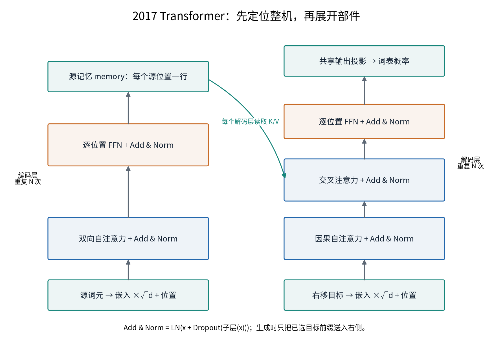

# 导览：我们要一起造一台 2017 年的翻译机

> 本章无代码、无公式压力，只需要你带着一个问题读：**这台机器为什么长成这个样子？** 后面十一章，都是这个问题的展开。本章不逐项标注数值出处，具体数字的来源均在对应章节给出（如 96×K80 详见第 1 章）。

## 0.1 读完这本书，你会拥有什么

先说清楚目的地。合上这本书的时候，你会有三样东西：

**第一，一台你自己造的翻译机。** 不是「看懂了别人的实现」，而是从第 2 章起，每一章你亲手实现一个零件——注意力运算、多头机制、三种角色的接线、位置编码、残差与归一化——第 7 章把它们组装成整机，第 9 章提供数据并开始训练，第 10 章做实验验证。

模型主体用 PyTorch 的基础算子搭建，分词、数据读取和评测则借用现成工具；各章会说明两者的分工。配套项目采用可在笔记本上运行的缩小配置，运行时间取决于设备和档位。文中的论文结果、历史Mac/CPU/MPS实验、理论核算和构造例分别标明口径；历史读数保留原运行条件，不代表当前代码与设备上的复测结果。

**第二，一条推理链。** 面对这台机器的设计选择——为什么除以 $\sqrt{d_k}$、为什么用正弦位置编码、为什么归一化放在残差外面——你能先说明它要解决的问题，再沿着公式和实验判断方案的作用与代价。这些问题往往有多种解法：有些性质可以严格推导，有些选择只有经验依据，还有些动机并未被论文披露。把三者分清，才算理解了设计，而不是把既成架构当成唯一能推出的答案。

**第三，一张后续演进地图。** 2017 年的这台机器留下了几笔没还清的债：注意力的平方复杂度、生成的串行依赖、容量的焦虑。这些限制为后续改造提供问题，但现代架构并非都来自同一个源头。第 11 章你会拿到这张地图，它同时是这套丛书后面七册的入口。

除了这些，还有一样无形的收获：**心智**。细节会忘——半年后你大概率记不清 label smoothing 的 $\varepsilon$ 是 0.1 还是 0.2，但你应当留下几个难以忘记的画面，并形成判断力，比如「注意力是一场软寻址」「数据流是一条恒定宽度的河」。本书所有章节的小结都会专门回答一个问题：**如果只允许你记住一件事，是什么？** 直觉需要由具体计算支撑，才可以在忘记参数数值后继续帮助判断。

## 0.2 为什么是 2017 年这台机器

要看懂这台机器，得先看它诞生时，这个领域遇到了哪些限制。2014 到 2016 年的机器翻译，站在两堵墙前：

**容量墙。** 当时一条重要的神经机器翻译路线是 seq2seq：一个编码器网络把整句源语言读成一个固定长度的向量，一个解码器网络再从这个向量逐词展开译文。你可以把这个向量想象成一只固定大小的箱子——句子再长，箱子能装下的东西也只有这么多。第 1 章我们会看到：固定状态可能难以保留长句所需的细节，但能保留多少取决于维度、精度、任务和训练；这堵墙立在那里，2015 年的注意力机制（Bahdanau attention）正是为了翻越它而生。

**串行墙。** 编码器是循环网络（RNN），必须一个词一个词依序处理——第 100 个词要等前 99 个词算完。这不是慢一点的问题，而是**结构性的**：增加算力不能直接消除时间步之间的数据依赖，因为计算本身是一条单行道。2016 年 Google 用 96 块 GPU 训了 8+8 层的深度 LSTM，展示了深层循环模型当时的一种大规模实现。

2017 年的《Attention Is All You Need》给出的回答，思想上只有一句话：

> **与其让结构规定信息怎么流动，不如让数据自己学出信息怎么流动。**

循环网络用「链式结构」先验地规定了：信息必须沿时间逐步传递。Transformer 把这个先验拆掉，让编码器中的位置直接读取其他源位置；解码器仍受因果可见性约束。在允许的边上，读取比例通过学习决定。这个思想你可以叫它「结构让位于数据」。这种选择也有代价：让每个人看见所有人，需要付出随句长平方增长的计算量——$O(n^2)$ 这笔账，从第 2 章第一次算起，贯穿本书，并且一路贯穿到这套丛书的后七册。

所以读这本书的正确方法，不是「记住架构图」，而是陪着 2017 年的那群工程师**重新做一遍决策**：每一步都先问「我们被什么卡住了」，再看「他们用什么换了什么」。这就是每一章的叙事骨架。

## 0.3 先看一眼整台机器

出发前先看一眼目的地。这台机器的全貌就是论文里那张著名的架构图（Vaswani et al. 2017, Fig. 1）——两座并立的塔：左塔**编码器**（encoder）把源句读成一叠表示，右塔**解码器**（decoder）逐词写出译文；塔与塔之间，编码器的输出作为「备忘」提供给解码器（这就是交叉注意力的岗位）；每座塔都由 $N=6$ 个结构相同、参数各自独立的层堆叠而成，编码器层含自注意力与前馈网络；解码器层在因果自注意力之后还增加交叉注意力，再接前馈网络；顺序信息由底部注入的**位置编码**补上。下面先用教学图定位整机，后面的章节再逐层展开。

图0.1 左边编码源句，右边在目标前缀上预测下一词。交叉注意力把两边连接起来；训练与生成共享结构，但输入目标前缀的来源不同。本图只标职责与信息流，张量形状在相应机制章节展开。依据Transformer v7 Fig.1制作。

先建立三条整体直觉，后面十一章再逐步充实：

- **一条河**：模型各子层之间的残差表示保持 $d_{model}=512$ 维；注意力头、FFN中间层和最终词表输出有各自维度——所有部件都只在这条河上做「支流注入（子层）＋水量校准（归一化）」，恒宽指子层接口，不指所有中间张量；
- **三种注意力岗位**：同一个注意力运算，在模型中承担三种职责——编码塔内互看（双向）、解码塔内只看当前及更早的输入位置（因果）、解码塔读取编码塔的备忘（交叉）。解码输入相对预测目标错开一位，因此「看当前输入」仍只是在看已经给出的词，不会提前看见要预测的答案；
- **一台翻译机的两拍**：生成时先编码整句源文，再依次生成目标词；每生成一步，都可以读取已经算好的源句表示。训练时目标句已知，错位后的目标词可以同时送入解码器，用因果遮罩约束可见范围。于是训练能并行计算各位置，生成却仍须等待前一个词，这正是第 11 章要回收的区别。

记不住细节不要紧——此刻你只需要记住「**两座塔、一条恒宽的河、三种注意力岗位**」。接下来五章造零件时，每一章开头都会把你领回这张粗图前，指给你看：我们正在构建的部件位于整机的哪里。

## 0.4 旅程地图：五段旅程，每段一站

整本书是一条造机器的旅程，分为五段。迷路的时候，回到这张地图：

| 段 | 章 | 我们在做什么 | 一句话 |
|---|---|---|---|
| 出发 | 导览 + 第 1 章 | 看清两堵墙，认识 2014 年的旧机器与它的注意力补丁 | 为什么需要新机器 |
| 零件铺 | 第 2-6 章 | 造零件：注意力运算 → 多头 → 三种角色 → 位置信息 → 残差与归一化 | 机器的每个零件怎么造、为什么这样造 |
| 组装 | 第 7-8 章 | 把零件装成整机；备好 2017 年原版的训练配方 | 整机长什么样、用什么点火 |
| 点火 | 第 9-10 章 | 数据管道、训练循环、解码评测；消融实验验证每个设计的贡献 | 让它跑起来，用数字检验 |
| 收官 | 第 11 章 | 盘点遗产与欠账，拿到通往后续七册的地图 | 它改变了什么、留下了什么 |

各章开篇都会交代：上一章走到哪里、留下什么问题，以及本章要把哪些部件或解释补齐。它们承担地图上定位点的作用；如果你在细节里迷路了，可以先回到开篇，再沿本章的问题往下读。

## 0.5 三条贯穿线索

旅程里有三条线一直陪着你。每章既推进当前问题，也沿着这三条线接回前文：

**一条代码线。** 第 2-6 章每章交付一块拼图（新零件，或零件在整机上的接线与验证——第 4 章是接线站；都在 `code/` 目录里，随写随跑），第 7 章组装，第 9 章点火。读完全书，你拥有的不是散落的脚本，而是**一台每个螺丝都亲手拧过的机器**。零件逐步组成整机的过程，也体现了架构逐步形成的过程。

**两堵墙。** 容量墙与串行墙在第 1 章立起来；第 2-6 章的注意力在拆容量墙（让每个词按需取信息）；第 11 章清点时你会发现：训练中已知序列的位置计算可以并行；自回归生成仍需先确定前面的词。**拆不干净的墙，就是欠账**；欠账的去向写在每章末尾的后续改造说明里，最终汇总成第 11 章的地图。

**一本账。** 工程师看任何机器都会下意识算三笔账：参数量、显存、重算。本书从第 2 章第一次手算注意力矩阵占多少字节起，反复练这个习惯。它看起来琐碎，却是后文所有工程讨论（「为什么推理贵」「为什么要压缩 KV」）的基础——账本意识在这套丛书的后七册都能派上用场。

## 0.6 这本书的纪律与约定

阅读之前，先说明四条约定：

**零魔改，时间冻结在 2017。** 本书实现的蓝本是原论文《Attention Is All You Need》的架构，后来的改进（RMSNorm、旋转位置编码、分组查询……）不装进这台机器。章末**后续改造说明**和第 11 章会交代这些问题的去向；实现对照处则只说明现代工具与原版的必要差别，第 6 章也会专门澄清归一化位置。这样做的代价是你看不到「最新版」，收益是你能看清**原论文明确给出的动机，以及本书能够证明的性质；没有材料时不代作者推断心理**——不被后见之明污染。

**四个框，各司其职。** 你会反复遇到四种插入框：**借用框**（sentencepiece 等工具当黑盒用，算法后册拆）、**实现对照框**（PyTorch 官方实现对照，非原论文内容）、**考据框**（论文版本变迁、引文考证——服务好奇心，跳过不影响主线）、**后续改造说明**（通往后续册的钩子）。框内是支线，主线永远在正文。

**每个数字都有出处等级。** 凡引用数字，随行标注证据等级——原论文、源码、构造例和硬件实验各自支持不同类型的结论，不能只按来源名气排成单一强弱序列。历史Mac/CPU/MPS训练读数保留原设备与数据口径；数学构造、理论核算和CPU局部验证分别说明。已有代码修正尚未经过整套训练复跑，缺失日志与这些修正对历史结果解释的影响在实验章标注。章末提供可继续核验的代码入口。我们已经遇到的问题：连原论文自己都在七个版本间改过数字——**引用必须锚定版本**，你会在书中看到这条要求的具体示范。

**教师视角，不解读论文。** 这本书不是论文领读。组织顺序服从「造机器的逻辑」——下一步需要什么就教什么——而不是论文的章节顺序。论文是我们的证据来源与重构对象，不是导游。

## 0.7 第一站，与整条线

这本书是一套八册旅程的第一站。终点站是 vLLM——把大模型服务化的推理引擎；而要理解推理引擎为什么长成那样，你必须先彻底理解它服务的对象：模型架构本身。本册交付的后续问题地图，就是从「架构」通往「系统」的桥。

现在，让我们回到 2014 年——先认识那台被两堵墙困住的旧机器。它的名字叫 seq2seq，它通过固定状态连接编码与解码。

---

*下一章：第 1 章 前史动机——我们会完整拆开 seq2seq 这台旧机器，看信息怎么在它体内流动，再检查固定状态与串行计算在什么条件下成为限制。*
