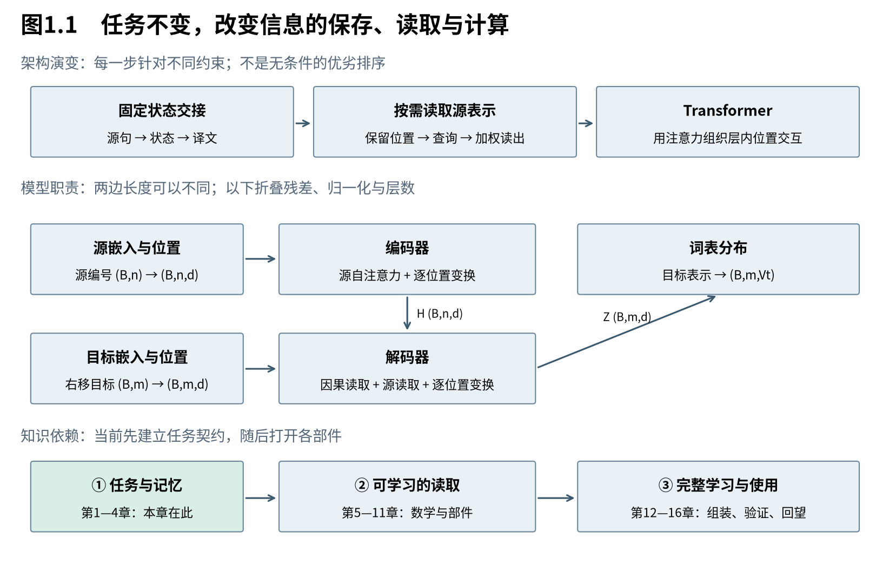

# 第1章　先定义一台翻译机

本书要从模型设计者的角度，重新走到2017年的Transformer：每次先看现有方案遇到了什么困难，再寻找需要的性质，推导支持这种性质的数学，最后把它变成模型的一个具体部件。读到卷末，你应该能够画出整机，沿一次训练和一次生成追踪信息，并解释为何这些计算必须这样配合。本章先确定整台机器的任务和接口；内部采用循环、注意力还是其他计算，随后再逐步决定。

## 1.1 先把目标说清：输入一串符号，输出另一串符号

**翻译模型需要根据完整源句和已经生成的目标前缀，决定下一个目标符号，并学习何时结束。** 源句和译文可以有不同长度，词序也未必逐位置对应。因此，不能只给每个源词贴一个译词标签；我们要建立的是一个以源句为条件、能够生成变长序列的模型。这个目标先决定了输入输出契约，尚未限定内部架构。

贯穿全书的源句是“我 爱 猫”，译文是“i love cats”。为突出机制，先人为按词分成三个符号。真实模型的分词可能把一个词拆成多个单位；相关算法留到Book2，本册不把这个教学切分当成通用分词器。

把源序列记为 $x=(x_1,\ldots,x_n)$，其中 $n$ 是源长。译文尾部再增加结束符号 $\mathrm{EOS}$，于是本例目标是：

$$
 x=(\text{我},\text{爱},\text{猫}),\qquad
 y=(\text{i},\text{love},\text{cats},\mathrm{EOS}).
 \tag{1.1}
$$

目标预测长度 $m=4$，包括EOS；源长 $n=3$。EOS不是一个译词，却是模型必须完成的决定：译文已经说完了。相对地，$\mathrm{BOS}$ 是人为提供的开始标记，用来启动第一次预测；本例不要求模型预测BOS。

还需要一个明确的数值接口。词表是符号到整数编号的映射。假设目标词表有 $V_t$ 个符号，那么每一步输出不是“一个编号大小的实数”，而是 $V_t$ 个候选的概率。编号只是查表地址：编号8与编号4的距离，并不意味着两个词的语义距离是4。

|对象|本例|一般形状或范围|
|---|---|---|
|源符号编号|我、爱、猫对应的三个整数|单样本 $(n,)$；批量 $(B,n)$|
|目标参考编号|i、love、cats、EOS|单样本 $(m,)$；批量 $(B,m)$|
|一步候选概率|对整个目标词表的分布|单样本 $(V_t,)$；批量 $(B,V_t)$|
|全部参考位置的概率|四次预测各自一份分布|$(B,m,V_t)$|

这里的 $B$ 是批量中样本数。不同样本长度不同，后续会用填充和遮罩把它们放入同一批；本章先只看一个完整句对。

这一接口已经排除了两种混淆。首先，模型预测的不是源位置对应的“翻译标签”，而是目标生成位置的下一个符号。其次，输出概率与最终选哪个符号是两件事：前者属于模型，后者还涉及搜索或采样。本册先建立模型，生成策略到第14章再展开。

## 1.2 一句译文的概率，怎样变成一连串局部决定

**概率链式法则把整句概率拆成逐位置的条件概率，因而把变长翻译转成重复使用的下一符号预测。** 每个局部预测必须看到完整源句和目标的已知前缀，却不能看到自己正在预测的答案。这种分解不要求各位置独立，也不要求使用循环网络；它规定的是条件信息，网络负责实现这些条件与输出之间的关系。

先从两个随机变量开始。条件概率的定义给出：

$$
 p(y_1,y_2\mid x)=p(y_1\mid x)\,p(y_2\mid x,y_1).
 \tag{1.2}
$$

这里默认正在讨论的条件事件有定义。第二项保留了对第一个目标符号的依赖，因此没有作“两个词相互独立”的假设。再把第三个符号接上：

$$
 p(y_1,y_2,y_3\mid x)
 =p(y_1,y_2\mid x)\,p(y_3\mid x,y_1,y_2)
 =\prod_{t=1}^{3}p(y_t\mid x,y_{<t}).
 \tag{1.3}
$$

$y_{<t}$ 表示 $(y_1,\ldots,y_{t-1})$；当 $t=1$ 时，它是空前缀。沿相同方式展开到第 $m$ 个位置，并用参数 $\theta$ 表示神经网络所定义的分布，得到：

$$
 p_\theta(y\mid x)=\prod_{t=1}^{m}p_\theta(y_t\mid x,y_{<t}).
 \tag{1.4}
$$

式(1.4)中的最后一项包括EOS的概率。BOS是固定启动约定，不是在这条概率链里额外预测出的随机事件。[S，§2，式1]

用一组人为设置的概率检验含义。假设在本例各个正确前缀下，模型给正确下一符号的概率依次为 $0.6,0.7,0.8,0.9$。完整目标序列概率就是：

$$
 0.6\times0.7\times0.8\times0.9=0.3024.
 \tag{1.5}
$$

这四个数不是同一份分布里的四项，而是四个不同条件分布里各自选中的一项。例如0.7对应“在已经看到i的条件下，接着说love的概率”；如果第一步生成了you，第二步必须重新读取条件为you的分布，不能继续沿用0.7。

概率连乘在长序列上容易变得很小。取对数，把乘积改为求和，并取负号，就得到后续训练要最小化的单样本负对数似然：

$$
 -\log p_\theta(y\mid x)
 =-\sum_{t=1}^{m}\log p_\theta(y_t\mid x,y_{<t}).
 \tag{1.6}
$$

这里没有新近似：用的只是对数把乘法变加法的恒等式。因为对数严格递增，增大整句概率等价于增大对数概率，也等价于减小负对数概率。上例用自然对数得到约1.1960；按四个目标位置平均则约0.2990。累计损失和平均损失是不同归一化口径，比较日志之前必须先问清楚。

还有一个边界：定义EOS并不从数学上保证任意参数的模型一定结束。如果它始终不给EOS足够概率，就可能不断生成。把每个有限序列的路径概率写出来，与这些路径的总质量恰好为1之间，还差一个几乎必然终止的条件。实际生成通常另设最大长度。这一点提醒我们：概率形式与运行控制也需要区分。

回到设计问题，式(1.4)给出了各代模型共享的任务。我们接下来要问的，不再是“每步应该预测什么”，而是“怎样把源句和前缀变成足以预测的内部表示”。

## 1.3 编码器与解码器，分别封装哪一项工作

**编码器把源句变成可供使用的表示，解码器结合这份表示与目标前缀，产生下一符号分布。** 这是一种职责划分，既容许源句压缩成固定状态，也容许保留逐位置表示。后面的架构演变，会反复改造两者之间的信息接口，而不是每次重新定义翻译任务。

先看最外层的数值路径。源词表大小记为 $V_s$，源嵌入矩阵 $E_s\in\mathbb R^{V_s\times d}$；目标嵌入矩阵 $E_t\in\mathbb R^{V_t\times d}$。每一行是一个可学习向量，$d$ 是表示宽度。查表将编号变成向量：

$$
 (B,n)\xrightarrow{\ E_s\ \text{查表}\ }(B,n,d),\qquad
 (B,m)\xrightarrow{\ E_t\ \text{查表}\ }(B,m,d).
 \tag{1.7}
$$

查表也可写成独热矩阵乘嵌入矩阵，但实际无需构造巨大的独热张量。向量不是预先写好的词义说明书；其数值在训练中随任务改变。

编码器消费源嵌入，产生源表示。早期循环编码器可以把句子交接为一份固定状态；采用注意力时可以让解码器访问整个源表示序列。在Transformer里，最终源表示记为 $H\in\mathbb R^{B\times n\times d}$：源长仍保留在第二维，每个位置的表示已经可融合其他源位置的信息。

解码器对目标每个预测位置产生宽度为 $d$ 的内部向量。把这些向量按行放在 $Z\in\mathbb R^{B\times m\times d}$ 中，再通过词表投影 $W_U\in\mathbb R^{d\times V_t}$，得到未归一化分数：

$$
 A=ZW_U\in\mathbb R^{B\times m\times V_t},\qquad
 P_{b,t,j}=\frac{\exp(A_{b,t,j})}{\sum_{k=1}^{V_t}\exp(A_{b,t,k})}.
 \tag{1.8}
$$

$b$ 是样本索引，$t$ 是目标位置，$j,k$ 是词表索引。$A$ 通常叫logits。每个固定的 $(b,t)$ 上，softmax把该行分数变成一份总和为1的候选分布；它不在时间维上归一化。softmax如何比较候选、如何求导，第5—6章会完整展开。本节先用它建立接口，不把函数名当作已经解释了全部机制。

沿本例走一遍：编码器读取“我 爱 猫”；解码器第一次读取BOS和源表示，输出一份词表分布；选到i后，下一次条件就含有i。编码器不需要把每个源词直接变成对应译词；解码器也不必在读到第三个源词时立刻输出第三个目标词。两边的长度与位置关系由模型学习，而不是由接口强制一一对应。

因此，读一张模型架构图时，第一件事是找“源信息以什么形式保存，目标侧通过什么路径读取它”。下一章研究最早的固定状态实现，再由它的约束引出更灵活的读取接口。

## 1.4 同一台模型，训练和生成为何长得不同

**训练时参考答案已知，可以把所有正确前缀准备好；生成时下一符号尚未确定，必须把自己的选择接回输入。** 这解释了为什么同一个条件概率模型有两种使用方式。但“训练数据已知”并不自动意味着内部计算并行：循环网络仍有状态依赖，Transformer需要靠遮罩和不同的计算结构，才能同时计算多个目标位置。

训练本例时，把目标错开一位：

|预测位置|1|2|3|4|
|---|---|---|---|---|
|送入的符号|BOS|i|love|cats|
|该位置应预测|i|love|cats|EOS|
|允许使用的目标输入|BOS|BOS、i|BOS、i、love|BOS、i、love、cats|

这种使用参考前缀训练的方式称为教师强制（teacher forcing）。它让训练直接计算式(1.6)需要的条件概率，而不必先等模型自行生成一条轨迹。但把答案右移还不够：若第一位置可以读取输入数组中的第二位置，它就能看见自己的答案i。因此，右移与禁止读取未来位置必须同时成立。

生成时则没有这张完整参考表：

1. 输入BOS，得到下一符号分布，选择i。
2. 输入前缀BOS、i，得到新分布，选择love。
3. 输入前缀BOS、i、love，选择cats。
4. 输入前缀BOS、i、love、cats，选择EOS，停止。

这些选择只是假定的一条路径，并非本章训练所得结果。若第二步选错，第三步条件就变了。模型在训练时主要看到参考前缀，在生成时看到自己的前缀，这种条件分布的差异值得后续检验；不能把教师强制的低损失直接等同于整句生成质量。

这里有三个不同的依赖，后面要分别处理。第一，源句在翻译开始前已经给定；第二，目标前缀在实际生成时逐步确定；第三，网络内部可能规定先算某个状态才能算下一个状态。注意力能改变第三种依赖，却不会让普通自回归生成里的未来符号凭空变成已知。

## 1.5 先看Transformer的整体，再进入它的前史

**Transformer保留编码器—解码器的任务划分，用注意力处理位置之间的信息交换，用逐位置网络加工读出的内容，再用位置表示、残差和归一化把这些部件连接起来。** 它改变了内部的信息路径和计算组织，并没有取消下一符号预测的条件概率链。我们先认出这些职责，再回到循环模型，理解为什么需要改造它们。[T，§3，Fig.1]



图1.1分三行读。上行是同一任务的三种信息组织方式；箭头表示本书展开顺序，不代表后者在所有任务上无条件更好。中行是Transformer的职责地图：源表示供目标侧读取，目标侧还要读取合法前缀，最后输出词表分布。下行是知识依赖：先搞清任务与记忆，再建立读取数学，最后组装训练与生成。图按原论文结构制作，省略层内分支；它不是详细计算图，完整残差支路会在第11—12章展开。

在原版编码器的一层中，源序列先通过自注意力，位置之间交换信息；再通过前馈网络，各位置加工自己的向量。每个子层都用残差相加，然后做LayerNorm。解码器的一层多一项工作：除了因果自注意力读取目标前缀，还通过交叉注意力读取编码器输出，之后才进入前馈网络。

这些名字分别回答不同问题。注意力回答“从哪里读”；前馈网络回答“如何变换读到的表示”；位置表示回答“这些内容按什么顺序出现”；残差和归一化帮助这些变换组成深网络；输出投影把内部表示变成候选符号的分数。将它们都叫作“提升表达能力”，会丢掉真正有用的职责区别。

本册按这条依赖展开：第2—3章解释循环记忆与按需读取，第4章回到完整Transformer；第5—9章建立注意力、尺度、多头、遮罩和位置的数学；第10—12章组装通道变换、深层路径与学习目标；第13—15章讨论训练、生成和可复现验证；最后一章重新比较设计收益与代价。

读者不必第一遍记住所有公式。数学节首段先给结论和模型意义，后面的推导回答“为什么成立”。但两种读法共享同一套论证：没有详细推导只能去外部资料补齐的隐藏台阶，也没有只读全景就要接受的无根据结论。

## 1.6 用一段短代码检查任务接口

下面只验证移位和概率链，不调用训练库，也不证明任何翻译质量。字符字符串在这里代表已经分好的token；数字来自本章构造例。

```python
from math import log, prod

source = ["我", "爱", "猫"]
target = ["i", "love", "cats", "<eos>"]
# 输入错开一位；预测标签保留EOS，输入端不再附加它。
decoder_input = ["<bos>"] + target[:-1]
correct_probs = [0.6, 0.7, 0.8, 0.9]
for t, expected in enumerate(target):
    # 前缀截至本输入位置，不能读取右侧参考符号。
    visible = decoder_input[:t + 1]
    print(t + 1, visible, "->", expected)
print("sequence_probability", prod(correct_probs))
print("summed_nll", -sum(log(p) for p in correct_probs))
```

它应依次显示BOS、BOS/i、BOS/i/love、BOS/i/love/cats四个前缀，整句概率0.3024，累计负对数似然约1.1960。这里计算的是沿正确前缀路径的概率；不能把四个位置各自最可能的符号任意拼起来，再假定概率仍来自相同条件。

带着这个接口进入下一章：源句已经可用，目标需要逐步生成。如果先让一个状态向量随着源词更新，最后把它交给解码器，这台机器怎样工作？它在表示、学习和计算组织上各有什么约束？我们将把这些问题拆开，而不预先宣布循环网络必然失败。

本章来源：[S：Sequence to Sequence Learning，v3，§2](https://arxiv.org/abs/1409.3215v3)；[T：Attention Is All You Need，v7，§3](https://arxiv.org/abs/1706.03762v7)。概率展开、终止边界及小数值例是本书推导与构造，不是论文实验结果。
