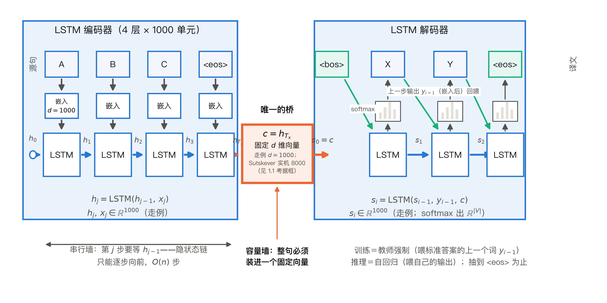
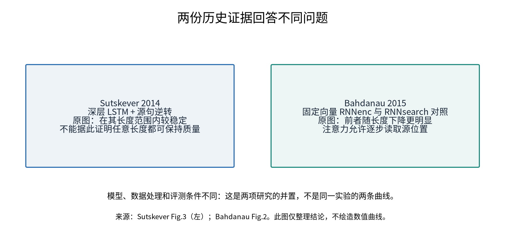
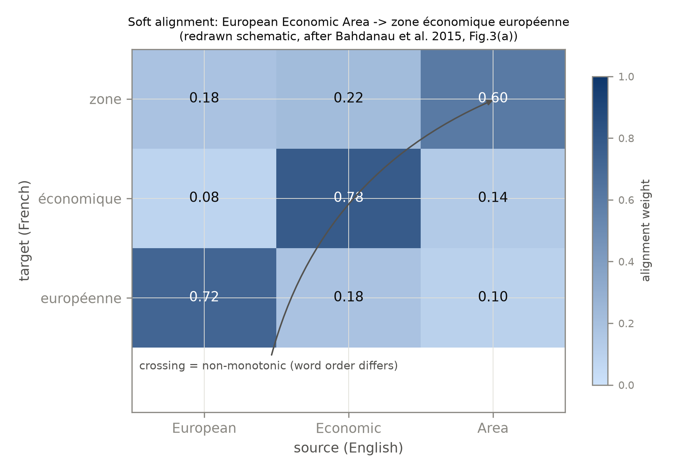
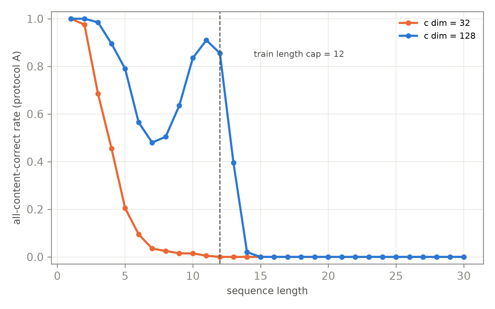

# 第 1 章 前史动机：seq2seq 瓶颈与 Bahdanau 注意力

## 1.0 开篇：从全书到这里

导览结尾我们把时间拨回 2014 年，说那里站着一台叫 seq2seq 的旧机器——它通过固定状态连接编码与解码，面前立着两堵墙：容量墙与串行墙。先在整机前定位：导览 0.3 节立过「一台翻译机的两拍」——先整句读完（编码），再逐词写出（解码）；本章拆的是这副双塔骨架在 2014 年的一种重要实现。2017 年的新机器保留双塔与逐词生成，却改用一整列源表示连接两塔，并让编码器同层各位置并行计算；这些改动要先从旧机器逐步更新的隐状态链说起。但导览只报了墙的名字；要理解一堵墙为什么是**结构性**的、增加算力不能直接消除计算依赖，得先画出被墙挡住的那台机器。本章就做这件事，不假设你读过任何 seq2seq 材料——1.1 节结束时，你应当能**凭记忆画出完整架构图**。

本章回答三个问题。其一，这台 2014 年的机器完整长什么样？1.1 节从任务形式化出发，把编码器、那个固定长度的向量、解码器、两种运转模式逐个搭起来。其二，两个缺陷分别出现在架构的哪个部位？——容量墙长在两塔之间的独木桥上（1.2 节，正反证据并置），串行墙长在塔内的隐状态链上（1.4 节）。其三，2014—2017 年的研究在缓解这些限制上走到了哪一步？——Bahdanau 注意力拆掉半堵（1.3 节），GNMT 与 ConvS2S 从两个方向突围（1.5 节），1.6 节再用几分钟可复现的微实验展示容量墙。

本章结束时你手里会有：一张能默画的架构图、两堵墙的原文证据、一条自己跑出来的「墙位曲线」——以及一份对新机器的需求清单：既无循环、又让允许互见的位置在一层内直接交互。带着它，第 2 章起我们开始造零件。

> **最小背景栏**（读懂本章所需的全部前置）
> - **词嵌入（word embedding）**：神经网络不能直接处理文字符号，需要先把它们表示成数字。做法是给词表里的每个词分配一个固定维度的 $d$ 维实数向量，全体向量构成一张可学习的查找表，用到哪个词就查哪一行。这意味着：每个词领到一张长度固定的「数字身份证」，向量中的数值由训练学出来，训练可以使向量反映任务相关的语义关系，但相近并非查表机制本身的保证。本章 $d=1000$【来源：Sutskever et al. 2014 §3.4】。
> - **循环单元（RNN→LSTM/GRU 的直觉版）**：一个内部带记忆的小盒子，每接收一个输入向量，就把自己的记忆更新一次。最朴素的 RNN 每步都把旧状态与新输入一起做变换，较早的信息及其训练梯度要连续经过许多次变换，可能逐渐衰减或放大。LSTM为记忆增加可调的通路：遗忘门决定旧记忆保留多少，输入门决定候选内容写入多少，输出门决定当前读出多少。GRU也用门控制保留与改写，但不另设LSTM式的记忆单元；二者的状态与门不能逐一等同。门的精确更新与梯度路径在1.1节补齐，第9章再读完整实现。
> - **BLEU**：机器翻译自动评分，对机器译文与参考译文的重叠 n-gram 精确率取几何平均，再乘一个惩罚过短译文的因子（Papineni et al., 2002）。取值 0—100，越高越好。它是本章与前史诸论文通用的「质量」刻度；正式公式、实现与口径陷阱留到第 9、10 章。

## 1.1 机器翻译与 seq2seq：把一台完整的机器搭起来

开篇立了次序：先画机器，再找墙。翻译这件事，到底要机器算什么？

**翻译是「变长序列到变长序列」。** 源句是英语词序列 $x_1,\dots,x_{T_x}$，译文是法语词序列 $y_1,\dots,y_{T_y}$：句与句、源文与译文的长度都不同。普通前馈网络要求固定形状的输入输出；循环网络已经可以处理变长输入，而将变长输入接到变长输出仍需要明确的网络组织（Sutskever et al., arXiv:1409.3215, §1）。seq2seq（sequence to sequence，序列到序列）的解决办法，是把它改写成条件概率的学习——模型学分布 $p_\theta(y\mid x)$，按链式法则展开（下式的目标序列包含句末EOS）：

$$p_\theta(y_1,\dots,y_{T_y}\mid x_1,\dots,x_{T_x})=\prod_{t=1}^{T_y}p_\theta\!\left(y_t\mid y_1,\dots,y_{t-1},\,x_1,\dots,x_{T_x}\right)$$

这意味着：整句译文的概率被分解为逐词的条件预测——每一步都以整句原文与已生成的译文为条件，模型为词表中的每个词给出一个概率，选出一个词后，将它加入下一步的条件；选择可以采用采样、贪心或束搜索，抽到终止符为止，译长不必事先约定。训练目标就是最大化正确译文的 $\log p_\theta(y\mid x)$（Cho et al., arXiv:1406.1078, §2.2）。概率分解本身尚未规定网络结构。

答案分两半——**编码器**把变长源句读成固定长度向量，**解码器**从它出发逐词展开：两塔结构。

### 1.1.1 从概率目标到一条可训练的序列

**模型要学的是：给定源句和正确目标前缀，提高下一个正确词的概率。**概率链把一个变长序列任务拆成共享参数的局部预测，负对数把连乘变成可累加的训练损失。这一步规定学习任务；循环网络和Transformer是计算这些条件概率的不同实现。

把源句暂记为 $x$，目标为 $(y_1,\ldots,y_T)$，其中 $y_T=\mathrm{EOS}$，$y_0=\mathrm{BOS}$ 只作输入标记。对一对训练样本，最大化整句概率等价于最小化

$$\mathcal L(\theta;x,y)=-\log\prod_{i=1}^{T}p_\theta(y_i\mid y_{<i},x)
=-\sum_{i=1}^{T}\log p_\theta(y_i\mid y_{<i},x).\tag{1.4}$$

等号只用到对数把乘积变成和，没有独立性假设；每一项仍依赖前缀。若正确的三步概率为 $(0.5,0.8,0.25)$，整句概率为0.1，总损失为 $-\log0.1\approx2.303$，与三项负对数之和一致。不能将三个位置的概率简单平均后再取对数，那会变成另一个目标。

教师强制把 $[\mathrm{BOS},y_1,y_2]$ 送入解码器，对齐标签 $[y_1,y_2,\mathrm{EOS}]$。标签不是同位置输入；如果直接把 $y_i$ 给预测 $y_i$ 的位置，模型就有机会复制答案。训练中输入已知使整个目标序列可以预先准备，但是否能同时计算各位置，还取决于网络的内部依赖。这里是循环解码器，因此状态仍逐步形成。

生成时没有标准答案可回喂，模型使用自己选出的前缀，并将EOS作为停止信号。EOS只是词表中的一个可预测符号；任意权重的模型不保证最终选中它，实际生成还需最大长度等停止规则。训练前缀与生成前缀的分布可能不同，这比“出一个错后必然步步错”更准确。

### 1.1.2 状态怎样更新，门又改变哪条路径

**循环单元把历史浓缩为可更新状态；门控的作用是让保留和改写可以分开调节，而不是承诺无限记忆。**先看最小RNN，才能理解LSTM/GRU在已有结构上增添了什么。以下列向量用于单个样本，批量实现外加轴 $B$。

设词嵌入 $e_j\in\mathbb R^{d_e}$、隐状态 $h_j\in\mathbb R^{d_h}$，普通RNN写为

$$h_j=\tanh(W_xe_j+W_hh_{j-1}+b),\qquad
\frac{\partial h_j}{\partial h_{j-1}}=\operatorname{diag}(1-h_j^2)W_h.\tag{1.5}$$

$W_x$ 形状为 $(d_h,d_e)$，$W_h$ 为 $(d_h,d_h)$。从位置 $a$ 传到 $b$ 的导数按链式法则是 $J_bJ_{b-1}\cdots J_{a+1}$。即使单步矩阵的典型尺度仅略小于1，连乘也可能很小；典型尺度大于1又可能放大。这给出长程训练困难的机制，但矩阵方向、门值和数据都会影响实际结果，不能只用一个标量谱半径解释所有训练。

常见的带遗忘门LSTM额外维护记忆 $m_j\in\mathbb R^{d_h}$，用门把更新分成两条支路：

$$\begin{aligned}
f_j&=\sigma(W_f[e_j;h_{j-1}]+b_f),&i_j&=\sigma(W_i[e_j;h_{j-1}]+b_i),\\
o_j&=\sigma(W_o[e_j;h_{j-1}]+b_o),&\tilde m_j&=\tanh(W_m[e_j;h_{j-1}]+b_m),\\
m_j&=f_j\odot m_{j-1}+i_j\odot\tilde m_j,&h_j&=o_j\odot\tanh(m_j).
\end{aligned}\tag{1.6}$$

拼接后的输入为 $d_e+d_h$ 维，四个 $W$ 的形状均为 $(d_h,d_e+d_h)$，偏置为 $(d_h,)$；三个门与候选记忆因此均为 $d_h$ 维。批量实现把状态排成 $(B,d_h)$，逐元素乘法保持这一形状，$\sigma$ 把每个门压在0和1之间。这是带遗忘门、无窥孔连接的常见形式，并非声称逐式复刻1997年最初版本。沿记忆的直接边、暂固定门值时，导数为 $\operatorname{diag}(f_j)$；因此网络可以学会让某些分量较长时间保留。完整导数还包含门随 $h_{j-1}$ 变化的其他路径，不能省掉这些项后声称梯度必为1。若某分量始终取 $f=0.99$，100步后直接保留系数约0.366；$f=0.5$ 则约 $7.9\times10^{-31}$，门如何被学到非常关键。

GRU合并了显式记忆与隐状态。沿Cho等原文“$z$保留旧状态”的约定，可写

$$r_j=\sigma(W_re_j+U_rh_{j-1}),\quad z_j=\sigma(W_ze_j+U_zh_{j-1}),\quad
\tilde h_j=\tanh(W e_j+U(r_j\odot h_{j-1})),\quad
h_j=z_j\odot h_{j-1}+(1-z_j)\odot\tilde h_j.\tag{1.7}$$

这里省略各项偏置；各个 $W$ 的形状为 $(d_h,d_e)$，各个 $U$ 为 $(d_h,d_h)$，所以候选、门与状态均为 $d_h$ 维。重置门决定生成候选时读取多少旧状态，更新门决定候选替换多少旧状态。有些实现交换 $z$ 与 $1-z$ 的命名；PyTorch还把候选支路中的重置乘法放在隐状态仿射变换之后，因此搬运权重时不能只核对门名。后面的教学实验用 `nn.GRU`，不是把式(1.7)的权重直接搬入该实现。

**编码器：逐词读入，形成一份不断更新的快照。** 它是一部循环网络，全部工作只有一句：

$$h_j = \mathrm{RNN}(h_{j-1},\,x_j)$$

这意味着：机器里备着一份「快照」$h$（隐状态，hidden state）；每读一个新词，就把旧快照与新词嵌入送进循环单元——前面已经展开的循环状态更新——形成新快照：$(1000,)+(1000,)$ 进、$(1000,)$ 出，作为当前已读前缀的压缩表示，不保证无损保留全部细节。

拿 3 词句 A B C 走一遍（嵌入与快照均 1000 维）：查表得 A 的向量，连同初始快照 $h_0$（置零）送入单元，得 $h_1$；读 B 得 $h_2$；读 C 得 $h_3$；再读句末标记 `<eos>` 得 $h_4$。四步，一条从左到右的依赖链 $h_0\to h_1\to h_2\to h_3\to h_4$——这条**隐状态链**就是编码塔的骨架，图 1.1 左塔画的正是它。读完全句，最后一份快照充当整句摘要：$c=h_{T_x}$（$T_x$ 记含 `<eos>` 的读入步数——本例 $T_x=4$，过桥的就是 $h_4$；Cho et al. 称之为「对整个输入序列的摘要 $c$」，§2.1）。

**c 是两塔之间唯一的桥。** 请在这里停下来，记住这一点：**从解码器的视角看，源句的一切——词义、词序、句长、语气——只能经过 $c$ 这一个固定长度的向量过桥；除它之外，解码器与源句之间再无任何信息通道。** Sutskever et al. 说得更直白：「用 8000 个实数表示一个句子」（§3.4）【来源：官方论文】。桥的宽度在构建模型时就已固定：源句 3 个词，过桥的是它；40 个词，过桥的还是它。1.2 节的容量墙就从这里长出来——先把桥画进图里。

> **【考据框】** 8000 怎么数出来的？Sutskever 的编码器是 4 层 LSTM、每层 1000 单元；只算隐状态，末步是 $4\times1000=4000$ 个数；论文口径的 8000 把每层的**记忆单元**也计入——每层内部本有两份千维向量：对外吐出的**隐状态**，与前文式(1.6)中的**记忆向量**，本章黑盒口径统称「快照」，于是 $8000=4\text{ 层}\times(1000+1000)$。本书统一按论文口径引用 8000。（跳过不影响主线。）

**解码器：逐步生成，上一步的输出回喂。** 桥那头的解码器也是循环网络，但它的循环里多两样东西：桥上传来的 $c$，和**它自己上一步输出的词**（Cho et al., §2.2）：

$$s_i = f(s_{i-1},\,y_{i-1},\,c)$$

这意味着：解码器也有自己的快照 $s$；每写一个词之前，手里三样东西——上一刻的自己（$s_{i-1}$）、上一个输出的词（$y_{i-1}$）、桥上传来的整句摘要（$c$）——合成新快照 $s_i\in\mathbb{R}^{1000}$，再对它做一次线性变换加 softmax，得到词表上一份 $\mathbb{R}^{|V|}$ 的分布（Sutskever 目标端 $|V|=80{,}000$）——链式分解里那一次「抽签」。抽出的词接着回喂进下一步：**自回归**（autoregressive）。



图 1.1　seq2seq 完整架构：编码塔逐词读入（嵌入 → 循环单元 → 隐状态链），整句压进固定向量 $c$——**两塔之间唯一的桥**（橙色）；解码塔以 $c$ 为初始状态、回喂上一步输出逐词生成，直到 `<eos>`；底部标注两堵墙的位置与两种运转模式；塔底公式旁与 $c$ 框内标注走例形状（$h_j\in\mathbb{R}^{1000}$、嵌入 $d{=}1000$，$c$ 框内 1000/8000 两口径），全流程形状流转见表 1.1（自绘；机制要素对应 Sutskever et al. 2014 v3 Fig.1 与 Cho et al. 2014 v3 Fig.1，训练/推理模式标注为本书补充）

对着图 1.1 右塔走一遍：$c$ 成为解码器初始状态 $s_0$；第 1 步没有上一个词可回喂，就喂一个与 `<eos>` 对称的固定起始符 `<bos>`——抽中 X，X 的嵌入沿青色回路回喂；第 2 步抽中 Y，Y 回喂；第 3 步抽中终止符 `<eos>`，生成到此为止——译文多长，机器自己说了算。

把这个例子的形状流转整理成一张表——全章的「现场图」，两堵墙各卡哪一行一看便知：

| 步骤 | 运算 | 输入形状 | 输出形状 | 说明 |
|---|---|---|---|---|
| 编码第 $j$ 步 | 查嵌入表 | 词 id（标量） | $(1000,)$ | 每词一张「数字身份证」 |
| 编码第 $j$ 步 | $h_j=\mathrm{RNN}(h_{j-1},x_j)$ | $(1000,)+(1000,)$ | $(1000,)$ | 旧快照与新词嵌入形成新快照 |
| 编码全句 | 沿 $j=1,\dots,T_x$ 重复 | — | $h_1,\dots,h_{T_x}$ 各 $(1000,)$ | 串行：$h_j$ 必须等 $h_{j-1}$（串行墙，1.4 节） |
| 过桥 | $c=h_{T_x}$ | $(1000,)$ | $(1000,)$ | 两塔唯一通道，宽度在构建模型时固定（容量墙，1.2 节；Sutskever 实机 8000 个实数，见考据框） |
| 解码第 $i$ 步 | $s_i=f(s_{i-1},y_{i-1})$，首步 $s_0=c$ | $(1000,)+(1000,)$ | $(1000,)$ | 上一刻自己＋上一步词的嵌入；Cho 接法 $c$ 每步到场，输入多一份 $(1000,)$ |
| 解码第 $i$ 步 | 线性＋softmax | $(1000,)$ | $(\lvert V\rvert,)$ | 词表上的分布，抽中回喂（自回归） |

表 1.1　seq2seq 走例的形状流转（自排；3 词句＋`<eos>`，$d=1000$；单句走例省去批维，真实训练把 $B$ 句拼成一批，所有形状前面多一维 $B$）

1.6 节的微实验把这张表原样缩小——1000 维缩到 32/128、词表缩到 13 个符号——桥还是第 4 行那座桥。

**桥的两种接法。** $c$ 进解码器，这两篇奠基性论文采用了不同接法：Sutskever 把它整个当作初始状态（$s_0=c$，此后每步只靠 $s_{i-1}$ 与回喂的 $y_{i-1}$ 推进）；Cho 的更新式则让 $c$ 参与每一步。本书记 Cho 的公式、图 1.1 按 Sutskever 画——两种接法只是「过桥的时间」不同，桥的唯一性等价。1.2 节的反方证据与 1.6 节的微实验（[code/ch01/bottleneck_demo.py](code/ch01/bottleneck_demo.py) 的 `EncDec.forward()` 与 `EncDec.greedy()`）都按 $s_0=c$ 走。

**两种运转模式：训练与推理。** 两种输入方式，必须分清。**训练用教师强制（teacher forcing）**：回喂的不是模型自己的猜测，而是标准答案里的上一个词 $y_{i-1}$——好处有二：每步输入已知，损失可针对每个正确前缀计算；但循环隐状态仍顺序更新，生成时前缀分布也可能与训练不同。**推理用自回归循环**：真翻译时没有标准答案可喂，只能回喂自己上一步的输出，直到 `<eos>` 或其他停止条件触发。一次错误会改变后续条件，可能引起连锁偏差，也可能在后续生成中被部分化解。这是「生成必须串行」的第一层体验（1.4 节还有更强的一层限制：连「读」都是串行的）；两种模式第 9 章亲手实现。

**这台机器的真实规格。** 概念图之外，看一眼真实配置。Sutskever et al. 用 4 层 LSTM 做编码器、4 层做解码器，每层 1000 单元，源端词表 160,000、目标端 80,000，整个模型 384M 参数（其中循环连接 64M）【来源：官方论文 §3.4】。训练中有一个流传至今的技巧——**源句逆转**（reversal of the source sentence）：把 $a,b,c$ 改读成 $c,b,a$、目标句不动，以缩短两端的最小时间滞差——测试困惑度 5.8→4.7、BLEU 25.9→30.6【来源：官方论文 §3.3】。

为什么逆转可能有帮助？在源词与目标词大致顺序对应的简化例子中，把 A B C 接在 a b c 前面，三对对应词的距离都是3；逆转为 C B A 后，距离变成1、3、5，平均仍为3，但最短距离缩短了。论文把收益解释为较短依赖更容易先建立，同时明确说尚无完整解释。因此，逆转实验支持关注依赖路径，并不证明所有长程困难都由同一个原因造成。第 2 章还会用路径长度比较不同架构。【来源：Sutskever et al. 2014 §3.3；字母序列为本书构造例】

算力上：单机 8 GPU，4 块按深度切分、另 4 块并行算 softmax，吞吐从约 1,700 词/秒提到 6,300 词/秒，整个训练约 10 天【来源：官方论文 §3.4–3.5】——第 11 章 11.1 节「并行化四锚点」的第一个锚点。

成绩：WMT'14 英→法 ntst14 上，5 个逆转 LSTM 的集成以束搜索（beam search）宽度 12 拿到 34.81 BLEU，超过统计系统 Moses 的 33.30，再配 1000-best 重打分到 36.5（原文顺带报告 beam=2 已拿走大部分收益——第 8 章 8.5 节还会回来）【来源：官方论文 Table 1/2】——在所报告的基准与集成设置下取得了有竞争力的结果。

与 Sutskever 同年的 Cho et al.（arXiv:1406.1078）独立给出了同一框架的概率表述（上文的链式分解与更新式出自 §2.1–2.2），循环单元后来以 GRU 之名广为人知。先记一个数字对比：Cho 的 $c$ 是 1000 维（§4.4），Sutskever 的末步状态是 8000 个实数——「用多少个实数装一个句子」，开山两篇答案不同，正是下一节的主角。Cho 当时只打算将这个模型作为统计翻译的打分特征：Moses 基线 33.30，加入 CSLM 与神经特征后 34.64【来源：官方论文 Table 1】。

> **【考据框】** 「GRU」这个名字：Cho et al. 原文只写了「带重置门与更新门的门控循环单元（a gated recurrent unit with a reset gate and an update gate）」，通篇不用「GRU」缩写——缩写是后续社区的约定，如今反而成了标准名。（跳过不影响主线。）

最后放回全书图景：「编码塔 → 压缩过桥 → 解码塔逐词展开直到 `<eos>`」这个双塔骨架，2017 年的 Transformer **保留任务层面的双塔与自回归分解，但改变了源端表示怎样跨塔传递**，塔内递推与跨塔读取都将改变——你刚画下的这张图，就是全书要改造的对象。

## 1.2 固定向量瓶颈：8000 个实数装一整句

上一节机器搭完了；现在检验图 1.1 上那座橙色桥的承载能力——把整句塞进一只固定大小的箱子。

**瓶颈是什么。** Sutskever 模型的解码器初始隐状态就是那个向量（§2, Eq.1）：源句的全部信息都必须经此一个向量转运【来源：官方论文】。把这只箱子想象成整句唯一的行李舱：10 个词的短句或许装得下；当句子有 40 个词、每个词都可能是 16 万词表中的任何一个时，这 8000 个实数就是全部舱位——句子再长，舱位也只有这么多。2014—2015 年，关于「这只箱子够不够」，两派证据针锋相对。

这里需要区分维度限制与信息限制。无限精度实数在形式上可以编码无穷多信息，因此“向量固定宽”本身不是绝对不可能性的证明。若状态只有 $D$ 个分量、每个分量至多 $b$ bit，则最多区分 $2^{bD}$ 个状态；要从中无损恢复由 $M$ 种符号组成的任意长度 $L$ 序列，至少需要 $M^L\le2^{bD}$，即 $L\log_2 M\le bD$。这只是指定有限精度和无损任务下的必要条件，语言翻译不要求逐位恢复源输入，实际训练也可能远未用足状态容量。论文中的长句退化应作为具体实验观察来读。

**正方证据：箱子不够。** Cho et al. 2014b（arXiv:1409.1259）做了专门的实证分析：RNN 编码器-解码器「在不含未登录词的短句上表现良好，但随着句子变长、未登录词变多，性能迅速退化」（摘要）；其 Fig.4(a) 画出了 BLEU 随句长的下降曲线，Fig.5 则显示 Moses 恰恰在长句上拿分。数字上：全集 BLEU 只有 13.92，对照 Moses 的 33.30；排除未登录词的影响（无 UNK 句）也只有 23.45 对 35.63；在条件最单纯的 10—20 词无 UNK 句上，27.81 仍输 Moses 的 33.08【来源：官方论文 Table 1】。他们给出的假设后来被整代论文引用：固定长度向量「没有足够的容量去编码一个具有复杂结构与含义的长句」（§5.1）。Bahdanau et al. 2015（arXiv:1409.0473）§1 正是沿着这条引文链提出自己的动机；其 Fig.2 复现了同一现象并加上对照组：不带注意力的 RNNencdec-50 的 BLEU 随句长急剧下降，而带注意力的 RNNsearch-50「对 50 词以上的长句也无性能恶化」【来源：官方论文 v7 Fig.2】。

**反方证据：箱子也许够。** Sutskever et al. 自己在 §3.7 报告过长句表现（Fig.3 左）：在按长度排序的测试句上，「少于 35 词的句子无退化，最长句只有轻微退化」【来源：官方论文 Fig.3 左】。读图注意一个细节：该图横轴是按长度排序后的测试句序号，并非句长本身。4 层深 LSTM、大词表、大数据——在这套配置与评测口径下，未观察到35词以内随长度增加而退化的现象；这并不测定一个精确的容量上限。

图 1.2 把两条证据并置。



图1.2 两份历史证据的并置：左侧讨论Sutskever深层LSTM配置，右侧讨论Bahdanau固定向量与注意力模型对照。此图整理原论文结论，不生成带伪造坐标的趋势曲线；具体实验条件不同，不能直接比较两项研究的曲线高低。

**怎么读这场争论。** 三点。其一，两组实验的状态分量数不同：Cho 系的1000维摘要（Cho14 §4.4）对Sutskever跨层隐状态与记忆共8000个实数，后者数量为前者的8倍，训练数据规模也不同——**墙的位置随容量与数据移动**，说明不能把分差唯一归因于状态维度，也不能忽略数据、模型深度和优化的差异。

其二，Sutskever 的结果来自采用逆转输入等设置的集成模型，不能当作所有固定状态模型的保证。其三，Bahdanau15 摘要仍以猜想口吻提出固定向量瓶颈，随后用注意力模型检验这条改造路线。两组结果共同提示：固定状态会带来信息保存和优化压力，但退化是否出现、出现在哪里，要结合具体配置判断。1.6 节将用同一类任务下的两个状态宽度继续考察这一点，同时交代历史实现的混杂因素。

> **【考据框】** Cho14b（arXiv:1409.1259）是这条证据链上最常被跳读的一环：多数材料只引 Bahdanau15 的 Fig.2，而相关的固定向量退化证据可追溯到 Cho14b 的 Fig.4/Table 1；Bahdanau15 Fig.2另包含其自身的注意力模型对照，并非同一张图的转载。本书写作期补读了原文并核销（前置任务批一 #2），正文数字因此直接锚定 Cho14b。（跳过不影响主线。）

## 1.3 Bahdanau 注意力：软对齐

这项限制的根源在架构图上很清楚——就是那座唯一的桥。于是，改进思路也很直接：既然让一个固定向量独自保存全句可能成为瓶颈，就让解码器能够直接读取各个源位置的表示。

让解码器在生成每个目标词时，回头在源句的**全部位置**里「自取」相关信息。Bahdanau、Cho 与 Bengio 给解码器的每一步 $i$ 配一个专属上下文向量 $c_i$，它由源句各位置的表示加权求和而成——权重刻画的就是「软对齐（soft alignment）」。

先把这套机制写成公式。以下三式编号沿用本书章.序；其中式 (1.2)(1.3) 即原文 Eq.(6)(5)，打分式 (1.1) 原文未编号（其单隐层 MLP 参数化见原文附录 A.1.2）：

$$e_{ij} = a(s_{i-1}, h_j) \tag{1.1}$$

这意味着：解码器举起自己上一刻的状态当「问询牌」，逐一与源句各位置的表示比较——「我要写第 $i$ 个词了，你们谁与我相关？」$e_{ij}$ 就是第 $j$ 个位置交上来的相关度打分。

$$\alpha_{ij} = \frac{\exp(e_{ij})}{\sum_{k=1}^{T_x}\exp(e_{ik})} \tag{1.2}$$

这意味着：把一行打分经 softmax 转换成百分比——总量 100% 的注意力摊给全部源位置，分数越高，权重越大。未加遮罩且分数有限时，精确实数运算下每项权重都为正；浮点下溢或显式遮罩则可能产生零权重。「软」指按连续权重混合，不是承诺所有实现都给每个位置非零值（硬对齐则只挑一个）。

$$c_i = \sum_{j=1}^{T_x}\alpha_{ij}h_j \tag{1.3}$$

这意味着：按摊好的百分比把源句每个位置的表示混合成这一步**专属**的上下文——第 $i$ 步要什么，现挑现混，不再用一只箱子装全句。

符号表（按 RNNsearch-50 配置，官方论文 §4.2）：

| 符号 | 含义 | 形状 |
|---|---|---|
| $s_{i-1}$ | 解码器生成第 $i$ 个词之前的隐状态（问询方） | $\mathbb{R}^{1000}$ |
| $h_j$ | 编码器在源位置 $j$ 的标注，双向拼接 $[\overrightarrow{h}_j;\overleftarrow{h}_j]$ | $\mathbb{R}^{2000}$（前向/后向各 1000） |
| $a(\cdot)$ | 打分函数：单隐层 MLP，$v_a^{\top}\tanh(W_a s_{i-1} + U_a h_j)$（附录 A.1.2） | 标量输出（吃两个向量） |
| $e_{ij}$ | 对齐打分 | 标量 |
| $\alpha_{ij}$ | 对齐权重（对 $j$ 归一化，和为 1） | 标量 |
| $c_i$ | 第 $i$ 步专属上下文向量 | $\mathbb{R}^{2000}$ |
| $T_x$ | 源句长度 | 标量 |

三式已经给出，下面逐个分析其中的部件。打分（式 (1.1)）：那个小型前馈网络把两路状态先各自线性变换、相加、过 $\tanh$ 再投影——其中1000维的解码状态与2000维的源标注不能直接相加，须先投到共同的 $d_a$ 维空间：$W_a\in\mathbb R^{d_a\times1000}$、$U_a\in\mathbb R^{d_a\times2000}$，两路结果相加后仍为 $d_a$ 维，再由 $v_a\in\mathbb R^{d_a}$ 投成标量。批量计算时，源端投影为 $(B,T_x,d_a)$，本步查询投影为 $(B,1,d_a)$，沿源位置广播相加得到 $(B,T_x,d_a)$，经过 $\tanh$ 再与 $v_a$ 相乘，才得到 $(B,T_x)$ 的打分。因为先将两路投影相加，后世称之为加性注意力（additive attention）。三式的形状连成一条线：式 (1.1) 吃 $s_{i-1}\in\mathbb{R}^{1000}$ 与 $h_j\in\mathbb{R}^{2000}$、吐出标量 $e_{ij}$；把 $j=1,\dots,T_x$ 并列，一步就得到一行打分 $\in\mathbb{R}^{T_x}$；式 (1.2) 对这一行做 softmax，形状不变；式 (1.3) 拿这行权重去乘按行排列的标注矩阵 $H\in\mathbb{R}^{T_x\times2000}$（$H$ 是本书为看清形状起的记号：把 $h_1,\dots,h_{T_x}$ 逐行排列）——$(1,T_x)\times(T_x,2000)\to(1,2000)$，得 $c_i\in\mathbb{R}^{2000}$。解码共 $T_y$ 步、每步一行，各行合起来就是一张 $\alpha\in\mathbb{R}^{T_y\times T_x}$ 的对齐矩阵；「摞起来一次乘」这个动作，第 2 章会把它升格为正式的矩阵写法。

加权（式 (1.2)(1.3)）：$c_i$ 是源句表示的凸组合，**每一步重新计算上下文**，而源端的 $h_j$ 可以先编码好并反复读取。本步先用 $s_{i-1}$ 算出 $c_i$，再更新 $s_i = f(s_{i-1}, y_{i-1}, c_i)$，最后预测 $y_i$，不存在“必须先有 $s_i$ 才能算 $s_i$”的循环定义。1.1 节 Cho14 框架里那个常量 $c$ 在这里被逐步选择的 $c_i$ 取代。

**软对齐为什么能与翻译目标一起学？**它提供一条从上下文回到打分的连续梯度路径。固定本步的源表示，softmax的导数为 $\partial\alpha_{i\ell}/\partial e_{ij}=\alpha_{i\ell}(\mathbf1[\ell=j]-\alpha_{ij})$。代入加权和并合并两项：

$$\frac{\partial c_i}{\partial e_{ij}}
=\sum_\ell h_\ell\alpha_{i\ell}(\mathbf1[\ell=j]-\alpha_{ij})
=\alpha_{ij}(h_j-c_i).\tag{1.8}$$

如果最终损失对上下文的梯度为 $g_i\in\mathbb R^{2000}$，便有 $\partial\mathcal L/\partial e_{ij}=\alpha_{ij}g_i^\top(h_j-c_i)$。它比较“增大该位置权重后，上下文往哪里移动”，并由翻译损失判断这个方向是否有利；训练不一定需要人工给每个词标对齐标签。

一个二维构造例把过程具体化：源表示为 $(1,0),(0,2),(1,2)$，打分为 $(0,\log2,0)$，权重就是 $(1/4,1/2,1/4)$，上下文为 $(1/2,3/2)$。提高第一项分数会使上下文沿 $h_1-c=(1/2,-3/2)$ 方向移动。这个方向是可计算的，但热图中的大权重不是该词对最终答案贡献的完整因果解释，因为解码器还会把这个上下文与自身状态结合，再经过输出网络形成词的概率；一格权重并未概括整条计算路径。

结构上还有一项选择值得仔细看：编码器是**双向**的——前向网络从左读到右、后向从右读到左，每个源位置的标注是两个方向隐状态的拼接 $h_j=[\overrightarrow{h}_j;\overleftarrow{h}_j]$（§3.2），于是每个源位置既知道左边又知道右边。2017 年 Transformer 的编码器用自注意力一步到位地双向，而解码器必须保持单向（因果性）——双塔的种子在此埋下，第 4 章 4.1-4.2 节展开。

机制交代到这里，再一起看结果与附带产物。训练口径：词表每语言 30,000，嵌入 620 维，WMT'14 英法 850M 词过滤至 348M，Adadelta，每模型约 5 天（108—113 GPU 时）【来源：官方论文 §4.2/Table 2】。成绩（Table 1）：同为 30 词上限训练，RNNencdec-30 得 13.93 BLEU，RNNsearch-30 得 21.50；50 词上限下 17.82 对 26.75；加长训练的 RNNsearch-50⋆ 达 28.45；在不含未登录词的句子上，RNNsearch-50⋆ 的 36.15 已经追平 Moses 的 35.63【来源：官方论文 Table 1】。

两个细节值得记住：其一，§5.1 观察到 RNNsearch-30（21.50）反超 RNNencdec-50（17.82）——只用较短句训练的注意力模型在该设置下超过了较长句训练的固定状态模型；30与50是训练句长上限，不是网络深度；其二，$\alpha_{ij}$ 是免费的副产品，训练完把权重直接画出来就是一张对齐矩阵。顺带一个口径提醒：这几篇论文里 Moses 的 33.30（全集）与 35.63（无 UNK 句）是同一系基线在不同口径下的复用，跨论文比数字永远要先对口径（第 10 章 10.1 节的引用对照纪律由此起）。



图 1.3　软对齐热图：European Economic Area → zone économique européenne 的非单调对齐（示意重制，改绘自 Bahdanau et al. 2015 v7 Fig.3(a)；格内数值为示意、非提取值）【来源：官方论文图（形态示意重制）】

图 1.3 重制了原文 Fig.3(a) 的典型情景：三个英语词译成三个法语词时词序交叉，「zone」主要看向「Area」、「européenne」主要看向「European」，对角线被翻转——这种非单调对齐正是短语统计系统与神经注意力以不同方法估计的关系；不能把统计翻译概括成人工硬编码对齐的东西。看图时顺手把形状也对上：整张热图就是 $\alpha$ 全矩阵 $(T_y,T_x)$（本例 $3\times 3$），每格一个 $\alpha_{ij}$、每行和为 1——本图用构造数值说明非单调关系与逐行归一化，不作为另一次学习语义的实验证据。

式 (1.1)—(1.3) 与第 2 章式 (2.1) 的缩放点积注意力（scaled dot-product attention）在结构上同构：打分、softmax、加权求和三步不增不减。差别集中在打分函数（加性 MLP 对缩放点积）与注入位置（每步一次对每层一次）。把零件放回整机图景看一眼：此刻的注意力仍是循环机器上的一个**配件**——它给解码器配了望远镜，让每步看得见全句，但两座塔本身还是循环塔。Transformer进一步让注意力承担塔内位置之间的信息交换，替代循环；逐位置前馈网络、残差与归一化仍是整机的必要部件，标题中的“all”不能按只剩一个运算来理解。

## 1.4 缓解但不痊愈：注意力仍嵌在 RNN 里

容量墙拆了一半。现在站到第二堵墙跟前——但要讲清它，得回到 1.1 节画的那两条隐状态链，回答一个机制问题：**为什么循环网络必须一步步算？并行性到底被什么挡住了？**

**串行性写在下标里。** 再看编码器的更新式 $h_j=\mathrm{RNN}(h_{j-1},x_j)$：右端**包含** $h_{j-1}$——第 $j$ 步的输入之一，恰是第 $j-1$ 步的输出。这条数据依赖边意味着：$h_{j-1}$ 不存在，$h_j$ 就无从算起；GPU 能同时做一千个互不相干的乘法，却不能「预支」一个还不存在的数。教师强制可以让所有输入词的嵌入提前备好（第 1 步要的词、第 100 步要的词同时查表），但隐状态链本身仍要逐格传递：$h_1$ 出来才有 $h_2$，$h_2$ 出来才有 $h_3$……前向走 $n$ 步，反向传播沿同一条链原路走回，隐状态递推仍依次进行；输入投影、批内样本与状态内矩阵运算则仍可并行。顺带拆掉一个常见的 API 错觉：PyTorch 里 `nn.LSTM` 一次调用看似整句进、整句出，内核仍按时间步逐步展开——API 的封装不改变写在下标里的依赖。$n$ 个 token 就是 $O(n)$ 次串行操作——这不是实现不够高效，而是循环定义本身的性质（该口径的正式表述是第 2 章 2.4 节 Table 1 的 Recurrent 行）。

**链还有第二重代价：路径长度。** 位置 1 的信息要影响位置 40 的输出，必须沿链被搬运 39 次——每经一次循环单元，就有一次被冲刷、被稀释的风险（最小背景栏里 LSTM 的门，正是为缓解它而生）。Sutskever 的源句逆转缩短了部分对应词之间的路径，最短滞差变小，但并没有把所有对应词都拉近。1.1 节的三词例子说明了这种取舍；它改善的是这套循环表示的优化条件，隐状态链本身仍然存在。

**注意力的账：早就存在，只是摊着付。** 1.3 节的公式是怎么被执行的？打分用的 $s_{i-1}$ 来自解码器的循环状态，$h_j$ 来自编码器的循环状态，两条循环网络仍要按时间步依序展开。把这件事算成一笔账更能看清要害：Bahdanau 的解码器共 $T_y$ 步，每步对全部 $T_x$ 个源位置打分——注意力计算总量本来就是 $O(T_y \cdot T_x)$（$T_y$ 行、$T_x$ 列，恰是 1.3 节那张 $\alpha\in\mathbb{R}^{T_y\times T_x}$ 对齐矩阵的格子数），当源长和目标长都按 $n$ 增长时，这部分工作量就是二次增长，只是被摊在 $T_y$ 次串行小步里逐笔支付；GPU 擅长的是把一个大矩阵乘一次算完，而不是把 $n$ 个小矩阵乘排成队。2017 年的关键动作之一，正是把这笔已经存在的账合并成一次可并行的大矩阵乘（第 2 章 2.2 节）。换句话说：交叉注意力已有源长乘目标长的工作；Transformer另外引入了源自注意力和目标自注意力，不能把整机计算量说成仅重排了同一笔旧计算。

这堵墙在工程上有多真实，GNMT 的推理速度表是一个鲜明的例子：6003 句开发集解码，88 核 CPU 用时 1,322 秒，K80 GPU 反而要 3,028 秒，TPU 384 秒【来源：官方论文 1609.08144 Table 1】。GPU 输给自家 CPU 2.3 倍——该配置中GPU并未更快；批量、内核、数值精度、模型分片和数据传输都可能参与，表中时间不能唯一归因于递推。

Google 报告的训练配置也反映了这条路线的工程规模：96 块 K80、约 6 天（另加强化学习精调约 3 天），这已是当时报告的一种大型循环训练配置。「能并行，才敢谈规模化」——这个判断在第 11 章以四锚点谱系收束，这里暂不展开。

## 1.5 前史竞速的两条突围

到 2016—2017 年，研究者沿两条不同路线继续推进：一条保留循环，改进深度与工程实现；另一条尝试用卷积替代循环。

**GNMT：把循环网络做深并用于大规模翻译。** Wu et al.（arXiv:1609.08144）的答案是更深：8 层编码器 + 8 层解码器 LSTM，每层 1024 单元，编码器第一层双向。论文报告，普通堆叠LSTM在其大规模翻译任务中到4层仍训练良好，6层已勉强，超过8层表现很差，并把梯度消失或爆炸列为可能原因。加入残差连接（residual connection，自底向上第 3 层起）改善了梯度传播，论文主要实验使用8+8层，也说明可以训练更深网络；这不是“加残差就保证任意深度都好训”的定理【来源：官方论文 §3.1】。第 6 章 6.2 节会接着解释这种连接怎样影响梯度路径。注意力模块从解码器底层读取查询、连接编码器顶层；其工程目的之一是减少解码器各层之间的额外等待，以利用层间流水并行，时间步的自回归依赖仍在。训练成本：96 块 K80、约 6 天（另加 RL 精调约 3 天）。成绩：WMT'14 En-De 24.61、En-Fr 38.95（单模型，32K wordpiece 词表）；解码配 beam 8—12、长度惩罚 $\alpha=0.2$、覆盖惩罚 $\beta=0.2$——第 8 章 8.5 节长度惩罚公式的直接来源。

**ConvS2S：干脆换掉循环。** FAIR 的 Gehring et al.（arXiv:1705.03122）用卷积替换循环：15+15 层卷积块，核宽 3，每块输出过门控线性单元（gated linear units, GLU）$v([A\ B]) = A \otimes \sigma(B)$，残差块的输入与输出相加后，整体乘 $\sqrt{0.5}$ 控制方差（§3.4）；这一步缩放的是和，不是只缩放其中一条支路。位置信息不再由读入顺序隐式承载，而是显式的学习式位置嵌入：词嵌入与位置嵌入逐元素相加 $e_j = w_j + p_j$（两者同为 $d$ 维、形状相同才能逐元素相加），编码、解码两侧都加（§3.1）——这是 Transformer 论文 §3.5 里「learned positional embedding [9]」的引用先例，第 5 章 5.4 节的消融对照 (E) 行由此而来。注意力也升级为每层一个独立模块（multi-step attention）：每个解码层各自算一份点积注意力，条件输入加的是「编码器输出＋输入嵌入」$c^l_i = \sum_j a^l_{ij}(z^j_u + e_j)$，作者自比键值记忆网络（§3.3）；实测 5 层全注意只比单层注意慢 4%（§5.5）。去掉循环后速度立竿见影：K40 上比 GNMT 的 K80 快 9.3 倍且 BLEU 反高 2.25【来源：官方论文 Table 3】。成绩：En-De 25.16（超 GNMT 0.5）、En-Fr 40.46（版本口径见本章考据框）。

但卷积也有自己的代价：固定核宽意味着有限感受野（receptive field），En-Fr 大模型的有效感受野只有 25 词（§5.1 原文明确说明）；要让相距 $n$ 的两个词相互作用，连续核要堆 $O(n/k)$ 层（空洞卷积才降到 $O(\log_k n)$，Table 1 取后者口径）。表 1.2 把三条路线放进一张表。

| | Sutskever et al. 2014 | Wu et al. 2016（GNMT） | Gehring et al. 2017（ConvS2S） |
|---|---|---|---|
| 架构 | 4+4 层深 LSTM | 8+8 层 LSTM＋残差（自第 3 层） | 15+15 层卷积块（核宽 3）＋GLU |
| 源句信息的载体 | 固定向量（末步隐状态） | 固定向量＋一处注意力 | 每层独立注意力（multi-step） |
| 位置信息 | 读入顺序（源句逆转技巧） | 读入顺序 | 学习式位置嵌入 $w_j + p_j$ |
| WMT'14 BLEU | En-Fr 34.81（5 集成 beam 12） | En-De 24.61 / En-Fr 38.95（单模型） | En-De 25.16 / En-Fr 40.46（单模型，v2 口径） |
| 训练成本 | 8 GPU × 约 10 天 | 96×K80 × 约 6 天（＋RL 3 天） | En-De 单 GPU 18.5 天；En-Fr 8 GPU 约 37 天 |
| 串行操作数 | $O(n)$ | $O(n)$ | $O(1)$（每层；普通卷积跨远距需多层） |
| 留给 2017 年的遗产 | encoder-decoder 骨架与「瓶颈」问题本身 | 残差连接；长度/覆盖惩罚解码配方 | 每层注意力、位置嵌入先例、Table 2 直接对手 |

**表 1.2　前史三篇与两条突围路线对比（自排）**

表注：串行操作数与路径长度按 Transformer 论文 v7 §4 Table 1 口径，其中 ConvS2S 路径长度 $O(\log_k n)$ 为空洞卷积口径（连续核要堆 $O(n/k)$ 层，见本节正文）；BLEU 各论文分词与词表口径不同（word/wordpiece/BPE），只在趋势层对照，第 10 章展开口径警示。【来源：官方论文（papers/02 前史链调研已核）】

**还缺什么。** 循环路线串行 $O(n)$，深度与并行性互相锁死；卷积路线使同层各位置可并行，但普通连续卷积的跨位置路径仍随距离增长、感受野受限。2017 年 6 月的答卷要同时获得两项收益：注意力直连任意两个位置（路径 $O(1)$），且没有循环可展开（层内全并行）——代价是每层 $O(n^2 d)$ 的计算量。这笔交易在第 2 章 2.4 节逐项算账。

> **【考据框】** 两处易错：其一，GNMT 的低精度推理采用8-bit权重与乘法、16-bit循环状态及逐元素运算，矩阵乘法另用更宽累加器；softmax和注意力保留浮点，不能统称float16；量化只损失 0.0072 log-PPL、BLEU 无损（§6）。其二，ConvS2S 的 En-Fr 40.46 是 arXiv v2 版数字——Transformer 论文 Table 2 引的正是这个口径，v3 已改 40.51；「引用必须锚定版本」的第一课，第 10 章 10.1 节还会正式开讲。（跳过不影响主线。）

## 1.6 微实验：把「8000 个实数」搬进笔记本

前文的容量墙证据来自 2014—2015 年的论文，模型、数据、词表各不相同，「双证并置」终究各有不同的实验条件。本节用一个状态宽度可调的最小实验继续追问：在同一类任务上，加宽上下文向量后，模型能否保留更多内容？图 1.4来自历史CPU运行；下文会同时说明已发现的PAD问题，当前修正代码的结果需要重新测量。

合成「随机符号序列的变换映射」任务：源序列由 10 种符号（1—10）随机组成，目标序列是源序列逐位经过一个固定随机置换、保持词序。任务不含任何语言结构，对模型的全部要求是「从上下文向量 $c$ 中按位置读出整条源序列」——内容与顺序都要装进 $c$，展示精确保存和按位置读取的压力，但不包含语言结构；隐藏宽度变化还会改变参数数、优化条件和表达能力，变量并非只剩状态容量。

模型就取一对最小的循环塔：一层 GRU 编码器（GRU的门与状态更新已在1.1.2节式(1.7)给出，第 9 章 9.5 节再结合真实任务实现）读入源序列与句末 `<eos>`，末步隐状态即 $c$——图 1.1 那座桥的缩小版；一层 GRU 解码器以 $c$ 为初始隐状态逐词生成。解码输入序列在标准答案前冠一个起始符 `<bos>`——即 1.1 节那个与 `<eos>` 对称的符号（代码里记作大写常量 `BOS`/`EOS`）：教师强制喂的是右移一位的标准答案（`[<BOS>, y_1, …]`，代码里的 `y_in` 正是这么拼的），推理时则换成模型自己的输出。

训练长度 1—12 均匀采样，教师强制（teacher forcing，1.1 节的训练模式），Adam（$10^{-3}$，后段降至 $3\times10^{-4}$），batch 64，共 12,000 步。两个容量档：$c \in \mathbb{R}^{32}$ 与 $c \in \mathbb{R}^{128}$。

```python
# code/ch01/bottleneck_demo.py 的 EncDec 节选
class EncDec(nn.Module):
    """无注意力 GRU encoder-decoder：整句压进编码器末步隐状态 c（「8000 个实数」的缩小版）；
    解码器以 c 为初始隐状态逐词展开（Sutskever §2 的 v 即此设计）。
    I/O 形状：x (B,Lx) 词 id、y_in (B,Ly) 词 id → logits (B,Ly,VOCAB)。"""

    def __init__(self, hidden: int):
        super().__init__()
        self.emb = nn.Embedding(VOCAB, 32, padding_idx=PAD)
        self.enc = nn.GRU(32, hidden, batch_first=True)
        self.dec = nn.GRU(32, hidden, batch_first=True)
        self.out = nn.Linear(hidden, VOCAB)

    def encode(self, x):
        """取每条样本最后一个有效位置；尾部PAD不得继续改变上下文。"""
        lengths = x.ne(PAD).sum(dim=1)             # (B,)，包含EOS
        if (lengths == 0).any():
            raise ValueError("编码器至少需要一个有效词元")
        states, _ = self.enc(self.emb(x))         # (B,Lx,H)，单向递推
        last = states[torch.arange(len(x), device=x.device), lengths - 1]
        return last.unsqueeze(0)                  # (1,B,H)，解码器初始状态

    def forward(self, x, y_in):
        h = self.encode(x)               # (B,Lx)→(B,Lx,32)，末步 h [1,B,hidden] = 固定上下文向量 c
        logits, _ = self.dec(self.emb(y_in), h)    # (B,Ly,32)＋c 作初始状态 → (B,Ly,hidden)：逐词展开
        return self.out(logits)                    # (B,Ly,hidden)→(B,Ly,VOCAB)
```

这套形状流转与表 1.1 完全同构——查表得 $(B,L,32)$、编码器末步隐状态即 $c\in\mathbb{R}^{B\times\mathrm{hidden}}$、线性层出 $(B,L,13)$——只是把 1000 维的走例缩到 32/128 维、词表缩到 13 个符号（10 个内容符号＋`<bos>`/`<eos>`/PAD），桥还是那座桥。

评测协议这样设计——长度 1—30 逐桶评测（每长度 200 个新样本，贪心解码），用两个协议把「读对内容」与「停对位置」解耦：

- 协议 A（内容召回）：长度由参考侧给定——这是额外提供正确输出长度的受控协议，BLEU只在评估时使用参考，并不向解码器提供参考长度——解码时屏蔽起始符、终止符与填充符的 logits，逐位在 10 个内容符号中取 argmax；指标为逐位准确率与「整句内容全对率」；
- 协议 B（整句精确）：自由贪心解码，模型须自行产出全部符号并在恰好正确的位置产出 `<eos>`。



图 1.4　固定向量的容量墙：整句内容全对率（协议 A）随序列长度衰减；虚线为训练长度上限 12（自产，本书实验）【历史实验：M5 Pro/CPU，2026-10】

下面列出图 1.4 对应的数字【历史实验：M5 Pro/CPU，2026-10】。整句内容全对率（协议 A）：

- $c \in \mathbb{R}^{32}$：训练约 25 秒，末段损失 0.3042。1—5 词桶平均 0.664，6—10 词桶崩到 0.037，11 词以上归零——墙落在训练范围之内；
- $c \in \mathbb{R}^{128}$：训练约 60 秒，末段损失 0.0078。训练范围内基本装下（1—3 词 0.99—1.00，11、12 词仍有 0.910 与 0.855），上限之外悬崖式崩塌：13 词 0.395，14 词 0.020，15 词起 0.000；远端 26—30 词桶逐位准确率仍残留 0.295（瞎猜为 0.1），说明仍有部分可用信息；低整句准确率可能同时涉及记忆、优化和长度泛化，不能只归为容量不足；
- 协议 B（整句精确率）几乎全线为零，唯一显著例外在 $c=128$ 档的 11、12 词处（0.300 与 0.850；13 词尚残留 0.075）。解码样例显示内容大多读对、但停不准：模型倾向「跑满约 12 步再停」（恰为训练长度上限），而不是「读尽即停」。这是该历史实现中的停止行为，不能提升成所有循环解码器的性质；
- 两个容量档的末段损失 0.3042 对 0.0078：在相同训练预算下，小宽度模型留下的训练损失更高，说明差别不只出现在评测端；这仍不能单独区分表示能力、优化难度与旧PAD处理的影响。

**历史实现还存在一个必须单列的混杂因素。**原脚本对变长批次补PAD后，直接读取GRU最后一步状态；零PAD嵌入仍会经过GRU的偏置和递推，状态并不会停止更新。定长评估没有相同尾部PAD，因此训练和评估的上下文不同。配套代码现改为读取每条样本最后一个有效位置的状态，并验证追加PAD不改变输出。上面保留的数字和图来自旧实现，尚未对修正后的模型重跑12000步训练；尤其不能用旧EOS异常证明模型必然不会计数。

**解读与边界。** 状态宽度从32增至128、扩大4倍时，历史曲线中整句内容全对率的明显退化区间从约6词移到13—14词附近；两档在更长序列上都降到了零。这是旧实现中观察到的差异，不足以把阈值变化唯一归因于容量，修正PAD后还需重新检查。Sutskever的8000个实数来自不同任务、数据、深度和优化设置，也不能与这两档拼成一条统一的容量—句长曲线。

这个实验仍然教给我们一套有用的检查方法：同时看内容是否正确、终止位置是否正确，以及失败发生在训练长度内还是之外。合成任务没有语言结构，历史结果只有单种子，$c=128$ 档在6—8词处还有浅谷；这些限制都应随图保留。第 9 章将在Multi30K上使用无注意力与有注意力的GRU作对照，继续区分架构假设、实现问题和实际观察。

## 1.7 本章小结

开篇问了三个问题，现在逐一作答。机器长什么样：1.1 节把 seq2seq 从任务形式化搭到完整双塔——编码器逐词攒快照，末快照 $c$ 是两塔唯一的桥，解码器回喂上一步输出逐词生成直到 `<eos>`，训练用教师强制、推理走自回归。

墙长在哪里：容量墙长在桥上——8000 个实数装整句，Cho14b 与 Bahdanau15 给出正方证据，Sutskever 的深 LSTM 给出反方证据，微实验给出状态宽度与长度表现的历史对照，但PAD混杂尚待修正后重测（1.2、1.6 节）；串行墙长在链上——$h_j$ 依赖 $h_{j-1}$，$O(n)$ 步依序计算写在定义的下标里（1.4 节）。

人拆到了哪一步：Bahdanau 注意力用软对齐（式 (1.1)—(1.3)）让解码器每步自取信息，质量在无未登录词句上追平统计系统，但塔还是循环塔——容量墙缓解，串行墙未动（1.3、1.4 节）；GNMT 用96×K80训练深层循环网络，留下残差连接与解码配方两份遗产；ConvS2S 换卷积拿到并行与学习式位置嵌入，却受困于感受野（1.5 节）。

**带走的心智**：如果忘掉本章的所有数字，请留下三幅画。**第一幅，唯一的桥：两塔之间所有信息只经一个固定长度的向量。** 以后无论看到什么架构，先找它的「桥」——当任务需要保留的独立细节持续增加时，固定容量、有限精度的状态需要承担相应信息限制；本章之后你遇到的注意力、外推、上下文长度之争，全是这座桥的现代变奏。**第二幅，两堵墙：装不下、快不了。** 而且要记得它们是结构性的——墙位随容量移动，这些结果没有证明改变容量、精度或任务后都存在同一个不可突破的阈值；并行性被数据依赖挡住，增加卡数并不直接消除这条时间步依赖。**第三幅，箱子装不下整句：** 有限资源下保留更多独立细节有成本，但实际退化位置要由任务与训练检查——1.6 节的两条曲线提醒我们检查这种关系，也提醒我们先排除实现错误，再作因果解释。

出发段到此走完：我们看清了为什么需要新机器，也有了明确的需求清单——既要允许互见的两词一步可达（缩短路径长度），又要层内没有依赖链可展开（拿回并行），还舍不得 1.3 节那套软寻址。零件铺从下一章开始：第 2 章把注意力从「RNN 的配件」升格为可单独定义、分析、实现的运算——缩放点积注意力，全书的第一块零件。

> **后续改造并行化红利：** 能并行，才敢谈规模化。2017年这台翻译机的一项重要遗产，是消除层内序列递推后更适合扩大训练规模的计算结构。它为后来的预训练提供了条件，但扩展到更多设备仍有通信和调度成本，本书也没有进行千卡实验。本册第 11 章收束时以四锚点谱系重讲，正式回收在下一册开场。→ Book2 第 1 章
>
> **后续改造固定容量焦虑：** 本章的注意力用逐位读取缓解固定状态压缩；后来的长上下文问题还涉及位置泛化、检索和资源容量，不能把两类限制完全等同。本册只解决「一句译文」的容量，现代变形留给主线。→ Book2 第 12 章（收束），线索贯穿 Book3 第 7 章、Book5 第 8 章

## 1.8 动手验证

**入口命令**

- 实验与图 1.4对应的任务：`python code/ch01/bottleneck_demo.py`（入口 `main()`；模型与双协议贪心解码见 `EncDec` 与 `EncDec.greedy()`；历史CPU运行约90秒，当前设备耗时另测）。

**历史输出与复跑记录**（下列数字为2026年10月 M5 Pro / CPU旧实现读数；修正代码不以命中旧数值为验收条件）

- 训练日志：`[hidden=32] 训练 ~25s × 12000 步，末段损失 0.3042` 与 `[hidden=128] 训练 ~60s × 12000 步，末段损失 0.0078`（秒数随机器浮动，固定种子有助于复现，但实现版本和设备仍可能改变数值）；
- 分桶表首行（句长 1—5）：句内容全对(A) / 逐位准确(A) / 整句精确(B) 两档依次为 0.664 / 0.867 / 0.000 与 0.934 / 0.980 / 0.000；
- 新运行产物：默认保存到本册`log/Book1-ch01/`中的`bottleneck_results.json`与`fig-1-4-capacity-wall-curve.png`；设置`BOOK1_LOG_ROOT`可改用自己的实验目录。正文的历史图保持原样，比较时应同时记录代码版本与设备；
- 历史记录称固定种子（2017）下当时的重复运行结果一致；修正代码、变更依赖或换设备后仍应重新记录结果，不能以固定种子保证数值或趋势不变。

**验收点**

1. 不看书画出图 1.1 的完整数据流：源句 → 词嵌入 → 编码器隐状态链 $h_1\to h_2\to\cdots\to h_{T_x}$ → $c$（两塔唯一的桥）→ 解码器初始状态 $s_0=c$ → 逐词生成、上一步输出回喂 → `<eos>` 停止；并说出训练（教师强制）与推理（自回归）两种模式回喂的东西有何不同，且每步的形状对得上表 1.1；
2. 能说出容量墙的正反两方证据（Cho14b 的 Table 1 数字、Bahdanau15 Fig.2 对 Sutskever Fig.3 左）与「墙位随容量移动」的读法；
3. 能从机制上解释注意力为什么「缓解但不痊愈」：信息不必再挤一个向量，但 $h_j$ 依赖 $h_{j-1}$ 的串行链未除；
4. 复跑时先确认尾部PAD不改变有效末状态，再分别记录两档模型的协议A/B结果；检查退化相对训练上限的位置，并与图1.4的旧实现结果比较。无论是否出现相同曲线，都保留实际结果；没有重训就不能声称已排除PAD混杂。
