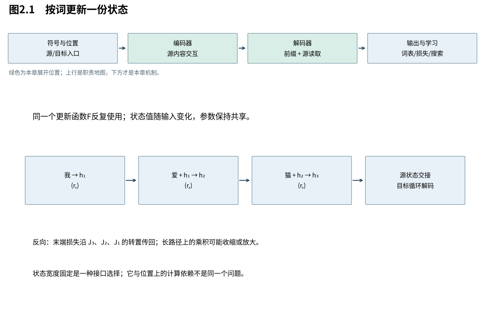
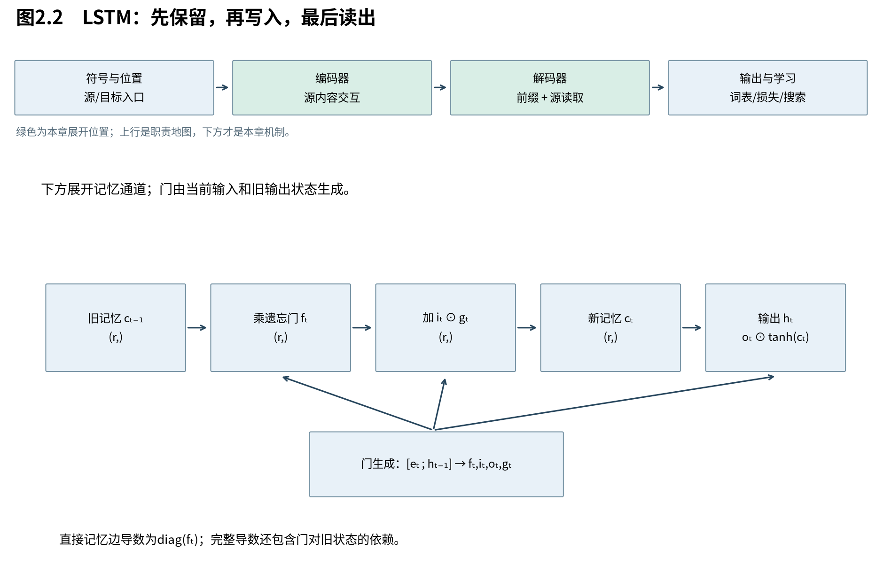

# 第2章　循环记忆能做什么

上一章确定了任务：根据源句和目标前缀预测下一符号。现在先实现最直接的一种记忆——每读一个词，就更新一个向量。本章打开编码器内部，沿“怎样保存历史→怎样学会保存→哪些限制仍在”前进。循环不是一个等待被淘汰的错误方案；它用固定状态处理任意长度输入，至今仍是一种重要的设计选择。

图2.1突出源侧状态链与末状态交接；目标侧也逐步更新状态，但参数不必与源侧相同。本章只改变状态单元的内部规则，下一章才改变两侧的信息接口。

## 2.1 用同一个更新器处理不同长度的句子

**循环网络把任意长度历史封装成固定宽度状态，并在各位置复用同一组更新参数。** 它获得了长度无关的参数规模和自然的顺序敏感性，代价是后一个状态必须等待前一个状态。状态是这一次输入产生的数据，参数是训练所得的更新规则，二者不能混为一谈。

先省略批量轴，所有单向量用列表示。令当前词嵌入 $e_t\in\mathbb R^d$，状态 $h_t\in\mathbb R^r$，初始状态 $h_0=0$。最简单的tanh循环单元为：

$$
 a_t=W_xe_t+W_hh_{t-1}+b,\qquad h_t=\tanh(a_t).
 \tag{2.1}
$$

$W_x\in\mathbb R^{r\times d}$ 把当前词变为状态空间的输入，$W_h\in\mathbb R^{r\times r}$ 处理旧状态，$b\in\mathbb R^r$ 是偏置；tanh逐分量作用。形状依次是 $(r,d)(d,1)\to(r,1)$、$(r,r)(r,1)\to(r,1)$，相加后仍为r维。

在“我、爱、猫”上，展开结果是：

$$
 h_1=F(e_1,h_0),\quad h_2=F(e_2,h_1),\quad
 h_3=F(e_3,h_2)=F(e_3,F(e_2,F(e_1,h_0))).
 \tag{2.2}
$$

同一个F在三个位置复用，这就是参数共享；三个状态的值一般不同。调换“我”和“猫”会改变嵌套顺序，因此循环已经带有顺序信息。它不像逐词独立查表那样仅给出一袋互不交流的向量。

固定上下文版本把 $c=h_n$ 交给解码器。解码器可以用c初始化自己的状态，也可以每步把c作为额外输入；这两种接口都见于早期模型，不能把一种简图当成所有实现。Sutskever等人的方案用源编码表示初始化目标LSTM。[S，§2]

若恢复批量，状态按行放在 $(B,r)$ 中，更新写成 $E_tW_x^\top+H_{t-1}W_h^\top+b$，输出 $(B,r)$。转置来自行向量表示，没有改变模型规则。

## 2.2 学习早期信息，为什么要穿过一串导数

**循环让过去影响未来，也让后来的损失必须沿状态链反向传递。** 每经过一步，梯度都被一个局部雅可比变换；多个收缩会把早期信号压小，多个放大则可能使它增长。困难来自这些变换的连乘，而不只是“序列很长”这句描述。

雅可比是把小扰动映射到小输出变化的矩阵。式(2.1)中，tanh导数为 $1-\tanh^2(a)$，所以：

$$
 J_t=\frac{\partial h_t}{\partial h_{t-1}}
 =D_tW_h,\quad D_t=\operatorname{diag}(1-h_{t,1}^2,\ldots,1-h_{t,r}^2).
 \tag{2.3}
$$

两个因子均为 $(r,r)$。先由 $W_h$ 变换旧状态的扰动，再由 $D_t$ 按当前工作点缩放各坐标。对 $s<t$，链式法则给出：

$$
 \frac{\partial h_t}{\partial h_s}=J_tJ_{t-1}\cdots J_{s+1},\qquad
 \nabla_{h_s}\ell_t=J_{s+1}^{\top}\cdots J_t^{\top}\nabla_{h_t}\ell_t.
 \tag{2.4}
$$

$\ell_t$ 是只从时刻t输出读取的标量损失；如果损失分布在多个时刻，还要把各条反传路径相加。矩阵乘法次序由链式法则决定，不能任意交换。

用与欧氏向量范数相容的矩阵范数，上式有上界：

$$
 \left\|\frac{\partial h_t}{\partial h_s}\right\|
 \le\prod_{u=s+1}^{t}\|J_u\|.
 \tag{2.5}
$$

如果每步范数都不超过 $\rho<1$，上界不超过 $\rho^{t-s}$。若取标量构造 $h_t=0.9h_{t-1}$，100步后导数为 $0.9^{100}\approx2.66\times10^{-5}$；若改成1.1，则约为13780.6。这不是一次RNN训练实测，而是剥离其他因素后展示连乘机制的构造例。矩阵范数大于1也不保证实际梯度一定爆炸：方向、非交换性和损失梯度都有影响。

设计目标由此清晰了：能否让需要长期保留的信息，沿一条可控制、少受重复非线性压缩的路径传递？

## 2.3 LSTM把“保留”和“改写”变成可学习的操作

**LSTM增加一条加性记忆通道，用门分别控制旧内容保留、新内容写入和对外读出。** 这给模型提供了维持信息及梯度的路径；门是否会学到合适数值、其他路径是否稳定，仍取决于训练。我们采用带遗忘门、无窥孔连接的常见形式；1997年原版与后续遗忘门变体不能在历史上合为一个版本。[Gers2002，§2]

记忆为 $c_t\in\mathbb R^r$，对外状态为 $h_t\in\mathbb R^r$。先拼接 $u_t=[e_t;h_{t-1}]\in\mathbb R^{d+r}$，再生成四组向量：

$$
 f_t=\sigma(W_fu_t+b_f),\quad i_t=\sigma(W_iu_t+b_i),\quad
 o_t=\sigma(W_ou_t+b_o),\quad g_t=\tanh(W_gu_t+b_g).
 \tag{2.6}
$$

各矩阵形状都是 $(r,d+r)$，偏置和输出均为r维。$\sigma(z)=1/(1+e^{-z})$ 使门值位于0与1之间；g是可正可负的候选写入。随后：

$$
 c_t=f_t\odot c_{t-1}+i_t\odot g_t,\qquad h_t=o_t\odot\tanh(c_t).
 \tag{2.7}
$$

$\odot$ 是逐元素乘法。记忆通道中的旧内容没有被强制乘一个稠密矩阵再过tanh，而是按坐标保留后与新写入相加。对外读出另经tanh和输出门，因此模型可以保留某项内容而暂时少暴露它。

固定某条实际门值轨迹，逐次展开记忆，第t步第j个坐标为：

$$
 c_{t,j}=\left(\prod_{u=1}^{t}f_{u,j}\right)c_{0,j}
 +\sum_{s=1}^{t}\left(\prod_{u=s+1}^{t}f_{u,j}\right)i_{s,j}g_{s,j}.
 \tag{2.8}
$$

第二项表示“第s步写入，经过之后的遗忘门留下多少”。当 $s=t$ 时空乘积定义为1，当前写入尚未经过未来遗忘。式子描述给定实际门值后的记忆账目，不意味门可以脱离状态独立提前算出。

例如一个坐标初值2，三步 $(f,i,g)$ 依次为 $(1,0,0)$、$(0.5,1,3)$、$(1,0,0)$，则记忆为2、4、4。第一步保留，第二步旧内容留1并写3，第三步再次保留。这些是理解极限行为的构造门值；有限sigmoid输入不会精确得到0或1。

若只看 $c_{t-1}\to c_t$ 的直接边、暂固定门值，其导数是 $\operatorname{diag}(f_t)$。沿多步直接路径就是遗忘门的乘积，门接近1时收缩较少。但完整计算图里，门还依赖 $h_{t-1}$，而后者依赖记忆。因此“直接路径导数等于遗忘门”不能偷换成“完整总导数只有遗忘门”，更不能宣布LSTM彻底消除了梯度问题。

图2.2把加性主路径单独画出，门的生成依赖另用箭头说明。读图时先追踪旧记忆能走到哪里，再看新增内容在哪相加；训练需要对两类路径一起求导。

## 2.4 GRU把保留与候选合并在一份状态里

**GRU保留门控思想，但通常不另设独立的记忆c与输出h。** 它用更新门混合旧状态与新候选，用重置门控制生成候选时读取多少旧状态，从而以较少的状态和门实现可调整的时间尺度。减少结构不意味着在所有任务上更好，比较仍需同条件实验。

沿Cho原文的门约定，令z表示旧状态的保留比例：

$$
 z_t=\sigma(W_ze_t+U_zh_{t-1}),\quad
 r_t=\sigma(W_re_t+U_rh_{t-1}),
 \tag{2.9}
$$

$$
 \widetilde h_t=\tanh(W_e e_t+U_e(r_t\odot h_{t-1})),\qquad
 h_t=z_t\odot h_{t-1}+(1-z_t)\odot\widetilde h_t.
 \tag{2.10}
$$

W形状 $(r,d)$，U形状 $(r,r)$；门、候选、状态均为r维，偏置为简洁省略。这里用 $r_t$ 表示重置门向量，与状态宽度标量r靠下标和形状区分。部分文献把更新门定义成新候选的权重；读公式时应看乘在哪里，不凭门名猜含义。另一些软件实现把重置放在矩阵乘之后，这也不是任意U下都可互换的重排。

当z接近1时直接保留旧状态；当z接近0时接受候选。重置门影响的是候选怎样使用旧内容，并不直接清空另一条保留支路。这种职责区分比记住“GRU有两个门”更有用。[Cho2014，§2.3，式5—8]

## 2.5 三种限制应当分开讨论

**门控改进记忆更新与学习路径，却没有自动取消固定接口、时间依赖和任务选择的取舍。** 要决定下一步怎样改造模型，必须先知道遇到的是信息表示问题、优化问题，还是计算组织问题。

固定向量交接要求所有源信息经过同一宽度接口。有限精度、噪声鲁棒性与任务要求都会影响它能保留什么；不能仅凭“长句有很多词”就证明固定实数向量不可能表示长句。Sutskever的特定深LSTM与源序列逆转设置曾报告较好的长句表现；Bahdanau对其基线则观察到长句退化并从注意力获益。两者的模型和训练不同，不能把一张曲线当成全部循环架构的普遍定理。

时间依赖是另一件事：普通RNN、LSTM、GRU的第t步门或状态依赖第t−1步状态，训练时知道全部词也不能直接抹去这个依赖。批量样本、矩阵内部和层间可以有并行机会，但位置链仍在。这与第1章“生成时不知道下一个词”的依赖不同。

最后，固定状态也有收益：生成时核心状态大小不随已读长度增长。之后的注意力保留更多逐位置表示，会增加存储和读取工作。架构演变是换取性质并承担代价，不是宣布旧模型所有优点都失效。

下一章针对的是接口问题：不要求编码器在不知道未来查询时，把全部有用细节挤进同一摘要；让解码器在每一步提出问题，读取不同的源位置。门控状态仍可以保留，改变的是访问源信息的方式。

来源：[Sutskever2014，v3](https://arxiv.org/abs/1409.3215v3)；[Cho2014，v3](https://arxiv.org/abs/1406.1078v3)；[Gers2002](https://www.jmlr.org/papers/v3/gers02a.html)；[Bahdanau，v7](https://arxiv.org/abs/1409.0473v7)。梯度展开和门控构造例为本书推导；本章不报告训练性能。
