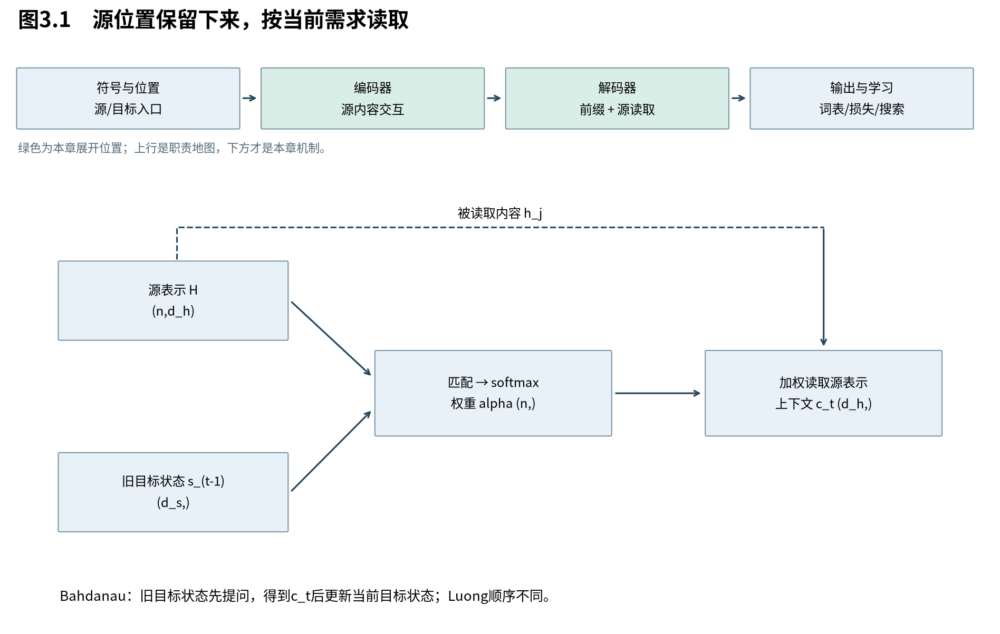

# 第3章　从一句摘要到按需读取

上一章把源句变为固定状态，再交给目标侧。现在的设计要求是：生成“cats”时能回到与“猫”有关的位置，生成其他词时可以换一种读取。我们保留编码器与解码器，把中间接口从“一份摘要”改成“一组可查询的表示”。本章先建立读取操作，再区分它与循环状态的关系。

图3.1中的源表示按位置保留，目标侧每一步产生不同的读取权重。源表示本身可以含全句背景，不等于一份原始词向量；权重矩阵的行属于目标预测位置，列属于源位置。

## 3.1 先保留位置，再决定当前需要什么

**注意力把源信息的整理与当前信息的选择分开：编码器保留一组表示，解码器根据当前需求组合它们。** 这减轻了单一摘要承担全部未来查询的压力，却增加了按源长度增长的存储与逐步读取成本。

令源表示为列向量 $h_j\in\mathbb R^{d_h}$，按行堆叠为 $H\in\mathbb R^{n\times d_h}$。Bahdanau采用双向循环编码：从左向右的状态 $\overrightarrow h_j$ 与从右向左的状态 $\overleftarrow h_j$ 拼接，形成 $h_j=[\overrightarrow h_j;\overleftarrow h_j]$。若每个方向宽度r，则 $d_h=2r$。源句在翻译前完整给定，因此两个方向读取源句不造成目标答案泄漏。

这样的h不是只含第j个词。它以该位置为中心聚合了上下文，后续“读位置j”是在读取一份上下文化表示。将注意力理解成直接复制原始字词，会遗漏编码器已经完成的工作。

目标预测位置t上的上下文 $c_t\in\mathbb R^{d_h}$ 定义为：

$$
 c_t=\sum_{j=1}^{n}\alpha_{tj}h_j,\qquad
 \alpha_{tj}\ge0,\quad\sum_{j=1}^{n}\alpha_{tj}=1.
 \tag{3.1}
$$

过去只有一个c；现在每个t都可以有自己的c。要实现它，还差一项关键工作：怎样把“当前需求”和“每个候选位置”变成可学习的权重？

## 3.2 分数如何变成一份可微的读取决定

**软对齐用连续权重替代只能选一个位置的离散决定，使翻译损失能反向调整读取方式。** 打分网络学习需求与候选是否匹配，softmax在候选之间进行相对归一化；最后的加权和是一次软读取，不必等同于人类标注的词对齐。

在Bahdanau的时序中，用上一步目标状态 $s_{t-1}\in\mathbb R^{d_s}$ 提问：

$$
 e_{tj}=v_a^\top\tanh(W_s s_{t-1}+W_h h_j+b_a),\qquad
 \alpha_{tj}=\frac{\exp(e_{tj})}{\sum_{k=1}^{n}\exp(e_{tk})}.
 \tag{3.2}
$$

$W_s\in\mathbb R^{d_a\times d_s}$、$W_h\in\mathbb R^{d_a\times d_h}$ 将两种表示送到同一打分空间；$b_a,v_a\in\mathbb R^{d_a}$。相加后是 $d_a$ 维向量，经tanh，再与 $v_a$ 点积变成标量。它称为加性注意力，因为两种投影先相加，再由非线性网络评价。

式(3.2)先得到 $c_t$，再用于更新当前解码状态：

$$
 s_t=F(s_{t-1},E_t[y_{t-1}],c_t).
 \tag{3.3}
$$

目标嵌入形状d，旧状态 $d_s$，上下文 $d_h$；F输出 $d_s$。不能先把 $s_t$ 当查询又用同一个 $c_t$ 来定义 $s_t$，那会画出并不存在的循环定义。[B，§3，式4—6及附录]

例如分数 $(\log2,\log3,\log5)$ 经指数成为 $(2,3,5)$，归一化后是 $(0.2,0.3,0.5)$。如果三份二维表示为 $(1,0)$、$(0,1)$、$(1,1)$，则读取结果为 $(0.7,0.8)$。权重为正且和为1，所以结果位于三点的凸包内。这是本次加权操作的几何性质，并不限制整层在输出投影、非线性和残差之后仍留在该凸包内。

## 3.3 为什么翻译误差能够教会模型往哪里看

**改变某个位置的分数，会提高它的权重，同时压低其他位置的相对权重；学习信号因此比较该位置内容与当前平均读出的差异。** 这使“往哪里看”与“最终预测是否正确”通过可微路径相连，但不保证注意力图就是唯一、完整的解释。

固定目标位置t，简写 $\alpha_j,e_j,c$。softmax分母记为 $Z=\sum_k e^{e_k}$。商法则逐项求导：

$$
 \frac{\partial\alpha_j}{\partial e_k}
 =\frac{\delta_{jk}e^{e_j}Z-e^{e_j}e^{e_k}}{Z^2}
 =\alpha_j(\delta_{jk}-\alpha_k).
 \tag{3.4}
$$

$\delta_{jk}$ 在j=k时为1，否则0；两项分别来自分子和分母的变化。固定h，只对读取分数求导：

$$
 \frac{\partial c}{\partial e_k}
 =\sum_jh_j\alpha_j(\delta_{jk}-\alpha_k)
 =\alpha_k h_k-\alpha_k\sum_j\alpha_jh_j
 =\alpha_k(h_k-c).
 \tag{3.5}
$$

形状是 $d_h$ 维向量。如果损失对c的梯度为 $g=\nabla_c\mathcal L\in\mathbb R^{d_h}$，链式法则给出标量：

$$
 \frac{\partial\mathcal L}{\partial e_k}
 =\alpha_k g^\top(h_k-c).
 \tag{3.6}
$$

$h_k-c$ 是改为更关注位置k时，读出会偏向的方向；g告诉我们这方向会使损失增加还是减少。若所有h相同，单纯调整读取权重不会改变c，式(3.5)就是零。模型还可通过另一条路径修改h本身，因此这个局部结论不等于整个模型无法学习。

这里的梯度只追踪分数路径。h也参与打分并作为被读取内容，完整反向传播会将两条贡献相加。把注意力权重大的位置直接宣布为最终预测的唯一原因，忽略了这种多路径作用，以及后续网络的加工。

## 3.4 从加性网络到点积：不变的接口，不同的匹配函数

**读取接口可以保持不变，而匹配函数可以换成更适合矩阵计算的形式。** Luong的点积与一般双线性打分展示了这种分离：当前目标状态提出需求，源状态提供候选内容；匹配怎样计算是模型选择，并非概率法则唯一规定。

Luong先形成当前目标状态 $s_t$，再以它读取源表示。等宽时点积为 $e_{tj}=s_t^\top h_j$；宽度不同时可用：

$$
 e_{tj}=s_t^\top W_a h_j,\qquad W_a\in\mathbb R^{d_s\times d_h}.
 \tag{3.7}
$$

计算顺序是先将 $h_j$ 投影到 $d_s$ 维，再与 $s_t$ 比较。若目标状态已按行放成 $S\in\mathbb R^{m\times d_s}$，源状态按行形成H，全部分数就是：

$$
 E=SW_aH^\top\in\mathbb R^{m\times n}.
 \tag{3.8}
$$

逐位置求和与矩阵乘描述相同的双线性分数。不过循环解码器的这些状态本身仍须顺序产生；能把分数写成矩阵式，不代表整条状态生成链已经可同时计算。

Luong还讨论局部读取：限制在某个中心周围的窗口，可减少候选数量，但可能漏掉窗口外信息；预测中心、给附近位置加权又增加了新的设计。输入馈送则把上一时刻结合过上下文的表示送入下一步，帮助后续读取利用之前的对齐信息。这些说明读取范围、打分函数和状态更新是三个不同的设计维度，不应被压缩成“用了注意力”一句话。[L，§3.1—3.3]

本书后面选择全局点积作为Transformer主线，不把上述不同模型强行拼成同一个历史实现。第5章会把匹配所用的key与最终读出的value进一步分开。

## 3.5 从读取接口回到整台模型

**注意力已经让目标侧能按需访问源表示，但此时编码器与解码器仍可由循环网络组成。** 它解决的是怎样访问上下文，尚未自动解决怎样生成各位置表示。下一步的关键转变，是把这种位置间读取从循环模型的辅助接口，提升为构造序列表示的主要操作。

在本例中，生成“cats”时的查询可能对“猫”附近的表示分配较大权重；这是我们希望模型学会的行为，不是上述公式已经保证的词义知识。真正学习到什么，需要训练和评测。构造出的对角热图也不能伪装成训练所得对齐图。

如果每个源位置都能查询其他源位置，就能形成自注意力；如果每个目标位置只查询合法前缀，就能形成因果自注意力；如果目标位置查询源表示，就是交叉注意力。三者可以共享一种读取算子，区别在输入来源与可见范围。下一章先把这三种职责装入整机，再深入每一项计算。

来源：[Bahdanau，v7，§3及附录](https://arxiv.org/abs/1409.0473v7)；[Luong等，EMNLP2015，§3](https://aclanthology.org/D15-1166/)。式(3.4)—(3.6)和二维算例为本书展开；局部导数不代替整机学习效果。
