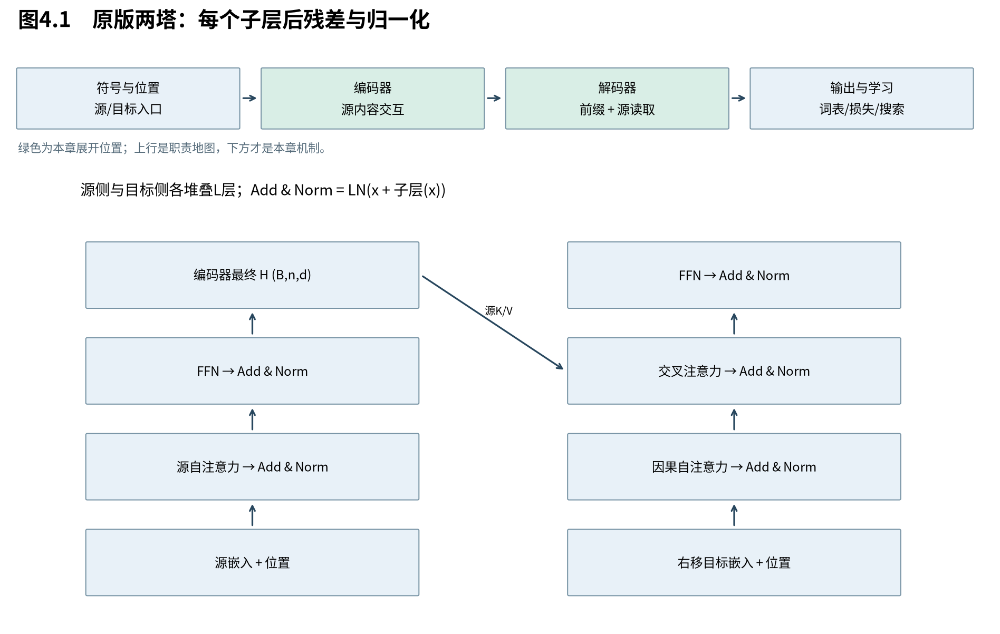

# 第4章　用注意力组织整台模型

第3章建立了按需读取。现在我们希望各位置的表示也通过读取其他位置来形成，而不再必须沿词序传递一个循环状态。这就是本章的架构转折：任务还是翻译，改变的是模型内部的通信方式。先把整机组起来，之后每章只打开其中一个部件。

图4.1沿两边自下向上读。编码器处理完整源句；解码器读取合法目标前缀，并读取编码器最终输出。每个标成Add & Norm的位置都先做残差相加、再做LayerNorm，不能颠倒。图省略dropout，训练时它位于子层输出与残差相加之间，嵌入和位置相加之后也有dropout。

## 4.1 同一组位置怎样同时更新

**自注意力让一层中的每个位置，从上一层全部允许访问的位置读取内容，再形成自己的新表示。** 各位置读的是同一个已知输入集合，不必等待同层左侧位置先更新。这缩短了位置间的信息路径；代价是全局读取需要计算大量位置对关系。

把一层输入记为 $X^{(\ell)}\in\mathbb R^{B\times n\times d}$。源侧一层的概念形式是：

$$
 U^{(\ell)}=\operatorname{LN}\bigl(X^{(\ell)}+\operatorname{SelfAttn}(X^{(\ell)})\bigr),\quad
 X^{(\ell+1)}=\operatorname{LN}\bigl(U^{(\ell)}+\operatorname{FFN}(U^{(\ell)})\bigr).
 \tag{4.1}
$$

各中间量都是 $(B,n,d)$，因此残差相加形状相容。本式先省略训练dropout；LN及FFN的数学分别在第11和10章建立。上标是层，非时间。第i个位置的新表示依赖上一层第j个位置；它不依赖同一层第j个位置刚更新后的值，因此没有循环状态的横向等待链。

“同时”不表示无限硬件上的零时间，也不表示不同层不用等待。它表示同层位置更新在计算图上可以被组织成批量矩阵操作。层与层仍顺序依赖，矩阵操作内部也有实际执行成本。

## 4.2 为什么目标侧要多一项读取

**解码器同时需要两类上下文：已经写出的译文决定接下来如何继续，源句决定要表达什么内容。** 因果自注意力处理前一项，交叉注意力处理后一项；把两种读取分开，使同一个目标表示可以先整合前缀，再提出针对源句的查询。

令目标层输入 $Y^{(\ell)}\in\mathbb R^{B\times m\times d}$，编码器最终输出为 $H\in\mathbb R^{B\times n\times d}$。原版一个解码器层的顺序为：

$$
 U=\operatorname{LN}\bigl(Y^{(\ell)}+\operatorname{CausalAttn}(Y^{(\ell)})\bigr),
 \tag{4.2}
$$

$$
 V=\operatorname{LN}\bigl(U+\operatorname{CrossAttn}(U,H)\bigr),\quad
 Y^{(\ell+1)}=\operatorname{LN}\bigl(V+\operatorname{FFN}(V)\bigr).
 \tag{4.3}
$$

U、V和输出都保留目标长度m，不变成源长度n。交叉注意力的分数表是目标查询对源候选的 $(B,h,m,n)$ 表；聚合后每个目标位置得到一份表示，因此输出仍在目标轴上。

|读取角色|查询来自哪里|候选键和值来自哪里|单头分数形状|允许范围|
|---|---|---|---|---|
|源自注意力|当前源层输入|同一源层输入|$(B,n,n)$|所有有效源位置|
|目标因果自注意力|当前目标层输入|同一目标层输入|$(B,m,m)$|本位置及更早的有效输入位置|
|交叉注意力|因果读取后的目标表示|编码器最终输出|$(B,m,n)$|所有有效源位置|

注意“本位置可读”对应的是右移后的输入。例如第3个目标输入是love，任务是预测cats；读取本位置并未直接看到cats。若省略右移，这个范围就会泄漏答案。遮罩的完整规则在第8章证明。

## 4.3 为什么不能只有注意力

**位置通信只是整台模型的一项职责。** Transformer还需要给向量注入顺序、对读出的内容做非线性加工、让多层变换维持可训练的路径，并把内部状态转成词表分布。每一项都在补注意力本身没有自动提供的性质。

位置表示使相同内容在不同序列位置得到不同入口；它不是随便加一个“编号特征”就能保证所有顺序能力。第9章将从置换等变性推导为什么需要它，再检查正弦设计真正提供的性质。

FFN在各位置独立使用同一组参数，改变通道内容，不直接交换位置。注意力负责跨位置混合，FFN负责逐位置加工，两者交替使用。残差让每个子层学习对原表示的修正，LayerNorm按每个位置的通道统计进行规范化；它们也不是解决所有优化困难的充分条件。

原论文base模型的编码器和解码器各6层，宽度512，8个头，每头键和值宽度64，FFN中间宽度2048。这些是一个经实验选择的配置，不是从概率链严格推导出的唯一整数。[T，§3]

## 4.4 原论文到底取消了哪一种顺序依赖

**Transformer取消的是同一层表示必须沿位置递推的结构要求，普通自回归生成仍要等待新符号确定。** 训练时目标参考已知，遮罩允许在一次前向里计算全部目标条件分布；生成时只能计算当前前缀对应的下一步分布。

本例训练把BOS、i、love、cats同时放入目标输入。每个位置都只读取合法前缀，四个位置的表示可以逐层批量计算，最终得到四份分布。生成时只有BOS，先选出i后才能把它加入下一次输入；模型可以复用已有计算，但不能把未知词当成已知参考。这类增量复用到Book3系统展开，本册先用完整前缀重算确认行为。

过去我们用“状态链”组织历史；现在用“各位置表示＋受控的读取边”组织历史。它使两个远位置能够在一层里直接交互，却引入与长度平方相关的关系表。第16章会核算整个层，避免把注意力核心的复杂度误当整机成本。

下一章进入SelfAttn和CrossAttn内部。我们已经知道查询来自哪里、允许看谁，现在需要说明：为什么要区分Q、K、V，怎样形成匹配分数，又怎样把分数变成真正可计算的读出。

来源：[Attention Is All You Need，v7，§3与Fig.1](https://arxiv.org/abs/1706.03762v7)。图为中文教学重制，结构依原论文；配置数字属于原研究，不是本机训练结果。
