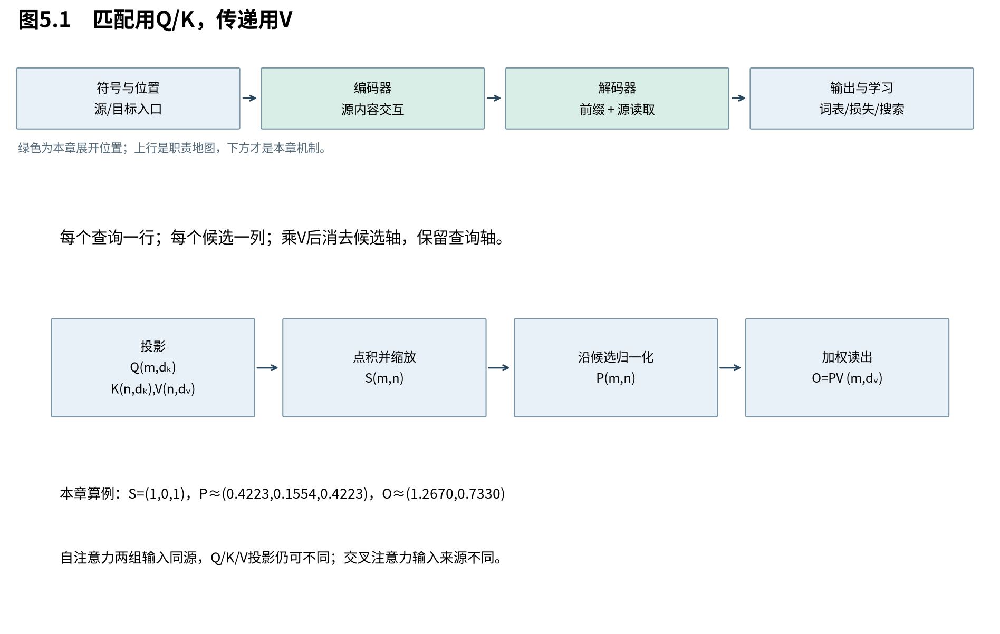

# 第5章　一次注意力怎样读出内容

第4章已经给出三种读取的来源和范围。本章打开它们共用的核心：先把“寻找什么”“凭什么匹配”和“读出什么”分开，再用点积、softmax和加权和完成一次读取。所有演算先在单头、单样本上进行，最后补回批量；尺度问题留到下一章专门推导。



图5.1中，查询位置与被读取位置可以来自不同序列。自注意力只是两组输入碰巧来自同一表示；不意味着Q、K、V三组投影相同。

## 5.1 为什么同一份输入要生成三种向量

**Q与K负责建立匹配关系，V负责携带最终被传递的内容。** 将这两项职责分开，模型可以学习“用哪些特征选择位置”和“从选中位置带回哪些特征”。它们都是由训练学出的表示，不是人工指定的语义标签。

查询输入记为 $X_q\in\mathbb R^{m\times d}$，候选输入为 $X_s\in\mathbb R^{n\times d}$，行对应位置。定义投影：

$$
 Q=X_qW_Q\in\mathbb R^{m\times d_k},\quad
 K=X_sW_K\in\mathbb R^{n\times d_k},\quad
 V=X_sW_V\in\mathbb R^{n\times d_v}.
 \tag{5.1}
$$

$W_Q,W_K$ 形状 $(d,d_k)$，$W_V$ 形状 $(d,d_v)$，暂省偏置。Q是query，K是key，V是value。查询与键必须具有相同的 $d_k$ 才能点积；值宽度 $d_v$ 可以不同，因为它不参加该点积。

从第i个查询和第j个候选看，未缩放分数为：

$$
 q_i^\top k_j=x_{q,i}^\top W_QW_K^\top x_{s,j}.
 \tag{5.2}
$$

此处单向量改用列，$q_i=W_Q^\top x_{q,i}$；所以式(5.2)与行矩阵形式一致。乘积 $W_QW_K^\top\in\mathbb R^{d\times d}$ 是学到的双线性比较。Q/K分开还允许比较不对称：位置i想从j读取，不要求位置j也以同样强度读取i。

V与K可以来自相同位置但使用不同投影。例如“该候选与当前查询是否相关”和“相关后应该传递什么信息”不必用同一组坐标表达。这个设计扩大了选择与传递的自由度，但也增加了参数及投影计算。

## 5.2 点积同时比较方向和长度

**点积让模型以连续方式衡量两个表示的匹配，但它同时受方向和范数影响。** 因而高分并不只意味着夹角小；尺度的变化也会改变读取权重。下一章的缩放设计，正是对这种数值尺度的回应。

对非零向量，欧氏几何给出：

$$
 q^\top k=\|q\|_2\|k\|_2\cos\theta.
 \tag{5.3}
$$

若q固定，所有满足 $q^\top k=c$ 的键位于垂直于q的超平面上；向q方向移动键会提高分数，沿正交方向移动不改变这个查询的分数。换一个查询方向，原来不可见的变化可能就可见。投影学习实际上在学习这种比较几何。

例如 $q=(1,0)^\top$，键 $(1,0)$ 与 $(2,0)$ 方向相同，分数却为1和2；键 $(1,1)$ 分数也是1，尽管与q的夹角不同。因此不能把未归一化点积直接称为余弦相似度。也不能把范数笼统解释成“信息量”：那需要额外训练或统计依据。

## 5.3 softmax比较相对分数，加权和给出软读取

**softmax把实数分数转成非负、和为1的权重，使读取可微，并允许多个候选共同贡献。** 加权结果位于当前V行向量的凸包中；这解释了软读取为什么既能聚合内容，也可能把原本需要分开的信息混在一起。

第i个查询有n个分数 $s_{ij}$。在已确定合法位置的集合 $\mathcal A_i$ 上定义：

$$
 p_{ij}=\frac{\exp(s_{ij})}{\sum_{u\in\mathcal A_i}\exp(s_{iu})},\qquad
 o_i=\sum_{j\in\mathcal A_i}p_{ij}v_j.
 \tag{5.4}
$$

非法位置权重为零；合法集合须非空。$p_i$ 是n维权重，$o_i$ 为 $d_v$ 维。给整行分数加同一个常数a，分子分母都有 $e^a$，因而约去：

$$
 \operatorname{softmax}(s+a\mathbf1)=\operatorname{softmax}(s).
 \tag{5.5}
$$

这使数值实现可以先减去行最大值，避免大正数的指数溢出；它没有改变数学分布。先对非法位置做约束，再对剩余位置求最大和归一化，不能对一整行无候选的情况机械计算 $-\infty-(-\infty)$。

对任意值分量a，输出 $o_{i,a}$ 介于该分量的候选最小值和最大值之间，因为权重非负且和为1；多维形式就是凸包。这个性质仅针对给定V与归一化权重的本次加权和。V投影、后续输出投影和残差可以改变几何范围，训练dropout后的权重也未必仍逐行和为1。

## 5.4 把一次读取逐数算出来

**一个小矩阵足以看见注意力怎样把“选择”变成“内容”。** 分数表的每一行属于一个查询，权重表沿列归一化，最终乘V后，候选轴被求和消去，留下查询轴。这是防止张量维度迷路的核心线索。

取一个二维查询 $Q=(\sqrt2,0)$，三个键按行构成 $K=((1,0),(0,1),(1,1))$，值矩阵取 $V=((1,0),(0,2),(2,1))$。此处先使用原版缩放 $1/\sqrt{d_k}$，下一章解释它为何这样选。则：

$$
 S=\frac{QK^\top}{\sqrt2}=(1,0,1),\quad
 P=\frac{(e,1,e)}{2e+1},\quad
 O=PV=\left(\frac{3e}{2e+1},\frac{e+2}{2e+1}\right).
 \tag{5.6}
$$

数值约为 $P=(0.422319,0.155362,0.422319)$、$O=(1.266956,0.733044)$。第一个分量把候选值1、0、2按权重相加；第二个分量把0、2、1按同样权重相加。权重控制来源，V控制传来的内容。

```python
import torch
q = torch.tensor([[2.0**0.5, 0.0]], dtype=torch.float64) # (1,2)
k = torch.tensor([[1.,0.], [0.,1.], [1.,1.]], dtype=q.dtype) # (3,2)
v = torch.tensor([[1.,0.], [0.,2.], [2.,1.]], dtype=q.dtype) # (3,2)
scores = q @ k.T / (q.shape[-1]**0.5)  # (1,2)@(2,3) -> (1,3)
weights = torch.softmax(scores, dim=-1) # 沿候选轴归一化
out = weights @ v                      # (1,3)@(3,2) -> (1,2)
print("scores", scores)
print("weights", weights)
print("out", out)
```

这段代码验证公式，不训练任何语义。更改V会改变结果，即使P完全相同；因此同一张注意力热图不足以确定模型传递了什么。

## 5.5 从逐项求和到批量矩阵

**矩阵乘法将所有查询的同一种读取组织在一起。** 它没有删去任意查询与候选之间的匹配，只是把重复运算交给可批量执行的线性代数；这也意味着全局关系数量仍然随两个序列长度的乘积增长。

对全部查询，$S_{ij}=\sum_{a=1}^{d_k}Q_{ia}K_{ja}/\sqrt{d_k}$，正好是Q乘K转置的第ij项。对输出第ib项，$O_{ib}=\sum_jP_{ij}V_{jb}$，正好是PV。因此：

$$
 O=\operatorname{softmax}_{\text{候选轴}}
 \left(\frac{QK^\top}{\sqrt{d_k}}+M\right)V.
 \tag{5.7}
$$

M是加性遮罩，合法项0，非法项 $-\infty$。单样本形状 $(m,d_k)(d_k,n)\to(m,n)$，再乘 $(n,d_v)\to(m,d_v)$。恢复批量后是 $(B,m,d_k)(B,d_k,n)\to(B,m,n)$，各样本独立计算，不跨样本互相注意。

本章得到了完整可计算算子，但还没有解释两个设计选择：为什么分数要除以平方根，为什么一次加权平均还不够。下一章先处理尺度与学习信号，再到第7章增加多个可独立选择的读取头。

来源：[Attention Is All You Need，v7，§3.2.1](https://arxiv.org/abs/1706.03762v7)。点积几何、凸包、移位不变性与小矩阵为本书推导和构造。
