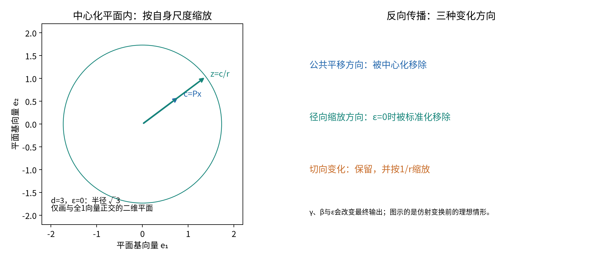
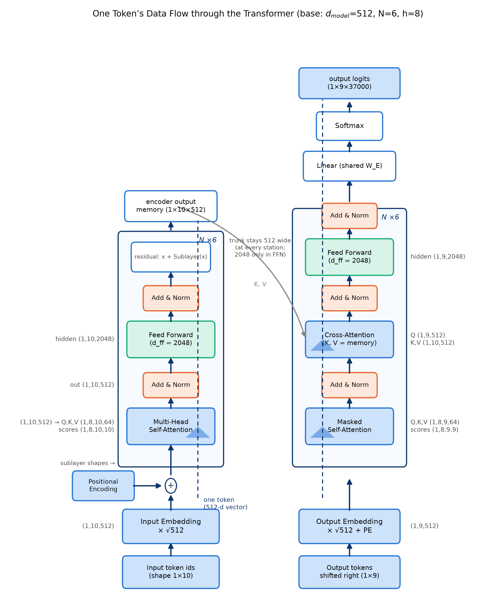

# 第 6 章 FFN、残差与 post-LN：一条 token 的数据流

## 6.0 开篇：从全书到这里

到第 5 章，我们已经完成了大半组件：缩放点积注意力（第 2 章式 (2.1)）管跨位置取料，多头机制（第 3 章）把取料分成八路并行，三种角色（第 4 章）把取料安排进双塔，正弦位置编码（第 5 章）给每个位置挂上门牌、在两栈底部各注入一次。但回看第 4 章那张双塔数据流清单（表 4.3），有一站我们当时有意绕开：第 6 站只写着「Add & Norm → FFN——第 6 章」，没有展开。先明确它们在整机中的位置：整机粗图见导览 0.3 节；本章的零件装在第 4 章图 4.1 双塔的每一层——紧接在每层注意力之后的那间「Feed Forward」车间、每个子层出口一枚「Add & Norm」芯片，表 4.3 的第 6 站在此展开。

留着的正是最后一批零件，也是本章要回答的三个问题：**其一，注意力把别的位置的信息取回来了，这些货在每个位置内部由谁加工？其二，六层双塔、三十个子层堆起来，残差与归一化各为信息流动提供了什么，又有哪些条件不能省略？其三，零件齐了之后，你怎么一眼鉴别一份实现抄的是不是 2017 年的原版结构？**

本章补齐注意力之外的三件零件——逐位置前馈网络（逐位置非线性变换部件）、残差连接（显式的残差通路）、LayerNorm（尺度的守门人）——并第一次把全书零件串成一条 token 从词元 id 到 logits 的完整旅程。产出两件：一张全书中轴图（图 6.1），此后任何一层的讨论都回到这张图上定位；一份「一眼鉴别清单」，帮你避免日后反复照抄错误版本。

本章结束，「零件铺」（第 2-6 章）就告一段落，下一章上装配线：组装整机、把 mask 的语义与陷阱一次讲透、与官方实现逐项对拍、核对实现的精确参数量与论文报告的 65M。不过合上本章之前，必须先回答开篇的第三个问题——6.5 节会用一份流行教程的代码说明：即使引用同一句论文公式，实现也可能采用另一种归一化顺序。

> **最小背景栏**
> - **残差学习（residual learning）**：He 等（arXiv:1512.03385，CVPR 2016）提出，与其让堆叠层去拟合目标 $H(x)$，不如让它们拟合残差 $F(x)=H(x)-x$，于是前向变为 $y=F(x,\{W_i\})+x$——恒等支路为反传增加直接路径，其与残差分支相加后的效果仍需分析；该论文训练了 152 层网络，残差网络集成取得 ILSVRC 2015 分类任务冠军。Transformer 论文将其引作参考文献 [11]。
> - **层归一化（layer normalization，LN）**：Ba 等（arXiv:1607.06450）改变了归一化的统计范围：从跨样本统计转为单个样本的层内统计。在本章 Transformer 中，具体沿**每个词元的特征维**计算，不跨 batch 或序列轴；LN 在训练与推理时使用相同计算方式，便于处理变长序列。Transformer 论文将其引作参考文献 [1]。公式见本章式 (6.3)。
> - 已有知识：注意力与 $\sqrt{d_k}$（第 2 章式 (2.1)）、多头拆装（第 3 章）、双塔三种注意力角色（第 4 章）、正弦位置编码（第 5 章 5.2 节）。

## 6.1 逐位置前馈网络：注意力的另一半

注意力在位置间搬运和混合信息，FFN则对每个位置使用同一套非线性参数变换。升维提供更多可选择的中间响应，ReLU使这些响应随输入改变；最后降回残差宽度，保持层间接口一致。4倍隐藏宽度是预算选择，不是必须服从的定理。

先答开篇第一问：取回来的货，由谁加工。答案不看公式也能讲清——先看画面。

把一层的处理想成一条传送带，每个位置是一格。注意力子层是**取货窗口**：第 $i$ 格从掩码允许访问的位置取料，按相关度配比混进自己（第 2-4 章的全部内容）。FFN 则是**加工车间**：传送带的每一格独立驶入同一间车间，车间里只有三道工序——先把 512 维的箱子整个倒出来、摊在 2048 维的大工作台上（升维）；逐项过一道是非闸门，不达标的直接归零（ReLU 裁一刀）；再把留下的装回 512 维的箱子送走（降维）。原论文 §3.3 把这个部件命名为逐位置前馈网络（position-wise feed-forward networks），并对「逐位置」给出明确表述：**对每个位置独立且相同地施加**（applied to each position separately and identically）——每格进同一间车间、用同一套工具，且加工时互不看一眼。所以注意力子层是序列内横向的算子，FFN 是每个位置纵向的算子；**一个编码器层包含一次横向混合和一次纵向加工；解码器层则有两次注意力混合，再接一次 FFN 加工**，这间车间就装在每层注意力的正下游。

**为什么先摊开到四倍宽**。4:1是原论文采用的超参数，并非由数学推出的唯一最优值。它背后的机制直觉是：**在高维空间里做更细的判断**。512 维里一个维度往往身兼数职——同一个数既参与「这个词是名词吗」又参与「它跟前文搭不搭」；各种判断挤在同一组维度上，就切不干净。摊到 2048 维，可学习的投影提供更多中间方向，ReLU 再按各方向的响应筛选。这里用「判断」帮助理解，并不表示训练后每一维必然对应一个独立语言概念。一团揉皱的线在火柴盒里解不开，摊到桌面上就能一根根分拣——「先升维、再线性切」是机器学习里常用的老套路，FFN 是它的朴素版本：升维是给判断腾地方。

你可能会问：那为什么不干脆把主干造宽点、直接用 2048？——可以设计更宽的主干，但会增加所有相关投影、状态和计算成本；固定512维主干时，中间扩展后再收回是控制成本的一种选择，而非残差结构禁止任何模型采用2048维主干。

**形式化**。原论文式 (2)——本书编号为式 (6.1)：

$$
\mathrm{FFN}(x)=\max(0,\;xW_1+b_1)\,W_2+b_2
\tag{6.1}
$$

| 符号 | 含义 | 张量形状（base） |
|---|---|---|
| $x$ | 单个位置的表示向量 | $\mathbb{R}^{d_{model}}$（512） |
| $W_1,\,b_1$ | 升维线性变换 | $\mathbb{R}^{512\times 2048}$、$\mathbb{R}^{2048}$ |
| $W_2,\,b_2$ | 降维线性变换 | $\mathbb{R}^{2048\times 512}$、$\mathbb{R}^{512}$ |
| $\max(0,\cdot)$ | ReLU 非线性（逐元素） | $\mathbb{R}^{2048}\to\mathbb{R}^{2048}$，形状不变 |

这意味着：每个位置各自进入同一间车间——箱子摊开到 2048 维的大工作台，逐项过一道是非闸门（ReLU），留下的装回 512 维送走；全程不看别的位置一眼。

输入输出都是 $d_{model}=512$，中间层扩到 $d_{ff}=2048$——**4:1 的扩展率**是原论文的事实比率（big 模型 4096/1024 同为 4:1）【来源：官方论文 v7 §3.3、Table 3】。原文还给了等价描述：「这可以看作两个 kernel size 为 1 的卷积」（two convolutions with kernel size 1）【来源：官方论文 v7 §3.3 原文】——卷积核宽 1 意味着没有跨位置交互，与「逐位置」的表述相互对应。写成整句张量，这一站是 $(b,s,512)\xrightarrow{\,W_1+b_1\,}(b,s,2048)\xrightarrow{\;\mathrm{ReLU}\;}(b,s,2048)\xrightarrow{\,W_2+b_2\,}(b,s,512)$——`nn.Linear` 只作用于最后一维，batch 与句长两个维度原样穿过，这正是「逐位置」在张量上的体现。

> **【考据框】** $d_{ff}=2048$ 这个数字经历过版本修订：v1 的 Table 3 曾把它误印为 1024，与正文矛盾，v2 起修正为 2048【来源：官方论文·多版本比对】。引用这个数字请锚定 v7——「连原论文自己都在版本间改数字」是全书引用纪律的一个具体例子，版本时间线总账在第 11 章。（服务好奇者，跳过不影响主线。）

### 6.1.1 扩展、筛选、合成各自增加了什么

**FFN的主要作用不是凭空增加输入信息，而是让表示经过输入依赖的非线性变换。**把式(6.1)按隐藏神经元展开，令 $w_{1r}$ 为 $W_1$ 的第r列、$w_{2r}^\top$ 为 $W_2$ 的第r行，则

$$\mathrm{FFN}(x)=\sum_{r=1}^{d_{ff}}\max(0,xw_{1r}+b_{1r})\,w_{2r}^\top+b_2.\tag{6.5}$$

每个隐藏单元先沿一个可学习方向读输入，检查仿射打分是否为正，再用激活值调节一份输出方向。这提供了可理解的“检测并写回”结构；将某个单元直接命名为名词或事实存储器，需要额外实验，不能由公式推出。

若去掉ReLU，两层会合成 $xW_1W_2+b_1W_2+b_2$，FFN本身仍只是一次仿射变换。ReLU的激活集合随输入变化，才使不同区域使用不同的有效映射。其中 $x$ 按行向量记，$w_{1r}$ 的形状为 $(d_{model},1)$，$w_{2r}^\top$ 为 $(1,d_{model})$。设 $D_x\in\mathbb R^{d_{ff}\times d_{ff}}$ 是对角 0/1 矩阵，记录当前激活的隐藏单元，局部扰动满足 $\delta y=\delta xW_1D_xW_2$（不在ReLU折点上）。扩展隐藏宽度增加了可选择的中间方向，但4倍是否合适是预算与训练问题。

最小构造例只需一个输入和两个隐藏单元：$W_1=(1,-1)$、$W_2=(1,1)^\top$，偏置为0，输出为 $\max(0,x)+\max(0,-x)=|x|$。在 $x=-1,0,1$ 处输出为1、0、1，任何单一仿射函数都不能同时拟合这三点。它展示非线性带来的分段响应；并不是说去掉FFN的ReLU后整个Transformer就变线性，注意力softmax和归一化仍然非线性。

**账本一：这个部件多大（参数占比）**。用公式直接数参数：一个注意力子层（$W^Q,W^K,W^V,W^O$ 四个 $512\times 512$ 矩阵加偏置）是 $4d^2+4d=1{,}050{,}624$；一个 FFN 子层是 $2d\cdot d_{ff}+d+d_{ff}=2{,}099{,}712$——**单个 FFN 子层的参数约是注意力子层的两倍**。把整台 base 模型数完（编码器层×6、解码器层×6、三处共享的词嵌入，词表取论文 §5.1 的 37000），得到表 6.1【来源：本书复算（公式，2026-10）；脚本见本章动手验证节】。

| 部件 | 参数量公式 | base 实算 | 家族占比 |
|---|---|---|---|
| 注意力子层（$W^Q,W^K,W^V,W^O$+偏置） | $4d^2+4d$ | 1,050,624 | 家族合计 30.0% |
| FFN 子层（$W_1,b_1,W_2,b_2$） | $2d\,d_{ff}+d+d_{ff}$ | 2,099,712 | 家族合计 **39.9%** |
| LayerNorm（$\gamma+\beta$） | $2d$ | 1,024 | 家族合计 0.049% |
| 编码器层小计（1 注意力+1 FFN+2 LN） | — | 3,152,384 ×6 = 18,914,304 | — |
| 解码器层小计（2 注意力+1 FFN+3 LN） | — | 4,204,032 ×6 = 25,224,192 | — |
| 词嵌入（三处共享，§3.4） | $V\cdot d$ | 18,944,000 | 30.0% |
| **复算合计** | — | **63,082,496 ≈ 63.1M** | — |
| Table 3 官方总数 | — | 65M | 差 1.9M（≈3%） |

表 6.1 各部件参数占比（自排，公式复算；65M 锚定 v7 Table 3）

这里有两个不同口径：表 6.1 按词表恰为 37000、三处共享、所列偏置与 LN 配置，精确算出 63,082,496；论文 Table 3 报告的是 65M。论文没有给出足以逐项核销约 1.9M 差额的构成明细，§5.1 的 37k 词表也是约数；词表每增加 1000，这套共享配置会增加 512000 个参数，但这只是敏感性计算，不能据此断言差额来自词表。**表中的相对占比属于本书这套明确配置；引用论文模型总量时保留 65M，差额原因仍待核实。**

这个结论值得记住：在表 6.1 的配置中，FFN 是参数最多的部件家族；LN 几乎不占参数，但它的放置顺序仍会改变完整计算图（6.5 节）。

**账本二：它算得多吗（计算量）**。参数多不等于算得慢——还得看乘加次数。先只比较同宽编码器中的一个 FFN 与一个自注意力子层，取 $d_{ff}=4d$，只计矩阵乘加，暂不计偏置、softmax、激活与归一化。FFN 每位置两次矩阵乘，共 $2\,d\,d_{ff}=8d^2$ 次乘加；注意力每位置四组投影 $4d^2$ 次乘加，外加对全句的 scores 与加权求和 $2nd$ 次（$n$ 为句长）。同一 batch 的因子会相消；按整句累计，这两类子层的乘加比为

$$
\frac{\text{FFN}}{\text{注意力}}=\frac{8nd^{2}}{4nd^{2}+2n^{2}d}=\frac{4d}{2d+n}
$$

在上述计数条件下，比值由句长与宽度之比决定：句越短，FFN 的矩阵乘加次数越接近一份自注意力的两倍。它不是实测耗时比。

在论文的句长口径下（几十个词，$n\ll d$）FFN 的矩阵乘加次数约为一份自注意力的两倍——本书按 $n=10$ 复算：每层 FFN 约 2097 万次乘加、注意力约 1059 万次，比值 1.98【来源：本书复算（公式，2026-10）】。

这个比值随句长增加而减小，$n=2d=1024$ 时两者打平、之后注意力反超——这里比较的是 FFN 与带投影的自注意力；论文 §4 Table 1 的 $n<d$ 讨论则比较注意力核心与循环层，不能直接视为同一个交点：**2017 年的翻译句长下，这台机器对所比较的编码器子层乘法，FFN比一份自注意力更重；解码器有两份注意力，整机还需计算词表输出，不能由这个比值推出所有模型的总耗时占比**——它是参数与计算的双重大户，也是后世动手术最积极的部件（后续两次改造见下一段末的说明）。

**前史的另一条路（对照）**。FFN 这个「位置内部的门」并非只有 ReLU 一种开法。同期直接对手 ConvS2S 在相同位置上用的是门控线性单元（gated linear unit，GLU，公式见第 1 章 1.5）：用 $\sigma(B)$ 门控 $A$ 的通过量【来源：官方论文 1705.03122 §3.2】。门控与残差作用在不同计算环节，也可以组合——GLU 的 sigmoid 门在 0 到 1 之间，对相应分支逐项调节；残差则是「加性旁路」，在反传中增加恒等项，整体效果还要看另一分支及后续运算。2016-2017 年这两条路线平行竞速，原版Transformer使用ReLU FFN并配残差，ConvS2S则在卷积块中同时使用GLU和残差。FFN 后续还会挨两刀——先换激活、再连整体结构一起换，门控思想在 GLU 里已经冒头——账记在 Book3 与 Book4，此处只留一个地址，不展开机制。

实现只有一行（完整文件见 [code/ch06/blocks.py](code/ch06/blocks.py) 的 `PositionwiseFFN`）：

```python
# code/ch06/blocks.py 节选
class PositionwiseFFN(nn.Module):
    """式 (6.1)：(b,s,d_model) -> (b,s,d_ff) -> (b,s,d_model)，逐位置独立。"""
    def __init__(self, d_model=D_MODEL, d_ff=D_FF):
        super().__init__()
        self.w1 = nn.Linear(d_model, d_ff)   # 升维 W1：512 → 2048（4:1 扩展率）
        self.w2 = nn.Linear(d_ff, d_model)   # 降维 W2：2048 → 512
    def forward(self, x):                    # x: (b, s, d_model)；Linear 只作用于最后一维＝逐位置独立
        return self.w2(F.relu(self.w1(x)))   # (b,s,512) -> (b,s,2048) -> (b,s,512)
```

注意 `nn.Linear` 只作用于张量最后一维——这正是「逐位置独立、全位置共享参数」的算子语义；而「层与层之间参数不共享」由每个层各持有一个 `PositionwiseFFN` 实例保证。

## 6.2 残差连接：显式的残差通路

残差把新层写成“原表示加一个修正”，为优化增加直接路径。但总雅可比是两条支路的和，仍可能抵消或放大；接上post-LN后还要再乘归一化的导数。下面分别计算这两件事，避免把捷径误读为梯度安全保证。

FFN 车间已经造好，但把它装进流水线之前，还要解决开篇第二问：怎样让子层在处理信息时保留一条直接使用原输入的路径？先用一条河来想象残差求和。

把 base 模型从嵌入到输出投影之前的层间接口想成**一条恒定宽度 512 的河**。每个子层是一条**支流的入河口**，把学到的**修正量**加到原输入上；支流为零时，求和这一步原样交出输入。这就是残差连接（residual connection）的直觉：用显式保留输入的加法来表达修改。**单看残差求和，分支输出接近零时会接近恒等映射**；但后面还要经过 LN，不能把这条局部旁路画成贯穿整机、完全不变的恒等通路。堆三十个子层时，分支仍可能抵消输入，归一化也仍会改变表示。

这个画面不是事后的美化，而是解决实际训练困难时产生的设计。「训不动」在视觉侧被记录得更早也更清楚：He 等发现 56 层的普通卷积网训练误差反而高于 20 层版——不是过拟合（训练误差也更高），是深层普通结构的优化**退化**（degradation）：更深网络理论上可通过新增层取恒等映射来容纳浅网络的解，但论文所用优化过程未能找到同样好或更好的解【来源：官方论文 1512.03385 §1、Fig.1】。残差学习正是对这个现象的回答：把恒等显式写进结构（式 (6.2) 的 $+x$），让堆叠层拟合增量修正。若最优映射接近恒等，只需把残差推近零；作者据此提出更易优化的假设，并用实验支持它。这不是对任意任务、任意初始化的保证。

NMT 侧的同型经验来自 GNMT（arXiv:1609.08144），写得非常具体【来源：官方论文 1609.08144 §3.1，经验性陈述】：

> 「在大规模翻译任务中，简单堆叠的 LSTM 层最多 4 层工作良好（work well up to 4 layers），6 层勉强（barely with 6 layers），超过 8 层非常差（and very poorly beyond 8 layers）。」——GNMT §3.1

而 GNMT 自己的解法就是残差连接，并且给出了机制表述：「残差连接显著改善了反向传播中的梯度流动，使我们能训练非常深的编码器与解码器网络」（原文直译）。该论文采用残差连接训练了 8 层编码器 + 8 层解码器，并报告深层模型的收益；这不意味着深度继续增加就一定更好【来源：官方论文 1609.08144 §3.1、Figure 1 题注（残差自第 3 层起）】。重排如表 6.2。

| 配置 | 深度 | 可训性（§3.1 措辞） |
|---|---|---|
| 无残差，堆叠 LSTM | ≤ 4 层 | 训练良好（work well） |
| 无残差，堆叠 LSTM | 6 层 | 勉强（barely） |
| 无残差，堆叠 LSTM | > 8 层 | 非常差（very poorly） |
| 残差连接（自第 3 层起） | 8 + 8 层 | 论文所用深层配置可训 |

表 6.2 GNMT 关于堆叠深度与残差的经验整理（引 Wu et al. 2016 §3.1；注意这是经验性陈述，不是 BLEU 消融表）

**机制（形式化）**。He 等（arXiv:1512.03385）的残差学习把前向写成式 (6.2)：

$$
y = F(x,\{W_i\}) + x
\tag{6.2}
$$

这意味着：子层不直接决定「这一站的河水变成什么样」，只往主干里掺一份「这一站要修正多少」；原输入作为一个加数直接参与结果，但另一个加数仍可能抵消它。

对输入求导得 $J_y=J_F+I$——其中 $I$ 是同维单位矩阵，提供一条直接梯度路径；但总梯度还会与分支路径相加，因此可以分析直接路径如何影响优化，而不能只看 $I$ 就断言总梯度安全。He 等与 GNMT 报告的训练改善提供经验支持【来源：He et al. 1512.03385 §1、§3；GNMT §3.1】。

把“梯度直通”说得准确一些。若损失的上游梯度为列向量 $g$，反传到输入是 $(I+J_F)^\top g=g+J_F^\top g$。其中有一项直接复制g，但两项可能同向，也可能抵消。极端构造 $F(x)=-x$ 给出 $I+J_F=0$，总梯度仍然为零。因此残差增加了一条优化路径，不是无条件杜绝梯度消失。

原版还有后接LN：$y=\mathrm{LN}(x+F(x))$，故 $J_y=J_{\rm LN}(x+F(x))(I+J_F)$。即使 $F(x)=0$，也得到 $y=\mathrm{LN}(x)$，一般不等于 $x$。把残差求和的恒等路径与完整post-LN块混为一谈，会误读下一节的训练取舍。

Transformer 把残差用得比 GNMT 更彻底：**每一个子层**（编码器层 2 个、解码器层 3 个）都各自包裹一条残差捷径，而非 GNMT 的「自第 3 层起、层间连接」【来源：官方论文 v7 §3.1】。原文还给出了一个容易被忽略的工程动机：**为方便这些残差连接，模型中所有子层与嵌入层都输出 $d_{model}=512$ 维**。

这就是为什么式 (6.1) 的 FFN 必须 2048→512 降回原维度、多头注意力先将 8 个 64 维头拼成 512 维，再由 $W^O$ 映射到 512 维（第 3 章）——不是巧合，是残差连接的硬约束：**这里的残差求和要求两个分支输出同形状，不借助广播**——落到张量上，$x+\mathrm{Sublayer}(x)$ 就是 $(b,s,512)+(b,s,512)\to(b,s,512)$ 的逐元素相加。上一节车间只能在内部扩展维度、图 6.1 上那条 512 宽的主干，来历都在这里。

六层双塔共有 30 条局部残差捷径（编码器 6×2 + 解码器 6×3，每子层一条），明确了原输入怎样参与每次更新；整机能否训好，还取决于归一化、初始化和优化配方，第 8、9 章再给出相应证据。数据流上可以直接保证的是**每层输入形状进、同形状出**。至于数值是否原样保留，须逐步看计算：分支为零时，求和输出是原输入，随后的 LN 却仍会中心化、缩放并施加可学习仿射。因此完整 post-LN 块不能直接跳过。

## 6.3 LayerNorm：把每个位置拉回同一尺度

LayerNorm用当前token的特征统计量规范尺度，不依赖批中其他样本。它去掉公共偏移并压缩径向尺度变化，随后用可学习仿射恢复任务需要的范围；前向的这种几何结构，也决定了反向哪些方向被削弱。

支流一条条汇入，表示的幅度可能改变：这条支流猛、下条细，主干水位的整体幅度逐站漂移——下游每个车间面对的输入尺度忽大忽小。第三件零件管这个。

它的画面一句话：**每经过一站，就把水量校回标准**。全机 30 座计量站，每站出口装一台校准器：把当前这一格的 512 个数先减去均值，再按自身标准差与稳定项缩放，最后交给两组可学习的向量（增益 $\gamma$、偏置 $\beta$）调节。标准化部分的方差在满足一定条件时接近 1，最终输出还会受这两组参数影响。校准只统计这一格自身的特征，这就是本章的「按位置归一化」。

为什么这里使用 layer norm？He 的原始 ResNet 用 batch normalization，而 Ba 等在提出 LN 时讨论了 batch 统计对批量大小的依赖，以及循环网络按时间步保存统计量给变长序列带来的困难【来源：官方论文 1607.06450 §3、§3.1】。通常，BN 按特征或通道聚合一批样本及相应空间轴；本章 LN 则对每个位置的特征向量就地计算统计量，不跨样本或时间。LN 本身在训练与推理时使用相同公式，这不表示含 dropout 的整个网络在两种模式下也相同。这样的统计方式方便变长序列处理，但 Transformer 原论文并未说明选择 LN 的具体动机，我们不能把工程解释当作作者自述，也不能由此断言 BN 无法用于序列。

**形式化**。原论文没有给出 LN 自身的公式（只写了组合结构），LN 的规范出处是 Ba 等，即式 (6.3)：

$$
\mu=\frac{1}{d}\sum_{j=1}^{d}x_j,\qquad
\sigma^2=\frac{1}{d}\sum_{j=1}^{d}(x_j-\mu)^2,\qquad
\mathrm{LN}(x)=\frac{x-\mu}{\sqrt{\sigma^2+\epsilon}}\odot\gamma+\beta
\tag{6.3}
$$

| 符号 | 含义 | 形状 |
|---|---|---|
| $x_j$ | 单个位置表示的第 $j$ 维 | 标量 |
| $\mu,\sigma^2$ | 该位置 512 维上的均值/方差 | 标量 |
| $\epsilon$ | 数值稳定项（论文未给值，PyTorch 默认 $10^{-5}$，属实现自由度） | — |
| $\gamma,\beta$ | 可学习的增益与偏置 | 各 $\mathbb{R}^{512}$ |
| $\odot$ | 逐元素乘 | $\mathbb{R}^{512}\times\mathbb{R}^{512}\to\mathbb{R}^{512}$ |

这意味着：对每个位置自己那 512 个数，就地算一份均值和方差，减一减、除一除，拉回标准刻度再交给 $\gamma,\beta$ 微调——其他位置、其他样本都不参与。

注意统计量的计算范围是**单个位置向量内部**——这正是「按位置归一化」：只要送入 LN 的该位置向量不变，增加其他位置或其他样本就不改变它的 $\mu,\sigma^2$。若前面的注意力已因句子变化而改了这个向量，统计量当然也可能变化。落到整句张量上，LN 沿最后一维作用：$(b,s,512)\to(b,s,512)$，形状不变，每个格子各算出一对 $\mu,\sigma^2$（全句共 $(b,s)$ 对）。

手算一个最小例子建立直观认识（取 $\gamma=1,\beta=0,\epsilon\approx 0$）：设某位置的 4 维表示 $x=(1,2,3,4)$，则 $\mu=2.5$、$\sigma^2=1.25$、$\sigma\approx 1.118$，减均值除标准差得

$$
\mathrm{LN}(x)\approx(-1.342,\;-0.447,\;0.447,\;1.342)
$$

未舍入、且epsilon取0时，归一化结果均值为0、方差为1；显示的小数只是近似值；真实模型里只是把「4 维」换成「512 维」，计算完全同构。

### 6.3.1 中心化、尺度与几何形状

**LayerNorm先移除所有坐标共同的偏移，再以当前向量自身的波动幅度缩放；它规范表示，却也改变可保留的信息。**为写清导数，本节将单个位置表示 $x\in\mathbb R^d$ 记作列向量。令 $\mathbf1\in\mathbb R^d$ 为全 1 列向量，$P=I-\mathbf1\mathbf1^\top/d\in\mathbb R^{d\times d}$，中心化向量为 $c=Px\in\mathbb R^d$。因为 $\mathbf1^\top c=0$，它落在与全1向量正交的超平面上。若方差非零且 $\epsilon=0$，$z=c/\sqrt{c^\top c/d}$ 还满足 $\|z\|^2=d$：标准化把中心化向量投向该超平面内半径 $\sqrt d$ 的球面。

当 $\epsilon>0$，标准化部分的方差为 $\sigma^2/(\sigma^2+\epsilon)$，介于 0 与 1 之间；只有 $\sigma^2\gg\epsilon$ 时才接近 1，常量向量的结果则为零。再乘逐坐标 $\gamma$、加 $\beta$ 后，输出通常既不零均值也不单位方差。$x+a\mathbf1$ 与 $x$ 的标准化部分完全相同；正比例缩放在方差非零且 $\epsilon=0$ 时也不改变 $z$。当 $\epsilon>0$ 时，尺度依赖仍然存在，只有缩放前后的方差都远大于稳定项时，尺度不变性才近似成立。LN 严格去掉公共偏移，并压缩绝对幅度的变化，而非在所有条件下彻底抹去幅度。



图6.2 LN 几何示意（本书绘制）。左侧取 $d=3$、非零方差、$\epsilon=0$，且尚未施加可学习仿射，只画中心化平面的两个坐标；向量缩放到半径 $\sqrt3$ 的圆上。右侧将标准化部分的导数分为公共平移、径向和切向变化，条件与下面的推导对应。

### 6.3.2 沿完整微分路径推导梯度

**LN的反向传播也会去掉某些公共变化方向，所以不能把它只当作前向乘一个常数。**记 $r=\sqrt{c^\top c/d+\epsilon}$，则 $dc=P\,dx$，并且 $\delta r=c^\top\delta c/(d\,r)$。继续对 $z=c/r$ 用乘积法则：

$$\delta z=\frac{P\,\delta x}{r}-\frac{c(c^\top\delta x)}{d\,r^3},\qquad
J_{\rm LN}=\operatorname{diag}(\gamma)\left[\frac{P}{r}-\frac{cc^\top}{d\,r^3}\right].\tag{6.6}$$

这里 $r$ 是标量，$\delta x,\delta z\in\mathbb R^d$，$J_{\rm LN}\in\mathbb R^{d\times d}$。第二项来自分母依赖输入，省掉它就会得到错误的梯度。对标准化部分，全1方向被P消去；沿c的导数系数为 $\epsilon/r^3$，epsilon为0时径向变化也被消去；与全1和c都正交的方向则乘 $1/r$。若方差很小，这个系数可能较大，epsilon使其有限但不保证所有训练梯度都小。若 $c=0$ 且 $\epsilon>0$，没有可定义的径向方向，但式 (6.6) 仍成立，此时 $J_{\rm LN}=\operatorname{diag}(\gamma)P/\sqrt\epsilon$；若同时令 $\epsilon=0$，分母为零，公式便不适用。这个几何解释将 LN 的前向不变性与反向作用连接起来。

**post-LN：式 (6.4)，本书的主角**。原论文 §3.1 用一句话定义了整个结构，这句话值得逐字读【来源：官方论文 v7 §3.1 原文直引】：

> 「我们在两个子层各采用一条残差连接，随后进行层归一化。也就是说，**每个子层的输出是 LayerNorm(x + Sublayer(x))**。」（"We employ a residual connection around each of the two sub-layers, followed by layer normalization. That is, the output of each sub-layer is LayerNorm(x + Sublayer(x))…"）

$$
\mathrm{Output}=\mathrm{LayerNorm}\bigl(x+\mathrm{Sublayer}(x)\bigr)
\tag{6.4}
$$

这意味着：先掺支流、再校准——每次求和后先中心化并按自身波动缩放，再施加可学习增益和偏置。三十站都采用这个顺序；标准化部分规范尺度，最终输出的均值和方差则遵循前面分析过的条件。形状上，这一站是 $(b,s,512)+(b,s,512)\xrightarrow{\text{相加}}(b,s,512)\xrightarrow{\text{LN}}(b,s,512)$——相加与归一化都不改形状，LN 改的是每一格的刻度。

LN 放在**残差求和之后**——这种放置方式后来被命名为「post-LN」。要紧的提醒：**「post-LN」这个名字是后世起的**（原论文只写公式、没起名）；与它相对的另一种放置方式为什么重要、引出了什么争议，留到 6.5 节集中澄清。此外论文 §5.4 规定了 dropout 的位置：施加在**子层输出上、加残差并归一化之前**——即 $\mathrm{LN}(x+\mathrm{Dropout}(\mathrm{Sublayer}(x)))$【来源：官方论文 v7 §5.4 原文】。

把式 (6.4) 连同 dropout 位置翻译成代码（`PostLNSublayer`：残差、post-LN、dropout 三者的顺序在代码中明确可见）：

```python
# code/ch06/blocks.py 节选
class PostLNSublayer(nn.Module):
    """式 (6.4)：§5.4 的 dropout 施加在子层输出上、加残差并归一化之前。
    输入 x: (b,s,d_model)；sublayer: (b,s,d_model)->(b,s,d_model)；输出: (b,s,d_model)。"""
    def __init__(self, d_model=D_MODEL, p_drop=0.0):
        super().__init__()
        self.norm = nn.LayerNorm(d_model)    # Ba et al. 式 (6.3)，γ/β 可学习；逐位置作用，形状不变
        self.dropout = nn.Dropout(p_drop)
    def forward(self, x, sublayer):
        return self.norm(x + self.dropout(sublayer(x)))  # (b,s,512)+(b,s,512) -> (b,s,512)，式 (6.4)
```

本书实测（固定种子，CPU）：随机输入过一层完整编码器层（两个子层）后，各位置输出的均值绝对值最大为 $2.24\times 10^{-8}$、标准差落在 $[1.0000, 1.0000]$【来源：本书实验（CPU，2026-10）】。此时 LN 的增益为 1、偏置为 0，输入方差也远大于稳定项；四位小数打印为 1.0000，并不表示方差在数学上恰为 1。这同时解释了 post-LN 数据流的另一个性质：**LN对输入作位置内标准化，但不把训练后输出永远固定为单位尺度**，上述读数属于给定初始化下的局部实验；训练后增益与偏置改变，不能照搬同一输出尺度。代价是什么，6.5 节与章末欠账给出线索。

这台校准器放回整机图景：它就是图 6.1 上的 30 枚「Add & Norm」芯片——参数只占全模型的 0.049%（表 6.1），却站在每一站的出口。

> **【实现对照框】**（非原论文内容）PyTorch 官方 `nn.TransformerEncoderLayer`（torch 2.13.0，`torch/nn/modules/transformer.py`）默认 `norm_first=False`，即按式 (6.4) 的 post-LN 摆位实现；本书按全书对拍规范（eval 模式 + 固定种子 + 锁 SDPA 的 MATH 后端）做了两级对拍：①手排官方子块 `norm1(x + self._sa_block(x))` → `norm2(y + self._ff_block(y))` 与整层前向 `el(x)`，`allclose=True`（atol=1e-6）；②本书手写 `EncoderLayerPostLN` 权重搬运进官方层后同输入前向，`allclose=True`（atol=1e-5）【来源：本书实验（CPU，2026-10）+ torch 2.13.0 源码】。已知一处数据流差异：官方 FFN 在 ReLU 之后、$W_2$ 之前多插了一个 dropout（论文 FFN 内部无此项），影响与处理留第 7 章对照表；另有后世参数 `norm_first` 可切换归一化摆位，其含义见 6.5 的澄清——本册正文实现一律不使用。

## 6.4 一条 token 的完整数据流

三件组件已经齐备，兑现开篇的承诺：把它们串成一条完整的河。视角回到第 4 章那条双塔传送带——base 模型、源句 10 个词元、目标句 9 个词元、batch=1。图 6.1 是全书的中轴图——此后任何一层的讨论，都可以回到这张图上定位。

**入口：嵌入与位置编码**。词元 id $(1,10)$ 查表得 embedding $(1,10,512)$；论文 §3.4 规定嵌入层要**乘 $\sqrt{d_{model}}$**（"we multiply those weights by $\sqrt{d_{model}}$"【来源：官方论文 v7 §3.4 原文】）。原论文没有解释为什么——这一步值得停下来讲透，因为它在河的源头，定下的是两种信号的配比。

入口要做一次加法：词元的查表向量与位置信号 PE。相加前，两者的幅度关系依赖嵌入初始化。本章 `blocks.py` 直接使用默认 `nn.Embedding`，给定实验中的初始 std≈1.0，乘 $\sqrt{512}$ 后 std=22.62；正弦 PE 的每个分量幅值不超过 1【来源：本书实验（CPU，2026-10）】。这说明在**该初始化示例**中，缩放后嵌入分量的典型幅度明显大于 PE。它不能直接换算成词义与位置各占多少信息或能量：平方范数还包含两路信号的交叉项，语义贡献更不能仅凭幅值判断。

所以解释「乘 $\sqrt{d_{model}}$ 是为了配平嵌入与 PE」时，必须先说明初始尺度：按本例 $N(0,1)$ 初始化，不乘时已大致同量级，乘完反而拉开差距；第 5 章标准差 0.02 的构造例则得到另一幅图景。不同实现采用的初始化、词表和模型宽度可能不同，不能直接套用本章默认查表层的具体统计读数。原论文并未把这些示例规定为缩放动机。

这一步同时改变**两路输入的相对配比**和进入首层的**绝对尺度**。第一枚 LN 之前，注意力已经计算了点积和 softmax；尺度改变可能先改变注意力权重，再改变取回的信息。因此，即使随后作标准化，也不能断言输入缩放只留下相对配比、不留下其他前向差异（本书分析）。随后加正弦 PE（第 5 章 5.2 节），形状不变。

**编码器：六层，每层两个子层**。第 1 层内部：$Q,K,V$ 投影 $(1,10,512)$，先 reshape 为 $(1,10,8,64)$，再交换序列轴与头轴，得到 $(1,8,10,64)$，注意力 scores $(1,8,10,10)$——8 个头各一张 $10\times 10$ 的全句可见矩阵（因果掩码只存在于解码器侧，第 4 章）；softmax 按行归一后对 $V$ 加权求和得 ctx $(1,8,10,64)$，拼回头维、经 $W^O$ 回到 $(1,10,512)$，加残差、post-LN，形状不变。FFN 子层把它逐位置升到 $(1,10,2048)$ 再降回 $(1,10,512)$，再一次残差 + post-LN。六层之后得到编码器输出——习惯称 **memory**，$(1,10,512)$：**每层进出形状不变，这是 6.2 节残差的维度约束的直接体现**。

**解码器：六层，每层三个子层**。目标句（右移一位，第 4 章）同样「查表 ×√512 + PE」得 $(1,9,512)$；每层依次是掩码自注意力（scores $(1,8,9,9)$，因果下三角）、以memory经不同投影产生K/V的交叉注意力（$Q$ 为 $(1,9,512)$、$K,V$ 为 $(1,10,512)$——查询来自解码器、键值来自编码器，第 4 章三种角色的第三种）、FFN（隐藏层 $(1,9,2048)$）。

**出口：共享的线性与 softmax**。解码器输出 $(1,9,512)$ 右乘**转置的词嵌入矩阵**得 logits $(1,9,37000)$，softmax 后即下一词元概率分布——论文 §3.4 的三处权重共享（输入嵌入、输出嵌入、pre-softmax 线性共用一个矩阵；原文以「similar to [30]」的口径引了先例——[30] 即 Press & Wolf《Using the Output Embedding to Improve Language Models》的输入/输出嵌入绑定，v7 著录其 arXiv:1608.05859 预印本、正式发表于 EACL 2017，对应关系第 7 章核账）【来源：官方论文 v7 §3.4】。全形状表见表 6.3。

| 站点 | 张量形状 | 说明 |
|---|---|---|
| src 词元 id | (1, 10) | 整数索引 |
| 查表 embedding | (1, 10, 512) | std≈1.0（本章默认查表层初始化） |
| × √512 | (1, 10, 512) | std=22.62（上述历史实验） |
| + 正弦 PE | (1, 10, 512) | PE 幅值 ≤1（← 第 5 章的零件在此装机） |
| 编码器第 1 层 Q/K/V（拆头前） | (1, 10, 512) | $W^Q W^K W^V$ 打包投影 |
| reshape 后交换头轴与序列轴 | (1, 8, 10, 64) | $h=8$，$d_k=64$ |
| 注意力打分矩阵（代码名 scores） | (1, 8, 10, 10) | 双向可见 |
| softmax 加权求和（代码名 ctx） | (1, 8, 10, 64) | 每行权重对全句 $V$ 加权平均 |
| 拼回头维 + $W^O$ 投影 | (1, 10, 512) | 8×64 拼回 512（第 3 章），子层出口 |
| 残差相加 + post-LN（Add & Norm） | (1, 10, 512) | 式 (6.4)，层内第 1 枚 |
| FFN 升维 $xW_1+b_1$（隐藏层） | (1, 10, 2048) | 4:1 扩展；ReLU 逐元素裁剪、形状不变 |
| FFN 降维 $\cdot\,W_2+b_2$ | (1, 10, 512) | 收回主干宽度 |
| 残差相加 + post-LN（Add & Norm） | (1, 10, 512) | 式 (6.4)，层内第 2 枚，第 1 层完成 |
| 编码器输出 memory | (1, 10, 512) | 六层后（栈顶） |
| tgt embedding ×√512 + PE | (1, 9, 512) | 右移一位 |
| 解码器输出 | (1, 9, 512) | 每层三子层后（栈顶）；层内各站同编码器侧、句长换 9——交叉注意力 $Q$ 为 $(1,9,512)$、$K,V$ 为 $(1,10,512)$，scores $(1,8,9,10)$ |
| logits（共享 pre-softmax 线性） | (1, 9, 37000) | 右乘 $E^{\top}$ |

表 6.3 一条 token 的全形状表（自产，本书实验：`blocks.py` 的 `main()` 实验四生成；base 配置，src=10、tgt=9）



图 6.1 一条 token 的数据流全景（自绘重制，改绘自 Vaswani et al. 2017 Fig.1，并叠加本书实测形状标注与「单 token 通路」虚线：注意力处的三角扇出表示跨位置读取，实际可见范围由角色和掩码决定；FFN 处收回逐位置处理。两塔子层接口的末维恒为 512，FFN 内部扩为 2048，最终输出投影则转成词表维）

看图的三个要点。其一，**虚线是「一条 token」的通路**：它在 FFN 处保持同一个位置，特征宽度经历 512→2048→512；在注意力处则跨位置读取（三角标记）：编码器和交叉注意力可读源句的非 PAD 位置，解码器自注意力只读允许的目标前缀——「混合」与「加工」的分工在图上一目了然。其二，**橙色的 Add & Norm 芯片共 30 枚**（编码器 6×2 + 解码器 6×3），每枚执行一次式 (6.4)。其三，memory 从编码器塔顶横向供给解码器每层的交叉注意力（灰色 $K,V$ 箭头）——双塔之间唯一的信息通道。

从形状表中可以提炼出三个**数据流不变量**，它们比具体数字更值得记住。**不变量一（宽度恒定）**：从查表后到输出投影前，各层及各子层的接口宽度都是 512——残差连接的维度约束（6.2 节）决定了整条主干等宽，2048 只在 FFN 车间内部扩展后立刻收回；用本章的河来说，**层间河宽不变，子层内部可以扩展或拆头，最后再由输出投影转成词表维**（图 6.1 两塔之间的小注即此不变量）。

**不变量二（scores 的行列语义）**：任何注意力 scores 矩阵都是「行数=查询句长、列数=键值句长」——编码器自注意 $10\times 10$、解码器自注意 $9\times 9$、cross $9\times 10$，因果掩码只是把下三角以外的格子置 $-\infty$（第 4 章）。

**不变量三（逐位置处理保留序列轴）**：逐位置FFN保留batch与序列轴，但会在内部改变特征宽度；LN、ReLU和dropout通常保持整个张量形状——debugging 时若形状错了，还应检查FFN投影维数、广播轴、输出层与各张量布局，不能只查注意力和嵌入。至此，读者应能在白纸上默画这张图并给每个站点标出形状；参数量则按表 6.1 数出——「能默画完整数据流、能数清本实现的 63,082,496 个参数并说明它与论文 65M 的口径差别」是本章的验收线，整机 mask 细节与权重共享账本在第 7 章收口。

## 6.5 保真度澄清：教程里的 pre-norm 与原论文有何不同

主线讲完，再回答开篇的第三个问题。这是本书与流行教程最重要的一个分岔点，请务必读完。

流行教程中最著名的 The Annotated Transformer（Harvard NLP）在讲解论文 §3.1 时，页面上明确引用了原论文的句子「每个子层的输出是 $\mathrm{LayerNorm}(x+\mathrm{Sublayer}(x))$」，紧接着给出的实现代码却是：

```python
# The Annotated Transformer 的 SublayerConnection（第三方源码直读，2026-10-02 核对）
def forward(self, x, sublayer):
    "Apply residual connection to any sublayer with the same size."
    return x + self.dropout(sublayer(self.norm(x)))   # ← norm 在子层之前
```

`self.norm(x)` 在**子层内部**先做归一化，残差加法在分支外部完成——顺序与式 (6.4) 恰好相反。这种「LN 放进残差分支内」的摆位叫 **pre-norm（pre-LN）**。

三点结论。**第一，两者不是同一模型的两种写法**：post-LN 与 pre-norm 的计算图不同，前向数值不等价，训练动力学也不同——差异不在记号，而在结构。

**第二，教程与原论文必须分别核对**：Annotated 的这段实现明确采用 pre-norm。若沿用它来复现 2017 架构，即使其他零件都对齐，归一化摆位也已经不同；是否有其他教程继承这一选择，须逐份看代码。

**第三，代码选择与后来的理论解释要分开**——教程注明调整顺序是为了代码简洁；不能用后来的论文替教程作者补写当时的动机。关于 post-LN 的训练困难，以及预热、归一化摆位、初始化和学习率之间的关系，可参见 Xiong 等的《On Layer Normalization in the Transformer Architecture》（arXiv:2002.04745，ICML 2020）——**后世分析，非原论文内容**【来源：官方论文 2002.04745】。本书不在本章展开其结论，只把它留待后续讨论（见章末）。

配套的还有第二处偏离：Annotated 在编码器、解码器**栈的末尾各补了一个 LayerNorm**——而原论文的两座 $N\times$ 塔出口直接输出，并无此项；PyTorch 的 `nn.Transformer` 同样带栈顶 LN，属实现族谱的又一差异（第 7 章对照表统一盘点）。两处偏离在源码中的依据收在下框，主线记住结论即可。

> **【考据框】** 两段考证，服务好奇者，跳过不影响主线。① Annotated 的作者自己知道偏离：源码注释写明「**Note for code simplicity the norm is first as opposed to last**」（为代码简洁起见，norm 在前而非在后）【来源：第三方源码直读（nlp.seas.harvard.edu/annotated-transformer，2026-10-02）】。② 栈顶 LN 的论文侧核对：原论文 Fig 1（v7 第 3 页）的两座 $N\times$ 塔出口直接输出，**没有**栈顶 LayerNorm，正文也无此记载【来源：官方论文 v7 Fig 1 本书直读核对（2026-10-02，对缓存 PDF 逐页比对）】。

本册的立场由零魔改纪律直接给出：全书实现忠于式 (6.4) 的 post-LN——包括第 7 章整机与第 9 章的训练实验；PyTorch 官方层的 `norm_first=False` 默认恰好同此摆位（见 6.3 实现对照框）。给读者留一份**一眼鉴别清单**，读任何 Transformer 实现时先看两处：①子层出口——若代码写成 `norm(x + sublayer(x))`，是论文结构；若写成 `x + sublayer(norm(x))`，归一化已被挪进残差分支（本节所述的 pre-norm）。②栈顶——若 N 层循环结束后又补了一次 LayerNorm，这是论文 Fig 1 里没有的额外操作。这两处是必要的结构核对项，还不足以单独证明完整复现：位置编码、共享权重、掩码与训练配方仍须逐项核对。

## 6.6 本章小结

开篇三问，本章逐一作答。**货谁来加工？**——FFN：每个位置用同一套参数经历 512→2048→512 的非线性变换；在表 6.1 的配置中，其参数家族占比 39.9%，矩阵乘加在短句时约为一份自注意力的两倍。**残差与归一化各提供什么？**——残差保留一个直接输入项，LN 在每次求和后规范位置内尺度；两者为训练提供了有用结构，但总梯度仍可能抵消、放大，最终尺度也受稳定项和可学习参数影响。**怎么鉴别原版？**——先看 LN 的位置，再继续核对其他结构与配方（6.5 节）。一条 token 的完整旅程由此走通：id → 查表 ×√512 → +PE → 六层编码器；目标侧经掩码自注意力、交叉读取 memory 和 FFN → 共享线性 → logits。全程形状见表 6.3、全景见图 6.1；本实现精确参数量约 63.1M，与论文报告的 65M 仍有未核销差额。

**带走的心智**：如果忘掉本章的公式与数字，只许留下几幅画，那就留下这些。**第一，数据流是一条恒定宽度的河**——从查表后到输出投影前，子层接口保持 512 维宽；注意力与 FFN 都只是汇入的支流，一个横向混合、一个纵向加工，2048 只在车间内部展开、出门就收回；往后你 debug 任何 Transformer 的形状问题，可沿图依次核对查表、注意力拆头与换轴、FFN 内部扩展、残差接口以及最终词表投影。**第二，每站校准**——三十枚 Add & Norm 芯片站站把关，支流再猛，标准化部分调节尺度，可学习增益与偏置继续塑造输出；接口宽度固定是结构约束，尺度受到规范是设计作用，二者不能混为无条件不变量。**第三，参数大头在车间**——最不起眼的 FFN 是全模型最大的参数家族（39.9%，对注意力的 30.0%）：在这套配置中，最多的参数用于逐位置变换；参数占比不等于功能重要性或语义处理贡献。另记一条检查原则：读任何实现，先看 LN 在加法里面还是外面——这是核对它是否采用 2017 年原版归一化顺序的第一步。

到这里，「零件铺」五站全部走完：注意力运算（第 2 章）→ 多头（第 3 章）→ 三种角色（第 4 章）→ 位置编码（第 5 章）→ 残差与归一化（本章）。造机器的料齐了，但一堆零件还不是机器：组装时 mask 怎么实现、权重共享的账怎么算、官方实现与论文还差在哪两处，是第 7 章的任务；点火要的配方——预热如何帮助控制训练早期更新，正是本章欠账的限制来源——第 8 章展开。下一章，上装配线。

> **后续改造** Xiong 等（2020）在其初始化与均值场分析条件下，指出 post-LN 靠近输出层的参数梯度尺度偏大，并用实验说明预热如何帮助早期训练；其 pre-LN 实验在去掉预热后也取得了可比结果。这提供了后世解释，但不证明任意 post-LN 模型都必须预热 4000 步，也不保证任意 pre-LN 配方都能去掉预热。**Book2 第 4 章**将核对 GPT-2 相对原典的归一化改造，**Book3 第 2 章**再梳理 pre/post 的谱系。→ Book2 第 4 章 / Book3 第 2 章

## 6.7 动手验证

- **入口命令**：
  ```bash
  python "code/ch06/blocks.py"
  ```
  脚本用 CPU 做局部前向验证，五组输出分别对应对拍、统计、形状与参数账本；运行时间随机器而变，不会执行训练。本章的 `MiniMHA` 固定使用 512 维、8 头，便于对照表 6.3；改变模型宽度时应采用第 3 章的通用实现。
- **预期产出**（固定种子 2017，为历史参考输出；本次结果依运行版本与数值精度核对）：①两级对拍均 `allclose=True`（atol=1e-6 / 1e-5）；②post-LN 输出逐位置 |均值| 最大 2.24e-08、标准差 [1.0000, 1.0000]；③嵌入 std 0.9997 → ×√512 后 22.62；④形状表 17 行（与表 6.3 一致，logits 为 (1, 9, 37000)）；⑤参数账本：编码器层 3,152,384 ×6、解码器层 4,204,032 ×6、嵌入 18,944,000、合计 63,082,496≈63.1M（对 Table 3 的 65M 差 1.9M）。
- **验收点**：能把 `PostLNSublayer.forward` 改成 6.5 节 Annotated 的摆位（`x + self.dropout(sublayer(self.norm(x)))`）并观察对拍 2 由 True 变 False——亲手验证 6.5 节「两种摆位不是同一计算图」；能解释 FFN 参数为何约为注意力子层的两倍；能把表 6.1 的参数公式默写到白板上。
