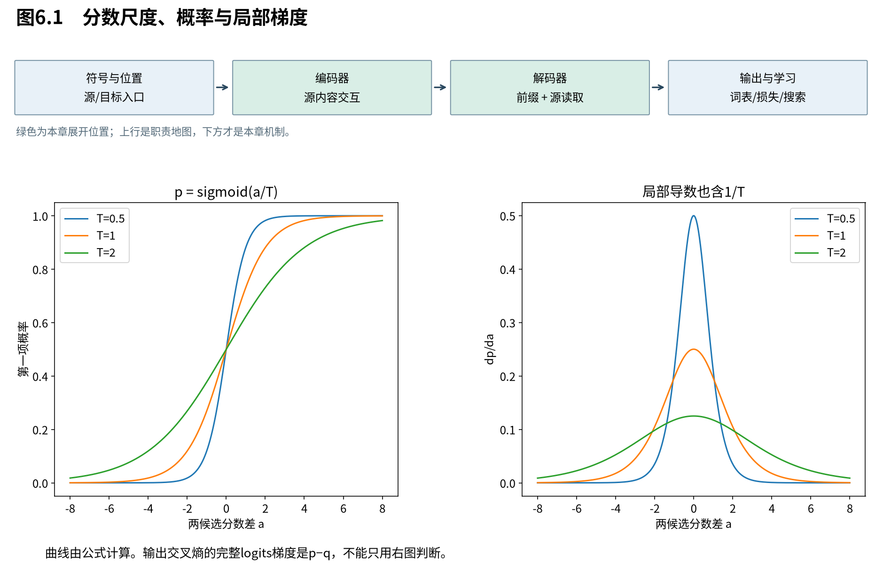

# 第6章　分数尺度为何影响学习

上章把读取写成了一个可运行算子。现在问一个优化问题：模型尚未学会匹配时，点积的数值会不会已把权重推得过尖，使调整读取变得困难？本章从分数方差走到softmax及完整损失梯度，明确哪些结论需要统计假设。

图6.1左边画两候选的概率，右边画它对分数差的局部导数；三条曲线对应不同温度。它们展示读取权重怎样响应分数，尚未包含读出和损失的其他梯度因子，因此不能只看右图便宣布所有学习信号消失。

## 6.1 为什么维度增长可能放大点积

**在零均值、单位方差和相应独立性假设下，d个分量乘积的和具有方差d，典型尺度为平方根d。** 除以这个平方根，可以让初始化附近的分数尺度较少随头维增长。这是一种统计尺度控制，不是把每一对向量强制归一化。

令 $q,k\in\mathbb R^{d_k}$，$s=q^\top k=\sum_aq_ak_a$。假设q与k各坐标互相独立，均值0、方差1；不同坐标的乘积也不相关。则：

$$
 \mathbb E[q_ak_a]=\mathbb E[q_a]\mathbb E[k_a]=0,\quad
 \mathbb E[(q_ak_a)^2]=\mathbb E[q_a^2]\mathbb E[k_a^2]=1.
 \tag{6.1}
$$

由方差定义，单项方差是1；求和方差展开为：

$$
 \operatorname{Var}(s)=\sum_a\operatorname{Var}(q_ak_a)
 +2\sum_{a<b}\operatorname{Cov}(q_ak_a,q_bk_b)=d_k.
 \tag{6.2}
$$

交叉项为零是独立性或不相关假设的用途，不能省略后再把结果用于所有q/k。于是 $s/\sqrt{d_k}$ 的方差为1。对于独立且各向同性、坐标方差为 $\sigma_q^2,\sigma_k^2$ 的情形，缩放后方差是 $\sigma_q^2\sigma_k^2$，也并非无条件为1。

更一般地，当q、k彼此独立、零均值，但各自坐标可能相关时，设协方差为 $\Sigma_q,\Sigma_k$，有：

$$
 \mathbb E[s^2]=\sum_{a,b}\mathbb E[q_aq_b]\mathbb E[k_ak_b]
 =\operatorname{tr}(\Sigma_q\Sigma_k).
 \tag{6.3}
$$

学习后的自注意力q/k来自同一输入，彼此独立也未必成立。因此原论文脚注的推导是解释缩放动机的理想化模型，不是训练全过程每个分数的定律。[T，§3.2.1脚注4]

## 6.2 温度改变“选择有多尖”，不改变分数排序

**正温度控制的是候选之间的相对集中程度。** 除以较大的温度，使概率更分散；较小温度使最大分数更占优势。注意力缩放可看成一种固定温度，但它的动机来自上一节的维度尺度，而非保证某种理想熵值。

定义 $p_j(T)=\exp(s_j/T)/\sum_k\exp(s_k/T)$，其中 $T>0$。任意两项的概率比为：

$$
 \frac{p_i(T)}{p_j(T)}=\exp\left(\frac{s_i-s_j}{T}\right).
 \tag{6.4}
$$

这直接显示：重要的是分数差；相同常数平移无效，除以温度则改变差值幅度。若有唯一最大分数，$T\to0^+$ 时其权重趋1；$T\to\infty$ 时有限分数趋均匀。多个最大值并列时，小温度极限在这些最大项之间均分，而不是任选一个。

两候选分数 $(a,0)$ 的第一项是 $p=\sigma(a/T)$，对a导数为 $p(1-p)/T$。温度既改变p又显式带来 $1/T$，所以“温度升高梯度必然变大”也不是普遍结论；应在具体分数和损失上分析。

## 6.3 softmax雅可比：概率如何共同改变

**一个分数升高时，自己的概率增大、其他概率减小；梯度因此表达竞争，而非每个候选独立开关。** 当分布接近单点时，softmax对有限分数扰动的局部敏感度变小。这会影响学习读取的路径，但还不是对完整损失梯度的结论。

令 $p=\operatorname{softmax}(s)$。第3章已由商法则得到元素导数，将它们放进矩阵：

$$
 J_{ij}=p_i(\delta_{ij}-p_j),\qquad J=\operatorname{diag}(p)-pp^\top.
 \tag{6.5}
$$

J形状 $(n,n)$。对任意扰动方向 $u\in\mathbb R^n$，

$$
 u^\top Ju=\sum_i p_i u_i^2-\left(\sum_i p_i u_i\right)^2
 =\operatorname{Var}_{i\sim p}(u_i)\ge0.
 \tag{6.6}
$$

它是以p加权的方差。这给出几何直觉：整体平移方向 $u=\mathbf1$ 的方差为0，所以 $J\mathbf1=0$；softmax只关心候选之间的差异。若p趋向单点，所有这样的加权方差都趋零。

例如两项均匀时J对角0.25、非对角−0.25；若第一项概率0.999，系数变为0.000999。它说明局部敏感度变小，未说明模型已经选对了候选。

## 6.4 注意力读出与交叉熵，不能混成同一种梯度

**注意力内部的softmax通常还要经过值混合和后续网络，输出层softmax则可能直接接交叉熵。** 二者的链式梯度不同；尤其自信但错误的分类，交叉熵对logits的梯度可以很大，即使softmax雅可比本身很小。

对注意力 $o=\sum_jp_jv_j$，固定V并令 $g=\nabla_o\mathcal L$，第3章同样的展开给出：

$$
 \frac{\partial\mathcal L}{\partial s_j}=p_jg^\top(v_j-o).
 \tag{6.7}
$$

当p集中、V和g有界时，这条分数学习路径容易变小。再对 $s_j=q^\top k_j/\sqrt{d_k}$ 求导：

$$
 \nabla_q\mathcal L=\frac1{\sqrt{d_k}}\sum_j
 \frac{\partial\mathcal L}{\partial s_j}k_j.
 \tag{6.8}
$$

这显示缩放也显式进入反向链，而K的尺度与方向仍影响实际梯度。对于V，还有直接传递项 $\partial\mathcal L/\partial v_j=p_jg$；不能因为分数梯度小就声称所有参数梯度同时为零。

输出层若直接使用目标类别y的交叉熵 $\ell=-\log p_y$，则：

$$
 \frac{\partial\ell}{\partial s_j}
 =-\frac1{p_y}\frac{\partial p_y}{\partial s_j}
 =-\frac1{p_y}p_y(\delta_{yj}-p_j)
 =p_j-\delta_{yj}.
 \tag{6.9}
$$

若两个类别概率为 $(0.999,0.001)$，正确类是第二个，梯度就是 $(0.999,-0.999)$，而非接近零。链式法则中的 $1/p_y$ 抵消了一个小因子。稳定实现使用log-softmax计算损失，避免先得到数值下溢的0再取对数。

## 6.5 把推导变成可检验的设计判断

**缩放的合理性来自统计动机、可微读取结构和实验支持的结合，不能从单个方差公式推出整机必定训练更好。** 本书用高精度数值检查雅可比和读出梯度；维度与温度实验只验证指定随机输入下的现象。

可以依次改变三件事：固定分数，检查解析雅可比与自动微分；固定V，检查式(6.7)；最后改变维度，用相同随机分布比较缩放前后分数的方差。第三种观察只有在采样假设下才应接近式(6.2)，不必人为调整数据使每次都精确等于理论值。

第5章的单头读取能学习一套权重，第6章使我们理解这套权重怎样受尺度影响。仍有一个表示问题：若模型同时需要两种不同的信息，先压成同一份平均会怎样？下一章用多头投影为不同读取保留独立通道。

来源：[Attention Is All You Need，v7，§3.2.1](https://arxiv.org/abs/1706.03762v7)。方差推广、温度极限、雅可比和完整梯度均为本书逐步推导；数值验证不宣称训练性能。
