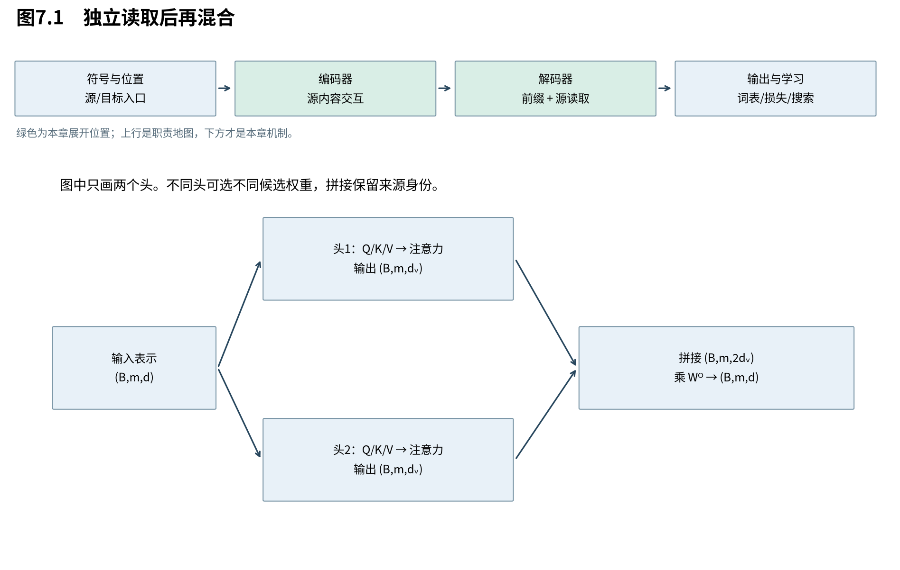

# 第7章　多头怎样保留不同读取

单头把所有候选压成一份加权和。现在假设某个位置既需要找到动作主体，又需要找到动作对象：它可以把两种内容混进同一个向量，但后续网络未必容易拆开。多头给出的结构选择是：允许多套查询、键和值分别读取，先保留各自输出，再学习如何组合。本章不预先给每个头指定语法职责。

图7.1以两个头示意，真实头数可变。头之间没有共享同一张softmax权重表；输出先拼接，再经过输出投影。不同头可以学到不同功能，也可能重复，结构本身不保证分工。

## 7.1 一份平均丢失了什么可区分性

**增加头数允许同一位置使用多套独立的候选权重，并把多种读出分开交给后续层。** 收益是额外的读取自由度；不是把单头的同一结果复制多份。公平比较时，还需同时控制每头宽度与总参数。

考虑两个标量值a、b。若只有一份等权平均，得到 $(a+b)/2$，那么 $(a,b)=(1,3)$ 与 $(2,2)$ 都得到2，无法从这个结果恢复来源差异。若两条支路分别偏重a与b，输出对 $(a,b)$ 可以区分它们。这是信息混合的构造例，不证明任意单头网络永远无法通过其他通道编码这些信息。

多头学习的不是预先指定的“主语头”“宾语头”，而是多组投影及各自的注意力。原论文展示的头可视化属于特定训练模型的观察，不能作为所有参数设置的定义。

## 7.2 投影、分头与拼接的完整形状

**每个头在自己的投影空间中比较和读取，拼接保留头身份，输出投影把它们重新混合到模型宽度。** 因此，多头不是把原始输入通道生硬切成几段，而是先学习线性投影，再按头组织计算。

对第a个头，$a=1,\ldots,h$，定义：

$$
 Q_a=X_qW_a^Q,\quad K_a=X_sW_a^K,\quad V_a=X_sW_a^V,
 \quad O_a=\operatorname{Attention}(Q_a,K_a,V_a).
 \tag{7.1}
$$

三组权重分别为 $(d,d_k),(d,d_k),(d,d_v)$，$O_a\in\mathbb R^{B\times m\times d_v}$。合并为：

$$
 O=\operatorname{Concat}(O_1,\ldots,O_h)W^O,
 \qquad W^O\in\mathbb R^{hd_v\times d}.
 \tag{7.2}
$$

拼接结果 $(B,m,hd_v)$，最终输出 $(B,m,d)$，才能与输入做残差相加。若把 $W^O$ 按输入行切为h块 $W_a^O\in\mathbb R^{d_v\times d}$，则：

$$
 O=\sum_{a=1}^{h}O_aW_a^O.
 \tag{7.3}
$$

这个等价式说明输出投影能对不同头施加不同线性变换，再相加。若直接把各头平均，便限制了这种组合方式；若把头输出求和后才投影，也未必能表示各头不同的投影。

实际实现通常把所有Q投影横向拼成一块 $W^Q\in\mathbb R^{d\times hd_k}$，一次矩阵乘得到全部头：

|步骤|形状|
|---|---|
|Q总投影|$(B,m,d)\to(B,m,hd_k)$|
|恢复头轴|$(B,m,hd_k)\to(B,m,h,d_k)$|
|换轴供批量乘法|$(B,m,h,d_k)\to(B,h,m,d_k)$|
|与K转置相乘|$(B,h,m,d_k)(B,h,d_k,n)\to(B,h,m,n)$|
|权重乘V|$(B,h,m,n)(B,h,n,d_v)\to(B,h,m,d_v)$|
|换回并拼接|$(B,h,m,d_v)\to(B,m,h,d_v)\to(B,m,hd_v)$|
|输出投影|$(B,m,hd_v)\to(B,m,d)$|

换轴是重新解释位置与头的排列，不能省略后直接reshape：否则可能把不同位置的元素误拼在一起。PyTorch转置后张量还可能不连续，需要reshape或显式contiguous，不能误以为数学换轴等于内存已经按新顺序存放。

## 7.3 为什么头数增加，不一定增加总参数

**在每头宽度随头数缩小、总投影宽度固定的条件下，多头可以维持近似相同的投影参数与核心乘法量。** 但每头更窄也限制其匹配空间，权重表数量和实际执行开销仍会改变；“同样便宜”必须说清口径。

忽略偏置，Q/K/V及输出投影共有：

$$
 d h d_k+d h d_k+d h d_v+h d_v d
 =2dh(d_k+d_v)
 \tag{7.4}
$$

个参数。原版取 $d_k=d_v=d/h$，于是得到 $4d^2$。例如d=512、h=8，每头64；若h=1、每头512，投影参数同为 $4\cdot512^2$。

注意力两次矩阵乘的乘加次数约为 $Bhmn(d_k+d_v)$，同样在该约束下成为 $2Bmnd$。然而显式权重表有Bhmn个数，头数增加仍会增加这部分存储；softmax与内存访问也不由上述乘加式完全决定。这里把一次乘加计作一个MAC，若按一次乘法和一次加法各算一次FLOP，主项再乘2。

每头点积矩阵的秩至多 $d_k$，因为它是 $Q_aK_a^\top$ 的乘积。softmax是非线性，不能把这个秩界直接套到归一化权重上。小 $d_k$ 限制的是归一化前的分数参数化，不是简单规定“该头只能关注 $d_k$ 个位置”。

原论文Table3在newstest2013上报告：1、4、8、16、32头对应BLEU为24.9、25.5、25.8、25.8、25.4。这支持该设置下多个头的作用，也显示更多并非总是更好。它不提供所有任务的最优头数。[T，Table3(A)]

## 7.4 代码里的三种打包，不是三种新架构

**把投影矩阵拼起来可以减少独立算子调用，但必须保持输入来源和权重排列一致。** 自注意力的Q/K/V输入相同，可以一次算三组投影；交叉注意力的Q与K/V来源不同，不能不加区分地套同一个打包调用。

本书数学权重按 $(\text{输入宽度},\text{输出宽度})$ 排列；PyTorch的Linear.weight按 $(\text{输出宽度},\text{输入宽度})$ 存储，所以移植权重时须转置。标准同宽多头实现的in_proj_weight常把Q、K、V沿输出行堆成 $(3d,d)$，而不是沿头轴存储。

验证应比较“每头分别投影”的参考实现与“总投影后分头”的实现，并使用相同权重、相同遮罩、关闭dropout。若二者不同，先检查转置、头轴与拼接顺序，再怀疑数值误差。第15章配套验证保留这一对照；生产API是实现参照，不作为2017论文的原始证据。

本章解决了同一个位置怎样保留多套读取。下一章重新检查信息权限：增加多少头都不应让未来目标泄漏进来。

来源：[Attention Is All You Need，v7，§3.2.2与Table3](https://arxiv.org/abs/1706.03762v7)。参数与形状为本书核算；软件打包按实际配套实现验证。
