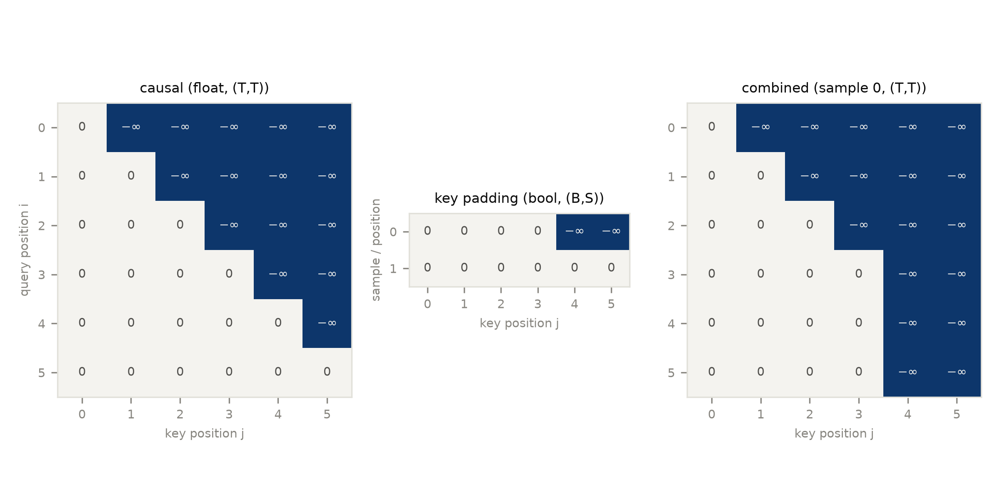
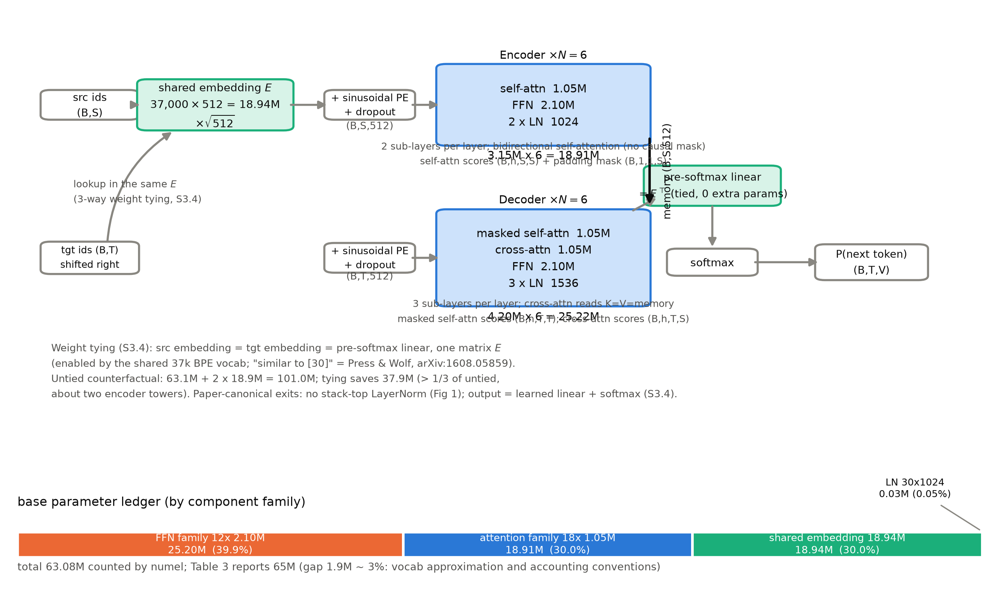

# 第 7 章 整机组装与 mask 全景

## 7.0 开篇：从全书到这里

上一章结束了零件讲解，五件组件已经齐备——缩放点积注意力（第 2 章式 (2.1)）、多头拆装（第 3 章）、三种角色的双塔接线（第 4 章）、正弦位置编码（第 5 章）、FFN 与残差 + post-LN（第 6 章式 (6.1)、(6.4)）。第 6 章末尾我们留下了三项任务：组装时 mask 怎么实现、三处权重共享的账怎么算、官方实现与论文还差在哪两处。现在进入装配阶段，组件已经齐备，图纸却还差最后一张——层内结构由§3.1—§3.3规定，§3.4继续补齐输入嵌入、输出映射与共享参数。

本章把这张图纸读透、照图装出一台完整的 Transformer，然后做三件事。整机粗图见导览 0.3 节、旅程地图位置见导览 0.4 节；本章装出的实物，就是第 4 章图 4.1 那张双塔——装完后，图上每个箭头都能落到一行代码。

先组装（7.1 节）：入口的查表嵌入、出口的共享线性 + softmax、三处权重共享的巧思，全部按 §3.4 的原文要求写入代码——原则是「组件零重写」，第 2-6 章的零件一个螺丝不动。

再把 mask 一次讲透（7.2 节）：整机的 forward 从此多出两个掩码参数，第 4 章一直当口头规则用的「谁能看见谁」，这里要写成张量和公式，连同它的两种形态、三条陷阱与一类未定义行为。

最后验收（7.3、7.4 节）：与 PyTorch 官方 `nn.Transformer` 同权重对拍、逐项对照超参，再逐项数清本实现的参数，并与 Table 3 报告的 65M 对照。

本章结束时你到达的位置是：手里有一台每个部件都亲手装配过的机器，读任何 2017 口径的 Transformer 实现都能逐行对号。但同时会看见一笔新账——教师强制训练可同时处理已知目标前缀的各位置，自回归生成却须逐词确定后续输入；本章未作复用的演示还会在每步重算整个前缀。这笔账本章先计算其开销，偿还的方案记在章末后续改造说明。机器装好还不能开机，点火要配方——那是第 8 章的事。

> **最小背景栏**
> - 已有知识：第 2-6 章全部组件（本章不再重复推导）；第 6 章 6.5 节的保真度澄清（论文 Fig 1 两塔出口**无栈顶 LayerNorm**——本章 7.3 节要把这条口径变成三档实验）；第 4 章表 4.2 的「谁能看见谁」三列（本章把它工程化）。
> - 本章无新增外部文献背景；涉及的两篇引文（Press & Wolf 的嵌入绑定；ConvS2S 的填充手法）在正文就地给出最小信息。

## 7.1 整机组装：§3.4 定下的入口与出口

开始装配时，先要读懂图纸。堆完 6+6 层双塔，其实只完成了 §3.1-§3.3 规定的层内结构；整机怎么进、怎么出，答案在 §3.4「Embeddings and Softmax」——总共四句话，值得逐句直读（v7 原文）：

> 「与其它序列转换模型一样，我们使用学习的嵌入把输入与输出词元转换为 $d_{model}$ 维向量。我们也使用通常的学习线性变换（learned linear transformation）与 softmax 函数把解码器输出转换为下一词元的预测概率。在我们的模型中，两个嵌入层与 pre-softmax 线性变换共享同一个权重矩阵，做法类似 [30]。在嵌入层里，我们把那些权重乘以 $\sqrt{d_{model}}$。」【来源：官方论文 v7 §3.4 逐句直读】

这段话定下四件事。其一，两侧入口都是查表嵌入，输出维度统一为 $d_{model}=512$——这是第 6 章 6.2 节残差维度约束的延伸：嵌入层也被拉到与主干同宽。其二，出口是「学习线性变换 + softmax」两步——The Annotated Transformer 将输出投影与 log-softmax 封装为 `Generator`；它返回对数概率，普通 softmax 则返回概率。这个模块名不是原论文术语【来源：Annotated Transformer 的 `Generator.forward`】。其三，三处权重共享。其四，嵌入乘 $\sqrt{d_{model}}$——第四件最轻，第 6 章 6.4 节已给过实测（初始 std≈1 的嵌入乘 $\sqrt{512}$ 后 std=22.62，而正弦 PE 各维幅值不超过 1；「与 PE 尺度匹配」属后世解释），此处不再展开。真正需要重点讨论的是第三件，值得单独拆开。

三个使用者，一张矩阵。编码器查它（src 词元 → 向量），解码器查它（tgt 词元 → 向量），出口的线性变换还要用它的转置（向量 → 词表打分）。共享的意思就是这三项工作由**同一个**矩阵 $E\in\mathbb{R}^{V\times d_{model}}$ 承担，于是整机的出口写成式 (7.1)：

$$
\mathrm{logits}=H\,E^{\top},\qquad P(\text{next token})=\mathrm{softmax}(\mathrm{logits})
\tag{7.1}
$$

| 符号 | 含义 | 张量形状（base） |
|---|---|---|
| $H$ | 解码器塔顶输出 | $\mathbb{R}^{B\times T\times 512}$ |
| $E$ | 三处共享的嵌入矩阵 | $\mathbb{R}^{37000\times 512}$ |
| $\mathrm{logits}$ | 下一词元打分 | $\mathbb{R}^{B\times T\times 37000}$ |

这意味着：出口不另造新参数，而是把那张「词 → 向量」的表转置后使用——塔顶输出与每个词的嵌入向量做内积，打分同时取决于方向与模长，不能仅按夹角排序；softmax 把分数变成「下一个词元」的概率分布。一张词典，正向查是编码，输出端将隐藏表示与整张词表逐行比较；转置读出并不是嵌入查表的逆函数。

「做法类似 [30]」的 [30] 是谁、凭什么类似，第 6 章 6.4 节留了账，这里予以说明：

> **【考据框】** v7 参考文献页直读核对：**[30] = Ofir Press & Lior Wolf, *Using the output embedding to improve language models*, arXiv:1608.05859**【来源：官方论文 v7 参考文献页直读（本书核对，2026-10）】。内容一句话：语言模型顶部的输出矩阵本身就是有效的词嵌入，**建议把输入与输出嵌入绑定（tying）**；论文还在翻译模型中提出三处绑定，结合联合子词词表，在所测设置中大幅减少参数而保持相近表现（§3.2、§4及Table 8）【来源：官方论文 1608.05859（正式发表为 EACL 2017；v7 著录的是 2016 年 arXiv 预印本，二手资料写「Press & Wolf 2017」指会议版）】。这与 Transformer 的用法完全对应：§5.1 的 37k 共享 BPE 词表（source-target 同一张表）正是「能共享」的前提，而 Press & Wolf在其研究设置下报告了绑定的效果；不能把经验比较写成任意BPE模型收益最大的证明。三个版本注记：① v1（2017-06-12）初稿的 §3.4 连出处都没标，「similar to [30]」是 v2（06-19）补入的引证；② v2 引入时它的编号是 [29]；v5 新增 [23] Luong et al.（multi-task，插于其前）使其顺移为 v7 的 [30]（同批新增的 Sukhbaatar 加在 [34]、Press & Wolf 之后，不影响编号）——跨版本查编号一律以 v7 的 40 篇为准；③ 对先例的判定应以明确引证为准：这里的引文指向 Press & Wolf，不能仅凭另一篇论文未设绑定章节就推断其所有实现都没有这一选择；例如后来 fairseq 的 `FConvDecoder` 已提供 `share_embed` 选项【来源：作者官方仓库 `fairseq/models/fconv.py`】。（版本考古，跳过不影响主线。）

### 7.1.1 共享的既是存储，也是训练约束

**三处共享使输入表示与输出分类使用同一组可学习坐标，节约两份嵌入参数，也让三条训练路径共同更新它。**要真正共享源、目标两侧的行，必须规定相同的token-ID映射；词表大小碰巧相同还不够。若两个词表中编号17含义不同，直接共用第17行就是额外的语义约束，不能称为无损实现替换。

把所有有效目标位置展平，$H\in\mathbb R^{M\times d}$，输出概率 $P\in\mathbb R^{M\times V}$，目标 one-hot 矩阵 $Y\in\mathbb R^{M\times V}$。先取有效位置交叉熵之和，且此处不加标签平滑，交叉熵对 logit 的梯度是 $P-Y$，所以输出分支对共享E的贡献为

$$G_E^{\rm out}=(P-Y)^\top H\in\mathbb R^{V\times d}.\tag{7.3}$$

这里的输出分支贡献指暂把 $H$ 看作已给定的中间量；$H$ 对共享 $E$ 的依赖由上游查表路径继续反传。若损失对 $M$ 个有效位置求平均，式 (7.3) 也要除以 $M$；第 8 章加入标签平滑后，$Y$ 换成平滑目标分布。输入分支则通过查表把每次出现该 ID 处的梯度累加到对应行，并包含嵌入乘 $\sqrt d$ 的链式因子。总梯度是 $G_E^{\rm src}+G_E^{\rm tgt}+G_E^{\rm out}$；正是同一个Parameter对象在三条路径上被使用，使自动微分将它们求和。共享不仅是少分配内存：原本三个矩阵可以独立变化，现在必须接受一个联合更新，这是节省参数所承担的表示约束。

转置也不是逆运算。E通常是高而瘦的 $V\times d$ 矩阵，$V\gg d$；多个词可能相关，$HE^\top$只是与各词行向量比较后得到V个分数。不同输入可能产生相近表示，需要靠训练和上下文区分，不能把输出解释成严格还原输入查表。

图纸读完，动手装配。原则一句话：**组件零重写**——多头注意力直接 `import` 第 3 章的 `MyMultiHeadAttention`，正弦位置编码用第 5 章的 `sinusoidal_pe`（interleave 排布，论文口径），FFN 与残差 + post-LN 包装用第 6 章的 `PositionwiseFFN` 与 `PostLNSublayer`。新写的只有三样：共享嵌入与 $\sqrt{d_{model}}$ 缩放的入口、层栈循环、式 (7.1) 的出口。

```python
# code/ch07/transformer.py 的 TransformerMT 节选（完整代码以文件为准；跨章 import 见文件头说明）
class TransformerMT(nn.Module):
    def __init__(self, vocab=37000, n_layer=6, d_model=512, h=8, d_ff=2048,
                 p_drop=0.1, stack_top_ln=False, max_pe=5120):
        super().__init__()
        self.d_model = d_model
        self.embed = nn.Embedding(vocab, d_model)               # 三处共享的同一个矩阵（§3.4）
        self.emb_dropout = nn.Dropout(p_drop)                   # §5.4：embedding 与 PE 之和
        self.enc_layers = nn.ModuleList(EncoderLayer(d_model, h, d_ff, p_drop) for _ in range(n_layer))
        self.dec_layers = nn.ModuleList(DecoderLayer(d_model, h, d_ff, p_drop) for _ in range(n_layer))
        self.top_norm_enc = nn.LayerNorm(d_model) if stack_top_ln else None  # 论文默认无栈顶 LN
        self.top_norm_dec = nn.LayerNorm(d_model) if stack_top_ln else None
        pe = sinusoidal_pe(max_pe, d_model, dtype=torch.float32)
        self.register_buffer("pe_table", pe, persistent=False)  # 第 5 章正弦 PE 预生成查表

    def embed_tokens(self, ids):
        """入口（§3.4/§3.5/§5.4）：查表 ×√d_model，加正弦 PE，再过 dropout。ids (B,L) int → (B,L,512)。"""
        x = self.embed(ids) * math.sqrt(self.d_model)           # (B,L) -> (B,L,512)：§3.4 的 ×√d_model
        x = x + self.pe_table[: ids.size(1)]                    # (B,L,512) + (L,512) 逐位置广播，形状不变
        return self.emb_dropout(x)                              # (B,L,512)
```

层栈循环是六个编码器层、六个解码器层的两次 `for`（掩码口径见 7.2 节），出口只有一行：`dec_out @ self.embed.weight.t()`——$(B,T,512)$ 右乘 $(512,37000)$ 得 $(B,T,37000)$，式 (7.1) 的 $E^{\top}$ 直接体现在代码中（三步都在 `TransformerMT` 的 `forward()` 里）。

这段代码里有三个口径要点。第一，`stack_top_ln=False` 是默认：论文 Fig 1 两塔出口直接输出、正文无栈顶 LN 记载（第 6 章 6.5 节已澄清的 canonical 口径），这个开关专为 7.3 节与官方对拍而设。第二，dropout 布点两处：每个子层输出（第 6 章 `PostLNSublayer` 内置）与「embedding 与 PE 之和」（§5.4 原文），后者就是 `embed_tokens` 末尾那行。第三，权重共享在代码里不是三份拷贝，而是**同一个嵌入权重参数在三个前向位置被使用**：查表两次（src/tgt），再以权重转置作输出投影；这里「转置」不是反向传播——默认去重的参数遍历对同一Parameter对象只计一次；逐键累加state_dict则需要防止别名重复，7.4 节的账本靠它兑现。

还有一处与第 4 章的对应关系需要再次说明：解码器的输入是**右移一位**的目标序列（`<bos>` 打头，第 4 章表 4.1 的错位结构），`forward(src, tgt_in)` 返回的 logits 与监督序列 `tgt_out`（去掉 `<bos>`、补 `<eos>`）逐位对齐——整机的输入输出契约，就是 $(B,S)$、$(B,T)$ 两个整数 id 张量，加 $(B,S)$、$(B,T)$ 两张 bool 填充掩码。

整机装配完成，再数一遍参数，看看共享究竟能省多少。以词表 37000 实例化整机、逐张量数参数（`transformer.py` 的 `exp_ledger()`，numel 计数）：不共享的反事实需要三份独立矩阵，合计 $63.1\mathrm{M}+2\times 18.9\mathrm{M}=101.0\mathrm{M}$；共享后 $63.1\mathrm{M}$——**一份 18.9M 的矩阵省了两份，砍掉不共享版的 37.5%（超过三分之一），省下的 37.9M 约等于两座完整的编码器塔（18.9M × 2）**【来源：本书实验（CPU，2026-10，numel 计数）】。对 2017 年的 base 而言，这是一笔可观的节省。这说明 Transformer 沿用了该绑定思路；本章只验证参数节省，没有进行共享与不共享的翻译质量消融。

## 7.2 mask 全景：一条规则与三种用法

整机的 `forward` 签名里还剩两个参数没讲透：`src_pad` 与 `tgt_pad`，连同解码器内部那张下三角禁区表，合起来是同一件东西——mask。第 4 章我们一直把「谁能看见谁」当口头规则用（表 4.2 的掩码列），装配线上它必须写成张量和公式。而原论文对它的全部说明只有两处：§3.2.3 的操作定义——「把 softmax 输入中对应非法连接的值全部置为 $-\infty$」（masking out (setting to $-\infty$) all values in the input of the softmax which correspond to illegal connections）【来源：官方论文 v7 §3.2.3】，以及 Fig 2 左图流程里 softmax 之前那个标注「Mask (opt.)」的可选框（第 2 章图 2.1 已按原图标签自绘）。把这句话写成公式，就是所有掩码的统一数学形式，式 (7.2)：

$$
\mathrm{Attention}(Q,K,V;M)=\mathrm{softmax}\!\left(\frac{QK^{\top}}{\sqrt{d_k}}+M\right)V,
\qquad M_{ij}\in\{0,\,-\infty\}
\tag{7.2}
$$

| 符号 | 含义 | 张量形状 |
|---|---|---|
| $M$ | 掩码偏置矩阵：$M_{ij}=-\infty$ 表示第 $i$ 个 query 不许看第 $j$ 个 key | $(L,S)$ 的扩展实值矩阵（取 0 或 $-\infty$，可广播到 $(B,h,L,S)$） |
| $L,S$ | query 序列长 / key 序列长 | 标量 |
| 其余符号 | 同第 2 章式 (2.1) | $Q$：$(B,h,L,d_k)$、$K$：$(B,h,S,d_k)$、$V$：$(B,h,S,d_v)$（整批口径；式 (2.1) 的 $n,m$ 即此处 $L,S$） |

这意味着：掩码是往打分表上叠的一张「禁区条」——格子填 0，照常参与权重分配；格子填 $-\infty$，在该行至少有一个可见位置、可见分数均有限且输入没有 NaN 时，softmax 后该格权重为 0，退出加权。「置 $-\infty$」与「禁止注意」因此是同一件事的两种说法。

在本章并行训练且带填充的实现中，可见性限制有两个来源，各自需要一张禁区表。来源一是**生成方向**：训练用教师强制（第 1 章 1.1 节），整句译文一次前向并行算完——这正是并行化红利的兑现——以零起始索引记目标输入 $y_0=\text{BOS},y_1,\ldots$，位置 $i$ 要预测 $y_{i+1}$；训练输入中位置 $i+1$ 已包含这个答案，故必须挡住所有 $j>i$ 的键（第 4 章式 (4.2) 的因果下三角）。

来源二是**批处理方向**：一个 batch 里长短句排列成同一个矩形，短句右端补 padding，padding键不应成为有效查询的读取来源；padding查询的输出还需从损失中排除。同年提出的 ConvS2S 也须阻止未来泄漏，只是限制施加在卷积窗口上。以宽度 $k$、步长 1 的因果卷积为例，在左侧补 $k-1$ 个零后，第 $i$ 个输出只读取 $i-k+1$ 到 $i$；右移输入后即可用于预测下一词。fairseq 的 FConv 解码器采用两侧各补 $k-1$、卷积后裁掉末尾 $k-1$ 个输出的等价方式【来源：作者官方实现 `fconv.py` 的 `FConvDecoder` 与 `LinearizedConvolution.forward`；原论文动机见1705.03122 §3.2】。用 $k=3$ 手算即可验证：两侧各补 2 后，输出比原序列多 2 位，裁掉末尾 2 位便恢复原长，留下的每个窗口都不越过当前位置。由此回到注意力，表 7.1 和图 7.1 将需要的可见性限制合在一起。

> **【考据框】** ConvS2S §3.2 原文写两侧各补 $k-1$，再从卷积输出末尾裁掉 $k$ 个；所读官方 fairseq 实现裁掉的是 $k-1$。按通常步长 1 的长度公式，两种写法相差一位。此处采用可直接核算且与该实现一致的因果构造，不替原文未交代的对齐约定补写理由。

| 掩码 | 谁用 | 语义 | 形状（bool 形态） |
|---|---|---|---|
| 因果掩码（causal mask） | 解码器自注意力 | 第 $i$ 位只许看 $j\le i$：挡未来 | $(T,T)$，上三角为 True |
| 填充掩码（padding mask） | 编码器自注意力 / 交叉注意力 / 解码器自注意力 | 键序列中的 padding 位不参与读取 | 源侧 $(B,S)$、目标侧 $(B,T)$，padding 位为 True |
| 组合掩码 | 训练时解码器自注意力 | 因果 $\cup$ 填充：既挡未来又挡填充 | $(B,1,T,T)$，两者按位或 |

表 7.1 三类掩码全景（自排；因果限制据 v7 §3.2.3，填充及组合为本书批处理实现）



图 7.1 掩码三态热图（自产，本书实验）：左=因果掩码（float 形态 $(T,T)$，$0/-\infty$）；中=填充掩码（bool 形态 $(B,S)$，两个样本、长度 4 与 6）；右=样本 0 的组合掩码（逐样本 $(T,T)$，因果 $\cup$ 填充；批量化即表 7.1 的 $(B,1,T,T)$）。深色格=$-\infty$（屏蔽），浅色格=0（可见）。注意右图中查询位 4、5 虽自身是 padding，仍能看见前 4 列——右填充 + 因果的组合不会产生全屏蔽行；左填充的无效查询、全 PAD 输入或其他额外限制则可能产生全屏蔽行（见本节末）

组合规则值得单独看一看，因为它有两种写法。bool 形态下合并是**按位或**，float 形态下合并是**相加**——两者数学等价，因为 $-\infty+(-\infty)=-\infty$、$0+0=0$，加法合并不产生新值。这一代数关系也可通过实现对照检查（[code/ch07/masks.py](code/ch07/masks.py) 的 `exp_combine()`）：把 float 因果与 float 填充手工合并成 $(B\cdot h,T,T)$ 传入 `nn.MultiheadAttention`，与「分开传 `attn_mask` + `key_padding_mask`」让官方内部自行合并相比，输出 `allclose=True`（max|Δ|=0.00e+00）；换成全 bool 分开传亦一致（max|Δ|=1.19e-07）【来源：本书实验（CPU，2026-10）】——所读 functional 实现将掩码规范为加法偏置后合并；这些输出对照验证数值等价，不能仅凭输出相同判定调用了哪条内部路径。工程小注：分开传时两种掩码 dtype 不一致会触发一条弃用警告（实测复现），该历史实验仍完成计算；为遵守接口约定，新代码应统一成同一形态。

### 7.2.1 从有效位置集合推到广播形状

**padding掩码控制的是键是否允许被读取，不自动把padding查询的输出清零。**设目标输入长度为T、每条样本有效键集合为 $\mathcal V_b$，第i个查询的允许集合为 $\mathcal A_{b,i}=\{j:j\le i\}\cap\mathcal V_b$。对应禁止表为

$$C_{b,i,j}=\mathbf1[j>i]\lor\mathbf1[j\notin\mathcal V_b].\tag{7.4}$$

因果项形状 $(T,T)$，键填充项先由 $(B,T)$ 变成 $(B,1,1,T)$，二者广播得到 $(B,1,T,T)$，再广播到各头。注意padding的轴落在最后的键轴；若误写到查询轴，反而会允许有效查询读取填充位。

例如两条目标前缀有效长度为3和5，右补到T=5。第一条索引为 3 的查询（第 4 个位置）虽为 PAD，仍可读键 0、1、2，输出通常非零。这不必破坏有效位置计算：后续所有层继续屏蔽PAD键，损失再忽略PAD查询，就不会将它当作有效训练目标。相反，仅设置 `padding_idx` 使PAD嵌入初值为零并不能替代掩码；位置编码、投影偏置及其他层都可能使该位置表示非零。

最后还要区分“禁止表”和“加法偏置”。不要用布尔表直接乘 $-\infty$ 构造偏置，因为合法位置的 $0\times(-\infty)$ 可产生NaN。应从浮点零张量开始，用 `masked_fill` 将禁止位置填成 $-\infty$，并确认每个有效查询仍有至少一个允许位置。

同一张掩码有两种写法：bool（True=屏蔽）与 float（屏蔽位 $-\infty$、其余 0）。在 `nn.MultiheadAttention` 一系（MHA、`nn.Transformer` 各层）里两者等价、True=屏蔽；但在 `F.scaled_dot_product_attention`（SDPA，第 2 章对照面）里 bool 的语义**相反**：True=参与，迁移时必须取反——本书实测 `~bool` 与 float 形态 `allclose=True`【来源：本书实验（CPU，2026-10）+ torch 2.13.0 源码 docstring】。

更隐蔽的是三维掩码的形状语义。对批量 MHA，三维 `attn_mask` 要求 $(B\cdot h,L,S)$；$(B,L,S)$ 只有在 $h=1$ 等尺寸恰好符合时才满足要求，四维表则不属于此接口。SDPA 接收可广播到分数张量 $(B,h,L,S)$ 的掩码，三维表按右对齐规则广播。例如 $B=2,h=8$ 时，MHA 的 $(16,L,S)$ 无法对齐 SDPA 的头维 8，因而报错；$B=1$ 时 $(h,L,S)$ 却可以合法广播，不能把前一个错误推广成一律报错（见 `exp_all_masked()`）。跨 API 搬掩码，形状和极性都要核对。

比语义反转更隐蔽的，是一个不报错的陷阱。构造 float 掩码的自然写法是 `masked_fill`，但若图省事在 bool 张量上直接 `masked_fill(mask, float("-inf"))`——bool 容器装不下 $-\infty$，它会被**静默替换为 True**；随后这张「bool 伪 float」参与加法时，True 被类型提升为 $1.0$——本应 $-\infty$ 的位置变成了 **+1.0 的加分项**：掩码不但失效，还反过来给禁区加分，全程无任何报错。本书实测（合并偏置 $(B,T,T)$ 里，查询位 4 看 padding 位 3：因果放行、填充应屏蔽）：正确写法在该格是 $-\infty$（屏蔽生效），陷阱写法是 $+1.0$【来源：本书实验（CPU，2026-10）】。正确写法是先创建一个 float 容器再填：

```python
# code/ch07/masks.py 的 exp_trap() 节选
kpm = padding_mask([3, 5], 5)                                  # (B,L)=(2,5) bool，True=padding
wrong = torch.zeros_like(kpm).masked_fill(kpm, float("-inf"))   # 陷阱写法：zeros_like 继承 bool dtype，(2,5) 仍 bool
right = torch.zeros(kpm.shape, dtype=torch.float32).masked_fill(kpm, float("-inf"))  # (2,5) float：-inf 存得住
```

> **【实现对照框】**（非原论文内容）torch 2.13.0 的两条工程事实，写作期实测。①**所据版本的 `F` 中不存在 `generate_square_subsequent_mask`**：`hasattr` 检查为 False，可用的是 `nn.Transformer.generate_square_subsequent_mask` 静态方法；仅凭不存在不能推断它曾被官方提供后再移除；写成 `F.generate_square_subsequent_mask(sz)` 会在所据环境中触发 AttributeError。本书自写因果掩码，一行即是论文口径：
```python
def causal_mask(sz):    # §3.2.3：上三角（不含对角线）为 -inf，其余 0；返回 (sz,sz) float
    return torch.triu(torch.full((sz, sz), float("-inf")), diagonal=1)
```
> 与该静态方法对拍 `allclose=True`【来源：本书实验 + torch 2.13.0 源码】。②本节五路径实验均为本机 CPU/MPS 的 fp32 实测；该次历史实验没有 CUDA 设备，未测 CUDA 或 fp16 下的全屏蔽行行为；后世融合注意力内核的机制在 Book6 展开，属实现定义，引用以 PyTorch 官方数值精度文档为准。

最后一类行为最难处理：一个 query 在合并掩码后**一个可见位置都没有**（全屏蔽行）。先补一个前置概念——「实现定义行为」（implementation-defined）：softmax 对全 $-\infty$ 行是 $0/0$，数学上未定义；不同实现可能返回NaN或显式约定的零向量；这属于函数边界处理，不是数学上存在多个等价结果。本书在 CPU 与 MPS 双设备实测五条路径（`exp_all_masked()`），结果见表 7.2。

| 调用方式（均将样本 0 的全部 key 屏蔽；部分调用另采输入） | CPU | MPS |
|---|---|---|
| `softmax` 对全 $-\infty$ 行（数学真相） | NaN | NaN |
| 手写 matmul+softmax（本书实现口径） | NaN | NaN |
| MHA `need_weights=True` | NaN | NaN |
| MHA `need_weights=False` | NaN | 0 向量 |
| 直接 SDPA（4D float 掩码） | 0 向量 | 0 向量 |

表 7.2 全屏蔽注意力行的五路径 × 双设备实测（自产，本书实验；M5 Pro，torch 2.13.0，fp32，2026-10）

表中有 NaN 和零向量两类观察，结果随调用方式、设备和版本变化；「依路径而定」是对差异的描述，不是第三种数值。该脚本只检查部分输出分量，未追踪内部内核，故表中保留调用方式，不凭 `need_weights` 或四维掩码反推必经路径。MHA 的输出投影若有非零偏置，即使注意力核心约定返回零，最终输出也未必为零。

还有更难处理的情况：历史布局加测使用相同数据与掩码，分别新建两份 MHA，但没有复制权重；观察到 `batch_first=True` 时为 NaN、`False` 时为零，因而不能声称这是只改变布局的严格对照。修订后的脚本先复制权重，再比较两种布局，并如实打印实际返回值；改变布局可能影响可选执行路径，但具体选中了哪条路径仍需另行追踪【来源：本书实验（CPU，2026-10）】。工程结论是防御性的：**为有效查询保证至少一个合法键；无效查询采用明确的处理约定并排除其损失**。当每条输入至少含一个有效起始词元、且没有额外限制时，右填充加因果掩码可保留合法键（图 7.1 右）。左填充的无效查询可能全被遮住；不能只在最终损失里忽略它们，却任由 NaN 进入后续层和反向传播。应在注意力运算前后给无效行规定有限输出，并确认有效位置的前向与梯度均有限。

把三类掩码放回整机图景作个收束：图 4.1 的双塔里，编码器塔内只贴填充掩码（双向可见是它的本性，第 4 章 4.1 节）；解码器自注意力贴组合掩码（因果 $\cup$ 填充）；交叉注意力只贴源侧填充掩码（源句是既成事实，没有未来可挡）。一张规则书，三种贴法——这就是本节 mask 机制的全部内容。

三类掩码贴好，整机就到了整体检查的阶段：把一个真实训练 batch 的完整旅程从头到尾走一遍。设 batch 为 64 个句对，批内最长源句 16 个词元、最长目标句 17 个词元（含句末 `<eos>`）——短句右端补 PAD、长短句排列成同一个矩形，右移后 `tgt_in` 与监督序列 `tgt_out` 都是 17 位。全程形状见表 7.3。与第 6 章表 6.3 的分工正在于此：那张表走的是 batch=1、无填充的单 token 通路（src=10、tgt=9）；这张表是整 batch 旅程，这里将已有 batch 轴从 1 扩为 64，并显式处理填充；padding 是序列轴上的无效位置，不是新增张量维度。

| 步骤 | 运算 | 输入形状 | 输出形状 | 说明 |
|---|---|---|---|---|
| 1 | 源批查表 ×√512 | (64,16) | (64,16,512) | int id 查共享 $E$（§3.4）；16=批内最长源句 |
| 2 | + 正弦 PE、dropout | (64,16,512) | (64,16,512) | PE (16,512) 逐位置广播相加 |
| 3 | 编码器自注意力（×6 层） | (64,16,512) | (64,16,512) | reshape 后换轴为 (64,8,16,64)→scores (64,8,16,16)；贴填充掩码 (64,16)→(64,1,1,16) |
| 4 | 编码器 FFN（×6 层） | (64,16,512) | (64,16,512) | 车间内扩展到 (64,16,2048) 后收回（第 6 章式 (6.1)） |
| 5 | 六层后：memory | (64,16,512) | (64,16,512) | 双向可见；供每层交叉注意力作 $K,V$ |
| 6 | 目标批右移查表 ×√512、+PE | (64,17) | (64,17,512) | `tgt_in`=`<bos>` 打头（第 4 章表 4.1 的错位结构） |
| 7 | 解码器掩码自注意力（×6 层） | (64,17,512) | (64,17,512) | scores (64,8,17,17)；组合掩码 causal (17,17)∪`tgt_pad`→(64,1,17,17) |
| 8 | 交叉注意力（×6 层） | Q (64,17,512)、$K,V$ (64,16,512) | (64,17,512) | scores (64,8,17,16)：行=目标位、列=源位；贴 `src_pad` |
| 9 | 解码器 FFN（×6 层） | (64,17,512) | (64,17,512) | 扩展到 (64,17,2048) 后收回 |
| 10 | 六层后：解码器输出 | (64,17,512) | (64,17,512) | 每层三子层各套残差 + post-LN（第 6 章式 (6.4)） |
| 11 | pre-softmax 线性 | (64,17,512)×(512,37000) | (64,17,37000) | 式 (7.1)：右乘 $E^{\top}$，零新参数 |
| 12 | softmax（逐最后一维） | (64,17,37000) | (64,17,37000) | 17 个位置各一份下一词元分布 |
| 13 | 训练：对 `tgt_out` 算损失 | (64,17,37000)、(64,17) | 标量 | 交叉熵直接接 logits；此时无需先做步骤12的 softmax，PAD监督位置不计损失 |

表 7.3 整机前向的整 batch 形状流转表（自排；base 配置，B=64、批内最长源句 16 / 最长目标句 17 词元；与第 6 章表 6.3 分工：彼为 batch=1 单 token 通路，此为整 batch 旅程——显式处理64个样本、填充掩码与损失掩码）

提炼表 7.3 的要点：第 6 章的三个数据流不变量在整 batch 下原样成立——各层与各子层接口宽度为 512；scores 一律「行=查询句长 × 列=键句长」（编码 $16\times16$、解码自注意 $17\times17$、cross $17\times16$）；逐位置操作保留序列轴，FFN内部改变特征轴。新增的形状规则只有两条：batch 维 64 在每个站点的第一维原样保持，两张填充掩码各贴各的句长（源侧 16、目标侧 17）；主干唯一一次变宽发生在出口（512→37000）。

## 7.3 官方对照：默认超参与原版结构的相同和不同

机器装好、掩码就位，到了验收时刻。整机的验收标准动作按全书对拍规范执行：与官方实现**同权重、同输入、同掩码**，比前向输出。对照对象 `torch.nn.Transformer`——PyTorch 在它的 docstring 里明说这是「按原论文实现的参考实现」【来源：torch 2.13.0 源码（torch/nn/modules/transformer.py）】。动手搬权重之前先做静态对照，把官方的默认设定与论文 base 逐项并排放（`exp_default_hyperparams()`），结果是个小小的惊喜：`nn.Transformer()` 全默认构造与 base 的对照断言共八项——编码层数 6、解码层数 6、$d_{model}=512$、头数 8、$d_{ff}=2048$、dropout 0.1、ReLU、post-LN（`norm_first=False`）——**逐项一致，八项全中**【来源：本书实验（torch 2.13.0 实测打印）+ 官方论文 v7 Table 3 base 行】。表 7.4 同时如实记下两处**数据流差异**、三项「论文无记载、实现自行决定」的自由度，以及一处模块边界。

| 项 | 论文 base（v7 Table 3/§3） | `nn.Transformer()` 默认 | 判定 |
|---|---|---|---|
| 层数 N（编码/解码） | 6 / 6 | 6 / 6 | 一致 |
| $d_{model}$ | 512 | 512 | 一致 |
| 头数 h（$d_k=d_v=64$） | 8 | 8 | 一致 |
| $d_{ff}$ | 2048 | 2048 | 一致 |
| dropout | 0.1 | 0.1 | 一致 |
| FFN 激活 | ReLU | ReLU | 一致 |
| 归一化摆位 | post-LN（式 (6.4)） | `norm_first=False` | 一致 |
| FFN 内部（ReLU 后、$W_2$ 前） | 无 dropout | 多一个 dropout | **差异 ①** |
| 栈顶 LayerNorm | **无**（Fig 1 两塔出口直出） | 有（encoder/decoder 各一） | **差异 ②** |
| 参数初始化 | 全文无记载 | xavier_uniform（dim>1 参数） | 论文未规定（注记） |
| LayerNorm $\epsilon$ | 未给值 | $10^{-5}$ | 论文未规定 |
| Q/K/V/O 偏置 | 未写记号（FFN 明确有 $b_1,b_2$） | `bias=True` | 论文未规定 |
| 词嵌入 / PE / 输出层 / 权重共享 | §3.4-§3.5 规定 | **不在模块内**（外围自理） | 缺失（外围补） |

表 7.4 官方默认超参 vs 论文 base 逐项对照（自排；torch 2.13.0 源码 + 实测 vs v7；一致七行〔层数按编码/解码各算一项断言，共八项〕、两处差异、三项自由度、一处边界）

静态对照之后是整机对拍。协议照全书规范：双侧 `eval()`（所有 dropout 变恒等——差异 ① 在 eval 下数值不可见，对拍不受影响）、固定种子、关闭 MHA 原生 fast path、SDPA 锁 MATH 后端。两处结构差异里的差异 ②（栈顶 LN）用开关对齐：给 `TransformerMT` 置 `stack_top_ln=True` 作为对拍档，把全部权重按第 3 章的 `in_proj` 打包规则搬进 `nn.Transformer`（编码器层按 4 个注意力投影、2 个 FFN 线性层和2个 LN 对应；解码器层按8个注意力投影、2个 FFN 线性层和3个 LN 对应），同输入（`exp_parity()` 里从嵌入之后喂的连续张量 `h_src`/`h_tgt`，$(B,S,512)$ 与 $(B,T,512)$，含 src/tgt 填充掩码与因果掩码）比输出，再分三档读数：

- **对拍档（本书 + 栈顶 LN vs 官方）**：max|Δ| = 2.56e-06，`allclose=True`（atol=1e-5）【来源：本书实验（CPU，2026-10）】——整机组装完成，验收通过。
- **论文档（本书无栈顶 LN vs 官方）**：max|Δ| = 2.68e-06。咦，与对拍档几乎一样小？原因值得写透：该实验中末层 LN 的增益为 1、偏置为 0，输入方差远大于稳定项，因此塔顶输出均值近零、方差接近 1（条件见第 6 章）。再接初始增益与偏置相同的 LN，变化很小；这里约 $10^{-6}$ 的差异是给定实验读数，不是所有输入与初始化的上界。这不是「差异不存在」，而是「差异在初始化时恰好隐形」。
- **把官方栈顶 LN 的 $\gamma/\beta$ 设为偏离初始值**（模拟训练后的漂移，$\gamma\in[0.5,1.5)$、$\beta\in[-0.5,0.5)$）：max|Δ| 立刻跳到 **2.11**【来源：本书实验（CPU，2026-10）】——这组人为设置的非初始参数让差异明显显现：每塔多 $2\times512$ 个参数与一次归一化，输出几何随之改变。

三条放在一起读，第 6 章 6.5 节那句 canonical 口径在这里变成了三档实验：**「论文 Fig 1 无栈顶 LN」是 canonical，torch 的栈顶 LN 属实现族谱差异**——本次初始化对照中的小差值不能消除结构差异；人为改变参数的实验则说明它有能力改变输出，并不等同于测过实际训练后的变化。同理，差异 ①（FFN 内 ReLU 后的 dropout）在 eval 下隐形，但训练时的数据流确实与论文不同——本书整机遵循论文口径不设此项，官方层的存在如实记入表 7.4。

初始化的注记也在此一并交代：**论文全文没有任何初始化方案记载**（已核查 v7），Xavier 是所读 PyTorch 实现对二维及以上参数采用的初始化，而非原论文要求；这里不以未经核实的实现承继关系解释其来源——复现报告里写「按论文用 xavier 初始化」是不严谨的，若实际照此初始化，应写明「对二维及以上权重使用 Xavier 均匀初始化，与所据 PyTorch 实现一致」【来源：官方论文 v7（无记载）+ torch 2.13.0 源码】。

至此对照的结论可以归纳为一句话：**`nn.Transformer` 是一个忠实的 base 参考实现，忠实到八项超参逐项一致；但它不是论文的等价物**——两处数据流差异与模块边界（嵌入、PE、输出层、权重共享全在外围）决定了「用它」与「复现它」是两回事。第 9 章的训练实验将用本书整机（论文口径）执行，官方层仅作本节的对照面。

## 7.4 参数量账本：逐项计数，再与 65M 对照

参数核算把整机拆成共享嵌入、各注意力投影、FFN与归一化四类。相同权重被调用多次仍只计一份，运行激活和生成缓存不算参数。用这套规则可从结构重建总数，也能指出我们与论文约数之间尚未解释的差额。

验收通过，交机前最后一道工序是把参数数清。第 6 章表 6.1 按明确配置用公式数过参数；整机组装完成后，可以换成**实例化后逐张量用 `numel` 计数**——方法本身就是 7.1 节权重共享自证的延续：通过去重的参数遍历逐张量计数，同一个 Parameter 只算一次。两口径互相印证，数字完全一致（表 7.5）。

数的过程值得亲手走一遍。单个注意力子层（$W^Q,W^K,W^V,W^O$ 四个 $512\times512$ 加偏置）1,050,624；单个 FFN 子层（$512\times2048$、$2048\times512$ 加偏置）2,099,712——FFN参数约为一份注意力子层的两倍（偏置使比例不恰好为2）（第 6 章 6.1 节说明过的事实，这里进行实际计数）；每枚 LayerNorm 只有 $\gamma+\beta=1{,}024$。编码器层小计 3,152,384、解码器层小计 4,204,032（多一个注意力子层与一枚 LN），各乘 6；再加三处共享的单份嵌入 $37000\times512=18{,}944{,}000$。**合计 63,082,496 ≈ 63.1M**，对 Table 3 的 65M 差 1.9M（约 3%）——论文未给构成明细，37k 词表本身是约数口径（词表每加 1000，参数加 51 万），本书沿用第 6 章的处理：**本实现总数精确为 63,082,496，家族占比也只对应这套配置；论文报告保留 65M，差额原因仍待核实**【来源：本书实验（CPU，2026-10，numel 计数）+ 官方论文 v7 Table 3】。

| 部件 | numel 计数 | 家族合计（占比） |
|---|---|---|
| 注意力子层 ×18（编码 6 + 解码自 6 + cross 6） | 1,050,624 / 个 | 18,911,232（30.0%） |
| FFN 子层 ×12（每层 1 个） | 2,099,712 / 个 | 25,196,544（**39.9%**） |
| LayerNorm ×30（每子层一枚） | 1,024 / 枚 | 30,720（0.049%） |
| 词嵌入（三处共享一份） | 18,944,000 | 18,944,000（30.0%） |
| **合计** | — | **63,082,496 ≈ 63.1M**（Table 3：65M） |

表 7.5 base 参数账本（自产，本书实验：整机实例化后 `numel` 逐项计数；与第 6 章表 6.1 公式口径互证一致；注意力账本的运行时侧见第 2 章图 2.2）



图 7.2 整机数据流与参数流（自绘，组装 + 账本视角）：上方为 §3.4 组装口径——src/tgt 查同一张 $E$、pre-softmax 线性即 $E^{\top}$（三处权重共享）、memory 供解码器每层交叉注意力、Fig 1 口径两塔出口无栈顶 LN；下方为按家族的参数账本堆叠条（numel 计数）。图中标注主干关键站点的形状：src $(B,S)$ → 查表+PE 后 $(B,S,512)$ → memory $(B,S,512)$ → 解码器 $(B,T,512)$ → $P$ $(B,T,V)$；两塔旁注记各自打分矩阵的形状（编码自注意 $(B,h,S,S)$、解码自注意 $(B,h,T,T)$、cross $(B,h,T,S)$）（逐站明细见表 7.3）。与第 4 章图 4.1（架构机制视角）、第 6 章图 6.1（单 token 通路视角）互为三面

读图 7.2 的账本条，三个主要家族占据绝大部分参数，但份额并不相等：**FFN 家族 39.9% 最大、注意力家族与嵌入各占 30.0%、LN 家族 0.049% 几乎不可见**。最不起眼的 FFN 是参数第一大户；而注意力家族的 18.9M 里不含任何「运行时账」——那是第 2 章图 2.2 的领地：取 batch=64、8 个头、源句与目标句都长 30、fp32 时，一张打分张量为 $64\times8\times30^2\times4=1{,}843{,}200$ 字节，即约 1.76 MiB；把 18 处同尺寸打分表的容量相加约为 31.6 MiB。两侧长度同时放大时，这部分按平方增长；它是张量容量账，不是实际峰值内存。**参数是静态的账，注意力还有一本随句长平方增长的动态账**——完整训练内存还要计梯度、优化器状态及其他激活等，不能只把参数和打分表相加就当作总开销；到推理时代还会开立第三本（章末后续改造说明），账本意识从本章起要随身带。

这里保留两种数值各自的含义：63,082,496是本书指定37000词表、偏置和共享规则后可复算的模型；65M是原论文报告的约数。未经真实词表与实现明细核对，不能把差额随意归给“若干偏置”——它们的数量也可以逐项计算，不能只靠候选原因凑数。复现任务首先要求自身模型的公式与参数枚举一致，再说明与论文规格尚有哪些差异。

数完 63.1M 只是静态部分。本章 `decode_step()` 是未作复用的演示：生成每个新词元时，它把**整段前缀**重过一遍解码器——`decode_step()` 每步都是 ys $(B,t)$ 进、下一词元分布 $(B,V)$ 出，不缓存任何中间量；以 $T=9$ 为例逐 token 解码，累计前向位置数 $1+2+\dots+9=45$，是一次整段前向（9 个位置）的 **5 倍**；$T$ 个词元的生成累计 $\tfrac{T(T+1)}{2}$ 个位置的计算，位置处理次数的比值随 $T$ 线性增长【来源：本书复算（形状算术，2026-10）】。这不是总耗时比：注意力还随前缀长度计算成对关系；此处 `decode_step()` 直接调用完整 `forward()`，连源句编码也每步重算，并且先算全部前缀位置的词表分布，最后才取末位。后续可先将不变的编码器结果移到循环外，再讨论更细的中间状态复用。「每生成一个词元要重算什么、哪些又能缓存不重算」——这本账在推理时代比参数账本更重要；K与V本来就有不同投影；保存哪些中间结果以避免重算，是后续执行策略，这本账到 Book3 第 6 章正式开立（本册第 9 章解码时会先撞见它的影子）。

## 7.5 本章小结

开篇提出的三项任务，本章已经逐一完成。组装：§3.4 的四件事（两侧查表嵌入、学习线性 + softmax 出口、三处权重共享、$\times\sqrt{d_{model}}$）把第 2-6 章的组件零重写地装成整机，[30] 的身份已从 v7 参考文献页核实为 Press & Wolf（arXiv:1608.05859，EACL 2017 会议版），共享省下 37.9M（不共享版 101.0M 的超过三分之一）。mask：收拢为式 (7.2) 的加法口径——因果、填充、组合三类，bool/float 两态，组合即「bool 按位或 = float 相加」；官方 API 的 True 语义反转、`masked_fill` 静默 +1.0 陷阱、全屏蔽行在五种调用中的两类观察（NaN / 0），以及 `F` 中未提供该 helper 的检查都已实测落表；一个 64 句对 batch 从 $(64,16)$ 到 $(64,17,37000)$ 的完整形状旅程收进表 7.3。对照：官方默认超参八项断言逐项一致、两处数据流差异与三项自由度如实入表 7.4，整机对拍 `allclose=True`（max|Δ|=2.56e-06），栈顶 LN 的 canonical 口径以三档实验证形（2.56e-06 / 2.68e-06 / 2.11）。账本：本实现以 numel 计得 63.1M，与论文65M约有3%尚未核销差额，FFN 家族 39.9% 居首，动态账（给定配置下打分表容量合计31.6 MiB，源/目标长度同比增加时按平方增长）与重算账（$T=9$ 时前缀位置处理次数为一次整段前向的5倍）双双开出数额。

**带走的心智**：即使忘掉细节，请留下三件东西。**其一，整机没有新零件——同一套零件的三份装配。** 6+6 层双塔里的 18 个注意力子层是同一个类的 18 次实例化，三种角色只差「Q/K/V 从哪来、贴哪张掩码」（第 4 章表 4.2）；读任何 Transformer 实现，先找它的装配表，而不是找新零件——本章新写的代码只有入口、层栈循环、出口三样，其余全是 import。**其二，mask 是「谁能看见谁」的规则书，内容只有 0 与 $-\infty$ 两行。** 谁写掩码谁定义可见性：因果挡未来、填充掩码挡住填充位、组合按位或；bool 还是 float、True 是屏蔽还是参与，都只是这本规则书的翻译问题——数学上只有一件事：往打分表上加 $-\infty$。**其三，账本从参数扩到激活。** 参数是静态的账（63.1M，数得清、数量确定）；打分矩阵是随句长平方长的动态账；自回归重算是逐词元累积的第三本——工程师看任何机器，永远同时数三本账。

到这里，组装段的第一站完成：机器立在桌上，主要结构已逐项对照 2017 年图纸，实现自由度与未核销差额也已注明。但还不能开机——点火要燃料与配方：学习率为什么要先热身再衰减（第 6 章欠账的限制来源在这里还），label smoothing为何在论文那组实验中使困惑度变差而BLEU提高，beam search 怎么在「多看几步」与「偏爱短句」之间找平衡。第 8 章把论文 §5 的训练配方逐项讲到「知道为什么」，第 9 章给这台机器接上数据、点火训练。

> **后续改造** **自回归串行**——因果掩码的另一面：训练时教师强制让全部位置并行（第 1 章埋的并行化红利在此兑现），推理时生成下一个词需先确定已生成前缀；掩码表达这一条件依赖而不是决定运行调度，且每步重算整段前缀（$T=9$ 时前缀位置处理次数为一次整段前向的5倍）。论文作者自己把这条写进了 future work：「Making generation less sequential is another research goals of ours」（§7，原文语法瑕疵保留）。两阶段调度与「先猜后验」的并行化解码在 Book6 展开。→ Book6第1章 / Book6第16—17章
>
> **后续改造 权重共享（tied embeddings）**——三处共享省 37.9M（超过不共享版的三分之一），但共享也把「输入表示、输出分类、对侧语言」三件事约束在同一套几何表示中。绑不绑、为什么绑、何时解开，这个小开关在 GPT-2 与 LLaMA 两代模型之间被拨来拨去，账在两册的差异清单里。→ Book2 第 4 章 / Book3 第 5 章

## 7.6 动手验证

- **入口命令**：
  ```bash
  python "code/ch07/masks.py"        # 实验一至四 + 图 7.1
  python "code/ch07/transformer.py"  # 超参对照 + 整机对拍 + 账本
  ```
- **预期产出**（固定种子，为历史参考输出；本次结果依运行版本与数值精度核对）：①`masks.py`：自写 `causal_mask()` 与 `nn.Transformer.generate_square_subsequent_mask` `allclose=True`、`hasattr(F,...)=False`；陷阱实验（`exp_trap()`）$-\infty$ vs $+1.0$；组合等价 `allclose=True`（0.00e+00 / 1.19e-07）；全屏蔽行五路径 × CPU/MPS 双设备表（表 7.2 原始输出）与 `batch_first` 布局加测（True→NaN、False→0 向量）。②`transformer.py`：超参逐项断言 8 一致 + 栈顶 LN 1 差异；对拍档 `allclose=True`（max|Δ|=2.56e-06）、论文档 2.68e-06、$\gamma/\beta$ 漂移档 2.11；账本：1,050,624 / 2,099,712 / 1,024，编码器层 3,152,384×6=18,914,304 + 解码器层 4,204,032×6=25,224,192 + 嵌入 18,944,000 = 63,082,496，反事实 101.0M（省 37.9M），重算账 45 vs 9（5 倍）。
- **验收点**：能把表 7.3 的每一行指到 `TransformerMT` 的 `forward()` 及其调用的对应代码行（入口 `embed_tokens()`、层栈 `run_encoder()`/`run_decoder()`、出口那一行转置乘）；能构造左填充的组合掩码，指出哪些无效查询成为全屏蔽行，并比较不同调用的实际输出；不能预设它们必定都返回 NaN；能把 `TransformerMT` 的 `stack_top_ln` 在 True/False 间切换并复述三档 max|Δ|（2.56e-06 / 2.68e-06 / 2.11）各自的含义；能在白板上默写表 7.5 的五行账；能说明 `batch_first=False` 时输入轴顺序应如何变化，以及为何不能把输入布局与内部执行路径简单等同（7.2 节布局加测）。
- **复现注意**：本章脚本不训练，也不需要数据集或检查点；无 MPS 时仅运行 CPU 部分。图7.1按组合掩码直接绘制，新图写入 `log/Book1-ch07/`；历史跨设备数值只作所据环境的记录，不能要求当前版本逐字复现。
