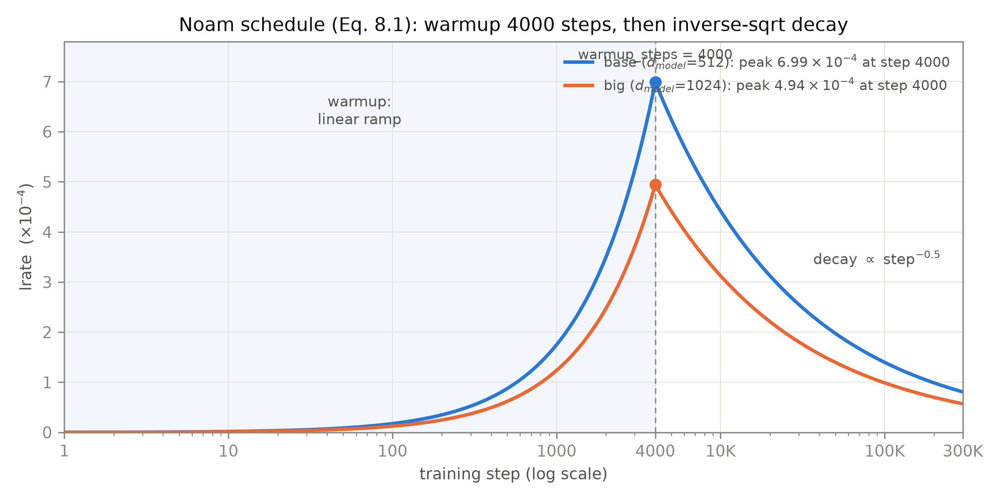
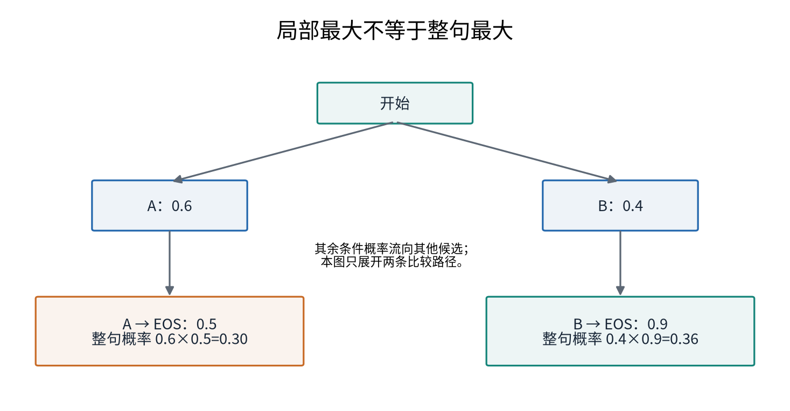

# 第 8 章 原论文训练配方：点火前的最后准备

## 8.0 开篇：从全书到这里

第 7 章结束时，整机已经装配完成（整机粗图见导览 0.3 节与第 4 章图 4.1 的双塔——本章的一切都围着这台机器转，只是不进它的机身）：三十个子层按图纸接好线，三类掩码有了统一的加法口径（第 7 章式 (7.2)），63.1M 参数已逐张量数清（表 7.5），与官方 `nn.Transformer` 对拍 `allclose` 通过。但它此刻只是一台昂贵的随机数发生器——权重处于随书实现给定的初始化状态，喂进去一句英语，得到的是尚未训练的输出分布，未必严格均匀。会「前向」不等于会「翻译」：从零件到机器，中间还差最后一道工序——**点火**。第 6 章还留下一个训练问题：预热怎样与归一化摆位、初始化和学习率共同影响早期更新？本章将从原论文的具体配方出发继续回答。

本章拆解原论文 §5（Training Setup）与 §6.1 的训练配方，把它从一份超参表还原成一系列有因果关联的决策：优化器与学习率怎么走（8.1）、训练目标算什么损失（8.2）、怎么防过拟合（8.3）、数据按什么口径切词组批（8.4）、训完怎么把译文取出来（8.5）。每一项都追问到「知道为什么」为止——论文没给理由的地方，如实标出，并给本书的解释口径。

同时交付三个可复用组件：Noam 学习率调度器、label smoothing 损失、带长度惩罚的束搜索——第9章会把前两项接入训练循环，把束搜索接入生成评测。8.6 节回头看一眼谱系：其中多项做法有明确前史；哪些被采用、哪些未在论文中报告，也要分别说明。

到本章结束，第 0 章旅程地图的「组装」段（第 7-8 章）走完：机身与点火程序都备齐。但要先提醒一点：这里的配方服务于论文在 8 张 P100 上进行的翻译实验，英德约450万句对，英法约3600万句对；论文并没有逐项披露每个数值的搜索过程——缩到一台笔记本电脑，它们还灵不灵？这个疑问第 9 章先在缩尺寸上原样执行（式 (8.1) 随宽度缩放学习率，但这不保证小数据训练稳定或最优），第 10 章再以趋势级判据复检各项设计的贡献；下一章先接上数据，再开始训练。

> **最小背景栏**（读懂本章所需的全部前置）
> - **交叉熵与困惑度**：语言模型每步输出词表上的分布 $p$，对真实的下一个词 $y$ 记负对数似然 $\mathrm{NLL}=-\log p(y)$，全语料平均即交叉熵损失。**困惑度（perplexity，PPL）** $=\exp(\text{平均 NLL})$，可粗读为「模型每一步平均在多少个候选词之间犹豫」。口径警示：论文 Table 3 的 PPL 是 per-wordpiece（按子词计）口径，表题专门注明勿与 per-word 口径比较——第 9 章报数沿用此口径。
> - **Adam 优化器**：Kingma & Ba（arXiv:1412.6980，ICLR 2015；原论文引作 [20]）。给每个参数维护梯度一阶矩、二阶矩的指数滑动平均（$\beta_1$、$\beta_2$ 是两个平均的衰减率），用它们逐参数缩放步长；$\epsilon$ 是防除零的小常数。库的缺省 $\beta_2=0.999$、$\epsilon=10^{-8}$——记住这组缺省，马上会看到论文两处都改了。
> - 已有知识：第 6 章 6.5 节 post-LN 的训练不稳（warmup 的限制来源）、第 7 章整机组装与 65M 账本、第 1 章最小背景栏的 BLEU 速览、第 7 章 7.1 节共享嵌入（37k 共享词表正是它能共享的前提）。

## 8.1 优化器与 Noam 调度：热机、冲峰、收油

Adam用梯度的一阶、二阶矩调整每个坐标的更新，Noam则安排整个训练过程的公共学习率。前者是坐标尺度适配，后者是随步数变化的配方；两者共同作用，不能把warmup或某个峰值独立称为稳定性的充分条件。

原论文报告 base 为 65M、big 为 213M；本书指定词表后的 base 实现是63.1M（第7章账本）。要更新这些参数，先得选优化器。论文用 Adam，三个参数 $\beta_1=0.9$、$\beta_2=0.98$、$\epsilon=10^{-9}$（§5.3）——后两处偏离库缺省的 0.999 与 $10^{-8}$，是复现时最常被忽略的两个细节【来源：官方论文 v7 §5.3】。为什么改？论文只给数字、不给理由——这是配方文档的常态，我们的纪律是照抄并如实标注。顺带记一笔「没有」：现代配方常客 weight decay，论文通篇未提（t2t 复现口径取 0.0）——复现报告写「按论文加了 weight decay」是不严谨的【来源：官方论文（未提及）+ config/源码（t2t）】。

### 8.1.1 Adam为什么还需要一条全局学习率

**Adam按坐标调整更新比例，学习率调度再控制整次更新的总体尺度。**二者不是替代关系。令 $g_t=\nabla_\theta\mathcal L_t(\theta_{t-1})$ 为第 $t$ 次更新前计算的梯度；将参数展平记作 $\theta\in\mathbb R^P$，则 $g_t,m_t,v_t$ 也都在 $\mathbb R^P$ 中。取 $m_0=v_0=0$，一阶矩、二阶原点矩及参数更新分别满足

$$m_t=\beta_1m_{t-1}+(1-\beta_1)g_t,\quad
v_t=\beta_2v_{t-1}+(1-\beta_2)g_t^2,\quad
\theta_t=\theta_{t-1}-\eta_t\frac{\hat m_t}{\sqrt{\hat v_t}+\epsilon}.\tag{8.5}$$

平方、除法和根号逐坐标进行；$v_t$不是减去均值后的方差。若从 $m_0=0$ 开始，展开为 $(1-\beta_1)\sum_{i=1}^t\beta_1^{t-i}g_i$。在梯度均值恒为 $\mu$ 的简化条件下，其期望为 $(1-\beta_1^t)\mu$，因此用 $\hat m_t=m_t/(1-\beta_1^t)$ 修正零初始化的偏差；$\hat v_t=v_t/(1-\beta_2^t)$ 同理。实际梯度分布随训练变化，不能将这一修正称为对当前真实梯度的精确估计。

以单坐标恒定梯度2为例，第一步在 $\beta_1=0.9,\beta_2=0.98$ 下得到 $m_1=0.2,v_1=0.08$，修正后为2和4，忽略epsilon时归一化更新约为1，再乘全局 $\eta_1$。二阶矩的衰减0.98使旧梯度平方的影响比0.999更快淡出；这是公式的性质，但原作者为何取此值仍不能仅凭这个解释代言。

知道 Adam 怎样调整各坐标之后，还要决定全局学习率怎样随训练变化。论文采用先升后降的两段式曲线。第 6 章介绍的后世分析为初期使用较小步长提供了一种解释：在其假设下，post-LN 靠近输出层的初始化梯度尺度偏大，较大学习率可能使更新不稳；后段衰减则逐步缩小更新尺度。这些解释不证明恒定学习率必然行不通，也不是原作者对选值动机的说明。原论文给出的具体规则是（§5.3 公式 (3)，本书编号 (8.1)）：

$$
lrate = d_{model}^{-0.5}\cdot\min\!\left(step\_num^{-0.5},\; step\_num\cdot warmup\_steps^{-1.5}\right)
\tag{8.1}
$$

| 符号 | 含义 | 形状·取值（base） |
|---|---|---|
| $lrate$ | 当前步的学习率 | 标量 |
| $d_{model}$ | 模型宽度——它出现在公式里 | 标量，512（big 1024） |
| $step\_num$ | 当前优化器更新步，从1起数 | 标量，base到$10^5$，big到$3\times10^5$ |
| $warmup\_steps$ | 升温步数 | 标量，4000（base/big 同值） |

这意味着：前 4000 步学习率从近零**线性爬升**——像冷车起步先小油门热机；第 4000 步之后自动换挡，按步数平方根的倒数**单调下降**——步数翻四倍、学习率减半，越走越保守。两段的交点恰在 $step\_num=warmup\_steps$ 处，$\min$ 只是切换开关。

公式里值得多看一眼的细节是 $d_{model}^{-0.5}$：**模型越宽，学习率越低**——公式会随宽度调整学习率，但不保证自动适配不同数据、批量与训练步数，第 9 章 $d_{model}=256$ 时峰值自动变为 $9.9\times10^{-4}$。这条曲线今天通称「Noam 调度」，名字的来历是一桩小考据，见本节末的框。

两段怎样交接也可直接推导。比较 $t^{-1/2}$ 与 $tw^{-3/2}$，后者不大于前者当且仅当 $t^{3/2}\le w^{3/2}$，也就是 $t\le w$。因此前段线性增长、后段反平方根下降；峰值为 $\eta_w=(dw)^{-1/2}$。函数在交点连续，但两侧导数不同，不是平滑曲线。把w翻倍，峰值还会下降到原来的 $1/\sqrt2$，所以改变预热长度同时改变了峰值预算。

这里的t是优化器更新次数，不是已见token数量。若改变梯度累积或批量，4000步对应的数据量和训练进程都会变化；不能只按模型宽度缩放就宣称与原实验等价。



图 8.1 Noam 学习率调度曲线（自产，本书实验：式 (8.1) 在 base/big 两档的取值，横轴为对数步轴、全程画到 big 的 30 万步）。浅色竖带是 warmup 段（前 4000 步线性升温），第 4000 步达峰后按 $step\_num^{-0.5}$ 收油；圆点标出两档峰值——base $6.99\times10^{-4}$、big $4.94\times10^{-4}$（本书复算，论文未给峰值数值）。数值与 [code/ch08/recipe.py](code/ch08/recipe.py) 的 `noam_lr()` 同源

曲线看图 8.1 比看公式快，但数字还需要亲手运行验证（[code/ch08/recipe.py](code/ch08/recipe.py) 的 `noam_lr()`，固定种子可复现）：$lrate(1)=1.75\times10^{-7}$，$lrate(1000)=1.75\times10^{-4}$，峰值 $lrate(4000)=6.99\times10^{-4}$（$512^{-0.5}\cdot4000^{-0.5}$，本书复算），$lrate(10^{5})=1.40\times10^{-4}$【来源：本书实验（CPU，2026-10）】。两段各自的「形状指纹」也验了：线性段 $lrate(800)/lrate(400)=2.0000$，严格翻倍；衰减段 $lrate(4\times10^{4})/lrate(10^{4})=0.5000$，严格减半——一条曲线、两段各有各的数学，$\min$ 在 4000 步无缝换挡。

再看一下它所占的比例：warmup 只占 base 全程的 4.0%（4000/100000）、big 的 1.3%——这是预热步数占比，不是训练安全性的数学保证，这笔比例后面还会出现。

预热的作用是控制训练早期更新，而非等待激活“自动稳定”后便万无一失。Xiong等2020年的分析在特定初始化与模型假设下研究了归一化位置和梯度尺度，并给出相应实验；它解释了预热为何可能有用，不能推出所有post-LN模型都必须恰好4000步，也不能保证pre-LN永远无需预热。原论文明确的是采用了这个配方，其普适性仍需条件化检查。

> **【考据框】「Noam 调度」的名字从哪来。** 论文通篇没有 "Noam" 一词——§5.3 只有公式 (3)。名字的书面证据只有两条字符串事实：其一，tensor2tensor 源码把这套调度编码为 `learning_rate_decay_scheme = "noam"`（`transformer_base_v1` 起）；其二，The Annotated Transformer（Harvard NLP，2018-04-03）把封装类命名为 `NoamOpt`。社区通行说法「以作者之一Noam Shazeer命名」，在 t2t 源码注释与 Annotated 行文里都找不到直接陈述——本书只陈述上面两条字符串事实，归因存疑处如实存疑【来源：config/源码 + 第三方源码直读（2026-10 核对）】。另外记住两个细节：Annotated 2018 版的 `get_std_opt` 辅助函数为 `NoamOpt` 传入 factor=2、warmup=4000——**不是**论文口径（论文等效 factor=1）；其 2022 重写版改用 `rate(step, model_size, factor, warmup)`；函数没有这些参数的缺省值，合成复制任务示例显式传 warmup=400，其他示例采用不同设置。引用一份实现的「默认超参」之前，先问它锚的哪一年、哪一版。

名字之外还有一笔系数账，通向 8.4 的主题。Google 自家的开源复现库 tensor2tensor 把这套调度写成 $5000\cdot d^{-0.5}\min(\cdots)\times0.002\times0.1$——三个系数相乘恰等于 1.0：t2t 最早一档配置（`transformer_base_v1`）与论文式 (8.1) **系数完全一致**，在相同数字索引下，两函数还差源码的 $step\_num{+}1$：t2t 从全局步0起算，本文公式从更新步1起算——step 1 处两版差一倍、step 100 处差 1%、step 4000 处只差 0.0125%（`recipe.py` 的 `demo_noam()` 打印的是相同数字索引之比；若把 t2t 的步 $g$ 与论文的步 $t=g+1$ 对齐，这两条公式相等，不能将索引错位当成实际第1次更新必然差一倍）【来源：config/源码（t2t `learning_rate.py`）+ 本书实验】。但 t2t 后来的版本就不再严格沿用这一配方——warmup、$\beta_2$、系数逐档漂移，全表留到 8.4 的表 8.3。

本章组件一：`NoamLR`。教学版就是上面的纯函数 `noam_lr()`；第 9 章 [code/ch09/train.py](code/ch09/train.py) 的 `NoamLR` 类是绑定优化器的应用版（每步在 `NoamLR.step()` 里先改 `param_groups` 的 lr、再 `opt.step()`）。两版在九个步点逐点全等（对拍实测通过）——同一条式 (8.1)、两种封装，第 9 章上机的是后者。

## 8.2 label smoothing：对错误答案留一点概率

标签平滑改变训练目标，让模型不再把全部目标质量压到单一类别上。它的无限数据最优分布一般不同于原始数据分布，因此存在NLL目标的取舍；有限样本中又可能通过正则化改善泛化。下面从目标分布推到损失和最优解，再解释为何PPL与BLEU可能不同向。

学习率定了，下一个问题：损失算什么。最自然的选择是交叉熵——每个训练位置使用参考词对应的 one-hot 目标；模型预测本身仍是整张词表上的分布。论文却在交叉熵目标中加入了一项调整：**label smoothing（标签平滑）**，$\epsilon_{ls}=0.1$。出处要引准：§5.4 的正文段落（粗体小节标题 Label Smoothing 之下，不是表注、不是脚注），Table 3 base 行同值，引文 [36] = Szegedy et al.《Rethinking the Inception Architecture for Computer Vision》（arXiv:1512.00567）【来源：官方论文 v7 §5.4 + 参考文献页】。

先建立直觉：故意对错误答案留一点概率，为什么反而有帮助？关键在两件事实之间的差异。**其一，翻译没有唯一正确答案**。同一句源文有多种合理译法，训练集却只把其中一种采样出来写成参考；有限数据上高容量模型可能把单个参考过度记忆；但期望交叉熵本身的最优解是真实条件分布，并不天然要求有歧义任务变成100%单一答案。需要防范的是有限样本中的过度确信，而不是交叉熵必然把真实歧义抹去。

**其二，评分指标根本不看概率有多尖**。BLEU（第 1 章速览过）计算候选与参考的 n-gram 重叠精确率，并带有短句惩罚；解码规程按概率选择或搜索候选（8.5节）；束搜索并非每步只取一个最大项。BLEU 不直接读取概率分布，但概率变化会改变搜索和最终译文，因而可以间接改变 BLEU。

两件事合起来：把「学会更不确定」写进训练目标，这是正则化动机的一种解释，但平滑并不知道哪些替代翻译合理；均匀分布甚至给不合理词分配质量，实际泛化效果需要实验。论文自己的话说得直白：「这伤害困惑度，因为模型学会更不确定（the model learns to be more unsure），但提升了准确率与 BLEU 分数」【来源：官方论文 v7 §5.4 直引】。

形式化只要两步。第一步，把目标分布本身改写（Szegedy 的构造，式 (8.2)）；第二步，对新目标算交叉熵——它恰好分解成两份旧损失的加权（式 (8.3)）：

$$
q'(k) = (1-\epsilon_{ls})\,\delta_{k,y} + \frac{\epsilon_{ls}}{K}
\tag{8.2}
$$

| 符号 | 含义 | 形状·取值 |
|---|---|---|
| $q'(k)$ | 平滑后类别 $k$ 的目标概率 | 标量（$\sum_k q'(k)=1$）；整张分布 $(K,)$、训练批形态 $(B,L,K)$（$K$ 即词表维，代码里记 $V$） |
| $\delta_{k,y}$ | 示性函数：$k=y$ 时取 1，否则 0 | 标量（0/1） |
| $K$ | 词表大小（全部类别，含目标词自己） | 标量，EN-DE 约 37000 |
| $\epsilon_{ls}$ | 平滑强度 | 标量，0.1 |

$$
H(q',p) = (1-\epsilon_{ls})\cdot \mathrm{NLL}(y) \;+\; \epsilon_{ls}\cdot\Big(-\frac{1}{K}\sum_{k}\log p_k\Big)
\tag{8.3}
$$

这意味着：式 (8.2) 把「全部押 $y$」改成「九成押 $y$、一成平分给所有人」——目标类拿到 $(1-\epsilon_{ls})+\epsilon_{ls}/K$（$K=10$ 的教学例实测 0.9100），其余各类各得 $\epsilon_{ls}/K$（实测 0.0100），总和恰为 1；这个平滑后的目标分布本身是一个 $(K,)$ 向量（教学例即 `smoothed_target()` 返回的 $(10,)$）。式 (8.3) 说明这个新目标等于「九成普通交叉熵 + 一成对均匀分布的交叉熵」——后一项对任何类别的零概率都给出无穷损失（$\epsilon_{ls}>0$），因此在理想最优解中保留正质量。有限精度实现仍须用稳定的 log-softmax，不能把理论正概率当作数值下溢不会发生的保证。实现对应以下核心步骤：

```python
# code/ch08/recipe.py 节选（式 (8.3) 的直接翻译：label_smoothing_loss()）
def label_smoothing_loss(logits, target, eps=EPS_LS, ignore_index=None):
    logp = F.log_softmax(logits.float(), dim=-1)               # (B,L,V) -> (B,L,V)：softmax 在词表维上
    keep = torch.ones_like(target, dtype=torch.bool) if ignore_index is None else target != ignore_index
    if not keep.any():
        raise ValueError("损失至少需要一个有效标签")
    safe_target = target.masked_fill(~keep, 0)                 # 如 -100 的忽略值不可直接用于 gather
    nll = -logp.gather(-1, safe_target.unsqueeze(-1)).squeeze(-1)  # (B,L,1) 挑列 -> (B,L)
    loss = (1 - eps) * nll + eps * (-logp.mean(-1))            # 两个 (B,L) 逐位加权 -> (B,L)
    ...                                                        # pad 掩蔽（布尔 (B,L)）挑有效位，均值 -> 标量
```

这段实现的形状账值得单独走一遍（表 8.1）。教师强制喂进整批句子，机器吐出的 logits 是 $(B,L,V)$——批内 $B$ 句、每句 $L$ 个位置、每个位置一份全词表得分（$V$ 即式 (8.2) 的 $K$）；两份中间损失都是逐位置的 $(B,L)$，pad 掩蔽是一张同形的布尔 $(B,L)$，最后汇总成一个标量用于反向传播。

顺带一个实现洞察：**平滑目标 $q'$ 从头到尾没有被显式构造**——式 (8.3) 的分解让 $(B,L,K)$ 的目标分布无需构造，gather 挑出一列、mean 沿词表维求平均，就完成了原本需要整张表的计算；若真把 $q'$ 显式造出来，白花的是一份 $(B,L,K)$ 的显存。

| 步骤 | 运算 | 输入形状 | 输出形状 | 说明 |
|---|---|---|---|---|
| 1 | $\log\mathrm{softmax}$（最后一维） | $(B,L,V)$ | $(B,L,V)$ | logits 变 log 概率；softmax 永远在词表维上做 |
| 2 | gather 挑真值列 | logp $(B,L,V)$；索引 $(B,L)\!\to\!(B,L,1)$ | $(B,L)$ | 式 (8.3) 左项 $\mathrm{NLL}(y)$：逐位置取出参考词那一列 |
| 3 | $\mathrm{mean}(-1)$ | $(B,L,V)$ | $(B,L)$ | 右项 $-\frac{1}{K}\sum_k\log p_k$：对均匀分布的交叉熵 |
| 4 | $(1-\epsilon_{ls})\times$第 2 步 $+\,\epsilon_{ls}\times$第 3 步 | 两个 $(B,L)$ | $(B,L)$ | 式 (8.3) 逐位落地 |
| 5 | pad 掩蔽（布尔索引） | 掩码 $(B,L)$；损失 $(B,L)$ | $(n_{valid},)$ | 填充监督位置不计损失；本章及第9章实现均支持，至少须有1个有效位置 |
| 6 | 均值 | $(n_{valid},)$ | 标量 | 反传用的损失值 |

表 8.1 label smoothing 损失的形状流转表（自排，对应 `recipe.py` 的 `label_smoothing_loss()`）。批形态以训练实况 $(B,L,V)$ 记——第 9 章 $V=8000$；无句结构的玩具任务是二维退化形态 $(N,V)=(2048,16)$，对拍里本章教学版吃三维 $(64,50,11)$、ch09 应用版先展平成 $(3200,11)$——全部运算沿最后一维，流转同理

### 8.2.1 为什么改变目标会改变最优概率

**平滑让无约束最优预测从真实分布r转向混合分布，给出了明确的目标偏移；有限样本下能否改善测试集仍是另一个问题。**对固定输入，设真实标签分布为 $r=(r_1,\ldots,r_K)$。对式(8.2)的随机标签取期望，得到 $\bar q=(1-\epsilon)r+\epsilon u$，$u_k=1/K$；期望训练损失就是 $-\sum_k\bar q_k\log p_k$。

取 $0<\epsilon\le1$、$K\ge2$，则 $\bar q$ 各项均为正，最优解位于概率单纯形内部。加上概率和为1的约束，用乘子求导：$-\bar q_k/p_k+\lambda=0$，所以 $p_k=\bar q_k/\lambda$；各项求和得 $\lambda=1$，从而 $p^*=\bar q$。等价地，$H(\bar q,p)=H(\bar q)+D_{\rm KL}(\bar q\|p)$，最小值在两分布相同时取得。KL非负可由 $-\log z\ge1-z$ 推出：逐项取 $z=p_k/\bar q_k$ 后加权求和，右端为0（零概率项按极限处理）。

如果评估仍按真实标签r计算NLL，使用平滑最优分布的代价为

$$H(r,p^*)-H(r,r)=D_{\rm KL}(r\|(1-\epsilon)r+\epsilon u)\ge0.\tag{8.6}$$

这解释下面0.7/0.3构造分布的闭式差值：先按新目标求最优解，再按原目标评估。它不证明有限模型、有限训练和测试分布中平滑必然伤害NLL；实际估计误差与过拟合可以改变比较结果。

梯度也能直观看到改动。对词表logit $z_k$，平滑交叉熵给出 $\partial\mathcal L/\partial z_k=p_k-q'_k$。当模型已对参考词过度集中时，该词梯度不再一味鼓励更尖锐。训练时应同时记录平滑损失与真实标签NLL，困惑度取后者的平均再指数化，不能直接对平滑损失取exp冒称同一PPL。

验证分两半，恰好对应双指标。**在下面的无约束最优分布比较中，真实标签NLL的代价可以闭式算出**：构造一个真值本身含噪的合成任务（$y=x{+}1$ 概率 0.7、$y=x{+}2$ 概率 0.3，词表 16），$\epsilon_{ls}=0$ 的理论最优 NLL 就是贝叶斯风险 0.6109 nats（PPL 1.842）；掺入 0.1 平滑后最优解变成 $p^{*}=0.9\,r+0.1/K$，在该平滑最优分布上按真实标签计算的 NLL 为0.7024（PPL 2.019），比真实分布本身的0.6109多约0.0916 nats。这个差值比较的是两种目标各自的无约束最优分布，不是任意训练结果都必须相差这么多【来源：本书实验（CPU，2026-10，含闭式推导）】。实测 500 步小训练：$\epsilon_{ls}=0$ 得 eval NLL 0.6245、$\epsilon_{ls}=0.1$ 得 0.7107，都接近上述两个理论参考值；其中0.7024不是原标签NLL对所有预测的下界（理论锚点与 500 步训练都在 `recipe.py` 的 `demo_label_smoothing()`）。

而**「利 BLEU」的一半，玩具尺度诚实地复现不出来**——合成任务的选词准确率两组同为 69.3%：该任务中两种理论最优分布都把概率最大的 $x+1$ 作为 argmax，但另一种标签仍会以0.3概率出现，所以这个构造不体现搜索译文的 BLEU 收益；有限训练下准确率是否相同仍是实测结果。

真证据在论文自己的消融里：Table 3 (D) 行，$\epsilon_{ls}=0$ 时 PPL **4.67，优于 base 的 4.92**（(D) 组最佳；消融行中仅 (C) 的 $d_{model}=1024$ 行 4.66 更低）、BLEU 25.3 反而更差；$\epsilon_{ls}=0.1$（base）PPL 升到 4.92、BLEU 升到 25.8；$\epsilon_{ls}=0.2$ 则 5.47 对 25.7——两个指标对效果的评价出现了分歧【来源：官方论文 v7 Table 3 (D)】。第 10 章的消融网格将设 $\epsilon_{ls}=0$ 行，在真模型上复检这条「双指标反向」。

> **【考据框】两笔引用勘误。** 其一，label smoothing 的出处论文是 Szegedy et al.《Rethinking the Inception Architecture for Computer Vision》，**arXiv:1512.00567**；外部资料常见的「Szegedy 1506.02672」系误引——arXiv:1506.02672 是一篇凝聚态物理论文（自旋冰材料 Ho₂Ti₂O₇ 的单离子各向异性），与 label smoothing 毫无关系，禁用【来源：arXiv 编目直核】。其二，Transformer 论文只给了 $\epsilon_{ls}=0.1$ 这一个数，**没写平滑分布怎么构造**——构造出自 Szegedy §7：$q'(k)=(1-\epsilon)\delta_{k,y}+\epsilon/K$，均匀质量撒在**含目标类在内的全部** $K$ 类上（「非目标类均分 $\epsilon/(V-1)$」是排除目标类的变体，不是 Szegedy 原文）。本书据该论文 §7 核对了这一构造。顺带一个细节：Szegedy 在 ImageNet（$K{=}1000$）上用的也是 $\epsilon=0.1$——两篇论文采用了相同的平滑数值；是否经过相同调参过程，原文未说明。

本章组件二：`label_smoothing_loss()`。教学版的核心步骤和形状流转见表8.1；它与第9章 `train.py` 的应用版都支持忽略填充监督位置。忽略某个位置不等于把 PAD 类从其他位置的均匀平滑分布中删掉；本书沿式(8.2)对全部词表类分配质量。随机 logits 上两版 `allclose`（对拍实测通过）——同一条式 (8.3)、两种封装，第 9 章上机的是后者。

## 8.3 dropout 布点：两处开关、三档数值与一段被删的正文

损失的两端都定了，接下来的一项正则措施是为了避免模型把训练集背下来。参数量与样本量提示我们关注泛化，但不能仅凭两个总数判断过拟合程度；论文的答案是 dropout（Srivastava et al. 2014，引作 [33]）：训练态每步随机把一部分激活置零、其余按 $1/(1-p)$ 放大，期望不变——相当于每步训练一个随机子网，测试时通常关闭dropout；非线性整网输出并不严格等于所有随机子网输出的均值。先用程序检查一次这个机制，再继续讨论（`recipe.py` 的 `demo_dropout()`）：`Dropout(0.1)` 作用在 20 万个 1 上，置零比例实测 0.1012、存活值按四位小数显示为1.1111（理论值为$1/0.9$）、总均值 0.9987【来源：本书实验（CPU，2026-10）】——「置零 + 逆缩放」两件事都在，期望守恒。形状上它仍是全书最省心的算子：逐元素作用，$(B,L,512)$ 进、$(B,L,512)$ 出——第6章关于逐位置处理及形状的区分在这里又多了一个例子，机检里那 20 万个 1 就是一张拍平了的激活张量。

对一个固定激活x，取 $0\le p<1$，令随机保留变量 $m\sim\mathrm{Bernoulli}(1-p)$，训练输出 $\tilde x=mx/(1-p)$。直接计算得 $\mathbb E[\tilde x]=x$、$\operatorname{Var}(\tilde x)=p x^2/(1-p)$：它在保期望的同时增加噪声。经过非线性网络f后，一般 $\mathbb E[f(\tilde x)]\ne f(x)$；“子网集成”是有用解释，不能作为逐式等价关系。

v7 §5.4 的 Residual Dropout 段明确列出**两类布点**。其一，每个子层的输出、在加回残差与 LayerNorm **之前**——第 6 章 `PostLNSublayer` 内置的就是它，整机共 30 个子层 30 个开关；其二，embedding 与位置编码**之和**上，编码解码两栈都有——第 5 章 5.2 节预告、第 7 章 `embed_tokens` 末尾落地的正是它。v7的该段只明确列出这两类布点，没有给出完整执行代码；本书按文字定义这两类dropout，不能由段落缺席证明历史训练绝未使用其他布点（第 7 章表 7.4 的差异①——官方实现 FFN 内 ReLU 后多一个 dropout，属实现族谱差异）。

数值三档：base $P_{drop}=0.1$（§5.4）；big $P_{drop}=0.3$（出处是 Table 3 **big 表体行**，不是表注）；**例外**：EN-FR 的 big 用 0.1 而非 0.3（§6.1 原文明言 instead of 0:3）【来源：官方论文 v7 §5.4/Table 3/§6.1】。为什么 EN-FR 反而减弱？论文没说。一个与数据规模自洽的推测是：EN-FR 有 36M 句对（EN-DE 的 8 倍），更大的数据集可能减轻某些过拟合压力，使较弱正则也能取得好结果；但最佳dropout仍受数据分布、模型与训练过程影响——这一推测不能代表论文的解释，如实标注。

> **【考据框】被删掉的第三小节：Attention Dropout 段存废史。** v7 §5.4 的首句是「我们在训练中采用三种正则化（three types of regularization）」，可正文数来数去只有两个粗体小节（Residual Dropout、Label Smoothing）。多出来的「第三种」是一段被删的正文：v1–v4 的 §5.4 原有第三小节 **Attention Dropout**——大意是「查询到键的注意力在结构上类似前馈网络里隐层到隐层的权重，softmax 输出的注意力权重恰似隐层激活；自然的推广是对注意力权重本身做 dropout（把 dropout 包在式 (2.1) 的权重矩阵外层）……注意力 dropout 对我们的句法分析实验有益」。v5（2017-12-06）起该段被整体删除，却留下两处未清理的痕迹：§5.4 首句的 "three types" 没改成 "two"；§6.3 仍写着「注意力与残差 dropout（both attention and residual, section 5.4）」，指向已删的段落。NeurIPS 会议版同样删段、同样留着 "three types"【来源：官方论文·八版全文 diff（2026-10-02，本书调研 notes/06）】。两点读法：其一，不能仅凭定稿段落删除断定历史机器翻译训练**不含**注意力dropout（t2t v2+ 的 `attention_dropout=0.1` 与被删段精神相通，但那不是论文定稿口径）；其二，定稿删掉的是一段配置说明，残留引用未同步清理；这不能单凭文字判断实际训练配置是否随之改变——版本考古的必要性，这是又一件物证。

版本漂移在配方这里值得一张总表。表 8.2 把八个版本（v1–v7 加 NeurIPS 会议版）与训练相关的主要差异收拢：41.x 的逐版矩阵、被删的段落、误印的表格、重排的引文，集中列在一张表中。

| 差异项 | v1（06-12） | v2（06-19） | v3（06-20） | v4（06-30） | v5–v7（12-06→） | NeurIPS 版 |
|---|---|---|---|---|---|---|
| §5.4 Attention Dropout 段 | 有 | 有 | 有 | 有 | **删**（留两处化石） | 无（"three types" 残留） |
| EN-FR big BLEU（摘要／§6.1 句／Table 2） | 41.0/41.0/41.0 | **41.2/41.17/41.0** | 41.0/41.17/41.0 | 41.0/41.0/41.0 | **41.8/41.0/41.8** | 41.0（三处一致） |
| §6.1 EN-FR big 特殊配置 | 无此句 | 不共享嵌入、$d_{ff}$=8192、$P_{drop}$=0.1 | 同 v2 | 只留 $P_{drop}$=0.1 | 同 v4 | 同 v4 |
| 脚注 4（$\sqrt{d_k}$ 方差论证，见第 2 章） | 无 | **新增** | 有 | 有 | 有 | 有 |
| Table 3 base $d_{ff}$（见第 6 章） | 误印 1024 | **修正 2048** | 2048 | 2048 | 2048 | 2048 |
| Table 3 (E) 行（见第 5 章） | 无 | **新增** | 有 | 有 | 有 | 有（与 v2+ 各版一致） |
| 引文编号（Adam／label smoothing／GNMT） | [18]/[32]/[34] | 逐版重排 | 逐版重排 | 逐版重排 | [20]/[36]/[38] | 自成一套（32 篇） |
| 配方数字（warmup、$\beta_2$、$\epsilon_{ls}$、$P_{drop}$、词表、beam、$\alpha$、checkpoint 平均） | 一致 | 一致 | 一致 | 一致 | 一致 | 一致 |

表 8.2 训练配方视角的版本差异对照（自排；【来源：官方论文·八版 PDF 全文 diff（2026-10-02，本书调研 notes/06）】）。表注三点：v6≡v7（文本层零差异，v7 仅元数据再提交）；引 41.8 须标「v5 起」，并注明 §6.1 正文句遗留 41.0——第 10 章 10.1 节展开；NeurIPS 版真正缺的是 §6.3/Table 4/Fig 3-5（成分句法分析整体删节），Table 3 本身与 v7 逐词一致

表 8.2 的最后一行单独点出：**表中列出的共同配方数字，在所比版本间保持一致**——warmup 4000、$\beta_2$ 0.98、$\epsilon_{ls}$ 0.1、$P_{drop}$ 两档、37k/32k 词表、beam 4、$\alpha$ 0.6、checkpoint 平均，七个版本加会议版全部一致。这不表示所有训练配置都未变：表中另列的 EN-FR 特殊配置句、attention dropout 说明和 FFN 宽度勘误也影响复现者怎样理解配方；结果数字与参考文献编号同样需要核对。这给复现者一个好消息（须同时说明采用哪一版文字和哪套实现）和一个提醒（照抄 v7 的**结果数字**之前，先查表 8.2）。

## 8.4 BPE 数据口径：37k 词表与「论文口径 vs 复现口径」第一课

优化器、损失、正则齐了，还差燃料本身：数据按什么口径切成词元。伏笔第 1 章埋得很深：Sutskever 的源端词表 160,000、目标端 80,000，表外的词只能记 UNK；Cho14b 的证据链里，「未登录词变多」与「句长变长」并列是性能退化的两大主因（1.2 节）。词级词表是个两难：词表小，UNK 满天飞；词表大，每步训练的 softmax——$(B,L,V)$ 张量的最后一维——要在几十万类上逐位重算，稀有词仍然得不到充分训练。

子词（subword）是出路，直觉一句话：**高频词整存，低频词切碎**。「the」这样的高频词值得独占一行词表；本书小词表中的「Nähe」（德语「附近」）拆成 N/ähe 也无妨——拼回来就行。德语尤其受益于这套切法：名词复合与词形变体海量，第9章介绍的早期8k分词探针中，Nähe→▁/N/ähe、Büsche（灌木丛）→▁Bü/sche，该早期探针报告训练抽样UNK率约1.9%（统计方法及其与正式项目配置的区别见9.2节）；这只是给定语料、字符覆盖和分词器设置下的观察，不代表任何8k BPE都能得到这一数值【来源：本书实验（第 9 章底座，2026-10）】。方法出处是 Sennrich et al.《Neural Machine Translation of Rare Words with Subword Units》（arXiv:1508.07909，ACL 2016）：把文本压缩领域的字节对编码（byte-pair encoding，BPE）改造成子词切分——从字符和词尾标记起步，在训练词内统计相邻符号对，反复合并最频繁的一对，直至达到设定合并次数等停止条件；本书使用的 SentencePiece BPE 工具则以目标词表大小等参数配置，具体约定在下一册展开。切分器怎么训练，本书当黑盒用，拆解欠账在章末。

论文自己的口径（§5.1 逐句）：EN-DE 用 WMT 2014 英德语料约 450 万句对，**shared BPE 约 37000 词元**——源语言与目标语言共享同一张词表；EN-FR 用大得多的 3600 万句对，切成 32000 word-piece 词表（GNMT 的 WPM 口径，引 [38]）。批也在这里规定：按近似句长分桶，每批约 25000 个源词元加 25000 个目标词元——按**词元数**而非句数组批，可使每批处理的有效词元数量较为接近；按近似句长分组还可减少填充，但不能据此保证梯度大小或方向更均匀（第 9 章缩尺寸后用 batch 64 句的简化口径，差异届时声明）。37k 共享词表还有一层结构含义，第 7 章 7.1 节已说明：三处权重共享的前提，正是两侧本来就用同一张表。

> **【考据框】§5.1 的 [3] 引错了人？** 论文写道「句子用字节对编码 [3] 编码，共享约 37000 词元的源-目标词表」——而 v7 参考文献 [3] 是 Britz et al.《Massive Exploration of Neural Machine Translation Architectures》（arXiv:1703.03906），一篇 NMT 超参的实验综述，不是 BPE 方法论文。BPE 的方法出处 Sennrich 论文其实引了——在 §4，被引作 [31]。这个 [3] 在 v1、NeurIPS、v7 三个版本里一致存在：要么是编号笔误（想引 [31] 写成 [3]），要么是有意引 Britz 的实验设置——论文内部无法判定，本书如实记为「疑似笔误」【来源：官方论文·多版本参考文献页直读】。教训与 8.2 的 1506.02672 一脉相承：**引文编号与引文内容要对账**，经典论文也有笔误。

把 §5.1 的 37k 记牢，再看 Google 自家开源库 t2t 的复现配置，本章的第二课就来了：t2t 的 WMT EN-DE 标准问题名叫 `translate_ende_wmt32k`——**约 32k 子词，用的还是 t2t 自研的 SubwordTextEncoder，不是 Sennrich 的 BPE**；README 自报「8 GPU 训 300k 步，BLEU 约 28」，是这个口径下的复现值【来源：config/源码（t2t README 直读）】。37k 对 32k 差得不大，但漂移不止词表一处：表 8.3 把论文配方与 t2t 四代配置并排——warmup 4000→8000→10000，$\beta_2$ 0.98→0.997，调度系数 1.0→2.0，优化器 Adam→Adafactor。没有哪一代「错了」——复现库在持续做工程演进；但「按论文复现」与「跑通官方库」是两件事，报数时必须声明用的哪套。第 9 章自训 8k 词表、第 10 章报消融，都按这条纪律来。

| 配置 | warmup | $\beta_2$ | 学习率调度（有效系数） | 词表口径 |
|---|---|---|---|---|
| **论文 §5（base）** | 4000 | 0.98 | 式 (8.1)，系数 1.0 | 37k 共享 BPE（Sennrich 系） |
| t2t `transformer_base_v1` | 4000 | 0.98 | legacy+noam：5000×0.002×0.1=1.0 | ~32k 子词（SubwordTextEncoder，自研） |
| t2t `transformer_base_v2` | 8000 | 0.98 | legacy+noam：5000×0.002×0.2=2.0 | 同上（dropout 拆三处各 0.1） |
| t2t `transformer_base`（v3，master 缺省） | 8000 | **0.997** | constant×linear_warmup×rsqrt 衰减，系数 **2.0** | 同上 |
| t2t TPU 版 | 10000 | — | Adafactor＋rsqrt 衰减 | 同上 |

表 8.3 论文口径 vs t2t 复现口径漂移表（自排；【来源：config/源码（t2t `transformer.py`／`learning_rate.py`／README 直读）】）。读法：论文数字只保证第一行；向下逐档，v1在步号对齐后还原式(8.1)；v2已将learning_rate改为0.2，连同warmup改为8000；v3保留有效系数2.0并改写调度组合、把beta2改为0.997；TPU配置再改用Adafactor。这是所读源码中命名配置的对照，不能仅凭master中的函数名断言每个历史发布版都完全相同

## 8.5 束搜索与长度惩罚：留四条路走迷宫，别偏爱短句

束搜索在每一步保留多个前缀，缓解逐词贪心过早放弃路径的问题；长度惩罚改变不同长度的最终排序。它仍是有限宽度的近似搜索，完成若干条句子并不意味着可立即停止。概率树和停止上界会把“搜什么、怎样比较、何时能停”连接起来。

训练配方到 8.4 全部就位。但 §6.1 还藏着配方的最后一段：模型训完，译文怎么「取」出来？解码不是训练的附属品——同一台训好的机器，解码规程不同，BLEU 可以差出一格；这一段里还有第 1 章预告过的那条直接传承关系。

先把前置概念搭完整：**束搜索（beam search）是什么**。想象走迷宫：入口是句首，每一步要在一块写着全词表（约 37000 个词）的路牌上选一个词往下走。最省事的走法是贪心——每步挑当前概率最大的出口，一直沿选定的路径走下去；它只顾眼前一步：第一步的局部最优可能通向越走越窄的死路，而当时只差一点的一条岔路其实通向坦途。束搜索的改法是**最多保留 $k$ 条活跃前缀**（束宽 beam size，论文取 4）：起步只有空前缀，此后把存活前缀各扩展一步，得到至多 $k\times V$ 个候选。本书按累计对数概率取前 $2k$ 个候选，其中遇到 `<eos>` 的进入完成区，最多 $k$ 个非 EOS 候选继续。最后按含长度项的最终得分比较已完成候选；若到达长度上限仍未结束，截断候选也按约定参与比较。

这幅图你可以默画出来：一棵不断加宽又不断剪枝的树，树的每一层最多留下4条活跃前缀，另外保存已经结束的候选。

落到张量上，这棵树每步只活两层：同一迭代的活跃前缀长度相同；第9章为每条输入分配 $k$ 个槽位，无效槽另用布尔状态标记，前缀张量形状为 $(b\cdot k,t)$，其中包含起始符，并非将不同长度活路用PAD对齐；一步扩展是给 $k$ 个前缀各取一份全词表分布 $(k,V)$（第 9 章 `decode.py` 的 `beam_search()` 批量版按 $b$ 句并成 $(b,k,V)$），$k\times V$ 个累积分排一次序、保留前 $k$ 条——「束」就是那道把 $V$ 收窄成 $k$ 的闸门。如果每一步只保留一个最高分后继，便是贪心；分开维护已完成与未完成候选的束搜索在 $k=1$ 时也可能与普通贪心不同；第9章当前的 `greedy_decode()` 已独立实现逐步 argmax，`decode_corpus(k=1)` 显式调用它。只有完成结果长度不同，最终输出批才在右侧补PAD。

紧接着第二个前置问题：**累积对数概率怎么比才公平**。概率是连乘：扩展一个前缀，总分就乘上一个不大于1的条件概率，对数分不会上升（概率恰为1时不变）——条件相同，**延长同一前缀的原始概率不会增加；不同完整序列则不能只凭长度判胜负**，不同序列的各步条件概率并不相同，因此有些长句仍可能得分更高；长度归一化针对的是搜索中常见的短输出倾向。GNMT 的解法（Wu et al. 2016，arXiv:1609.08144，§7 公式 (14)；本书写作前已下载 PDF、解压文本层逐字复核，本书编号 (8.4)）：

$$
s(Y,X)=\frac{\log P(Y\mid X)}{lp(Y)}+cp(X;Y),\qquad
lp(Y)=\frac{(5+|Y|)^{\alpha}}{(5+1)^{\alpha}}
\tag{8.4}
$$

| 符号 | 含义 | 形状·取值 |
|---|---|---|
| $s(Y,X)$ | 候选译文 $Y$ 对源句 $X$ 的最终得分 | 标量，越高越好 |
| $lp(Y)$ | 长度因子；$\alpha>0$时随长度增大，$\alpha=0$时恒为1 | 标量 |
| $\alpha$ | 惩罚强度：$\alpha=0$ 即不惩罚 | 标量，Transformer 0.6；GNMT 自用 0.2 |
| $cp(X;Y)$ | 对源位置覆盖不足施加非正惩罚，充分覆盖时为0（$\beta\ge0$） | 标量；Transformer正文未报告此项，本书不采用 |

这里的长度按本书解码协议计数：包含生成的 EOS，不含起始符 BOS；代码参数 `max_len` 却包含起始符，因此式(8.7)使用的生成上限是 $L_{max}=\texttt{max\_len}-1$。GNMT的覆盖项写作 $cp=\beta\sum_{i=1}^{|X|}\log\min(\sum_{j=1}^{|Y|}a_{ij},1)$，其中 $a\in\mathbb R^{|X|\times|Y|}$ 记录各目标步对源位置的注意力。当 $\beta>0$ 时，先沿目标步累计每个源位置的覆盖量，再截到1并取对数，覆盖不足便得到负分；$\beta=0$ 时直接禁用覆盖项，不计算 $0\times\log0$；这解释了它与长度折扣的分工，本书搜索只保留长度项。

这意味着：给长句的负分发一个随长度增长的折扣——每多走一步，就多减轻一点概率连乘累积的扣分。除数恰在 $|Y|=1$ 处取 1——一个词的输出免罚；分子里的 $+5$ 让折扣随长度平缓爬升：到 6 词，除数也只爬到约 1.44。$+5$ 是 GNMT 软化短句惩罚的平滑项（其 §7 的演化：先除长度、再除 $\mathrm{length}^{\alpha}$、最后到 eq(14)）。$lp$ 的数值直观（`recipe.py` 的 `length_penalty()` 实测）：$lp(1)=1.00$、$lp(7)=1.52$、$lp(10)=1.73$、$lp(20)=2.35$、$lp(50)=3.78$【来源：本书实验（CPU，2026-10）】。Transformer 论文在 §6.1 只写了一行——束宽 4、长度惩罚 $\alpha=0.6$，引 [38]——公式本体在 GNMT，其中明确报告的是长度项，未说明采用覆盖项；本书实现因此只用 $lp$，$\alpha$ 也是自家的值。

短句偏置可以直接观察，手动构造一个打分器就能看到（`recipe.py` 的 `short_bias_demo()`；六个内容token后接EOS，初始0.55后有五次0.9转移）：场景设定——第 1 步直接出 `<eos>` 的概率 0.35，一条含6个内容词元及EOS、共7个生成词元的路径，全程概率 $0.55\times0.9^{5}\approx0.325$。纯对数分：短句 $\log 0.35=-1.0498$ 胜、长句约 $-1.1246$ 败；换 $\alpha=0.6$：长句得 $-1.1246/1.5157\approx-0.7420$，翻盘【来源：本书实验（CPU，2026-10）】。

这里有个实现洞察值得单独说明：束搜索进行中，所有活路长度同步增长，同一步同长度活跃候选的 $lp$ 相同——**此集合内部两种排序等价，但跨长度比较、提前停止和截断时仍须使用完整得分规则**。所以同长度活路的步内剪枝可用原始logP；EOS候选进入完成区和计算停止上界时，都要立即使用各自长度对应的完整分数，不能等搜索全部结束才处理；第 9 章的批量张量实现（打分 $(b,k,V)$、活路 $(b\cdot k,t)$（同一迭代含BOS的前缀宽度为$t$）、每句累积分 $(b,k)$），用的也是这个性质。

```python
# code/ch08/recipe.py 节选（式 (8.4) 与定稿打分：length_penalty()；定稿发生在 beam_search() 内）
def length_penalty(length, alpha=ALPHA):
    return (5.0 + length) ** alpha / 6.0 ** alpha      # lp(Y)：标量 |Y| -> 标量；α=0 时恒为 1（纯 logP）

# beam_search() 内部：EOS 候选以「累计 logP / lp(自身长度)」的得分定稿入成品区——(k,V) 打分、标量定稿
```



图8.2 在第一步A的概率更高，但两步完整路径中B更高。每条边是条件概率，路径概率相乘；不把每步局部最大误当作整句最优。

### 8.5.1 搜索近似与停止条件必须分开

**束搜索扩大了探索范围，但有限束宽仍会丢弃未来可能更好的前缀；长度惩罚又改变了完成候选的比较规则。**先看不带长度项的两步树：第一步A概率0.6、B概率0.4；A后EOS概率0.5，其余两个后继各0.25；B后EOS概率0.9，其余后继合计0.1。贪心先选A，完整路径概率0.3；保留两条路径后能选出B→EOS，概率0.36。这说明看一步的局部最大不等于整句最大；更深的树仍可能使有限beam遗漏真正最优路径。

再看停止。若采用非负 $\alpha$、没有额外正奖励、生成长度最多 $L_{max}$，活跃前缀累积对数概率为 $\ell\le0$。未来增加的log概率不为正，因此任意完成续串满足

$$s_{\rm future}\le\frac{\ell}{lp(L_{max})}.\tag{8.7}$$

分母取最大允许长度，给负分最乐观的折扣；这是一条宽松上界。如果当前最好完成分数已经不小于所有存活前缀的上界，才可针对这些存活路径安全停止。只因已有k条EOS候选就停，没有这个保证；但即使满足上界，也不能找回此前被beam剪掉的路径。若加入其他奖励、改变长度项或允许无限输出，这条上界要重新推导。

旧教学版与批量版都曾按“完成候选已达k条”停止，两者对拍一致只能说明实现相同，不能证明该停止准则正确。配套代码现按式(8.7)处理，并用可枚举小树与教学/批量对照验证。历史翻译BLEU保留原解码版本与条件，不把它改称新版搜索结果。长度到上限仍未遇到EOS时，还需明确将该前缀视作截断结果，而非冒称模型已自然结束。

**血统与调参的谱系**（兑现第 1 章的两处预告）。GNMT 自用参数：束宽 8–12、$\alpha=0.2$、覆盖惩罚 $\beta=0.2$，实测把单模型 En-Fr 从纯概率解码的 30.3 BLEU 提到 31.4（+1.1）【来源：官方论文 1609.08144 §7/Table 2（本书 PDF 复核）】。更早的 Sutskever 就报告过「beam=1 已不错、beam=2 拿走大部分收益」（第 1 章 1.1 节埋的钩子）【来源：官方论文 1409.3215 §3.2】；GNMT 也自述束宽收到 4 或 2 只有轻微负效应【来源：官方论文 1609.08144 §7（本书 PDF 复核）】。Transformer 取 beam=4，站在两代前人的经验之上，再在自家 dev set（newstest2013）上把 $\alpha$ 调到 0.6（§6.1 明言这组超参是 dev 上实验选定的）【来源：官方论文 v7 §6.1】。一条数字口径提醒：GNMT 文中「$\alpha\in[0.6,0.7]$ 通常最好」说的是**早期**「除以 $\text{length}^{\alpha}$」启发式的调参区间，不是 eq(14) 的最优区间——同样写0.6不表示两种长度公式给出相同的候选分数，不能把一个公式的调参区间直接移给另一个（PDF 复核新增的口径）。

最后一小项：**checkpoint 平均（checkpoint averaging）**。base 取最后 5 个 checkpoint（每 10 分钟一存）做**参数平均**，big 取最后 20【来源：官方论文 v7 §6.1】。注意它不是 ensemble：ensemble 平均的是各模型的**输出**，这里平均的是**权重本身**——同一组形状的参数张量逐个取算术平均（每个权重的形状都不变，变的是取值），若这些checkpoint仍在相近的参数区域，平均可能减小部分波动；跨不同训练或不同参数对齐的模型平均可能很差，非线性模型也不满足平均权重=平均输出。两个口径注记：Table 3 的消融实验**不做** checkpoint 平均（表题写明），第 10 章沿用此口径；推理最大输出长度设为输入长度 +50、能提前终止就提前终止（§6.1）。

本章组件三：束搜索本体。教学版（`beam_search()`，逐句 Python 循环）与第 9 章 `decode.py` 的 `beam_search()` 批量张量版同协议对拍：确定性打分器上 3 句构造任务，两版最优假设逐句相同、且都等于构造正解（实测三项全过）【来源：本书实验（CPU，2026-10）】；该批量版此前另与朴素参考实现 200/200 句一致（第 9 章底座实测）。同一算法、两种工程形态，第 9 章上机的是后者。至此三块仪表齐了——它们不装在机身上，挂在点火台上：下一章会把`NoamLR`和`label_smoothing_loss`接入训练，再用`beam_search`完成解码，每一行都能回到本章找到出处。

## 8.6 前史配方对照：2017 年的配方站在什么之上

至此 §5 与 §6.1 的配方逐项拆完。回过头看，这套配方并非凭空产生——把四代训练配方并排放（表 8.4），谱系一目了然。

| 配方项 | Sutskever 2014 | GNMT 2016 | ConvS2S 2017 | Transformer 2017 |
|---|---|---|---|---|
| 优化器 | SGD，无动量 | 异步12副本、每批128；前60k步Adam，随后SGD | Nesterov 动量 0.99 | Adam（$\beta_2$=0.98、$\epsilon$=$10^{-9}$） |
| 学习率策略 | 0.7 起步，第 5 个 epoch 后每半 epoch 减半 | WMT En-Fr：Adam 0.0002转SGD 0.5，1.2M步后每200k步减半，继续800k步 | 0.25；验证集不降则每 epoch 降一个数量级 | 式 (8.1)（warmup 4000＋平方根倒数衰减） |
| 梯度防护 | 范数裁剪（阈值 5） | 范数裁剪（阈值5，§8.3） | 范数 >0.1 即重归一化 | 论文未记载 |
| 特殊技巧 | **源句逆转** | **RL 精调**（GLEU 奖励；En-Fr 38.95→39.92，En-De 略降；未上生产） | — | label smoothing 0.1＋v7段落列出的两类dropout布点 |
| 数值精度 | 此处未据原文核定各算子位宽 | 训练使用全精度浮点；推理以8-bit权重/乘法及16-bit循环状态、逐元素运算为主，矩阵乘法用更宽累加器 | 此处未据原文核定各算子位宽 | 论文按GPU单精度能力估算训练FLOPs，未据此核定每个算子的实际位宽 |
| 解码 | beam 12（beam=1 已不错、beam=2 拿走大半收益） | beam 8–12、$\alpha$=0.2、$\beta$=0.2（eq(14)，+1.1 BLEU） | beam 5＋长度归一化 | beam 4、$\alpha$=0.6＋checkpoint 平均 |

表 8.4 四代训练配方对照（自排；均为各论文自报口径，「论文未记载」指通篇无提及，「—」指调研未录得该项记载、不作「没有」解【来源：官方论文 1409.3215／1609.08144／1705.03122／1706.03762v7，调研 papers/02、papers/03 已核】）

读表的三个观察。**其一，继承是主流**：束搜索加长度惩罚直承 GNMT——连「$\alpha$ 在 dev set 上调」的做法都一样；label smoothing 承自计算机视觉（Szegedy 在 ImageNet 上 $K=1000$、$\epsilon=0.1$；Transformer也取0.1，但原文未说明是否经历相同调参过程）；Adam 承自 Kingma & Ba；BPE 承自 Sennrich；输入输出嵌入共享承自 Press & Wolf（第 7 章 7.1）。

**其二，这里值得辨认的是结构与配方的组合**：原论文把先线性预热、再反平方根衰减的调度用于这套 post-LN 模型，并报告了训练结果。它提供了可复现的起点，却未证明这是保证深层训练稳定的最小方案，也不能由本表单独判断每个技巧是否首创。

**其三，训练目标与推理数值格式要分别比较**：GNMT 用强化学习按评测精调（GLEU 奖励，En-Fr 38.95→39.92，但 En-De 略降、人工评测几乎不变，最终未上生产），又用 8-bit 定点量化换吞吐（第 1 章考据框辨析过：8-bit权重与乘法、16-bit循环状态及逐元素运算，矩阵乘法另用更宽累加器；softmax和注意力并未量化，不能统称全机int8或fp16；所测配置损失0.0072 log-PPL）；ConvS2S 用 Nesterov 动量配精细的梯度范数控制。Transformer正文报告的是带标签平滑的交叉熵训练，没有报告GNMT式RL精调或该量化推理方案；未报告不能写成作者有意拒绝。GNMT本身在全精度训练时加入裁剪约束以便量化推理，已经说明训练准备与推理位宽是两个环节。后来低精度训练、低精度推理及按评价目标精调都发展出更多方法，分别在后册讨论。→ Book4第7章、Book6第12—13章

## 8.7 本章小结

开篇我们站在装好的整机前问：这台机器用什么点火、怎么点？本章把论文 §5 与 §6.1 的配方还原成一系列有因果关联的决策，并交付了三块仪表。学习率：Adam 配式 (8.1) 的两段曲线——前 4000 步线性升温到 $6.99\times10^{-4}$（base，本书复算），再按步数平方根倒数收油；预热限制早期更新，效果与归一化、初始化及训练预算有关（8.1）。训练目标：交叉熵掺一成均匀——label smoothing在指定最优分布比较与论文实验中呈现PPL与BLEU差异，不能将两者一般化为固定交换比例；玩具任务的闭式NLL差值0.0916 nats与论文PPL 4.67→4.92、BLEU 25.3→25.8是两套不同证据，不能互相换算（8.2；损失张量从 $(B,L,V)$ 收窄到标量的全程见表 8.1）。正则：v7 Residual Dropout 段列出两类布点（30 个子层输出＋两侧嵌入与 PE 之和）、三档数值，外加一段被 v5 删掉的第三小节与两处化石——表中列出的共同数值保持一致，特殊配置与文字变化仍须分别核对（8.3、表 8.2）。数据：37k 共享 BPE 的论文口径对着 t2t 32k 子词的复现口径，「论文口径 vs 复现口径」的第一课（8.4、表 8.3）。解码：束宽 4 留四条路走迷宫，GNMT eq(14) 的长度惩罚矫正连乘的短句偏置，checkpoint 平均在权重空间取质心（8.5）。三块仪表——`NoamLR`、`label_smoothing_loss`、`beam_search`——都与第 9 章的应用版逐项对拍一致。

**带走的心智**：即使忘掉细节，请把这三幅画留下。**第一，学习率曲线是一条点火程序**——热机、冲峰、收油；见到任何 warmup，先别背数字，先问「这台机器哪里需要热机」——后来的分析指出归一化位置与初始化是相关因素；2017年论文报告具体配方，没有给出这一后世理论。**第二，训练目标与评价指标是两回事**——PPL 奖励诚实的概率，BLEU 只看选出的词；两者发生冲突时想清楚你为谁服务：论文这组消融中，平滑使PPL变差而BLEU提高0.5；这提示两种指标测量不同性质，不是一条固定的交换规律。日后你面对任何「为指标而设的损失」——包括后世按人类偏好调模型的时代——先问同一个问题。**第三，解码要同时考虑候选保留、评分与停止**——有限束宽决定能探索多少前缀，长度项调节不同长度候选的比较，但不能保证更长译文一定更好；这套 2017 年为翻译机设计的解码哲学，到开放生成的年代怎么改写，后续改造说明里有地址。

到这里，旅程地图的「组装」段（第 7-8 章）收官：机身（第7章的整机、掩码与63.1M实数账，另与论文65M报告值对照）与点火程序（本章的五件事与一条谱系）都已在手。第 6 章末欠账的另一半也在 8.1 兑现：预热、归一化与优化初期更新之间的联系已得到有条件的解释，手术本身留在后续问题地图上（→ Book2 第 4 章）。下一章点火：数据管道（Multi30K、自训 BPE-8k）、训练循环（调度与损失上机）、GRU 双 baseline、束搜索解码与按句长分桶的评测——那些句长桶会让我们检查第1章提出的容量问题，也要求我们把历史实现误差、模型容量与训练差异分开。

> **后续改造** **BPE分词**——本章与第 9 章把分词器当黑盒用了三次（口径辨析、自训调用、切分演示）：BPE 词表怎么从语料里「长」出来、压缩率与 unk 率的账怎么算，具体机制将在下一册拆解——届时回收第 9 章的「约 3.7 字符/piece、unk 约 1.9%」当验证算例。→ Book2 第 2 章
>
> **后续改造束搜索与长度惩罚**——beam 在这里用于翻译的近似最大分数搜索；它并非翻译专有，也不以小词表为定义条件。开放生成中常见温度、top-p等采样策略，它们选择的分布与优化目标需要另行说明。投机解码也可能一次处理多条候选，但这一表面相似不足以证明它继承了beam的搜索目标；后册会分别解释候选生成、验证与结果分布。→ Book6第15章 / Book6第16—17章

## 8.8 动手验证

- **入口命令**：
  ```bash
  python "code/ch08/recipe.py"        # 五组演示（含玩具训练）+ 与 ch09 对拍
  ```
- **预期产出**（固定种子 2017/8，为历史参考输出；本次结果依运行版本与数值精度核对）：①Noam：九个步点 lr 表（$1.75\times10^{-7}\to$ 峰值 $6.9877\times10^{-4}\to1.40\times10^{-4}$）、两段自检 2.0000／0.5000、warmup 占比 4.0%／1.3%、t2t 系数还原 5000×0.002×0.1=1.0 及五个步点比值（2.0／1.1／1.01／0.999875／0.999995）。②label smoothing：目标分布 0.9100／0.0100（$\Sigma=1$）、理论 NLL 0.6109（PPL 1.842）对 0.7024（2.019）、实测 0.6245 对 0.7107（选词准确率均 69.3%）。③dropout 机检：0.1012／1.1111／0.9987。④束搜索：lp 数值表、短偏置翻盘（$\alpha=0$ 选 1 词短句、$\alpha=0.6$ 选 7 词长句）。⑤对拍三行全 True：Noam 九步点全等、LS 损失 `allclose=True`（2.821495 对 2.821495）、beam 三句「教学版＝应用版＝构造正解」。该脚本不生成图8.1；随书已附的曲线图对应 `noam_lr()` 的函数取值。
- **验收点**：能把 `warmup` 改成 8000 并先笔算再跑验证峰值变化（$512^{-0.5}\cdot8000^{-0.5}=4.94\times10^{-4}$——恰等于 big 档峰值，因为 $d_{model}$ 与 $warmup$ 在式 (8.1) 里地位对称）；能把 `eps` 改为0.2，先复算平滑最优分布的原标签NLL，再与玩具实验比较；该玩具任务不计算BLEU，不能据此复现论文的BLEU变化；能把 `short_bias_demo()` 里长路的每步概率从 0.9 调低，观察翻盘所需 $\alpha$ 变大；能向同伴解释「为什么同一步、同长度活跃候选内部，两种排序等价；跨长度排序与停止时为何不等价」；能对同伴报出表 8.1 每一步的输入输出形状（不看表）。
- **复现注意**：本章默认脚本包含两个各500步的合成训练，不下载翻译语料，也不需要翻译检查点；只核对公式时可单独调用对应函数。历史玩具读数与运行时间依环境而变；当前代码采用修正后的束搜索停止准则，不能将旧翻译BLEU视作其验证结果。
