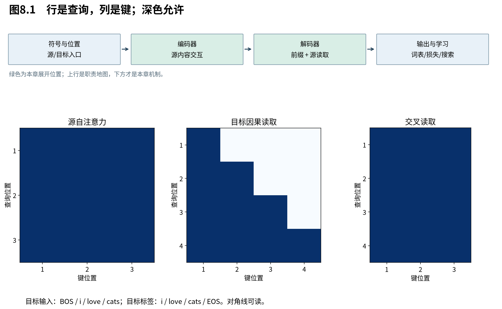

# 第8章　遮罩如何实现条件概率

现在我们会计算单头与多头读出了，但“算得出来”还不代表它符合第1章的概率模型。本章从信息权限审计整机：第t个预测到底可能看见哪些目标符号？这不仅是一个三角矩阵问题，还涉及右移、层间传播、填充以及损失统计。

图8.1的行是查询，列是键。深色表示允许读取，浅色表示禁止；因果矩阵含对角线，原因是输入已经右移。本图使用教学符号，不沿用某个软件API的True/False约定。

## 8.1 右移规定预测任务，遮罩规定信息路径

**右移使当前输入不等于当前答案，因果遮罩再阻止它从其他位置偷看答案。** 两者一起保证第t个预测只能依赖目标前缀 $y_{<t}$；只做其中一项都不足以实现原定条件概率。

本例解码输入为 $u=(\mathrm{BOS},y_1,y_2,y_3)$，预测标签为 $(y_1,y_2,y_3,\mathrm{EOS})$。对输入位置t允许读 $j\le t$，所以定义：

$$
 M_{tj}=\begin{cases}0,&j\le t,\\-\infty,&j>t.\end{cases}
 \tag{8.1}
$$

当t=3时，能看BOS、i、love，不能看输入第4位置的cats。由于softmax把 $e^{-\infty}$ 视为0，非法连接不贡献输出，也没有沿该分数边传播的梯度。

若输入不右移而是 $(y_1,y_2,\ldots)$，含对角线的遮罩会让位置t直接看到答案 $y_t$。若右移却完全不遮罩，第t个位置可以从t+1的输入读到 $y_t$。这两个错误都可能使训练损失看起来很好，却不能据此正确生成。

## 8.2 为什么多层叠加不会绕过遮罩

**每层都保持“位置t只依赖合法前缀”，才能保证整机的因果性；单层掩住未来还不够检查全网络。** 证明可沿层数归纳：输入层满足条件，所有子层与旁路都不引入未来，下一层便继续满足。

第0层位置t由输入 $u_t$、固定位置编码生成，所以只依赖 $y_{<t}$ 中的一项。假设第 $\ell$ 层每个位置j只依赖 $y_{<j}$。位置t的因果读取仅使用 $j\le t$，这些依赖的并集仍包含于 $y_{<t}$。FFN与LayerNorm逐位置运算，不引入新目标位置；残差来自同一位置，也保持条件。

交叉注意力读取完整源句x是合法的，因为 $p(y_t\mid x,y_{<t})$ 本就以整个x为条件。编码器不会接收目标序列，所以源表示也没有目标未来信息。这样逐层归纳，最终第t个logits仍只依赖x和 $y_{<t}$。

如果在目标轴上引入跨位置统计的归一化、错误的全局池化，或把未来目标送到额外分支，上述证明就断了。因此“主注意力用了下三角”不是对任意整机结构都成立的因果证明。

## 8.3 填充位置需要两种不同的处理

**padding既不能被当作有意义的候选读取，也不能作为真实标签参与损失平均。** 前者属于注意力权限，后者属于训练目标；只把填充嵌入设为零并不能同时解决两项问题。

设同批源句最大长度n，样本b实际长度 $n_b$。源键遮罩将 $j>n_b$ 的列禁止，形状可用 $(B,1,1,n)$ 广播到 $(B,h,q,n)$。编码器自注意与解码器交叉注意都要遵守它。

目标侧先合并因果限制与有效键限制；对右填充且有效前缀完整的样本，合法目标查询至少能读BOS。填充查询自身即便算出了非零输出，只要它不作为有效位置的键、且损失被忽略，便不会成为训练标签。但若后续把这些输出混入池化，仍需进一步处理。

令 $w_{bt}=1$ 表示真实目标位置（包括EOS），0表示填充，平均损失为：

$$
 \mathcal L=\frac{\sum_{b,t}w_{bt}\ell_{bt}}{\sum_{b,t}w_{bt}}.
 \tag{8.2}
$$

分母是有效目标token数，不是包含padding的 $Bm$。不同长度批次若采用不同分母，梯度尺度也会改变。源填充数量不能作为目标损失的分母。

## 8.4 全遮罩与API约定为何容易出错

**遮罩的数学语义是允许关系；代码里的布尔值、广播轴和特殊数值只是实现约定。** 接口之间的约定可能相反，必须把语义明确转换，再用小矩阵验证。

若一整行全部为 $-\infty$，普通softmax分母为0；稳定算法还可能出现 $-\infty-(-\infty)$。不能指望每个后端都自动返回同一种结果。教学实现拒绝有效查询的全遮罩行；对纯填充查询可以专门置零，但必须确保它不影响有效输出。

另一种常见错误是用一个不够小的有限负数近似负无穷。它仍会给非法项非零权重，尤其与低精度或异常大合法分数组合时。有效性检查应直接针对非法权重和未来扰动，而不是只看遮罩张量形状。

## 8.5 用改变未来的方法验证过去

**因果性可以转成可执行的不变性检查：保持源句和目标前缀不变，修改后面的目标输入，较早位置的输出应保持。** 这种检查覆盖实际实现中的信息路径，比仅打印三角矩阵更接近模型承诺。

固定参数并进入eval模式，对两份目标输入，前k个位置相同、后面不同，比较前k个logits。测试还应覆盖多层、多个头、不同长度与填充。训练dropout带来随机差异时，要控制随机性，不能把随机掩码变化误判为泄漏。

padding检查则在有效源句后加入更多填充，同时保持键遮罩；有效目标输出应不变。梯度检查可进一步确认未来输入到过去输出的导数为零。数值误差容差按精度设定，不要求浮点实现逐位相等。

我们现在不仅会计算读取，还能说明哪些信息允许沿它传播。下一章面对另一项缺失：如果各位置只是彼此读取，顺序本身从哪里进入表示？

来源：[Attention Is All You Need，v7，§3.1、§3.2.3](https://arxiv.org/abs/1706.03762v7)。多层因果归纳、填充损失口径和不变性测试为本书展开。
