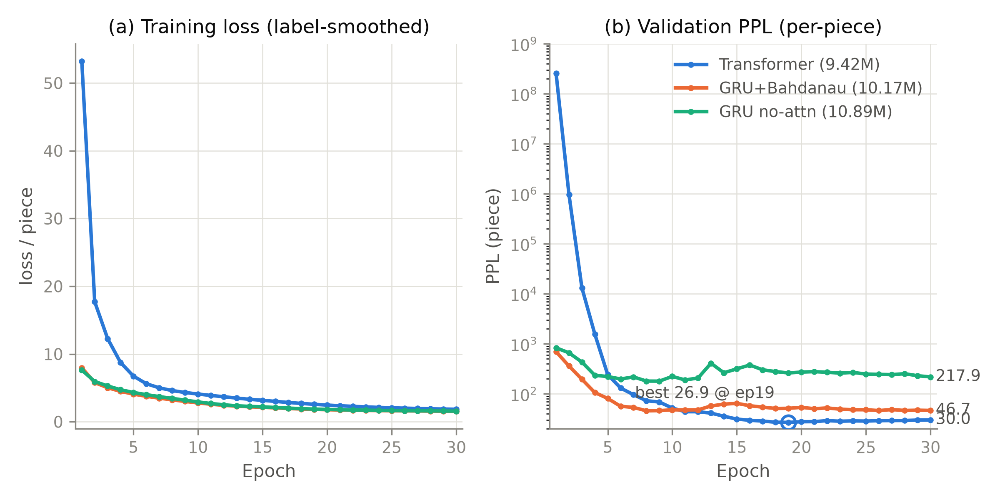
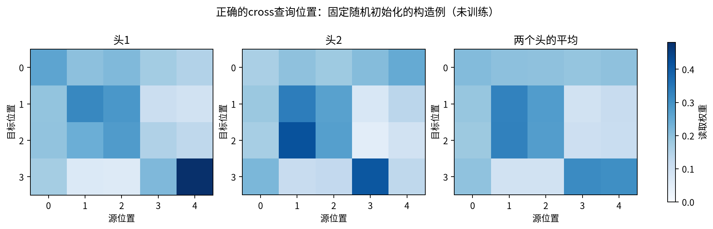
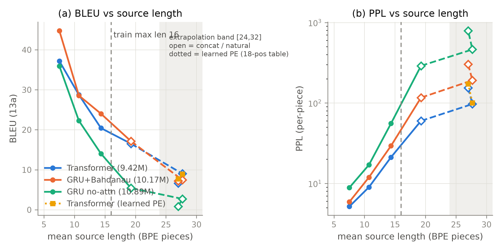

# 第 9 章 从零实现与小型翻译实验

## 9.0 开篇：从全书到这里

第 8 章收官时，机身与点火程序都已在手：第 7 章装好的整机立在桌上（63.1M 参数、三类掩码、与官方对拍 `allclose`），第 8 章把论文 §5 的配方还原成三块仪表——`NoamLR`、`label_smoothing_loss`、`beam_search`——并预告要把它们接入训练与解码流程。但那一章开篇也提醒我们：论文配方用于8张P100上的翻译实验，英德约450万句对、英法约3600万句对，且没有逐项披露每个数值的搜索过程，缩到一台笔记本电脑上还灵不灵？现在到检验的时刻了。本章点火，让全书从「图纸与零件」进入「机器运转」的阶段。

旅程地图的「点火」段由此开始，本章要一口气走完 2017 年工作流的全流程：数据进来（Multi30K 小型英德语料、自训 BPE 词表）、机器缩尺寸上线（第 7 章整机的四个旋钮拧小）、三块仪表逐件装配、双对手同台（两个 GRU baseline——第 1 章那台旧机器在真实数据上的复活）、最后束搜索解码、按句长分桶评测、外推实测。

先记下三个预告：其一，你会看到一条**可插拔的管线**——数据、模型、训练、解码四段首尾相接，第 10 章的消融实验只换其中一段；其二，GRU双baseline让我们在真实数据上检查固定向量与逐步注意力的表现，并区分表示限制、训练条件和实现误差；其三，结果里有意外——小数据短句域上，借鉴2014年加性注意力思路的本书GRU实现取得了更高BLEU，而评测过程中踩到的一个坑，会逼我们把「组批方式」也当成实验口径的一部分。

到本章结束，第 0 章承诺的「一台你自己造的翻译机」就真正跑起来了：输入英语句子，输出德语译文，历史M5 Pro/MPS实验中，三个模型的训练与主要评测合计约20分钟，具体数据准备、版本和硬件会改变耗时。随之冒出的新问题也有两串：这台机器的每个设计到底贡献了几分（第 10 章消融网格），以及「能跑」与「能比」之间隔着多少口径（本章表 9.3 先列出这些口径）。

> **最小背景栏**（读懂本章所需的全部前置）
> - **已有知识**：第 2-6 章全部零件、第 7 章整机与掩码（式 (7.2) 的加法口径）、第 8 章三块仪表（式 (8.1)(8.3)(8.4)）与 BPE 直觉（8.4 节「高频词整存，低频词切碎」）、第 1 章的 seq2seq 架构与 BLEU 速览、第 4 章式 (4.3)(4.4) 的对齐矩阵。本章不再重复推导。
> - **工具即借用**：sentencepiece（自训分词器）、datasets（语料加载）、sacreBLEU（评测）三个工具当黑盒用，只讲 API 与口径，算法拆解全部留给下一册（9.1 节借用框）。
> - **Multi30K**：Flickr 图像英文描述及其人工德译构成的平行语料，本书用 bentrevett 镜像加载，train/validation/test = 29000/1014/1000 句对【来源：bentrevett/multi30k镜像数据卡与本书历史加载记录】。
> - GRU门式已在第1章补齐，本章将其与PyTorch实现及完整数据管线对照。

## 9.1 工具链与数据合规：三只黑盒和一条红线

点火之前先备燃料，燃料分两半：语料与切词器。这两样本书都不从零造——2017 年的工程师也是站在现成工具上工作的，论文 §5.1 自己就写着「句子用字节对编码 [3] 编码」：BPE 是别人的发明，他们是使用者。本书同样只做使用者，三个工具各给一张使用说明，算法细节留待章末后续改造说明所指的章节讨论。

> **【借用框】** 三个工具的「会用即可」说明（算法拆解 → Book2 第 2 章）：
> - **sentencepiece**（自训分词器）：三步走——`SentencePieceTrainer.train(input=语料文件, vocab_size=8000, model_type="bpe")` 训出 `.model`；`sp.encode(句子)` 得子词序列（`out_type=int` 给 id）；`id_to_piece` 查出单个ID对应的piece字符串，`sp.decode` 将整段ID解码为文本；两者作用不同。特殊符号的 id 在训练时显式指定（本书 PAD/UNK/SOS/EOS = 0/1/2/3，句首标记在代码里记作 `SOS`，与第 1 章的 `<bos>` 同义）。
> - **datasets**（语料加载）：`load_dataset("bentrevett/multi30k")` 一行拉下三个切分，jsonl 原生、无加载脚本。
> - **sacreBLEU**（评测）：`corpus_bleu(假设列表, [参考列表], tokenize="13a")` 返回 0—100 的语料级 BLEU；`tokenize` 是它的口径旋钮——"13a" 与 "none" 的区别 9.6 节会亲手量出来。
> 这些是本章所需的主要接口；调用处解释输入输出，内部算法留待后册。

本书提供数据准备与训练脚本，不附数据集或模型权重；下载和使用前应核对所用数据版本及其许可。这里采用bentrevett的Multi30K镜像，不能将镜像身份写成数据集官方发布渠道。若换另一份数据，需核对切分、样本内容与预处理；内容或切分变化会改变实验，不能默认当作等效复现。历史MPS时长是一次记录，不承诺任意笔记本在十分钟内达到相同结果。

## 9.2 数据管道：把两万九千句对喂进机器

语料到手只是第一步，机器不能直接处理字符串——从原始句对到可训练的张量批次，中间隔着一段常被教程略过的管道工程。本节把这段管道走一遍，它有两个决定后续实验的口径选择（词表与长度上限），也有两处只有亲手跑过才遇得到的坑。

先看切词。第 8 章 8.4 节讲过 BPE 的直觉——「高频词整存，低频词切碎」，并预告过本书的实测切分；现在兑现。用 sentencepiece 在 Multi30K 训练集上自训一张 **shared BPE-8k 词表**：英德两种语言的全部句子（训练集 29000 对的 58000 行）写进同一份语料文件、训出**一张**两语言共用的表——这是论文 §5.1 的 37k 共享词表（源与目标同表）的缩小版，也是第7章三处共享采用相同token-ID映射的前提；只有目标输入与输出两处绑定时，则不必要求源侧词表相同。早期8k分词探针记录训练耗时0.2秒【来源：本书历史探针（CPU，2026-10）】；正式项目的入口为[code/ch09/data.py](code/ch09/data.py)，耗时须以所用环境为准。切出来的样子，两个真实的词最有说服力：

- `Nähe`（附近）→ `▁ / N / ähe`——在该探针词表中切成三片；
- `Büsche`（灌木丛）→ `▁Bü / sche`——在同一词表中切成两片；片数本身不足以判定两个词的频率高低。

`▁` 是SentencePiece表示空格的标记，也可能出现在句首的虚拟空格位置。常规piece可以拼接后替换这一标记；含UNK或经过文本规范化时，却不能据此保证恢复原始字符。本项目 `ids_to_text()` 按piece拼接、替换标记并去掉两端空格，是明确的评测还原约定。

第8章引用的约1.9% UNK和3.7字符/piece，来自早期8k探针：在训练集每10条取1条的抽样中，同时统计英德两侧，去除普通空格后的字符总数除以piece总数得3.71，UNK ID数除以piece总数得1.92%；全test对应3.73和1.80%【来源：本书历史探针记录，2026-10】。该探针使用默认特殊ID并打乱输入，正式项目则指定PAD/UNK/SOS/EOS并关闭输入打乱，因此这些历史统计不能直接当成当前正式分词模型的新测量值；`data.py` 现有冒烟也不输出这两项统计。它们说明统计方法和一种配置的表现，不保证任意8k词表都得到同样结果。对比第 1 章前史：Sutskever 的源端词表 160,000 也免不了出现 UNK，Cho 框架 30,000 词表；这个数据集上的子词词表具有较低的未登录率；不同语料、语言和预处理下不能只按词表大小横比UNK率，这就是「切碎高频存整」的收益。

词表大小本身是口径：论文 37k、t2t 复现 32k、本书 8k——词表差异会改变模型与分词口径，而本书与论文还使用不同测试集，不能直接用BLEU排名；若统一到同一测试集、文本还原和评测规程，不同内部子词词表的模型仍可以比较BLEU（表 9.3 收拢）。

第二个口径选择更关键：**训练句长上限 $L=16$ 个 piece**。做法是**双侧内容过滤**（源句与参考译文的 piece 数都 ≤16 才保留），不是截断——截断会教机器学「翻译半句话」，过滤保证每对都是完整句。29000 对留下 17555 对（60.5%），被滤掉的四成是长句【来源：本书实验（`data.py` 复跑）】。为什么砍掉四成数据？这样选择有两个正当理由：其一，小模型配小算力，短句减少每批计算量，历史MPS实验的Transformer约7.5秒/epoch、30轮约224.6秒；这给读者一个规模参考，不能作为其他环境的耗时保证；其二，这个 $L$ 同时是第 5 章外推承诺的基准线——训练最大长度 16，外推实验就在它的 1.5—2 倍（24—32 piece）上做（9.6 节）。代价也如实记下：过滤后的训练分布比原始 Multi30K 更偏短句，模型对长句的经验全部来自这 60.5% 里相对较长的尾巴。

然后是批处理，两处实际遇到的问题都发生在这里。变长句要拼成矩形张量，就得**动态填充**（dynamic padding）：每批 64 句补齐到批内最长句，批与批长度不同。`data.py` 的 `batches()` 是这一步的落点：它取批内**两侧**最长的id序列长度$m$作统一宽度（过滤后的训练批满足$m\le18$），产出`src`和`tgt`两个$(B,m)$矩形；通常$B=64$，不足一整批的尾批则较小。下面的形状表先以$B=64$的整批为例——训练循环随后从 $(64,m)$ 的 `tgt` 上错位切出输入侧 `tgt[:, :-1]` $(64,m{-}1)$ 与标签侧 `tgt[:, 1:]` $(64,m{-}1)$（9.4 节，表 9.1 第 2 行）。批处理可以先在列表层补齐，也可以使用 `pad_sequence` 或预分配张量；关键是正确处理长度、填充值和设备。本书选择列表先补齐（`batches()` 内 `pad()` 的 `row + [PAD] * (m - len(row))`），一步成型。

第二个问题出在损失函数里：`tgt[:, 1:]` 这类切片拿到的张量不保证内存连续，直接`.view`展平可能因步幅不兼容而报错，可使用 `.reshape`，或明确连续化后再 `.view`（[code/ch09/train.py](code/ch09/train.py) 的 `label_smoothing_loss()` 里那行展平）。两坑都不深奥，但都是「跑起来才知道」的工程现实——教程里的优雅代码与能跑的代码之间，隔着一层张量内存布局。

批的构造还有一个论文口径的偏离，先挂账。论文 §5.1 的批按**词元数**计（约 25000 源词元 + 25000 目标词元），并且**按近似句长分桶**组批；本书用「batch 64 句、随机混批、动态填充」的简化口径——差距看似只是工程细节，9.6 节会看到它对一个模型意味着 11.5 BLEU 的差距。这里先明确一个事实：按历史平均内容长度11.62 piece估算，整批64句约744个源内容piece；实际计数还须区分SOS/EOS与PAD，尾批也不足64句，论文每批约 25000 源词元，相差三十多倍——小账本再次提醒我们，照抄配方与照抄尺度是两回事。

## 9.3 组装与缩尺寸：代码在此完成整合

燃料备好，轮到机器。第 7 章装好的整机（整机粗图见导览 0.3 节，双塔结构见第 4 章图 4.1）在 [code/ch07/transformer.py](code/ch07/transformer.py)；本章的 [code/ch09/model.py](code/ch09/model.py) 是它用于本章训练的版本——保留相同的主要结构，但项目文件是独立实现而非直接导入第7章：它自动生成PAD掩码、动态生成PE，并提供统一解码接口。先核对保留的主要结构清单，这台缩微模型是否保持原版结构，读者应当能逐项打勾：post-LN 摆位（残差求和后归一化，式 (6.4)）✓；正弦位置编码（式 (5.1)(5.2)，按需生成、零参数）✓；双塔三注意力（编码器双向自注意、解码器因果自注意 + 交叉注意力）✓；FFN = ReLU 两层（式 (6.1)）✓；按v7 Residual Dropout段设置两类dropout布点（子层输出 + embedding 与 PE 之和，§5.4）✓；三处权重共享（编码器输入、解码器输入、pre-softmax 输出共用一张嵌入表，式 (7.1)）✓；注意力手写 matmul + softmax（式 (2.1)，掩码按式 (7.2) 的加法口径叠加）✓。

清单之外，项目接口的关键变化是：`encode()`把源句id批$(B,S)$映射为逐位置memory $(B,S,256)$ 与填充掩码 $(B,1,1,S)$，`decode_step(state, ys)` 给定整段前缀 $(B,t)$ 返回最后一步的 logits $(B,8000)$——贪心与束搜索共用这一条路（GRU 双 baseline 也实现同一接口，9.5 节的两个模型因此能插进同一条管线）。

尺寸调整了四项：层数 $N$ 6→4、宽度 $d_{model}$ 512→256、FFN 宽度 $d_{ff}$ 2048→1024、词表 37k→8k；头数 $h=8$ 保持不变，于是每头维度 $d_k$ 随之从 64 变为 32——宽度和层数变了，每层内部的连接方式保持：批 64 的前向里打分矩阵仍是 $(64,8,n,m)$ 的同构形状（第 2 章那笔 $O(n^2)$ 账只是换了刻度），FFN 的扩展率保持 4:1（$256\to1024\to256$）。

以下数值沿用论文：warmup4000、$\epsilon_{ls}=0.1$、$P_{drop}=0.1$来自§5，beam4、$\alpha=0.6$来自§6.1——第 8 章留的悬念「缩到笔记本尺度还灵不灵」，式(8.1)给出相应的数值变化：峰值学习率 $\propto d_{model}^{-0.5}$，宽度减半自动把峰值从 $6.99\times10^{-4}$ 抬到 $9.9\times10^{-4}$，第 8 章 8.1 节的预告在此兑现，学习率按该公式变化了，但是否适合当前数据量、批量与训练长度仍需验证。

调整完成后，再统计一次参数量，账本习惯（第 7 章 7.4 节）不能丢。逐张量 `numel` 实数【来源：本书实验（`model.py` 复跑）】：注意力家族 12 个子层（编码 4 + 解码自注意 4 + 交叉 4）每个 263,168，合计 3.16M（占非嵌入 42.9%）；FFN 家族 8 个每个 525,568，合计 4.20M（57.0%）；LayerNorm 20 枚合计仅 10,240（0.14%）；非嵌入主体共 **7.37M**。三处共享的嵌入表 8000×256 = 2.05M 只数一份，整机 **9.42M**——是 base 63.1M 的约 1/6.7。

家族占比也随配置变化：FFN 依旧第一大户，但嵌入份额从 30.0% 缩到 21.7%——嵌入由$Vd$决定，主体则主要由层数与$d^2$决定；本次词表、宽度和层数同时缩小，复算后嵌入份额降至21.7%，不能只比较词表与宽度两个比例就推出全部占比。把零件放回整机图景说一句：此刻在第 2-6 章亲手造的每一个零件——缩放点积、多头拆装、正弦编码、残差与 post-LN——正同时在同一块 GPU 上转动，这台 9.42M 的机器与那台 63.1M 的机器是**同一套结构的两种规模**。

## 9.4 训练循环：把配方接入参数更新

机器、燃料就位，先将第8章的损失与学习率调度接入训练；束搜索在模型训练后的解码阶段使用。`train.py` 的 `run_epoch()` 骨架一个 epoch 只有一句话：教师强制喂入（`src` $(64,m)$ 与右移一位的 `tgt[:, :-1]` $(64,m{-}1)$ 进机器，logits $(64,m{-}1,8000)$ 对 `tgt[:, 1:]` $(64,m{-}1)$ 计损失——第 1 章 1.1 节的两种运转模式之一，第 7 章 7.1 节的整机输入契约在此执行）→ `label_smoothing_loss`（式(8.3)的应用版，与第8章一样忽略PAD监督位置）→ 反传 → `NoamLR.step()`（式 (8.1) 的应用版：先改 `param_groups` 的学习率、再 `opt.step()`，与第 8 章教学版九个步点逐点全等，对拍记录在 8.1 节），内部执行一次Adam更新（$\beta_2=0.98$、$\epsilon=10^{-9}$，沿用论文§5.3）。因果掩码与填充掩码的组合在机器内部按式 (7.2) 叠加，循环本身无需知道掩码的存在——组装模型时已完成这部分处理。

看完训练循环的骨架，把这一步训练的形状从头到尾走一遍。第 6 章表 6.3 用 base 配置走了 batch=1 的一条 token，第 7 章核了整机前向与掩码的形状口径；表 9.1 把口径换成真实训练管线——batch 64、动态填充的 $m$、shared BPE-8k——并往两头延伸：前头是批构造，后头是损失（pad 掩蔽到标量）与解码接口（推理侧的束状态），端到端一张表：

| 步骤 | 运算 | 输入形状 | 输出形状 | 说明 |
|---|---|---|---|---|
| 1 批构造 | `batches()` 批内动态填充 | 64 个变长 id 序列 | src $(64,m)$、tgt $(64,m)$ | $m$ = 批内最长 id 长（含 SOS/EOS），$m\le18$，批与批不同 |
| 2 教师强制切片 | `tgt[:, :-1]` / `tgt[:, 1:]` | tgt $(64,m)$ | tgt_in $(64,m{-}1)$、tgt_out $(64,m{-}1)$ | 同一句错位切出输入侧与标签侧 |
| 3 源端嵌入 | 查表 ×√256、+正弦 PE、dropout | src $(64,m)$ | $(64,m,256)$ | 三处共享的嵌入表（式 (7.1)） |
| 4 编码器 ×4 | 双向自注意 + FFN，各层同构 | $(64,m,256)$ | memory $(64,m,256)$ | scores $(64,8,m,m)$、FFN 扩展到 $(64,m,1024)$；填充掩码 $(64,1,1,m)$；每层进出同形 |
| 5 目标端嵌入 | 查表 ×√256、+PE | tgt_in $(64,m{-}1)$ | $(64,m{-}1,256)$ | 右移一位的前缀（SOS 起头） |
| 6 掩码自注意 ×4 | $QK^{\top}$：$(64,8,m{-}1,32)\times(64,8,32,m{-}1)$ | Q/K/V $(64,8,m{-}1,32)$ | scores $(64,8,m{-}1,m{-}1)$ → 子层出 $(64,m{-}1,256)$ | 因果 ∪ 填充组合掩码（式 (7.2)） |
| 7 交叉注意 ×4 | $QK^{\top}$ 再乘 $V$ | Q $(64,8,m{-}1,32)$；K/V $(64,8,m,32)$（自 memory） | scores $(64,8,m{-}1,m)$ → 子层出 $(64,m{-}1,256)$ | 查询来自解码器、键值来自编码器 |
| 8 FFN ×4 | $256\to1024\to256$ | $(64,m{-}1,256)$ | $(64,m{-}1,1024)\to(64,m{-}1,256)$ | 逐位置扩展后收回（式 (6.1)） |
| 9 输出投影 | 右乘共享嵌入转置 $E^{\top}$ | $(64,m{-}1,256)$ | logits $(64,m{-}1,8000)$ | $m{-}1\le17$；式 (7.1) 的第三处共享 |
| 10 损失 | `label_smoothing_loss` + pad 掩蔽 | logits $(64,m{-}1,8000)$、tgt_out $(64,m{-}1)$ | 每位损失 $(64,m{-}1)$ → 标量 | 填充位不计；展平用 `.reshape`（9.2 节第二坑） |
| 11 解码接口（推理侧） | `decode_step` 整段重算取末位 | ys $(B',t)$ | $(B',8000)$ | 贪心 $B'{=}64$；beam $B'{=}64\times4$；无缓存 |
| 12 束状态 | `beam_search` 沿 batch 复制 k=4 份 | memory $(64,S,256)$、掩码 $(64,1,1,S)$ | memory $(256,S,256)$；活路 ys $(256,t)$、累积 logP $(64,4)$ | 每句 4 束共用同一源；束内长度同步增长 |

表 9.1 一步训练（含解码接口）的形状流转表（自排；口径：batch 64、动态填充 $m$、shared BPE-8k、缩微配置 $d_{model}{=}256$/$h{=}8$/$d_k{=}32$/$N{=}4$；与第 6 章表 6.3 的 base/单句口径互为印证，代码对应 `data.py` 的 `batches()`、`model.py` 的 `forward()`/`decode_step()`、`train.py` 的 `label_smoothing_loss()`、`decode.py` 的 `beam_search()`）

读这张表，第 6 章立下的三条数据流不变量在缩微机上原样成立：各层和各子层接口宽度为256，FFN内部扩展与注意力拆头另计；scores行=查询长/列=键值长（第 6、7 两行的 $(m{-}1)\times(m{-}1)$ 与 $(m{-}1)\times m$）、逐位置处理保留batch与序列轴，FFN可在内部改变特征宽度。真正的新变量只有两个：入口的 $m$ 随批浮动（第 1 行——动态填充的全部含义），出口的 8000 是词表而非宽度（第 9 行）。而第 10 行往下，是训练侧与推理侧的分岔：训练吃 $(64,m{-}1)$ 的整句、一次前向出全部位置；推理每步只要末位 $(B',8000)$、每出一个词元重算整段前缀——同一台机器的两种运转模式（第 1 章 1.1 节），形状表上看得见分岔点。

### 9.4.1 一次更新究竟优化了哪些位置

**完整训练步骤需要保持输入、标签、可见性和损失位置四者一致；只要其中一项错位，曲线下降也可能没有教学意义。**假设一个目标含三个内容词，词元ID为 $[\mathrm{SOS},4,5,6,\mathrm{EOS},\mathrm{PAD}]$，输入切为前五项，标签切为后五项；前三个内容预测和EOS预测参与损失，最后PAD位置不参与。

```python
# src、tgt是右填充的整数批次；模型内部使用源padding和目标因果/padding掩码。
tgt_in, labels = tgt[:, :-1], tgt[:, 1:]      # (B,T)，逐位置错开一格
logits = model(src, tgt_in)                  # (B,T,V)，输出原始打分
loss = label_smoothing_loss(logits, labels) # 只平均labels不等于PAD的位置
optimizer.zero_grad()                       # 清除上一更新的梯度累加
loss.backward()                             # 从损失反传到共享嵌入与所有子层
scheduler.step()                            # 本项目封装：设置学习率，再执行optimizer.step()
```

这里的调度器最后一行已包含参数更新，不能再重复调用一次 `optimizer.step()`。验证阶段用 `eval()` 与关闭梯度，按所有有效目标token累加NLL再除以总token数；不能对每个batch的均值无权平均，否则尾批大小与句长会改变结果。PPL取这个全语料平均NLL的指数。

本节展示的输入标签小例子是构造例。原项目的曲线与表格保留为2026年10月的历史训练，当前修正的padding及束搜索实现尚未重跑完整翻译实验。

数字到手。30 epochs =8250步（每轮$\lceil17555/64\rceil=275$步，保留含19句的尾批），MPS 上 7.5 秒/epoch、总 **224.6 秒**【历史实验：M5 Pro/MPS，2026-10；复跑以 `log/Book1-ch09/transformer_log.json` 为准】。把包含逐轮验证的224.6秒总计时除以8250次更新，折算约27毫秒/步；这不是单独测量训练内核的延迟——它与写作期探针的43.5毫秒/步（11.76M档、未过滤语料）还存在模型、序列和计时范围的差异：本管线模型更小（9.42M）且句子更短（$L\le16$），两个口径都对，引用时须注明【来源：本书实验 + notes/01 探针】。

验证曲线（图 9.1 右）：PPL(piece) 从第 1 epoch 的 $2.6\times10^{8}$ 一路俯冲，epoch 19 到最优 **26.9**，之后轻度过拟合、末 epoch 回到 30.0——17,555 句对喂 9.42M 参数，过拟合是一个真实的问题，更多数据可能改变过拟合压力，但论文尺度也不能被宣布没有过拟合问题；本书不做 checkpoint 挑选、不做参数平均，主表一律取末epoch（与Table3不做checkpoint平均这一点一致；不能据此推定其其他checkpoint选择细节完全相同，见表9.3）。



图 9.1 三模型训练曲线（自产，本书实验）：(a) 训练损失（label-smoothed、每 piece）与 (b) 验证 PPL（per-piece 口径、对数轴），均 30 epochs。蓝色 Transformer 的「高开—俯冲」与该初始化和预热设置共同出现；没有对照不能将曲线唯一归因于warmup（第 1 epoch 末学习率才 $6.8\times10^{-5}$，前 4000 步占全部 8250 步的近半）；空心圆标出其最优验证点（epoch 19，PPL 26.9）。数字与 `log/Book1-ch09/*_log.json` 同源

与论文的算力对照值得摆一次。论文 base：8×P100、每步 0.4 秒、10 万步、共 12 小时（论文 §5.2）【来源：官方论文 v7 §5.2】；本书：单块笔记本 GPU、27 毫秒/步、8250 步、共 224.6 秒。将两个时间相除约为15，但计时范围与每步工作量都不同，不能读成效率提高15倍——论文每步约 5 万个词元的预算，本书每步约 1500 个 piece，差三十多倍；总训练词元量差约 400 倍，数据差 256 倍（450 万对 17,555 对），模型差 6.7 倍。这本账的读法是：**缩微实验展示指定实现与配方能在该小任务上运行并产生学习结果；它没有用更少算力复现原论文的28.4 BLEU，也不能把原论文各设计的效应自动移植到这里**——可对照结构与配方，再检验效果方向是否相同；不同任务的绝对分数不能直接排名（第 10 章的判据将建立在这一点上）。

## 9.5 GRU 双 baseline：旧机器复活，公平对照

新机器有了，还缺对照组。第 1 章 1.6 节许诺过：要在真实数据上复活 GRU 双 baseline，在真实数据上检查固定向量模型与带注意力模型的差异。两个 baseline 一负一正：无注意力的 RNN 编码器-解码器（第 1 章那台旧机器本体，实际的瓶颈示例）与 Bahdanau 加性注意力版（1.3 节的补丁，实际的缓解示例）。动工前先还一笔旧账——第1章已给出门式，这里沿同一约定接入真实训练管线。

沿第1章的记法，GRU的四组关系如下。设第 $t$ 步输入为 $x_t$（当前词的嵌入等外部信号），上一刻记忆为 $h_{t-1}$：

$$
\begin{aligned}
z_t &= \sigma\!\left(W_z x_t + U_z h_{t-1}\right) & &\text{更新门}\\
r_t &= \sigma\!\left(W_r x_t + U_r h_{t-1}\right) & &\text{重置门}\\
\tilde{h}_t &= \tanh\!\left(W x_t + U\left(r_t \odot h_{t-1}\right)\right) & &\text{候选记忆}\\
h_t &= z_t\odot h_{t-1} + (1-z_t)\odot \tilde{h}_t & &\text{记忆更新}
\end{aligned}
\tag{9.1}
$$

| 符号 | 含义 | 形状 |
|---|---|---|
| $x_t$ | 该步外部输入（本书实现：目标词嵌入，或与上下文向量拼接，见本节两版结构） | $\mathbb{R}^{d_x}$（批式 $(B,d_x)$） |
| $h_{t-1}$ | 上一刻记忆（隐状态） | $\mathbb{R}^{d_h}$（批式 $(B,d_h)$） |
| $z_t, r_t$ | 更新门 / 重置门，$\sigma$ 输出 $(0,1)$ | $\mathbb{R}^{d_h}$ |
| $\tilde{h}_t$ | 候选记忆（新内容） | $\mathbb{R}^{d_h}$ |
| $h_t$ | 该步后的记忆（隐状态） | $\mathbb{R}^{d_h}$ |
| $W_\bullet, U_\bullet$ | 各式的输入权重 / 记忆权重（候选式一行的 $W,U$ 无下标） | $W\in\mathbb{R}^{d_h\times d_x}$、$U\in\mathbb{R}^{d_h\times d_h}$ |
| $\odot$ | 逐元素乘 | — |

这意味着：传送带上驮着旧记忆 $h_{t-1}$。重置门 $r_t$ 决定「写新内容时参考多少旧记忆」（接近0时削弱候选分支对相应旧状态的直接读取，但最终状态还有更新门控制的保留支路）；更新门 $z_t$ 是传送带的速度计——$z_t$大时保留更多旧状态，小则更多使用候选状态。两道门的开度都是学出来的，信号既看新输入也看旧记忆。式 (9.1) 与第 1 章的「传送带＋阀门」逐一对上：$r$调节候选分支读取旧状态的方式，$z$调节旧状态与候选状态的混合。它们有助于类比LSTM的门控，但GRU不是简单删除LSTM某一扇门得到的相同计算图【来源：官方论文 Cho et al., arXiv:1406.1078】。（记法注：各式偏置从略；PyTorch候选支路的重置乘法位置与Cho记法不同，见1.1.2节。）

两个 baseline 的结构照第 1 章的图搭建。**无注意力版**：单向 GRU 编码器读完全句，末步隐状态 $h_{T_x}$（隐宽 $d_h{=}896$，批式 $(64,896)$）就是那只箱子 $c$——它既当解码器的初始状态（$s_0=c$，Sutskever 接法），又拼进解码器每一步的输入（$[\,y_{t-1}$ 嵌入 $(64,256)\,;\,c\,]$ 拼成 $(64,1152)$，Cho 接法）：第 1 章 1.1 节说好的「桥的两种接法」在实现里叠加使用，桥的唯一性不变。

**Bahdanau 版**：双向 GRU 编码器（每向隐宽 576，每个源位置的标注 $h_j$ 是前向与后向隐状态的拼接，$(64,S,1152)$，1.3 节），解码每步按式 (4.4) 的加性打分算 $\alpha_{ij}$（打分表 $(64,S)$——注意它没有 $(B,h,n,m)$ 那样的头维，全模型只有一个注意力「头」）、按式 (1.3) 加权出这一步专属的 $c_i$（$(64,1152)$）——两者都遵循打分、softmax、加权求和这三步；这里的打分器是加性MLP，投影、形状和逐步调用方式都与多头缩放点积不同。两版都挂三处权重共享的输出投影（经一层适配对齐到 256 维嵌入，每步 $(64,896)$ 或 $(64,576)\to(64,256)\to$ logits $(64,8000)$），都使用label smoothing与Noam调度；GRU的dropout放在嵌入处，Transformer还在各子层出口使用dropout，相同的概率参数不表示两者正则强度相同——它们在同一数据、训练和解码管线上替换模型主体。这是借鉴早期结构的本书实现：使用PyTorch的GRU门式、三处权重共享及本章配方，并非原样复现2014年的完整系统。Bahdanau版还把双向末态拼接后投影为解码初态，而原论文附录用反向网络的首位置状态初始化；这项实现选择也应计入比较条件。

为使比较条件明确，本书固定以下五项；这是一套控制方案，不是排除所有混杂因素的充分条件：① 同一张 shared BPE-8k 词表、同一嵌入维度 256；② 同一训练数据（17555 对）、同 batch 64、同 30 epochs——同 token 预算；③ 同优化器与调度（Adam $\beta_2{=}0.98$ + 式 (8.1)，$d$ 取 256）；④ 非嵌入参数对齐到同量级——无注意力版隐宽 896（非嵌入 8.84M）、Bahdanau 版双向 576（非嵌入 8.12M），对 Transformer 的 7.37M，三者同处 7—9M 档；⑤ 同推理协议（beam=4、$\alpha$=0.6，与 Transformer 走同一份 [code/ch09/decode.py](code/ch09/decode.py) 代码）。

训练账【历史实验：MPS，2026-10，[code/ch09/gru_baseline.py](code/ch09/gru_baseline.py) 复跑】：无注意力版 8.4 秒/epoch、总 255.4 秒，末验证 PPL 217.9；Bahdanau 版 17.9 秒/epoch、总 537.4 秒，末验证 PPL 46.7。该历史实现约慢2.4倍；递推、Python循环、不同参数数和内核形态都参与耗时，不能只由数据依赖唯一归因：解码器逐步 attend 再转移，Python 循环一步一算，而 Transformer 的整个 epoch 是一摞大矩阵乘——这个实现保留了时间步依赖，但具体耗时还需结合实现测量。（一个诚实的口径注记：两个 GRU 的验证损失在混批下计算，旧循环实现也可能使本节的末态PPL受填充影响，影响程度不能未经对照就定为轻微，机理见 9.6 节的组批实录。）

训练之后，本来希望继续观察真实译句的注意力。例如历史记录选过test第21句“A teenager plays her trumpet on the field at a game”，比较德语参考中Trompete与bei einem Spiel的相对位置。但要解释这种对齐，首先得确认读到的正是前向中实际使用的查询。旧探针在这一步有误，因此当前图9.2先用固定随机初始化的微型模型说明正确读取位置；它承接第4章的接口讨论，不替代训练后语义热图。



图9.2 正确查询位置上的交叉注意力读数：以固定种子初始化的微型模型为构造例，左、中是最后一个解码层的两个头，右是它们的平均。行是目标位置，列是源位置；这是接口与数值结构演示，不是已训练模型的语义对齐结果。导出时先执行本层因果自注意力和post-LN，再将其结果作为交叉查询，和实际前向的调用位置一致。

历史图曾报告Bahdanau峰值0.5—0.8、Transformer头平均峰值0.15—0.44，并列举了词对。核对代码发现，旧Transformer探针直接使用解码层入口x，漏过了本层自注意力和归一化，因此那些数值不是实际交叉分支的注意力，不能继续证明模型“学会了对应词”。原图保存在历史材料中；修正后需加载原检查点重新导出，本文不伪造新的语义热图。

即便探针正确，头平均也只是统计摘要。取同一批样本中一次确定性前向、没有全屏蔽行的注意力权重，记每头矩阵为$A_h\in\mathbb R^{T\times S}$，则平均为 $\bar A=H^{-1}\sum_h A_h$，每行仍非负且和为1；并有 $\max_j\bar A_{ij}\le H^{-1}\sum_h\max_j A_{hij}$。这是因为对任意固定j，各头该列都不大于本头最大值，再求平均即可。不同头峰值错开时平均会更平；峰值都在同一位置时可取等号。它解释平均可能隐藏差异，但不能反推出头一定具有语法分工，更不能把注意力权重直接当成因果重要性。

## 9.6 解码与评测：束搜索、BLEU 口径与句长分桶

模型训练完成，到了检验结果的时刻——但「交卷」本身也是一台机器：解码规程与评测口径。本节四步走：取译文（束搜索）、定义「译得好」（BLEU 正式公式与口径自证）、按句长分桶对读容量墙预言、实测外推承诺；中间会踩到本次实验最大的坑。

**解码。** beam=4、$\alpha=0.6$，第 8 章式 (8.4) 的长度惩罚原样上机（论文 §6.1 的解码配置）。`decode.py` 的 `beam_search()` 是批量张量版，束状态自带一小套形状账：`encode()` 的 state 先沿 batch 维复制 $k$ 份（memory $(64,S,256)\to(256,S,256)$，即 64 句 × 4 束装进同一个批）；活路序列 ys $(256,t)$ 步进增长，累积 logP 记在 $(64,4)$，每步在展平成 $(64,4\times8000)$ 的候选分里取 top-$2k$——「批」从训练侧的 64 句换成推理侧的 64 句 × 4 束（表 9.1 第 11—12 行）。实现要点只有一个，且第 8 章已证明过它：同一步的活跃候选长度相同，所以该集合内的 $lp$ 相同，按原始 logP 剪枝与按惩罚分剪枝等价——这个同长度结论不适用于跨长度比较与停止判断，后者使用第8章补齐的上界条件。它与第 8 章教学版（3 句构造任务）及朴素逐句参考实现（200/200）的双重对拍均一致【来源：本书实验（CPU，2026-10）】。本书批量入口在k=1时单独调用贪心路径；与维护额外完成候选的beam实现不必完全一致（`greedy_decode()`）。源句经 `encode()` 计算一次并随束复制；每个新词元仍重算目标前缀（`decode_step`：$(B',t)\to(B',8000)$，未保存解码器增量中间状态——第 7 章 7.4 节那笔重算账的活体），全 test 1000 句 beam 解码：Transformer 约 25 秒、GRU 无注意力约 15 秒（译文短、步数少）、Bahdanau 约 31 秒（逐步 Python 循环）【历史实验：MPS，2026-10；README 25.7/14.9/31.0，复跑 25.6/14.7/31.2，机器浮动属正常】。

**BLEU 的正式账。** 第 1 章只速览了 BLEU，正式公式欠到今天：

$$
\mathrm{BLEU}=\mathrm{BP}\cdot\exp\!\left(\frac{1}{4}\sum_{n=1}^{4}\log p_n\right),\qquad
\mathrm{BP}=\begin{cases}1, & c>r\\[2pt] e^{\,1-r/c}, & c\le r\end{cases}
\tag{9.2}
$$

| 符号 | 含义 | 形状 / 口径 |
|---|---|---|
| $p_n$ | 截断 n-gram 精确率：全部假设译文里 n-gram 的总命中数（同一参考 n-gram 至多匹配其出现次数——「截断」防复读机刷分）÷ n-gram 总数 | 分母非零时为$[0,1]$内标量；语料级累加，非逐句平均 |
| $c, r$ | 假设译文总长度 / 参考译文总长度 | 标量（整数）；词或 piece 数 |
| BP | 简短惩罚：译得比参考短就指数打折 | 标量；$c\ge r$ 时免罚 |

这意味着：拿 1-gram 到 4-gram 四把尺子量「译出来的片段有多少在参考里出现过」，四个精确率取几何平均（无平滑时，任一阶精确率为0就使整个乘积为0；不是错一个词就必然归零），再乘一个防偷懒因子——译得越短越占便宜，BP 就是把这份便宜按长度差收回来。公式出自 Papineni et al. 2002【来源：官方论文（Papineni et al., ACL 2002）】。本书按式 (9.2) 手写了一份朴素实现（[code/ch09/eval.py](code/ch09/eval.py) 的 `naive_corpus_bleu()` 里二十来行），与 sacreBLEU 的 `tokenize="none"` 口径对拍：**三模型在记录精度下差0.0**【来源：本书实验（2026-10，`eval.py` 复跑）】——「会写 BLEU」的自证完成。而 "13a"（sacreBLEU 缺省，按WMT的mteval-v13a兼容规则处理部分HTML实体、空白与标点）与 "none"（原样按空格切）的差：三模型分别 +1.19、+1.06、+1.50 BLEU——标点怎么切，值 1 个多 BLEU；「先核口径再谈数字」的第一课在此有了自家数字。

### 9.6.1 截断计数与几何平均如何合成BLEU

**BLEU先在句对内部限制重复命中，再跨语料累加各阶计数，最后施加长度惩罚。**它衡量参考文本的片段重合，不是语义正确性的完备量尺。对句对s、n-gram g，候选出现次数为 $c_s(g)$，参考次数为 $r_s(g)$，单参考时

$$p_n=\frac{\sum_s\sum_g\min(c_s(g),r_s(g))}{\sum_s\sum_g c_s(g)}.\tag{9.3}$$

注意先在每个句对截断，不能让某句的多余词匹配另一句的参考。多参考时，分子采用对应句的各参考最大计数；长度惩罚中的参考长度也按评测协议选取。若候选反复输出“a a a a”，参考只有一个a，1-gram命中最多为1而非4，这就是截断的作用。

取候选“a b c d e”、参考“a b c d f”。四阶精确率依次为 $4/5,3/4,2/3,1/2$，乘积为1/5；两句等长，BP=1，因此BLEU为 $100(1/5)^{1/4}\approx66.87$。若仅输出“a b c d”，各阶精确率都为1，但BP为 $e^{1-5/4}$，得约77.88。这也展示长度惩罚不是语义完整性的充分保证；指标与任务目标始终要分开。

式(9.2)以0—1写分数，表格通常乘100。某阶命中为0时无平滑BLEU为0；候选为空、候选短于最高n-gram阶、是否采用有效阶数与平滑，都需要实现约定。配套朴素版本是无平滑、固定四阶，sacreBLEU的默认平滑不一定相同；在旧语料所有阶都有命中时两者恰好一致，不能据此宣布任意输入都等价。当前对照代码已显式使用相同的`tokenize="none"`、`smooth_method="none"`与固定四阶；主指标13a仍按原设定计算。

**三方对照，表 9.2 交卷**（beam=4、$\alpha$=0.6、全 test 1000 句、13a、按参考句词数分桶）：

| 模型 | 参数量 | BLEU(13a) | 桶 ≤7 词 (n=172) | 桶 8-13 词 (n=620) | 桶 ≥14 词 (n=208) | 贪心 BLEU | beam 解码 |
|---|---|---|---|---|---|---|---|
| Transformer | 9.42M | 21.87 | 23.73 | 24.38 | 14.79 | 20.63（+1.24） | ~25 s |
| GRU 无注意力† | 10.89M | 6.52† | 7.75† | 6.89† | 4.34† | 6.58（≈0） | ~15 s |
| GRU+Bahdanau | 10.17M | **23.56** | 23.92 | **26.71** | 15.40 | 22.22（+1.34） | ~31 s |

表 9.2 三方 BLEU 与解码时延对照，含按参考句词数的分桶（自产，本书实验：M5 Pro/MPS，2026-10；混批评测口径，†号见下文组批实录——该行数字含组批税，较少填充口径 18.03）。桶口径与第 1 章图 1.2 对读；贪心列为 beam 增益参照。数字与 `log/Book1-ch09/eval_*.json` 同源

表中首先引人注意的就是那个意外：**GRU+Bahdanau 23.56，反超 Transformer 1.69**。要解释这组差异，先看无注意力行†号标出的实现与评测问题。

**组批实录：同一检查点为何从6.52变为18.03。** 表 9.2 评测按数据集顺序混批解码（batch 64、批内动态填充）。复盘无注意力版的译文发现异常：平均译长只有 6.4 词（参考 10.9），大量译文短而混乱——与第 1 章玩具实验的「塌缩」形似而**机制对不上**：两者都可能混合容量、优化与实现因素，不能先验判定896维一定足够。排查发现一个明确的实现问题：注意力通过键掩码处理填充，而循环模型也可以按有效长度打包或停止状态更新（第 7 章式 (7.2) 往打分表上叠 $-\infty$，循环末态没有打分表可叠），无注意力 GRU 的末步隐状态 $h_{T_x}$ 是**吃完真实词元再吃一串 PAD 之后**的状态——训练侧 $L\le16$ 最多吃约 13 步 PAD、模型在该填充范围内训练，混批评测侧批内最长句可达 50 piece，短句的箱子被三四十步 PAD 反复冲刷，早已偏离训练分布。

验证方法很直接：换成**按源句长排序组批**（减小批内源侧长度差并改为只按源侧定宽）重新解码全 test。这种做法借用了论文§5.1按近似句长组织样本的思路，但这里做的是测试时重新组批解码；它不等于论文完整训练组批协议，也不替代正确处理循环有效长度。沿用同一训练检查点、beam设置和1000句测试数据，不重新训练；改变的是排序及填充宽度的确定方式【历史实验：MPS，2026-10，`log/Book1-ch09/batching_protocol_check.json`】：Transformer 21.87 → 21.87、GRU+Bahdanau 23.56 → 23.56（两种组批的汇总BLEU在显示精度下相同，但不保证逐句输出不变）；GRU 无注意力 6.52 → **18.03**——末态旧实现没有按有效长度停止递推，它在混批口径下付了 **11.5 BLEU 的「组批税」**；逐句变化数与译长明细（1/813/990 句、译长 6.39 → 9.94）见 9.8 动手验证。

这段记录不能被解读为“循环网络天生无法处理padding”。无注意力GRU可以用有效末状态或打包序列；双向GRU还必须确保逆向网络不先从尾部PAD读起，仅在之后给注意力加键掩码并不能撤销此前污染。配套的两种GRU编码器现都采用按有效长度打包，避免PAD参与递推。

排序组批减少填充，却并不保证每条样本完全无PAD，因此18.03是另一套历史评估协议下的成绩，不能称为模型的“真实水平”。更值得注意的是，历史记录中Bahdanau虽同为23.56 BLEU，却有813句生成发生变化；汇总分数相同不能证明实现对批形状免疫。修复后的模型需要重新训练和评估才能报告新BLEU，本章保留旧数值以展示排查过程。

接下来换一个角度，查看同一类历史模型在不同长度组的表现。图9.3按**源句piece长度**划分四个天然测试桶，另列拼接与天然长句两组。制图脚本先筛选桶，再按桶内原顺序动态组批；它没有调用上面的全test排序且仅按源侧定宽的分支，因此不能把图中曲线与18.03直接当成完全相同的组批协议。分桶通常缩小长度跨度，但旧GRU的PAD问题仍可能存在。



图 9.3 外推长度—BLEU/PPL 曲线（自产，本书实验，历史制图记录；分桶数字 `log/Book1-ch09/fig_9_3_data.json`）：横轴为各集源句平均 piece 长度（实线连接天然测试句的四个分桶(1,8]/(8,12]/(12,16]/(16,24]；其中最后一桶源长已超过训练上限，前三桶也未限制目标长度）；空心菱形从(16,24]天然桶起画，并连接拼接286对和天然长句43句两组（均值约27.6piece）；因此图内“open = concat / natural”只是简写，不能把所有空心点都读成那两组样本；竖虚线=训练长度上限 $L=16$，灰带=外推带 [24,32]；黄色点线=学习式位置编码（ch10 网格 learned PE 行，18 位查表、超长截位）的同协议外推两点（9.6 节）。BLEU用13a，PPL为教师强制下有效目标词元的平均NLL指数。这四个天然测试桶不应统称训练长度内的样本；读图时须同时看训练上限虚线与各桶范围

图9.3可以与第1章的长度观察对读，但两个任务的词元单位、数据与实现条件不同；下面按长度分段描述现象，不将曲线单独当作容量上限的证明。**短句段（桶 1）**：三台模型表现都不错——Bahdanau 44.75 领先，无注意力 GRU 35.93、Transformer 37.17 紧随。该历史短句桶下三者分数都较高——第 1 章 1.2 节反方证据（Sutskever「少于 35 词无退化」）的领域：**墙位随容量移动**，这些短句成绩不能据此确定容量阈值，也不能与前史中的35词界线直接对应。**中段（桶 2—4）**：无注意力版从 22.26 一路掉到 5.43，两台带注意力的机器还稳在 16—17 一线——差距在长度轴上稳步拉开，它与第1章提出的问题方向相关，但参数预算、优化和旧实现问题尚未分离。**外推段（拼接/天然）**：三台都大滑坡，但形态不同——无注意力版崩到 2.73/0.83（译短胡言），两台注意力模型的成绩腰斩，但译文仍能成句。PPL 面板是观察同一走势的另一个角度：教师强制下无注意力版的外推 PPL 飙到 463/790，Transformer 97/155，Bahdanau 191/304。

**如何解释这组比较。**在历史较少填充协议下，Bahdanau为23.56、Transformer为21.87、无注意力GRU为18.03；外推拼接口径又由Transformer领先（9.03对7.46），PPL与BLEU也不总同向。保留这些负结果的价值在于：新架构并不凭名称自动在每个小任务上胜出。

可能的解释包括循环局部先验与数据量相适应、超参数对不同模型的适配程度、参数预算不同、初始化和优化差异。但当前没有逐项控制这些因素，还存在上述旧padding与停止规则问题，因此不能从一次分差直接证明“RNN样本效率更高”或给出普遍选型定律。同数据、同调度有助于建立可比条件，却也不等于为每种架构找到同样充分的调参机会。应先修复实现、报告多种子和预算，再研究这些机制假说。

**外推实测：能处理更长输入，不等于保持翻译质量。** 第 5 章 5.5 节立此存照的那句 "may allow the model to extrapolate"——结构上可能（闭式公式无查表上限），经验上待检验。检验设计：训练 $L{=}16$ 的模型**不重训**，在 1.5L—2L 的 band=[24,32] piece 上评测；原记录引用过p99约22piece，但当前未核定该值的抽样口径；即使这一分位数成立，也不能证明没有更长句子。为了取得更多长输入样本，实验主体用**拼接对**构造（测试句随机排列后不重复地两两配对，源侧内容piece数落在[24,32]时保留，共286对），另列同一测试集中的43句天然长句。带宽按源侧筛选，不同时约束目标长度；拼接组内不重复使用原句，但与天然长句组可能共享原始句子，不能当作两个独立样本集。结果【历史实验：MPS，2026-10，`extrap_transformer.json`】：完整天然test的PPL25.4→拼接长句组97.0；前者包含少量超出训练长度的句子，且不同于验证集末轮PPL30.0或最优26.9；BLEU 21.87 → **9.03**（拼接）/6.62（天然，n=43小样本；两组内容不同）。两半都真：**这份实现确实能计算更长输入**——正弦 PE 零新参数，同一台机器直接吃下 2 倍长度的输入、译出成句的德语（「腰斩但成句」）；**「译得好」没有白送**——BLEU 腰斩，PPL 翻近 4 倍，未见过的相位是一种可能因素，但同时改变了内容长度与句子组合，当前实验不能隔离位置编码的贡献。对照组让结论更立体：无注意力 GRU 塌成短胡言——观测下降可能混合表示、优化、分布偏移及实现因素；Bahdanau的两组BLEU为7.46/7.19；相近分数不能证明稳健。它没有有限学习位置表的查表边界，但仍面临更长递推、数据分布变化和旧PAD实现的影响。

第 5 章预告的「正弦 vs 学习式并排」在此收口：正弦侧 9.03/6.62（半兑现）；学习式同协议补测 **8.92/7.73**、PPL 100/173【历史实验：MPS，2026-10，`log/Book1-ch10/learnedpe_extrap.json`】——它的 18 位查表在超长输入上只能截位复用末位向量（旧记录估计外推位置中约39%复用末行，比例依长度及特殊词元计数而变），其位置复用是额外因素，但尚未与其他因素隔离（见10.4）；但在这个 1.5—2 倍的小带上，两者的性能下降同样严重（图 9.3 黄点线）——真正的长任务分歧仍需后续研究（参见 Book3 第 7 章）。

最后把所有口径差异收进表 9.3 的声明清单——这是本章与论文数字之间的「不可比性清单」，也是第 10 章报消融前的立规：

| 项 | 论文 base | 本书缩微版 | 影响 |
|---|---|---|---|
| 训练数据 | WMT'14 EN-DE 约 450 万句对 | Multi30K 17555 对（L≤16 过滤） | 256 倍数据差；短句域偏置 |
| 词表 | 37k shared BPE | 8k shared BPE（自训） | 嵌入与 softmax 规模、unk 率口径 |
| 批构造 | ~25000+25000 词元/批，按句长分桶 | batch 64 句、随机混批、动态填充 | 每步预算差 30 余倍；组批口径对无掩码 RNN 敏感（上文组批实录） |
| 训练量 | 10 万步 / 12 h / 8×P100（0.4 s/步） | 8250 步 / 224.6 s / 单 GPU（27 ms/步） | 总词元预算差约 400 倍 |
| checkpoint | base 推理用 last-5 平均 | 一律末epoch，不平均不挑选 | 与Table3不做checkpoint平均这一点一致 |
| 评测 | newstest2014（base BLEU 27.3；big 28.4） | Multi30K test 1000 句 | 数据域不同，绝对值不可比 |
| PPL 口径 | 按其wordpiece计NLL | 按本书分词器的有效目标词元计NLL | 都按子词计不等于数值可比；词表、切分、语料及特殊词元计数也须一致 |

表 9.3 本书缩微实验与论文 base 的口径差异声明（自排；论文侧【来源：官方论文 v7 §5.1/§5.2/Table 2/§6.1】）。结论一句：可逐项对照结构和配方，并检验趋势是否一致；不能预先保证不同尺度会得到相同方向——第 10 章的判据（方向级、$\max(2\sigma, 0.5)$）建立在这张表上

## 9.7 本章小结

开篇提出的三件事，已经逐一完成。管线：数据（Multi30K、shared BPE-8k、L=16 过滤、动态填充）→ 模型（9.42M 缩微整机，主要结构清单逐项核对，具体实现选择另作说明）→训练（损失与调度上机，8250步224.6秒，验证PPL最优26.9）→ 解码评测（beam=4/α=0.6，BLEU 三口径自证，句长分桶，外推实测）——四段首尾相接、各自可插拔，第10章会分别改动模型组件或训练配方中的一个选项，再沿同一条管线比较。双 baseline：五项共同设置下取得了可检查的历史对照，但并未消除所有混杂因素，无注意力版的「塌缩」在复盘后拆成了两半——11.5 BLEU 是组批税（循环末态吃 PAD、旧实现没有按有效长度停止递推），剩余差距仍可能包含容量、优化和其他实现因素（图 9.3 的长度轴上从 35.93 掉到 2.73）。意外结果：Bahdanau历史总分高出1.69，两种组批显示的23.56相同，却有813句译文变化，不能称为协议稳健，可能涉及小数据、先验和优化等因素，尚未完成因果分离；正弦 PE 的外推承诺半兑现——零新参数前向 2 倍长度、成句但腰斩（9.03）。

**带走的心智**：即使忘掉全部数字，请把这三件留下。**第一，管线思维**：任何序列生成实验都是「数据—模型—训练—解码」四段插头的组合，出了问题先定位段落，再查口径——本章最大的一个数字反转（6.52 对 18.03）是在不重训的情况下改变评测组批后观察到的，但其机制涉及模型旧实现未正确排除PAD，不能只归咎于组批；从此你报任何评测数字，都会条件反射地附上协议。**第二，公平对照是一门手艺**：比较前先声明固定哪些条件、允许哪些变化；控制目标不同，就有不同的公平协议；而对照的目的不是排名，是归因——「反超」教给我们的不是 GRU 更好，而是要把先验、数据量、尺度和实现作为待检验因素；一次反超并没有分别量出这些因素的贡献。**第三，承诺要用实验检验**：正弦 PE 那句 may allow，第 5 章立此存照，本章实测半兑现——结构上「能前向」与经验上「译得好」是两个命题，论文里一个 may 字隔着的世界，我们亲手量过了。

点火段的第一站完成：机器转起来了，长度曲线与运行时间为第1章的问题补上了具体观察，但尚不足以把质量差异归因于容量、或把2.4倍时间差全部归因于串行依赖。但「跑通」还不等于「证毕」：三块仪表的每个配方项、每个结构件，各自贡献了几分 BLEU？现在这台机器成了一台测量仪器——下一章换着零件跑网格，选取第2—8章的若干设计做消融，再按第10章逐项列出的历史教学判据与论文Table 3比较；$\max(2\sigma,0.5)$ 是其中一条探索性筛选线，不是所有行共用的统计检验。

> **后续改造** **BPE 黑盒的算例**——本章把切分器当黑盒用了第三次（调用、切分演示、unk 率口径），早期分词探针的历史数字可作为下一册的统计口径算例：8k词表训练约0.2秒、约3.7字符/piece、UNK约1.9%（训练抽样及配置差异见9.2节）、`Nähe→▁/N/ähe` 的切分路径——BPE 词表怎么从语料里「长」出来、这些数怎么算，→ Book2 第 2 章
>
> **后续改造推理时 K/V 的账**——本章解码全程「每个新词元重算整段前缀」：本实现会重复计算目标前缀；历史1000句beam解码约25秒，但未逐算子剖析，不能断言这部分占了多少时间。哪些计算其实可以缓存不重算、这笔账在推理时代怎么反超参数账本成为显存主项——键和值在原版中就各有投影，交叉注意力只是投影前同源于memory。如何保存并复用它们是执行策略问题，不是后来才把相同张量拆成两种数学对象。→ Book3 第 6 章

## 9.8 动手验证

- **入口命令**（先激活安装了依赖的Python环境，在本册目录运行；首次加载Multi30K需联网，默认产物根目录为`log/Book1-ch09/`，环境变量`BOOK1_LOG_ROOT`可另指定输出根目录）：
  ```bash
  python "code/ch09/data.py"                                    # 数据冒烟（BPE/分布/过滤/一批形状，约 1 分钟）
  python "code/ch09/train.py" --device mps --epochs 10          # 较少轮数试跑；保存检查点与逐轮JSON，不自动绘图
  python "code/ch09/train.py" --device mps --epochs 30          # 参考30轮；历史MPS总计224.6秒，当前耗时另计
  python "code/ch09/gru_baseline.py" --variant both --device mps --epochs 30   # 双 baseline 约 13 min
  python "code/ch09/decode.py" --ckpt transformer --n 5          # 解码冒烟：贪心 vs beam 对照
  python "code/ch09/eval.py" --compare --greedy                 # 三方对照（表 9.2）
  python "code/ch09/eval.py" --ckpt transformer --extrap        # 外推实测（另两 tag 同法）
  python "code/ch09/eval.py" --ckpt gru_noattn --sort-by-len    # 组批对照（9.6 组批税实录，约 30 s）
  python "code/ch10/ablation.py" --extrap-learnedpe             # 学习式 PE 外推补测（图 9.3 黄点线，约 1 min）
  ```
- **历史参考产出**（种子2017、M5 Pro/MPS，2026-10；修复后的实现尚未重训，不作为新代码须逐值复现的验收线）：①数据：句对 29000/1014/1000，BPE-8k 训练 0.2 s，L=16 保留 17555（60.5%）；②训练：Transformer 9.42M / 7.5 s/epoch / 总 224.6 s，val PPL 最优 26.9（ep19）末 30.0；GRU 双 baseline 8.4 与 17.9 s/epoch（255.4/537.4 s），末 PPL 217.9/46.7；③评测：BLEU(13a) 21.87 / 6.52 / 23.56，桶 ≤7/8-13/≥14 见表 9.2，手写朴素 BLEU 与 sacreBLEU(none) 三模型差 0.0，贪心 20.63/6.58/22.22；④外推：拼接 9.03/2.73/7.46、天然 6.62/0.83/7.19，PPL 97.0/462.6/191.1；学习式 PE 同协议补测（`log/Book1-ch10/learnedpe_extrap.json`，图 9.3 黄点线）拼接 8.92、天然 7.73，PPL 100.0/172.9；⑤组批对照（9.6 节实录；入口 `eval.py --ckpt <tag> --sort-by-len`，结果落各 `eval_<tag>.json` 的 `sorted_by_len` 块，总表 `log/Book1-ch09/batching_protocol_check.json`）：21.87→21.87（1 句变化）、23.56→23.56（813 句）、6.52→18.03（990 句，译长 6.39→9.94）。以上是原实验记录中的数字，所引日志与检查点未随书分发。当前修复版只经过局部数学与实现核验，尚未重新训练并评得这些成绩。
- **验收点**：能把 `MAX_TRAIN_PIECES` 改成 12 重跑，先判断保留率不会增加；若仍要评1.5—2倍长度，须同时把`EXTRAP_BAND`改为[18,24]并使输出标签对应，代码不会仅因修改L就自动更新固定带宽；能把无注意力版的隐宽从 896 改成 512，预测非嵌入参数量与公平协议第 ④ 条的破坏方式；能解释6.52与18.03分别属于旧循环实现的混批和较少填充评测，指出当前有效长度打包修复了什么；不能要求修正版重现旧错误分数；能用评测的 `--greedy` 选项检查贪心列，并指出 `decode_corpus(k=1)` 会转入独立的 `greedy_decode()`；不能据此断言直接调用 `beam_search(k=1)` 也一定给出相同结果；能解释为什么图 9.3 的外推点要用空心标记、两个外推口径（拼接/天然）差在哪。
- **复现注意**：完整训练与评测需要数据和检查点；历史时长不是当前CPU或其他设备上的时间保证。修正后的代码不会保证逐字再现旧译文。
