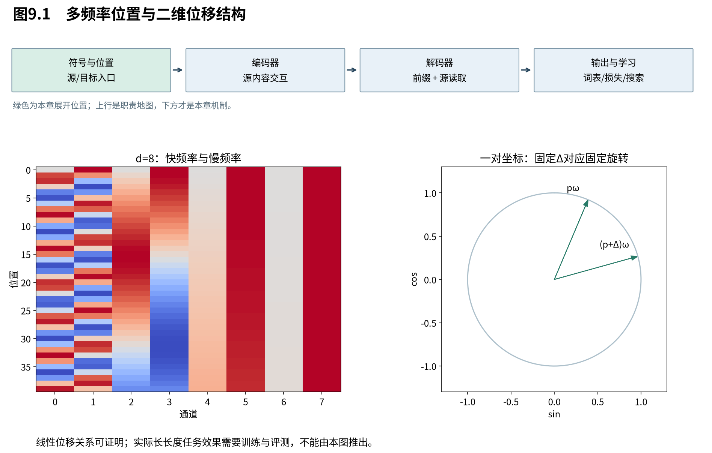

# 第9章　顺序怎样进入无循环网络

我们已经控制了谁能看见谁，但源侧全局自注意力仍面临一个问题：“我爱猫”与“猫爱我”的内容相同、顺序不同。循环状态天然沿顺序更新，纯粹的集合读取却不会自动知道位置编号。本章先证明这种对称性，再设计正弦位置向量，并区分可证明的平移结构与需要实验检验的长度外推。

图9.1强调位置向量与词嵌入在模型入口相加。它不直接给每层安装一条确定的相对距离规则；后面的投影会把内容与位置共同变换。

## 9.1 没有位置时，自注意力有什么对称性

**在没有位置特征、没有破坏该对称性的遮罩时，重排输入位置只会使自注意力输出按同样方式重排。** 这叫置换等变，不是输出完全不变。它使模型适合处理集合，却没有单靠这个算子区分“谁在前、谁在后”的位置依据。

暂省B，输入 $X\in\mathbb R^{n\times d}$。令P为 $(n,n)$ 置换矩阵，每行每列恰有一个1，左乘PX重新排列行。投影与行重排可交换，所以 $Q'=PQ,K'=PK,V'=PV$。分数变为：

$$
 S'=Q'K'^\top=PQK^\top P^\top=PSP^\top.
 \tag{9.1}
$$

左侧P重排行，右侧 $P^\top$ 重排每行候选；行softmax对候选重排相容：

$$
 \operatorname{softmax}_{\rm row}(PSP^\top)
 =P\operatorname{softmax}_{\rm row}(S)P^\top.
 \tag{9.2}
$$

原因是各行分母只是同一组指数项换了求和顺序。于是注意力输出为：

$$
 O'=P\operatorname{softmax}(S)P^\top PV=PO,
 \tag{9.3}
$$

其中 $P^\top P=I$。逐位置共享的FFN、LayerNorm和残差也保持这种等变性，因而这样的网络堆深后仍没有额外的绝对位置依据。

固定因果遮罩并不对任意位置置换保持上述关系，因此不能把证明直接搬到所有decoder-only模型。我们的动机不是声称任何无显式位置编码的模型都完全无序，而是指出原版源侧结构中需要注入的顺序信息。

## 9.2 为什么用一组不同频率的正弦与余弦

**正弦位置编码用多个二维旋转相位表示位置，使同一位移在每一对坐标中对应一个固定线性变换。** 多种频率提供不同变化尺度，编码能在任意整数位置计算；它是否被网络有效利用，还要由学习决定。

模型宽度d取偶数，位置 $p=0,1,\ldots$；第i对坐标的频率为 $\omega_i=10000^{-2i/d}$，$i=0,\ldots,d/2-1$。定义：

$$
 \mathrm{PE}_{p,2i}=\sin(p\omega_i),\qquad
 \mathrm{PE}_{p,2i+1}=\cos(p\omega_i).
 \tag{9.4}
$$

每对坐标位于单位圆上；i越大，频率越低，随位置变化越慢。波长是 $\lambda_i=2\pi/\omega_i=2\pi10000^{2i/d}$。最小波长为 $2\pi$，最大为 $2\pi10000^{1-2/d}$，接近但不精确等于 $2\pi10000$。不应把论文描述中的范围端点抄成有限d下取到的精确最大值。

取d=4，频率为1和0.01。位置0编码为 $(0,1,0,1)$；位置1约为 $(0.84147,0.54030,0.01000,0.99995)$。第一对已明显旋转，第二对仍只移动一小段。编码不是把位置写成独热编号；多个位置共享一套连续变化的特征。

原版将词嵌入乘 $\sqrt d$ 后加位置编码：$X_p=\sqrt d E[x_p]+\mathrm{PE}_p$。两项同为d维，因此维度不增加；若拼接，模型宽度和后续权重都需调整。这是一项架构选择，并非数学上只有相加才可行。

## 9.3 相对位移的线性关系，从加法公式一步步得到

**位置p到p+Δ的变化，在每对坐标里等于同一个与p无关的旋转矩阵。** 这给线性操作提供了一种可利用的位移结构，是原论文选择正弦编码的动机之一；它并没有规定模型必须学出某个距离函数。

固定频率 $\omega$，把二维列向量写成 $u(p)=(\sin(p\omega),\cos(p\omega))^\top$。用三角加法公式分别展开：

$$
 \sin((p+\Delta)\omega)=\sin(p\omega)\cos(\Delta\omega)+\cos(p\omega)\sin(\Delta\omega),
 \tag{9.5}
$$

$$
 \cos((p+\Delta)\omega)=\cos(p\omega)\cos(\Delta\omega)-\sin(p\omega)\sin(\Delta\omega).
 \tag{9.6}
$$

按两个输出坐标收集系数：

$$
 u(p+\Delta)=
 \begin{pmatrix}\cos(\Delta\omega)&\sin(\Delta\omega)\\-\sin(\Delta\omega)&\cos(\Delta\omega)\end{pmatrix}u(p).
 \tag{9.7}
$$

符号顺序来自本书采用 $(\sin,\cos)$，不是常见 $(\cos,\sin)$；如果改变坐标顺序却不改矩阵，旋转方向就会写错。把各频率的二维矩阵放在分块对角线上，就得到整个d维编码的线性位移变换。

两个位置编码直接点积，还有：

$$
 \mathrm{PE}_p^\top\mathrm{PE}_q
 =\sum_i\bigl[\sin(p\omega_i)\sin(q\omega_i)+\cos(p\omega_i)\cos(q\omega_i)\bigr]
 =\sum_i\cos((p-q)\omega_i).
 \tag{9.8}
$$

这里使用的是余弦差角公式。结果只依赖位移，但它是多个振荡项之和，不保证随距离单调下降。用一张某个范围内总体下降的曲线推断全距离单调性，会超出式子能支持的结论。

## 9.4 加入模型后，哪些性质还成立

**原始位置向量的相对结构，不等于模型实际注意力分数只依赖相对位置。** 加法把内容与位置混合，随后不同的Q/K投影会产生交叉项；网络有利用顺序的工具，同时也有学习绝对位置和内容相关关系的自由度。

将缩放后的内容记为 $e_p$，位置向量记为 $r_p$，投影乘积 $A=W_QW_K^\top$。单个未缩放分数展开为：

$$
 (e_p+r_p)^\top A(e_q+r_q)
 =e_p^\top Ae_q+e_p^\top Ar_q+r_p^\top Ae_q+r_p^\top Ar_q.
 \tag{9.9}
$$

第一项比较内容，第二、三项混合内容与位置，第四项是经A变换的位置关系。即便原始 $r_p^\top r_q$ 只依赖位移，任意A下的第四项也未必保留同样形式。式(9.8)不能直接替换整个分数。

因此，我们能严格说“输入提供了某种线性位移结构”，不能直接说“模型天然成为纯相对位置模型”。后续Book3会沿这个问题讨论把旋转放进Q/K的另一种位置设计，本册先完整理解原版加法机制。

## 9.5 可以计算更长位置，为何仍可能外推失败

**定义域延伸与学得能力外推是两件事。** 正弦公式能给未见位置生成向量，但模型可能依赖训练范围内的相位组合、距离分布或其他特征，超出范围后仍会失效。

可学习位置表通常需要为新位置增加或外推参数；正弦避免了这一直接的查表上限。但它没有保证注意力、FFN和输出层在新分布上做出正确判断。原论文将长度外推表述为选择正弦的可能理由，并未给出任意长度可靠性的证明；其Table3(E)只报告学习式位置嵌入与正弦在指定开发集上结果接近。

验证分三层：数值检查式(9.7)的位移恒等式；置换实验检验无位置结构的等变性；训练长度与测试长度分开，才检查实际外推。前两者通过不能替代第三者。

我们已建立位置通信的读取规则与顺序输入。下一章离开位置轴，转向每个位置内部：读取到的向量，怎样被进一步加工成更有用的表示？

来源：[Attention Is All You Need，v7，§3.5与Table3(E)](https://arxiv.org/abs/1706.03762v7)。等变、位移、点积与交叉项为本书展开，外推边界不作超出论文的性能承诺。
