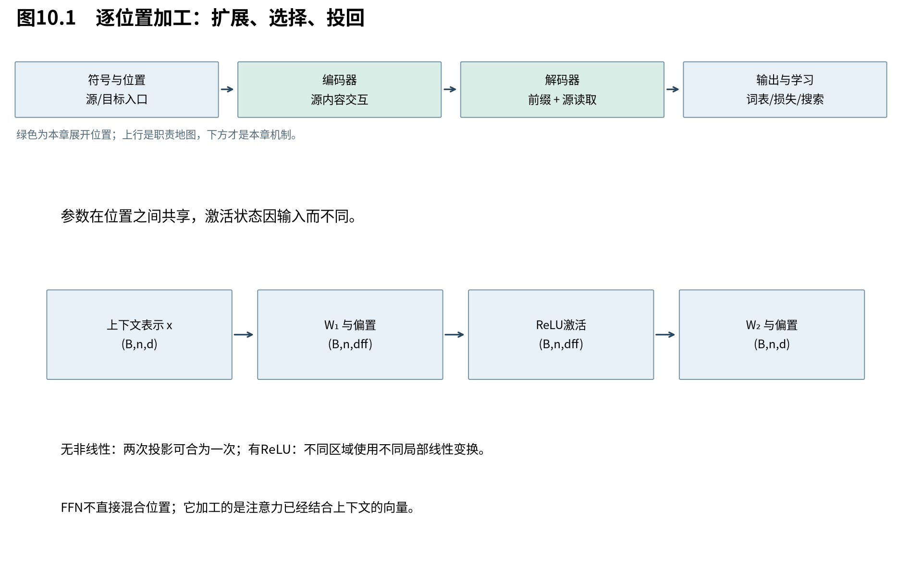

# 第10章　每个位置怎样加工读取

前几章集中回答从哪里读取。现在看读取之后：一个位置已经混合了上下文信息，模型还需要根据这份内容做非线性变换。原版Transformer用逐位置前馈网络完成这项工作。它并不直接打开新的位置通信边，却会改变下一层拿来提问和回答的表示。

图10.1将注意力与FFN画成两种不同方向的操作。FFN的“逐位置”表示同一权重作用于所有位置；它不表示整个模型的各位置互相独立，因为输入已包含注意力读来的上下文。

## 10.1 两次线性变换之间为何必须有非线性

**FFN先把每个位置投影到较宽的中间空间，用ReLU选择当前激活的特征，再投回模型宽度。** 非线性使不同输入可以使用不同局部变换；若去掉它，两次线性层可以合成一层，就失去了这部分分段表达能力。

对单个位置，先用行向量 $x\in\mathbb R^{1\times d}$ 表示，原版FFN为：

$$
 a=xW_1+b_1\in\mathbb R^{1\times d_{ff}},\quad
 z=\max(0,a),\quad
 f(x)=zW_2+b_2\in\mathbb R^{1\times d}.
 \tag{10.1}
$$

$W_1\in\mathbb R^{d\times d_{ff}}$，$W_2\in\mathbb R^{d_{ff}\times d}$，偏置宽度分别为 $d_{ff}$ 与d。ReLU逐元素保留正数、把负数置零。

若将ReLU换成恒等映射：

$$
 f(x)=x(W_1W_2)+(b_1W_2+b_2),
 \tag{10.2}
$$

它只是一项仿射变换，无论中间写了多少个神经元。加入ReLU后，令 $D(x)=\operatorname{diag}(\mathbf1[a_j>0])$，在不跨越激活边界的区域中：

$$
 f(x)=(xW_1+b_1)D(x)W_2+b_2.
 \tag{10.3}
$$

该区域的局部线性部分是 $W_1D(x)W_2$。改变输入可能使某些 $a_j$ 变号，从而更换局部变换。边界 $a_j=0$ 是输入空间的超平面；ReLU在边界不可微，自动微分通常采用特定次梯度约定。

这种“根据内容选用不同局部变换”的能力，是FFN在模型中承担的具体工作，不只是一个抽象的参数扩容器。

## 10.2 从隐藏神经元看它如何组合特征

**每个中间通道先检测一个输入方向，再以一个输出方向贡献到最终表示。** 多个通道的激活组合允许模型把已经读到的上下文转成新的特征；单个神经元是否对应人可命名概念，需要证据，不能从结构直接指定。

把 $W_1$ 第j列记为 $w_{1,j}\in\mathbb R^d$，把 $W_2$ 第j行记为 $w_{2,j}^\top\in\mathbb R^{1\times d}$，则式(10.1)逐通道展开为：

$$
 f(x)=\sum_{j=1}^{d_{ff}}\max(0,xw_{1,j}+b_{1,j})w_{2,j}^\top+b_2.
 \tag{10.4}
$$

前面的标量控制该输出方向贡献多大。输入检测方向与输出写回方向不必相同，这与注意力区分匹配和内容有相似的职责分离，但FFN没有对其他位置做归一化读取。

一个二维例子取 $W_1=\begin{pmatrix}1&-1&0\\0&0&1\end{pmatrix}$、$W_2=\begin{pmatrix}1&0\\-1&0\\0&1\end{pmatrix}$，偏置全零。输入 $(2,-1)$ 先变为 $(2,-2,-1)$，ReLU后为 $(2,0,0)$，输出 $(2,0)$；输入 $(-2,1)$ 则得到 $(0,2,1)$ 再输出 $(-2,1)$。前两通道可分别处理第一坐标的正负区域，第三通道只传递第二坐标的正部分。

这不是语义模型，只是让读者看见线性投影、激活选择与输出组合怎样合作。学习到的W通常没有这么清晰的人为分工。

## 10.3 参数共享不等于各位置做出相同结果

**逐位置共享的是函数参数，不是输入向量或激活状态。** 同一FFN接收不同上下文表示，就会得到不同激活集合；共享使模型不必为每个序列位置再训练一套变换。

输入 $X\in\mathbb R^{B\times n\times d}$，两次投影形状是 $(B,n,d)\to(B,n,d_{ff})\to(B,n,d)$。也可以先把B和n合并为 $Bn$ 行做矩阵乘，再恢复形状。由于运算不混合这些行，两种方式应数值等价。

它也等价于沿序列作用的两个核宽1的卷积加非线性；“卷积”在这里不表示跨相邻词聚合。跨位置内容已由注意力引入，FFN改变的表示又成为下一层注意力的Q/K/V来源。

## 10.4 宽度与成本的交换

**更宽的中间层提供更多可组合的特征方向，同时增加参数、乘法和训练激活。** 它并非没有代价的“表达能力提升”，也不是只要变宽就保证模型表现更好。

计入偏置，参数总量为：

$$
 d d_{ff}+d_{ff}+d_{ff}d+d=2dd_{ff}+d_{ff}+d.
 \tag{10.5}
$$

原版base取d=512、$d_{ff}=2048$，得到2099712个参数。忽略偏置加法和ReLU，每个位置约 $2dd_{ff}$ 次MAC；B个长度n的样本约 $2Bndd_{ff}$。训练中中间激活形状 $(B,n,d_{ff})$，同样随宽度增加。

注意力核心随位置对数量增长，FFN随位置数线性增长，但含大通道乘积。短序列下FFN完全可能占据显著计算比例；不能看到注意力的平方项就断言所有负载都由它支配。

下一章研究怎样把这些子层堆深。即使单个操作有足够表达能力，多次串联仍可能难以训练；残差与归一化要解决的是变换的组织和数值路径。

来源：[Attention Is All You Need，v7，§3.3](https://arxiv.org/abs/1706.03762v7)。局部线性展开、算例、参数及MAC为本书推导和核算。
