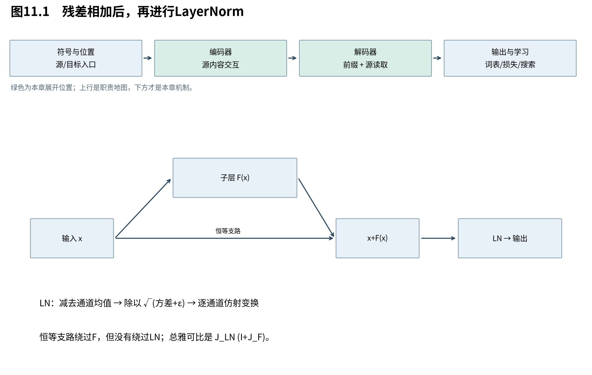

# 第11章　深层网络怎样传递与规范表示

注意力负责位置通信，FFN负责内容变换。将它们反复堆叠时，表示与梯度都要经过许多层。现在的设计目标是：允许子层学习对已有表示的修正，同时控制每个位置通道的统计尺度。原版Transformer用残差后接LayerNorm完成这种组织；本章将前向几何和反向路径一起展开。

图11.1先让输入沿恒等支路与子层支路会合，再经过LN。读图时注意：恒等支路绕过子层，却没有绕过最后的归一化。这正是分析梯度时不能漏掉的一项。

## 11.1 残差为表示和梯度增加一条直接路径

**残差把目标从“每层重新创造全部表示”改为“在原表示上添加修正”，并给梯度增加一项恒等贡献。** 这种结构使小改动容易表示，但不保证多层乘积总是稳定，也不保证后续归一化保留完全恒等的传递。

单位置用列向量 $x\in\mathbb R^d$，子层 $F:\mathbb R^d\to\mathbb R^d$，残差输出 $u=x+F(x)$。微分为：

$$
 du=dx+J_F(x)dx=(I+J_F(x))dx.
 \tag{11.1}
$$

所以反向梯度 $\nabla_x\mathcal L=(I+J_F)^\top\nabla_u\mathcal L$。即使F的导数很小，还有恒等项；但若某方向 $J_F$ 接近−I，仍可能抵消，若很多层 $I+J_F$ 连乘，仍可能放大或缩小。

在注意力子层，整体雅可比还包含位置之间的块结构。这里用单位置式展示恒等加修正的原则；它不是假定注意力F只看一个位置。残差要求输入输出宽度相同，所以多头输出投影和FFN降回d都与此相关。

## 11.2 LayerNorm首先做了什么几何操作

**LayerNorm对每个位置的d个通道先减均值，再按均方幅度缩放，最后施加可学习的逐通道仿射变换。** 它使用当前位置自身的统计，不跨样本，也不沿目标时间混合信息，因此能与因果模型相容。

令 $\mathbf1\in\mathbb R^d$ 为全1向量，定义：

$$
 \mu=\frac1d\mathbf1^\top x,\quad z=x-\mu\mathbf1,\quad
 v=\frac1d z^\top z,\quad s=\sqrt{v+\varepsilon},\quad
 \widehat x=z/s,\quad y=\gamma\odot\widehat x+\beta.
 \tag{11.2}
$$

$\mu,v,s$ 是标量；z、$\widehat x$、$\gamma$、$\beta$、y均为d维，$\varepsilon>0$ 防止除零。这里除以d，是当前通道的均方偏差，不是在估计总体方差时使用的无偏样本修正d−1。

记中心化矩阵 $C=I-\mathbf1\mathbf1^\top/d$，则 $z=Cx$。它满足 $C^2=C,C^\top=C,C\mathbf1=0$，所以是投影到“坐标和为零”的超平面。若 $\varepsilon=0$ 且z非零，$\|\widehat x\|^2=d$：中心化之后再投到该超平面内半径 $\sqrt d$ 的球面。

保留epsilon时，$\|\widehat x\|^2=dv/(v+\varepsilon)<d$；最后再乘不同的gamma、加beta，会进一步改变这个几何形状。因此“LN输出永远零均值单位方差”只适用于仿射变换之前，并且单位方差还要考虑epsilon。

## 11.3 为什么平移被去掉，缩放只在条件下被忽略

**中心化消除了所有通道共同平移的成分；正比例缩放在epsilon可忽略时基本被规范化抵消。** 这降低了某些尺度变化对后续计算的直接影响，但也舍弃了这些统计信息，网络需要通过其他方向或参数表达有用内容。

对任意标量a，$C(x+a\mathbf1)=Cx$，所以共同平移被精确消除。对正标量b，忽略epsilon时：

$$
 \frac{C(bx)}{\sqrt{\|C(bx)\|^2/d}}
 =\frac{bz}{b\sqrt{\|z\|^2/d}}=\frac{z}{\sqrt v}.
 \tag{11.3}
$$

若b为负，结果还会翻转符号；若epsilon保留，分母是 $\sqrt{b^2v+\varepsilon}$，缩放不再精确抵消。对于常数向量z=0，epsilon使规范化输出为0，最终输出就是beta。

例如x=(1,2,3)，均值2，z=(−1,0,1)，v=2/3。忽略epsilon，规范化后约为(−1.224745,0,1.224745)。它留下的是相对通道模式，而非原先共同的偏移2。

## 11.4 把LayerNorm导数完整展开

**LayerNorm的反向传播会去除共同平移方向，并削弱沿当前中心化表示的径向变化。** 梯度不是简单除以标准差；均值与方差都依赖输入，必须把它们的导数一并计算。

从 $z=Cx$ 开始，$dz=Cdx$。再由 $v=z^\top z/d$ 求微分：

$$
 dv=\frac2d z^\top dz=\frac2d z^\top dx,
 \tag{11.4}
$$

最后一个等号使用 $Cz=z$ 与C对称。$s=\sqrt{v+\varepsilon}$ 的微分是 $\mathrm ds=\mathrm dv/(2s)=(z^\top\mathrm dx)/(d\,s)$，分母中的d是通道宽度。把它代回商的微分：

$$
 d\widehat x=\frac{dz}{s}-\frac{z}{s^2}\,ds
 =\left(\frac Cs-\frac{zz^\top}{d s^3}\right)dx.
 \tag{11.5}
$$

所以规范化的雅可比与完整LN雅可比分别为：

$$
 J_{\rm norm}=\frac1s\left(C-\frac{zz^\top}{d s^2}\right),\qquad
 J_{\rm LN}=\operatorname{diag}(\gamma)J_{\rm norm}.
 \tag{11.6}
$$

它们形状均为 $(d,d)$。共同平移方向满足 $J_{\rm norm}\mathbf1=0$；沿z方向，由 $z^\top z=dv$ 得：

$$
 J_{\rm norm}z=\frac zs\left(1-\frac v{s^2}\right)
 =\frac{\varepsilon}{s^3}z.
 \tag{11.7}
$$

epsilon为0时径向也被消除；与1和z都正交的方向则只乘 $1/s$。这解释了规范化既可能压低某些变化，也可能在s很小时放大其他方向，不能笼统说它永远“压缩梯度”。gamma还会进一步按通道改变梯度。

实现时也可用向量式。令上游梯度g，先取 $a=g\odot\gamma$，由式(11.6)得到：

$$
 \nabla_x\mathcal L=\frac1s\left[a-\operatorname{mean}(a)\mathbf1
 -\widehat x\operatorname{mean}(a\odot\widehat x)\right].
 \tag{11.8}
$$

这保留了epsilon的作用，因为 $\widehat x=z/s$。配套验证将解析式与自动微分及有限差分比较，而不是仅与另一份复制同一公式的实现比较。

## 11.5 原版post-LN给出的是什么路径

**原版子层是先残差相加、再规范化，因此反向路径同时包含残差雅可比和LN雅可比。** 残差提供了绕过F的通道，但没有绕过LN；不能拿纯残差的恒等项直接证明原版深层训练稳定。

设 $u=x+F(x)$，$y=\operatorname{LN}(u)$，链式法则为：

$$
 \frac{\partial y}{\partial x}=J_{\rm LN}(u)(I+J_F(x)).
 \tag{11.9}
$$

将LN移到F之前会得到另一种计算图及雅可比，不能仅说“都是残差加归一化”。本册主线保留2017 post-LN；后续Book3再比较现代骨架中的其他安排及其代价。

BatchNorm通常按批量等轴估计统计，与这里每个位置自身通道统计不同；训练/推理统计和可变长度问题也不同。不要为了实现方便将任意规范化层互换。我们已经知道每个子层如何通信、加工与规范表示，下一章终于可以把完整张量流连接到概率损失。

来源：[Layer Normalization，v1，§3](https://arxiv.org/abs/1607.06450v1)；[Attention Is All You Need，v7，§3.1](https://arxiv.org/abs/1706.03762v7)。投影几何、完整雅可比及边界为本书推导。
