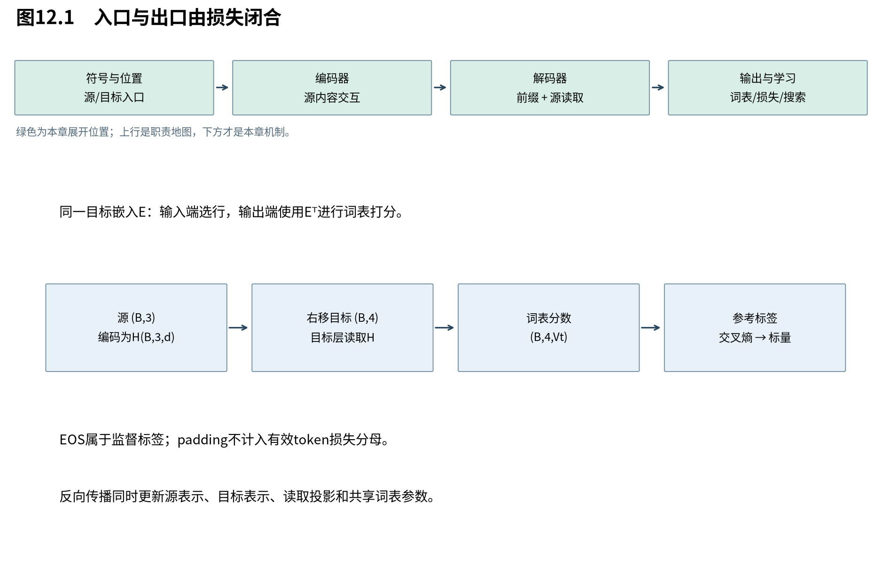

# 第12章　从整机输出到学习目标

各个部件已经有了数学含义，现在回到第1章的完整翻译任务。我们要让“我 爱 猫”经过源侧编码，让右移后的目标前缀经过目标侧计算，最终把每个位置的词表分布与参考答案比较。本章连接入口、整机与损失，并解释权重共享和标签平滑究竟修改了什么。

图12.1中源长n=3，目标预测长度m=4包含EOS。概率表最后一维是词表，不能在目标长度轴上做softmax。图上方注明的E在目标输入端查表、输出端转置使用；共享的是参数，不是源句和目标句的token数据。

## 12.1 把入口、堆叠与词表出口接起来

**完整Transformer将离散符号映射为带位置的表示，经过源侧与目标侧的分工计算，再将目标表示投影到词表。** 层内宽度保持d，源长与目标长各自保留；源信息通过交叉注意力进入目标侧，而不是把两种长度强行对齐。

|阶段|输入→输出|必须保持的含义|
|---|---|---|
|源嵌入与位置|$(B,n)\to(B,n,d)$|源位置对应有效源符号|
|L层编码器|$(B,n,d)\to H:(B,n,d)$|源填充不能作为有效候选|
|目标右移、嵌入与位置|$(B,m)\to(B,m,d)$|当前位置输入不是当前位置答案|
|L层解码器|目标表示与H→$(B,m,d)$|每层保持因果，交叉读取有效源位置|
|词表投影|$(B,m,d)\to(B,m,V_t)$|每个目标位置一组logits|
|概率与损失|logits、标签、有效位置→标量|EOS计入，padding不计入|

原版嵌入乘 $\sqrt d$ 是入口的尺度选择。它影响内容相对位置编码的幅度，但论文没有提供一个足以推出所有模型都必须如此缩放的普遍定理。实际数值还与初始化、训练和后续规范化有关，不能假定内容每坐标方差恒为1。

## 12.2 权重绑定怎样把输入与输出联系起来

**目标嵌入与输出分类器共享参数，让同一个符号向量既参与输入表示，也参与输出打分。** 这样可减少参数，并把两端的几何联系起来；源侧是否也能共享，取决于词表与符号映射是否一致。

设目标嵌入 $E\in\mathbb R^{V_t\times d}$，目标最终表示Z形状 $(B,m,d)$。权重绑定设置 $W_U=E^\top$，于是词表分数：

$$
 A_{btj}=Z_{bt,:}E_{j,:}^\top.
 \tag{12.1}
$$

同一矩阵在输入端按编号选行，在输出端把所有行当候选方向比较。输入端的 $\sqrt d$ 缩放不能不加说明地也乘到输出端；原论文明确把这个缩放用于嵌入层。

与独立 $W_U$ 相比，绑定减少约 $V_t d$ 个参数，但也约束了两端不能自由选择两套矩阵。原论文使用共享词表设置下的嵌入/输出共享；若源、目标词表不同，即使大小碰巧相同也不能按行号直接绑定，必须先有一致的符号对应。教学实践可选择独立源表、绑定目标输入输出，并明确这是缩小实现的设置。

## 12.3 从似然到交叉熵与困惑度

**最大似然把正确下一符号的概率作为学习目标，交叉熵是它按目标分布表达的形式。** 困惑度则把平均负对数似然重新指数化；它依赖分词单位、数据和损失口径，不能脱离这些条件比较。

单个位置logits为 $a\in\mathbb R^{V_t}$，概率 $p=\operatorname{softmax}(a)$，正确编号为y。独热目标 $q_j=\mathbf1[j=y]$，所以：

$$
 H(q,p)=-\sum_jq_j\log p_j=-\log p_y
 =-a_y+\log\sum_j e^{a_j}.
 \tag{12.2}
$$

最后一个式子直接使用logits，便于稳定计算。令 $c=\max_j a_j$，则 $\log\sum_j e^{a_j}=c+\log\sum_j e^{a_j-c}$，避免大正指数溢出。

全数据按有效token平均得到 $\overline\ell$，自然对数口径下困惑度 $\mathrm{PPL}=\exp(\overline\ell)$。若正确符号概率始终为1/V，则损失为log V、PPL为V，这给出一个直观基准。它不是模型每步真的保留了恰好PPL个候选，而是正确符号概率几何平均的倒数。

不同分词器把同一文本拆成不同数量单位，平均损失与PPL的单位随之改变。原论文Table3注明的是每wordpiece困惑度，不能直接与每词困惑度比较。

## 12.4 标签平滑修改的是目标分布

**标签平滑不再要求正确类概率趋近1，而给其他类别保留少量目标质量，从而削弱过度确定的训练倾向。** 它是一种目标选择，会改变最优概率和梯度；训练损失下降、未平滑PPL变化与翻译质量并非同一指标。

为把推导口径固定，取词表上均匀分布u，$u_j=1/V_t$，平滑系数 $\epsilon\in[0,1)$：

$$
 q_j^{\rm sm}=(1-\epsilon)\mathbf1[j=y]+\epsilon/V_t.
 \tag{12.3}
$$

于是正确类目标是 $1-\epsilon+\epsilon/V_t$，其他类为 $\epsilon/V_t$。某些实现把平滑质量只分给非正确、非padding类别，得到另一组目标数值；“epsilon=0.1”本身不足以描述完整实现。本书实践使用式(12.3)，不把它冒充所有原始代码的唯一细节。

由分布混合的线性性：

$$
 H(q^{\rm sm},p)=(1-\epsilon)(-\log p_y)
 +\epsilon\left(-\frac1{V_t}\sum_j\log p_j\right).
 \tag{12.4}
$$

又因为 $H(q,p)=H(q)+D_{\rm KL}(q\|p)$，且对固定q熵H(q)不依赖模型，理想无限制最优是p=q。这里不能仅凭“距离”这个称呼就假定KL非负：对正数u，$\log u\le u-1$，它来自函数 $u-1-\log u$ 在u=1处取最小值0。将u取为 $p_j/q_j$，逐项乘以 $q_j$ 并求和，得到 $\sum_jq_j\log(p_j/q_j)\le\sum_j(p_j-q_j)=0$，两边取负就是KL非负；各项取等需要p=q。此处先假设q各项为正，零项用极限处理。因而在模型能够表达任意分布的理想情形，最优目标确实从独热分布移向了平滑分布。由第6章同样的商法则，对一般和为1的q：

$$
 \frac{\partial H(q,p)}{\partial a_j}=p_j-q_j.
 \tag{12.5}
$$

例如V=4、epsilon=0.1，正确类目标0.925，其余0.025。若模型给正确类0.999，梯度会推动它降低过度集中的分数；没有平滑时，正确类仍会被推向1。

此处的KL分解若需要展开：$D_{\rm KL}(q\|p)=\sum_jq_j\log(q_j/p_j)=\sum_jq_j\log q_j-\sum_jq_j\log p_j$，加上 $H(q)=-\sum_jq_j\log q_j$，便回到交叉熵。0项按连续极限处理。原论文报告标签平滑降低PPL表现却改善准确率和BLEU，这是特定实验观察，不能当作每次都会发生的规律。[T，§5.4]

## 12.5 一次反向传播究竟更新什么

**损失通过输出投影、解码层、交叉读取和源编码一路反传，联合训练表示与读取规则。** 注意力的权重是本次输入算出的中间数据，模型参数才是优化器长期更新的对象；将二者分开，才能理解“学习关注哪里”具体发生在何处。

输出logits梯度为p−q，先更新词表矩阵与目标表示；目标表示的梯度穿过FFN、LN和残差，再进入各注意力。交叉注意力既更新目标查询投影，也通过键和值更新源侧表示。源嵌入和编码器由此接收与翻译目标相关的训练信号。

权重绑定时，同一E从输入查表和输出分类两条路径获得梯度，优化器对这一个参数累加更新，不能复制成两个各自更新的变量后仍声称共享。参数梯度可以在批量样本间累加，状态与注意力矩阵则属于当前前向计算。

至此，第1章的概率模型已有完整实现路径。下一章研究怎样用优化器和训练配方让这些参数实际学起来，并区分公式所能证明的更新规则与经验选择。

来源：[Attention Is All You Need，v7，§3.4、§5.4、Table3](https://arxiv.org/abs/1706.03762v7)。交叉熵、平滑及梯度推导由本书展开；具体平滑分布在正文显式固定。
