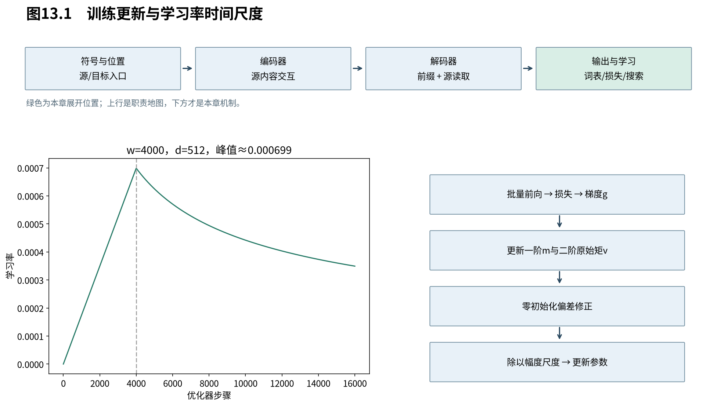

# 第13章　原论文如何训练

上一章把整机变成可求导的损失。现在要解决的是怎样用带噪声的批量梯度更新大量参数，以及怎样区分架构性质和训练配方。原论文使用Adam、预热后衰减的学习率、dropout与标签平滑；这些共同构成研究设置，不能只保留架构图便声称完整复现。

图13.1将模型前向状态、参数梯度、优化器矩估计分开。注意力矩阵属于当前批次，Adam的动量在训练步骤间保留，模型参数则用于下一批前向。三种生命周期不能混写。

## 13.1 Adam为何同时记住方向和平方幅度

**Adam对每个参数维护梯度的一阶与二阶原始矩估计，用较平滑的方向除以近期幅度尺度来更新参数。** 它提供逐坐标自适应的步长组织；二阶量不是Hessian，也不是减去均值后的方差，不能因此把Adam称为二阶优化方法。

设所有参数展成向量 $\theta\in\mathbb R^P$，第t个优化步骤的批量梯度为 $g_t$。从 $m_0=v_0=0$ 开始，逐元素计算：

$$
 m_t=\beta_1m_{t-1}+(1-\beta_1)g_t,\quad
 v_t=\beta_2v_{t-1}+(1-\beta_2)g_t\odot g_t.
 \tag{13.1}
$$

$\beta_1,\beta_2\in[0,1)$ 是两个平滑系数，不是第12章的标签平滑参数。展开第一条递推：

$$
 m_t=(1-\beta_1)\sum_{s=1}^{t}\beta_1^{t-s}g_s.
 \tag{13.2}
$$

系数和为 $1-\beta_1^t$，早期小于1。若梯度的期望恒为 $\mu$，则 $\mathbb E[m_t]=(1-\beta_1^t)\mu$；因此定义偏差修正：

$$
 \widehat m_t=\frac{m_t}{1-\beta_1^t},\quad
 \widehat v_t=\frac{v_t}{1-\beta_2^t},\quad
 \theta_t=\theta_{t-1}-\eta_t\frac{\widehat m_t}{\sqrt{\widehat v_t}+\varepsilon_A}.
 \tag{13.3}
$$

分式、平方根都是逐元素，$\varepsilon_A$ 是优化器分母常数，区别于LN和标签平滑。二阶矩的修正同理，需要相应的稳定期望假设；训练中梯度分布不断变化，修正主要消除零初始化引入的权重不足，不把非平稳数据变成无偏总体估计。[Adam，Algorithm1、§3]

首步若某个坐标梯度为2，则 $\widehat m_1=2,\widehat v_1=4$，忽略epsilon，更新量为−eta。梯度为−2则方向相反。以后步骤依赖历史，不再总是等于符号乘eta。这个例子说明初始归一化作用，不证明所有步骤都具有同样幅度。

原Transformer取 $\beta_1=0.9,\beta_2=0.98,\varepsilon_A=10^{-9}$，不同于Adam论文常见默认值。配方是需要明确记录的实验条件。

## 13.2 预热与衰减怎样在同一个公式中交接

**原版学习率先随步骤线性增加，再按步骤平方根的倒数衰减，两段在预热终点连续接合。** 这控制训练早期与后期的参数更新尺度；公式可以推导交接位置，却不能单靠代数证明它对所有模型都最优。

令优化步骤 $t\ge1$，预热步数w，宽度d，原配方为：

$$
 \eta_t=d^{-1/2}\min(t^{-1/2},t w^{-3/2}).
 \tag{13.4}
$$

比较两条曲线，令 $t^{-1/2}=tw^{-3/2}$，得 $t^{3/2}=w^{3/2}$，即t=w。对t<w，线性项更小；对t>w，反平方根项更小。因此：

$$
 \eta_t=\begin{cases}
 d^{-1/2}t w^{-3/2},&1\le t\le w,\\
 d^{-1/2}t^{-1/2},&t\ge w.
 \end{cases}
 \tag{13.5}
$$

峰值为 $1/\sqrt{dw}$。base的d=512、w=4000给峰值约0.00069877；到4w时是峰值一半。实际代码还常允许一个额外全局倍率，若加入必须报告，不能仍说与原公式完全相同。

t是优化器更新次数，不是token位置或训练样本数量。梯度累积多个微批后再更新时，若调度器每个微批前进，学习率时间尺度就变了。记录训练时应同时说明样本/token批量、累积次数与优化步骤。

## 13.3 Dropout保留了什么期望，又没有保证什么

**Dropout在训练中随机去掉部分通道或连接贡献，以改变模型依赖单一计算路径的方式。** 常用反向缩放保持该次线性输出的条件期望，但不保证后续非线性网络的期望等于无dropout结果。

对待处理向量x，独立掩码 $m_j\sim\operatorname{Bernoulli}(1-p)$，训练输出为：

$$
 \widetilde x_j=\frac{m_jx_j}{1-p},\qquad
 \mathbb E[\widetilde x_j\mid x]=x_j,\quad
 \operatorname{Var}(\widetilde x_j\mid x)=\frac p{1-p}x_j^2.
 \tag{13.6}
$$

期望由 $\mathbb E[m_j]=1-p$ 得到，方差由Bernoulli方差 $p(1-p)$ 得到。评估时不用随机掩码。若后面接非线性F，一般 $\mathbb E[F(\widetilde x)]\ne F(x)$，所以不能把dropout解释成无影响的数值技巧。

原论文在子层输出与残差相加之前，以及嵌入加位置之后使用dropout；base概率0.1。某些实现还在注意力权重等处应用dropout，必须将论文说明、实际代码选择与实验设置分别记录。

## 13.4 数据与批量同样属于实验定义

**同一架构在不同数据、分词、批量和训练时长下会形成不同结果。** 训练复现必须同时锁定这些条件；教学缩小实验的目标是验证流程与指定现象，不是得到原论文分数。

原论文英德训练约450万句对，使用约37000词表的共享BPE；英法数据约3600万句，采用约32000的wordpiece词表。按近似长度分批，每批约25000源token与25000目标token，减少填充浪费。[T，§5.1]

BPE在本册是分词器接口：先用训练数据得到词表与规则，再同样处理验证和测试文本，不能用测试集重新学习词表。具体合并算法与不同分词目标在Book2推导。原论文数据体量和GPU成本不能转写为本机测量。

base训练100000步、8张P100约12小时；big训练300000步约3.5天，是原研究条件下的报告。权重checkpoint平均也属于最终模型形成过程，区别于多个模型分别推理再集成。我们在第15章只做CPU小型构造任务，明确规模、种子和限制。

## 13.5 怎样读一条训练曲线

**训练损失回答的是在训练条件下拟合目标的程度，验证生成还同时受泛化、前缀偏差和搜索影响。** 正确诊断要让这些观测互相补充，而不能用一条下降曲线宣布模型学会翻译。

至少区分：平滑训练损失、未平滑验证NLL、按参考前缀计算的准确率、实际自回归生成的整句结果。若训练好而生成坏，要检查右移与遮罩、训练/评估模式、EOS和搜索，再考虑泛化问题。若所有损失异常，先验证短序列能否拟合及梯度是否有限，不立即堆硬件或训练更久。

下一章将模型分布与搜索分开：即使每一步概率都可计算，怎样选出一整句译文仍是另一个算法问题。

来源：[Adam，v9](https://arxiv.org/abs/1412.6980v9)；[Attention Is All You Need，v7，§5—6](https://arxiv.org/abs/1706.03762v7)。矩展开、调度分段和dropout方差为本书推导；原论文硬件数字为引用。
