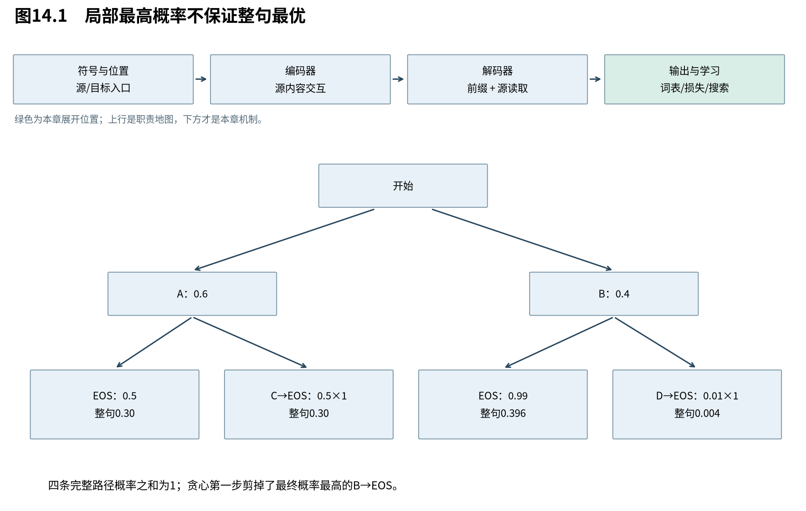

# 第14章　怎样生成并评估翻译

训练得到的是条件分布，用户需要的是一条完整译文。我们必须再选择一条搜索路径，并用合适指标评价结果。本章沿“局部最优为何可能失败→怎样保留多个候选→怎样评价整句”展开，区分模型、搜索目标和质量指标。

图14.1的边标条件概率，整条路径概率是边概率的乘积。剪掉某个前缀意味着其所有后续都不再搜索；这与训练时直接计算参考路径不同。

## 14.1 贪心为何不保证整句概率最大

**每步选择当前最可能的符号，只优化这一步，不保证最终完整序列最可能。** 后续概率依赖已选前缀，因此早期稍低概率的选择可能通向更高概率的整句。

构造一个两层概率树：第一步A概率0.6、B概率0.4；A之后EOS概率0.5，余下0.5走到C，C后EOS为1；B之后EOS为0.99，其余0.01走到D再结束。完整序列概率为：

$$
 p(A,\mathrm{EOS})=0.30,\quad p(A,C,\mathrm{EOS})=0.30,\quad
 p(B,\mathrm{EOS})=0.396,\quad p(B,D,\mathrm{EOS})=0.004.
 \tag{14.1}
$$

总和为1。贪心第一步选A，之后无论处理0.5的并列怎样，最终都只得到0.30；全局最佳是B后结束，概率0.396。此例不来自训练模型，只用于否定“逐步最大就是整句最大”。

## 14.2 束搜索保留多个前缀，仍是近似搜索

**束搜索每步只保留若干分数最高的前缀，增加继续探索的机会，又避免枚举整个词表树。** 束宽限制了成本，也意味着被剪掉前缀的未来不会再回来；它不保证找到全局最优，更不保证最大模型概率对应最好的人类译文。

令束宽K。每个活动前缀保存token序列、累计对数概率和模型所需状态。扩展时，每个前缀产生 $V_t$ 个候选，新分数为：

$$
 L(y_{1:t})=L(y_{<t})+\log p_\theta(y_t\mid x,y_{<t}).
 \tag{14.2}
$$

从约 $KV_t$ 个候选选出活动集合；遇EOS的路径转入完成集合，不应继续给它追加普通词。若有状态缓存，重排束时也必须按父前缀重排状态，否则token序列与状态会错配。

上例束宽2第一步保留A和B，下一步可以找到概率0.396的完成路径。更大的真实树仍可能在早期剪掉最终最佳路径，因此不能把这个构造例的成功推广成证明。

原始对数概率在扩展后不会增加，因为每个新增概率不超过1。这给纯概率搜索提供一个上界：活动前缀分数是其所有后代完成分数的上界。但加入长度归一化之后，分数可能随长度变化而提高，停止条件必须重新分析，不能沿用同一判断。

## 14.3 长度归一化改变了搜索目标

**长度惩罚或归一化用来调整搜索对不同长度候选的偏好；加入它后，搜索的不再只是原始序列概率。** 它可以改善特定任务的生成长度，但参数必须在开发集选择，并与概率模型本身区分。

GNMT提出、Transformer采用的长度项可写为：

$$
 \operatorname{lp}(y)=\left(\frac{5+|y|}{6}\right)^\alpha,\qquad
 \operatorname{score}(y)=\frac{\log p_\theta(y\mid x)}{\operatorname{lp}(y)}.
 \tag{14.3}
$$

长度的计数是否含EOS必须在实现中固定。因对数概率通常为负，除以较大的正数使分数更接近0，相对降低对较长序列的惩罚。alpha=0退回原始分数；这不是从条件概率链推导出的唯一校正，而是搜索设计。

原Transformer报告束宽4、alpha=0.6，最大输出长度为源长加50，并使用checkpoint平均。[T，§6.1] GNMT还讨论覆盖惩罚等项，不能因为共享了长度公式就把它所有搜索细节都归给Transformer。

## 14.4 BLEU为什么要截断重复匹配

**BLEU用参考译文中的短语重合衡量语料级输出，但必须限制重复词的虚假得分，并惩罚过短译文。** 它是一个可复现的代理指标，不是语义正确性的完整判定，也不是每一句都与人类评分一致。

对候选句c中的某个n-gram g，候选出现次数 $C_c(g)$，多条参考中最大次数 $R_c(g)$，截断计数为 $\min(C_c(g),R_c(g))$。在语料上先加计数再除：

$$
 p_n=\frac{\sum_c\sum_g\min(C_c(g),R_c(g))}
 {\sum_c\sum_g C_c(g)}.
 \tag{14.4}
$$

例如参考“i love cats”，候选“cats cats cats”，普通“是否出现过”会把三个词都算匹配；截断后cats只计一次，unigram精度为1/3。再考虑候选“i love”，unigram和bigram都可完全匹配，却遗漏了内容，因此还需长度项。

设候选语料总长度为c，有效参考总长度为r，每句从多参考中选与候选长度最近者，平局按约定选短。简短惩罚为：

$$
 \mathrm{BP}=\begin{cases}1,&c>r,\\\exp(1-r/c),&0<c\le r.\end{cases}
 \tag{14.5}
$$

对c=r两段都为1，保证接合。短句例c=2、r=3，则BP=$e^{-0.5}\approx0.60653$。若演示只使用1、2-gram且权重各1/2，最终BLEU就是0.60653；这不是标准4-gram BLEU结果，不能隐去阶数。

标准组合采用加权几何平均：

$$
 \mathrm{BLEU}=\mathrm{BP}\exp\left(\sum_{n=1}^{N_g}w_n\log p_n\right),
 \quad w_n\ge0,\quad\sum_nw_n=1.
 \tag{14.6}
$$

常见 $N_g=4,w_n=1/4$。某阶匹配为0时，未平滑几何平均为0；短句可能根本没有高阶n-gram，实际工具的平滑、有效阶数和空句策略必须报告。语料BLEU也不是逐句BLEU的算术平均，因为计数先汇总才求比例。

## 14.5 怎样避免用指标替代模型理解

**质量评估需要把模型概率、搜索设置、文本预处理和参考集合一起报告。** 两个BLEU数字只有在这些条件可比时才有清楚含义；分数差不能自动归因于某个架构部件。

至少记录数据集与划分、分词/大小写/去分词、参考数量、搜索束宽和长度项、BLEU实现及签名。第15章的短合成句用整句准确率与token结果更直观；原WMT结果则引用论文并保留其口径，不将两者并排成“复现精度”。

注意力热图也属于辅助观测。它说明某层某头分配了怎样的权重，不能单独证明翻译因果来源。可以通过输入扰动、遮罩检验与生成结果相互印证，但不能凭一张漂亮的对齐图宣称整机理解已经完成。

下一章把本册的关键承诺变成可运行检查：哪些应当数学等价，哪些是信息不变性，哪些必须训练后才能观察。

来源：[BLEU原论文，ACL2002](https://aclanthology.org/P02-1040/)；[GNMT，v2，解码部分](https://arxiv.org/abs/1609.08144v2)；[Attention Is All You Need，v7，§6.1](https://arxiv.org/abs/1706.03762v7)。概率树和短句计数是本书构造例。
