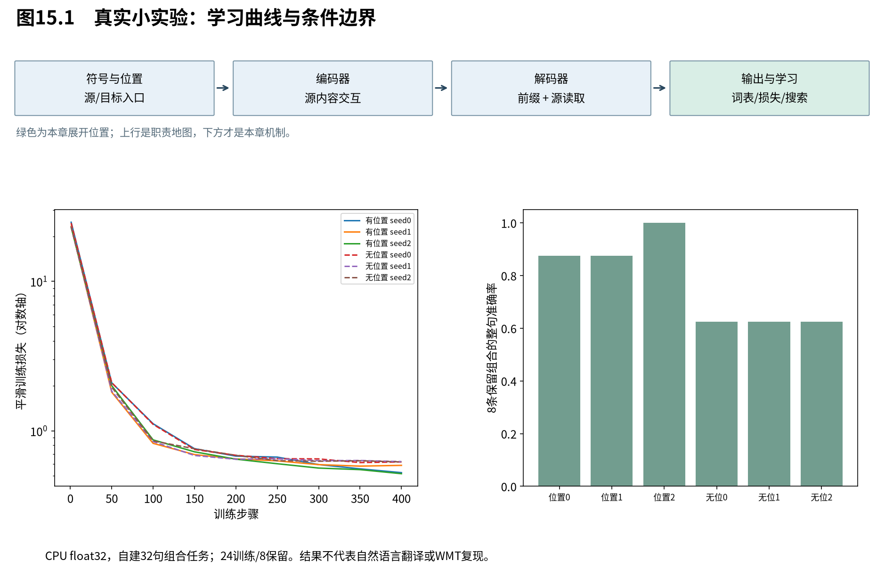
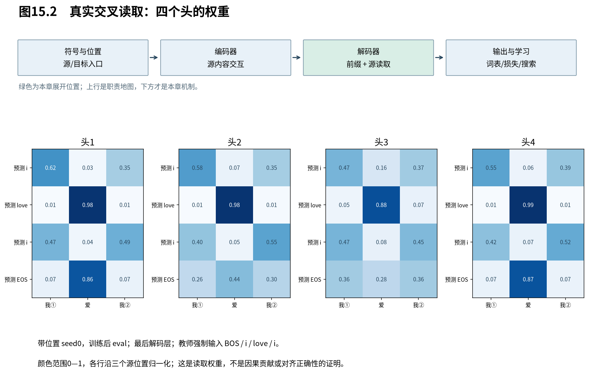

# 第15章　亲手检验这台机器

模型结构与公式已经闭合，现在把承诺分成三类来检查：数学表达是否一致，信息权限是否保持，小模型能否在指定任务上学到需要的行为。三类检查互相补充；任何一类通过都不能替代另外两类，更不能自动证明自然语言翻译质量。

图15.1来自本册实际保存的运行日志。左图是带标签平滑的训练损失，纵轴采用对数刻度以同时显示初期和后期；右图是自回归生成的整句准确率，二者测量对象不同。实线与虚线分别表示是否加入正弦位置编码，颜色区分随机种子。

## 15.1 先验证等式，再训练模型

**训练不是排查数学实现错误的第一工具。** 对应明确等价关系的操作，应先在CPU高精度下比较；涉及因果性的承诺，应直接改变未来输入或填充，观察有效输出是否保持。

本册以CPU float64完成47项检查，最大的绝对差约 $3.76\times10^{-10}$，来自包含有限差分的比较。它不是浮点实现无误差的证明，而是这些输入、精度和容差下的核验结果。

|对象|比较方法|支持的结论|
|---|---|---|
|RNN状态链|雅可比连乘、自动微分、有限差分|反向次序与导数一致|
|softmax与读出|解析雅可比、自动微分、有限差分|候选竞争和式(6.7)正确实现|
|多头|逐头参考、打包投影、PyTorch同权重对照|拆头与拼接没有混淆位置|
|正弦位置|各频率位移矩阵与直接重算|平移恒等式保持|
|FFN|逐位置计算与批量计算|参数共享实现相同函数|
|LayerNorm|含epsilon的解析式、自动微分、有限差分|均值/方差导数没有漏项|
|两层整机|未来输入扰动、追加源padding、嵌入梯度|被测试路径保持因果与填充不变性|
|学习目标与更新|平滑梯度、偏差修正、调度交点|训练公式口径一致|

随机方差实验另列为观察：10000对独立标准正态向量，维度8、64、256的缩放后样本方差约为0.991、1.005、1.025。采样误差应存在，不能为了数字漂亮把它们改成理论值1。第6章的严格结论是分布假设下的总体方差。

可运行入口与完整输出见配套实践。正文短代码也从Markdown直接提取执行，避免书中例子与文件实现悄悄漂移。

## 15.2 用一个足够小的任务检验位置需求

**本实验把词义学习压到简单词典映射，重点检验模型能否保留源序列中的角色顺序，并把它转换成目标序列。** 它不是自然语言翻译数据集，也没有复现WMT；任务越简单，越容易判断失败究竟是否符合预期结构。

源语言有四个名词“我、你、猫、狗”和两个动词“爱、看”，组成32条“主体＋动词＋客体”。目标语言使用对应的人工词典符号i、you、cat、dog、love、see，保持三项顺序，尾部预测EOS；不引入英语屈折或冠词规则。

编号0、1、2分别为PAD、BOS、EOS，名词为3—6，动词为7—8。两种语言在各自词表中使用对应编号，但源嵌入与目标嵌入是不同参数；实验本质是同构序列映射，不应伪装成真实语义对齐。

按固定组合规则划分24条训练、8条保留组合，不在训练中读取保留标签。每个词都在训练集出现，测试的是已有词的未训练组合，不是未见词泛化。主客体互换的两句按同一规则进入同一划分，避免一边训练一边测试造成任务解释混乱。

模型为两层编码器、两层解码器，d=32、4头、FFN宽64，post-LN；目标输入输出权重绑定，源嵌入独立，共43328个参数。dropout=0.1，Adam学习率0.003，两个矩系数0.9/0.98，标签平滑0.1，CPU float32，整批24条训练400步。这里使用固定学习率而不是原论文预热配方，以清楚记录缩小实验设置。

## 15.3 把实际结果连同失败一起读

**带位置模型在这个有限组合任务上大多学会了顺序，但不同种子仍有失败；无位置模型的限制则可以与源侧对称性直接联系。** 六次运行只比较此任务和设置，不估计真实翻译任务的普遍收益。

|位置编码|种子|训练整句正确|保留组合正确|保留组合未平滑NLL|
|---|---:|---:|---:|---:|
|正弦|0|24/24|7/8|0.12285|
|正弦|1|23/24|7/8|0.13994|
|正弦|2|24/24|8/8|0.10796|
|无|0|15/24|5/8|0.23261|
|无|1|15/24|5/8|0.25516|
|无|2|15/24|5/8|0.29445|

每次训练循环耗时约8.65—9.27秒，不含解释器和库初始化、后续评估与图示。这是本机CPU两线程设置下的小负载测量，不能换算成大模型吞吐。

失败例来自带位置seed0：源编号 $(3,8,5)$，即“我 看 猫”，目标应为 $(3,8,5,2)$，实际输出 $(5,8,3,2)$，把主体和客体交换了。seed1在“我 爱 狗”上输出了“狗 爱 狗”。这些结果说明训练和多数测试成功仍未保证所有保留组合正确；本书保留它们，不继续调参直到所有种子全对再报告。

## 15.4 为什么无位置模型恰好停在5/8

**这个任务中，同一组词的主客体互换需要不同输出，而无位置源编码器及交叉读取对源排列保持不变。** 因此对每一对需要相反输出的句子，确定性生成至多答对其中一个。这里可以给出任务限定的结构上界，而不只依赖训练曲线猜测。

第9章证明源编码对置换等变：$H'=PH$。交叉注意力的查询不变，键和值同时重排，分数列按同样顺序变化，softmax后再乘重排的V，两个置换抵消，目标读出不变。于是给定相同目标前缀，两份源排列得到相同下一符号分布。确定性贪心从同一BOS开始，整个生成序列也相同。

保留集8条中，2条主客体相同，不需要区分互换；其余6条组成3对互换句。每对至多对一条，加上2条对称句，最多 $2+3=5$ 条。三个无位置种子都达到5/8，符合这个结构边界。该论证依赖无位置源编码、排列不变交叉读取、确定性生成及当前任务，不能扩大为所有无显式位置模型都无法处理顺序。

带位置模型消除了这项对称性限制，但“可以表达”不保证某个训练种子一定学会，因此7/8与8/8之间的差异同样合理。

## 15.5 热图、消融与更大实践怎样接续

**可视化应帮助定位模型行为，消融应围绕明确假设，完整工程则保留为继续实验的入口。** 本册不要求为了配合故事而把某条曲线调成预期方向。

图15.2取带位置seed0训练后的模型，关闭dropout，以第一条训练样本“我 爱 我”做教师强制前向。列为三个源位置，行分别是预测i、love、i、EOS的查询；目标输入依次为BOS、i、love、i。两个“我”词面相同但位置不同，图中用①②区分。每行三个权重相加为1，颜色范围统一为0到1。观察不同头是否重视相同源位置，比预先把它们命名成“主语头”“宾语头”更诚实。

配套日志保存了这些真实权重，图中的两位小数只是显示舍入。它们来自训练参数的前向计算，区别于第3章人为设置的权重；但权重本身还没有把V、输出投影与残差的贡献分离，不能仅凭热图得出解释性结论。教师强制热图也不能冒充某条错误生成路径上的观测。

原项目的自然语言小型翻译管线、GRU固定摘要与注意力基线、长度分桶、位置/头数/缩放等消融资产保留到实践附录。旧Mac/MPS结果继续标历史条件，不改名为本次CPU或NPU实测。真正进行架构比较时还须控制数据、预算、参数、分词、搜索及随机种子，未观察到预期趋势就如实记录。

这轮验证建立了从数学到模型行为的闭环，却仍不意味着我们拥有一台高质量翻译系统。最后一章回到原论文的规模与证据，说明本册学到的设计原则能支持哪些判断。

本章来源：本册实际运行的`math-verification.json`与`toy-training.json`，完整命令、环境和脚本见实践附录。数值等价、CPU小实验与论文结果分开报告。
