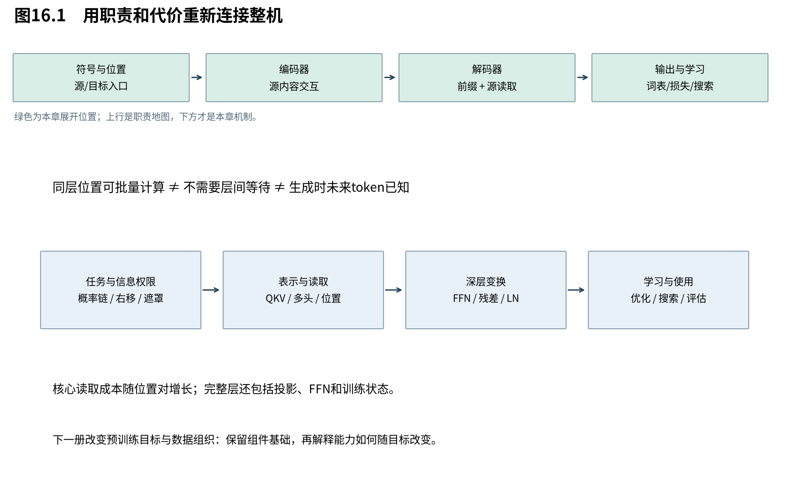

# 第16章　重新看见Transformer

现在我们已经从任务出发，推导了读取、位置、通道加工、深层路径、学习目标与搜索。最后把镜头拉回整台机器：它以什么代价换来了哪些性质，原研究提供了什么证据，又有哪些问题仍然留给后来架构？本章的目标是形成判断框架，而不是背诵一份部件名单。

图16.1将表达、优化和计算组织分开。历史上这些问题同时存在，方案也有多条路线；本书按理解依赖重建问题链，不把Transformer写成唯一可能的终点。

## 16.1 较短的信息路径，换来更多位置关系

**全局自注意力允许远位置在一层内直接交互，并把同层位置更新组织成矩阵计算；代价是计算和保存大量位置对关系。** 这种交换对不同序列长度与模型宽度有不同意义，不能只用“并行”或“平方复杂度”评价全部负载。

单样本、单层自注意核心，所有头宽度合计d时，QK与PV各约 $n^2d$ MAC，合计约 $2n^2d$。Q/K/V及输出投影还约 $4nd^2$ MAC。若FFN宽度为 $d_{ff}$，再加 $2ndd_{ff}$。因此忽略小项时：

$$
 \mathrm{MAC}_{\rm encoder\ layer}\approx2n^2d+4nd^2+2ndd_{ff}.
 \tag{16.1}
$$

批量B再乘B；以乘法和加法各算一次的FLOP口径，主项再乘2。原论文Table1的 $O(n^2d)$ 聚焦位置交互核心，不表示完整层没有投影和FFN的 $nd^2$ 成本。

解码层还有长度m的因果自注意与m对n的交叉读取，核心项分别与 $m^2d$、mnd相关。显式训练实现常仍计算被遮罩位置，再把贡献置零，数学上禁止读取不自动等于执行时省掉了该乘法。实现优化需要另外验证。

显式注意力权重表大小是 $Bhn^2$ 个元素；若每元素b字节，则为 $Bhn^2b$。例如B=64、h=8、n=30，权重表有460800个数，float32约1.76MiB。这不是完整训练显存：分数、概率、保存的反向中间量、各层激活、参数及优化器状态都还需计入。后来的IO优化也不由这个朴素实现表格一概限定。

## 16.2 循环、卷积与注意力改变的是不同路径

**三类结构分别用时间递推、局部层叠和内容寻址组织信息。** 比较时既要看总运算，也要看依赖路径和可并行部分，且必须明确卷积是否使用膨胀、注意力是否局部限制。

|结构|代表性每层主项|同层位置依赖|远距离信息的结构路径|
|---|---|---|---|
|循环，状态宽d|$O(nd^2)$|逐位置状态链|通常随距离线性增长|
|普通宽k卷积|$O(knd^2)$|同层位置可批量|层叠扩展感受野，远距离需多层|
|膨胀卷积|取决于核与通道|同层位置可批量|适当膨胀下可随距离对数增长|
|全局自注意核心|$O(n^2d)$|同层查询可批量|一个全局层可直接连接|
|局部窗口注意|$O(rnd)$|同层查询可批量|多层传播，约与距离/窗口相关|

普通stride1、核宽k的卷积每层把感受野增加k−1，L层达到 $1+L(k-1)$；若膨胀率逐层增长，感受野才可能指数扩大。不能把原论文表中的对数路径无条件套给普通相邻卷积。深度可分离卷积又把空间与通道混合分开，主项可变为 $O(knd+nd^2)$，说明“卷积成本”也不是一个唯一常数。

GNMT沿循环路线加深网络，使用8层编码器和8层解码器、残差及注意力，并结合wordpiece与低精度推理。其整数推理并非把所有数据都叫作FP8：论文讨论8位权重/乘法与16位累加状态等具体安排。ConvS2S则用局部卷积、可学习位置嵌入、残差与层间注意力组织序列，门控线性单元把卷积输出分成两半A、B，计算 $A\odot\sigma(B)$，一半提供内容、一半控制通过程度。[GNMT；ConvS2S]

这些前史表明，减少串行依赖、改善深层训练和保留上下文访问可以分别推进。Transformer的贡献应放在这些路线中理解，而不是把所有改进都归为一个新公式。

## 16.3 从部件参数算到整机预算

**总参数来自各部件和共享关系的加总；“6层、512宽”还不足以唯一确定整机大小。** 词表、是否绑定嵌入、偏置与规范化参数都会改变精确数量。

按本书同宽多头、含线性偏置、每个LN有gamma/beta的口径，一个多头为 $4d^2+4d$，FFN为 $2dd_{ff}+d_{ff}+d$，一个LN为2d。于是编码器层：

$$
 P_E=4d^2+2dd_{ff}+d_{ff}+9d.
 \tag{16.2}
$$

它含一个多头、一个FFN和两个LN。解码层含两个多头、一个FFN和三个LN：

$$
 P_D=8d^2+2dd_{ff}+d_{ff}+15d.
 \tag{16.3}
$$

代入d=512、$d_{ff}=2048$，得 $P_E=3152384$、$P_D=4204032$；编码/解码各6层共44138496个参数。若源、目标与输出共享约37000×512的词表矩阵，再加约18944000，得到约6308万。精确原实现的词表大小、偏置及参数化可改变总数，原论文Table3报告的是取整后的65M。不能把某个近似37k硬算成65M后宣称逐参数完全一致。

如果源嵌入独立，再增加一份源词表矩阵；如果目标输出也独立，又增加一份。预算比较必须说明共享策略。第7章头数不变参数的结论同样有前提：总投影宽度固定，而不是单头宽度固定再无限加头。

## 16.4 原论文的证据怎样支持设计，又止于哪里

**原研究的整机结果证明了这套方案在所报告条件下的有效性，消融则为部件选择提供局部证据；二者都不能替代普遍因果定理。** 读表首先核对数据集、训练步数、模型配置和评估口径。

Table2的newstest2014上，base英德BLEU为27.3，big为28.4；Table3的开发集newstest2013上，base为25.8。因此不能把27.3与某一消融的25.5直接相减，得到“某组件提高1.8”的结论。Table3在其条件下还显示：去掉dropout、改变标签平滑、降低深度或缩窄模型都会改变结果，但这些是指定配方下的单次或有限实验报告，不提供跨任务稳定置信区间。

英法big在v7 Table2写41.8，正文§6.1仍保留41.0。这里并列记录差异，引用表值时明确按表，不在叙事中悄悄选择更漂亮的数字。Table4还报告成分句法分析任务，说明原研究考察了翻译之外的迁移场景；它仍不等于后来大规模语言模型的全部能力。

阅读论文时可沿三层问题检查：公式是否实现声称的性质；实验是否隔离需要讨论的因素；结论能推广到什么范围。模型设计者需要三者，不能只看排行榜，也不能只看代数等价。

## 16.5 带走的判断框架

**Transformer最值得保留的心智，是用明确的信息接口和可学习的内容读取组织序列，再让每项数学服务一个具体设计问题。** 它提供了更灵活的位置交互和适于批量计算的结构，同时留下长上下文成本、生成依赖、位置泛化与训练稳定性的持续问题。

回看本册，条件概率决定可见信息；Q/K/V把匹配和传递分工；缩放控制分数尺度；多头保留多个读出；遮罩维护因果；位置编码提供顺序结构；FFN加工通道；残差与LN组织深层路径；训练目标、优化器、搜索与评估又分别承担不同职责。忘掉某个中间式时，只要这张职责图还在，就能重新推回需要的计算。

下一册将保留这些主要部件，改变学习任务与数据组织：如果不再只学习成对翻译，而是从大量未标注文本中预测或重建内容，编码器、解码器与目标函数会怎样重新组合？这是Book2的起点。本册到此收束，下一册从预训练目标与任务接口继续。

来源：[Transformer，v7，§4、Table1—4](https://arxiv.org/abs/1706.03762v7)；[GNMT，v2](https://arxiv.org/abs/1609.08144v2)；[ConvS2S，v3](https://arxiv.org/abs/1705.03122v3)。成本与参数按本书明确口径计算；实验数字均为论文引用。
