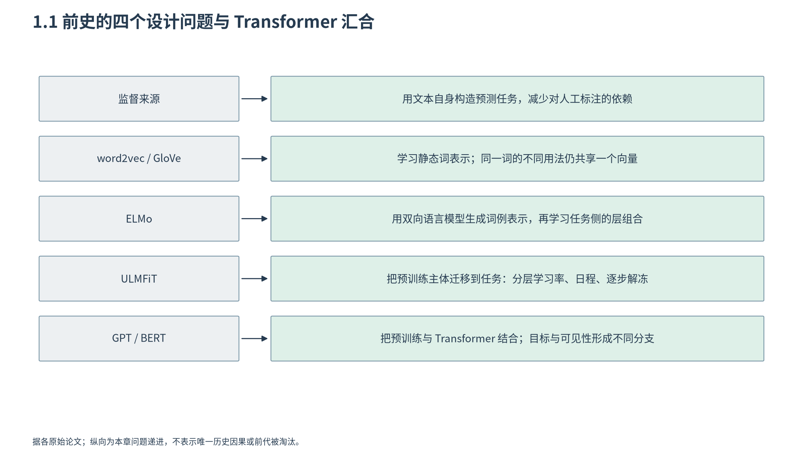
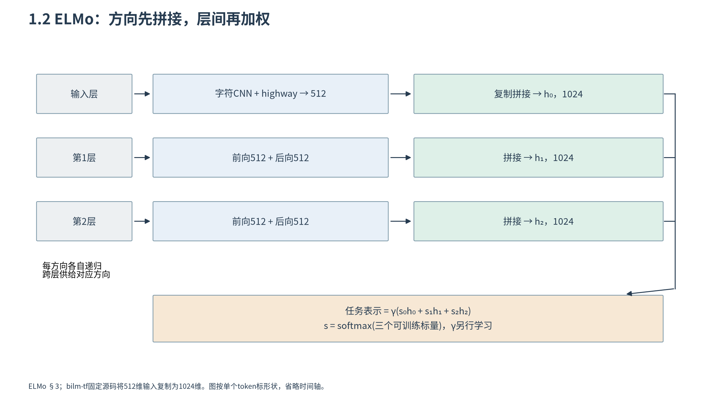

# 第 1 章 范式转移：监督数据不够了

## 1.0 开篇：从全书到这里

本册从 Book1 的 Transformer 出发，研究怎样把任务专用模型变成可迁移的预训练模型。动结构之前，先要回答：为什么仅靠每项任务的标签不够，为什么文本自身能提供有用的监督？本章保留 word2vec、GloVe、ELMo 与 ULMFiT 的完整前史：它们依次展示了表示学习、上下文建模与整机微调可以解决哪些问题。顺序按知识依赖组织，不表示它们在历史上逐项替代。读完后，我们将带着训练信号、表示方式和迁移配方，进入 GPT 与 BERT；下一章再补上所有路线共用的输入接口——分词。

> **最小背景栏**：本章不需要 Book1 之外的任何前置知识。softmax 与交叉熵损失在 Book1 对应章节的训练配方里已经用透，此处直接复用；「语言模型」在本册首次正式定义（1.2 节），不假设你读过任何文献。你只需要带上 Book1 留下的一笔欠账——它就写在下一节开头。

## 1.1 计算成本怎样限制可用数据

训练架构首先决定，在预算内能处理多少数据。Book1 已比较过循环、卷积与注意力的序列计算路径：Sutskever 2014 的4+4层 LSTM 用8块 GPU 训练约10天；GNMT 用96块 K80、约6天；ConvS2S 报告过9.3倍的解码加速；Transformer big 用8块 P100 训练约3.5天。它们展示了不同的计算组织，但硬件、模型、任务和实现并不相同，不能把这些数直接相除当成架构的受控加速比。这里要继承的是一个问题：哪些串行依赖可以移除，节省的时间又能用于多大的模型和语料？【来源：各模型原论文；Book1 的历史与计算复杂度讨论】

兑现来得比 Transformer 还早四年。2013 年的 word2vec 论文里有一笔对照账：早期循环语言模型「在单个 CPU 上训练大约要 8 周」【证据等级：官方论文 1301.3781 §4.3】；而 word2vec 在 16 亿词的语料上训练，单机 CPU 不到一天【证据等级：官方论文 1301.3781 摘要】，新实现的处理速度达到「每小时数十亿词」的量级【证据等级：官方论文 1301.3781 §7】，谷歌内部的 DistBelief 集群版更直接吞下 60 亿词、100 万词表的语料【证据等级：官方论文 1301.3781 §4.2】。注意这里的因果方向：word2vec 的便宜并不主要来自硬件并行——它便宜，是因为把结构削到了极简，不再训练一个完整的语言模型，只训练一个「看窗口猜词」的小任务。但它在 2013 年就证明了 一个较弱但重要的命题：**训练成本限制可处理的数据规模；更多合适的数据可能改善表示，但收益还受目标、模型和优化影响**。结构上每一次「变便宜」，最终都会兑换成语料规模——2017 年 Transformer 把「便宜」的来源换成真正可并行的架构之后，这条兑换曲线才能一路画到 33 亿词的 BERT（第 3 章）与 40GB 语料的 GPT-2（第 4 章），再往后是第 8 章把它写成定律的幂律，以及第 10、11 章你在自己机器上的亲手兑现。

不过 word2vec 当年买到的只是「词」的表示，离「整台模型」还差五年。这五年里发生了什么，就是本章剩余部分的故事。

## 1.2 监督数据不够了：标注瓶颈与无标注海洋

红利在手，下一个问题是拿它训练什么。2018 年以前的标准答案很朴素：一个任务、一个数据集、一台从零训练的判别模型。这个答案撑了很多年，直到两边的体量差再也藏不住——GPT-1 论文指出，无标注文本充足，具体任务的标注却稀少，因此需要把前者学到的表示迁移到后者。【来源：GPT-1，摘要与§1】

这种差距可以从数据规模看见：SST-2 情感分类约6.7万句，MRPC 句对判定只有3,668对；BERT 使用的 BooksCorpus 与维基百科则合计约33亿词。句子、句对与词不是同一种单位，这个对照说明的是信息来源和标注成本的差异，不能当成精确的训练样本比。【来源：数据集规格；BERT v2 §3.1】

数据量之外，还要看模型是否学到稳健的规律。Jia与Liang对 SQuAD 做的是**评测时添加干扰句**：16个系统的平均 F1 从75.4降到36.4，不是给训练集加噪声，也不是单个模型从88.8下降。ULMFiT 则讨论了小数据微调时的过拟合与灾难性遗忘。原稿“14个测试中13个过拟合”的说法无法在其摘要中核实，本版撤去该数字。两类证据分别涉及鲁棒性和迁移训练；它们支持寻找更好的学习方式，不证明逐任务训练从此无效。[Jia与Liang，2017，Table 3](https://aclanthology.org/D17-1215/)；[ULMFiT，§1](https://aclanthology.org/P18-1031/)

那造一台「通用语言机器」下一步需要什么？需要一个不依赖人工标注的训练目标。最直接的办法是让文本的前缀预测真实后继。这样把标注需求改成了文本采集需求；它训练的是概率预测，迁移能力仍须另行评测。设序列含 $N$ 个 token，$t_k$ 是第 $k$ 个词表编号，$p_\theta$ 是参数为 $\theta$ 的模型分布：

$$\mathcal{L}_{\mathrm{LM}} = -\sum_{k=1}^{N} \log\, p\!\left(t_k \mid t_1, \dots, t_{k-1}\right) \tag{1.1}$$

这就是语言模型（language model, LM）的目标：给定前文，预测下一个词。这表示：把语料里每个词的「下一个词」当考题，答案就抄原文——**答案可从原文构造，有效预测位置提供训练样本**。今天我们叫它自监督（self-supervised）：监督信号不是没有，而是从数据里自己造出来的；2018 年的论文口径统一叫「无监督预训练」（unsupervised pre-training），指的只是「无人工标注」——读文献时要知道这两个词说的是同一件事。有了免费的目标，「预训练 + 微调」两阶段的构造逻辑就自然立起来了：第一阶段在大语料上用式 (1.1) 或其变体训一台通用模型，贵，但训一次到处用；第二阶段在每个任务的小标注集上给这台模型加一个小输出头继续训练，便宜，每个任务都付得起。几个月后 BERT 把这套两阶段写成标准件——「预训练与微调两个步骤、跨任务统一架构」【证据等级：官方论文 1810.04805 v2 §3，直引大意】。GPT-1 的引言还老实交代了当时悬而未决的两件事：用什么无监督目标最有效、学到的表示如何迁移到目标任务【证据等级：官方论文 GPT-1 §1】——前者由第 3、4 章的目标函数创新回答，后者的答案正是 1.5 节的微调配方。计算机视觉的迁移学习（transfer learning）在那几年恰好演示过这套剧本的成功版本，于是有了一个流传极广的类比——「NLP 的 ImageNet 时刻」。这个类比的出处值得单独开一个考据框，因为它的三层来历经常被讲混。

> **【考据框】「NLP 的 ImageNet 时刻」出处考**
> ① **GPT-1 原文没有这句话**。全文检索（含引言）只命中一处泛泛的 "image classification"，且引的 CV 文献是 2006–2010 年无监督预训练的老前史，结论是「预训练起到了正则化的作用」【证据等级：官方论文 GPT-1 §2；负结论已全文核】。② 论文级的「ImageNet 微调配方」原句在 BERT：*"Computer vision research has also demonstrated the importance of transfer learning from large pre-trained models… an effective recipe is to fine-tune models pre-trained with ImageNet"*【证据等级：官方论文 1810.04805 v2 §2.3，直引】。③ 「NLP's ImageNet moment」这个口号出自 Sebastian Ruder 2018 年 7 月 12 日的博客（作者本人是 ULMFiT 共同作者）：这些工作「可能对 NLP 产生与 ImageNet 预训练模型对计算机视觉同样广泛的影响」，并预言一年内从业者将「下载预训练语言模型，而不是预训练词向量」【证据等级：厂商自报（个人博客 ruder.io/nlp-imagenet，2018-07-12）——事后看预言命中，但引用必须标明博客等级】。

本章接下来的路线，就是把这个「为什么」拆成五环论证链，一环一环走到 GPT/BERT 门口——图 1.1 是全程地图：环 0 是问题，环 1–4 是四步解答，每支箭头上标着「上一环留下的局限」，正是它逼出下一环。

图 1.1 前史问题地图。每行表示一种设计回应的限制；纵向是本章的理解顺序，不表示唯一历史因果。

## 1.3 静态词向量：word2vec 的窗口-预测机制

先看环 1 要回答的问题：从无标注文本中构造训练信号，究竟可不可行？2013 年的答案是可以——只是当时学到的不是整台模型，而是每个词的一个向量：词向量（word vectors），术语也叫词嵌入（word embeddings）。

直觉先于公式。完形填空你从小就会：「The cat sits on the ___」，你能填出 mat，说明上下文里确实藏着关于空格的信息。word2vec 把这个直觉推到底：**经常出现在相似上下文中的词，可能具有相近的用法**。预测任务利用这种统计相关性学习表示；它不是词义的完整定义。预测方向有两种、方向相反：CBOW（continuous bag-of-words，连续词袋）拿上下文猜中心词，skip-gram（跳字模型）拿中心词猜上下文——论文原图注的原话是 "The CBOW architecture predicts the current word based on the context, and the Skip-gram predicts surrounding words given the current word."【证据等级：官方论文 1301.3781 Figure 1 图注，直引】。以 skip-gram 走一遍机制：句子 "the cat sits on the mat"，取中心词 sits、窗口半径 2，得到四个训练对 (sits, the)、(sits, cat)、(sits, on)、(sits, the)；语料的每个位置都这样切一遍，16 亿词就变成了几十亿道微型选择题（窗口放到更大尺寸时题量更多——按本例的算法，半径 5 即每词 10 个上下文对，16 亿词约 160 亿道，上百亿）——这就是 1.2 节说的「自造监督信号」在 2013 年的样子。每个词配两份向量：当中心词时查输入向量 $v_w$，当被预测词时用输出向量 $v'_w$，两份都要学。

机制图画出来了，还有个工程问题挡路：词表 $V$ 有十万到百万级，每道选择题的答案本该对全词表做 softmax——这才是真正的计算瓶颈。word2vec 的第一把刀是层次 softmax（hierarchical softmax），把「在全词表里挑一个」变成「沿 Huffman 树走 $\log_2 V$ 步」，一次评分由遍历词表改成沿树路径计算；具体速度还取决于树深与实现【来源：1301.3781 §2.1】。同年发表的续作进一步引入——负采样（negative sampling），训练目标改成区分观察到的词对与噪声词对。设两张向量表均为 $V\times d$，$v_{w_I}$ 是中心词向量，$v'_{w_O}$ 是真实邻词向量，$v'_{w_i}$ 是第 $i$ 个噪声词向量，$\sigma(a)=1/(1+e^{-a})$。对每个正例抽取 $k$ 个负例，最大化：

$$\log \sigma\!\left({v'_{w_O}}^{\top} v_{w_I}\right) + \sum_{i=1}^{k} \mathbb{E}_{w_i \sim P_n(w)} \log \sigma\!\left(-{v'_{w_i}}^{\top} v_{w_I}\right) \tag{1.2}$$

| 符号 | 含义 | 形状 / 取值 |
|---|---|---|
| $v_{w_I}$ | 中心词的输入向量 | $\mathbb{R}^{d}$，实验 $d{=}300$ |
| $v'_{w_O}$ | 窗口词（正例）的输出向量 | $\mathbb{R}^{d}$ |
| $v'_{w_i}$ | 噪声词（负例）的输出向量 | $\mathbb{R}^{d}$，每步采 $k$ 个 |
| $P_n(w)$ | 噪声分布：unigram 频率的 $3/4$ 次幂 | $U(w)^{3/4}/Z$ |
| $k$ | 负例个数 | 小数据 5–20，大数据 2–5 |

【证据等级：官方论文 1310.4546 Eq.4 与 §2——注意负采样属续作，1301.3781 只有层次 softmax】这表示：式 (1.2) 把每道「全词表选择题」偷换成 $k+1$ 道「是非题」——正例（真邻居）把内积推高，负例（随机词）把内积压低，每个训练步只碰 $k+1$ 个词而不是整张十万词表；噪声分布取频率的 $3/4$ 次幂，是给低频词留一点出场机会。配套的高频词子采样进一步降低重复训练量：高频词子采样（subsampling），"the" 这类词按 $\max(0,1-\sqrt{t/f(w)})$ 的概率丢弃（$t\approx 10^{-5}$），训练再快 2–10 倍，低频词的表示反而更好【证据等级：官方论文 1310.4546 §2.3】。

### 从二分类损失看负采样究竟更新了什么

负采样通过少量二分类训练，让真实共现的词对更易区分于噪声词对，降低一次更新的成本。它改变了训练目标，不是把全词表 softmax 无偏地“算快一点”；所得向量能否迁移，由后面的类比和任务实验检验。

对一个词对，记输入向量为 $u\in\mathbb R^d$，输出向量为 $v\in\mathbb R^d$，标签 $y\in\{0,1\}$，得分 $a=v^\top u$。二元负对数似然为

$$\ell(a,y)=-y\log\sigma(a)-(1-y)\log(1-\sigma(a)).\tag{1.2a}$$

真实词对取 $y=1$，噪声词对取 $y=0$；利用 $1-\sigma(a)=\sigma(-a)$，把一正例和 $k$ 个负例的负损失相加，就得到式(1.2)的采样估计。由 $\sigma'(a)=\sigma(a)(1-\sigma(a))$，链式法则给出

$$\frac{\partial\ell}{\partial a}=\sigma(a)-y,\qquad
\nabla_u\ell=(\sigma(a)-y)v,\qquad
\nabla_v\ell=(\sigma(a)-y)u.\tag{1.2b}$$

对于正例，系数介于 $-1$ 与0之间，梯度下降把两个向量沿彼此方向拉近；对于负例，系数介于0与1之间，更新趋于降低内积。内积还受模长影响，因此“拉近”指提高这个打分，不保证所有欧氏距离都缩短。

取 $u=(1,0)$、$v=(0,1)$、学习率0.1。初始得分为0，概率为0.5。正例一次同时更新得到 $u'=(1,0.05)$、$v'=(0.05,1)$，内积变成0.1；负例则得到 $u'=(1,-0.05)$、$v'=(-0.05,1)$，内积为−0.1。这是式(1.2)从统计关系改变向量几何的直接路径。

噪声分布也影响学到的几何。若两个词的频率比为16∶1，取 $3/4$ 次幂后比值变成8∶1；低频词相对更容易成为负例，但并没有变成均匀采样。每次只访问少数行，主要更新成本约为 $O((k+1)d)$；两张完整词表仍需存储 $2Vd$ 个参数，不能把计算节省误写成词表消失。

效果兑现了 1.1 节的预言——便宜换规模，规模换质量。同一份 7.83 亿词语料、同为 300 维的对照里，skip-gram 语义类比准确率 50.0%、CBOW 只有 15.5%【证据等级：官方论文 1301.3781 Table 4】；换一组架构对照（Table 3，640 维、LDC（语言数据联盟）语料 3.2 亿词/8.2 万词表——与已发表的 NNLM/RNNLM 结果同数据同列），语义类比上 skip-gram 55%、CBOW 24%，而训练贵一个量级的 NNLM 23%、RNNLM 9%【证据等级：官方论文 1301.3781 Table 3 与 §4.3】。负采样对层次 softmax 的胜利同口径：10 亿词语料、300 维，负采样（15 负例）类比总精度 61%、层次 softmax 47%，开子采样后 36 分钟就训完【证据等级：官方论文 1310.4546 Table 1】。

学出来的向量在空间里排出了可解释的几何：big 到 bigger、small 到 smaller 这类同类词形变化可用相近的位移表示；Paris − France + Italy 的最近邻是 Rome【证据等级：官方论文 1301.3781 Table 8】。“某些关系可近似表现为方向”这个有边界的心智模型，是词向量时代留给后世最重要的遗产。但那个家喻户晓的 king − man + woman ≈ queen，出处常被讲错——

> **【考据框】king − man + woman ≈ queen 的真出处**
> 这个等式最早不是出现在 word2vec 论文里，而是 Mikolov、Yih、Zweig 的 NAACL 2013 短文（编号 N13-1090），且实验用的向量**是 RNNLM（Mikolov 2012）输入投影矩阵的列向量**——3.2 亿词的 Broadcast News 语料、8.2 万词表——压根不是 word2vec【证据等级：官方论文 N13-1090 §3】。这篇短文的句法类比测试（7 类 × 1000 题）给出 RNN 向量 39.6% 对 LSA 的 11.3%，并强调「三题能对一题以上，而瞎猜只有千分之几」【证据等级：官方论文 N13-1090 Table 2】。word2vec 主论文只是以引用方式重述了 king/queen 例子（§1.1，定性、无数字）；它自己给出的诚实口径在 §5：按严格精确匹配计，示例表里的关系只「约 60%」正确【证据等级：官方论文 1301.3781 §5】。流传的「百发百中」从来不存在于任何原文——引用向量算术时，60% 与 39.6% 这两个数字才是论文级的。

窗口法很快有了对照组。GloVe 指出窗口模型只用局部统计，而全局的共现计数（co-occurrence statistics：语料里词 $i$ 与词 $j$ 在窗口内同现的次数）同样躺在那里；它直接让词向量的内积去回归共现计数的对数，$\sum_{i,j} f(X_{ij})\left(w_i^{\top}\tilde{w}_j + b_i + \tilde{b}_j - \log X_{ij}\right)^2$，加权函数 $f$ 降低极少共现项的权重，并在高计数区间封顶【证据等级：官方论文 D14-1162 §3–4.2】。为什么回归「计数的对数」？论文给了一个能手算的动机例：拿 ice 与 steam 当两个磁极，探针词 solid 与 ice 同现的概率是与 steam 的 **8.9 倍**（强判别信号），gas 反向差到 $8.5\times10^{-2}$（也是强信号），water 两边都沾（比值 1.36，无判别力），fashion 两边都不沾（0.96）——原始概率噪声大，**比值才是信号**【证据等级：官方论文 D14-1162 §1 Table 1】。结果却是一场合流：60 亿词语料上，GloVe 词类比总精度 71.7%、word2vec skip-gram 69.1%——同量级【证据等级：官方论文 D14-1162 Table 2】；论文的收束句是两类方法「在根本层面上并无 dramatic 的不同，因为它们探测的都是底层的共现统计」【证据等级：官方论文 D14-1162，直引大意】。顺带记两笔账：GloVe 还画出了类比精度随向量维度、随语料规模的增长曲线【证据等级：官方论文 D14-1162 §4.4–4.5 Figure 2/3】——那是 scaling 曲线在词向量时代的雏形，第 8 章 Kaplan 幂律的远祖；而 60 亿词语料、40 万词表的共现矩阵，光填出来单线程就要 85 分钟、300 维一次迭代 32 核 14 分钟【证据等级：官方论文 D14-1162 §4.2】——预训练时代的第一笔工程账，欠账框登记、第 9 章回收。

### 从概率比到 GloVe 的拟合式

GloVe 希望把“两个词在不同语境中的相对偏好”放进向量差，而不是只记录它们有多常见。概率比先转成对数差，再用向量内积近似，才得到前面的加权最小二乘目标。这里从统计动机到低维参数化有设计选择，并非共现矩阵天然具有低秩。

令 $X_{ij}$ 为中心词 $i$ 与上下文词 $j$ 的共现计数，$X_i=\sum_jX_{ij}$，$P_{ij}=X_{ij}/X_i$。同一探针词 $j$ 对词 $i$ 和 $k$ 的区分，可以写为

$$\log\frac{P_{ij}}{P_{kj}}=\log P_{ij}-\log P_{kj}.\tag{1.2c}$$

若选择以 $w_i^\top\tilde w_j$ 表示一个中心词与探针的关系，那么两词之差自然成为 $(w_i-w_k)^\top\tilde w_j$。这说明“差向量”为什么适合承载概率比信息。进一步，由 $\log P_{ij}=\log X_{ij}-\log X_i$，把只依赖中心词的常数与偏置吸收，再为上下文一侧增加对称偏置，得到拟合形式

$$w_i^\top\tilde w_j+b_i+\tilde b_j\approx\log X_{ij}.\tag{1.2d}$$

$w_i,\tilde w_j\in\mathbb R^d$ 是待学向量，两个 $b$ 是标量；不是将任意 $V\times V$ 计数矩阵精确分解成 $d$ 维。残差平方衡量拟合误差。只对 $X_{ij}>0$ 的项计算，权重常取 $f(x)=\min((x/x_{\max})^\alpha,1)$，论文使用 $\alpha=3/4$、$x_{\max}=100$。很少见的共现不够可靠，权重较低；达到阈值后不再随着频率无限增加。于是才得到前文的求和目标。

以 ice/steam 为例，solid 的概率比8.9对应对数约2.19，gas 的0.085对应约−2.47。它们落在零的两侧；water 的1.36对应约0.31，区分较弱。直觉中的“偏向哪一侧”有了明确的数学量。两个向量表与偏置如何近似这些量是学习问题，不能由这四个例子断言整个语义空间都已被解释。[GloVe，§3，式1–9](https://aclanthology.org/D14-1162/)

word2vec 与 GloVe 一起证明了环 1，也一起撞上同一堵墙：**静态**。每个词型（word type，词典里的一个词条）无论出现在什么句子里，永远是同一个向量；向量再好，也只是「放进模型第一层的一个特征」。词该带着上下文走——这是环 2 的入场券。

## 1.4 上下文向量：ELMo 的双向语言模型

上一节结尾那堵墙有个具体的名字：play。Broadway 的 play（戏剧）与棒球解说里的 play（防守动作），GloVe 给出的最近邻几乎全是体育义——一个向量伺候不了两个意思【证据等级：官方论文 1802.05365 Table 4】。病根在粒度：静态向量是词型级的，消歧需要词例（word token，一次具体出现）级——每个词例的表示应当是「整句话的函数」。这是 ELMo 论文的原话："each token is assigned a representation that is a function of the entire input sentence"【证据等级：官方论文 1802.05365 §1，直引】。

要造这个函数，原料还是 1.2 节的语言模型——只是两个方向各造一台：

$$p(t_1, \dots, t_N) = \prod_{k=1}^{N} p\left(t_k \mid t_1, \dots, t_{k-1}\right) \tag{1.3}$$

$$p(t_1, \dots, t_N) = \prod_{k=1}^{N} p\left(t_k \mid t_{k+1}, \dots, t_{N}\right) \tag{1.4}$$

式 (1.3) 从左往右读、猜下一个词；式 (1.4) 从右往左读、猜上一个词。双向语言模型（bidirectional language model, bi-LM）就是这两台的联合：训练目标是两个方向对数似然**相加**，token 嵌入与输出 softmax 双向共享，LSTM 参数按方向各自独立【证据等级：官方论文 1802.05365 §3.1】。这表示：两台「独眼」阅读器，一只只看左半边、一只只看右半边，各自把句子的统计规律吃进去。注意一个要害：这是**两个单向模型的拼接，不是深层双向**——任何一层里，每个方向都看不见另一半句子。「为什么不干脆让模型一层同时看两边？」这个问题牵涉训练目标的深层困难，第 3 章 BERT 的掩码语言模型会正面回答，此处按下。

整机结构如图 1.2：底座是 $L=2$ 层双向 LSTM。最底层是 token 层——字符级 CNN（2048 个卷积核）加两层 highway 再投影到 512 维，词表外的拼写也能编出向量；其上每方向每层 4096 个单元、投影回 512 维，前后向拼接成 1024 维；第一层到第二层带残差连接【证据等级：官方论文 1802.05365 §3.4】。预训练语料是十亿词级的 1B Word Benchmark，训 10 个 epoch【证据等级：官方论文 1802.05365 §3.4】——到此为止，仍是「无标注语料 + 预测目标」的旧配方。ELMo 的真正发明在下一步：**怎么取用这台机器**。

图 1.2 ELMo按单token展开的表示组合。先在各层拼接方向，再在三个等宽表示间加权；输入层512维表示需复制拼接为1024维。

ELMo 的层混合让任务自行选择需要哪些深度的特征，同时保持预训练主体冻结。计数时要分两步：未拼接时，一份 token 表示加每层两个方向，共 $2L+1=5$ 份；每层的前后向拼接后，参与加权的是 $L+1=3$ 份，而不是5份。它们必须等宽。官方实现把512维 token 表示复制并拼接为1024维 $h_{k,0}$，与每层的双向1024维表示相加。任务权重由三个可训练标量的 softmax 得到，再用一个标量 $\gamma$ 调整幅度：

$$\mathrm{ELMo}_k^{\,\mathrm{task}} = \gamma^{\,\mathrm{task}} \sum_{j=0}^{L} s_j^{\,\mathrm{task}}\, h_{k,j}^{\,\mathrm{LM}} \tag{1.5}$$

| 符号 | 含义 | 形状（单 token / 整句 $n$ 个） |
|---|---|---|
| $h_{k,0}$ | token 层表示 | $\mathbb{R}^{1024}$ / $(n,1024)$；由512维输入复制拼接 |
| $h_{k,j},\, j\ge 1$ | 第 $j$ 层前向 $\oplus$ 后向拼接表示 | $\mathbb{R}^{1024}$ / $(n, 1024)$ |
| $s_j^{\,\mathrm{task}}$ | 任务可学的层权重（softmax 归一） | 标量 $\times\,(L{+}1)$ 个 |
| $\gamma^{\,\mathrm{task}}$ | 任务可学的整体缩放 | 标量 |
| $\mathrm{ELMo}_k$ | 第 $k$ 个 token 的最终向量 | 本配置为 $\mathbb{R}^{1024}$；整句 $(n,1024)$ |

【证据等级：官方论文 1802.05365 Eq.1（§3.2）】这表示：不是只拿最顶层，而是把「句法取几成、语义取几成」做成两个可学旋钮，交给任务自己拧。「层与层分工不同」有实证：全词词义消解上层更好（第二层 F1 69.0 对第一层 67.4），词性标注却下层更好（第一层 97.3 对第二层 96.8）——在这些探针任务中低层更利于词性、上层更利于词义；并非所有模型都严格按层分工【证据等级：官方论文 1802.05365 Table 5/6】；SQuAD 上只用末层 84.7、按式 (1.5) 全层加权 85.2——这个设置中全层组合优于只用末层【证据等级：官方论文 1802.05365 Table 2】。

例如某任务学到 $s=(0.2,0.3,0.5)$、$\gamma=1.5$，输出就是 $1.5(0.2h_{k,0}+0.3h_{k,1}+0.5h_{k,2})$，每个坐标都按同样的权重组合。缩放前是三份表示的凸组合；$\gamma$ 无此概率约束，缩放后不能继续当作凸组合。训练任务头时，梯度可以调整层权重和 $\gamma$，但冻结的 biLM 不更新。这样既能复用已有表示，又避免每个任务重新训练庞大的语言模型。[ELMo，§3.2–3.3](https://aclanthology.org/N18-1202/)；官方实现的维度对齐见本章资料说明。

用法上，ELMo 是特征法（feature-based）的代表：biLM 预训练完就冻结（论文原话 "we first freeze the weights of the biLM"），把 $[\,x_k;\, \mathrm{ELMo}_k\,]$ 拼进每个任务自己的模型【证据等级：官方论文 1802.05365 §3.3，直引】。效果横扫六个任务：SQuAD F1 81.1→85.8（相对误差降 24.9%）、NER 90.15→92.22（21.0%）、SRL 17.2%、SNLI 5.8%、指代消解（coreference）9.8%、SST-5 6.8%；论文 §4 的保守口径是 6–20%（引言写 up to 20%），Table 1 的 24.9% 是单模型基线口径，引用时注意分口径【证据等级：官方论文 1802.05365 Table 1 与 §4】。对「数据不够」更致命的一击是小样本效率：SRL 任务上 ELMo 用 1% 的标注数据就追平了基线用 10% 数据的效果【证据等级：官方论文 1802.05365 Figure 1】——预训练的本质是**买标注效率**，这个心智从环 2 就立起来了。

但特征法的天花板也在这里：每个下游任务仍要设计自己的结构，ELMo 只是把更好的向量喂进去——GPT-1 论文的批评是它需要「为每个单独的目标任务新增大量参数」【证据等级：官方论文 GPT-1 §1，直引大意】。加上 LSTM 长程记忆弱、双向只是浅拼接，三个局限一起把问题递给下一环：**既然预训练的 LM 这么有用，能不能不借它的向量，而是把整台机器直接微调？**

## 1.5 微调配方：ULMFiT 三阶段与四件套

冻结特征便于复用，却不能让语言模型主体适应任务。另一种选择是保留预训练参数作为起点，直接更新整台模型。直接在下游任务上继续训练整台机器，听起来更自然，但 2018 年以前大家都清楚这条路的地雷：深层网络在小数据集上一顿猛调，会把预训练攒下的通用知识冲掉，术语叫灾难性遗忘（catastrophic forgetting）。ULMFiT 的贡献是证明：**预训练参数可以继续适应下游任务，而更新幅度与顺序需要控制**。（时间线诚实声明：ULMFiT 与 ELMo 同在 2018 年上半年面世，本章按论证链而非日历顺序讲。）

它的流程分三阶段【证据等级：官方论文 1801.06146 §3，Figure 1】：一、**通用 LM 预训练**，在 WikiText-103（28,595 篇维基文章、1.03 亿词）上训练语言模型——贵，但训一次到处用；二、**目标任务 LM 微调**，在目标任务自己的无标注文本上继续训 LM，把领域词的分布也吃进去；三、**目标任务分类器微调**，在 LM 顶端加一个小分类头（两个线性块），解冻整台机器微调。特别值得玩味的是底座：AWD-LSTM，论文原话是「一个常规的 LSTM——没有注意力、没有捷径连接、没有任何精巧的添加」【证据等级：官方论文 1801.06146 §3，直引大意】，嵌入 400 维、3 层、每层 1150 单元。使用既有 LSTM 使论文能够集中研究迁移配方；同结构消融可以评估配方的作用，却不能证明配方在任何条件下都比架构更重要。**本册从这里开始分别考察架构与训练配方的贡献**——第 6 章 RoBERTa 将用一次不动架构、只改配方的复跑把这个命题做成大实验，此处先把旗立上。

配方是四件套。一、**判别式分层学习率**（discriminative fine-tuning）：越靠底层学习率越小——底层装的是最通用的知识，该走小步；论文取下层学习率为上一层的 $1/2.6$。二、**斜三角学习率调度**（slanted triangular LR）：先短促升温、再长尾降温——升温段只占前 10%，最低学习率压到峰值的 $1/32$；论文强调与常规三角调度的区别就在「短升长降」，这是好性能的关键。三、**逐步解冻**（gradual unfreezing）：先冻住全网只解冻最后一层训 1 个 epoch，再逐层向下放开——论文原话点破理由：最后一层装着「通用性最少的知识」，最该先动。四、BPT3C 加拼接池化：长文档切成定长段、前段末状态初始化后段，最终句表示取 $[\,h_T;\, \mathrm{maxpool}(H);\, \mathrm{meanpool}(H)\,]$，缓解 RNN 只记得结尾的毛病【证据等级：官方论文 1801.06146 §3.2–3.3】。四件套拧在一起，直觉就一句话：预训练模型像一摞从通用到特化的积木，微调最怕一巴掌把整摞拍歪——于是从上往下逐层放开、下层小步上层大步、总步幅先热身后退火。

### 把四项配方写成可检查的更新

ULMFiT 的改造主要发生在训练过程：哪些层先更新、每层走多大步、整段微调如何收尾，以及怎样从长文档读出分类信息。结构相同不表示学习轨迹相同；这些控制要减少适应任务时对已有表示的过度扰动，效果仍需消融确认。

设第 $l$ 层参数为 $\theta^{(l)}$，任务损失为 $J$。普通梯度下降写为

$$\theta^{(l)}_{t+1}=\theta^{(l)}_t-\eta_t^{(l)}\nabla_{\theta^{(l)}}J.\tag{1.6}$$

分层学习率选择 $\eta^{(l-1)}=\eta^{(l)}/2.6$；若顶层为0.001，下面两层约为0.000385与0.000148。只是缩小更新系数，不代表底层梯度天然更小；2.6是论文经验配方，不是由层深证明的常数。逐步解冻则把尚未开放层的更新设为零，并逐轮增加可训练层。

要表达“前10%上升、其后下降”，可用端点明确的教学写法。设总步数 $T$、拐点 $c=\lfloor0.1T\rfloor$、峰值 $\eta_{\max}$，并假设 $0<c<T$：

$$p_t=\begin{cases}t/c,&0\le t<c,\\(T-t)/(T-c),&c\le t\le T,\end{cases}
\qquad\eta_t=\eta_{\max}\frac{1+31p_t}{32}.\tag{1.7}$$

代入 $t=0,c,T$，分别得到峰值的 $1/32,1,1/32$。这是对论文“短升长降”端点的规范化表达；原论文式3的下降段分母写作 $cut\cdot(ratio-1)$，与图示的全程下降端点并不一致，不能把两式不加说明地说成逐字相同。实现时应检查实际调度序列，而不是只核对名称。

最后看长文档读出。设末层状态 $H=[h_1;\ldots;h_T]\in\mathbb R^{T\times d}$，对每个通道分别取最大和平均，得到两个 $d$ 维向量，与末状态拼接为 $3d$ 维。末状态提供顺序累积结果，最大池化保留某通道是否强烈响应，平均池化概括整体强度；后三者共同输入分类头，不保证无损保存全文。BPT3C 把文档分段处理并传递状态，反向传播长度与状态跨段延续要分开理解：传了状态不等于保存了全文无限长的梯度图。【来源：ULMFiT §3.2–3.3】

数字把这套配方的价值标得很清楚。同一架构（AWD-LSTM）在 IMDb 影评分类上从零训练错误率 10.31，按三阶段走完是 4.60——架构一字不改，相对降 55.4%【证据等级：官方论文 1801.06146 §4.1】。数据效率更是直接回应 1.2 节的标注瓶颈：摘要句是「只用 100 个标注样本，即可匹敌从零训练用 100 倍数据的效果」【证据等级：官方论文 1801.06146 摘要，直引大意】；正文拆解——纯 100 例错误率 7.75，已与从零用 10 倍数据（7.67）几乎持平；再在第二阶段借 4.2 万条领域内无标注文本做 LM 微调，错误率 4.55，反超从零用 100 倍数据（4.60）【证据等级：官方论文 1801.06146 §5】。无标注文本换标注数据的「汇率」，第一次被明码标出。消融同样干净：IMDb 上 LM 微调后 6.99，加判别式学习率 5.55，再加斜三角调度 5.00——这些逐项设置在该实验中降低了错误率【证据等级：官方论文 1801.06146 Table 6】。

到这一环，2018 年初的局面是：信号（1.2 节）、表示（1.4 节）、配方（本节）全部就绪，只差一台配得上的底座。GPT-1 论文给前驱们的定位就是这句：Dai 等人与 Howard、Ruder 沿语言模型预训练改进了文本分类，但「他们对 LSTM 的使用把预测能力限制在了短程；相比之下，我们选择 Transformer 网络，得以捕捉更长程的语言结构」【证据等级：官方论文 GPT-1 §2，直引大意】。

## 1.6 回到整机：Transformer 与预训练怎样汇合

五环走完，表 1.1 把前史四篇的账并排摊开——每一行的「关键局限」列，就是图 1.1 里那几支箭头。

表 1.1 前史四篇对比（自排；各行数字与出处的证据等级见正文各节标注）

| 篇目（年份） | 学到什么 | 怎么用 | 关键局限 | 后续响应的方向 |
|---|---|---|---|---|
| word2vec（2013，含同年负采样续作） | 词型级静态向量 | 查表当第一层特征 | 静态：一词一向量，无法消歧；知识只进第一层 | ELMo |
| GloVe（2014） | 同上（全局共现拟合法） | 同上 | 同上——与窗口法合流，天花板相同 | ELMo |
| ELMo（2018） | 词例级上下文向量（bi-LM 内部状态的加权） | 冻结 biLM、特征拼接 | 特征法：每任务仍要建结构；LSTM 长程弱；浅双向 | ULMFiT（配方）+ GPT-1（底座） |
| ULMFiT（2018） | 微调整台 LM 的配方 | 预训练 → 目标域 LM 微调 → 分类微调 | 底座是 LSTM；主问题是分类 | GPT-1 |

门后就是环 4。GPT-1 把式 (1.1) 的语言模型目标搬到 12 层 Transformer 解码器上，BooksCorpus 的 7,000 多本书喂进去，12 个任务里 9 个刷新纪录【证据等级：官方论文 GPT-1 摘要与 §4】；几个月后 BERT 换一个预训练目标（第 3 章详述），在 33 亿词语料上把 GLUE 成绩抬到 80.5、绝对提升 7.7 个百分点【证据等级：官方论文 1810.04805 v2 摘要】。硬件账值得与 1.1 节并排看：BERT 的 LARGE 档用 64 块 TPU 芯片训 4 天、在 33 亿词语料上过了 40 遍【证据等级：官方论文 1810.04805 v2 附录 A.2】——这说明预训练已进入大规模计算阶段；不同代际 GPU 与 TPU 的片数不可直接等价，不能据此推断纯粹的架构加速。

回头看，静态表示、固定特征和循环计算各自留下了可研究的问题。上下文表示、整机微调和 Transformer 分别提供了新的选择；它们能汇合，并不意味着每个前驱都必然走向同一终点。收拢成一句话：**word2vec 给了信号，ELMo 给了表示，ULMFiT 给了配方，GPT/BERT 将这些思路组合到同一台 Transformer 底座、再配合语料与训练——预训练从此不是「特征工程的外挂」，而是「模型的出厂设置」。**但在本册进入第二段旅程「范式三物种」（第 2-6 章，三物种的主体在第 3-6 章）之前，还欠最后一块基石：范式的原料是无标注文本，而机器只认整数 id——任何文本进机器前，必须先变成「词表内的编号序列」。词表选大，每个词分到的数据被摊薄；词表较小，若采用子词会使序列变长；若基础符号不足，还可能产生 unk。word2vec 的 100 万词表、BERT 的 3 万、GPT-2 的 50,257——这些数字是怎么从语料里「长」出来的？下一章，开箱分词器。

## 1.7 本章小结

本章解释了为什么预训练逐渐成为重要的建模方式。无标注文本可以构造预测信号；word2vec/GloVe 将统计关系写入静态向量，ELMo 让表示随上下文变化，ULMFiT 探索如何稳定地调整已有模型。GPT与BERT随后把这些研究问题带到 Transformer 上。架构、目标、数据和优化共同影响结果，不能只用一个“模型更大”解释整段历史。

**本章最值得保留的判断方式**：先指出当前表示与使用方式的限制，再看新方案具体改了哪一部分。静态向量改成上下文函数，冻结特征改成可更新主体，都是可定位的变化。更少标签达到相近结果是特定实验中的迁移收益，不是对任何任务的通用保证。

离「造出这台机器」还差三块基石：原料（分词，第 2 章）、三种范式的架构与目标（第 3-6 章）、规模化的定律（第 7-9 章），然后动手（第 10-11 章）。下一章先补原料：范式的原料是无标注文本，但机器只认 id——词表的边界，就是模型的词世界。

> **【欠账】** GloVe 的共现矩阵是预训练时代的第一笔工程账：60 亿词语料、40 万词表，矩阵填充单线程 85 分钟、300 维一次迭代 32 核 14 分钟——词表与语料再涨两个数量级之后，这笔账怎么算得动？第 9 章的显存与算力账本回收。→ Book2 第 9 章

## 1.8 参考资料与进一步练习

本章保留原研究的配置、结果和消融；本轮没有重新训练这些模型。补充核验包括 SGNS 梯度、GloVe 概率比、ELMo 的三份等宽表示和分层学习率。ELMo 维度对齐依据 [allenai/bilm-tf 的 model.py](https://github.com/allenai/bilm-tf/blob/master/bilm/model.py)，阅读不同实现时，应核对输入复制、方向拼接与层加权的维度约定。
