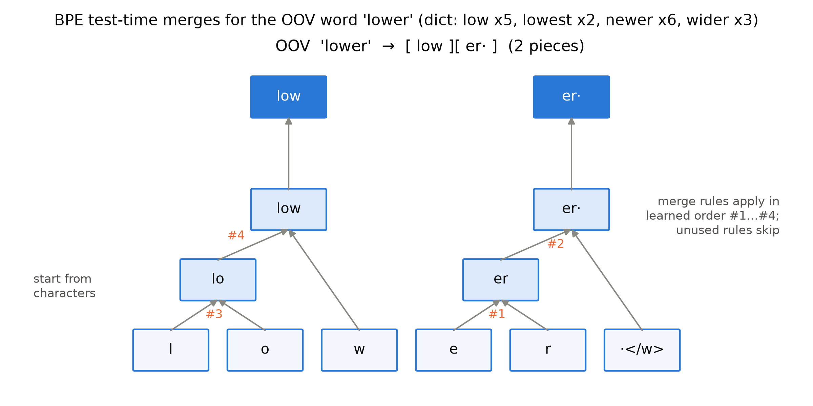
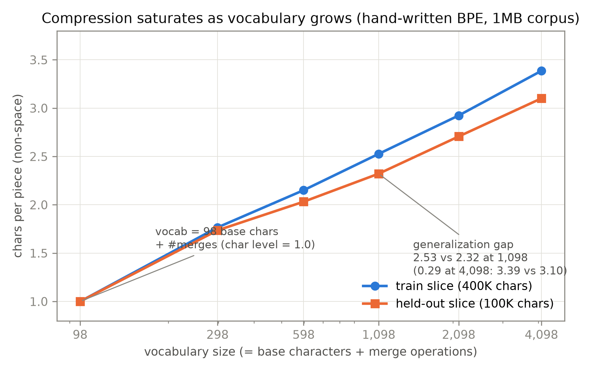

# 第 2 章 分词器：BPE 从零讲透

## 2.0 开篇：从全书到这里

上一章说明了预训练信号、上下文表示与迁移配方的来历。本章进入所有模型共用的入口：把文本变成词表编号。分词器不改变 Transformer Block，却同时决定嵌入矩阵的大小、序列长度和未知文本怎样处理。选择分词器，需要在词表成本、序列成本和覆盖能力之间作取舍。

我们继续讨论此前实践中的四个具体问题：BPE词表怎样从语料统计产生，训练耗时取决于什么，字符/piece与unk率怎样计算，以及同一个 `Nähe` 为什么在不同词表下有不同切法。先从词表与长度的权衡进入算法，再手算和检查实现，最后比较 WordPiece、Unigram 与字节级方案。原实验数字作为历史记录保留，小型构造例不能替代这些实验。

读完本章，你会得到 code/ch02/bpe.py 中一个可独立检查的BPE实现，以及历史实验记录和局部验证入口。接下来的问题是：文本变成词 id 之后，BERT 用什么目标函数学习这些输入？下一章将回答这个问题。

> **最小背景栏**（本章唯一需要的册外知识）：
> - **词频统计与哈希表**：把文本整理成「词→出现次数」的映射，常用哈希表保存。训练还需要每个词当前的符号序列、相邻对计数和合并规则；词频表避免反复扫描相同词的每次出现。
> - **UTF-8 与字节**：任何文本在计算机里都是字节序列。UTF-8 是变长编码——ASCII码点占1字节，`ä`、`é`占2字节；常见汉字如`汉`占3字节，扩展汉字如`𠀀`占4字节。单码点emoji如`🚀`占4字节，一个显示出来的emoji还可能由多个码点组成，例如`👨‍👩‍👧‍👦`包含7个码点、共25字节。后文Python的字符计数通常是码点数，不等于屏幕上的字形数。这表示：**字符串在计算机中表示为字节序列**，这是 2.6 节 byte-level 方案的基础。
> - 词、词表、OOV（未登录词，out-of-vocabulary）、piece/词元（token）：见Book1第8章的数据口径与第9章的分词实践；本册第8章再把它们用于预算分析，此处直接沿用。

## 2.1 用四个历史观察提出问题

Book1第9章保留的早期分词探针记录了CPU训练8k词表约0.2秒、去普通空格后的字符/piece约3.7、piece级unk率约1.9%；其训练统计是每10句抽1句、英德双侧合计。后续本章另有全量语料复算记录。切分样例包括`Nähe` 切成 `▁/N/ähe`，`Büsche` 切成 `▁Bü/sche`。这些都是2026年10月的历史记录；本章保留数据与复算表，同时区分探针和正式项目的分词器配置。早期探针使用默认特殊ID并开启输入打乱，Book1正式管线与本章重训代码则显式设置四个特殊ID并关闭打乱；数值四舍五入后接近，不等于模型文件完全相同。它们分别对应效率、计量口径和切分机制，不能只用一句“BPE把低频词切碎”回答。

四个数字——**0.2 秒、3.7、1.9%、`▁/N/ähe`**——就是本章的问题清单。它们分属三种性质：0.2 秒是**效率**问题（统计的数据量、数据结构、实现与硬件共同影响耗时）；3.7 和 1.9% 是**口径**问题（分子分母各算什么，稍换一种算法就不可比）；`▁/N/ähe` 是**机制**问题（词表里到底存了什么，切分时发生了什么）。本章也按这三方面展开：先建立直觉（2.2-2.3），再检查实现（2.4），最后比较不同方案（2.6）。介绍实现之前，还要交代一条沿用自 Book1 对应章节的合规红线：Multi30K 语料为 CC BY-NC-SA，一切衍生产物（本章的自训词表、复算结果）只落工作区 `log/` 目录、不入书仓不分发；本章新引入的德文语料取自古登堡计划（Project Gutenberg）的公版书，GPT-2 官方词表文件从 OpenAI 公开存储下载，同样只落 `log/`。

## 2.2 为什么需要子词：词表与长度的权衡

要理解 BPE 解决的问题，先看整词和字符这两种方案各有什么局限。整词（word-level）是词表的原始形态：一句话按空格切开，每个词占词表一行。它的第一笔账 Book1 对应章节见过——Sutskever 2014 的序列到序列模型源端词表 160,000，仍然会遇到 UNK。Sennrich等人2016年对WMT15英德训练语料德语侧的统计把这笔账算到了极端：按词切分，100m token（m=百万，即 1 亿词元）的语料有 **1,750,000 种词形**，开发集newstest2013上 **1,079 个 UNK**【证据等级：官方论文 1508.07909（ACL P16-1162）Table 1】。词表装不下是一半；另一半更隐蔽——语料里词频排名 50,000 开外的词出现不足 60 次，排名 500,000 开外的只出现 2 次（同文 §5.1），这些低频词即使进入词表，获得的直接更新机会有限，表示质量更依赖其他共享信息与训练条件。**词表的开放性与表示的稀疏性，是整词方案的两个结构性问题。**

往另一个极端走，字符（char-level）在该语料统计中使用约3000种字符，并在这份开发集上得到0个UNK，但代价写在这张表的第二行：同样的语料膨胀成 550m 个字符——**序列长度 5.5 倍**（Table 1）。序列一长，Book1 从第 2 章到第 11 章反复讨论的计算成本问题就再次出现：固定宽度下，稠密自注意力的成对打分与聚合项随长度平方增长；循环网络的时间步数则随长度线性增长。信息没有增加，序列却变长了；若只比较长度平方项，5.5倍长度对应约30.25倍，而非5.5倍。整机还包含线性层、词表读出等不同成本，不能把这当成总训练倍率——这是「序列税」。

BPE 的位置就在这两端的中间。同一张 Table 1 里它的行是：59,500 次合并之后，token 数 112m——只比词级长 12%；词表 63,000——从 175 万压到 6.3 万；UNK **0**。用一句话说：**高频词整存，低频词切碎**。「the」这样的高频词值得独占一行；很少出现的「Nähe」可以拆成 N/ähe，但要用于固定词表的模型，还须保证每一片都能查到合法ID。理解这个思路后，还需要量化比较。整词与子词之争，归根到底是在「词表大小 ↔ 序列长度」之间选择平衡点，**压缩率**（compression ratio）可以衡量序列长度这一侧的代价；覆盖能力、模型参数量和下游效果还要分别检查：

$$\text{压缩率}=\frac{\text{文本量}}{\text{piece 数}} \tag{2.1}$$

这表示：平均每个 piece 表示多少文本。分子取什么「文本量」，就是口径问题——本章全程使用三种口径：**口径A**（去空白后的码点数÷piece数）、**口径B**（原文本全部码点数÷piece数）、**口径C**（原文本UTF-8字节数÷piece数）。A还要核对去掉哪些空白：MiniBPE用正则排除全部空白；Book1探针与本章SentencePiece复算只减去普通空格U+0020。本文将后者注明为“A：仅去普通空格”。遇到制表符或换行时，两者可能不同，不能直接混比。三者的关系一句话可记：空格占比取决于语言与语料、非 ASCII 字符在口径 C 下按 2-4 字节计。Book1的“约3.7”采用仅去普通空格的A口径；2.4节将对照历史复算记录说明分子、分母。表 2.1 汇总了数据管道中各个量的形状与口径，它是本章的「尺寸流转表」：单条文本的分词结果没有注意力头维；批处理分词当然可以返回多条序列，填充后才形成模型需要的批量张量，而这正是后续一切 token 预算的源头。

表2.1 分词数据管道的形状流转（数值取表2.2保留的历史全量复算报告；模型身份与早期探针的区别见2.1、2.4节）

| 步骤 | 量（符号） | 形状 / 计量口径 | 说明 |
|---|---|---|---|
| 原文 | 字符序列 $L_c$ | 58000行，平均每行55.3个去普通空格后的码点 | 口径 A 的分子 |
| 预分词（pre-tokenization） | 词序列 $N_w$ | $N_w=667{,}403$，平均4.81个去普通空格后的码点/词 | 本表用Python split统计英德两侧的空白分词单元；SentencePiece自身不依赖此统计来切分 |
| 子词切分 | piece 序列 $L_p$ | $L_p=863{,}481$（$N_w$ 的 1.294 倍） | 平均每个空白分词单元1.294片；仅凭均值不能确定整词保留比例 |
| 查词表 | id 序列 | $(L_p,)$，整数 ∈ $[0, 8000)$ | 每片一个词表行号 |
| 组批进模型 | 张量 | $(B,n)$，$n$ 为当前批次填充或截断后的长度 | Book1内容过滤上限为16个piece，含起止符的训练张量长度最多18；整批通常 $B=64$，尾批可更小 |

## 2.3 BPE 算法：怎样根据语料构建词表

明确了两种极端方案的局限，现在来看 BPE 的具体做法。BPE（byte-pair encoding，字节对编码）不是为 NLP 发明的：Gage 1994 年用它做数据压缩，「迭代地用序列中最高频字节对替换成一个单一字节」（原文强调替换符必须是**未使用的**字节）【证据等级：官方论文转述（Gage 1994，C Users Journal 12(2)，经 Sennrich §3.2 与参考文献页转述）】。Sennrich 等人的改造只有一句话：**不合字节，合并字符或字符序列**——于是每个新符号不再是一个单纯的替换码，而是一段可解释的子词，网络能借它泛化去翻译没见过的词（这是他们与 Huffman 编码对照时的核心论点）。

算法本体（§3.2 + Algorithm 1）可以写成五行：

1. **初始化**：符号词表 = 语料字符集；每个词表示为「字符序列 + 词尾符 `</w>`」，词尾符标记单词结束，便于恢复预分词后的词边界；原始空白排版需另行保存；
2. **统计**：数所有相邻符号对的出现次数——**在「词 → 词频」的词典上数，每个词按语料频率加权**；
3. **合并**：取最高频对 $(a,b)$，从左到右将不重叠的出现替换为新符号 $ab$；
4. **迭代**：重复统计-合并，直到达到指定合并次数，或没有符合停止条件的候选；
5. **推理**：测试时把新词拆成字符，再按学到的合并表依序合并到不能再并。

其中第 2 步是提高效率的关键：合并不跨词边界，所以不必扫语料本身（token 级），只需扫词典（type 级）——它解释了这类算法的一种提速方式，但本书没有对SentencePiece的0.2秒历史计时做逐项性能分解，不能据此量出词频表或倒排索引各贡献多少。合并的准则形式化为一行：

$$(a^*,b^*)=\arg\max_{(a,b)\in \text{词典相邻对}} \mathrm{freq}(a,b) \tag{2.2}$$

这表示：每一轮都把相邻出现最频繁的一对符号合成一个新符号，合并轮数由你指定——**在固定基础字符、预处理与停止规则的原始算法中，合并次数控制词表规模**。若每次产生一个新符号并保留全部基础符号，词表大小就是初始字符集大小加成功合并次数；实际工具还可能包含特殊符号、字符覆盖率和其他配置。2.4节会核对具体实现。还有一个容易混淆的计数：`aaaa`里相邻的`aa`可数出3次，非重叠替换却只能执行2次。式(2.2)按相邻对频次选规则，频次不总等于本轮实际减少的符号数，也不保证最终得到全局最短编码。

下面用一个小例子逐步手算。用论文图 1 的词典：`low`×5、`lowest`×2、`newer`×6、`wider`×3（写作 `l o w </w>` 等，字符加词尾符）。第一轮统计：`(e,r)` 在 newer 里 6 次、wider 里 3 次，共 9 次；`(r,</w>)` 同样 9 次；`(l,o)` 与 `(o,w)` 各 7 次（low 与 lowest 贡献）；其余更少。最高频 9 次的并列里（`(e,r)` 与 `(r,</w>)` 打平，平票的裁决见下文考据框），`(e,r)`按本书Python 3实现的词典插入序胜出——**第一条合并规则：`e r → er`**，newer 变成 `n e w er </w>`，wider 变成 `w i d er </w>`。第二轮重数：`(er,</w>)` 现在恰有 9 次，是出现最多的符号对——**第二条：`er </w> → er·`**（论文用 · 缩写 `</w>` 粘连形态）。第三、四轮：`(l,o)`、随后 `(lo,w)` 各以 7 次的频率依次被选中——**`l o → lo`、`lo w → low`**。再往后是 `n e → ne`、`ne w → new`、`new er· → newer·`、`low </w> → low·`……每轮选择当前出现最多的相邻对，生成一个新词表条目。测试时遇到训练中没见过的 `lower`：拆成 `l o w e r </w>`，按学到的规则序依次套用——规则 1 命中 `e r`，规则 2 随即把 `er` 与词尾符粘成 `er·`，规则 3、4 命中左侧——得到 **`low er·`**，共两片，拼接内容并去掉词尾标记后还原原词。这个推导画成图 2.1：合并规则逐步把字符组合成子词，树的层级表示合并依赖，边上的编号表示规则的学习顺序；例如规则1和3可以位于相同树高，二者不是同一个概念。



图 2.1 OOV 词 `lower` 的测试时合并推导（自绘，示意级）。底层是字符加词尾符；橙色编号 ①-④ 是训练学到的合并规则的先后序（词典 `low`×5、`lowest`×2、`newer`×6、`wider`×3 手算所得，与 Sennrich 2016 图 1 的词典一致；首条合并的平票裁决与论文图取序不同，见 2.3 节考据框）；顶层蓝框即最终两片 `low`+`er·`【来源：本书构造例，按`sennrich_toy`逐轮核对；图示不代表训练性能测量】

这个例子还顺带回答了「BPE 为什么不会 unk」：切分从字符起步、合并表只将已有符号组合成新符号，因此，如果固定模型词表保留了全部基础字符及所需合并产物，测试词的**每个字符**又都被覆盖，它就能退回到已知符号序列——固定词表下的开放词表网络。但论文脚注 3 给了精确边界：测试时唯一可能未知的，是 (a) 训练语料没见过的**字符**，或 (b) 所有出现都被并入更大符号的符号（例：裸 `safeguar` 因每次出现都被并进 `safeguard` 而不在词表）。(a)是2.6节字节覆盖要解决的问题；(b)涉及实际模型词表是否保留中间符号，论文建议必要时递归撤销合并，直到所有片段都已知。字符覆盖和模型词表保留规则必须一起检查。

> **【考据框】byte 是压缩遗产，Sennrich 操作的其实是字符。** BPE 名字里的 byte 出自 Gage 1994 的压缩场景（替换符还必须是「未用字节」）；Sennrich 改造后实际操作的是 Unicode 字符，此时「字节对编码」这个名称已不能准确描述实际操作——直到 GPT-2 把 byte 这个词变回字面意思（2.5 节）。另一个需要注意的细节是：论文 Algorithm 1 代码块的词典是 `{low, lower, newest, widest}`，而图 1 图注写的是 `{low, lowest, newer, wider}`——正文「OOV 的 lower 切成 low er·」与图注词典自洽、与代码词典矛盾（代码里 lower 出现 2 次，不是 OOV）。两套词典我们都在 `sennrich_toy` 里逐轮复算过（代码词典的首条合并是 `e s → es`，图注词典的是 `e r → er`），正文采用图注词典。图注词典还有一处频率并列需要说明：`(e,r)` 与 `(r,</w>)` 并列 9 次，论文图 1 自列的规则序首条实为 `r </w> → r·`（其后是 `lo`、`low`、`er·`）；本书Python 3实现按当前字典遍历序取`(e,r)`，不能把这一平票顺序追认为论文原运行环境的保证——平票裁决是实现细节，两条路线都能把 OOV 的 `lower` 切成 `low er·`。【证据等级：官方论文 1508.07909 PDF 直读（Algorithm 1 代码块与 Figure 1 图注并读）】

## 2.4 实现与复算：从规则表到可测量结果

手算完成后，现在将算法写成代码。code/ch02/bpe.py 里的 `MiniBPE`类借用了Sennrich的词内频数合并思路，但作了两项教学简化：它不加词尾符，平票时取字典序较大的符号对。前节的`sennrich_toy`则另行保留`</w>`并按插入序决胜；两者不能要求合并规则逐项相同。词频加权已经出现在论文Algorithm 1中；本实现进一步采用论文提到的增量维护思路：在**词频表**上训练，并为每个符号对建**倒排索引**（pair → 含该对的词集合），每次合并只重算受影响的词，不重扫全表。`fit` 训练、`encode_word` 按规则序切词、`encode`返回忽略空白边界后的扁平片段列表；单词还原用字符串拼接，脚本没有保留原始空白的整句`decode`方法。`compression`另报三种计量口径，核心词典示例可在CPU运行；完整七组实验还依赖预备语料、模型文件和工具库，耗时不能只由核心算法推断。

历史实验取tiny shakespeare前 $2^{20}$ 个Python字符码点，并加入五种非ASCII样句各40遍（旧记录简称“1MB”，并非精确的字节口径）训练，1000 次合并：**训练0.7秒上下（四次复跑0.67—0.76秒），旧报告的词表计数为1098=98个基础字符+1000条规则**。这个数当时由两项直接相加得到，不是对唯一片段数的独立核验；当前实现按唯一字符串统计词表，不把可能产生相同字符串的不同合并规则重复计入；学到的合并序列前几名是 `th、ou、er、in、an、or、the、is、ar、en……`——先双字母、后高频整词，`the` 排到第 7 名，可以直接看到高频词逐步合并为完整符号的次序；从 held-out 切片抽 200 词做 round-trip 验证，`encode_word→拼接==原词`全部成立；这只检查单词字符没有丢失，还须另查每一片是否属于已学词表，才能验证固定ID编码的覆盖【证据等级：本书实验（CPU，2026-10，`bpe.py` 复跑）】。

压缩率用式 (2.1) 的三口径量，给出两条曲线（图 2.2）：词表从 98（纯字符）涨到 4098，训练切片的口径 A 压缩率从 1.0 升到 3.39——收益逐渐递减，曲线趋于平缓；而 held-out 曲线全程贴着训练曲线之下，在 1098 词表处是 2.32 对 2.53——这组切片上两者比值约为0.92，不能推广成新文本都要打九折。旧脚本把原文前部用于训练、末10万个码点用于评估，这两个区间可能重叠，还向两侧加入了相同非ASCII样句。因此，历史“held-out”不能视为严格独立保留集，图中的间距也不能全解释为泛化损失。当前代码已改为不重叠的文本区间、样句只加训练侧；修正后的曲线需要重新运行，不能沿用旧读数。这张图同时预告了两件事：词表不是越大越好（每行词表都是模型的参数与内存，第 9 章的账本会给数值），以及任何压缩率数字都必须附带「在什么文本上测的」。



图 2.2 词表大小-压缩率曲线（自产）。历史MiniBPE在前 $2^{20}$ 个码点加扩展样句的语料上扫描合并次数 {0, 200, 500, 1000, 2000, 4000}，口径 A（非空白字符/piece）：蓝=训练切片、橙=held-out 切片。在所测范围内，新增词表项带来的单位收益减小；图内“held-out”“generalization gap”保留了历史命名，但旧两组文本并非严格独立，其间距这里只能读作切片压缩率之差（1098 词表处 2.53 对 2.32）【证据等级：本书实验（CPU，2026-10，`bpe.py` sweep）】

MiniBPE是教学件，表2.2则保留2026年10月对当时保存的`bpe_8k.model`和Multi30K英德双侧共58000行所作的复算报告。它与Book1早期抽样探针不是同一计数范围；早期与正式管线的配置差异已在2.1节说明。当前未取得那次复算所用模型的完整身份记录，因此下面可以作为历史报告阅读，不能仅凭同名文件断言它逐位复现了早期探针。

表2.2 围绕Book1历史观察的复算报告（当时保存的模型、全量58000行；不据同名文件推定与早期探针逐位同一）

| Book1 历史观察 | 本章复算值 | 口径裁定 | 证据等级 |
|---|---|---|---|
| 训练 0.2 秒 | **约 0.2 秒**（同规格重训实测 0.19-0.23 秒），重训词表与原模型 8000 条**逐条相同** | 旧报告称按ID排列的8000个piece字符串相同；实际代码只比较这一项，未证明proto全部设置相同，也不保证换版本后重训相同 | 本书实验（CPU，2026-10） |
| unk 率约 1.9% | **1.89%**（16,294 个 unk piece / 863,481 piece） | **piece 级**：unk piece 数 ÷ 总 piece 数；另有「unk 字符占比」口径不等价 | 同上 |
| 约 3.7 字符/piece | **3.717**（3,209,752个去普通空格后的码点 / 863,481 piece） | **口径A：仅去普通空格**；口径B为4.423、口径 C 为 4.463——三个数字同一现实 | 同上 |
| `Nähe → ▁/N/ähe` | `['▁','N','ähe']`（3 片）；`Büsche → ▁Bü/sche` | 与历史观察逐字一致 | 同上 |

表中最值得仔细比较的是那组 3.717 / 4.423 / 4.463——同一份历史报告中，分词器和语料固定，换一个分子就是另一个数。Book1 报「约 3.7」时若顺手把空格计入就是 4.4，若按字节算就是 4.5。这不是谁错了，而是**压缩率有不同统计口径，引用前要先核对分子与分母**——它与 Book1 第 9-10 章「BLEU 的 13a 与 none 差 1 分多（三模型 +1.06～+1.50，标点怎么切，值 1 个多 BLEU）」体现了同样的计量问题。另一个由此计算出的指标也可以确定：pieces/word = **1.294**（表 2.1 已用），与Sennrich Table 1的112m/100m=1.12属于同类比值，但语料、语种、预分词和符号计数不同，不能据此直接排名两套分词器——8k 词表下英语德语文本平均每个空格词切 1.29 片，它给出了平均切分程度；均值本身不能唯一确定整词保留的比例。

还有一笔账要算清：unk 的 1.89% 从哪来？BPE 不是「字符兜底、永不 unk」吗？答案藏在训练参数里——Book1 训这张表时 `character_coverage=0.995`，它按归一化训练文本中的字符**出现频次**累计选取字符，使覆盖率达到约99.5%，不是删去0.5%的字符种类。字符是逐个纳入的，实际覆盖率可能越过阈值；未覆盖部分也不必恰好0.5%。一个未知piece还可能包含多个连续未知字符，而分母是切分后的piece数，所以字符覆盖率不能直接换算为piece级unk率。也就是说，这类实验中的unk主要来自基础字符覆盖不足；更一般地，还要检查模型词表保留规则、未知段处理和长度限制，不能只凭unk率认定唯一原因。2.6 节会用实验验证这个判断。在结束本节之前，先看由此引出的一个推论：**切分路径是语料频率的函数**。同一个词、同样的算法、同样的词表大小与覆盖率，换个语料，切法可能改变；也可能某个词恰好保持相同切分。取古登堡的公版德文书（歌德《浮士德》第一部，原报告文件大小187,758字节），同样设置BPE、8k目标词表与coverage 0.995，再训一张表：`Nähe → ▁Nähe`——整词一片【证据等级：本书实验（CPU，2026-10）】。对照摆开：Multi30K模型给出`▁/N/ähe`，浮士德模型给出`▁Nähe`，说明不同训练文本改变了可用片段及其优先次序。现有切分结果并未逐轮分解`Nähe`的词频和所有竞争合并，不能只凭结果确定是哪一项统计造成了差异。更有说服力的是 `Büsche`：两张表都切成 `▁Bü/sche`——**切法不是“哪张表更德语”的单一属性，而是整个训练统计、预处理、基础字符与合并竞争共同产生的结果**。词表不是词典，而是语料统计的结果；本章后面还会用进一步的对照说明这一点（2.6 节「一词三切」）。

## 2.5 家族谱系：同一个问题的四种答法

复算检验了 BPE 的实现，但 BPE 只是常用分词方法中的一种。选合并对的准则、词边界的记号、基础符号集的取法——再加上词表是逐步扩展还是先建大表再剪枝、是否对切分建立概率模型，就得到不同方案。表 2.3 先作整体比较，随后逐一介绍各方案的思路与关键差异。

表 2.3 分词器家族谱系对照（自排；准则与记号均注出处）

| 成员 | 选合并/切分准则 | 词边界处理 | 代表模型（词表口径） |
|---|---|---|---|
| word-level | 不合并（整词） | 空格预分词 | Sutskever 2014（160k，仍进 UNK） |
| char-level | 不合并（单字） | 无需 | 早期字符 NMT；序列 5.5× 税 |
| **BPE**（Sennrich 2016） | **频率最高**的相邻对（式 2.2） | 预分词后按词处理；`</w>` 词尾符或 `@@` 续接符 | Transformer（37k joint）；Book1（8k 自训） |
| **WordPiece**（Schuster & Nakajima 2012） | 文献描述为提高语言模型似然；原始训练实现未公开 | 预分词；`##` 续接前缀 | BERT（30,000【证据等级：官方论文 1810.04805 §3】；HF bert-base-uncased 实为 30,522【证据等级：config/源码】） |
| **Unigram LM**（Kudo 2018） | 不增量合并：大词表按损失**剪枝** + 概率模型 | 可无预分词 | T5（SentencePiece 32,000；官方 checkpoint 实测为 UNIGRAM 模型【证据等级：config/源码，本书实验 2026-10】） |
| **SentencePiece**（Kudo & Richardson 2018） | 工具框架（内含 BPE 与 Unigram 两算法） | **空格即普通字符**，转写为 ▁（U+2581） | T5 / mT5 / XLNet / ALBERT 系 |
| **byte-level BPE**（GPT-2，2019） | 频率（同 BPE），但基础词表 = **256 字节** | 预分词 regex + 字节重映射 | GPT-2（50,257）；RoBERTa（50k 级） |

**WordPiece：把「频率」换成「似然」。** 它最初要解决的问题就涉及词边界——Google 为日韩语**语音搜索**的分段而造（2012），经 GNMT 论文转述进入大众视野：「wordpiece 模型以数据驱动的方式生成，以最大化训练数据的语言模型似然」（GNMT §4.1）；BERT 引用的正是 GNMT，引用链是 2012 会议 → 2016 GNMT → 2018 BERT【证据等级：官方论文转述（Schuster & Nakajima 2012 原文未获取，经 GNMT arXiv:1609.08144 §4.1 转述）】。与 BPE 的机制差异一句话：BPE 问「谁最常相邻」，WordPiece 问「把这一对合并，语料似然涨多少」。HF 的 LLM 课程把它转写成一个打分公式 $score=\mathrm{freq}(a,b)/\left(\mathrm{freq}(a)\cdot\mathrm{freq}(b)\right)$——这表示：分母惩罚「零件各自都很常见」的对，按相邻频次相对两侧边际频次的大小排序；一个很稀有的对也可能因此得到高分。这只是该教程使用的训练启发式，不等于已经算出了原始WordPiece的精确语料似然增益；但**Google 从未公开官方训练实现，此式系第三方从文献推断**【证据等级：第三方教程（HF LLM Course）】。

词边界记号也从词尾符换成续接前缀：GNMT 的示例句 `Jet makers feud over seat width with big orders at stake` 切成 `_J et _makers _fe ud _over _seat _width …`（`_` 是词首符，`feud → fe + ud` 两片）；BERT 系改用 `##` 标记续接件（`##ud` 这类形态，词首件无标记）。推理时的差异更值得仔细比较：WordPiece 只存最终词表不存合并表，切词用**最长前缀匹配**（greedy longest-match-first），某位置匹配失败则**整词变[UNK]**。例如词表有`a`与`##b`时，`ab`可以拆成两片；若余下字符找不到合法续接片，整词都会回退。BERT实现还设有单词长度上限，超过它时即便字符都已覆盖也会变成[UNK]；默认上限须按具体实现核对。因此，字符覆盖并不是WordPiece无未知词的唯一条件。当时的方案通常允许出现 unk：GNMT 明言西文基础字符预算约 500、其余映射为 unk——这正是 2.6 节对照实验的重要参照。第 3 章讲 BERT 时会实际使用这张 30k 的表，这里先讲清机制。

**Unigram LM：反过来，从大词表往下剪。** Kudo 2018 采用了相反的方向：先启发式造一张大种子词表（字符 ∪ 高频子串），假设每个子词独立发生（一元语言模型，unigram LM），$P(x)=\prod_i p(x_i)$；给定词表用 EM 估每片概率，最优切分用 Viterbi 解码取 $\arg\max P(x)$；然后**估计删去每片造成的似然损失，按损失保留较重要的片段，同时保留种子词表中的单字符**；论文以每轮保留80%为例，循环到目标大小。这表示：BPE 从字符逐步合并，Unigram 则从大词表逐步删去子词，保留那些删去后损失较大的子词。由此还产生了两个特点：其一，切分带概率分布，训练时可对同一句话**采样不同切分**作为训练扰动（子词正则化，subword regularization，$P(x\mid X)\propto P(x)^\alpha$——增大正的α使采样更集中于高分路径），WMT14英德的原表中，BPE为24.53 BLEU，Unigram不加子词正则为24.50，加采样（$l=64,\alpha=0.1$）后为25.04；24.50到25.04更直接对应Unigram内部是否采样的比较，不能把BPE到Unigram的全部变化只算给一个开关；其二，Kudo 还从压缩的角度作了比较：**BPE可从字典替换与符号数减少来理解，Unigram则通过片段概率联系到熵编码的码长 $-\log p$**——同样称为「压缩」，两种方法采用的准则不同【证据等级：官方论文 1804.10959 §3.2-3.4】。T5是采用它的一个重要例子：论文只说「用 SentencePiece 编码为 32,000 wordpiece」（§3.1.3），实测官方 checkpoint 的模型 proto 标着 `model_type=UNIGRAM`——这里也需要对照论文表述与实际产物。

### Unigram 的概率究竟定义在哪个对象上

Unigram 为一段文本的多种合法切分分配概率，使模型训练时可以见到不同子词边界。它不只是一张“每片有概率”的词表：训练需要把同一文本的多条切分路径合起来，推理才可以选其中概率最高的一条。这是它与按合并顺序执行的 BPE 的关键区别。

令原字符串为 $X$，合法切分集合为 $\mathcal S(X)$，一条切分为 $s=(s_1,\ldots,s_m)$。每个 $s_i$ 是词表中的非空字符串，拼接后还原 $X$。词表概率满足 $p(v)>0$、$\sum_vp(v)=1$。一条路径的权重与文本的边缘概率分别是

$$P(s)=\prod_{i=1}^{m}p(s_i),\qquad P(X)=\sum_{s\in\mathcal S(X)}P(s).\tag{2.3}$$

前文的乘积应理解为切分路径的权重，不能直接替代多路径求和。对能被词表完整切分、因而 $P(X)>0$ 的固定字符串 $X$，路径后验为 $P(s\mid X)=P(s)/P(X)$；式(2.3)提供了归一化分母。这里沿用论文对文本似然的写法，没有另外建立任意长度字符串的生成与终止模型，不应把这些乘积直接当成所有长度字符串上已归一化的生成概率。模型对语料最大化 $\sum_X\log P(X)$，路径是未观察到的变量。EM 的 E 步在当前参数下计算各路径后验，从而累计每片的期望次数；M步把每片的期望次数除以全部片段的期望总次数，更新词表概率；不是先只保留Viterbi路径再数硬计数。剪枝时再估计删除子词带来的似然损失。

以 `abc` 为教学例，只允许 `a`、`b`、`c`、`ab`、`bc` 五片，概率依次为0.1、0.1、0.1、0.4、0.3，总和为1。三条路径 `a/b/c`、`ab/c`、`a/bc` 的权重为0.001、0.04、0.03，三条路径权重合计0.071。除以0.071后，其后验概率约为0.0141、0.5634、0.4225。Viterbi选`ab/c`，而按此后验采样仍可能选中另外两条路径。词表概率只是教学构造，不是 T5 的实际词表统计。

不用穷举所有路径也能求最优切分。记 $D(t)$ 为前 $t$ 个字符的最小负对数路径代价，$D(0)=0$，其他位置先设为正无穷；没有合法到达路径的位置保持正无穷。枚举在位置 $t$ 结束的合法子词 $v=X_{a:t}$：

$$D(t)=\min_{a<t:\,X_{a:t}\in\mathcal V}\{D(a)-\log p(X_{a:t})\}.\tag{2.4}$$

每个候选由“前缀最优代价＋最后一片代价”组成，保存前驱即可回溯切分。求总权重时改用 $F(0)=1$、$F(t)=\sum_{a<t:\,X_{a:t}\in\mathcal V}F(a)p(X_{a:t})$，最终 $F(|X|)=P(X)$；空候选和为0；只有最终 $F(|X|)=0$ 才表示整段字符串没有合法切分。某个中间位置不可达并不一定失败，例如词表只有`ab`时，`a`处不可达，整段`ab`仍可一步到达。$D$与$F$各保存 $|X|+1$ 个标量，共享这张切分图，却分别回答最优路径与全部路径权重的问题。子词正则化则使用归一化后的 $P(s)^\alpha$ 采样；$\alpha>0$越大越集中于最高分路径；只有唯一最高分路径时，极限才是一条确定切分，平分时仍有多个候选。这个概率设计让输入边界具有训练多样性，代价是概率估计、剪枝和采样的额外复杂度。【来源：Kudo 2018，§3.2–3.4；数值例为本书构造】

**SentencePiece：空格也是字符。** 严格说它不是第三种算法，而是把 BPE 与 Unigram 装进同一个**端到端工具**的框架（我们的 `bpe_8k.model` 就是它训的）。它的关键做法：先把空格转写为元符号 ▁（U+2581），此后文本就只是「Unicode 字符序列」，训练与切分无需外接按语言编写的分词器。它仍有归一化、空白处理和特殊符号规则：只有把这些规则及保留记号一起计入规范化文本，并确保剩余字符可表示、没有未知段折叠或有损截断，才能谈规范化后内容的往返还原。将约定的文本规范化结果记作 $N(t)$（不含词表内部的空白转义记号），编码与解码记作 $E,D$；在上述边界满足时，需要核验的往返关系是 $D(E(t))=N(t)$，不能直接改写成 $D(E(t))=t$。所谓**无损分词**须说明还原的是哪个阶段的文本。默认设置可把连续空白合并、去掉首尾空白，并把全角字符等规范化；例如`hello  world`可能还原为`hello world`，即便没有unk也不等于原文逐字相同。字面`▁`还涉及保留的空白记号，不能当作任意普通字符保证往返不变（lossless tokenization）【证据等级：官方论文 1808.06226 §1-3】。

这种做法为什么值得单独讨论？看反例：常规管道把 `Hello world.` 切成 `[Hello][world][.]`，「world 与句点之间没有空格」这条信息丢了，还原要靠「欧洲语言补空格、中日不补」的语言相关规则；subword-nmt 的 `@@` 续接符甚至无法编码连续空格。更根本的是预分词的依赖：Sennrich的实验和WordPiece需要先确定待切分单元，但这个步骤不一定只是按空格。BERT的BasicTokenizer还处理标点，并把CJK字符分开；日语、韩语等也有各自边界问题。SentencePiece的价值是能直接从原始句子建立子词模型，不要求事先提供语言专用的词切分结果。WordPiece与SentencePiece都关注过无空格语言的边界问题，但采用的训练与预处理接口不同。它的 `▁` 从此贯穿本章：`▁the` 就是「 the」，Book1 的 `▁Bü/sche` 里 ▁ 也是它。

**byte-level BPE：GPT-2 把 byte 变回字面意思。** 通用语言模型该能对**任意字符串**算概率，而 lower-casing、OOV、词表截断都在收缩可建模的字符串空间；对合法Unicode文本，UTF-8提供完整的字节表示，但纯字节/字符模型在 WebText 上不敌词级（GPT-2 §2.2 引 Al-Rfou 2018 的前史）。GPT-2 的答案是 BPE 的「实用中间地带」加一个关键观察：**报告讨论的常规BPE参考实现虽名为byte-pair，实际从Unicode字符起步；按2019年报告的计数，要覆盖当时全部字符，基础词表需超过130,000项**，在 32k-64k 的惯用词表面前不可接受；**而字节级的基础词表只要 256**【证据等级：官方论文（OpenAI PDF §2.2）】。

代价是新麻烦：直接在字节上跑 BPE，「贪心频率启发式」会产出劣质合并——`dog.`、`dog!`、`dog?` 这类跨类别的变体各自占用词表槽位。对策是**禁止跨字符类别合并、只对空格开例外**：先把文本用一个预分词正则切成片段（缩写后缀 → 可选空格开头的字母串 → 数字串 → 符号串 → 空白），BPE 只在各片段内部合并。这个正则还留下一处著名的历史痕迹——缩写分支只匹配小写，源码注释也提到了这一点（连 "Should haved added" 的笔误都原样保留）：实测 `don't → don + 't`（2 token），`DON'T → DON + ' + T`（3 token）【证据等级：官方代码 openai/gpt-2 encoder.py 源码直读 + 本书实验】。

另一个源码级观察：数字串在预分词阶段整段成一片、片段内再按已学合并切——实测 `123456789 → 123/45/67/89`，这说明切分没有按十进制位或统一位数固定分组。它改变了模型接收数字的表示方式，但仅凭这一观察不能认定算术能力的因果来源；还需控制训练数据、目标和模型等因素做实验。

这 256 个基础字节还需要作一次重映射：词表文件里不想出现控制符与空格，于是把选定的三个字节区间共188个值映射到同值Unicode码点（33-126 的 94 个 + 161-172 的 12 个 + 174-255 的 82 个，$94+12+82=188$，恰余 68 个）、其余 68 个（空格、换行、DEL……）平移到 256 起的空闲码位——空格 0x20 的替身就是 `Ġ`，在采用这套GPT-2字节重映射的词表中，`Ġthe`表示带前导空格的字节串` the`。这套映射可逆，用于避免把空格或控制码直接放进词表字符串；这些映射字符只是字节的记号，未必对应完整自然语言字符。最后，表 2.4 列出词表总数的分解：

表 2.4 GPT-2 词表 50,257 的分解（论文只给总数「expanded to 50,257」§2.3；分解由官方词表产物程序化验证）

| 分量 | 数目 | 验证方式 |
|---|---|---|
| 基础字节词表 | **256** | encoder.json 中恰有 256 个单字符 token，覆盖 bytes_to_unicode 全域 |
| 合并产物 | **50,000** | vocab.bpe 去掉版本头后非空行数恰 50,000 |
| 特殊 token | **1** | `<\|endoftext\|>` = id 50256 |
| 合计 | **50,257** | 与 tiktoken `n_vocab`、HF `vocab_size` 三方一致 |

【证据等级：config/源码（官方 encoder.json/vocab.bpe 逐项计数，本书实验 2026-10 复验）】头三条合并是 `Ġt`、`Ġa`、`he`——第一优先合并不是字母对而是「空格+t」「空格+a」：它显示带前导空格的片段在已学合并表中获得很高优先级；这并不单凭前三条规则就证明所有完整词形的频率排名；配套实测：`'the'` 的 id 是 1169，`' the'` 的 id 是 262——两个都在表里，词前是否有空格会改变片段与ID，不能把二者随意替换。词表统计的颗粒度，从来不是「词」，而是「字符串片段」。

> **实现口径**：本章机制以 OpenAI 原始 `encoder.py` 为参考。旧对拍记录使用 tiktoken 0.14.0、transformers 5.18.0、sentencepiece 0.2.2；这些版本是历史记录，不代表本轮环境。不同库版本可能改变类名和默认预处理，本轮不依旧文的“某类已删除、某入口恒为fast”等断言编写命令。对拍应核对同一词表、合并表、特殊token规则与输入规范化，再比较id。

## 2.6 非 ASCII 对照：覆盖能力怎样付出长度成本

比较过这些方案，再回到本章提出的判断：**在本节实验中，训练字符集不足以覆盖新输入，是需要检验的主要原因**。现在用受控实验检验这个判断。设计很简单：模拟只在ASCII字符范围内训练——取Multi30K英德混排语料中纯ASCII的前20,000行；ASCII只约束字符，不等于这些行全部是英语，用 SentencePiece 训两张同规格（BPE、4k、coverage 1.0）的表：一张**字符级**（基础符号 = 语料字符，byte_fallback 关闭），一张**字节级兜底**（byte_fallback 开启：未知字符降解为 `<0xXX>` 字节 piece——工具功能，非论文内容）；再用 GPT-2 的 tiktoken 实现作第三方字节级参照。测试集三份：留出的ASCII行200句、含非ASCII字符的前200行，以及中文探针3句。原表把第二组简称“德语200句”，但代码只筛字符范围，没有另验语言，因此它检验的是字符覆盖差异。两套SentencePiece的总词表都设为4000；开启byte_fallback后还要给256个字节片段留位置，可用于其他片段的预算随之改变，不能把所有压缩率差异只归给测试时的兜底动作。历史结果收进表2.5。

表 2.5 非 ASCII 对照实验（自产实测；unk 率为 piece 级口径，压缩率为口径 B 含空格字符/piece）

| 测试集 | 字符级 unk 率 | byte 兜底 unk 率 | tiktoken | 字符级 字符/piece | byte 兜底 字符/piece | tiktoken 字符/piece |
|---|---|---|---|---|---|---|
| ASCII 200 句 | 0.00% | 0.00% | 0（无此概念） | 4.09 | 4.04 | 3.88 |
| 德语 200 句（变音符） | **7.56%** | 0.00% | 0 | 3.33 | 3.07 | 2.55 |
| 中文探针 3 句 | **44.44%** | 0.00% | 0 | 4.89† | **0.34** | 0.47 |

【证据等级：本书实验（CPU，2026-10，`bpe.py` 非 ASCII 模块）】†字符级方案把**连续一段未知字符合并成单个 unk piece**（实测 `北京欢迎你，世界！ → ▁/<unk>/,/<unk>/!`、`Nähe → ▁N/<unk>/he`），piece 数被折叠压低，压缩率虚高且文本已毁，不可比——这也是 unk 率必须声明 piece 级口径的又一实证。另注：调研期的旧探针集（CJK/emoji 混合）在同一套对照设置下得 29.03%/0.81/1.10，与本表 44.44%/0.34/0.47 的差异系测试集更换（本表为中文探针 3 句）所致，引用一律以本表口径为准。

三行数字分别说明一个问题。第一行：本次ASCII测试上三家unk全零——**这一指标上没有差异**；只考察英文，就无法看出 byte-level 方案在这里的作用（阅读其他论文时，也要注意对照设计怎样帮助说明方案的动机）。

第二行：引入德语，字符级方案的 unk 跳到 7.56%——`ä`、`ö`、`ü`、`ß` 不在它的基础符号集里；而两个字节级方案全零，因为合法Unicode文本可编码为UTF-8字节序列，完整保留256个字节就能覆盖这些字节；这不等于两种工具的规范化与特殊符号行为也相同。Sennrich 脚注 3 里那个「未知字符」的例外，被 GPT-2 从根上消灭了；Book1 那 1.89% 与这里的 7.56% 同源——基础字符覆盖不足；前者包含覆盖率配置，后者即使设置1.0，也只保证覆盖训练中见过的字符。

第三行则显示了**覆盖能力的代价**：unk 归零并不意味着没有成本。中文在两个字节方案下的压缩率跌到 0.34 与 0.47 字符/piece——这表示：byte兜底对未覆盖的常见BMP汉字通常发出3个字节片段，另外还可能有空白记号和标点；扩展汉字可能需要4个字节片段。tiktoken则已有部分字节合并，本组文本平均约每码点2片。这些总量指标包含标点，不能直接当作每个汉字都固定占几片。**碎片化税**——GPT-2§2.2的空格例外允许空格与相邻词形合并，服务的是词边界附近的表示；它不能单独解释或解决中文的字节碎片化。中文长度的具体账将在第12章的上下文预算中继续核算。再用几个词单独测量这种长度成本：`北京` 2 字 → 4 token、`北京清华大学` 6 字 → 12 token，整句 2.0-2.33 token/字——**这些中文探针在 GPT-2 词表下约每字2个 token；不能外推为所有中文文本的固定换算率**【证据等级：本书实验（tiktoken，2026-10）】。顺带一个细节：其中一些token单独解码会显示`�`，因为它们只含一个Unicode码点的部分UTF-8字节；另一些token已经含完整字符，例如`北京清华大学`中的`大`可单独解码。完整解码要先拼接各片段的字节，再转换成文本；无法组成合法UTF-8时，原实现默认采用`errors='replace'`。这里的`�`是无效字节序列在字符串解码时的替换字符，不是词表查找失败产生的[UNK]。二者出现在不同环节。

现在可以用同一个词比较不同方案。以 Book1 用过、本章反复使用的 `Nähe` 为例：Book1 自训 8k（英德混编语料）切 `▁/N/ähe` 三片；t5-base的SentencePiece Unigram 32k（分词器按英语、德语、法语、罗马尼亚语10:1:1:1的文本混合训练；T5模型本身的C4预训练语料以英语为主，两者要分开）**整词一片** `▁Nähe`；GPT-2 byte-level 50257（英文为主）切 `N/ä/he` 三片——其中 `ä` 这片是两个 UTF-8 字节在英文语料统计里碰巧粘成的一个「字节件」（词表里的字节形态记作 `ä`），对 GPT-2 而言它不是德语字母，只是「常见的一对字节」。同一个词有三种切法，每一种都合法。**词表不是字典，是语料统计的快照**——同一个词怎样切分，由「谁的统计、多大的词表、什么基础符号集」三个变量共同决定，缺少其中任一项的说明，就无法复现切分。

## 2.7 工具对拍与全书实践的衔接

实现是否正确，最后还要做**交叉验证**：让两个独立实现的工具处理同样的输入，比较它们的结果。B 级对拍承诺三项一致——压缩率、round-trip 无损、受控样例切分；实测我们在 11 个边缘样例（缩写大小写、CJK、emoji、变音符、连续空格、邮箱、数字式）加 Multi30K 真实语料前 2000 行（英德混排）上跑 tiktoken 对 HF transformers：**id 序列全等 0 失配、round-trip 全部无损**【证据等级：本书实验（CPU，2026-10；覆盖范围内全等，罕见 Unicode 未穷尽测试）】。同一定义词表（encoder.json+vocab.bpe）的tiktoken与HF加载器相互核对；后者实际使用的实现还需记录加载到的类与版本——它检查的是两份GPT-2工具实现对同一规格是否一致，**不能替代对自写MiniBPE的独立校验**。后者还要对照一个直接重算词对的参考算法，检查重叠替换、平票、重复fit、单词还原及词表覆盖。有限样例一致仍不是所有输入下的等价证明。

> **【借用框】** tiktoken（OpenAI，0.14.0，本书首次借用）：纯推理库，无训练 API。三个入口够用全书：`tiktoken.get_encoding("gpt2")` 装配预置编码；`enc.encode(文本)` 得 id 列表（缺省**拒绝**特殊 token——`encode("<|endoftext|>")` 会抛 ValueError，若要把它当作特殊token，可显式设置`allowed_special={"<|endoftext|>"}`；若只想编码字面文本，可设`disallowed_special=()`。拒绝缺省匹配是为了让这项选择显式发生）；`enc.decode(ids)`把字节片段串起来解码；对合法文本的普通编码结果可往返还原，但任意ID子序列可能含不完整UTF-8，缺省可输出替换字符。本书的自训分词实验使用SentencePiece或自写实现。

完成这些不同层次的检查后，还需把历史数字的配置与后续实践逐项对应。最后再梳理**分词器在全书实践中的衔接关系**，看看后续各章怎样使用这些结果。Book1的8000词元模型服务于英德翻译；第8、11章的scaling族则在独立OpenWebText分片上另训8192词元的`sp8k_owt`，并开启byte_fallback。两者都简称“8k”，却不是同一词表、同一ID或同一语料。小模型若使用50,257词元的大词表，可能出现“嵌入矩阵会把模型本体淹没”的参数比例问题；所以后续采用较小词表，但仍须按各配置实际计数；下一章 BERT 使用的是 WordPiece 的 30,522 词表（机制本章 2.5 已教，到时只剩生态问题：`[CLS]`/`[SEP]` 怎么拼、`##` 记号怎么读）；第 4、10 章 GPT-2 的 50,257 词表直接沿用本章的分解式；第12章收束时，会把这些中文探针的切分率用于上下文长度预算示例。一张词表的演化史，就是「怎么把文本变成数字」这个问题在 2016-2019 间被反复重答的历史——而现在已有足够依据区分它们的训练目标与推理流程。

## 2.8 本章小结

开篇四项观察现在有了对应的解释与核验边界：词频表及增量维护解释一种提速机制，但不能单独说明SentencePiece的0.2秒历史计时（历史自写版约0.7秒、按规则数报告1098；历史重训约0.2秒、只比较piece字符串表）；「约 3.7」明确为口径 A 的 3.717（表2.2的历史全量统计仅去普通空格；B/C另为4.423/4.463）；「约 1.9%」明确为 piece 级的 1.89%（16,294/863,481）；历史复算记录中的`▁/N/ähe`与先前样例一致，并在浮士德语料上得到 `▁Nähe` 的对照切法。原始算法可以简短描述——字符起步、式 (2.2) 的贪心合并、在固定其他配置下由合并次数控制规模——其余全是口径、工程与家族史。

**带走的心智**：即使忘掉具体数字，也请记住以下三点。**第一，词表不是字典，是语料统计的快照**——同一个 `Nähe` 在三张表里有三种切法，切分路径是「谁的统计、多大词表、什么基础符号集」三个变量的函数；从此你看到任何分词结果，第一反应是问它的语料与口径，而不是问它「对不对」。**第二，一切子词方案都需要在「词表大小 ↔ 序列长度」之间权衡**——word-level 的 175 万词形与 char-level 的 5.5 倍序列税是两端的账单，BPE 用「高频整存、低频切碎」在中间取点，压缩率（以及它必须声明的分子口径）是这条轴上的刻度尺。**第三，先查覆盖，再查预处理与失败规则**——本节ASCII测试上各方案unk均为零，引入训练未覆盖字符后，字符方案才暴露缺口。完整字节基础集能覆盖合法Unicode文本的UTF-8表示，但仍有规范化、特殊token与片段解码规则，不能由unk=0推出任意原文无损。覆盖与序列长度要一起核算。

到这里，文本进入模型所需的输入接口就准备好了：文本进入、整数 id 输出；是否可逆、序列多长，则由基础覆盖、规范化与词表共同决定。但还需要确定模型用这些 id 学什么：怎样设计目标函数，才能从大量无标注文本中学到用于理解的表示？下一章先介绍三种范式中的第一种：BERT 把 Book1 的 encoder 半塔拿出来单独用，用「挖空填空」的掩码语言模型在双向注意力上预训练，再拿一张 30,522 的 WordPiece 表把本章的谱系接下去。词 id 已经就绪，接下来就看 BERT 怎样使用它们。

## 2.9 动手验证

- **入口命令**：先激活Python环境。工作区中先在根目录`source ./env.sh`；`BOOK2_LOG_ROOT`与`BOOK1_LOG_ROOT`可指向已有外层缓存根。纯手算入口不下载语料；完整实验需先准备Multi30K语料与所用Book1模型、Shakespeare文本、OpenAI的`encoder.json`及`vocab.bpe`，这些文件不会由主脚本全部自动下载。产物写入所选日志根下的`book2-ch02/`：
  ```bash
  python "code/ch02/bpe.py" --toy-only     # 手算词典与含词尾符的lower切分
  python "code/ch02/bpe.py"                # 原料准备齐全后运行七组实验
  python "code/ch02/make_figs.py" --merge-only  # 合并树，无需训练报告
  python "code/ch02/make_figs.py"          # 用本次报告生成两张图，写入日志目录
  ```
- **历史结果与本次验收分开**：下列是2026年10月记录，原脚本的20261003只是种子标签，并未为所有工具统一设定随机源；计时、不同版本和修正后的数据划分均可能改变结果。浮士德可由代码按需下载，GPT-2原始词表与其余原料需先准备。历史参考包括：①手算例：图注词典合并序 `er → er· → lo → low → …`，OOV `lower → low/er</w>`（图中文字用`er·`简写）；②mini-BPE：fit ≈0.7 s、词表 1098、round-trip 200 词无损、压缩率 train 2.53 / held-out 2.32（口径 A）；③Book1 复算四数字如表 2.2（unk 1.89%、3.717、1.294 片/词、`▁/N/ähe`），重训 ≈0.2 s 词表逐条相同；④两语料对照：浮士德 8k `Nähe → ▁Nähe`；⑤非 ASCII 表 2.5 三行全数字；⑥50,257 = 256+50,000+1 分解与 don't/DON'T、CJK 各样例；⑦tiktoken≡HF：2,011 条输入 0 失配。汇总JSON为`log/book2-ch02/bpe_report.json`（设置日志根时相应迁移），纯手算另存`bpe_toy_report.json`。当前验收应检查规则序、词尾符与词表覆盖，确认训练和保留文本区间不重叠，并记录版本及模型哈希；不能要求修正版重现旧重叠切片的全部数字。
