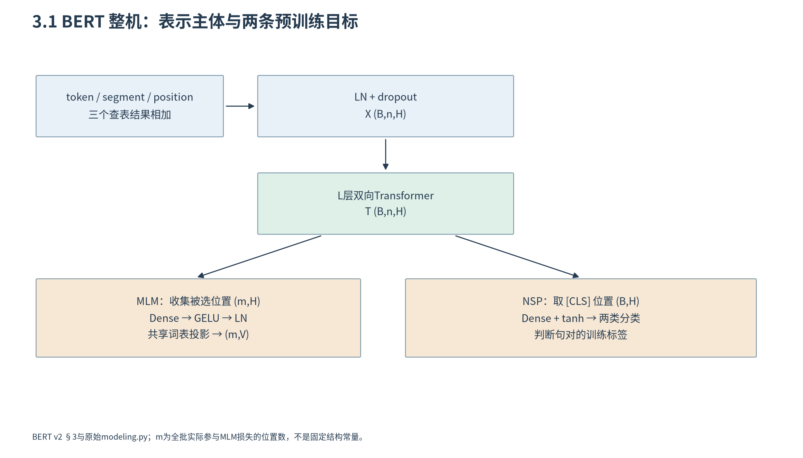
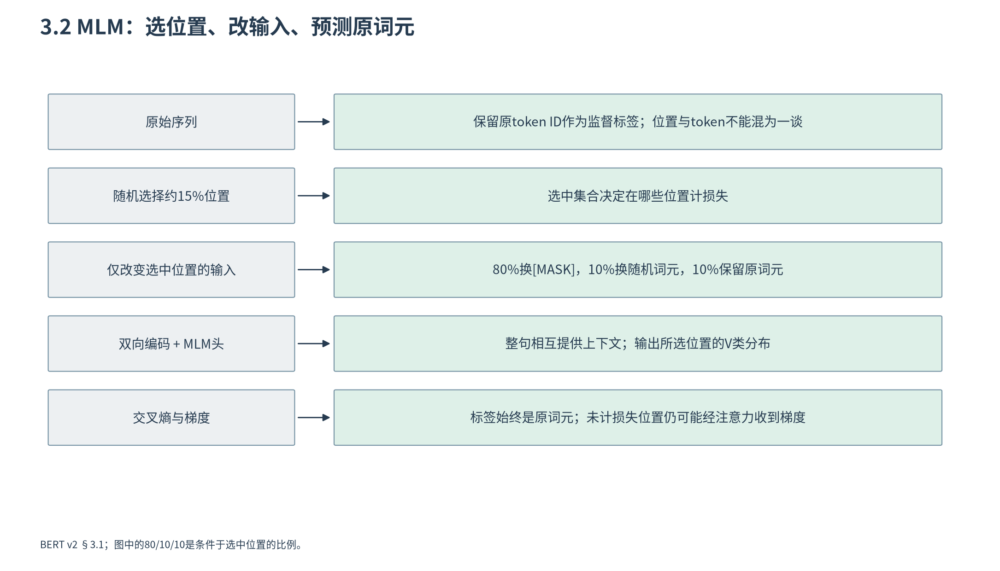
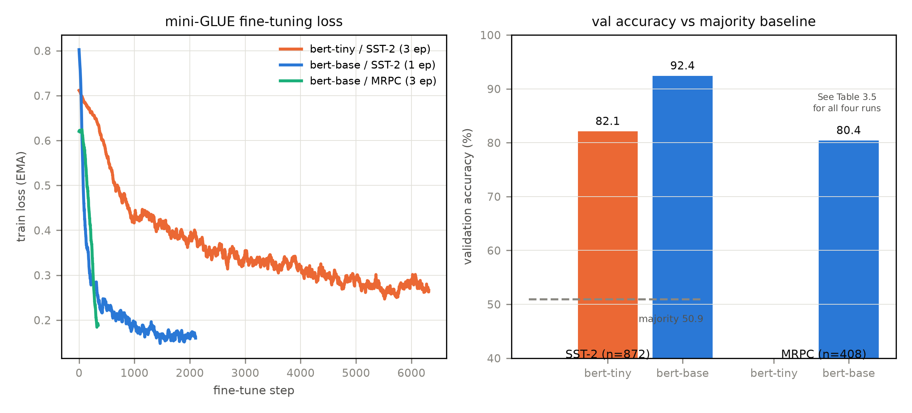

# 第 3 章 BERT：双向理解与微调生态

## 3.0 开篇：从全书到这里

第2章建立了文本到编号的入口，本章开始改变 Transformer 的学习目标。BERT 选择双向编码器，希望每个位置的表示能结合两侧上下文，适应分类、抽取与句对判断。困难在于：若所有答案都原样放在可见输入里，预测任务就可能退化成复制。掩码语言模型通过选择预测位置、扰动其中大部分输入，重新设计训练题目；它并不保证每一个预测位置都看不到原词。它与更早发表的 GPT-1 是不同路线，不是首个将 Transformer 与预训练结合的工作。

本章要回答三个问题：这台机器与 Book1 那台双塔翻译机是什么关系（主体继承编码器，输入和任务头另作调整）；预训练目标为什么是「遮词填空 + 判断句对」这两个任务；「预训练一次、微调 N 次」在理解任务中怎样实现。我们会亲手在两个 GLUE 任务上微调一个预训练好的 BERT，并记录实际成绩——这是全书第一次接触「别人的预训练权重」，也是第 11 章对拍官方 GPT-2 权重的预演。

到本章结束，理解侧的预训练范式就介绍完整了。但另一半还没讲：原版 BERT 没有按自回归生成接口训练，生成侧的另一半塔如何独立成塔、如何在不微调的情况下使用，是下一章介绍 GPT 时要讨论的问题；本章还会留下一个疑问——BERT 的第二个预训练任务，后来得到了不同的实验评价。

> **最小背景栏**
> - **Book1 已学**：编码器自注意力与三种注意力角色（Book1 第 4 章表 4.2——Q/K/V 来源与掩码列）；mask 全景表（Book1 第 7 章表 7.1：编码器自注意力只贴填充掩码，因果掩码只属于解码器）；post-LN 与训练配方（Book1 第 6、8 章）。本章一律指回，不再重教。
> - **本册已学**：ELMo 的特征拼接用法与 ULMFiT 的微调配方（第 1 章）；WordPiece 子词与 `##` 记号（第 2 章 2.5 节）。
> - **本章新增的最小背景**：GLUE（General Language Understanding Evaluation，通用语言理解评测基准）——九项自然语言理解任务的合集；BERT 的表格平均剔除 WNLI 后列八项（Wang et al., ICLR 2019），这八项任务规模约从 2.5k 到 392k 训练样本不等，是「理解侧」模型的标准考场【证据等级：官方论文 Wang et al. 2019】。

## 3.1 在整机中定位：双向编码器独立承担表示学习

先回答第一个问题：**BERT 的主体沿用 Book1 的编码器，将它用于独立的表示学习。**论文用一句话概括主体架构："BERT's model architecture is a multi-layer bidirectional Transformer encoder based on the original implementation described in Vaswani et al. (2017)"——基于 2017 原典（tensor2tensor 实现）的多层双向 Transformer 编码器【证据等级：官方论文 1810.04805v2 §3】。主要组件仍是多头注意力、FFN、post-LN与残差；学习式位置、段嵌入、GELU和预训练头则需要单独核对，不能把结构继承理解为所有细节原样照搬。所谓「多层」，就是把这个塔堆 $L$ 层。

「双向」（bidirectional）并不是什么新机制。回看 Book1 第 7 章的 mask 全景表：编码器自注意力**只有填充掩码、没有因果掩码**——每个位置可以关注输入中左右两侧的有效位置。这里的「双向」指不额外加入 Book1 第 7 章的下三角因果掩码；而 GPT 的「单向」需要额外加上因果掩码。论文 §3 明确说明了这一点："the BERT Transformer uses bidirectional self-attention, while the GPT Transformer uses constrained self-attention where every token can only attend to context to its left"——这一段专门比较注意力可见性；两个完整模型还存在目标、数据与组件细节差异【证据等级：官方论文 1810.04805v2 §3】。论文还在 §3 脚注里正式化了这套叫法：双向版在文献里就叫 **Transformer encoder**（编码器），只看左上下文的版本叫 **Transformer decoder**（解码器，「因为它能用于文本生成」）。这个脚注说明了本文的命名习惯，不能据此认定这一分类首次出现于 BERT【证据等级：官方论文 1810.04805v2 §3 脚注】。

从原 Transformer 的职责划分看，BERT 保留编码器，移除目标序列生成路径。两个文本段可以一起送进编码器，逐层进行跨段交互；这与编码器—解码器中的显式交叉注意力并非逐算子等价。第4章将转向因果单塔，第5章再比较两种单塔与编码器—解码器的成本和适用任务。

为什么要强调「双向」？第 1 章的 ELMo 已能根据上下文区分词义，但它的两个语言模型分别处理左、右上下文，再把表示交给下游模型组合。BERT 则让两侧信息在每一层内部交互。例如，理解「bank」时，ELMo 的下游网络可以综合两侧线索；BERT 还允许这些线索在编码器中反复影响彼此，而不只在两条方向路径的出口相遇。论文 §5.1 讨论另训一对左到右、右到左模型的替代方案，提出额外计算、问答条件可见性与交互深度三点顾虑。作者所说的「两倍」计算成本针对该替代配置，不是任何 ELMo 与 BERT 的实测成本比；右到左模型看不到问题，也以问题放在文章前面的布局为前提，不能泛化为 ELMo 无法做问答【证据等级：官方论文 1810.04805v2 §5.1】。

先用整体示意图了解模型结构（图 3.1）：一段文本（或句对）切成 WordPiece 词元序列进三路嵌入，相加后过 $L$ 层双向编码器，出口分两个头——每个位置的隐向量 $T_i$ 接「遮词填空」头，首个位置 [CLS] 的隐向量接「句对判断」头。两个头分别对应两个预训练目标，接下来两节会分别介绍。

**图 3.1** BERT 整机架构与两处预训练头（自绘重制，架构引 arXiv:1810.04805v2 Fig.1/Fig.2 的框线结构；形状标注为本书叠加层；示意级）。输入是句对拼包 `[CLS] A [SEP] B [SEP]`（单句时 B 段缺省）；三路嵌入逐位置相加得 $(B,n,H)$；$L$ 层编码器的注意力图 $(B,A,n,n)$ 不贴因果掩码；出口两路——全部位置的 $T_i$ 供 MLM 头抽取有效预测位置、[CLS] 位置的 $C=T_0$ 供 NSP 头。图内 $m=|\mathcal M|$ 表示全批有效位置数，所以抽取后的形状是 $(m,H)$；表 3.2 则使用逐句填充到 $m_{\max}$ 的批处理表示，两种组织方式不要混用。【证据等级：官方论文 1810.04805v2 §3 + 官方源码 google-research/bert】

## 3.2 MLM：遮词填空，15% 与 80-10-10

了解整体结构后，先来看预训练目标。这里沿用 ELMo 的出发点：我们想要**双向**的上下文表示。你可能会问：直接把语言模型目标搬进编码器——每个位置据上下文预测下一个词——不行吗？不行，原因值得仔细分析：双向条件下每个词能「间接看见自己」，预测第 $i$ 个词时它就坐在输入里，多层网络只要学会「把输入原样传到输出」就能直接复制答案。论文原话：双向条件会 "allow each word to indirectly 'see itself'"（让每个词间接看见自己）【证据等级：官方论文 1810.04805v2 §3.1】。这说明不能把普通自回归目标原封不动地放到全可见输入上。概率序列可以按不同顺序分解；这里需要的是破除「所有目标都可原样复制」这条捷径；后面的混合替换会有意保留一小部分原词。

由此得到一个直接的办法：**先选出要预测的位置，再扰动其中大部分词元**。论文称之为掩码语言模型（masked language model，MLM），与完形填空（Cloze）的思路相近。它只在选中的位置计算重建损失，不要求重建整个输入。论文规定选取约 15% 的 WordPiece 位置；原版按子词选择，并不要求一个词的所有片段一起入选。假设 `hairy` 切成 `hair ##y`，两个片段都可成为候选，但这不表示它们必须同时入选，也不表示各位置独立做一次概率为 15% 的伯努利试验【证据等级：官方论文 1810.04805v2 §3.1/A.2】。

官方数据生成代码先排除 `[CLS]`、`[SEP]`，打乱候选位置，再无放回地选取。目标数量为 `min(max_predictions_per_seq, max(1, round(len(tokens)*0.15)))`，其中序列长度包含特殊词元，因此短序列、取整与数量上限都会使实际比例偏离 15%。脚本默认上限 20 适配 128 长度；512 长度时通常相应提高到约 76 或 80，须以数据生成配置为准。下文将这个逐序列上限记为 $m_{\max}$，它不是 BERT 架构常数。词元由第 2 章的 WordPiece 提供；论文概称词表 30,000，uncased checkpoint 实际为 30,522【证据等级：官方源码 create_pretraining_data.py，create_masked_lm_predictions；默认不启用后来加入的 whole-word masking】。

选中位置之后，关键在于怎样进行**三段式替换**。对每个被选中的位置，按以下概率进行替换：80% 换成特殊词元 `[MASK]`；10% 换成词表里随机的词；10% 保持原词不动；随机抽出的词也可能恰好等于原词，所以实际发生改变的比例不必精确等于 90%。无论如何替换，监督标签始终是原词。论文用未展开子词细节的句子说明：`my dog is hairy`，若 `hairy` 被选中，它有八成变成 `my dog is [MASK]`，一成变成 `my dog is apple`，一成原样保留【证据等级：官方论文 1810.04805v2 §3.1】。为什么不干脆 100% 换 `[MASK]`？因为 `[MASK]` 有一个需要注意的特点：**原论文的常规下游微调输入通常不含它**。预训练经常见到 `[MASK]`，下游任务却不见，这就是训练-推理失配（预训练/微调分布不一致）。论文附录 A.1 的机制解释值得逐字读：编码器「不知道哪些词会被要求预测、哪些被换成了随机词，所以它被迫为每一个输入词元维持分布式的上下文表示」，而 10% 保留原词的目的，是「把表示往实际观测到的词上偏置」【证据等级：官方论文 1810.04805v2 A.1，直引】。论文也计算了随机替换的代价：只占全部词元的 $15\%\times10\%=1.5\%$，「似乎不损害语言理解能力」。

这个设计到底值不值？附录 C.2 的 Table 8 比较六种替换比例，在 MNLI 微调、NER 微调、NER 取特征三种设置中观察差异。标准 80-10-10 与全 `[MASK]` 的 MNLI 分别为 84.2、84.3，NER 微调分别为 95.4、94.9，NER 固定特征分别为 94.9、94.0。全 `[MASK]` 对固定特征用法的影响在这组比较中更大，但不能据此说其余改法完全不掉点：例如全随机替换的 MNLI 为 83.6。这张表支持的是所测条件下的比较，不是任何任务都对替换策略不敏感【证据等级：官方论文 1810.04805v2 Table 8】。

原因可以这样理解：微调时模型有机会重新适应输入分布，缓解了对这项设计的依赖；而取特征的用法冻结编码器、不做微调，在没有 `[MASK]` 的下游输入上直接使用预训练得到的表示，因此更能体现这项设计的作用。三段式替换是为了让表示适用于不含 `[MASK]` 的输入。

MLM 的损失只在选中的位置读出，但它通过注意力更新整台编码器。先约定：批大小 $B$、序列长 $n$、隐宽 $H$、词表 $V$；每张嵌入表按“编号行、特征列”存储，词表为 $E_{\rm tok}\in\mathbb R^{V\times H}$。原始编号记为 $x$，扰动后的编号记为 $\tilde x$；段编号 $s$、位置编号 $p$ 都按位置提供，三者形状均为 $(B,n)$。查表后形状同为 $(B,n,H)$，相加得到：

$$\tilde X = E_{\text{tok}}(\tilde x) + E_{\text{seg}}(s) + E_{\text{pos}}(p) \tag{3.1}$$

这表示：按扰动后的词元、所属文本段与位置，分别查三张表，同位置相加；结果再过嵌入层 LN 和 dropout，才送进编码器。段嵌入 $s$ 标记「这个词元属于句 A 还是句 B」（NSP 的配套，3.3 节展开）；位置嵌入是**学习式**查表、512 行（这里暂不展开，3.4 节会讨论相关成本）。MLM 的训练目标是（符号与形状见表 3.1）：

$$\mathcal L_{\rm MLM}=-\frac{1}{|\mathcal M|}\sum_{(b,i)\in\mathcal M}\log P_{b,i,x_{b,i}},\qquad
P_{b,i,:}=\operatorname{softmax}\!\left(g(T_{b,i})E_{\rm tok}^{\top}+b_{\rm vocab}\right).\tag{3.2}$$

**表 3.1 式 (3.2) 符号表**

| 符号 | 含义 | 形状 |
|---|---|---|
| $\mathcal{M}$ | 被选中预测的位置集合（每序列不超过配置上限 $m_{\max}$） | 全批有效预测位置的 $(b,i)$ 索引 |
| $\tilde{X}$ | 扰动输入的三路嵌入之和；经 LN/dropout 后送入编码器，输出为 $T$ | $(B,n,H)$ |
| $T_i$ | 第 $i$ 个位置的最终隐向量 | $(B,H)$ |
| $g(\cdot)$ | MLM 头逐位置变换：dense $H{\times}H$ + GELU + LN | 单个向量 $(H)\to(H)$，批量维度不变 |
| $b_{\rm vocab}$ | 仅输出侧使用的词表偏置 | $(V)$ |
| $E_{\text{tok}}$ | 输入词元嵌入矩阵（与输出共享，见 3.5 节） | $(V,H)$，$V=30522$；读出时转置 |

用人话说式 (3.2)：被选位置的隐向量先过一层小变换，再乘上**输入侧那张嵌入矩阵的转置**得到对全部词表的打分，softmax 后与原词元算交叉熵——只对被选的有效位置计损失，其余位置不直接计入词表预测损失，但可通过被选位置的注意力路径接收梯度。逐站形状流转见表 3.2（对照图 3.2 走一遍数据流）。

**图 3.2** MLM 的选词-替换-预测流程（自绘；示例句与三段式比例引 arXiv:1810.04805v2 §3.1/A.1；示意级）。选词发生在 WordPiece 分词之后，比例约 15%；对每个选中位置进行三选一替换；编码后只读出这些位置，填充式批处理形状为 $(B,m_{\max},H)$，词表打分为 $(B,m_{\max},V)$。【证据等级：官方论文 1810.04805v2 §3.1 + 官方源码 google-research/bert】

**表 3.2 MLM 头的形状流转表**（BASE 档；$B$=批、$n$=序列长、$H$=768、$V$=30522）

| 步骤 | 运算 | 输入形状 | 输出形状 | 说明 |
|---|---|---|---|---|
| 1 | 三路嵌入相加 + LN + dropout（式 3.1） | ids $(B,n)$ / 段 $(B,n)$ / 位置 $(B,n)$ | $(B,n,H)$ | 逐位置查表相加 |
| 2 | $L$ 层双向编码器 | $(B,n,H)$ | $(B,n,H)$ | 注意力图 $(B,A,n,n)$，无因果掩码 |
| 3 | gather 被选位置 $\mathcal{M}$ | $(B,n,H)$ + 下标 $(B,m_{\max})$ | $(B,m_{\max},H)$ | 不足上限的槽位填充，以权重 0 排除 |
| 4 | 变换 $g$：dense + GELU + LN | $(B,m_{\max},H)$ | $(B,m_{\max},H)$ | 常规下游分类不再使用该变换 |
| 5 | 绑定解码 $E_{\text{tok}}{}^{\top}$ + 偏置 | $(B,m_{\max},H)\cdot(H,V)$ | $(B,m_{\max},V)$ | 与输入共用权重，另加 $(V)$ 偏置 |
| 6 | 与原词元算交叉熵并按有效权重平均 | $(B,m_{\max},V)$ vs $(B,m_{\max})$ | 标量 | 式 (3.2)，要求有效位置非空 |

出处：步骤 4-5 的结构与绑定关系【证据等级：官方源码 google-research/bert，run_pretraining.py 注释直引："The output weights are the same as the input embeddings, but there is an output-only bias for each token"】。

### 从一个被选位置追踪损失与梯度

假设输入是 `[CLS] 猫 喜欢 鱼 [SEP]`，位置3的“鱼”被选中并改为 `[MASK]`，词表头在该位置给“鱼”的概率为0.2，单项损失就是 $-\log0.2\approx1.609$。若另一个被选位置的正确概率为0.5，两项平均损失是约1.151。没有被选中的位置不进入这个平均，但“猫”“喜欢”的隐状态会影响被选位置的表示，因此其相关参数仍可以得到梯度。

更一般地，令选中位置的 logits 为 $z\in\mathbb R^V$，正确编号为 $r$，则

$$\ell=-z_r+\log\sum_{v=1}^Ve^{z_v},\qquad
\frac{\partial\ell}{\partial z_v}=P_v-\mathbf1[v=r].\tag{3.2a}$$

第一项要求提高正确词得分，第二项把其他候选的竞争纳入更新。经读出矩阵、变换头和注意力层反向传播，监督才从少量读出位置扩散到主体。10%的原词保留确实允许较容易的复制路径，但在没有出现 [MASK] 的位置，模型不能仅凭该位置的输入确定它是否被选中监督；整个混合目标同时包含需要上下文才能恢复的样本。不能把它描述为“每个预测位都已完全删除目标”。

实际张量为了批处理填充到 $m_{\max}$ 个预测位。设权重 $w_{b,j}\in\{0,1\}$ 标明第 $j$ 个槽是否有效，损失是 $\sum w\ell/\sum w$；填充位置不能计入分母。一个批次可能选中不同数量的词，先对每句平均再对句平均，与按全批有效 token 平均也不总相同。本章公式采用后一种，要求 $\sum w>0$。官方实现分母为 $\sum w+10^{-5}$，以防除零；因此它与理想平均有极小数值差别。全零权重时得到零损失，并不代表模型已经完成预测任务。

MLM 学习的是损坏上下文下的条件预测，并没有给出按从左到右顺序分解的整句联合概率。因而它的预测损失、因果LM的困惑度和下游准确率，需要分别解释，不能仅凭数值大小比较三个任务的难度。

MLM 的监督密度与因果语言模型不同：每批约 15% 的位置直接接受词表预测监督，而常规因果训练会监督各有效预测位置。不过，监督位置少不等于每步信息量必然按同一比例减少。附录 C.1 的 **Figure 5** 比较不同预训练步数的模型在微调后得到的 MNLI 开发集准确率：3 万步时 LTR 为 79.4、MLM 为 78.6；10 万步时分别为 80.3、80.5；100 万步时为 82.2、84.4。这是下游准确率随预训练步数的变化，不是预训练损失曲线，也不是逐 FLOP 严格对齐的计算比较。两条路线的模型深度没有随横轴改变，不能称为「步数换深度」；它说明训练预算会影响我们对目标函数的评价，为第 8 章进一步区分步数、数据量与计算量作准备【证据等级：官方论文 1810.04805v2 Appendix C.1，Figure 5；LaTeX 图源的绘图坐标】。

## 3.3 NSP：句对判断及其局限

遮词填空让模型学会了「看上下文补洞」，但第 1 章埋下的问题还剩一半：问答、蕴含这些下游任务的核心是理解**两段文本的关系**，而逐词预测没有单独给整对文本提供一个关系标签；它仍可能通过上下文学习跨段联系。BERT 的第二个预训练目标就是为此定制的：下一句预测（Next Sentence Prediction，NSP）。训练样本的构造一句话讲完：取两个文本段 A 和 B，一半概率 B 真的是 A 的后继（标签 IsNext），一半概率 B 是从语料里随机抽的（标签 NotNext），模型判断是哪种【证据等级：官方论文 1810.04805v2 §3.1】。

结合源码，可以更具体地理解样本怎样构造。官方数据生成脚本里，每个训练实例带一个布尔字段 `is_random_next`——B 段是否被随机句换过，训练标签就由它直接映射（`next_sentence_label = 1 if instance.is_random_next else 0`）；脚本还有一个细节参数 `short_seq_prob=0.1`：以一成概率抽取较短的目标长度，使预训练也遇到短序列，减少与下游短输入的长度失配【证据等级：官方源码 google-research/bert，create_pretraining_data.py】。这里需要澄清二手资料中一个常见的误解：论文里所有的「sentence」**不是语言学句子**，而是「任意连续文本跨度」——通常远长于一个单句，也可能更短，512 长度配置下，A、B 正文合计至多 509 词元，另为 `[CLS]` 和两个 `[SEP]` 留出三个位置【证据等级：官方论文 1810.04805v2 §3.2/A.2；官方 create_pretraining_data.py 的 max_num_tokens 配置】。NSP 判断的是按构造规则得到的「段对」关系，不要求恰好两句。源码在当前片段只有一句时也会强制走随机 B 分支，所以实际样本不必精确各占一半；随机 B 通常取自其他文档，但这既不保证语义无关，也不能把标签理解为人工判断的语义真值。论文 A.1 的示例可以直接当小算例：正例 `[CLS] the man went to [MASK] store [SEP] he bought a gallon [MASK] milk [SEP]` 标 IsNext；负例把 B 段换成 `penguin [MASK] are flight ##less birds`，标 NotNext——顺带展示了 WordPiece 的 `##less` 续接记号（与第 2 章 2.5 节的讲解对应）。

输入怎么打包、输出从哪读，图 3.1 已经画了：A、B 拼成一条序列 `[CLS] A [SEP] B [SEP]`，段嵌入（式 3.1 的 $E_{\text{seg}}$，A 段全 0、B 段全 1）告诉模型界线在哪；序列首位恒为 `[CLS]`，它的最终隐向量 $C$ 就是整条序列的聚合表示。先将原始首位表示记为 $C=T_0$。它经过 pooler 的 dense 与 tanh 得到 $C_{\rm pool}$，再经过另一个线性层产生两个类别的 logits：

$$C_{\rm pool}=\tanh(CW_p+b_p),\qquad q=\operatorname{softmax}(C_{\rm pool}W_n+b_n),\qquad
\mathcal L_{\rm NSP}=-\frac1B\sum_{b=1}^B\log q_{b,y_b}.\tag{3.3}$$

这里 $C,C_{\rm pool}$ 均为 $(B,H)$，$W_p$ 为 $(H,H)$、$b_p$ 为 $(H)$，$W_n$ 为 $(H,2)$、$b_n$ 为 $(2)$，$q$ 为 $(B,2)$，$y$ 为 $(B)$ 的标签编号。用人话说：先把首位表示变换为同宽的池化向量，再判断段对类别；pooler 没有把 $H$ 压缩成 2，二分类投影才做这一步。MLM 按有效预测位置平均，NSP 按样本平均，两者不能先混在同一个分母下。总损失是两个目标的平均负对数似然**之和**：$\mathcal{L}=\mathcal{L}_{\text{MLM}}+\mathcal{L}_{\text{NSP}}$【证据等级：官方论文 1810.04805v2 A.2】。

NSP 有多有效？论文 Table 5 的消融说：去掉它，QNLI 从 88.4 掉到 84.9，MNLI、SQuAD 的成绩也明显下降【证据等级：官方论文 1810.04805v2 Table 5】——支持 NSP 在这组训练与评测条件下有帮助，不能据此断定任何预训练配置都必须包含它。

但同一篇论文里还有两条值得注意的脚注。其一，NSP 准确率达到 **97%–98%**；准确率接近饱和值得进一步检查，但它只看预测类别，无法单独决定交叉熵与梯度还剩多少。其二，作者提醒，未经下游训练的 $C$ 不宜直接视为通用句义表示：它学到的首先是服务于预训练任务的特征。这是对表示用途的限制，不是说 `[CLS]` 无法成为任何句级任务的输入【证据等级：官方论文 1810.04805v2 §3.1 脚注】。第 6 章将结合 RoBERTa 重审 NSP：那里的训练目标、文档打包和长度配置需要一起辨认，不能把涉及多项变化的结果简化成唯一由「删去 NSP」造成的增益。

## 3.4 整机与账本：两档、参数复算与语料

两个目标介绍完毕，现在回到整体结构。论文对外只发布两档配置，记号 $L$（层数）、$H$（隐层宽度）、$A$（头数）：BERT$_{\text{BASE}}$ = $L12$/$H768$/$A12$，BERT$_{\text{LARGE}}$ = $L24$/$H1024$/$A16$，FFN 宽度恒为 $4H$（脚注明文）【证据等级：官方论文 1810.04805v2 §3】。注意是**两档**——你日后在 HF 上看到的 tiny/mini/small/medium 是 Google 在官方仓库 2020 年 3 月更新中公布的缩小版家族（对应 Turc 等人 2019 年研究；本章借用一档，见 3.6 节），不属于 BERT 原论文的两档配置。两档都保持每头 64 维（$H/A=64$），与 2017 原典的 $d_k=64$ 一致——这是观察到的设计惯例，不是论文写下的规则。BASE 为什么是这个尺寸？论文说得直白："BERT$_{\text{BASE}}$ was chosen to have the same model size as OpenAI GPT for comparison purposes"——**刻意与 GPT 同尺寸**，以减少规模差异；数据与目标等仍不同，不能据此单独归因于双向【证据等级：官方论文 1810.04805v2 §3】。

参数量论文自报 110M/340M。沿用 Book1 第 2 章的逐张量计数方法复算（表 3.3）。单层的账你应当已经很熟：QKVO 四个投影各 $H^2+H$、FFN 两个矩阵共 $8H^2$、偏置共 $5H$、两枚 LN——BASE 每层 7,087,872。请留意这个数字：下一章 GPT-2 124M 的每个块的参数量**同样是 7,087,872**——相同参数数量不代表相同块：掩码和归一化位置不增加参数，却改变计算；嵌入与训练目标也不同，第 4 章的差异清单会继续分析这些变化。

**表 3.3 两档主体参数逐张量复算**（复算基于 HF bert-{base,large}-uncased 的 config；vocab=30522、位置表 512、段表 2）【证据等级：config/源码 + 本书算术复算，2026-10】

| 分项 | BASE (12×768) | LARGE (24×1024) |
|---|---|---|
| 词嵌入 $30522\times H$ | 23,440,896 | 31,254,528 |
| 位置嵌入 $512\times H$ | 393,216 | 524,288 |
| 段嵌入 $2\times H$ + 嵌入层 LN | 3,072 | 4,096 |
| 单层（QKVO + FFN + 两枚 LN） | 7,087,872 | 12,596,224 |
| 全部 $L$ 层 | 85,054,464 | 302,309,376 |
| pooler（主体保留的池化层） | 590,592 | 1,049,600 |
| **复算合计** | **109,482,240 ≈ 109.5M** | **335,141,888 ≈ 335.1M** |
| 论文自报 | 110M | 340M |

表 3.3 统计的是含 pooler 的 `BertModel`，不含 MLM 变换与词表偏置，也不含 NSP 最后的二分类层。BASE 的 109.5M 与 LARGE 的 335.1M，按两位有效数字可分别写成 110M 与 340M；不能因为 335.1 不等于 340，就断言存在约 5M 个找不到的参数。本章微调所用 BASE 主体的参数数目为 109,482,240，与这张表一致。

> **【考据框】精确计数、共享参数与论文约数**
> 若统计完整预训练模型，还要在表 3.3 之上增加 MLM 的 $H^2+3H+V$ 个参数，以及 NSP 的 $2H+2$ 个参数，得到 BASE **110,106,428**、LARGE **336,226,108**。MLM 解码权重与输入词嵌入共享，不能再加一次 $VH$。原论文的 110M/340M 是约数，单凭约数无法辨认它是否包含这些任务头；引用精确值时必须写清计数边界。词表同理：正文概称 30,000，uncased checkpoint 的实际配置为 30,522【证据等级：官方论文 §3/§3.2；官方 modeling.py、run_pretraining.py；本轮局部参数复算】。

模型结构确定后，用什么训练？先看语料：BooksCorpus（8 亿词，小说语料）+ 英文 Wikipedia（25 亿词，只抽正文段落、忽略列表表格标题），合计约 33 亿词【证据等级：官方论文 1810.04805v2 §3.1】。其中一项重要选择是：必须用**文档级**语料而非打乱句序的句子级语料（点名反例 Billion Word Benchmark），因为 NSP 的段对与 MLM 的长「句子」都依赖文档连续结构——这也是第 6 章重新审视 NSP 时要讨论的问题之一。两处注记：BooksCorpus 的历史上存在版权争议，这里只作简要说明；GPT 当年只用 BooksCorpus 8 亿词，BERT 的语料约是它的 4 倍——这是一个容易被忽视的对照变量【证据等级：官方论文 1810.04805v2 A.4】。

再看训练配方：论文先以批256、长512概括每批约128,000词元（精确乘积为131,072），并给出100万步、约40遍的概括；但实际90%的步长128、10%长512，按该调度累计 $256\times(900000\times128+100000\times512)=42,598,400,000$ 个序列位置，而不是 131.1B；位置预算还包含特殊词元及可能的填充。词与WordPiece也不是同一单位，因此“40遍”应保留为论文概括，不能当作此混合长度配置的精确复算；Adam 学习率 1e-4、前 1 万步线性 warmup 后线性衰减，全层 dropout 0.1，GELU（Gaussian Error Linear Unit）激活；架构上原样沿用原典 post-LN——warmup继续用于这份训练配方；下一章再分析归一化位置与稳定性的关系【证据等级：官方论文 1810.04805v2 A.2】。

配方中还有降低成本的做法，也涉及位置嵌入的训练：注意力分数与加权求和部分随序列长度呈平方增长，所以 **90% 的步使用 128 长度配置、最后 10% 使用 512**。这不表示整层所有运算都按平方增长。后期长输入使位置表后 384 行有机会通过查表路径接受训练，但实际样本长短不同，也不保证各行见到同样多的数据【证据等级：官方论文 1810.04805v2 A.2】。BERT 的学习式位置表只有 512 行，未经修改不能直接索引第 513 个位置；这是一条输入接口边界，与模型在已有位置范围内泛化得好不好是两件事。Book1 第 5、9 章已经区分过查表范围、训练长度与长度泛化，不能把其中一种实验的失败推广为「学习式位置表示只会训练过的长度」。下一章 GPT-2 把可索引位置增至 1024；本册沿 Book1 的 F6 线索记录这项变化，不展开后续长上下文改造。

最后是算力账，也是 Book1 第 1 章并行性讨论（F3）在预训练中的一个具体实例：BASE 用 4 台 Cloud TPU（共 16 块芯片）、LARGE 用 16 台（共 64 块），**每个模型的预训练 4 天完成**【证据等级：官方论文 1810.04805v2 A.2】。放回第 1 章的谱系，这些数字展示了无标注训练可以达到的规模，但不同年代的模型、硬件和数据单位不一致，不能把各自的速度纪录串成等条件的效率比较，也不能把论文概述的「40 遍」当成混合长度调度的精确词数账。而下游微调的成本低得多：论文全部微调实验**单块 Cloud TPU 至多 1 小时**（GPU 数小时），SQuAD 约 30 分钟到 dev F1 91.0【证据等级：官方论文 1810.04805v2 §3.2】。同一个预训练检查点可以供多个下游任务复用，之后各次微调的成本相对较低；这不包括研究阶段探索多份预训练配置的成本。这两个数字体现了两阶段方法的成本优势。顺带一笔：论文的尺寸消融（Table 6）从 $L3$ 加到 $L24$、困惑度（perplexity，PPL）与下游精度同向改善，自称「首个令人信服地证明 scaling 到极端规模在小数据任务上也带来大收益的工作」【证据等级：官方论文 1810.04805v2 §5.2】——这些设置中规模增大与成绩改善相伴；第 7、8 章将进一步研究规律的适用范围与预算条件。

## 3.5 用法生态：四种任务接口与固定特征用法

预训练好的 BERT 是一台「理解机器」，但下游任务五花八门——既有 GLUE 的单句情感与句对释义，也有 SQuAD 的问答抽取、SWAG 的多选常识。逐个改架构吗？恰恰相反，论文的关键论断是**主体计算结构可以保留，按任务改变输入格式与输出头**："Fine-tuning is straightforward since the self-attention mechanism in the Transformer allows BERT to model many downstream tasks—whether they involve single text or text pairs—by swapping out the appropriate inputs and outputs."（自注意力让 BERT 可以通过调整输入输出接法适配许多下游任务）【证据等级：官方论文 1810.04805v2 §3.2，直引】。输入侧的格式在预训练时已经使用过——句对任务直接用 NSP 的段对拼包 `[CLS] A [SEP] B [SEP]`，单句退化为 B 段缺省的「text-∅ 对」。输出侧有四种接法，每种需要新增的参数都很少：

**接法一：[CLS] 分类头。**单句或句对分类取首位表示，接一个新矩阵 $W\in\mathbb R^{K\times H}$，其中 $K$ 为标签数。先按论文的简写直接用 $C\in\mathbb R^H$，省略偏置，BASE 二分类需要 $2\times768=1536$ 个新参数。对标签为 $r$ 的单个样本，最小化的交叉熵应为：

$$\ell_{\rm cls}=-\log\left(\operatorname{softmax}(CW^{\top})\right)_r. \tag{3.4}$$

用人话说：让正确类别的概率升高，损失就会下降；批量计算时从 $(B,H)$ 得到 $(B,K)$ 打分，再对样本平均。论文该处写的是对数 softmax，若称为需要最小化的损失，就必须补上负号并取真实标签分量。官方分类代码实际先取 $C_{\rm pool}$，过 dropout 后接带偏置的分类层，所以新参数为 $KH+K$，二分类即 1538；主体中的 pooler 不是新加的分类层。GLUE 的 STS-B 则是相似度回归，需用标量读出与回归损失，不能套用这条类别交叉熵。

**接法二：起止向量。**抽取式问答（SQuAD）把问题放 A 段、文章放 B 段，只新增两个向量 $S,E\in\mathbb{R}^H$：词元 $i$ 作为答案起点的概率是

$$P_i = \frac{e^{S\cdot T_i}}{\sum_{j} e^{S\cdot T_j}} \tag{3.5}$$

（终点同理；单个样本的 $S,E,T_i$ 均为 $(H)$，各位置概率组成 $(n)$ 向量，批量为 $(B,n)$；训练对真实起止位置计算损失，解码在文章中的有效候选里比较 $S\cdot T_i+E\cdot T_j$，要求 $j\ge i$，官方代码还限制最大答案长度）【证据等级：官方论文 1810.04805v2 §4.2】。这表示：学两个「探针」向量，一个问「答案从这开始吗」、一个问「到这结束吗」。SQuAD 2.0 的无答案问题把 `[CLS]` 当作起止重合的空片段，其得分为 $s_{\rm null}=S\cdot C+E\cdot C$。只有最佳非空片段得分超过 $s_{\rm null}+\tau$ 才输出答案，阈值 $\tau$ 用开发集选择；不是简单把所有跨度取一次最大值就结束【证据等级：官方论文 §4.3；run_squad.py】。

**接法三：多选打分。**SWAG 四选一：四个选项各拼一条序列，新向量 $u\in\mathbb R^H$ 与各序列的 $C_i$ 点积，得到四个标量后做 softmax（论文将这个向量记为 $V$，这里用 $u$ 避免与词表大小混淆）【证据等级：官方论文 1810.04805v2 §4.4】。

**接法四：逐词元标注。**命名实体识别（NER）给每个词（取 WordPiece 切分后的**首个子词**的 $T_i$）接分类层——预测发生在每个原词的首个子词位置，输出类别是实体标签；它与 MLM 都读取位置表示，但监督位置选择和类别空间不同【证据等级：官方论文 1810.04805v2 §5.3】。

这里需要仔细理解论文中的一个重要架构论断。传统句对模型（BiDAF、DecompAtt 那一代）是「分别编码两段、再接双向交叉注意力」的双塔+桥；BERT 的做法是把两段拼进**一个**序列、让自注意力全互见——"encoding a concatenated text pair with self-attention effectively includes bidirectional cross attention between two sentences"（用自注意力编码拼接的句对，事实上已包含两句之间的双向交叉注意力）【证据等级：官方论文 1810.04805v2 §3.2，直引】。这正是 F9「折叠」命题在理解侧的完整表述：**两段文本之间的信息交换，可以在同一张自注意力图中完成**。把注意力矩阵按 A、B 分成四块，两个对角块对应段内关系，两个非对角块对应跨段关系。不过，每个 query 对两段的全部可见 key 共同做一次 softmax；独立的自注意力与交叉注意力通常分别归一化，也可使用不同参数。因此这是一种交互能力与信息路径的对应，不是逐算子恒等。

> **【考据框】源码注释中的逐层交互**
> v2 的 LaTeX 源码中，`\eat` 隐去的一段文字进一步讨论了段内与跨段关系共处于自注意力中的做法，并以 BASE 问答的 12 层交互作说明。这能帮助理解作者当时的思路，但它不是成稿正文，更不能证明联合自注意力等于两个独立注意力算子的相加。该注释末尾对 GPT 跨段可见方向的描述还存在倒置，判断时应回到因果掩码：问题在前、文章在后时，前面的问题不能看后面的文章，而后面的文章可以看前面的问题【证据等级：1810.04805v2 bert.tex 注释段；成稿 §3.2；因果掩码定义】。

第五种用法是**基于特征**（feature-based）：与第 1 章 ELMo 的用法相近，冻结整个 BERT，抽取某几层激活，外面另接随机初始化的两层 BiLSTM 与分类层。这里并非沿用 MLM 头，而是保留预训练主体作为固定特征提取器。它适合需要额外任务结构、或希望预计算特征再进行多次实验的情形【证据等级：官方论文 1810.04805v2 §5.3】。CoNLL NER 的 Table 7 必须按模型档位与数据划分阅读：BASE 全量微调的 **Dev F1 为 96.4**，BASE 末四层拼接特征为 **96.1**，相差 **0.3**，与论文正文一致；LARGE 微调的 96.6 属于更大模型，不能拿它来判定上述比较算错。该表的 Test F1 又是另一列，BASE 为 92.4、LARGE 为 92.8；报告值按所选超参数平均五次随机重启。固定特征行的 91.0、94.9、95.6、96.1 都是开发集结果，依次对应词嵌入、最后一层、倒数第二层、末四层拼接。最后一层在此并非最好特征，可能与层间分工及预训练适配有关，但该表没有隔离出「过拟合」这一原因。两种用法有效，说明预训练表示既可以冻结使用，也可以继续微调。

这也回应 Book1 第 8 章的权重共享问题（F15）：常规分类微调不再使用 MLM 的变换 $g$、词表输出偏置和词表读出运算，但共享的词嵌入参数仍要留作输入查表，不能把它也当成「拆头后删掉的参数」。Book1 原典三处共用一张词表权重，BERT 的 MLM 则由输出读出与输入嵌入共用一张表；下一章 GPT-2 会继续使用这张共享权重来生成下一个词元。比较节省多少参数，必须先固定词表、宽度及哪些任务头计入统计。

了解这些用法后，再来看怎样解读成绩表——这是 Book1 第 9、10 章 BLEU 口径课的直接续篇。最常被引的「GLUE 82.1」有三处统计口径需要注意：**其一**，82.1 是 Table 1 的 BERT$_{\text{LARGE}}$ **测试集**平均，且**剔除了 WNLI**——论文写作时列举的已提交系统在 WNLI 上都未超过「恒预测多数类 65.1」的基线，BERT 干脆对 WNLI 恒预测多数类「以示对 GPT 公平」，论文平均因此与官方 GLUE 分数口径不同【证据等级：官方论文 1810.04805v2 Table 1 caption 与 Appendix B】。

**其二**，论文报告当时官方排行榜上的 LARGE 总分为 **80.5**，不只是往 82.1 里补回一个 WNLI 数字那么简单。原表把 MNLI 的 matched 与 mismatched 分列，LARGE 的九个显示数值相加为 738.7，除以 9 得到 82.077…，圆整为 82.1。官方 GLUE 则先在每项任务内部平均多个指标，再对九项任务平均：MNLI 的两个域合成一项，QQP、MRPC 合并 accuracy 与 F1，STS-B 合并 Pearson 与 Spearman，然后才与其他任务一起平均。论文表格没有列出这些指标的全部分量，所以不能仅凭该表与 WNLI 的 65.1 精确复算官方 80.5【证据等级：官方论文 1810.04805v2 Table 1、§4.1；GLUE 官方 FAQ 第 10 项】。

**其三**，Table 1 是「每个模型只做一次评测服务器提交」的成绩（脚注原话），对照行的 GPT 数字取自排行榜与 OpenAI 博客。指标口径也不同：QQP/MRPC 报 F1、STS-B 报 Spearman、CoLA 报 Matthews 相关系数，其余表列指标为 accuracy；原论文图注概括「其余为 accuracy」遗漏了 CoLA 这个例外；此处按 GLUE 原论文的任务指标定义标明。表 3.4 重排成绩单并注明口径。

**表 3.4 GLUE 测试集成绩重排**（引 arXiv:1810.04805v2 Table 1；列出原表八项任务，MNLI包含两个域的数值；末列照录原表汇总；评测服务器打分、每模型单次提交）【证据等级：官方论文 1810.04805v2 Table 1】

| 系统 | MNLI-m/mm | QQP | QNLI | SST-2 | CoLA | STS-B | MRPC | RTE | 原表平均（剔 WNLI） |
|---|---|---|---|---|---|---|---|---|---|
| 训练样本量 | 392k | 363k | 108k | 67k | 8.5k | 5.7k | 3.5k | 2.5k | — |
| Pre-OpenAI SOTA | 80.6/80.1 | 66.1 | 82.3 | 93.2 | 35.0 | 81.0 | 86.0 | 61.7 | 74.0 |
| BiLSTM+ELMo+Attn | 76.4/76.1 | 64.8 | 79.8 | 90.4 | 36.0 | 73.3 | 84.9 | 56.8 | 71.0 |
| OpenAI GPT | 82.1/81.4 | 70.3 | 87.4 | 91.3 | 45.4 | 80.0 | 82.3 | 56.0 | 75.1 |
| **BERT$_{\text{BASE}}$** | 84.6/83.4 | 71.2 | 90.5 | 93.5 | 52.1 | 85.8 | 88.9 | 66.4 | **79.6** |
| **BERT$_{\text{LARGE}}$** | **86.7/85.9** | **72.1** | **92.7** | **94.9** | **60.5** | **86.5** | **89.3** | **70.1** | **82.1** |

读表两件事。第一，BASE 对 GPT 的相近主体规模比较中，MNLI-m 高 2.5 点、QNLI 高 3.1 点、RTE 高 10.4 点，原表平均相差 4.5 点；数据规模和训练配方也不同，这不是双向机制的单变量增益。第二，RTE 只有约 2.5k 训练样本，LARGE 对 ELMo 的差距仍达 13.3 点，说明小型有标签数据集也可以从大规模预训练方案中获益。但不同任务、指标和基线同时变化，不能据此排出「数据越少，预训练兑换率越高」的规律。MRPC 的 3.5k 是原表概数，本章实验实际使用 3,668 条；我们保留两种出处，不揣测作者为何采用这个约数。

## 3.6 mini-GLUE 实验：亲手微调一次

讲完原理，现在动手实践。实验只有一个目标：把 3.5 节的「换头微调」在自己机器上完整走一遍，并立一条及格线——**先与多数类基线比较，再结合重复运行与验证集大小判断收益**，不能只看一个准确率。两个任务：SST-2（单句情感二分类，训练 67,349 条、验证 872 条）与 MRPC（句对释义二分类，3,668/408 条）【证据等级：config/源码，HF datasets-server 2026-10 查询】。先明确多数类基线：SST-2 训练集正类 55.8%（验证集 50.9%），MRPC 等同类 67.4%（验证集 68.4%）——MRPC「全猜等价」就有 68.4，需要超过的基线比 SST-2 高得多。

> **【借用框】datasets 与 GLUE 的加载和引用**
> 工具当黑盒：`load_dataset("nyu-mll/glue", "sst2")`（datasets 5.0.1；旧名 `"glue"` 重定向同仓库）。两条纪律随借用生效：①**许可**——GLUE 无统一许可（HF 卡片 license 标 "other"，条款随子任务原始数据集而异），按全书合规约定：数据落 `log/` 不入库不分发；②**引用**——卡片明文要求「用了 GLUE 请引用所用到的每个子任务数据集」，本书照办：SST-2 引 Socher et al. 2013，MRPC 引 Dolan & Brockett 2005，GLUE 引 Wang et al. 2019【证据等级：HF 数据集卡片 nyu-mll/glue，2026-10 查证】。算法拆解不在此展开，分词已在第 2 章讲透。

两个模型档：`bert-base-uncased`（109,482,240 编码器参数 + 新初始化分类头 1,538 个——加载后逐位复现表 3.3 的复算值，顺带对账一次）与 `bert-tiny`（$L2$/$H128$/$A2$，4.39M——Google 官方仓库 2020 年发布的缩小版家族中的快档，**不是论文的第三档**，本章借它当快档）。本章采用参考论文 §4.1 主要超参数的简化协议：batch 32、学习率 2e-5（论文搜索集 {5e-5, 4e-5, 3e-5, 2e-5} 的常用值）、默认 3 epochs、AdamW、截断 128、固定种子；表中的 BASE/SST-2 只跑 1 epoch。代码保持常数学习率，未加入官方分类脚本默认的 10% warmup，也未复刻全部优化器细节及开发集搜索，因此这是完成微调流程的教学实验，不是原论文分数的严格复现。代码在 code/ch03/glue_finetune.py（入口 `main()`，逐 epoch 评测在 `evaluate()`）。

**表 3.5 mini-GLUE 微调实测**（MPS，2026-10；协议见上文；本机口径）

| 格 | 任务 | 步数 | 计时秒数/步 | loss（首10→末10） | 内存采样最大值 | 验证准确率（逐 epoch，%） |
|---|---|---|---|---|---|---|
| fast | bert-tiny / SST-2 | 6,315 | 0.0087 | 0.702→0.257 | 171 MiB | 80.5 / 81.2 / **82.1** |
| fast | bert-tiny / MRPC | 345 | 0.011 | 0.674→0.574 | 171 MiB | 68.6 / 69.9 / **70.3** |
| full | bert-base / MRPC | 345 | 0.449 | 0.630→0.191 | 7.08 GiB | 四次同种子运行终点 **80.4 / 80.1 / 83.8 / 81.9**（逐 epoch 见正文） |
| full | bert-base / SST-2 | 2,105 | 0.44（无并发口径） | 0.692→0.146 | 7.08 GiB | **92.4**（1 epoch） |

【证据等级：本书历史实验（MPS，2026-10；原记录路径 log/book2-ch03/finetune_*.json）】。本轮保留这些既有成绩，没有重跑训练；当前工作区未找到原始四格日志，因此不把它们表述为本轮复测。计时从前三步之后开始，但包含其后的评测和循环开销，除以剩余训练步数；它不是纯训练算子的单步耗时。内存由后台约每 0.03 秒采样一次 `current_allocated_memory`，报告观测最大值，不保证捕获瞬时峰值。BASE/SST-2 的 0.44 来自无并发探针（0.436），成书时另一次并发运行记录为 0.53；两者不能混作同一次运行的完整时间与成绩。BASE/MRPC 的四个终点沿用原稿的四次同种子记录，文件名为 `finetune_base_mrpc{,_run1,_run2,_run3}.json`。这些记录支持报告波动，不能在缺少逐算子、数据顺序等对照时唯一归因于设备非确定性。

先读快档。bert-tiny 在 SST-2 上三 epoch 共 6,315 步、每步 8.7 毫秒（与调研探针互证【证据等级：本书实验（MPS，2026-10）】），用这个均摊数乘步数约为 55 秒，不能把它当成含下载、初始化在内的完整耗时：loss 从 0.702 降到 0.257，验证准确率 80.5→82.1——这台约 4.4M 参数的模型最终比多数类基线（50.9）高出约 31 个点：这说明预训练加微调的整体流程能得到明显高于该基线的结果；没有从零训练对照，不能独立量出预训练带来的增益。再看 MRPC 上的 bert-tiny：70.3 对基线 68.4，只高 2 个点——**及格线边缘**，在这次设置中收益较小；不能据此证明所有训练配方都无法改善该小模型。

full 档的两组结果则突出显示了运行波动的重要性。bert-base 的 SST-2：单 epoch 共 2,105 步、无并发口径每步约 0.44 秒（约 15 分钟），loss 从 0.692 压到 0.146，验证准确率 **92.4**——接近论文 Table 5 的 BASE 档 dev 准确率 92.7，但训练配方不同，不能称为复现到相同水平【证据等级：官方论文 1810.04805v2 Table 5】，一个 epoch 就到。

而 bert-base 的 MRPC，我们**同种子跑了四次**：76.7/80.6/80.4、76.0/82.1/80.1、76.0/80.6/83.8、76.2/80.9/81.9——终点 80.1 到 83.8，最好最差差 3.7 个点。种子没变、协议没变、代码没变，原稿报告的四次运行首 10 步平均 loss 四舍五入后同为 0.630，记录与设备非确定性累积相容，但并未隔离全部可能因素；408条验证集使差异表现为3.7点（一条样本 0.245 点，约相当于净答对数相差 15 条；两次运行可能在更多样本上互有对错，不能据此确定改变预测的样本总数）。这提示应采用类似的多次运行处置，但不是对论文不稳定机制的直接复现：BERT$_{\text{LARGE}}$ 在小数据集上「有时不稳定」，官方对策就是**多次随机重启选 dev 最优**【证据等级：官方论文 1810.04805v2 §4.1 与 A.3】；「训练不稳定」这条线索将在第 9 章继续讨论。综合这两组结果，可以得到一个判断：**这组小验证集实验中的单次差异，需要结合重复运行与样本级结果解释**——先立基线、再看方差、最后才谈「提升了几个点」。

MRPC 这组实验还让我们实际走过句对打包：脚本 `tokenize()` 将两段文本编码为 `[CLS] A [SEP] B [SEP]`，格式与 NSP 预训练输入相同，但分类标签已经换成释义关系。章末变式只将 segment 编号置零，用来观察段标记的作用；它既没有去掉某段文本，也没有改变预训练 NSP 目标，因此不能直接回答「NSP 是否有用」。微调读取表示时，HF 与 Google 原始 `run_classifier.py` 都采用 pooler 后接分类头；应把它们与论文简写式 (3.4) 区分，不能把 pooler 路径误称为 HF 独有改动。

> **【实现对照框】HF transformers 5.18.0 的 BERT 微调路径（非论文内容）**
> Google 原始 `run_classifier.py` 与 HF 的常见 BERT 路径均为主体（含 pooler）→ dropout →带偏置的分类投影；BASE 二分类在 HF 中为 `Linear(768,2)`，因而新头有1538个参数。也可以绕过 pooler 直接读取 `[CLS]`，但两种方案的差异依任务、初始化和训练而变；“只差零点几分”的断言缺少独立对照记录，不能作为普遍结论。这里的工具版本属于历史环境，运行时以实际安装和脚本接口为准。

**图3.3** mini-GLUE历史图：左侧是三组训练loss的EMA曲线（$\alpha=0.02$），右侧保留当时绘制的验证准确率。旧图没有画出tiny/MRPC柱与该任务多数类基线；BASE/MRPC上方原有“2 runs: 85.0 / 80.4”硬编码标注，其中85.0不受本章四次运行记录支持，现已移除该注释，改为指向表3.5。曲线、柱高及其余数据像素未变。四格结果与四次MRPC终点以表3.5和正文为准；缺少原始逐步日志，不能凭汇总值补画完整训练曲线。配套绘图代码只读取实际文件，具备原日志后可重新生成完整图。【证据等级：本书历史实验（MPS，2026-10）；原图与脚本核对，注释层修正】

表3.5保留了两种任务、两种模型的历史结果：base在SST-2上明显优于多数类基线，在MRPC上也有较大收益；tiny在MRPC上的差距很小。这里两个任务同为二分类，但数据量、验证集、难度与部分训练轮数共同变化，因此这四格不能证明“数据越少预训练收益占比越大”，也没有从零训练对照来直接测量预训练的独立贡献。它们真正教会我们的是完成微调流程、建立基线并报告运行波动。

## 3.7 版本考据：v1→v2，GLUE 的数字曾经不一样

本章引用的每个 BERT 数字都锚定 v2（2019-05-24），需要区分论文版本：v1（2018-10-11）到 v2 有**实质性数字与结构改动**——GLUE 成绩更新过（LARGE 平均 81.9→**82.1**、QNLI 91.1→92.7，GPT 对照行也随之变动）、主实验中独立的 NER 小节不再保留，NER 微调结果与既有的特征用法比较合并展示，同时加入 SQuAD 2.0 的主实验小节、措辞软化（"extremely large drops"→"large drops"）、Table 1 图注的 GPT 配置声明转入源码注释【证据等级：官方论文 1810.04805 v1/v2 LaTeX 源码逐字比对】。你在别处读到「BERT 平均 81.9」不是错，是 v1——但与 82.1 不可混用。这是 Book1 第 11 章「版本考古一课」（原论文七版本改数字删段落）的续篇，而 BERT 的改动恰好发生在**成绩单**上：连「模型考了多少分」都是版本敏感的。完整清单见考据框；引用纪律一句话：**凡引 GLUE/SQuAD 数字一律锚 v2，并引 v1 须双版本标注。**

> **【考据框】v1→v2 已实证差异清单**（LaTeX 源码逐文件比对；全部 {官方论文} 级）
> ① GLUE Table 1 数字更新（QNLI 与平均分，含 GPT 对照行）；② v1 主实验的 NER 节撤出，该部分结果与已有的特征比较并列于 v2 Table 7；v2 另列 SQuAD 2.0 实验；③ SQuAD Table 2 的 leaderboard 快照从 2018-10-08 换成 2018-12-10 并裁行；④ 特征表行名从 "Sum Last Four" 改为 "**Weighted** Sum Last Four"，同样的 95.9 成绩保留；行名细化本身不能证明 v2 才改用加权算法；⑤ 措辞软化与括号注释删除（微调不稳定现象两版都承认）；⑥ Table 1 caption 的 GPT 配置声明转入源码注释（引 GPT 配置须引 v2 正文 §3 或 v1 caption）。

## 3.8 本章小结

本章把双向编码器、MLM/NSP和下游接口连接起来。BERT复用 Transformer 的主要组件，通过损坏输入避免普通全可见预测的泄漏问题；微调时保留主体，改变输入打包和读出头。原论文的消融、成绩表与本章历史微调实践分别支持不同层面的判断，不能混作同一份因果证据。

**本章的结构判断**：一张可见性图告诉我们每个位置能获取什么信息，一个目标函数告诉我们哪些输出接受监督，任务头则决定怎样读出这些表示。三者要一起检查。微调只新增很小的头，但通常更新整个主体，计算和数据处理成本并不只发生在“两头”。

下一章转向因果单塔：GPT-1如何预训练并微调，GPT-2又如何探索用文本指定任务？第6章会回查NSP，把损失项、样本打包和训练预算分开比较。保持这些边界，才能理解同一设计为何在不同实验中得到不同评价。

> **后续连接**：第4章解释因果单塔，第5章解释显式交叉注意力，第12章在具体使用设定下比较三种架构；跨模态等条件输入交给Book5。

## 3.9 动手验证（本章代码与实验清单）

- 入口命令（fast 档；下列时长是历史 MPS 参考，不是当前设备保证）：`python "code/ch03/glue_finetune.py" --model tiny --task sst2 --epochs 3`
- full 档：`--model base --task mrpc --epochs 3`（约 2.5 分钟）、`--model base --task sst2 --epochs 1`（约 15 分钟）；图表重绘：`python "code/ch03/make_figs.py" --only 3`（需先有四格基准日志；图 3.1、3.2 的脚本版本为早期布局练习，与现行排版不同）
- 方差复跑：同一命令加 `--run-tag runN`（文件名带后缀防覆盖），同种子再跑几次 MRPC，检查终点是否及如何变化——表 3.5 四个终点即此法所得
- 预期产出：四格 JSON（含逐步 loss 曲线、逐 epoch 准确率、内存采样最大值）落在 `log/book2-ch03/`；准确率与多数类基线的对照打印在 stdout；重绘文件默认落 `log/book2-ch03/figures/`，可用 `BOOK2_FIGURE_OUTPUT_DIR` 指定输出目录；正式图不被默认覆盖
- 验收点：能否不看书画出图 3.2 的流程并说出 80-10-10 各自防什么；能否解释「双向 = 无因果掩码」与 F9 第一触点；能否以多数类基线、验证集规模和重复运行描述成绩，而不把历史 80% 阈值当成所有环境都必须达到的验收线；能否说出 82.1 与 80.5 各是哪种口径的平均
- 变式实验（选做，第 6 章预演）：改 `glue_finetune.py` 的 `tokenize()`，在保持两段文本、分隔符、截断和训练预算一致时，仅把segment编号置零，观察段标记的影响。此实验仍保留文本内容，且没有改变预训练目标，不能用来直接检验NSP是否有用
