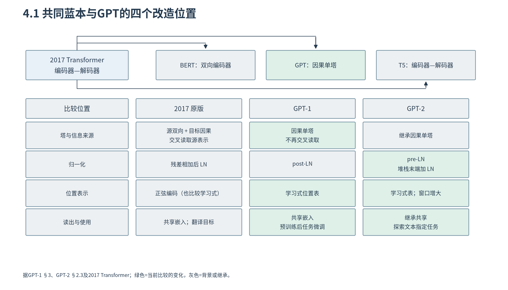
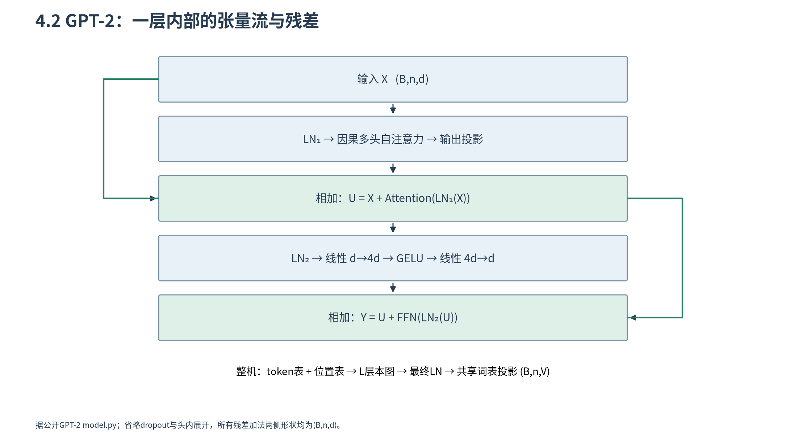
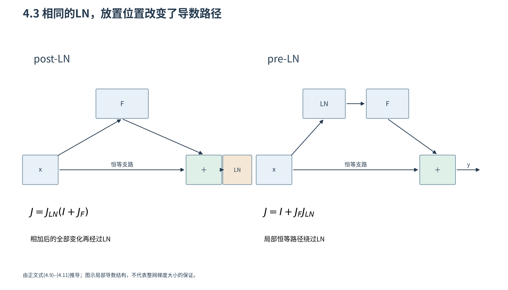
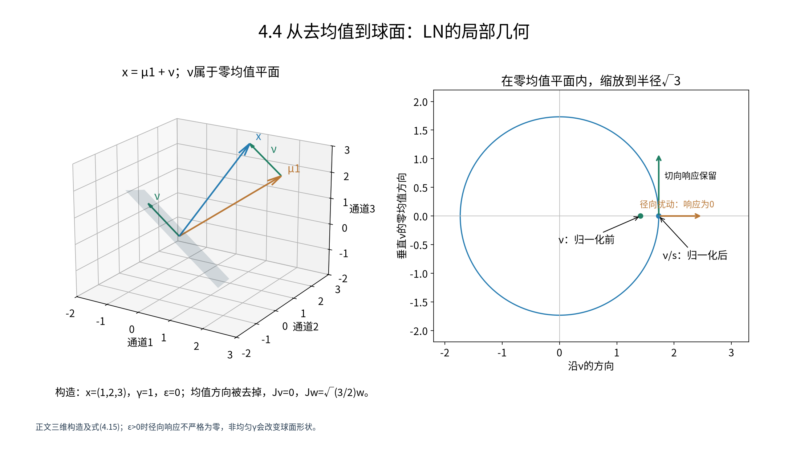
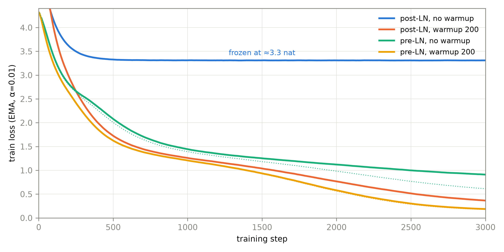
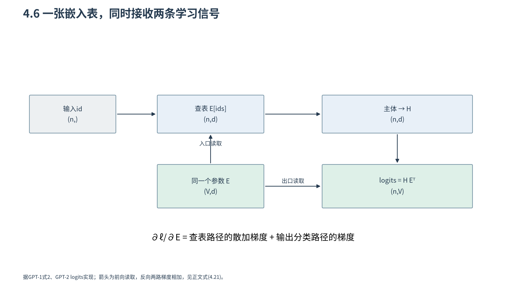

# 第4章　GPT-1/2：从翻译双塔到因果语言模型

## 4.0 从已经熟悉的 Transformer 出发

上一章讨论了 BERT：保留 Transformer 的编码器，让每个位置结合两侧上下文，再用遮盖预测等任务学习表示。本章转向另一条路线。假如我们首先要解决的是“根据已有文本继续生成”，那么模型不必先读一份完整的源句；它只需要把已经出现的 token 组织成上下文，预测下一个 token。**GPT 沿着这项任务重新组织 Transformer：采用因果单塔，并围绕它安排预训练、任务接口和训练配方。**

这里的章序是教学顺序。GPT-1 发表于2018年6月，早于同年10月的 BERT；它不是从 BERT 删除某些部件得到的后继。两者共享的是 Book1 已经建立的 Transformer 基础。图4.1把这份共同基础与本章路线放在一起：先看整台机器怎样变，再分别理解改动的理由。



图4.1的上部保留本册三条路线：BERT 使用双向编码器，GPT 使用因果单塔，T5 仍组织为编码器—解码器。本章展开的是中间一支。下部按照输入、主干、输出和使用方式比较2017 Transformer、GPT-1、GPT-2；绿色标出当前讨论的变化，灰色表示继承。图是依据原论文和公开实现制作的教学对照，不表示作者实际按图中的顺序修改过同一份代码。[G1，§3–4；G2，§2.3；G3]

我们仍然围绕旧章的四个位置展开：塔与交叉注意力、归一化、位置编码、输入输出嵌入。其中有新增、有替换，也有重要的继承。例如权重共享在原 Transformer 中已经存在，不能因为本章重新算它的账，就把它写成 GPT-2 的发明。改造清单的价值，是让读者知道一个选择在整机中承担什么职责。

到本章结束，我们应当能够从一串 token 走到词表概率，解释 GPT-1 如何接上有标签任务、GPT-2 如何尝试用文本指定任务，并读懂归一化对照实验究竟证明了什么。第8章的规模实验、第10章的 GPT-2 实现、第11章的权重对拍，都将复用这里的结构与判断方式。

> **阅读准备**：Book1 已讲过因果遮罩、自注意力与交叉注意力、FFN、残差、LayerNorm 和交叉熵；本章按需要唤醒这些结论，不重新教授整套 Transformer。统一记号：批大小 $B$，序列长 $n$，宽度 $d$，头数 $h$，每头宽度 $d_h=d/h$，层数 $L$，词表大小 $V$。数学分析局部通道时会明确省略批与位置轴；实现和整机表恢复完整形状。

## 4.1 GPT-1：先学预测文本，再适应具体任务

**GPT-1 把同一台因果 Transformer 用于两个阶段：先从无标注文本学习表示，再用任务标签调整这套表示。** 微调需要增加一个小输出头，有时还要改变输入的排列方式；主体网络也参与更新。它降低了下游任务从零学习语言表示的负担，却仍然需要每项任务的标注、微调和评测。理解这两阶段的联系，是看懂 GPT-2 为什么继续探索免微调使用方式的前提。

### 4.1.1 语言模型目标怎样提供训练信号

语言模型把每一个真实后继token都变成监督信号，让同一主体在大量文本上学习可迁移的表示。因果遮罩使训练可并行预测各位置，但生成仍需逐步获得未知的后继；“预训练是预测文本”并不意味着训练与生成的数据可见性相同。

设语料中的 token 为 $u_1,\ldots,u_T$，每个 $u_i$ 是 $0$ 到 $V-1$ 的整数。模型参数记为 $\theta$，可用上下文最多为 $k$ 个 token。GPT-1 论文最大化下列对数似然：

$$
\mathcal J_{\rm LM}(\theta)=\sum_i\log p_\theta(u_i\mid u_{\max(1,i-k)},\ldots,u_{i-1}).\tag{4.1}
$$

求和是把每次“用过去预测当前”的分数积累起来。实际优化器通常最小化它的负值，常再除以有效预测位置数。原论文把最大化的量写成 $L_1$；本章用 $\mathcal J$ 表示待最大化的对数似然、$\ell$ 表示待最小化的损失，避免同一个符号一会儿越大越好、一会儿越小越好。[G1，§3.1，式1]

把输入和标签真正排出来，这个任务就不抽象了。教学文本取“猫 喜欢 鱼”，并暂把三个词视为三个 token。输入可以排成“起始符 猫 喜欢”，标签排成“猫 喜欢 鱼”。第一位置预测“猫”，第二位置已经读到“猫”，预测“喜欢”；第三位置读到“猫 喜欢”，预测“鱼”。所有位置可以在一次训练前向中计算，因为真实前缀已经给定；因果遮罩保证第一个位置不能偷看后面输入里的“猫”。生成时未来真实 token 不再可用，才需要逐步把预测接回输入。

这个简单任务同时训练了词嵌入、注意力、前馈网络与输出读出：为了预测“鱼”，模型必须从前缀提取有用信息。它没有被显式要求学语法、实体或情感；这些能力是否出现、能否迁移，是训练后需要检验的结果，不能直接由式(4.1)宣布。

GPT-1 的主体为12层、宽768、12头、FFN中间宽3072、上下文512的因果 Transformer。训练语料是含7000多本书的 BooksCorpus；分词使用40000次 BPE 合并，合并次数不等于最终词表大小。论文的预训练配方包括64条、每条512 token 的批次，100个 epoch，Adam 峰值学习率 $2.5\times10^{-4}$，前2000步 warmup，随后余弦衰减。大量连续文本使模型能学习跨句依赖；论文也讨论了句子被打乱的 One Billion Word 数据在这一点上的不足。这些是当时研究的训练条件，不是本章重新执行的训练。[G1，§4.1]

### 4.1.2 从词表预测到任务判断

微调的改造发生在读出端和训练目标：把词表预测换成任务所需的类别评分，再让任务梯度更新整个主体。因果塔的末端已经看过全部输入，因此适合作为句级任务的读出位置；这是一种训练得到的任务表示，并非预训练已为每种标签预留了坐标。

预训练读出的是词表概率；一个情感分类任务需要的则是类别概率。设一个输入实例经过网络后得到 $H\in\mathbb R^{B\times n\times d}$。取序列末端的表示 $H_{\rm end}\in\mathbb R^{B\times d}$，增加任务矩阵 $W_y\in\mathbb R^{d\times K}$，其中 $K$ 是类别数：

$$
P_y=\operatorname{softmax}(H_{\rm end}W_y),\qquad
\mathcal J_{\rm cls}=\sum_{(x,y)\in\mathcal D_{\rm task}}\log P_y(x)_{y}.\tag{4.2}
$$

矩阵乘法将 $(B,d)$ 变成 $(B,K)$；softmax 沿类别轴归一。为什么取末端？因为因果塔的末位置能读取前面全部输入，而首位置没有这个条件。末端表示不是天然的“情感向量”，它通过分类目标和主体参数的共同微调，学习携带任务所需的信息。[G1，§3.2，式3–4]

GPT-1 还在微调时保留一个辅助语言模型目标：

$$
\mathcal J_{\rm joint}=\mathcal J_{\rm cls}+\lambda\mathcal J_{\rm LM},\qquad\lambda=0.5.\tag{4.3}
$$

这里的 $\mathcal J_{\rm LM}$ 作用于任务数据中的文本，不是要求每一步重新遍历全部 BooksCorpus。它让表示在学习标签的同时继续承担文本预测，可能帮助迁移和收敛。两个目标共用主体参数；“只新增小头”不等于“只训练小头”。论文微调一般使用3个 epoch、批量32、学习率 $6.25\times10^{-5}$，线性衰减并在前0.2%的训练中 warmup。这与第1章 ULMFiT 的讨论衔接：预训练提供起点，怎样调整这个起点仍然重要。[G1，§3.2、§4.1]

### 4.1.3 输入接口如何容纳不同任务

一台因果塔只接收序列，但下游数据可能是一句文本、一个句对，或“文档—问题—候选答案”。GPT-1 没有为每种情况另造一套主体，而是把结构化输入排列成序列。所有格式都加入起始与结束标记，必要时加入分隔标记；图中的“起始/结束/分隔”是职责名称，不是现代聊天协议。[G1，Fig.1、§3.3]

|任务|送入主体的结构|怎样得到判断|
|---|---|---|
|单文本分类|起始、文本、结束|末端表示接 $K$ 类头|
|文本蕴含|起始、前提、分隔、假设、结束|末端读到了前提和假设，接蕴含分类头|
|相似度|A→B、B→A两种排列分别编码|两个末端向量逐元素相加，再接任务头|
|多选问答/常识推理|每个候选各拼一条“文档、问题、分隔、候选”|每条产生一个分数，在候选之间做 softmax|

相似度的处理尤其说明“接口”会改变可见关系：只编码 A→B 时，B 的位置能看 A，A 的位置却不能看 B。交换顺序再算一次，使两个方向都进入最终表示，但要付两次编码的成本。它不是把每层注意力改为双向。

对一个有3个候选的问题，暂时把候选轴合进批轴，输入为 $(3,n)$，编码为 $(3,n,d)$，取末端为 $(3,d)$，共同评分向量把它变成3个标量，最后只在这3个候选上归一。这个 softmax 与预训练的 $V$ 类词表 softmax 是不同的概率空间。这样展开后，读者就能看见改动发生在输入打包和输出头，主体仍是同一台因果 Transformer。

### 4.1.4 成绩与消融怎样支持这条路线

表4.1保留原章的任务证据。指标不同的行不能互相比较大小；应横向比较同一任务的系统。它展示的是原论文报告，不是本书重训结果。

**表4.1　GPT-1 原论文微调结果节选**。[G1，Tables 2–4]

|任务（指标）|GPT-1|论文列出的此前结果|
|---|---|---|
|MNLI-m（准确率）|82.1|80.6，Stochastic Answer Networks|
|SNLI（准确率）|89.9|89.3，ESIM+ELMo|
|SciTail（准确率）|88.3|83.3，CAFE单模型|
|QNLI（准确率）|88.1|82.3，GenSen|
|RTE（准确率）|56.0|61.7，BiLSTM+Attention|
|Story Cloze（准确率）|86.5|77.6，Hidden Coherence|
|RACE（准确率）|59.0|53.3，BiAttention MRU|
|CoLA（Matthews相关）|45.4|35.0，BiLSTM+ELMo+Attention|
|SST-2（准确率）|91.3|91.6，多任务BiLSTM+ELMo|
|MRPC（F1）|82.3|83.5，多任务BiLSTM+ELMo|
|STS-B（Pearson相关）|82.0|72.8，多任务BiLSTM+ELMo|
|QQP（F1）|70.3|66.1，BiLSTM+ELMo+Attention|
|GLUE汇总|72.8|68.9，多任务BiLSTM+ELMo|

原论文概括为12个数据集中的9个达到当时最优。这个进展重要，但RTE、MRPC、SST-2几行也提醒我们：预训练没有消除任务差异和小数据微调的不确定性。SciTail 的83.3来自 Table 2 中 CAFE 行的 SciTail 列；不能把同一行其他任务数值误配过来。

更接近机制判断的是论文 Table 5 的消融。完整系统在该表的平均分为74.7，去掉预训练为59.9，换成 LSTM 为69.1；因此这套实验支持“预训练与 Transformer 表示共同构成有效方案”。不过74.7是这张消融表的汇总，不能拿它当上表72.8的同口径替代值。去掉辅助语言模型目标的平均分反而是75.0，说明辅助项并非在所有任务上都提高平均表现；论文讨论它对较大任务更有帮助。我们应保留这种不整齐的结果，因为它告诉设计者哪些选择是有条件的经验方案，而不是必选零件。

原论文微调还给出了具体配方：学习率 $6.25\times10^{-5}$、批量32、多数任务训练3个epoch，线性衰减并用训练步数的0.2%做warmup。[G1，§4.1] 它与第1章的迁移学习讨论相接：已有表示减少了从零学习的负担，但微调仍需要日程与正则选择。不能仅凭配方相似，就认定两项工作存在未经来源证实的直接继承。

至此，GPT-1 的迁移过程已经连通：预测文本获得参数，任务格式把输入送进同一主体，任务损失调整表示。下一个问题也随之出现：如果每项任务都要微调，能否让任务本身成为输入的一部分？

## 4.2 GPT-2：让文本承担任务接口

**GPT-2 探索的是：同一个语言模型能否通过文本上下文直接表现出多种任务行为，而不为每项测试任务另做梯度更新。** 输出仍是下一 token 的概率，没有新增翻译头或问答层。模型必须从训练文本中的任务示范和测试时的上下文推断“接下来应写什么”；这依赖数据、容量和提示形式，不能由一个条件概率公式保证。

### 4.2.1 任务条件怎样进入一条序列

任务信息可以通过前缀进入现有因果网络，输出仍按下一token概率分解；这使模型能够尝试用同一续写接口完成不同任务。成立的前提是模型从训练分布中学到了相应条件关系，公式本身不会赋予它未学到的能力。GPT-2 报告把多任务系统写成：

$$
p_\theta(\text{输出}\mid\text{输入},\text{任务}).\tag{4.4}
$$

这不是在注意力层增加一个名为“任务”的张量通道。实现的思路是把任务说明、输入与输出都编码为文本。若前缀 $c$ 含有输入与任务线索，输出 token 为 $y_1,\ldots,y_m$，语言模型已能表示：

$$
p_\theta(y\mid c)=\prod_{t=1}^{m}p_\theta(y_t\mid c,y_1,\ldots,y_{t-1}).\tag{4.5}
$$

原来的续写接口因此可以承载任务条件。教学中可以把“文档＋问题＋回答：”看作一个前缀；实际 GPT-2 评测则为不同任务安排了具体格式，比如用 `TL;DR:` 引导摘要。不能把示意三元组直接当成论文每项任务实际使用的逐字 prompt，更不能把 GPT-2 当成已经完成指令微调的现代助手。

为什么无标签文本可能支持这种行为？自然文本本身包含问答、翻译对照、摘要、讨论与推理。语言模型若想预测这些文本的后半部分，就有理由利用前半部分所表达的任务关系。可以用总体交叉熵说明这个联系：对真实文本分布 $p_*$，理想目标为 $H(p_*,p_\theta)=H(p_*)+D_{\rm KL}(p_*\Vert p_\theta)$。如果模型族有能力表示真实分布，且找到总体最优，便能在有概率质量的相关前缀上复现条件分布。

把这条等式展开一次。令 $z$ 表示完整文本序列，$p_*(z)$ 为真实概率，$p_\theta(z)$ 为模型概率，并要求真实分布有质量的地方模型不赋零概率。交叉熵的定义给出：

$$
\begin{aligned}
-\sum_zp_*(z)\log p_\theta(z)
&=-\sum_zp_*(z)\log p_*(z)
 +\sum_zp_*(z)\log\frac{p_*(z)}{p_\theta(z)}\\
&=H(p_*)+D_{\rm KL}(p_*\Vert p_\theta).
\end{aligned}
$$

第一项不随模型改变；第二项衡量两个分布的差异且非负。若总体最优恰好达到 $p_\theta=p_*$，那么对 $p_*(c)>0$ 的前缀，$p_\theta(y\mid c)=p_\theta(c,y)/p_\theta(c)$ 也等于真实条件分布。由此获得的是“理想文本建模可以包含任务条件建模”的联系，不是对有限训练效果的预先保证。

但真实训练只有有限数据、有限容量和有限优化；任务可能没有充分出现在语料里，测试提示也可能偏离训练分布。因而这段分布层面的论证解释了研究方向为什么合理，不能证明“训练好语言模型就自动掌握任意任务”。这正是 GPT-2 需要用具体任务结果检验的事情。[G2，§2]

### 4.2.2 语料、容量与实际表现

GPT-2 使用 WebText。报告描述了约4500万条 Reddit 外链的候选集合，以至少3个 karma 作为筛选条件，再抽取正文、去重和清洗，得到略多于800万份文档、约40GB文本。它还移除了 Wikipedia 文档，以减少与常见评测的重叠。这个筛选是内容质量的启发式代理，并不意味着每一条被保留的内容都可靠或均衡。[G2，§2.1]

WebText 没有随模型公开。第11章使用的 OpenWebText 是社区按类似思路构造的替代语料，不能称为相同训练数据。分词方面，GPT-2 沿用第2章讨论的字节级 BPE：基础字节覆盖避免常规未知字符问题，合并提高常见字符串的表示效率；公开词表大小为50257，其中包含特殊结束标记。词表变化既影响序列长度，也增加入口与出口共享矩阵的参数，4.7节会把这笔账算出来。

表4.2把容量分为四档。注意“论文标签”和“公开模型实际参数量”不是两种可随意互换的精确计数。

**表4.2　GPT-2 四档配置**。上下文均为1024；论文报告 batch size 为512，不能写成“每批512 token”。[G2，§2.3、Table 2；G3，README]

|档位|论文参数标签|层数|宽度|公开模型参数标签|
|---|---|---|---|---|
|small|117M|12|768|124M|
|medium|345M|24|1024|355M|
|large|762M|36|1280|774M|
|XL|1542M|48|1600|1.5B，约1,557,611,200|

12层、宽768的小档与 GPT-1 有相近的深宽，但归一化、词表和上下文等已经变化，不能称为完全同一模型。官方仓库承认早期参数计数有误；4.7节按公开结构复算得到124,439,808。旧稿发现，代入 GPT-1 风格的词表和上下文能得到接近117M的数，这可以作为算术对照，却不能据此断言已经查明官方误计的内部原因。

具体算术也保留下来：保持后文的GPT-2参数公式不变，只把词表改成40478、位置表改成512行，得到116,536,320；词表差增加7,510,272，位置表差增加393,216，合计恰增7,903,488。medium同样得到约344.3M与354.8M两种读数。这是**替换两个计数输入的构造例**，不是对真实GPT-1所有参数的重新认定，更不是官方错误原因的证明。它教给我们的操作是先列配置与共享关系，再解释参数标签。

模型增大后，报告展示了多类 zero-shot 结果。下面保留原章的主要例子，并把不同任务的指标分开：

|对象|GPT-2 报告的结果|应怎样解释|
|---|---|---|
|LAMBADA|最大档困惑度8.63，对照99.8|按该数据集协议评估的文本预测改善|
|WikiText-2|困惑度18.34，对照39.14|词级评测需要论文规定的预处理和换算|
|Penn Treebank|困惑度35.76，对照46.54|不能直接与另一分词器的原始token困惑度比较|
|One Billion Word|困惑度42.16，对照21.8|未超过对照；句子打乱与WebText的连续文档分布不同|
|Winograd|准确率70.70%|原任务协议下的选择判断，不是普遍推理能力|
|CoQA|F1约55|未在该任务的127000多条训练样本上微调|
|摘要|使用`TL;DR:`时ROUGE-1为29.34；去掉提示约降6.4|提示确实影响输出任务形态，但仍落后于较强专用系统|
|法语→英语翻译|BLEU约11.5|说明出现可测的迁移能力，不说明已替代监督翻译模型|

以上是论文 §3及各表的结果，保留各自评测口径，不合成一个“通用能力分数”。报告总结为8个语言建模数据集中的7个取得当时的 zero-shot 最优，并观察到跨任务表现随容量呈对数线性改善。这个观察仍来自一组特定模型与数据；不能把多项配置共同变化的结果归因给某一个层的修改。[G2，Table 3，§3.1–3.6]

> **资料说明：公开资产的范围。** GPT-2 在2019年分阶段发布，从小档逐步到最大档；公开权重使后来加载和对拍成为可能，但不等于公开完整训练数据与训练流水线。公开仓库采用 Modified MIT 许可，代码/权重使用应以随附许可为准；许可还说明不主张生成内容的所有权、请求负责任使用及归因等。这个历史背景解释了为什么第11章能对齐公开权重，却不能声称逐项复现原预训练过程。[G3，README与LICENSE]

研究任务已明确。现在回到模型本身：这些能力尝试究竟运行在怎样的网络上？

## 4.3 差异清单：新增、替换与继承分别是什么

**从原 Transformer 到 GPT-2，改变的不只是“保留一座塔”：任务信息进入网络的路径、归一化所在位置和位置表示都要重新安排。与此同时，自注意力、逐位置 FFN、残差和权重共享等大量基础被保留。** 把变化拆到具体位置，才能知道下一次升级应该改哪里，也能避免把规模或数据收益误认为某一零件的功劳。

表4.3沿用原章的四个对照位置，但明确第四项是继承关系。

|位置|2017 Transformer|GPT-1|GPT-2|这里要理解的决定|
|---|---|---|---|---|
|塔与信息路径|编码器读源序列，解码器通过cross-attention读源表示|因果单塔，无独立源塔与cross子层|沿用因果单塔|任务条件怎样进入同一前缀|
|归一化与残差|post-LN|post-LN|pre-LN，末端再加LN|局部梯度路径和尺度怎样变化|
|位置|正弦位置编码|学习式位置表，512|学习式位置表，1024|可学习自由度与长度边界|
|输入输出词嵌入|在论文设定中共享词嵌入/输出权重|输入与词表输出共享|继续共享|节省参数，同时耦合两种用途|

还有几项必须知道、但不必另起一条历史主线的差异：GPT-1 已使用 GELU 取代原版 FFN 的 ReLU；输入嵌入不再先乘 $\sqrt d$；GPT-1 报告标准差0.02的正态初始化，在嵌入、残差和注意力处使用0.1 dropout；GPT-2 报告考虑残差深度的初始化缩放，并扩大上下文、词表与批量。这些选择有相互作用，不能把“归一化位置”与“初始化策略”视为互不相关。[G1，§4.1；G2，§2.3]

公开GPT-2代码中的GELU使用tanh近似；加载同一权重对拍时，应匹配具体函数，而不只检查激活名称。第10、11章会继续检查这一点。

对公开小型 GPT-2，整机的形状流是：

$$
\begin{aligned}
\text{token ids }(B,n)&\longrightarrow\text{词嵌入}(B,n,768),\\
\text{位置 ids }(n,)&\longrightarrow\text{位置嵌入}(n,768),\\
\text{相加并广播}&\longrightarrow H_0\in\mathbb R^{B\times n\times768},\\
H_0&\xrightarrow{12\text{个Block}}H_{12}\in\mathbb R^{B\times n\times768},\\
H_{12}&\xrightarrow{\mathrm{LN}_f}\widetilde H\in\mathbb R^{B\times n\times768}
\xrightarrow{E^\top}\text{logits}\in\mathbb R^{B\times n\times50257}.
\end{aligned}\tag{4.6}
$$

这里 $E\in\mathbb R^{50257\times768}$ 是入口那张词嵌入表，输出没有再独立购买一张同尺寸矩阵。每个 Block 保持 $(B,n,d)$，内部改变的是表示，而不是序列长度；两条残差支路分别承载注意力和 FFN。下面按这条数据流进入局部。

## 4.4 因果单塔：条件信息都从前缀进入

**GPT 用同一条序列容纳上下文与任务输入，通过因果自注意力读取已经出现的信息。** 相对于翻译双塔，它不再单独编码源文本，也没有每层读取另一塔的交叉注意力。这样减少了一套信息路径和相应参数，但源条件与输出历史共享同一个上下文窗口；双塔的分工并没有被证明在所有任务中都多余。

### 4.4.1 去掉交叉注意力，究竟去掉什么

交叉注意力封装了“用目标侧查询读取独立源表示”这条路径。因果语言模型把条件放进同一序列，于是可以省去这条路径及其投影参数；代价是源信息与生成历史共用同一窗口。下面通过分数矩阵的两个位置轴和参数账，看清这项拓扑变化。

在 Book1 的翻译模型中，目标长 $n$，源长 $m$。交叉注意力的查询来自解码器，键和值来自编码器：

$$
Q\in\mathbb R^{B\times h\times n\times d_h},\quad
K,V\in\mathbb R^{B\times h\times m\times d_h},\quad
QK^\top\in\mathbb R^{B\times h\times n\times m}.\tag{4.7}
$$

转置作用于键的最后两轴。分数矩阵的行是目标位置，列是源位置，因此 $m$ 与 $n$ 可以不同。GPT 的自注意力中 Q、K、V 都来自同一条输入，分数成为 $(B,h,n,n)$，也就不再需要另一塔提供 $(B,m,d)$ 的表示。

这是从已知结构出发的教学对照。GPT-1 论文直接描述它使用的 decoder-only 网络，而不是记录了一次从翻译代码里删除 encoder 的手术。对单纯的下一词预测任务，不需要独立源塔；对翻译等条件生成任务，则可以把源信息放到前缀里，或继续采用双塔，两种方式各有取舍。下一章 T5 会回到后者。

参数成本可以单独算。假设宽度均为 $d$，一个 cross 子层包含 Q/K/V/输出四份 $d\times d$ 权重、四份 $d$ 维偏置，以及一份带缩放和偏移的 LN，则增加：

$$
N_{\rm cross}=4d^2+4d+2d=4d^2+6d.\tag{4.8}
$$

$d=384$ 时是592128；$d=768$ 时是2363904。12层合计28366848，约为 GPT-2 小档现有总参数的22.8%。这是给因果块加回一个同宽 cross 子层的构造账本，不是“删掉原2017模型某些部件后精确节省”的整机比较：原模型的深宽、编码器参数和词表都不同。旧稿的参数式是正确的，本轮重新逐位核算并保留它的具体含义。

### 4.4.2 一个 Block 内的数据怎样走

图4.2展开图4.1中重复的那个因果 Block。读图时先沿主干向下：每经过一条分支，就把分支结果加回主干；再进入下一个子层。归一化只改变每个位置的通道表示，不改变形状。



**表4.4　单个 GPT-2 Block 的完整形状流**。设 $d_h=d/h$，本表省略不改变形状的 dropout；公开发布推理代码本身不执行训练 dropout。[G3，attn、mlp、block]

|步骤|运算|输入→输出|职责|
|---|---|---|---|
|1|第一处LN|$(B,n,d)\to(B,n,d)$|规范注意力分支入口|
|2|合并QKV投影|$(B,n,d)\cdot(d,3d)\to(B,n,3d)$|同一次矩阵乘生成三组表示|
|3|切分并分头|三份$(B,n,d)\to(B,h,n,d_h)$|把表示分到各头|
|4|缩放分数|$(B,h,n,d_h)\cdot(B,h,d_h,n)\to(B,h,n,n)$|每个查询与各键比较，再除以$\sqrt{d_h}$|
|5|因果遮罩与softmax|$(B,h,n,n)\to(B,h,n,n)$|第$i$行仅允许$j\le i$|
|6|加权读取V|$(B,h,n,n)\cdot(B,h,n,d_h)\to(B,h,n,d_h)$|读取可见位置的值|
|7|并头与输出投影|$(B,h,n,d_h)\to(B,n,d)\to(B,n,d)$|组合各头结果|
|8|第一次残差相加|两份$(B,n,d)\to(B,n,d)$|注意力增量加回主干|
|9|第二处LN|$(B,n,d)\to(B,n,d)$|规范FFN分支入口|
|10|FFN第一投影与GELU|$(B,n,d)\to(B,n,4d)\to(B,n,4d)$|逐位置通道扩展和非线性|
|11|FFN第二投影|$(B,n,4d)\to(B,n,d)$|投回主干宽度|
|12|第二次残差相加|两份$(B,n,d)\to(B,n,d)$|得到下一Block输入|

为何多层之后仍然不能看未来？第一层位置 $i$ 的注意力只读取 $j\le i$，而这些输入尚未混入未来；FFN 和 LN 又只在每个位置内部工作。假设第 $\ell$ 层所有位置 $j$ 都只依赖前缀 $1{:}j$，下一层位置 $i$ 读取的每个 $j\le i$ 也只含 $1{:}i$ 信息。按层归纳，就得到整塔的因果性。遮罩不是只在第一层生效的标签，而是每层都必须满足的依赖约束。

这解释了4.1节的训练并行：矩阵里可以同时放齐全部位置，但每一行都有自己的可见边界。到了生成时，序列最后一行给出下一 token 的分布，再把新 token 加入上下文。第10章实现将把这些形状落实到 `Block`，Book3 再分别替换归一化、FFN、位置和注意力组织。

> **实现阅读提醒**：某些库的 GPT-2 类支持可选 cross-attention，用于把它作为更大编码器—解码器系统的一部分。这是库的扩展接口，不代表原 GPT-2 checkpoint 自带 cross 权重。新增路径必须有相应配置和参数；“类里有这个分支”与“当前模型实际使用这个分支”是两件事。后续权重对拍会检查实际键名和形状。

拓扑和张量流已经清楚。接下来要解释的不是再增加一层，而是把同一个 LN 移到另一个位置，为什么会改变训练过程。

## 4.5 post-LN 与 pre-LN：归一化位置怎样影响训练

**把 LN 从残差相加之后移到分支入口，会让每个子层的主干保留一条局部恒等路径。** 反向传播因而不必在这条路径上逐次穿过 LN 的导数；代价是残差主干的尺度不再被每层直接规范，需要结合初始化、末端归一化和优化配方考虑。这个结构变化可以解释为什么训练行为不同，但既不保证梯度永远良好，也不保证所有任务都能取消 warmup。

### 4.5.1 同样的部件，两种计算顺序

两种接法的关键差别是：相加后再归一化时，恒等支路也要经过LN；先归一化分支时，主干保留不经过LN的局部路径。下面用链式法则把图上的差别变成导数中的差别，结论只涉及局部结构，不预先承诺训练结果。

先省略批与位置轴，令 $x\in\mathbb R^d$ 是一个子层的输入，$F$ 是保持形状的变换。注意力情形可以把全部位置展平成更大的向量；下面的链式法则仍成立。两种接法分别是：

$$
\begin{aligned}
y_{\rm post}&=\operatorname{LN}(x+F(x)),\\
y_{\rm pre}&=x+F(\operatorname{LN}(x)).
\end{aligned}\tag{4.9}
$$

图4.3将两条路径并列。左图中主干与分支先相加，再一起经过 LN；右图中 LN 只位于分支，主干沿着恒等连接到达加法节点。GPT-2 的一个 Block 连续使用两次右图结构，分别对应注意力和 FFN。[G2，§2.3；G3，block]



读图时不要只数 LN 框的数量：相同的算子放在不同位置，会改变谁必须经过它。设 $J_F$ 为 $F$ 对其输入的雅可比，$J_{\rm LN}$ 为 LN 对其输入的雅可比，二者都是 $d\times d$ 矩阵。对式(4.9)分别作微分：

$$
\begin{aligned}
\mathrm d y_{\rm post}
 &=J_{\rm LN}(x+F(x))\bigl(\mathrm d x+J_F(x)\mathrm d x\bigr),\\
\mathrm d y_{\rm pre}
 &=\mathrm d x+J_F(\operatorname{LN}(x))J_{\rm LN}(x)\mathrm d x.
\end{aligned}\tag{4.10}
$$

把 $\mathrm dx$ 前的系数提出来，得到：

$$
\begin{aligned}
J_{\rm post}&=J_{\rm LN}(x+F(x))\,[I+J_F(x)],\\
J_{\rm pre}&=I+J_F(\operatorname{LN}(x))J_{\rm LN}(x).
\end{aligned}\tag{4.11}
$$

第一行的 $I$ 也要左乘 LN 的导数；第二行中有一个单独的 $I$。矩阵乘法的先后由前向依赖决定，不能随意交换。反向传播则将这些矩阵转置，作用于从后面传来的损失梯度。这就是“恒等路径”在数学上的具体含义，而不只是图上的一条直线。

现在还缺一环：LN 的导数到底会对向量做什么？如果不回答这一点，“少经过一个 LN”仍然只是抽象说法。

### 4.5.2 把 LayerNorm 的导数展开

**LN 会去掉共同平移，并按输入方差调整其他方向的尺度。** 这种性质有助于控制分支输入的尺度，但当 LN 位于残差主干上时，主干携带的扰动也必须接受同样的变换。下面从定义推导，而不是直接引用一个雅可比公式。

记全1向量为 $\mathbf1\in\mathbb R^d$，学习到的缩放和偏移为 $\gamma,b\in\mathbb R^d$，数值稳定常数为 $\varepsilon>0$。定义：

$$
\mu=\frac1d\mathbf1^\top x,\quad
\nu=x-\mu\mathbf1,\quad
s=\sqrt{\frac1d\nu^\top\nu+\varepsilon},\quad
\operatorname{LN}(x)=\gamma\odot\frac{\nu}{s}+b.\tag{4.12}
$$

这里 $\mu,s$ 是标量，$\nu$ 是去均值后的 $d$ 维列向量。先把“去均值”写成线性变换：

$$
P=I-\frac{\mathbf1\mathbf1^\top}{d},\qquad
\nu=Px,\qquad \mathrm d\nu=P\,\mathrm dx.\tag{4.13}
$$

矩阵 $P$ 的作用很具体：从每个分量减去全部分量的平均。它满足 $P\mathbf1=0$；而 $\nu$ 的分量和为0，所以 $P\nu=\nu$。再对 $s$ 求微分：

$$
\mathrm ds
 =\frac{1}{2s}\frac{2}{d}\nu^\top\mathrm d\nu
 =\frac{\nu^\top P\,\mathrm dx}{d s}
 =\frac{\nu^\top\mathrm dx}{d s}.\tag{4.14}
$$

第一步来自平方根求导，第二步代入去均值的微分，最后一步使用 $\nu^\top P=\nu^\top$。于是每个通道共享的分母变化已经写清。继续对 $\nu/s$ 使用乘积法则：

$$
\begin{aligned}
\mathrm d\!\left(\frac{\nu}{s}\right)
 &=\frac{\mathrm d\nu}{s}-\frac{\nu}{s^2}\,\mathrm ds\\
 &=\left[\frac{P}{s}-\frac{\nu\nu^\top}{d s^3}\right]\mathrm dx,\\
J_{\rm LN}(x)
 &=\operatorname{diag}(\gamma)
   \left[\frac{P}{s}-\frac{\nu\nu^\top}{d s^3}\right].
\end{aligned}\tag{4.15}
$$

$P/s$ 与 $\nu\nu^\top/(ds^3)$ 都是 $d\times d$ 矩阵；最后按输出通道乘以 $\gamma$。偏移 $b$ 对输入的导数为0，所以没有出现在这个式子里。到此，定义到雅可比的桥已经闭合。

为了读出几何，暂取 $\gamma=\mathbf1$。三类方向分别是：

|输入扰动方向|导数作用|几何含义|
|---|---|---|
|共同平移 $\mathbf1$|$J_{\rm LN}\mathbf1=0$|全部通道加同一个数，会被去均值消去|
|径向 $\nu$|$J_{\rm LN}\nu=\varepsilon\nu/s^3$|沿现有去均值向量缩放，变化大多被归一化抵消|
|同时垂直于 $\mathbf1$ 和 $\nu$ 的 $w$|$J_{\rm LN}w=w/s$|其余方向按 $1/s$ 缩放|

第二行可以直接由式(4.15)验出：$P\nu=\nu$、$\nu^\top\nu=d(s^2-\varepsilon)$，相减后恰好只剩 $\varepsilon/s^3$。若输入方差非零并取教学极限 $\varepsilon=0$，LN 会把去均值后的向量映到固定半径的球面；径向变化被消去，沿球面切向的变化保留并缩放。图4.4画的就是这个局部几何。真实的 $\varepsilon$ 和各通道不同的 $\gamma$ 会改变精确尺度，所以图不能读成所有 LN 都是正交投影。



图4.4左侧把向量分解为均值方向与零均值平面内的部分；右侧在零均值平面中表示径向、切向两种扰动。它解释了哪类变化被消去、哪类变化被缩放，并不把“被消去”自动评价为坏事：归一化本来就要降低某些尺度自由度对后续计算的影响。

用三个数检查一次。取 $x=(1,2,3)^\top$，则 $\mu=2$、$\nu=(-1,0,1)^\top$；在 $\varepsilon=0$ 的构造下 $s=\sqrt{2/3}$。共同平移 $(1,1,1)^\top$ 和径向 $(-1,0,1)^\top$ 被导数消去；切向 $w=(1,-2,1)^\top$ 同时垂直于它们，得到 $J_{\rm LN}w=\sqrt{3/2}\,w$。这说明 LN 的作用不仅不是“所有梯度乘一个小于1的数”，甚至有些方向会被放大。

### 4.5.3 从局部路径回到深层网络

**pre-LN 提供的是更直接的局部信息通路；深层训练是否稳定，还取决于整条通路上的其他变换。** 连续堆叠时，雅可比按层相乘。post-LN 的每个因子都有 LN；pre-LN 的每个因子都可写成 $I+A_\ell$。展开后者的乘积会出现一项 $I$，但其他项可能放大、旋转甚至抵消某些方向，末端 LN 和损失读出也仍在。因此不能从式(4.11)跳到“消除了梯度消失和爆炸”。

可以把上一个三维例子接到一个最简单的分支 $F(x)=0.1x$ 上。pre-LN 的局部导数是 $I+0.1J_{\rm LN}(x)$：均值与径向上仍有单位响应，切向上为 $1+0.1\sqrt{3/2}$。post-LN 则是 $1.1J_{\rm LN}(1.1x)$，在这个零 $\varepsilon$ 例子中仍消去均值与径向。例子只检验路径差异，不模拟注意力或证明真实训练效果；真实 $F$ 更复杂，正是需要实验的原因。

pre-LN 还把另一个问题交给整机设计：主干每层都加上残差增量，其尺度会怎样累计？若把 $K$ 条残差增量暂记为 $r_1,\ldots,r_K$，则一个通道上的方差满足：

$$
\operatorname{Var}\!\left(\sum_{j=1}^{K}r_j\right)
 =\sum_j\operatorname{Var}(r_j)+2\sum_{i<j}\operatorname{Cov}(r_i,r_j).\tag{4.16}
$$

只有在增量大致不相关、方差相近的简化下，方差才约随 $K$ 增长。把各增量尺度缩小到原来的 $1/\sqrt K$，便能在这个近似下抵消累计增长。这为深度相关的残差初始化提供了直觉；真实网络的协方差与训练变化仍需考虑，不是公式保证尺度永不漂移。

GPT-2 报告明确描述了残差权重初始化的 $1/\sqrt{N_{\rm res}}$ 缩放，其中 $N_{\rm res}$ 为残差层数量，并在整个堆栈末尾添加 LN。我们的历史教学代码采用每个 Block 两条残差路径的 $0.02/\sqrt{2L}$ 实现方式。需要区分的是，公开的 OpenAI **推理** `model.py` 没有完整展示这套训练初始化流程：其卷积式线性投影默认标准差0.02，位置表声明0.01。不能把教学代码或后来的训练实现倒写成该发布文件逐字实现的内容。[G2，§2.3；G3，conv1d、model]

末端 LN 的职责也更容易理解了：pre-LN 每层规范的是分支入口，最后的主体输出仍可能随深度和训练改变尺度；词表读出之前再做一次 LN，让读出接收受控的通道尺度。它是 GPT-2 的具体设计选择，与分支内的 LN 分工不同。

旧稿还有一个应保留的尺度探针：同种子创建6层、宽384的两组Block，输入形状 $(1,64,384)$ 的标准正态张量，观察每层输出标准差。旧记录中post-LN约为1.0000，pre-LN约从1.02增长到1.14，末端LN再回到约1.0000。对应 `surgery.py` 使用Block的默认初始化，**并不是上一段GPT整机的深度缩放初始化**；它展示位置变化如何影响前向尺度，不能把其中的增长数值当作所有pre-LN的规律。该探针与下面的长训练是两项不同实验。

### 4.5.4 原四格实验：训练行为与泛化要分别看

**原实验支持的是：在给定小模型、学习率和数据上，LN 接法与 warmup 会显著改变优化过程；训练损失更低却不必然意味着验证表现更好。** 我们保留全部四格和负结果，避免只选择符合“pre-LN更好”叙事的曲线。

> **历史实验说明**：以下结果、图4.5及第二种子说明来自旧版2026年10月的正文、实验代码与成品图，原记录标注 MPS。当前工作区未找到对应的原始逐步日志，因此本轮没有重新验证训练轨迹，也没有把这些结果称为当前CPU或NPU实测。新增的数学与参数检查另列于4.9节。

四格是接法 {post-LN，pre-LN} 与 warmup {0，200步} 的组合。模型为6层、宽384、6头，使用65字符词表的 tiny Shakespeare，批量为64条、每条256字符，总训练3000步。各格重置同一颗种子，复用相同参数形状、批序与优化配置：AdamW 的 $\beta=(0.9,0.95)$、权重衰减0.1、梯度裁剪1.0；峰值学习率 $10^{-3}$，余弦衰减至其0.1倍。两种接法都使用该教学代码的残差缩放初始化，pre-LN 另带末端 LN。

因此这不是一个完全复刻 GPT-1 对 GPT-2 的历史竞赛，而是在同一缩微工厂中比较归一化组织及日程。warmup 取200而不是 GPT-1 的2000步，是为了不让短实验的大部分训练时间都处于升温阶段。旧实验预先区分了损失非有限或超过100的绝对失败，以及同一接法下无warmup损失比有warmup差逾0.05 nat的相对失败；两者都没有发生时，也应允许报告“本设置无需warmup”。块内参数形状一致，但pre-LN多一个末端LN，不能说两台整机每个参数都相同；这个教学实现也未开启dropout。旧环境记录约0.30秒/步、四格合计约60分钟，仅保留为历史运行条件。

**表4.5　旧版四格记录**。末段训练损失为最后300步平均；验证损失为固定20批平均；单位为 nat/token。

|接法与日程|末段训练损失|最小训练损失|末点验证损失|首200步最大梯度范数|
|---|---|---|---|---|
|post-LN，warmup 0|3.3098|3.2501|3.3458|4.66|
|post-LN，warmup 200|0.3753|0.3277|2.6884|5.52|
|pre-LN，warmup 0|0.9182|0.8648|1.7457|34.35|
|pre-LN，warmup 200|0.1922|0.1661|3.3136|17.19|



图4.5保留旧版成品图，未用汇总值重造曲线。实线为旧记录第一种子20261002四格，点线为pre-LN两格的第二种子20261003；训练损失经过系数0.01的EMA平滑。它有助于观察下降形态，但只展示训练曲线，判断泛化还必须同时看表4.5的验证列。

先作同接法比较。post-LN 两格的训练损失差为 $3.3098-0.3753=2.9345$。原曲线显示无 warmup 格在初期下降后长期停留于较高损失，而有 warmup 格继续优化。这支持“该设置对 warmup 敏感”，却不能仅凭损失曲线证明参数进入了不可逃出的某个盆地；梯度范数有限，也不能排除饱和、尺度、优化器状态等其他原因。

旧500步冒烟记录中，post-LN两格差约1.71 nat；全量训练把差距扩大到了2.93。旧记录还给出post-LN初始损失5.57、pre-LN初始损失4.31，以及post无warmup格后期约0.2的梯度范数。它们描述了现象，但没有单独辨识原因。4.7节会解释为什么初始化损失不必恰好等于 $\log V$。

再看pre-LN。无 warmup 格仍能持续下降，说明这套结构与配方组合没有出现前一格那样的停滞。但 warmup 格的训练损失又降低了 $0.9182-0.1922=0.7260$；旧记录的第二种子同方向改善约0.44，因而“可能降低对warmup的依赖”不能偷换成“warmup没有收益”。

最值得停下来读的是验证列：pre-LN 加 warmup 的训练损失最低，验证损失却达到3.3136；pre-LN 不加 warmup 的验证损失反而是1.7457。3000步共处理 $3000\times64\times256=49152000$ 个字符位置，相对于约百万字符的训练文本，是约数十遍的重复。这个设置有明显的过拟合风险；观察到的训练改善不能直接排成下游泛化名次。第10、11章转向更大语料及明确的数据消费协议，正是要继续处理这个问题。

最后与论文证据对照。Xiong 等在其均值场假设下分析初始化梯度：post-LN 靠近输出的参数梯度可能偏大，warmup 有助于避免早期大更新；pre-LN 的初始化梯度性质更适合直接使用较大学习率。Nguyen 与 Salazar 则把接法、初始化和学习率调度放在一起实验：某些浅层 post-LN 配方也可不使用 warmup，而 pre-LN 在部分高资源翻译任务上并不占优。[G4；G5]

这些研究与表4.5共同给出的是有条件的设计判断。式(4.15)解释局部方向变换，理论论文讨论特定假设下的梯度，训练实验观察整机行为；三者互相补充，但不能代替彼此。GPT-2 自己的报告没有讨论 warmup，因而“GPT-2采用pre-LN，所以原论文证明它无需warmup”是不成立的归因。

## 4.6 学习式位置编码：让位置成为可训练的入口参数

**学习式位置表把位置向量交给训练来决定，以有限表格换取每个训练位置的独立自由度。** 它的代价同样直接：超出表长就没有对应参数，未充分训练的行也没有可靠表示。正弦公式在更长位置仍可计算，学习表则需要额外扩展策略；但“能够计算”与“模型能在该长度可靠工作”仍是两种不同性质。

GPT-1 已用学习式位置编码替代原 Transformer 的正弦位置编码；GPT-2 将上下文512扩到1024。令位置表 $P\in\mathbb R^{n_{\max}\times d}$，词表 $E\in\mathbb R^{V\times d}$，则位置 $t$ 的入口表示为：

$$
H_{0,b,t,:}=E_{x_{b,t},:}+P_{t,:}.\tag{4.17}
$$

词 id 为 $(B,n)$，查词表得 $(B,n,d)$；位置 id 为 $(n,)$，查表得 $(n,d)$，再沿批轴广播。没有新增注意力算子，只是在入口换了一种位置向量的生成方式。GPT-1 论文和 GPT-2 公开实现都没有原版入口的 $\sqrt d$ 乘法；嵌入、位置、归一化与初始化的相对尺度应作为组合考察。[G1，式2、§4.1；G3，model]

查表也可以用 one-hot 矩阵表达。若 $R\in\{0,1\}^{n\times n_{\max}}$ 的第 $t$ 行只在位置索引处为1，那么位置嵌入是 $RP$。令该嵌入收到的梯度为 $G_P\in\mathbb R^{n\times d}$，便有：

$$
\nabla_P\ell=R^\top G_P.\tag{4.18}
$$

乘积形状是 $(n_{\max},n)\cdot(n,d)\to(n_{\max},d)$。哪一行没有被查到，哪一行在这一步就没有由查表路径产生的数据梯度；优化器的权重衰减是另一回事，不能算作学到了位置行为。若训练总是短于某个长度，后面的行即使被预先分配，也不会仅靠“有一个参数”就学会长距离结构。

对GPT-2小档，表的有效索引为0到1023。直接请求索引1024会越界；扩表、插值或重复某行是另外的设计，需要说明训练和使用条件。正弦公式则可以计算位置4096，这只保证公式有定义，不能保证在1024内训练的整机能正确使用它。

旧版曾把 Book1 的18位查表翻译实验放在旁边：超出表长时，该实验复用末位置向量，部分外推位置因而失去区分；两组对照记录为正弦9.03/6.62、学习式8.92/7.73 BLEU。保留这组历史例子，是为了提醒“如何处理超长位置”本身就是实验条件，不是拿18位实验直接评价GPT-2的1024位表。新Book1已调整章节，不能再用旧章号让读者误以为这些读数来自本轮已认可的正文。

把位置表放回图4.1，它改变的是输入表示，不是输出接口，也没有取消因果约束。长上下文时怎样让位置关系更可迁移，将由Book3继续展开。现在看入口另一张表：它为什么还能同时负责出口？

## 4.7 权重共享：同一张表如何兼任输入与输出

**共享词嵌入让输入查表与输出评分使用同一组向量，省下一整张词表矩阵，并让两条用途的梯度共同更新它。** 代价是二者不能完全独立选择表示。这项设计由原 Transformer 和 GPT-1 继承到 GPT-2；它不是新加的层，却是理解参数规模和权重加载不可缺少的一环。

### 4.7.1 从查表到评分，两次使用怎样对应

共享的含义是同一组词向量在入口被选取、在出口被打分：查表选择一行，词表预测则同时比较所有行。它减少参数并连接两种用途，但不会把打分自动变成只看方向的余弦相似度。

把一条序列的 token id 写成 one-hot 矩阵 $X\in\{0,1\}^{n\times V}$，则输入嵌入为 $XE\in\mathbb R^{n\times d}$。经过主干得到末端归一化表示 $H\in\mathbb R^{n\times d}$ 后，再用同一张 $E$ 评分：

$$
Z=HE^\top\in\mathbb R^{n\times V},\qquad
p_{t,j}=\frac{\exp(Z_{t,j})}{\sum_{r=1}^{V}\exp(Z_{t,r})}.\tag{4.19}
$$

输入时，第 $j$ 个词选择 $E$ 的第 $j$ 行；输出时，同一行与当前隐藏向量作内积，成为词 $j$ 的分数。图4.6把这两次用途画出来。实际输入实现使用索引查表，不会真的构造巨大的one-hot矩阵；这里写成矩阵，是为了看清共享关系。[G1，式2；G3，logits计算]



例如教学词表只有3项，$d=2$，取

$$
E=\begin{pmatrix}1&0\\0&1\\1&1\end{pmatrix},\qquad
h=(2,1).
\tag{4.20}
$$

输入词id为2时查到第三行 $(1,1)$；输出隐藏向量为 $h$ 时，三个打分是 $(2,1,3)$，对应概率约 $(0.2447,0.0900,0.6652)$。同一行既提供输入坐标，也成为输出比较对象，但这不表示词的语义简单等于它的模长，或打分永远是余弦相似度。内积同时依赖方向和长度。

### 4.7.2 为什么共享参数会收到两路梯度

同一参数在计算图中被使用两次，反向传播会把两条路径的贡献相加。因此绑定同时改变参数成本和学习方式：某词的入口表示更新，也会改变它在出口的评分。下面把两项梯度分别展开，避免只凭“自动求导会处理”跳过机制。

设词表logits的梯度为 $G_Z=\partial\ell/\partial Z\in\mathbb R^{n\times V}$。只看输出使用，由 $Z=HE^\top$ 得到 $G_Z^\top H$。再看输入使用，令 $G_{\rm in}\in\mathbb R^{n\times d}$ 是从主干传到词嵌入输出的梯度，则由 $XE$ 得到 $X^\top G_{\rm in}$。先逐项检查：输出分数 $Z_{t,j}=\sum_k H_{t,k}E_{j,k}$，若暂固定 $H$，便有 $(\partial\ell/\partial E_{j,k})_{\rm out}=\sum_t(G_Z)_{t,j}H_{t,k}$，这正是 $G_Z^\top H$ 的第 $(j,k)$ 项。输入嵌入 $Y_{t,k}=\sum_jX_{t,j}E_{j,k}$ 同样给出 $(\partial\ell/\partial E_{j,k})_{\rm in}=\sum_tX_{t,j}(G_{\rm in})_{t,k}$。前一项把输出侧暂固定的中间表示作为数值使用，后一项再收集通过主体传回的全部依赖；两条路径相加，得到：

$$
\nabla_E\ell=X^\top G_{\rm in}+G_Z^\top H.
\tag{4.21}
$$

两项形状都是 $(V,d)$。第一项只通过当前输入中被查到的词行累加；第二项来自词表分类，在普通全词表softmax下可能作用于全部行。$G_{\rm in}$ 已经包含通过主干反向传播的影响，不要再把那条路径重复加一次。这就是共享产生的耦合：调整某个词的输入向量，同时也改变该词在输出侧的评分向量。

下面是与式(4.21)对应的可执行小例子。为突出共享，用固定的二维线性变换代替完整主体，省略位置和批轴；它不模拟语言模型性能。配套核验会把入口表与出口表暂时拆开，分别计算梯度，再检查两者之和等于共享梯度。

```python
import torch
from torch.nn.functional import cross_entropy

# 三词二维构造，CPU双精度；E是唯一的可训练词表参数。
E = torch.tensor([[1., 0.], [0., 1.], [1., 1.]],
                 dtype=torch.float64, requires_grad=True)
ids = torch.tensor([0, 1, 0])
labels = torch.tensor([1, 2, 2])
W = torch.tensor([[0.2, 0.4], [0.1, 0.8]], dtype=torch.float64)
embedded = E[ids]                   # 查表：(3,) -> (3, 2)
hidden = embedded @ W              # 固定教学主体：(3, 2) -> (3, 2)
logits = hidden @ E.T              # 同一张E用于出口：(3, 2) @ (2, 3)
loss = cross_entropy(logits, labels) # 三位置平均损失，是标量。
loss.backward()                    # E.grad累加两条使用路径。
print("词表打分:", logits.detach())
print("共享表梯度:", E.grad)
```

不共享时，可以独立学习输入矩阵与输出矩阵，表达自由度更多，但要多存一张 $(d,V)$ 的参数，还要维护其梯度和优化器状态。是否值得解绑，需要结合模型大小、词表、数据和效果来判断；Book3会继续这笔账。BERT 的 MLM 头也共享词嵌入，但它在读出前增加变换，并有输出偏置，因此“共享”不意味着两个模型的头完全相同。

### 4.7.3 124M 的逐项参数账

逐项计数会得到共享版124,439,808参数；解除共享要再增加一张词表矩阵。这个账本把结构图变成可核对的模型配置，也明确“增加31%”和“节省24%”为什么可以描述同一改动：两者使用的分母不同。

现在把4.3节整机图上的每项都数一遍。每个GPT-2 Block中，QKV权重和偏置为 $3d^2+3d$；注意力输出为 $d^2+d$；FFN两层为 $8d^2+5d$；两个LN各有 $d$ 个缩放和 $d$ 个偏移，共 $4d$。因此：

$$
N_{\rm block}=12d^2+13d,\qquad
N_{\rm total}=Vd+n_{\max}d+L(12d^2+13d)+2d.
\tag{4.22}
$$

最后 $2d$ 属于塔顶LN；共享输出不再计一份 $Vd$。对 $V=50257,n_{\max}=1024,L=12,d=768$，得到表4.6。

|部分|计算|参数量|
|---|---|---|
|词嵌入 `wte`|$50257\times768$|38,597,376|
|位置表 `wpe`|$1024\times768$|786,432|
|单个Block|$12\times768^2+13\times768$|7,087,872|
|12个Block|$12\times7,087,872$|85,054,464|
|末端LN|$2\times768$|1,536|
|共享时总量|词表＋位置＋12个Block＋末端LN|**124,439,808**|
|解除共享后总量|再加一份$50257\times768$|**163,037,184**|

这张表也把百分比的分母说清了。相对于共享版，解绑增加 $38,597,376/124,439,808\approx31.02\%$；相对于未共享版，绑定减少 $38,597,376/163,037,184\approx23.67\%$。不能把前一个数写成“绑定让总参数减少31%”。两张嵌入表合计约占共享模型31.65%；其余主体约85.06M，这是第8章区分总参数与非嵌入参数的入口。

参数账还关联初始化。均匀词表分布的交叉熵是 $\log V$；它是一个有用的参考，而非随机模型必然精确达到的数。以65字符词表为例，$\log65\approx4.1744$。旧四格记录的初始损失约为post-LN 5.57、pre-LN 4.31，说明两套接法下初始logits并不相同；但仅凭这两个数不能将差异全部归因给权重绑定。若要验证这种归因，还应固定接法和初始化，单独比较绑定/解绑，并检查logits的分布与相关性。

> **权重加载说明**：手写模型通常用 `head.weight = wte.weight` 让两处引用同一个参数对象；复制数值却不共享对象，不是同一种训练行为。某些序列化格式只保存共享参数的一份，因此加载器需要恢复别名关系。旧稿按当时库版本记录的具体内部字段不作为跨版本API契约；第11章应锁定配置、权重文件和库版本，检查实际键名、转置和绑定，而不是仅凭“缺少一个head键”判定权重损坏。

## 4.8 把这些选择重新组回整机

现在可以回到图4.1，完整地复述GPT路线。GPT-1用因果单塔学习文本预测，再把结构化任务转换成序列，通过小头和全量微调适应任务。GPT-2继续沿用因果塔，探索文本任务接口；与此同时采用pre-LN与末端LN，调整初始化并扩大词表、上下文、数据和模型规模。位置表改变输入表示，共享词表连接入口与出口，二者都能在参数账中找到准确位置。

**本章要留下的判断方式，是把一项模型变化拆成“改了哪里、为何需要、数学改变了什么、实验支持到哪里”。** 例如LN挪位的局部梯度可以推导，四格实验的训练差异可以观察，泛化是否提高则必须看验证结果；三者不能缩成一句“结构更先进”。权重共享省多少可以算清，是否应该共享仍要看效果与成本。

这也解释了为什么本册还需要下一章。BERT擅长在完整输入上构造表示，GPT直接组织因果生成；但“理解输入”和“生成输出”并不必在同一塔中完成。T5将让我们重新审视编码器—解码器，并比较统一文本接口与训练目标。这是一条并行设计路线，不是宣布双塔淘汰后再让它复活。

向后看，Book3将继续改造我们已经认识的这台因果机器：归一化本身能否更简单，FFN能否换一种门控，位置表示能否更适合相对关系，输入输出表是否继续共享。本章的内容之所以要落到具体张量和参数，是为了让这些后续改动有共同的起点。

## 4.9 动手验证与资料入口

本轮配套的CPU脚本只验证本章能够明确断言的数学关系：LN雅可比与方向、两种接法的链式法则、共享参数两路梯度、参数账与位置查表边界。它不会把一次小算例当成训练稳定性实验。

```bash
# 在本工作区根目录运行；每个独立shell重新激活环境。
source ./env.sh
python code/Book2-5-原稿润色/book2/verify_math.py --chapter 4
```

原组件与训练资产也完整保留：`code/Book2-预训练革命/ch04/surgery.py` 展示结构和参数；`warmup_ablation.py` 是原四格实验；第10章模型和第11章权重对拍沿用这条主线。历史实验不因代码仍在就自动变成已经复现。若要重新运行，应先检查设备选择、训练数据、输出路径与库版本，再决定设置；原MPS运行时间不能当作当前机器的预算。

```bash
# 只查看历史训练脚本的参数，不启动长训练。
source ./env.sh
python code/Book2-预训练革命/ch04/warmup_ablation.py --help
```

读完可以做三个自检：遮住图4.2，按形状走完一层；遮住式(4.15)，从去均值与方差定义重新求出LN导数；遮住表4.6，按真实组件数出124,439,808。随后再读表4.5：能否解释为什么最低训练损失不是最低验证损失，且不需要编造一个未经观测的训练机理？

**资料与证据索引**

- G1：[GPT-1原论文](https://cdn.openai.com/research-covers/language-unsupervised/language_understanding_paper.pdf)，§3目标与接口、§4配方、Tables 2–5。公式展开与教学句子为本书补充。
- G2：[GPT-2原报告](https://cdn.openai.com/better-language-models/language_models_are_unsupervised_multitask_learners.pdf)，§2数据与结构、§3任务评测。报告与发布代码分别引用。
- G3：[OpenAI GPT-2固定提交](https://github.com/openai/gpt-2/tree/9b63575ef42771a015060c964af2c3da4cf7c8ab)，`src/model.py`、README、LICENSE。发布文件不等于完整训练实现。
- G4：[Xiong等，On Layer Normalization in the Transformer Architecture](https://proceedings.mlr.press/v119/xiong20b.html)，理论假设及初始化梯度分析。
- G5：[Nguyen与Salazar，Transformers without Tears](https://aclanthology.org/2019.iwslt-1.17/)，归一化、初始化、调度与翻译实验。
- 历史实验：旧第4章表4.5、原实验脚本及旧成品图；本轮归档、证据限度与新增核验见配套README。它们与上述论文结果、正文构造例分开记录。
