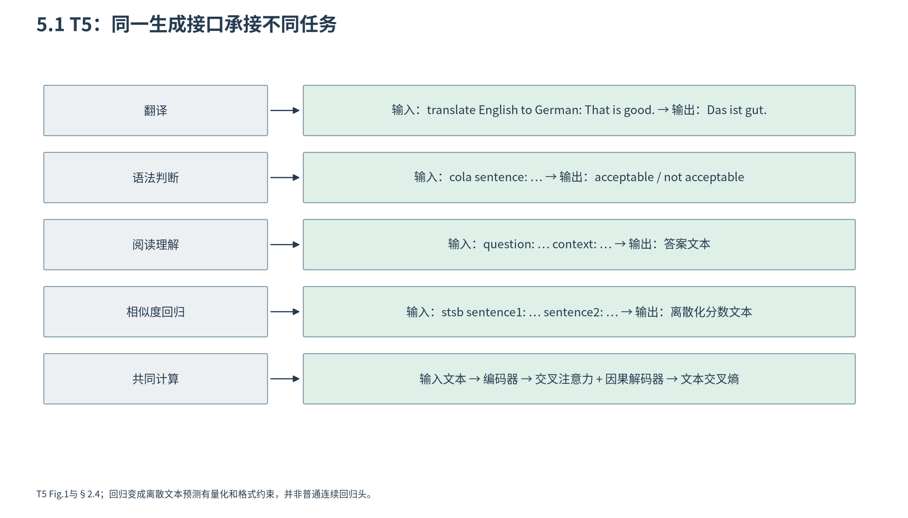
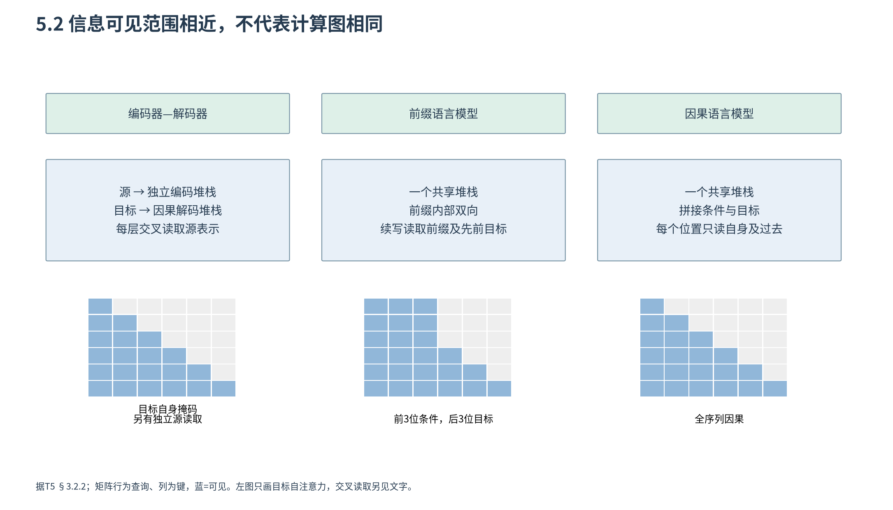

# 第 5 章 T5：text-to-text 与系统性消融

## 5.0 开篇：从全书到这里

BERT、GPT-1与GPT-2展示了不同任务接口：专用读出头、任务输入变换，以及用文本指定生成任务。T5进一步追问：能否统一为文本输入与文本输出，让不同架构、目标和训练配方在相近条件下比较？本章将原论文的系统性消融作为一次模型设计研究来分析。T5继续采用编码器—解码器，说明单塔的成功并未消除“先读输入，再生成输出”这项职责划分的价值。

我们依次讨论统一接口、C4数据工程、五组系统消融、显式交叉注意力的作用，以及新增计算预算如何分配。每一节都回到同一个问题：当前改变的是模型的哪一部分，比较条件允许我们得出多强的结论？本章保留完整的表格和研究细节，消融方法将在第8章模型族与第11章等计算实验中继续使用。

> **最小背景栏**：本章默认你已读过 Book1 第 2、4、7 章（编码器—解码器整体结构与三种注意力角色）、第 6 章（LayerNorm 与残差路径），以及本册第 3 章（MLM 与微调生态）、第 4 章（GPT-2 的因果语言模型、四项结构对照、第4章讨论的任务条件化）。跨度损坏（span corruption）与 C4 的概念本章自建；分词三方案（WordPiece / byte-level BPE / SentencePiece）在第 2 章已经介绍，本章会继续比较它们。

## 5.1 统一接口：让所有任务都采用「文本进、文本出」

先看不同任务接口带来的问题。BERT 的分类、抽取等任务需要不同读出方式；第3章的1,538个新参数指BASE二分类的带偏置线性头，并不是所有任务中最小的头。GPT-1则用第4章的四类输入变换，把不同任务送进同一因果塔；GPT-2进一步探索不做任务微调的文本条件化。接口各异会增加适配工作，也容易使架构、损失和数据处理同时变化，给归因带来困难。不过，接口不同并不意味着永远不能公平比较；统一接口也只是减少混杂因素的一步，数据、预算和评测协议仍须明确对齐。

T5 的方案一句话可以说完：**把每个文本问题都写成「输入一段文本，生成一段目标文本」**——翻译如此，打分也如此。下面保留四个原文算例，问答上下文作省略；图5.1概括它们共用的接口【证据等级：官方论文 1910.10683 v4 Figure 1（p.3）与附录 D.15，直引】：

```text
翻译   translate English to German: That is good.                →  Das ist gut.
分类   cola sentence: The course is jumping well.                 →  not acceptable
问答   question: What does increased oxygen concentrations in the patient's
       lungs displace? context: Hyperbaric (high-pressure) medicine uses special
       oxygen chambers to increase the partial pressure of O 2 …   →  carbon monoxide
回归   stsb sentence1: The rhino grazed on the grass. sentence2: A rhino is
       grazing in a field.                                        →  3.8
```



**图 5.1** T5用统一生成接口处理翻译、语法判断、问答与相似度评分，并共享输入编码、条件生成和目标串训练的流程。图中文字为教学概括；上方文本框中的翻译、分类、回归例来自v4 Figure 1，问答例来自附录D.15并截短上下文。这里的“统一”指架构与任务表示，不表示不同任务最终使用同一份微调权重。【证据等级：官方论文1910.10683v4 Figure 1、§2.4、附录D.15；自绘示意】

四个算例各有一个值得注意的细节。翻译例开头的 `translate English to German:` 是**任务前缀**（task prefix）——前缀给出希望执行的任务；模型能否按它完成任务，还依赖相应训练与所用检查点；这体现了用文本说明任务的接口思路（第 7 章 GPT-3 的 few-shot prompt 会与它重逢），也把第4章式(4.4)所说的任务条件显式编码成了文本：GPT-2 希望模型能从语料中自行学会任务条件化，T5 把 task 直接写进输入串。分类例输出的是字符串标签（`not acceptable`）；若模型生成了合法标签集之外的词（比如 `hamburger`）直接记错——作者报告说实测从未发生【证据等级：官方论文 1910.10683 v4 §2.4】。

问答例取自论文附录D.15；Figure 1原本的第三类示例是摘要，这里换成问答，以展示生成、标签、抽取和数值四种输出。答案 `carbon monoxide` 来自上下文，但模型仍通过词表逐token生成，并没有被结构性地限制为只能复制文中某个跨度。

回归例则把数值渲染为字符串。需要分清原文概括与实际数据：T5论文§2.4写“1到5分、21类”，而STS-B原始标注范围是 **0到5**；官方预处理也列出 `0.0, 0.2, …, 5.0`，将标签舍入到最近的0.2后输出一位小数，共有26个可能的刻度。这里说“26档”指训练目标的数值取值，不是另加一个26维分类头，模型仍可能生成别的字符串。评测时要将输出解析回数值，再计算任务规定的相关系数；不能用字符串是否与量化标签完全相同，替代原来的回归评测。比如 `3.8` 是一个目标字符串，`2.57` 经量化会成为 `2.6`。【证据等级：T5 v4 §2.4；STS原始任务S17-2001；官方preprocessors.stsb与postprocessors.string_to_float】

统一接口把不同任务的监督都交给目标串的后继预测。它简化读出与损失，却把标签格式、有效答案约束和解码错误带进了任务定义。设输入编号串为 $\boldsymbol x$，目标为 $\boldsymbol y=(y_1,\ldots,y_m)$（含EOS，$m\ge1$），参数为 $\Theta$；为说明预测任务，先写不含额外正则项、按单个样本有效目标长度归一的损失：

$$
\mathcal{L}(\Theta) \;=\; -\frac{1}{|\boldsymbol{y}|}\sum_{t=1}^{|\boldsymbol{y}|} \log P\!\left(y_t \mid y_{<t},\, \boldsymbol{x};\, \Theta\right)
\tag{5.1}
$$

| 符号 | 含义 | 形状/取值 |
|---|---|---|
| $\boldsymbol{x}$ | 输入串（含任务前缀）的 token id 序列 | $(n_{\text{in}},)$，基线编码后输入长度预算为512 |
| $\boldsymbol{y}$ | 目标串的 token id 序列 | $(n_{\text{out}},)$ |
| $y_t$ | 目标串第 $t$ 个 token | 标量，词表大小记作 $V$；论文概括为32,000 |
| $P(\cdot)$ | 读出前表示与共享词嵌入转置相乘，再沿词表做softmax | $(B,n_{\text{out}},768)\cdot(768,V)\to(B,n_{\text{out}},V)$；768是基线宽度 |
| $\Theta$ | 全部可学参数 | 基线约 220M |

用人话说式(5.1)：不管题目是翻译、判语法还是打相似度分，训练都根据输入和**右移的真实目标前缀**预测下一个目标token。这里沿用Book1的teacher forcing，而不是先让模型猜出前文再训练。若目标是 `not acceptable EOS`，用作机制示意的解码器输入就是 `START not acceptable`，三个位置分别预测 `not`、`acceptable`、`EOS`。实际分词可能把这些词再切分；T5通常以PAD编号充当起始输入，但这个起始位置仍参与预测，损失是否有效应看对应目标是否为填充。

推理时没有真实目标可喂，解码器才逐token使用已经生成的前缀，直到EOS或设定的长度上限。“同一个模型、损失与解码过程”在这里首先指共同的架构和接口。T5允许分别微调各任务，所得参数可以不同；基线实验统一用贪心解码，最终大模型配方又对翻译和摘要使用beam search。因此统一接口并没有取消任务格式、检查点选择或解码配置的说明义务。T5是Text-to-Text Transfer Transformer的缩写，其价值是让变体比较有共同的基础。【证据等级：T5 v4 §2.4、§3.1.2、§3.7】

还要把概率目标与实现中的损失归约分开。式(5.1)先对一个样本平均；若再平均不同长度样本，每个样本权重相同。另一种办法是对全批有效目标token平均，让较长样本贡献更多项。Mesh Transformer的默认实现又是：填充位置的损失权重置零，但分母取目标张量的全部槽位数，并允许配置覆盖；它不一定等于“有效token总数”。当填充比例或目标长度改变时，这些约定会改变损失与梯度尺度。比较配方或照着代码复现时，既要核对因果遮罩和填充权重，也要核对分母，不能仅因都叫交叉熵就视为同一数值口径。【证据等级：官方Mesh Transformer，Unitransformer._compute_loss、loss_denominator】

共享接口也有成本。把类别写成两个 token 时，答案概率是条件概率的乘积，标签长度和用词会影响评分；把相似度写成数字字符串，词元级交叉熵并不直接惩罚数值距离。例如“3.8”和“4.0”的数值接近，不会自动使它们的文本损失更接近。统一格式提供共同实验框架，不代表所有任务都变成同一种统计问题。

论文的32,000是SentencePiece词表的概括；哨兵特殊token与为计算对齐而补出的嵌入行还需要另计。常见公开T5配置使用32,128行嵌入。下文以 $V$ 表示实际读出宽度，不能凭“32k”断言每个checkpoint的最后一维都严格等于32,000，也不能把补齐的所有行都当成有独立文字意义的token。

## 5.2 C4：把网页集合变成训练语料

统一接口后，下一个问题是训练语料。BERT采用BooksCorpus与Wikipedia，第4章的GPT-2则使用约40GB的WebText；T5希望探索更长训练，并尽量避免反复使用很小的语料。其基线按每批128条、长度预算512，训练 $2^{19}=524288$ 步，得到 $2^{35}=34,359,738,368$ 个token位置的论文预算（约34.36B）。训练会尽可能把多条短序列打包到一个批条目中，因此这是按序列槽位计的预算，不等于同样多的独立样本，也不能与语料的“词数”直接相除。【证据等级：T5 v4 §3.1.2】

较小语料并非不能重复训练，Common Crawl也不是唯一可能的数据来源；作者选择它，是为了在本研究中获得足够大的、多样的未标注文本。论文描述Common Crawl每月可提供约20TB去掉网页标记后的正文提取数据，但其中大量内容是菜单、重复文本和其他噪声。GPT-2报告也讨论过直接使用这类数据的质量问题。T5于是对2019年4月快照作过滤，v4列出的规则如下【证据等级：T5 v4 §2.2】——

1. 只保留以句号、感叹号、问号或结束引号结尾的行；
2. 丢弃少于 3 个句子的页面；只保留至少 5 个词的行；
3. 删除含脏词表（LDNOOBW 清单）词汇的页面；
4. 删除含 "Javascript" 的行（大量「请启用 Javascript」警告页）；
5. 删除含 "lorem ipsum" 占位文本的页面；
6. 删除含花括号 `{` 的页面（源代码页的代理特征）；
7. 移除维基百科来源页的引用标记（如 `[1]`、`[citation needed]`）；
8. 删除含「terms of use」「privacy policy」「uses cookies」等样板句的行；
9. 去重：任何出现多于一次的三句跨度只保留一份；
10. 语言过滤：langdetect 判为英文的概率 ≥ 0.99 才保留。

二十 TB 的原始网页滤出「约 750GB」可用作训练语料的英文正文；表格里登记的是 745GB（750 是行文取整，引用时注明双口径）【证据等级：官方论文 1910.10683 v4 §2.2 与 Table 8】。这套规则中的每一条都针对一种具体的网页噪声——警告页、占位符、代码、样板法律声明、重复抓取；第 9 条的三句去重与第 10 条的语言过滤，体现了大型网页语料中去重和语言筛选的重要性，但不能据此断定后来的所有数据工程都采用相同规则。

清洗值得吗？T5 把它做成了受控实验（5.3 节的方法论在此先预演一次）：同一基线，只换预训练语料。C4 unfiltered仍保留英文语言识别过滤，其余主要启发式清洗被取消，得到6.1TB——八倍于清洗版的数据量，GLUE/SQuAD/SuperGLUE 三项 81.46/78.78/68.04，对比 C4 745GB 的 83.28/80.88/71.36 全面更差【证据等级：官方论文 1910.10683 v4 Table 8】。在这组固定预算对照中，过滤后的数据更有效；“干净”仍是具体规则定义的属性，过滤也会改变领域、语言形式与覆盖范围。同一张表还可以作进一步比较：17GB 的 WebText-like 把 GLUE 推到 84.03、20GB 的 Wikipedia+TBC 把 SQuAD 推到 82.08——小而对口的语料能在个别任务反超大而杂的 C4（SQuAD 的语料本就出自维基）【证据等级：官方论文 1910.10683 v4 Table 8】。T5 为通用能力选了 C4；而把语料截小后在相同训练预算中多次重复，在所测配置下损害了下游表现（截断 C4 后训练损失反而更低——记忆化的迹象，原文 Figure 6）【证据等级：官方论文 1910.10683 v4 §3.4.2/Figure 6】。第 6 章 RoBERTa 的「数据 10 倍」实验和第 8 章 scaling 的数据量分析，还会讨论类似的问题。

接着第 2 章的讨论，再看第三个模型的词表：BERT 用 WordPiece 30k，GPT-2 用 byte-level BPE 50,257，T5 用 SentencePiece 训出的 32,000 词表——因为要兼顾翻译微调，词表在 10 份英文 C4 加德、法、罗马尼亚语 Common Crawl 各一份的混合语料上训练，输入输出共享同一张表。这里混合的是分词器训练语料；基线模型的无监督预训练仍以英文C4为主，不能由多语词表推出它已完成等量多语预训练【证据等级：官方论文1910.10683v4 §3.1.3】。

## 5.3 系统性消融：把综述做成受控实验

有了语料和统一接口，T5 最有价值的贡献是**建立比较方法**，而不仅是取得领先成绩。2019 年的困境是：新模型不断发布，每个都声称效果更好，但架构、目标、数据、训练时长常常多变量同改——因而无法判断究竟是哪项改动带来了提升。T5 采用了一个简单的设计：固定一个基线，**每次只动一个变量块**，五块分别是架构、预训练目标、数据、迁移策略、规模；text-to-text让变体可以沿用任务表示和评测流程；每项比较仍须说明具体目标、数据量、模型规模与解码设置。这等于把一篇文献综述做成了一场受控实验——「系统性消融」（ablation，逐次拆掉部件看成绩变化）由此成为一套具体的方法。

先对照图5.2看整体：左侧是本节基线的双塔分工，中间和右侧是随后要比较的单塔。先明确输入从哪里进入、目标在哪里生成，再看各个组件与训练设置。



**图5.2** 三种架构的计算组织与局部可见性（自绘示意）。每个矩阵为6×6，行是查询、列是键，蓝格可见。左侧只画解码器的目标自注意力；编码器内部全可见，解码器另经交叉注意力读取编码器输出。中间把前三位作为条件、后三位作为目标，条件内部双向、目标按因果顺序读取；右侧整条序列因果可见。左、中两图不是同一个注意力掩码，也不能据此把两个模型判为逐算子等价。【证据等级：T5 v4 §3.2.1及官方实现】

先明确基线：它继承Book1的编码器—解码器职责分工，先完整编码输入，再逐步生成目标。encoder与decoder各12层，$d_{\rm model}=768$、$d_{\rm ff}=3072$，FFN使用ReLU；12个注意力头的键和值各为64维，合计约220M参数。层数与宽度接近两套BERT-BASE，但不能把它理解为原2017模型各个算子的原样复制。【证据等级：T5 v4 §2.1、§3.1.1】

先看各残差分支的入口。T5采用pre-LN式布局，却还改变了归一化本身：不减均值，不加可学习偏置，只按均方尺度归一并乘可学习系数。对一个位置的 $x\in\mathbb R^d$，计算为

$$\operatorname{Norm}(x)_i=\gamma_i\,\frac{x_i}{\sqrt{d^{-1}\sum_{j=1}^{d}x_j^2+\varepsilon}}.\tag{5.1a}$$

这里 $x,\gamma$ 均为 $(d)$，$\varepsilon>0$ 是标量；逐位置应用时，输入输出均为 $(B,n,d)$。用人话说，它调整向量的整体尺度，不先把共同的均值分量减掉。取 $x=(2,2)$、$\gamma=(1,1)$，忽略很小的稳定项，输出约为 $(1,1)$；Book1和第4章先减均值的LayerNorm，在可学习偏置为0时输出 $(0,0)$。所以“只去掉偏置”不足以描述这项变化。【证据等级：官方Mesh Transformer归一化实现；T5 v4 §2.1】

再看位置信息：T5不在输入处叠加学习式绝对位置表，而在自注意力打分中加入相对距离桶的偏置。每套使用32个桶，近距离划分细、远距离逐渐合并，编码器还保留正负方向；后文会展开它的张量形状。输入、输出词嵌入继续共享。公开实现还省去主要线性层的偏置，并采用不显式除以 $\sqrt{d_k}$ 的注意力打分约定，必须与初始化和权重一起理解，不能只按算子名称认定与原典完全相同。

训练使用AdaFactor。基线预训练的学习率为 $1/\sqrt{\max(t,10000)}$：前一万步维持0.01，此后按逆平方根衰减；微调改用常数0.001。基线通常把GLUE、SuperGLUE各自作为一个子任务数据集的混合体微调，并允许按任务选择验证表现最好的检查点，最终配方还会调整这一步。【证据等级：T5 v4 §3.1.2、§3.7】

先与无预训练的同型模型比较：GLUE为83.28对66.22，SQuAD为80.88对50.31；英法翻译则为39.82对39.77，差距很小。它说明预训练的收益依任务和训练设定而变，不能由这一项高资源任务推断所有高资源场景的收益都很小。【证据等级：T5 v4 Table 1】

**第一块：架构三选一。**这里比较三种基本组织，同时涉及可见性、堆栈分工与参数复用——图 5.2。编码器-解码器（图 5.2a）：输入段由 encoder 全互见地编码成记忆，decoder 因果地生成目标、每层经交叉注意力桥取用记忆；前缀语言模型（prefix LM，图 5.2b）：单塔，序列切成前缀加目标两段，前缀段全互见、目标段因果且看得见全部前缀；decoder-only 语言模型（图 5.2c）：单塔纯因果，前缀也只能从左往右看。若只看“输入可双向交互、目标可读输入和先前目标”这层依赖关系，编码器—解码器与前缀LM相近；但双塔分别做目标自注意力和交叉注意力，前缀LM在同一组key上归一，计算图并不相同。图5.2将这些算子分开画，5.4节再讨论差别。成绩见表 5.1。

**表 5.1** 架构 × 目标消融（重排自 v4 Table 2；此处留 GLUE/SQuAD/SGLUE 三列，原表七列全任务。五变体 × 两目标共十行全录）

| 架构变体 | 目标 | 参数 | 算力 | GLUE | SQuAD | SGLUE |
|---|---|---|---|---|---|---|
| ★编码器-解码器 | 去噪 | 2P | M | **83.28** | **80.88** | **71.36** |
| 编码器-解码器（共享参数） | 去噪 | P | M | 82.81 | 80.63 | 70.73 |
| 编码器-解码器（各 6 层） | 去噪 | P | M/2 | 80.88 | 77.59 | 68.42 |
| 语言模型（decoder-only） | 去噪 | P | M | 74.70 | 61.14 | 55.02 |
| 前缀语言模型 | 去噪 | P | M | 81.82 | 78.94 | 68.11 |
| 编码器-解码器 | 语言建模 | 2P | M | 79.56 | 76.02 | 64.29 |
| 编码器-解码器（共享参数） | 语言建模 | P | M | 79.60 | 76.35 | 63.50 |
| 编码器-解码器（各 6 层） | 语言建模 | P | M/2 | 78.67 | 75.32 | 64.06 |
| 语言模型（decoder-only） | 语言建模 | P | M | 73.78 | 53.81 | 56.51 |
| 前缀语言模型 | 语言建模 | P | M | 79.68 | 76.87 | 64.86 |

（数据：【证据等级：T5 v4 Table 2】。$P$为论文用一套12层主体表示的近似参数量，$M$为基准编码器—解码器处理一对输入与目标的近似计算量；参数与计算量均按论文的近似口径记账。“去噪”指损坏后重建；“语言建模”在双塔与前缀LM中随机将文本分为前缀和待预测后段，在纯因果LM中则预测整段文本，监督范围也要随架构说明。）

读表之前先交代它怎样近似对齐成本。设编码器和解码器各有 $L$ 层，输入、目标长度分别为 $n_{\rm in},n_{\rm out}$。两套堆栈分别处理自己的序列，主要逐位置计算规模随 $L(n_{\rm in}+n_{\rm out})$ 增长；一套 $L$ 层的单塔处理拼接序列，也有这项长度和。因此论文把两者放进近似相同的 $M$ 档，但双塔存储两套主体参数，记为 $2P$。交叉注意力的额外参数与运算、注意力对长度的平方依赖没有消失；作者明确采用近似，并以相近的实验步时作为支持，不能将P/M当作精确相等的证明。【证据等级：T5 v4 §3.2.2】

共享双塔主体参数后，论文把它记为P/M，与前缀LM和纯因果LM归到同一近似档；需要独立的交叉注意力参数仍须按实现计数。把双塔都减成6层则记为P/M/2，它同时减少深度和计算预算，不是只改变层数、保持其他成本完全不变的实验。读者应先看这些比较条件，再解释成绩差别。

三个读数。第一，在本表所测任务中，编码器—解码器加去噪的成绩最高；共享版本的GLUE从83.28降到82.81，SQuAD从80.88降到80.63，SuperGLUE从71.36降到70.73。其代价相对较小，但“省一半参数”仍是论文P记账下的近似。减为各6层后的下降更大，也伴随着预算减半，不能只归因于深度。第二，去噪设置中的前缀LM为81.82，纯因果LM为74.70，相差7.12个GLUE点；这支持在该架构、目标与配方下比较前缀可见性，不构成任何任务中“加双向就值7分”的规律。第三，各架构去噪结果总体较好，却并非每项都高：纯因果LM的SuperGLUE为55.02，语言建模为56.51。论文概括中的“always”不能替代逐格阅读。【证据等级：T5 v4 Table 2、§3.2.4】

**第二块：目标三选一。**预训练目标怎样构造学习任务？先按论文Table 3的句子说明任务（乱序行按纯置乱定义整理，`<M>` 是共享掩码符、`<X>/<Y>/<Z>` 是各自唯一的哨兵 token（sentinel token））【证据等级：据官方论文1910.10683v4 Table 3整理；乱序行修正见下文】：

```text
原句      Thank you for inviting me to your party last week .
BERT式    输入  Thank you <M> <M> me to your party apple week .
          目标  （重建全文）
乱序复原  输入  party me for your to . last you inviting week Thank
          目标  （复原全文）
哨兵替换  输入  Thank you <X> me to your party <Y> week .
          目标  <X> for inviting <Y> last <Z>
```

原表的乱序行比原句多了一个 `fun`，与同节“只打乱原token顺序”的定义不一致；上例去掉该词，展示可由原句置乱得到的序列，并不冒称原表逐字引述。

先分开两种去噪接法。T5比较的BERT-style目标借用了“选择部分位置再扰动”的思想，但将它改造成编码器—解码器任务：选中约15%的token，其中90%换掩码、10%换随机token，然后由解码器重建全文。它不是第3章BERT的80-10-10配方，也不再只对选中位置读出损失；约85%的未损坏内容仍会成为生成目标。

基线采用Table 3的“i.i.d. noise, replace spans”：各位置独立决定是否损坏，连续入选的位置自然连成段，每段由一个不同哨兵替代；目标只生成缺失内容及定界哨兵。例中就是 `<X> for inviting <Y> last <Z>`。这里的最后一个哨兵与该样例的端点有关，后面的长度推导会明确区分处理约定。哨兵在同一例中区分不同缺口，在不同样本中可以重复使用，不是为每条文本临时新增嵌入参数。【证据等级：T5 v4 §3.1.4、§3.3.1及Table 3】

成绩分两层看。大类（Table 4）：BERT 式 82.96 最好，前缀语言建模目标 80.69 次之（翻译任务上两者接近），乱序复原（deshuffling）73.17 明显最差——把词序打乱再复原，该目标在所测下游任务中表现较差，但仅凭这个表还不能确定它具体少学到了哪一种语言知识。族内（Table 5）：哨兵替换式 i.i.d. 基线（行名 Replace corrupted spans，Table 7 又记作 Baseline (i.i.d.)）83.28 对 BERT 式 82.96——**多数族内变体接近；并非每项差距都小于1分**；表面最高的是「丢词式」（drop corrupted tokens：输入删去损坏词、不留哨兵，目标仍是生成那些词）84.44，但拆开看是 CoLA 单项暴涨驱动（60.04 对基线 53.84）——作者指出其GLUE优势主要来自CoLA；删词重建与可接受度检测并非同一任务，这个表不能证明优势的具体机制，SuperGLUE 反而更差（68.67）【证据等级：官方论文 1910.10683 v4 Tables 4-5 及 §3.3.2】。

因此，最终选择跨度损坏要同时考虑效果与计算。按Table 6，损坏率从15%换为25%时，一些指标接近、一些略有变化；50%时GLUE与SQuAD下降更明显，但不能说所有任务都同向下降。Table 7进一步先指定损坏token数和段数，再随机分配段长，平均段长3并不意味着每段都恰好三个token。该设置的GLUE/SQuAD/SuperGLUE为83.49/81.84/72.53，相比独立损坏基线83.28/80.88/71.36略高；翻译指标没有同步改善，段长3也不是每列最优。

论文最终取15%损坏率、平均段长3，理由是所测非翻译任务的表现略有改善，同时目标序列较短，训练稍快，而不是它在所有任务上远胜其他去噪方式。作者据此建议：在这些相近目标之间还应比较计算成本；这一结论限于论文所考察的模型和任务，不能推出继续研究目标函数都没有价值。【证据等级：T5 v4 Tables 6–7、§3.3.4–3.3.5、§3.7】

**再看迁移策略。**基线全参数微调的GLUE为83.28。adapter方案在每个原FFN之后插入一个dense—ReLU—dense小模块，使其输出宽度仍等于输入宽度；微调这些新增模块以及归一化参数，其余主体保持固定。Table 10测试内宽32、128、512、2048四档，主表GLUE为80.52、81.51、81.54、81.51，并不随内宽单调上升。渐进解冻的82.50也略低于基线，说明第1章的迁移配方需要结合具体模型与日程检验，不能只凭名称沿用结论。【证据等级：T5 v4 §3.5.1、Table 10】

> **【考据框】adapter大档的原表差异。**v4的Table 10把 $d=2048$ 一行写成与128档完全相同的读数，GLUE为81.51；附录Table 16对应行却列82.62，其他指标也不同。本章主比较沿用Table 10，同时保留这个未能判定的来源差异，不擅自认定哪一行代表真实实验。

多任务训练又是另一项选择。Table 11中直接混合训练的等比例方案GLUE为76.13，所测温度混合中最高为81.90，均低于83.28；但这不是“任何多任务都无效”。Table 12中，多任务预训练后继续微调得到83.11，与基线接近，部分翻译任务还更高；只做监督多任务预训练为79.93，也有翻译任务不降反升。基线阶段的GLUE与SuperGLUE各自混合其子任务，不能把这里的“逐任务微调”误读为所有阶段都已经按每个子任务分别训练。最终T5正是采用多任务预训练再微调的路线，5.5节会说明进一步变化。【证据等级：T5 v4 Tables 11–12、§3.5.2–3.5.3、§3.7】


### 跨度损坏怎样同时改变学习问题与计算量

跨度损坏让编码器保留大部分上下文，让解码器只重建被拿走的片段。哨兵既指明输入中的空缺，也把目标中的片段逐一对应起来。这个设计的收益不仅是“另一种MLM”：它减少目标长度，因而减少解码器需要逐位置计算和预测的工作；是否改善任务表现仍由前面的消融检验。

用独立的八 token 构造例明确索引。原序列为 `甲 乙 丙 丁 戊 己 庚 辛`，损坏第2–3与第6位置，分别以哨兵 $s_0,s_1$ 替换：

```text
编码器输入：甲 s0 丁 戊 s1 庚 辛
解码器目标：s0 乙 丙 s1 己 s2 EOS
右移的输入：START s0 乙 丙 s1 己 s2
```

这个原序列以未损坏内容结尾，按Table 3的示意在目标末尾保留 $s_2$，再用EOS结束目标串。每个哨兵是词表中的专用token，不是临时新增的向量。模型预测“乙”时可见完整的损坏输入，以及目标前缀$s_0$；预测“己”时还能看到先前已恢复的“乙丙”。目标序列中的哨兵把两处缺口组织成一条可因果训练的输出。

设原长为 $n$，损坏token数为 $k$，损坏段数为 $r$，并沿用“原序列先有一段未损坏内容”的构造。令 $e\in\{0,1\}$ 表示目标末尾是否还需一个额外哨兵。忽略填充，输入暂不计EOS、目标计入EOS，则

$$n_{\rm in}=n-k+r,\qquad n_{\rm out}=k+r+e+1.\tag{5.2}$$

输入每去掉一段，就补回一个哨兵；目标则包含 $k$ 个被拿走的token、每段开头的 $r$ 个哨兵、可能的末哨兵 $e$，以及一个EOS。本例 $n=8,k=3,r=2,e=1$，故输入7、目标7。若损坏率为 $\rho$、平均跨度为 $\ell$，用 $k\approx\rho n$、$r\approx k/\ell$ 得

$$n_{\rm in}\approx n(1-\rho+\rho/\ell),\qquad
n_{\rm out}\approx\rho n(1+1/\ell)+e+1.\tag{5.3}$$

取 $n=100,\rho=0.15,\ell=3$，恰有15个损坏token、5段时，不计输入EOS的长度为90；若 $e=1$，目标为22，若 $e=0$，目标为21。重建全文则至少要输出原来100个token及EOS。

为什么同一种目标会有这一个位置的差别？官方跨度预处理的默认分段以非损坏段开头、以损坏段结尾，两类段数相同；用哨兵替换非损坏段来构造目标时，末尾已是待恢复内容，不再额外产生终止哨兵，因此采用 $e=0$。输入和目标各自再附EOS，其长度是 $n-k+r+1$ 与 $k+r+1$。例如，官方长度辅助函数在15%损坏、平均段长3、输入预算512时给出原始长度568、目标114：$k=85,r=28$，输入 $568-85+28+1=512$，目标 $85+28+1=114$。这既解释了为何要说明端点约定，也说明“512输入预算”并不等于先截取512个原始token再损坏。【证据等级：官方preprocessors.random_spans_noise_mask、random_spans_helper、span_corruption；局部复算】

计算意义也可以拆开：解码器线性层大致随 $n_{\rm out}d^2$ 增长，自注意力分数计算随 $n_{\rm out}^2d$ 增长，交叉注意力的打分与值加权随 $n_{\rm in}n_{\rm out}d$ 增长，源和目标投影另有线性于长度的成本。目标变短可降低这些部分；编码器仍需处理其输入，词表读出也有成本，整体加速不能只按目标长度比例宣称。

### 相对位置偏置改了哪个位置

T5保留“内容决定相关性”，并额外让模型知道两个位置相隔多远。它把学习式绝对位置向量相加的入口改为注意力得分中的相对距离偏置。距离桶共享参数，降低位置参数量，但会合并部分远距离的精确区分。

对头 $h$、查询位置 $i$、键位置 $j$，把相对偏移 $j-i$ 映射到桶 $b(j-i)$，从可学表读取标量 $\beta_{h,b(j-i)}$，加入内容得分：

$$A_{ij}^{(h)}=Q_i^{(h)}K_j^{(h)\top}+\beta_{h,b(j-i)}+M_{ij},\qquad
P_{ij}^{(h)}=\operatorname{softmax}_{j}(A_{ij}^{(h)}).\tag{5.4}$$

式(5.4)中的单头 $Q_i,K_j$ 均为 $(d_{kv})$，乘积、桶偏置与掩码元素都是标量；基线的偏置表可记为 $(12,32)$，按两两距离查表后得到 $(1,12,n_q,n_k)$，广播到批维，形成 $(B,12,n_q,n_k)$ 的注意力分数和概率。用人话说，模型既按内容匹配，也可以给某些相对距离一个可学习的加分或减分。

T5公开实现没有在这里额外除以 $\sqrt{d_{kv}}$，而是将相应尺度纳入初始化约定；对拍同一组权重时不能再自行补一次除法。$M$中的0与负无穷仍独立决定可见范围，距离偏置不能解除因果遮罩。近距离桶较细，远距离合并；编码器对前后方向分别分桶，解码器的有效注意力只需处理当前与过去位置。

常见公开T5实现中，编码器自注意力共享一套桶偏置，解码器自注意力共享另一套，二者不混用；交叉注意力没有加入这一自注意力距离偏置。相同桶只表示这一项位置加分相同，不表示内容得分或多层输出也相同。例如编码器中距离为正和为负的一对位置仍可使用不同偏置，远处同方向位置则可能落入同桶。【证据等级：T5 v4 §2.1；官方bi_v1.gin、Mesh注意力实现及公开T5实现】

至此，实验比较的方法已经完整：**统一接口减少适配差异；比较仍要核对目标、预算、计算图和评测条件，近似对齐的部分应明确写出**。第 8 章我们要在自己 1M 到 20M 的小模型族上拟合幂律、第 11 章要铺 iso-FLOP 网格——用的正是同一套设计，只是把「架构/目标」换成了「参数量/数据量」。读论文时先找它的消融表、再看它对齐的是参数还是算力，是本章提供的第一种阅读方法。

## 5.4 显式交叉注意力：职责、收益与成本

第3章把两段文本放进同一个编码器，第4章用因果单塔组织输入与输出。本节回到另一种组织：编码器先形成输入记忆，解码器在每层分别处理目标内部关系和输入读取。T5的实验支持这种职责分工在其微调设置中的价值，同时也给出成本。

先看职责是否保留。T5仍由编码器读完整输入，由解码器依次使用因果自注意力、交叉注意力和FFN生成目标，基线约220M参数。这延续了Book1的整体分工，但分支归一化、位置机制和训练配方已经改变。因此它支持“编码器—解码器仍是一种有效选择”，不支持“2017实现未经改变即可取得同样成绩”。

再看受控对照。显式交叉注意力的作用可以从这组结果考察：表5.1里被论文归入近似P/M档的三种配置给出排序：共享参数双塔 82.81 > 前缀语言模型 81.82 > 纯因果语言模型 74.70。前缀语言模型与共享双塔的关键差异在计算组织：前者的塔内注意力直接覆盖输入与目标全序列（把跨段交互并入塔内注意力），后者保留显式交叉注意力。这组对照约差1分；不能把它外推为任意模型中一层交叉注意力的固定收益——

论文的结论句值得逐字引用：共享参数编码器-解码器胜过 decoder-only 前缀语言模型，「这提示显式编码器-解码器注意力的加入是有益的」（"suggesting that the addition of an explicit encoder-decoder attention is beneficial"）【证据等级：官方论文1910.10683v4 §3.2.4，直引】。

再看成本。2022年Wang等人的架构比较中，作者希望近似对齐预训练计算，让编码器—解码器使用合计更多的层，得到11.0B参数模型，对照单塔为4.8B；他们仍报告前者因交叉注意力约多10%的计算。这里是近似预算比较，不能同时把它说成精确等算力。参数比 $11.0/4.8\approx2.29$，论文对内存占用“约两倍”的说法也是这组模型的概括，不是任意双塔的固定比例。【证据等级：官方论文2204.05832v1 §3.1及Table 1】

这与第4章的22.8%不矛盾：那里计算的是为GPT-2小档额外添加一组同宽cross子层的参数量，占原模型参数的比例；这里谈的是另一组模型的运行计算成本。分子、分母和比较对象均不同。也不能把这项预训练比较直接当成所有推理长度、批量下都固定多10%的实测定律。

再把整机数据流走一遍，确认这台机器你能画出来：输入 $\boldsymbol{x}$（$(B,n_{\text{in}})$ 的 id）经嵌入查表成 $(B,n_{\text{in}},768)$，过 12 层 encoder 得记忆 $\boldsymbol{m}$（$(B,n_{\text{in}},768)$）；目标 $\boldsymbol{y}$ 右移一位（$(B,n_{\text{out}})$）经同一词表查表成 $(B,n_{\text{out}},768)$，过 12 层 decoder——每层先因果自注意力（分数矩阵 $(B,h,n_{\text{out}},n_{\text{out}})$ 下三角），再交叉注意力（query 来自目标侧、$K,V$ 来自 $\boldsymbol{m}$，逐头投到 64 维后相乘：$(B,h,n_{\text{out}},64)\cdot(B,h,64,n_{\text{in}})\to(B,h,n_{\text{out}},n_{\text{in}})$，对真实输入位置全可见，填充位置仍需屏蔽），后接 FFN（$768\to3072\to768$）——出口先经过最终归一化；在常见的共享嵌入读出约定下再乘 $d_{\rm model}^{-1/2}$，与共享词表转置 $(768,V)$ 相乘，得到logits $(B,n_{\text{out}},V)$，沿词表做softmax后进入式(5.1)。这些步骤沿用输入读取与条件生成的分工，具体算子则须按T5约定实现。【证据等级：官方Mesh VocabEmbedding.hidden_to_logits与T5公开实现】

现在可以具体说明，所谓「折叠」是怎样改变计算组织的。论文对前缀语言模型的定义句逐字是：这个架构「类似于一个编码器与解码器**共享参数**、并把编码器-解码器注意力**替换为跨输入与目标序列的全序列注意力**的编码器-解码器模型」【证据等级：官方论文1910.10683v4 §3.2.1，直引】。这表示：可以将前缀LM理解为把输入与目标放入共享堆栈，让跨段读取在自注意力中发生；这是功能层面的类比，单个大softmax与先自注意力再交叉注意力的归一化范围、参数和子层顺序不同，不是只换掩码就逐算子等价。

图5.2将三者放回同一张结构图，回应Book1关于交叉注意力去向的线索：双塔显式读取另一堆栈的输出，因果单塔从同一前缀读取条件，前缀LM又允许条件段内部双向交互。这些关系有助于理解架构选择，但不是模型按一条必然路线替代彼此的历史。T5论文自身也引用了更早的前缀LM工作，而不是首次创造这种定义。2022年的后续比较在纯zero-shot和多任务微调后得到不同排序；第12章会连同训练目标与预算条件一起分析。

> **【考据框】T5的版本与引用。**本章依据1910.10683v4及其JMLR版节号、表号。v1发布于2019-10-23，v2为次日，v3为2020-07-28，v4上传于2023-09-19；研究主体属于2020年的工作。版本间并非只有排版变化：例如较早缓存把C4阈值写成5句/3词，v4写成3句/5词，并补充引用标记与样板政策文本的处理。本章按v4说明规则，不把不同版本的描述拼在一起；Table 10与附录的adapter数字差异则另行保留。

## 5.5 规模、训练与算力预算的分配

五块消融还剩规模——T5 用一个问题引出这项比较：「你刚拿到 4 倍算力，怎么花？」（"You were just given 4× more compute. How should you use it?"）【证据等级：官方论文 1910.10683 v4 §3.6，直引】。背景是 Sutton 的「苦涩教训」（bitter lesson）：能充分利用算力的通用方法，最终会优于依赖精巧人类先验的方法——所以问题不是要不要 scale，而是 scale 什么。表 5.2 是答案。

**表5.2** 扩大预算的方案比较（v4 Table 13）。除基线及最后一行外，各方案约用4倍基线计算；“大小”指参数量，“步数”同时涉及预训练与微调。最后一行复用同一预训练模型，只分别微调后集成，训练成本较低，不能当成已用满4倍预算。

| 花法 | GLUE | SQuAD | SGLUE |
|---|---|---|---|
| 基线（1× 大小，1× 步数） | 83.28 | 80.88 | 71.36 |
| 1× 大小，4× 步数 | 85.33 | 82.45 | 74.72 |
| 1× 大小，4× 批量 | 84.60 | 82.52 | 74.64 |
| **2× 大小，2× 步数** | **86.18** | **84.18** | 77.18 |
| 4× 大小，1× 步数 | 85.91 | 83.86 | **78.04** |
| 4× 独立模型集成 | 84.77 | 83.09 | 71.74 |
| 同一预训练模型，4份独立微调后集成 | 84.05 | 82.36 | 71.55 |

（数据：【证据等级：官方论文 1910.10683 v4 Table 13】。）

先比较加步数与加批量。GLUE为85.33对84.60，SQuAD为82.45对82.52，SuperGLUE为74.72对74.64；前者在一个指标上更高，另外两项接近，不能仅看某一列就认定它对所有任务都占优。

再比较模型规模。2倍大小配2倍步数在GLUE和SQuAD最高，4倍大小配原步数在SuperGLUE最高。两种设置各有优势，说明“扩大模型”与“延长训练”要在具体预算和任务上选择，而不是纯堆模型永远达不到最优。

四模型集成是另一种分配办法。它在原表的英德、英罗翻译上较好，但英法最高的是2倍大小配2倍步数的41.03，集成为40.53；因而集成也没有统一胜出。集成需要多次模型计算，并保存或加载多份参数，不能把训练阶段的便宜方案直接等同于推理也便宜，更不等于必须使用四台物理设备。论文还比较了只在微调阶段分出四个模型的低预算方案，见表中末行。【证据等级：T5 v4 Table 13、§3.6】

模型大小与训练消费量之间的分配，正是第8章Scaling Laws的问题。Kaplan与Chinchilla分别在自己的模型族、拟合与预算条件下给出不同建议；我们届时还会用小模型族检验这种分析，而不是把本表的最佳一行直接推广到所有尺度。

把各组实验放在一起，可以看到规模、目标和迁移策略都影响结果，但不能给它们排出一个脱离任务的固定名次。只看表5.2，从基线到2倍大小配2倍步数，GLUE增加2.90点，SQuAD增加3.30点，SuperGLUE增加5.82点；“4倍算力换2到3分”并不适用于每一列。§3.7认为扩大到11B是最终取得最佳成绩的重要因素，这与去噪目标、多任务预训练和微调调整同时有效并不冲突。

Table 15进一步把同尺寸、同长训练的结果分开：基线GLUE为83.28，延长到约1T token后为84.80；再加入跨度目标、多任务预训练及微调等改动，T5-Base为85.97。后两者相差1.17点，是多项配方变化的合并结果，尚不能拆成某一项的独立贡献。这些都是开发集比较；不要把它们与最终Table 14的官方测试总分直接相减。论文据此强调规模并非唯一因素。【证据等级：T5 v4 Table 15、§3.7】

最终配方使用15%损坏率、平均段长3，多任务预训练后再微调。论文给出1M步、每批 $2^{11}$ 条长度512的序列，按这些数值计为 $1{,}048{,}576{,}000{,}000$ 个token位置，约1.05T；与基线 $2^{35}$ 相比约30.52倍。原文“约32倍”是概述，不能当成上述整数精确相除的结果。

模型有Small、Base、Large、3B、11B五档，约60M到11B。大档重点扩展FFN：11B使用 $d_{\rm model}=1024$、$d_{\rm ff}=65536$；同时还使用128个头、$d_{kv}=128$，编码器与解码器各24层，不是只改FFN而冻结其他组件。作者选择较大的FFN矩阵，是考虑所用加速器对大密集矩阵乘法的效率。【证据等级：T5 v4 §3.7】

最终微调也有变化：早期将GLUE和SuperGLUE各自合并微调，最终改为各子任务独立微调，采用较小批量并更频繁保存检查点；WMT翻译与CNN/DM摘要改用beam宽4、长度惩罚0.6，其他设置仍须按任务说明。Table 14报告24项任务中的18项达到当时最优，GLUE总分90.3、SuperGLUE总分88.9；后者高于此前84.6，接近所引人类参考89.8，但数值接近不构成统计等效的证明。WMT三项翻译都没有达到当时最优，说明扩模并未消除数据与增强策略的差别。SQuAD的91.26/96.22分别为EM/F1，仍是开发集结果，因为评测服务器无法运行其最大模型；GLUE和SuperGLUE则使用官方测试服务器。这些划分是成绩的一部分。【证据等级：T5 v4 §3.7、Table 14】

## 5.6 回到蓝本：哪些职责保留，哪些组件改变

T5保留了Book1的两阶段职责：完整读取输入，再条件生成目标。它并非把2017实现原封不动训练到更大：归一化形式与位置、相对位置偏置、优化器等都需核对。尤其相对位置桶不是GPT-2的学习式绝对位置表。真正值得记住的是整体职责与局部组件可以分别演进；保留双塔不妨碍改动目标、数据、位置机制和规模。

从任务职责看，text-to-text一端读取条件、一端生成目标，与双塔的分工相适应；T5的实验证明这种组合在其预训练加微调设置中仍有竞争力。这提供了一种设计思路：先确认已有组件能否承担任务，再判断是否需要改变结构。它不证明架构在所有预训练问题中都不是瓶颈。第12章将讨论纯zero-shot等不同设定，在那里，训练目标与使用方式改变后，架构排序也会变化。

## 5.7 本章小结

本章从共同的文本接口出发，把模型结构、损坏目标、数据来源、迁移策略与计算预算逐一展开。统一接口让比较更容易组织，但没有替我们消除所有混杂因素：P/M是近似成本，损坏方式改变目标长度，多任务方案还涉及数据混合与后续微调。C4过滤在所测固定预算下有效，小而匹配的语料又能在部分任务上占优；这些证据比一句“干净胜过多”更能指导新的实验。

**带走的心智：先沿信息流看每个模块承担什么职责，再沿实验表看这个判断在什么条件下成立。**双塔与前缀单塔都能读取完整条件，却用不同的算子组织交互；跨度损坏减少了待生成的内容，却仍要计算编码器、交叉注意力与词表读出。比较一种改动时，把收益和这些相伴变化一起说清，才有可迁移的设计判断。

至此，三种预训练范式都已介绍：理解半塔（BERT）、生成单塔（GPT）、双塔回环（T5）。T5 的实验证明了清洗与规模的价值，也留下一个值得单独讨论的问题——**不动架构、只改训练配方**，能走多远？下一章RoBERTa保留BERT主体，并改变数据、掩码、批量与目标等设置来考察这个问题，并重新审视第 3 章提出的 NSP 问题；两章都需要检查每张表具体控制了什么——RoBERTa的部分代表性比较也同时改变多个变量，怎么读那种表，正是第 6 章的课。另：本章的跨度损坏与第 10 章自训 GPT-2 用的因果语言建模是预训练目标的范式两端，第 10 章实现目标函数时会回指此处。

> **【欠账】** 本章不新增跨册欠账。F9（交叉注意力的折叠）三触点谱系在此收拢，与综合比较（2022 年受控对照的完整边界条件、约10%计算差异所依赖的模型与预算口径）一起在第 12 章统一讨论 → Book2 第 12 章。

## 5.8 动手验证（本章图表与手算清单）

- 在本册目录运行 `python code/ch05/make_figures.py`，可生成早期英文布局练习。它与正文当前中文图不是同一套排版，默认产物写入 `log/book2-ch05/figures/`；用 `BOOK2_FIGURE_OUTPUT_DIR`可指定其他输出目录。
- 手算预算：基线 $2^{19}\times128\times512=2^{35}$，约34.36B个位置；最终 $10^6\times2^{11}\times512$ 约1.05T，精确倍率约30.52，区分原文“约32倍”的概述。
- 手算跨度：原8token例以未损坏内容结尾，目标包含末哨兵；再改成以损坏段结束，说明为何目标可少一个哨兵。最后按 $n=568,k=85,r=28$ 核对含EOS的输入512、目标114。
- 对着图5.2说明：左侧目标自注意力之外还有哪条读取路径；前缀LM与双塔为何总体依赖相近、softmax和子层组织却不同；P/M如何近似对齐。
- 结合表5.1、5.2说明：为什么目标序列短不等于整机按同比例加速，为什么“交叉注意力约有收益”和“约多10%计算”都必须带具体实验条件。
