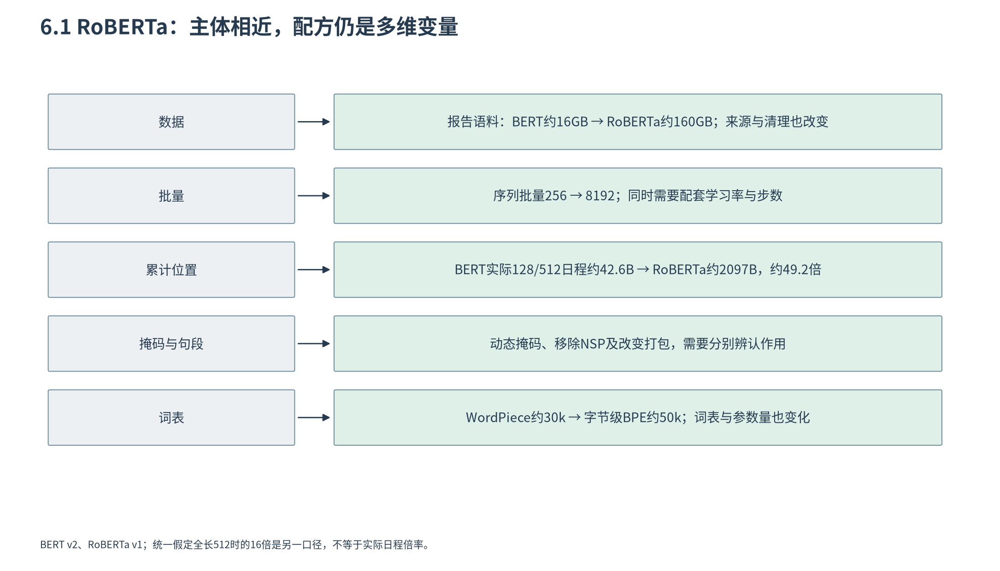

# 第6章 RoBERTa：重新评估训练配方的作用

## 6.0 开篇：从全书到这里

T5让我们看到，比较模型需要同时控制架构、目标和预算。RoBERTa回到BERT，提出更具体的问题：不引入新的主干算子，充分调整数据、批量、训练长度和掩码策略，已有架构还能改善多少？当时XLNet等模型已在多项任务超过BERT，例如RTE的83.8对70.4；RoBERTa的意义在于检验这些差距中有多少来自尚未充分优化的基线，而非宣告架构研究不再重要。【来源：RoBERTa，摘要、Table 5】

本章先列出主要训练差异，再分析NSP输入格式、规模阶梯与GLUE成绩。读它们时一直区分两件事：一组更好的配方能否工作，以及每项变化单独贡献了多少。第一件事可以由组合结果回答，第二件事需要更严格的对照。

> **最小背景栏**：本章所需的前置知识均已介绍——MLM 与 NSP 的机制、输入打包与两条说明其局限的脚注见第 3 章 3.2-3.3 节（式 (3.1)-(3.3)）；ULMFiT 的微调配方四件套见第 1 章 1.5 节；WordPiece 与 byte-level BPE 的家族谱系见第 2 章 2.5 节（表 2.3、表 2.4）；比较条件与近似预算的审读方法见第 5 章 5.3 节。静态/动态的概念本章自含。另有一点需要先说明：**本章主要改动训练与输入接口，Transformer主干结构保持BERT风格**。去掉NSP头、扩大词表和改变输入格式，仍会改变参数集合、词表投影宽度与输入内容，不能说整个模型逐位相同。

## 6.1 归因问题：先复现，再改变配方

把开篇的疑问写成一个可以动手检验的形式。在给定任务与评测协议下，一台预训练模型的成绩 $R$，粗略地说，是三类变量的函数：$R = f(\text{架构},\ \text{目标},\ \text{配方})$——架构是模型结构，目标是损失函数（第 3 章的 MLM+NSP）、配方是其余一切（数据、步数、批量、掩码采样、分词器）。BERT之后，架构与预训练目标的创新受到广泛关注；但不同模型的成绩差，也可能包含训练条件的影响。要检验已有主干还有多少潜力，可以采用这样的思路：**固定主干结构，逐块调整训练设置，观察它们在相同任务中的影响**。提升说明这些设置值得重视；没有提升也只能否定当前试过的配方，不能证明架构是唯一决定因素。

RoBERTa 论文的自我定位不是「提出新模型」，而是一项复现研究（replication study）——我们把这类工作叫「复现与优化研究」：把 BERT 的论文当实验记录，先建立复现基线，再比较新的训练选择。它的设计有三个值得学的细节。其一，固定Transformer主干的层数、隐藏宽度和头数，论文在消融章节开篇明言 *"We keep the model architecture fixed"*（我们保持模型架构不变），脚注另声明架构改动留作未来工作【证据等级：官方论文 1907.11692 §4 及脚注 7，逐字】——这里的固定须结合后文词表和任务头的改动来理解，不能扩成完整模型的每个维度都不变。

其二，先复现、再动手：Table 1 里有一行「我们的复现（静态掩码）」与 BERT 发表值并排（SQuAD 2.0 F1 78.3 对 76.3、MNLI-m 84.3 对 84.3、SST-2 92.5 对 92.8）【证据等级：官方论文 1907.11692 Table 1；BERT 发表值转引自 Yang et al. 2019】。三项结果有高有低，并不是逐位复现。它先建立同一实现中的参照点：后续改动应优先与对应的同实现基线比较，再结合实现、随机性和微调协议，判断与外部发表值的差异。仅因分数接近就认定实现完全相同，或因分数不完全相同就否定后续内部对照，都不合适。

其三，先分别比较，再组合比较：第 4 节把配方切成掩码、NSP 与输入格式、批量、分词四块，每块设置一组对照（用 BERT-Base 主干规格，$L{=}12/H{=}768/A{=}12$）；第 5 节将各项比较中表现较好的改动组合起来，用 BERT-Large 主干规格（$L{=}24/H{=}1024/A{=}16$，355M 参数）训出后续比较模型并起名 RoBERTa——「先分别分析、再组合验证」的两阶段安排，与第 5 章 T5 的方法相通，两者都把复杂方案分解后再组合；这里既涉及数据和优化，也涉及去掉NSP目标、改变输入表示，不能把全部改动都归为狭义的训练超参数。

在既有底座上检验训练方法——这正是第 1 章 1.5 节 ULMFiT 命题“训练配方也是设计的一部分”的又一次检验，只是那次底座是 LSTM。这一判断是否也适用于 Transformer，6.4 节会用定量结果检验；先把十项配方差异摆全。

## 6.2 配方十项差异：全清单与四个重点

表6.1汇总两文的主要训练差异，第0行先说明共同的Transformer主干。图6.1把数据、批量、累计处理位置、掩码与句段、词表五项放在一起：语料体积约增至10倍，批量增至32倍，按各自长度日程计算的位置处理量约增至49.23倍，词表约增至1.7倍。它们既有投入量的变化，也有学习目标和输入方式的变化，不能一律解释为“把同一模型多训几步”。

**表 6.1 BERT → RoBERTa 训练配方十项差异全清单**（自排；各行证据见注）

| # | 维度 | BERT（1810.04805v2 A.2/§3） | RoBERTa（1907.11692） |
|---|---|---|---|
| 0 | 架构 | BERT-Base/Large | **沿用BERT主干**；词表与任务头变化（§4） |
| 1 | 掩码采样 | 静态：预处理一次生成，数据复制 10 份 | **动态**：每次喂入时重采样（§4.1） |
| 2 | NSP 损失 | 保留 | **去掉**（§4.2） |
| 3 | 输入格式 | 段对（SEGMENT-PAIR，≤512） | **全句打包**（FULL-SENTENCES，可跨文档） |
| 4 | 批量 | 256 序列 | **8K 序列**（§4.3） |
| 5 | 预训练数据 | BookCorpus+Wikipedia，16GB【1907.11692 §3.2 复测口径】 | **五份语料 >160GB**（§3.2） |
| 6 | 训练时长 | 1M 步 @256 | **500K 步 @8K**；另比较100K、300K（§5 Table 4） |
| 7 | 分词 | WordPiece约30K，带启发式预处理 | **byte-level BPE 50K**；不沿用BERT式预处理，仍有字节BPE的切分规则（§4.4） |
| 8 | 优化细节 | Adam $\beta_2{=}0.999$；90% 步用 128 长序列 | $\beta_2{=}0.98$；**只用全长 512**；峰值 lr/warmup 随设置调 |
| 9 | 精度/硬件 | —— | 混合精度（mixed precision）；§5的100K步配置使用1024块V100，约1天 |

注：RoBERTa侧依据1907.11692v1 §§3–5与Table9，BERT侧依据1810.04805v2 §3、A.2。第5行的16GB是RoBERTa的数据口径，BERT原文报告词数。第7行使用BERT自己的算法名称；RoBERTa原文宽泛称它为字符级BPE，后文会区分。第8行“只用512”指主要训练日程不再先短后长；6.3节的短句与文档内打包消融仍可能产生较短样本。



**图6.1** BERT与RoBERTa的主要设置对照（本书示意级整理）。五行依次对应数据、序列批量、累计位置、掩码与句段、词表；前后两列不表示全部模型参数相同。累计位置按BERT的128/512混合长度日程与RoBERTa的512长度日程换算，约为42.6B与2097.2B，倍率约49.23；统一假设两者全程512时才得到16倍。这里统计输入位置，不是有效词元的实测量或独立文本量。数据、批量、格式及词表见RoBERTa v1 §§3–5，BERT长度日程见v2 A.2；计算见式(6.2)–(6.3)。

这十项变化不必平均着墨。下面重点解释四项变化的机制，其余见表中的说明。

焦点一，掩码何时采样。BERT 的掩码是**预处理时一次性生成**的：数据复制 10 份、每份打一种掩码，掩码在数据管道里是静态的（static）【证据等级：官方论文 1907.11692 §4.1（对 BERT 实现的复述）】。RoBERTa 把采样挪到运行时：序列每次进模型，重新随机采样——动态掩码（dynamic masking）。受控对照（BERT-Base 规格复跑，5 种子中位）：SQuAD 2.0 F1 78.3→78.7、MNLI-m 84.3→84.0、SST-2 92.5→92.9——论文自评「相当或略好」【证据等级：官方论文 1907.11692 §4.1 Table 1】。单项差距很小；选它的理由一半在工程（免掉 10 倍数据复制），一半在一句前瞻：*"This becomes crucial when pretraining for more steps or with larger datasets"*（当训练步数更多、数据更大时，这就变得关键）——固定文本访问次数增加时，静态掩码库会被反复使用，动态采样则允许继续刷新；更大语料也使预先保存多份损坏版本的存储成本更高。不过，固定总训练预算时，语料越大并不必然让每条序列重复更多。配方的改变常常不是为了当前实验中的这点分数，而是为了支持更长时间的训练和更大的数据规模。


### 动态掩码提供了多少新监督位置

动态掩码让同一文本在重复训练时产生不同预测题，减少对固定遮盖位置的重复。它增加的是监督组合的多样性，不是原始语料的信息量；静态方案预生成多份掩码，也能获得部分同类收益。

用一个简化模型量化：假设每次独立地以概率 $q=0.15$ 选中某个位置，文本重复 $r$ 次。一次不选中的概率是 $1-q$，连续 $r$ 次都不选中为 $(1-q)^r$，故至少被监督一次的概率为

$$P_{\rm covered}(r)=1-(1-q)^r.\tag{6.1}$$

式(6.1)中，$q$是单次选中概率，$r$是访问次数，$P_{\rm covered}$是至少入选一次的概率，三者均为标量。用人话说，先算每次都错过的概率，再从1中扣掉。$r=1,4,10$ 时约为15%、47.8%、80.3%。这是位置边缘概率的教学估计；真实实现可能按每句固定数量抽取，位置间并不独立，但若不同访问独立重采样，单位置的结论仍可按其实际边缘概率计算。BERT静态生成10份不同版本并非“永远只有一份题”；动态方案主要免去提前固定全部版本，并允许长训练继续刷新组合。

掩码选择的15%与真正替换成`[MASK]`的12%也要分开。一个位置被选中后，还经过80/10/10的替换策略；无论最后是否保持原词，监督标签仍是原词。动态改变的是选择和损坏过程，不是把模型目标改成生成全文。

焦点二，批量。Table3把每步序列数从256增至2048、8192，同时把更新次数从1M降至125K、约31K，并分别选择峰值学习率 $10^{-4}$、$7\times10^{-4}$、$10^{-3}$。前两组都处理2.56亿条序列；若第三组严格对齐，应是31,250步，表中写作约31K。论文按相同数据遍数与计算量设计比较，这里的圆整数不宜再当作逐位相等的实测账本。【证据等级：RoBERTa v1 §4.3、Table3】

这组对照回答的是“大批量配合相应学习率能否工作”，不是只改批量的独立作用。留出集MLM困惑度为3.99→3.68→3.77，MNLI-m为84.7→85.2→84.6，SST-2为92.7→92.9→92.8。8K的困惑度仍优于256，但MNLI略低，2K在这三项中最好，因此成绩并不随批量单调改善。作者继续选用8K，还考虑了大批量更便于分布式并行；这不证明它在所有模型和任务中最优。

没有大集群时，可以用梯度累积：先在几份小批量上求梯度，攒够后再更新一次。要近似对应一个大批量，必须使用相同样本、相同损失归约，并在累积期间保持参数不变。若每份小批量大小不等，就不能把各份“平均梯度”再等权平均，而应按样本数或有效监督数加权；否则同一批数据也可能得到不同的梯度，甚至改变更新方向。即使这些条件满足，实际吞吐、随机数轨迹和浮点加法顺序仍可能不同。批量需要在并行效率与优化质量之间权衡，第9章会进一步讨论。【来源：RoBERTa v1 §4.3及脚注8；归约条件为本书推导】

第三个焦点包含相互联系的两部分：数据与时长。数据侧，RoBERTa 把语料从 16GB 扩到五份语料合计**超过 160GB**：BookCorpus 与 English Wikipedia（原来使用的两份语料，合计 16GB）、CC-NEWS 76GB（CommonCrawl 新闻的英文部分，6300 万篇，2016-09 至 2019-02）、OPENWEBTEXT 38GB、STORIES 31GB【证据等级：官方论文 1907.11692 §3.2】。其中OpenWebText见第4章4.2节：WebText并未公开，社区按相近的网页收集思路构建了开放替代集。RoBERTa将其描述为来自Reddit上获至少3次赞同的链接；复刻的是收集思路，不保证包含同一批网页。

时长侧，Table 4 是一张累积阶梯：先比较16GB与约160GB语料下同为8K批量、100K步的配置，再把较大语料配置的训练步数设为300K、500K。各行累积的是设置变化，不据此断定它们都从上一行检查点续训；扩大语料还同时改变了领域组成。MNLI-m 从 89.0 提高到 89.3、90.0、90.2，SST-2 从 95.3 提高到 96.4，SQuAD v1.1/v2.0 F1 从 93.6/87.3 到 94.6/89.4；对照行BERT-Large（13GB、256批量、1M步）报告 MNLI-m 86.6、SST-2 93.7、SQuAD 1.1/2.0 90.9/81.8【证据等级：官方论文 1907.11692 §5 Table 4】。

这行对照的13GB与上文16GB来自同类语料源，但清洗版本可能不同：论文脚注3把16GB与Yang等报告的13GB差别解释为“可能来自Wikipedia清洗的细微不同”，没有证据将16GB直接定性为未清洗、13GB定性为清洗后，读表先对账。训到 500K 步时论文补了一句关键观察：模型「看起来并未过拟合，很可能还能从更多训练中受益」【证据等级：官方论文 1907.11692 §5，直引大意】——还可以继续增加训练投入。换一种计算方式会更直观。先定义固定长度阶段的**累计输入位置数**：

$$T_{\text{pass}} = B_{\text{seq}} \times n \times S \tag{6.2}$$

**式(6.2)符号表**

| 符号 | 含义 | 单位/形状 |
|---|---|---|
| $B_{\text{seq}}$ | 每步喂入的序列数（批量） | 序列/步（标量） |
| $n$ | 固定长度阶段的每序列位置数；变长需分阶段求和 | 位置/序列（标量） |
| $S$ | 总训练步数 | 步（标量） |
| $T_{\text{pass}}$ | 该阶段处理的输入位置总数，含填充槽位 | 位置（标量） |

用人话说，每步处理多少条序列、每条有多少个位置，再乘训练步数，就是这一阶段的总位置数。先做一个统一长度的假设比较：若BERT也全程用512，得到 $256\times512\times10^6=131{,}072{,}000{,}000$；RoBERTa的配置为 $8192\times512\times5\times10^5=2{,}097{,}152{,}000{,}000$，恰为16倍。这一假设把长度固定，只比较批量与步数，不能直接当作两文实际日程的比值。【证据等级：本书按两文配置换算】


固定长度的式(6.2)来自逐步相加：每一步处理 $B_{\rm seq}n$ 个位置，重复 $S$ 步。若长度或批量变化，应写成 $T_{\rm pass}=\sum_s B_s n_s$；还要区分填充槽位与有效token。按BERT的90%步长128、10%步长512计算：

$$T_{\rm BERT}=256(900000\times128+100000\times512)
=42{,}598{,}400{,}000.\tag{6.3}$$

RoBERTa按8192批、500000步、512位置为 $2{,}097{,}152{,}000{,}000$，位置通过量约为前者49.23倍。前文16倍使用“BERT全程512”的统一长度假设，适合比较批量与步数两个因素；49.23倍再加入真实长度调度。二者回答不同问题，也都不是重新统计训练日志所得的有效token量。填充、特殊符号和实际打包会影响有效文本的比例；不同词表还会把同一文本切成不同数量的token，因此位置量不能直接充当独立语料量或有效学习信息的倍率。

这笔账说明“训练步数更少”不等于“训练更少”。扩大批量和长度可以让每步处理更多数据；总通过量也不等于独立数据量，同一文本可能被反复使用。第8章将把参数量、独立数据与处理预算分开安排。

> **【考据框】数据增量的口径。**若看到“RoBERTa多用了77%的数据”，不要把它代入本章比较。RoBERTa v1 §3.2给出的量级是16GB到超过160GB，约为原来的10倍；“多77%”仅为原来的1.77倍，并不符合这组数据。各份语料的GB数还是取整值，且来源与清洗不同，不宜从总量继续推算精确的独立词元数。

焦点四，分词器，也是与前面各章联系最紧密的一项。BERT自己将分词方法称为WordPiece，RoBERTa §4.4则宽泛地把它描述为带启发式预处理的约30K字符级BPE。应沿用第2章的区分：名称相近，不意味着WordPiece的训练准则与按频率合并的BPE相同。RoBERTa改用GPT-2一系的约50K字节级BPE，使编码器也能使用这套输入表示。【证据等级：RoBERTa v1 §4.4；BERT v2 §3】

这里有两个容易混淆的边界。首先，原文所说“不做额外预处理”，不意味着连字节BPE自身的正则预切分都没有；它不再沿用BERT那套文本规范化、标点切分和WordPiece续接处理。其次，在包含完整256字节基表、文本能按约定编码的条件下，字节BPE可以表示任意输入字节串，不必因某个词不在词表而输出UNK；这不等于任意输入接口、特殊符号规则或损坏编码都没有限制。GPT-2的50,257如何组成，见第2章表2.4；RoBERTa的约50K是另一份词表，不能直接套用GPT-2的全部编号。

词表扩大也会改变模型大小。若输入嵌入与输出投影共享，约新增20,000行、每行宽度为 $H$，共享矩阵的形状从 $(V,H)$ 变为 $(V+20{,}000,H)$，主要参数增量为 $20{,}000H$；取Base的768维或Large的1024维，分别约15.36M和20.48M，与论文约15M、20M的说法相符。这是词表主项的估算，不能拿它替代完整模型计数。【证据等级：RoBERTa v1 §4.4；本书参数换算】

作者报告，早期比较中两种编码总体差别不大，字节BPE在部分任务上还略差，但仍因通用编码能力而选择它。论文没有公布这里的逐任务分差，不能把“略差”改写成“下降零点几分”。这项选择说明，评估输入接口还要考虑覆盖范围与参数成本；主干架构和分词方案可以分别选择，不能把二者绑定为同一个设计问题。

其余几项由表 6.1 承载，只提一句第 8 行的「只用全长 512」：BERT 在 90% 的训练步中使用短序列，是为了降低注意力随长度平方增长的计算成本（第 3 章 3.4 节的账），RoBERTa 用满 512 等于将「上下文长度」这一设置也用到了表中给出的最大值。至此再回看图6.1：训练投入确实大幅增加，但掩码、目标和句段组织也在变化。接下来要检查其中最容易混淆的一对——去掉NSP与改换输入打包方式。

## 6.3 重新检验 NSP：损失与输入打包必须分开

配方清单的第2、3行合在一起，就是第3章留下的问题。BERT报告NSP准确率达到97%–98%，但高准确率不等于交叉熵或梯度已经为零；另一个限制是，预训练后的[CLS]不能直接当作未经任务适配的通用句向量。这两点都不能单独证明NSP无用。另一方面，BERT Table5的“No NSP”行中，QNLI从88.4降到84.9，MNLI-m从84.4降到83.9，SQuAD 1.1 F1从88.5降到87.9，说明在该消融设置下成绩确实下降。尚待厘清的是：影响来自辅助损失本身，还是输入组织也曾改变，以及二者的相互作用？【证据等级：BERT v2 §3.1脚注、Table5；RoBERTa v1 §4.2】

RoBERTa §4.2比较四种输入与损失的组合，见表6.2。它们都用Base主干、BookCorpus与Wikipedia，报告五个种子的中位数，但并不是完整的“打包方式×NSP开关”正交实验。尤其要把表注与正文一起读：Table2用1M步、256条序列概述预算，正文却明确说，较短的SENTENCE-PAIR会增加序列批量，DOC-SENTENCES在文档结尾也会动态增加批量，使每步token数与长序列方案接近。因此不能把四行理解为每一步都恰好256条，更不能说它们完整复刻了BERT的128/512长度日程。【证据等级：RoBERTa v1 §3.1、§4.2及Table2】

**表6.2 NSP与输入格式的四种组合对照**（RoBERTa §4.2 Table 2 四行全录，附 BERT 发表参照行；顶部横行为 BERT 原始消融的并排摘录）

| 输入格式与损失 | SQuAD 1.1/2.0（F1） | MNLI-m | SST-2 | RACE |
|---|---|---|---|---|
| **BERT 原始消融**（1810.04805v2 Table 5，完整 → 去 NSP，QNLI 88.4→**84.9**、MNLI-m 84.4→83.9、SQuAD 88.5→87.9） | | | | |
| SEGMENT-PAIR + NSP（复现 BERT） | 90.4/78.7 | 84.0 | 92.9 | 64.2 |
| SENTENCE-PAIR + NSP（真·单句对，仍保 NSP） | 88.7/76.2 | 82.9 | 92.1 | 63.0 |
| FULL-SENTENCES，无 NSP（全句打包，可跨文档） | 90.4/**79.1** | **84.7** | 92.5 | 64.8 |
| DOC-SENTENCES，无 NSP（全句打包，不跨文档） | **90.6/79.7** | **84.7** | 92.7 | **65.6** |
| （参照：BERT-Base 发表值） | 88.5/76.3 | 84.3 | 92.8 | 64.3 |

【证据等级：官方论文 1907.11692 §4.2 Table 2；参照行转引自 Yang et al. 2019】

先把四种输入画清楚，再比较成绩。SEGMENT-PAIR把两个可含多句的片段组成一条序列；SENTENCE-PAIR把片段缩成两个自然句，两者都带NSP。FULL-SENTENCES把连续完整句子打包到最多512个位置，跨文档时加一个额外分隔符；DOC-SENTENCES沿用这种打包，但在文档边界停止。后两种都去掉NSP，短样本通过调整批量尽量对齐token预算。按这四种组合读表，可以得到三层证据。

**第一步**，保留NSP、改变打包：把段对（可含多个自然句的跨度）换成语言学意义上的单句对，NSP 保留——全线掉分（SQuAD 90.4/78.7 对 88.7/76.2，MNLI-m 84.0 对 82.9）。由于短句对还调整了序列批量，这一格表明：**在这份配方中，改用较短自然句对降低了成绩**，论文的假设是「模型学不到长程依赖」【证据等级：官方论文 1907.11692 §4.2，直引大意】。

**第二步**，同时去掉损失并改变打包方式：FULL-SENTENCES无NSP对SEGMENT-PAIR+NSP，SQuAD 1.1不变，SQuAD 2.0增加0.4，MNLI-m增加0.7，RACE增加0.6，但SST-2从92.9降到92.5。多数所测指标相近或改善，支持“这一整套无NSP方案可以工作”，不能写成“去掉NSP后各项都不掉点”。论文随后把DOC-SENTENCES与原BERT发表结果比较，也观察到相近或更好的成绩，因而重新讨论了BERT关于NSP必要性的判断。【证据等级：RoBERTa v1 §4.2、Table2】

**第三步**，在两个都没有NSP的方案之间比较。DOC-SENTENCES相对FULL-SENTENCES的SQuAD、SST-2、RACE略高，MNLI-m相同。这里限制跨文档与批量调整仍一起变化，不能把差值全归因于文档连续性。作者最后沿用FULL-SENTENCES，给出的理由是DOC-SENTENCES会产生变化的序列批量，采用前者更便于与相关工作比较；这不是“最高分方案无法实现”，也不是对可复现性的独立实验证明。【证据等级：RoBERTa v1 §4.2】

四格结果支持一个可执行的选择：改用长文本打包后，可以不训练NSP而取得相近或更好的下游成绩。它没有独立测出“NSP的贡献恰好为零”，也不能证明原BERT消融的下降全部来自输入长度。缺少固定同一打包方式、仅开关NSP的完整对照时，连续性与损失仍有混杂。论文也只是猜测，原BERT可能仅移除损失而保留段对格式；读者应把作者假设与已测结果分开。【来源：RoBERTa §4.2】

> **【考据框】读消融要读到改动范围。**BERT Table5未完整说明“No NSP”行是否改变输入打包，RoBERTa Table2又没有“SEGMENT-PAIR且无NSP”这一格。因此，本章引用的两组实验不能把NSP损失的独立贡献精确分离。不同设置下出现不同结果，并不构成直接矛盾；也不能据这两张表推断后来所有研究都未做过更完整的对照。

顺带三笔。其一，弃用 NSP 并非 RoBERTa 独有的做法：论文转述当时已有数项工作质疑其必要性（Lample & Conneau、Yang 等的 XLNet、Joshi 等的 SpanBERT）【证据等级：官方论文 1907.11692 §4.2 转述】——RoBERTa在这组讨论中补充了四种明确的训练组合及其成绩。其二，第3章选做仅检验微调时的段标记。保持文本与分隔符而把segment编号置零，不改变预训练NSP，不能充当本表的复现。其三，把表 6.2 与第 5 章 T5 的消融对照着看：T5按参数与计算的近似口径比较架构，RoBERTa比较输入与辅助目标的组合。两者都要追问哪些条件保持相同、哪些随着方案一起变化，不能因为用了“消融”一词就假定所有因素已经分离。

## 6.4 从组合结果判断配方的价值

第1章ULMFiT说明既有LSTM可以通过迁移配方获得明显改善；本章将同类问题带到Transformer主干上。MLM仍是主体目标，但NSP被去除，词表和训练投入也改变。因此下面的后续比较结果支持“BERT风格主干仍有较大潜力”，而不是“架构与全部目标一字未改”。

表 6.3 是 GLUE 九任务的开发集、单任务微调对照（均为24层Large规格；RoBERTa开发集结果取5次运行中位，其他模型为论文转引，不能假定所有微调搜索协议相同）【证据等级：官方论文 1907.11692 §5.1 Table 5；BERT-Large 与 XLNet-Large 行分别转引自 Devlin et al. 2019 与 Yang et al. 2019】。

**表 6.3 GLUE 九任务对照（dev，单任务微调）**

| 任务 | BERT-Large | XLNet-Large | RoBERTa | 对 BERT 增量 |
|---|---|---|---|---|
| MNLI (m/mm) | 86.6/– | 89.8/– | **90.2/90.2** | +3.6 |
| QNLI | 92.3 | 93.9 | **94.7** | +2.4 |
| QQP | 91.3 | 91.8 | **92.2** | +0.9 |
| RTE | 70.4 | 83.8 | **86.6** | **+16.2** |
| SST-2 | 93.2 | 95.6 | **96.4** | +3.2 |
| MRPC | 88.0 | 89.2 | **90.9** | +2.9 |
| CoLA | 60.6 | 63.6 | **68.0** | +7.4 |
| STS-B | 90.0 | 91.8 | **92.4** | +2.4 |
| WNLI | – | – | 91.3 | 口径特殊（注） |

注：表中保留原论文Table5的开发集列值。WNLI改用SuperGLUE提供的指代格式：给出代词及其候选指代短语，让正确候选的分数高于错误候选，并使用带间隔的排序损失（margin ranking loss）；只能使用原训练集中的正例，因此不与其他行视作同一种分类协议。相关做法在§5.1正文，脚注10补充了训练数据来源。CoLA使用Matthews相关，STS-B为相关指标；原表没有逐列完整注明其余单值的具体指标与聚合方式，因此不把QQP的92.2直接叫作测试集F1，也不据这些开发集单值计算官方GLUE总分。

论文报告九项开发集达到当时最好结果，其中八项有BERT直接参照，WNLI使用特殊设置。RTE增加16.2点、CoLA增加7.4点、MNLI增加3.6点，这些差值可以直接算；“其中一半由小数据造成”或“语法能力因更多语料而增强”则没有在表中被独立证明。SQuAD同样改善：v2.0开发集EM由79.0到86.5，v1.1 F1由90.9到94.6；这些仍是组合配方的结果。测试集集成口径平均88.5对XLNet的88.4，不能与开发集单模型差值直接混合。【来源：RoBERTa §5.1–5.2，Tables 5–6】

把成绩表与配方表一起读，论文的核心判断是：保留BERT-Large风格主干和MLM目标也能超过强基线，因此数据规模、训练时间等细节需要与架构、目标一起评估。它提出的是相对贡献问题，不是一个“配方总大于架构”的定理。【来源：RoBERTa §5.1】

T5与RoBERTa从两个方向回应同一设计问题。前者系统比较结构与学习目标，后者充分训练已有主干；两者都要求把数据和优化列入模型说明。读者以后查看新模型时，应能区分新增算子、输入表示变化与训练投入变化，而不是把所有提升都记在模型名称下。

## 6.5 批判性阅读：同时改变多个变量时怎样归因

沿用第5章的比较原则，逐项核对条件，就会发现RoBERTa仍有一些难以独立归因的变化：最终成绩来自多项改动的组合，论文第4节的分块对照也仍有因素捆绑。其中最重要的一项，论文已经明确承认：脚注 9 原文逐字——*"Our experiments conflate increases in data size and diversity. We leave a more careful analysis of these two dimensions to future work."*（我们的实验把数据规模与多样性的增加混在一起；对这两个维度更仔细的分析留给未来工作）【证据等级：官方论文 1907.11692 §5 脚注 9，逐字】。160GB 不是「16GB 的十倍同样的东西」，是新闻、网页、故事三种新域的加入——数据量与数据领域两个变量同时改变。

第二个问题在 NSP 部分：6.3 的考据框已登记，四格对照缺了「SEGMENT-PAIR 而无 NSP」那一格，而 BERT 原始消融的改动范围又不明——本章这两张表没有直接检验“NSP损失单独贡献为零”；它们支持的是，在所测的长文本打包方案下，无NSP也能得到有竞争力的结果。

第三个问题在分词部分：byte-level 与「词表从 30K 涨到 50K」捆绑在一起换，且作者自报它在部分任务上「略差」。不能把部分任务的下降推广成所有任务都没有改善；作者选择它主要考虑通用性，但没有给出逐任务分差来量化这项取舍。

第四个问题是评测口径。Table5的开发集结果使用每任务超参搜索：批量16或32，学习率 $10^{-5}$、$2\times10^{-5}$ 或 $3\times10^{-5}$，最多10个epoch，按开发集指标早停，并报告五个种子的中位数。BERT当年采用batch32、3个epoch和几档学习率，搜索预算并不完全相同；差值里可能包含微调协议的影响。【证据等级：RoBERTa v1 §5.1；BERT v2 A.3】

测试集提交又增加了别的条件：每任务集成5–7个模型，RTE、STS-B、MRPC先在MNLI上微调，再转到对应任务；QNLI则从“独立判断一个问题—候选句是否匹配”改成“在同一问题的候选中排序”。作者明确说明，后者与BERT的原分类设定不能直接比较，所以开发集仍使用分类形式。88.5这一测试总分不能全部归因于预训练配方，也不能与表6.3的开发集差值混成一个结论。【证据等级：RoBERTa v1 §5.1、Table5】

模型规格也限制了推广范围。论文Table2中的XLNet-Base（$K=7$）在MNLI-m和RACE上分别为85.8、66.1，高于DOC-SENTENCES的84.7、65.6。表6.3中Large规格的组合结果更好，并不抹去这个Base对照；它同样不能单独测出架构的净作用，因为数据、目标和训练日程还不同。

这些限制并不抹去实验价值。分块对照揭示了哪些训练选择值得进一步检验，组合结果则展示BERT风格主干尚未发挥的潜力；作者也明确承认数据量与多样性难以分开。可靠的阅读方式，是把这些已经测到的事实保留下来，同时不替它们补上未做过的因果实验。

由此还会引出下一层问题：不断增加数据和时长，可以检验“更多投入是否有用”，却没有回答“预算固定时怎样分配”。每步批量、序列长度和训练步数决定要处理多少位置；再结合模型规模与结构，才能估计计算量。第7章先看GPT-3如何扩大语言模型及使用方式，第8章再用Scaling Laws讨论这些量的关系。读那些曲线时，本章的三个问题仍适用：**改了几个变量？比较口径是否一致？数字来自什么证据？**

## 6.6 本章小结

从设置清单、分块对照到最终成绩，本章厘清了三者之间的关系。RoBERTa证明已有BERT风格架构还有明显提升空间，也表明在所测长文本打包方案中可以取消NSP并取得较好结果。但更大数据与更多领域、损失取消与打包变化、词表扩大与编码方式改变等仍然耦合。更好的结果和精确的单因素解释，是两种不同的研究成果。

**带走的心智**：**看到「新架构碾压旧架构」，先别急着找架构解释——先查三件事：训练是否充分（数据、步数、批量对齐吗）？消融改了几个变量（改动范围写清了吗）？口径对齐了吗（指标、微调预算、集成与否）？**架构规定模型怎样计算，配方决定怎样训练；比较不同架构时，观察到的性能差距可能也包含训练投入与评测协议的影响。这项工作没有更换模型主干，关于结构的新知识不多；它主要教我们**怎样阅读和判断模型研究报告**。

回到全书旅程，分词与三种主要预训练结构的讨论至此告一段落。我们已经知道如何改变主干、目标和输入方式，也学会了审查训练投入。下一章GPT-3沿着decoder-only路线把参数规模推到1750亿，并进一步研究如何只靠上下文中的示例使用模型；它并不是在这一规模上重新比较三种架构。更大模型带来的能力变化与所谓“涌现”，也要放回具体任务、指标和实验条件中判断。

## 6.7 动手验证（本章图表与换算清单）

- 运行图6.1的量级核算脚本（秒级，无训练），输出在当前运行目录的 `log/book2-ch06/figures/`。脚本按论文配置计算位置量，不会覆盖正文图片。在本册目录、已激活配套Python环境时运行：
  ```bash
  python "code/ch06/make_figures.py"
  ```
- 验收点：能否分别算出统一512假设下的16倍、按BERT混合长度日程的约49.23倍，并说明它们为何都不等于独立语料倍率；能否画出四种输入组合，指出哪些比较同时改变损失、打包或批量；能否解释16GB到超过160GB为何是约10倍，而不是多77%；能否区分分块证据、组合效果与单因素归因。
