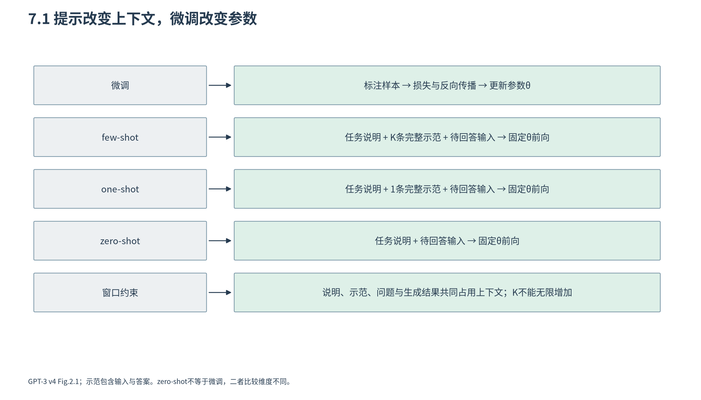
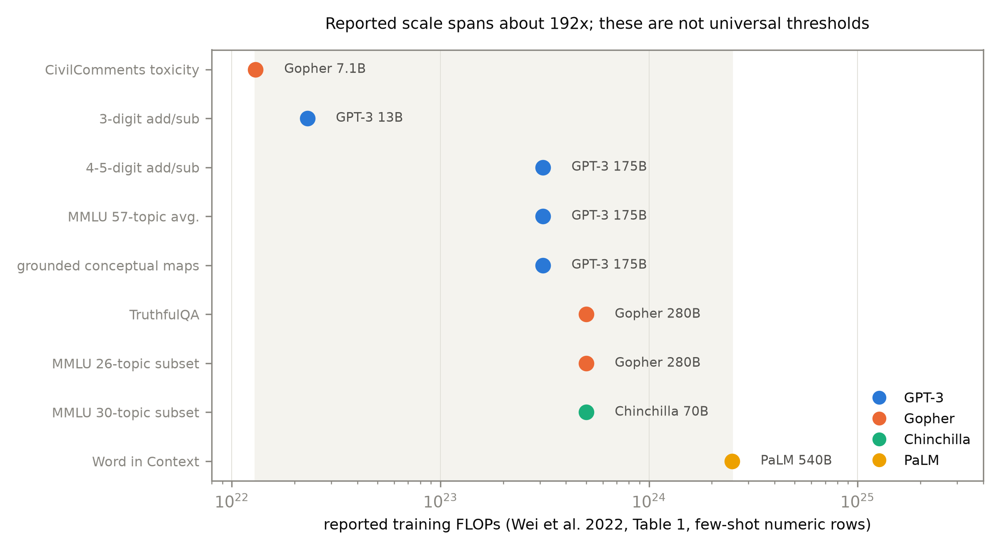
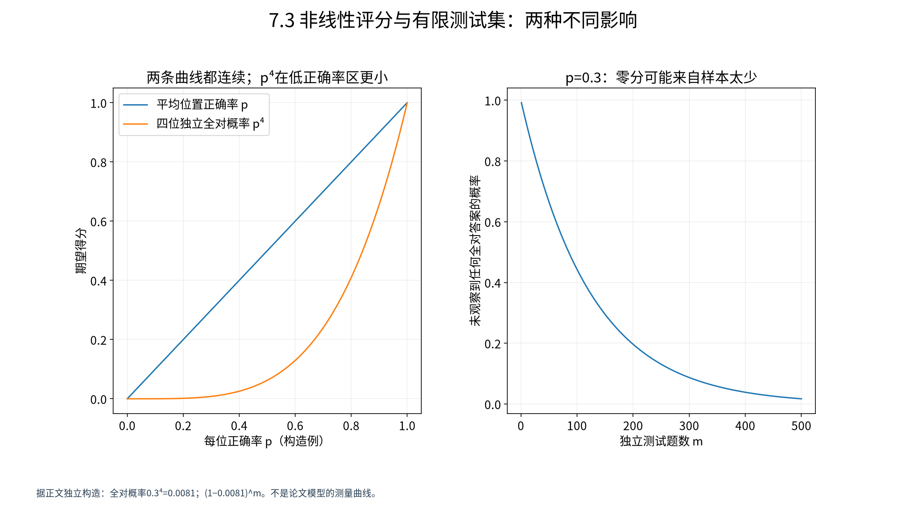

# 第 7 章 GPT-3 与涌现之争

## 7.0 开篇：从全书到这里

RoBERTa让我们把训练投入与架构一起比较。本章转向GPT-3：在延续因果语言模型主干的同时扩大模型规模，并检验不更新权重的上下文使用方式。规模并不是2020年才出现的新问题，也不是唯一变化的因素；模型宽深、学习率、批量和训练数据都要一起记录。参数账从GPT-2的124M、T5的11B走到175B，接下来的重点是：这些投入具体改善了什么，又怎样测量？

本章要回答两个问题。第一个：**沿同一模型家族扩大约三个数量级，任务表现会怎样变化？**GPT-3 的答案分两层——一台 175B 参数的机器（7.1 节，附一套三行式就能手算的算力账），和一项被系统扩大检验的现象：不更新任何权重、只在提示中提供几个示例，模型在部分任务上表现得像是在利用示范学习（7.2 节，上下文学习）。第二个问题由第一个直接引出：**规模增长带来的能力中，有没有「小模型完全没有、大模型突然有了」的那种质变？**这就是 2022 年之后在整个领域引发广泛争论的涌现（emergence）之争（7.3-7.6 节）——我们将对照 Wei 与 Schaeffer 两篇论文的论点，也会把 Book1 第 9-10 章教过的「口径自觉」从评测细节推广到文献阅读方法。本章结束时，涌现之争谁对谁错不会有统一结论——下一章将研究训练损失与预算的关系；损失定律本身也不能替代对具体能力和指标的检验。

> **最小背景栏**：本章需要三样前置。① GPT-2 的 zero-shot 思想（自然语言当任务接口、$p(\text{output}|\text{input},\text{task})$）——见第4章4.2节和式(4.4)；few-shot 是它的近亲，7.2 节自建。② BLEU 的口径课（同一模型换个分词口径差一个多 BLEU、同一旧检查点换评测组批方式差约11.5）——Book1 对应章节 9.6 节已亲手量过，7.6 节回收，不重教。③ 读图纪律：图7.2的横轴是训练计算量的**对数轴**（科学计数法，$10^{22}$ 到 $10^{24}$ 之间差一百倍）——对数坐标的正式课在第 8 章，这里只需记住「等距=等倍数」。

## 7.1 GPT-3：175B 的机器与它的账

要单独研究规模，需要尽量保持架构家族与评测协议可比，同时记录无法固定的训练因素——这是第 5 章 T5 教过的消融逻辑在更大尺度上的重演。先明确引用口径：本章 GPT-3 一律锚定 arXiv:2005.14165 **v4**（2020-07-22 终版），全部证据标签同此版本。这样设计还有一个经验依据：GPT-2 已经给出了「更大更好」的初步证据，而且当时已有的定量线索（Kaplan 等 2020）显示验证损失随规模平滑改善——GPT-3 论文自己的引述是 "there is evidence suggesting that log loss, which correlates well with many downstream tasks, follows a smooth trend of improvement with scale"，损失的平滑改善及其与下游能力的相关性，共同支持了「增加容量以改善能力」这一研究方向【证据等级：官方论文 2005.14165 v4 §1】。

首先沿用GPT-2的主干计算方式：论文交代 "We use the same model and architecture as GPT-2 [RWC+19], including the modified initialization, pre-normalization, and reversible tokenization described therein"——第4章比较过的因果单塔、pre-LN、学习式位置编码与共享词嵌入继续使用；注意力则在稠密层与局部带状稀疏层之间交替。可以把两种层理解为：前者允许当前位置读取全部历史，后者只开放一个局部的历史范围，未来仍不可见。它们改变的是注意力中的可见位置，不能当作与GPT-2逐算子完全相同；本章保留这一差别，不展开稀疏模式的工程实现。上下文也从GPT-2的1024增到2048【证据等级：官方论文 2005.14165 v4 §2.1】。模型规模成为这组研究的主轴；表中批量和学习率随规模变化，不能说所有其他变量完全相同，而变量怎么取值，写在表 7.1 的八档里。

**表 7.1** GPT-3 八档模型规格（引 2005.14165 v4 §2 Table 2.1；全部模型训练 300B tokens、上下文 $n_{ctx}=2048$、FFN 内层 $4\times d_{model}$）

| 模型 | $n_{params}$ | $n_{layers}$ | $d_{model}$ | $n_{heads}$ | $d_{head}$ | 批量（tokens） | 峰值学习率 |
|---|---|---|---|---|---|---|---|
| GPT-3 Small | 125M | 12 | 768 | 12 | 64 | 0.5M | $6.0\times10^{-4}$ |
| GPT-3 Medium | 350M | 24 | 1024 | 16 | 64 | 0.5M | $3.0\times10^{-4}$ |
| GPT-3 Large | 760M | 24 | 1536 | 16 | 96 | 0.5M | $2.5\times10^{-4}$ |
| GPT-3 XL | 1.3B | 24 | 2048 | 24 | 128 | 1M | $2.0\times10^{-4}$ |
| GPT-3 2.7B | 2.7B | 32 | 2560 | 32 | 80 | 1M | $1.6\times10^{-4}$ |
| GPT-3 6.7B | 6.7B | 32 | 4096 | 32 | 128 | 2M | $1.2\times10^{-4}$ |
| GPT-3 13B | 13.0B | 40 | 5140 | 40 | 128 | 2M | $1.0\times10^{-4}$ |
| GPT-3 175B | 175.0B | 96 | 12288 | 96 | 128 | 3.2M | $0.6\times10^{-4}$ |

【证据等级：官方论文·表格 2005.14165 v4 Table 2.1】

表中先看两个端点。最小档125M是12层、768维、12头，与第4章GPT-2 124M的这三项几何规格相同，但上下文和注意力模式已有差别。最大档宽度为 $12288=16\times768$，层数为 $96=8\times12$；按附录TableD.1的174,600M除以GPT-2公开配置的124,439,808，参数量约为1403.1倍，并非整数倍。按表7.1的175B与125M标称值比较则是1400倍，两种口径都约跨三个数量级。

再核对最大档的头维：输入 $(B,n,12288)$ 经Q、K、V投影并拆头，分别成为 $(B,96,n,128)$；头数乘头维等于12288，合头后映回 $(B,n,12288)$。96层堆栈的残差宽度始终不变，局部或稠密注意力改变可见位置，不改变这条主干形状。Book1的形状检查因此仍然适用。【证据等级：GPT-3 v4 Table2.1、TableD.1；本书算术】

这八个模型使用同一套混合语料、各训练300B token。原文Table2.2同时列出语料库存、训练采样权重和已消费遍数，三列应一起看：

| 来源 | 库存token数 | 训练样本采样权重 | 论文报告的消费遍数 |
|---|---:|---:|---:|
| 过滤后的Common Crawl | 410B | 60% | 0.44 |
| WebText2 | 19B | 22% | 2.9 |
| Books1 | 12B | 8% | 1.9 |
| Books2 | 55B | 8% | 0.43 |
| Wikipedia | 3B | 3% | 3.4 |

这说明采样不按库存大小等比例分配：作者认为质量更高的来源可以反复使用，而较大的来源未必完整经过一遍。论文还执行了参考语料相似度过滤、文档级模糊去重和评测集重叠检查；其中重叠过滤存在程序问题，作者在§4分析了残留污染。因此“未做任务微调”不等于能保证预训练从未见过相似测试内容。【证据等级：GPT-3 v4 §2.2、Table2.2及§4】

> **【考据框】表7.1的投影规格。**13B行原文写5140，而40×128为5120；1.3B行的24×128也不等于残差宽度2048。后者本身不违反注意力定义：$X:(B,n,d)$ 可经 $W_Q,W_K,W_V:(d,hd_k)$ 映到 $(B,n,hd_k)$，拆成 $(B,h,n,d_k)$，合头后再用 $W_O:(hd_k,d)$ 映回 $(B,n,d)$。这与“把d均分给h个头”的简化实现不同。13B的5140究竟是排版误差还是实际选择，论文没有足够信息裁定；本章保留原表，不擅自改成5120，也不把一组合法维度直接认作完整的可复现模型配置。

如果某来源每次参与训练的平均有效长度相同，或者已知的 $w_j$ 本就是token份额，库存 $D_j$ 与总训练量 $D$ 可以给出近似消费遍数 $w_jD/D_j$。这只是明确计数条件后的估算：例如把60%视作token份额，Common Crawl得到 $0.60\times300/410\approx0.44$ 遍。

> **【考据框】采样权重不能直接当作精确token份额。**原Table2.2把权重定义为抽中该数据集的样本比例，并非逐字节日志。若直接把22%代入token份额，WebText2会得到 $0.22\times300/19\approx3.47$，与原表2.9不一致；Wikipedia同样得到3.0而非3.4。显示权重之和为101%，说明数值有圆整，但仅凭圆整不能断定已解释全部差距。本文保留原表和简化算式各自的口径，不把3.47写成真实训练遍数，也不编造未披露的采样细节。

确定模型规模后，再核算训练成本。先只看最主要的矩阵乘法：每条向量经过一个线性层时，每个权重约参与一次乘法和一次加法，前向计2次浮点运算；反向既要计算权重梯度，也要把梯度传回输入，两项各与前向同量级，合计约4次。于是每个token经过稠密参数主体的训练主项，近似是每参数6次运算，得到导览0.5提到的估算式：

$$
C \;\approx\; 6\,N\,D
\tag{7.1}
$$

| 符号 | 含义 | 取值 / 口径 |
|---|---|---|
| $C$ | 训练总浮点运算量 | 标量，单位 FLOPs |
| $N$ | 代入近似的参数量，标量 | 按GPT-3附录TableD.1取174,600M；含嵌入的总参数口径 |
| $D$ | 累计训练token数，标量，允许重复 | $300\text{B}=3\times10^{11}$ |
| $6$ | 稠密矩阵主项的近似系数，标量 | 前向2加反向约4 |

这表示：**用参数量乘累计token数，再乘主项系数6，得到该口径下的训练计算量估计**。现在手算 GPT-3：$6\times174{,}600\times10^{6}\times3\times10^{11} = 31{,}428\times10^{19}\approx3.14\times10^{23}$ FLOPs。对照官方：附录 Table D.1 的 175B 行写着 3.14E+23（三位有效数字，与未圆整手算值相差约0.09%）——用三行乘法就核对了论文附录中的结果【证据等级：官方论文 2005.14165 v4 附录 Table D.1；本书算术 `handcalc.py`】。同一个表还给了第二种单位：petaflop/s-day（PF-days，$10^{15}$ FLOP/s 跑满一天 $=8.64\times10^{19}$ FLOPs），$3.1428\times10^{23}/8.64\times10^{19}=3637.5\approx3.64\times10^{3}$ PF-days——也和 Table D.1 的 3.64E+03 对上。这套「6ND 口诀」（式 (7.1)）从此进入我们的账本：第 8 章会细化它的两个口径细节（Kaplan 的 $C\approx6NBS$ 记号与「非嵌入参数」口径——GPT-3 的 174,600M 是含嵌入的全参数，两文并排时要注脚），第 9 章的换算盒再用它把自家 124M 的训练点画进论文坐标系。这个核对复算的是论文的近似方法，不是独立测量硬件。附录D省略注意力矩阵的交互计算；Q、K、V和输出投影的参数主项仍计入，不能说全部注意力层都被忽略。嵌入输入是查表，输出却要做词表投影；把总参数统一乘6也属于简化，另外还有归一化、激活、优化器与并行通信等未在这个式子中逐项展开。第8章会细化参数口径，第9章会进一步区分算术量、显存和实测时间。

## 7.2 few-shot 与上下文学习：不更新权重的「学习」

确定模型后，怎样使用它？第 4 章 GPT-2 的答案是无微调的 zero-shot——用自然语言写任务说明，与微调模型之间仍有明显差距。GPT-3论文区分四种设定（图7.1），这里的shot数指推理时提供多少个完整示范：**微调**用任务的标注集更新权重；**少样本**（few-shot，FS）不更新权重，在提示中提供若干示范（论文通常取10到100个，数量还要结合窗口与开发集选择）；**单样本**（one-shot，1S）给一个示范；**零样本**不给示范，只提供待处理输入，并可附任务说明【证据等级：官方论文 2005.14165 v4 §2，四设定图示见其 Figure 2.1】。论文特地为这种用法强调："these 'learning' curves involve no gradient updates or fine-tuning, just increasing numbers of demonstrations given as conditioning"——所谓「学习曲线」，升的是示范条数，不是梯度步数【证据等级：官方论文 2005.14165 v4 §1】。



**图7.1** 提示与微调改变的对象（本书示意级整理，依据GPT-3 v4 Figure2.1与§2.4）。微调通过损失与反向传播更新参数；zero/one/few-shot固定参数，改变的是任务说明、示范与查询组成的输入。图的最后一行说明窗口约束：示范、查询和生成答案共同占用2048个位置。窗口给出数量上限，但不保证示范越多表现越好。

也可以沿用 Book1 的形状分析方法，具体看一下这种用法。一条 few-shot 提示就是一条普通序列：token id 进入 $(1,n_{\text{prompt}})$，查嵌入与位置表相加成 $(1,n_{\text{prompt}},12288)$，穿过 96 层恒宽张量流，出口经过最终归一化，再由共享词嵌入转置投影成 $(1,n_{\text{prompt}},50257)$ 的logits，沿最后一维softmax后才得到逐位分布——与第 4 章那台 124M 的张量流**沿用同样的主干流程，只是主体宽度为其 16 倍、层数为其 8 倍**。位置预算约束为 $n_{\text{prompt}}+n_{\text{generated}}\le2048$（不滑窗的单次上下文）；还应给答案留出空间。“通常10到100个”是论文对任务长度的经验概述，不是只用2048除以一个固定长度就能推出的最优值。§2.4明确说更多示范通常较好，但也有例外：若有独立开发集，就先试几个K，再在测试集使用选定值。每道评测题从对应任务训练集随机抽取示范，以一两个换行分隔；LAMBADA与StoryCloze从开发集取示范、在测试集评测，原始Winograd只有一份数据时则从该数据集取示范【证据等级：官方论文 2005.14165 v4 §2.4】。

四设定的直觉可以先立起来：这像一场不发教材的考试——微调是把考生送回教室重上一门课（改权重），few-shot 是考前只允许带几张例题卡片进考场（改输入），zero-shot 则只有一句口头考试说明。论文强调四者不是竞争关系，而是「性能与样本效率之间的不同取舍」——few-shot 使用包含输入与答案的几十条示范逼近微调的成绩，对标注预算紧张的任务而言，这种取舍很有价值【证据等级：官方论文 2005.14165 v4 §2】。

示范可以在前向计算中改变模型对当前任务的预测，论文称之为上下文学习（in-context learning, ICL），定义值得逐字读："We use the term 'in-context learning' to describe the inner loop of this process, which occurs within the forward-pass upon each sequence."——「内循环发生在每条序列的前向传播之内」【证据等级：官方论文 2005.14165 v4 Figure 1.1 图注】。脚注还说明了命名上的困难：zero-shot 这个词容易误导（本文的zero-shot指没有任务示范；zero/one/few-shot三者都不更新权重，不能用“无梯度”定义它们之间的区别），所以他们借了元学习（meta-learning）的 inner/outer loop 框架来措辞——预训练是慢的外循环（更新权重），ICL是快的内循环（不更新权重，通过前向计算利用上下文）；生成多token答案仍需逐步预测，不能把“学习发生在前向中”误读为整个答案只算一次前向【证据等级：官方论文 2005.14165 v4 §1 脚注 1】。


### 上下文改变了什么，参数又在哪里保持不变

ICL把示例当作当前输入的条件信息，让同一组参数产生适合该任务的输出；微调则把示例用于更新参数。两者都能改善任务表现，但学习发生的位置不同，不能把提示中的示例说成已经永久写入权重。

设预训练参数为 $\theta$，示例集合为 $\mathcal D_K=((x_1,y_1),\ldots,(x_K,y_K))$，查询为 $x$。ICL形成序列 $s=\operatorname{format}(\mathcal D_K,x)$，预测

$$P_\theta(y\mid s)=\prod_{t=1}^{|y|}P_\theta(y_t\mid s,y_{<t}).\tag{7.1a}$$

这仍是第4章的条件后继预测，新增的是前缀内容。微调则先执行例如 $\theta'=\theta-\eta\nabla_\theta\mathcal L(\mathcal D_K)$，再用 $P_{\theta'}(y\mid x)$。将全部参数展平时，$\theta$、$\theta^\prime$ 与梯度同为 $(N)$，学习率 $\eta$ 和损失 $\mathcal L$ 为标量；示例序列改变输入条件，微调则改变这个参数向量。ICL的注意力和隐状态会随示例改变，但没有这一步参数更新。删除示例或换序排列，就可能改变答案；这说明条件输入有效，不证明模型推断了研究者心中的唯一规则。

例如提示为 `red→红；blue→蓝；green→`，输出“绿”可能同时依赖预训练中的翻译知识、示例揭示的格式与当前词。只观察答案正确，不能把贡献全部归因于“现场学会新词”。要研究机制，需要改变标签映射、示例顺序和任务分布，并控制预训练知识；本章只据原论文确认行为。

预算也可直接算。若固定说明和查询共80个token，每个示例连同分隔符恰好40个，预留48个输出位置，2048上下文至多容纳 $\lfloor(2048-80-48)/40\rfloor=48$ 个示例。真实长度有差异，还需实际分词后检查。更多示例增加条件信息，也占用读取与计算资源；第11章的探针与后续推理册分别讨论行为和成本。

这种现象表现如何，可以看两个任务在三种设定下的成绩。LAMBADA（给一段话补最后一个词，考长程一致性）：GPT-3 175B 的 zero-shot 76.2、one-shot 72.5、few-shot **86.4**（困惑率 1.92）——zero-shot 已比先前最优（Turing-NLG 17B 的 68.0）高约8个点，few-shot高约18个点，连 2.7B 档的 few-shot 都超过了 17B 的旧 SOTA【证据等级：官方论文 2005.14165 v4 §3.1.2 Table 3.2 与 Figure 3.2 图注】。TriviaQA（闭卷百科问答）：64.3 / 68.0 / **71.2**——而**微调过**的 T5-11B 只有 50.1、带检索的 RAG 68.0；zero-shot 就超 T5-11B 14.2 分【证据等级：官方论文 2005.14165 v4 §3.2 Table 3.3】。这些结果说明无梯度的示例条件化可以取得较强成绩。但模型大小、预训练数据、任务格式和检索设置不同，不能把跨系统成绩差值全记在ICL上，更不能据此宣称检索或微调已被普遍替代。

LAMBADA 的结果还说明了格式的重要性。这个数据集的答案永远是段落最后一个词，但一台标准语言模型并不知道这个约定——它会给所有合理续写都分概率；过去的修补是加停用词过滤器（GPT-2 的做法），而 few-shot 提供了新解法：用「上文 →（空）→ 词」的示范把任务明确写成完形填空，模型从示范里自己推断出「只要最后一个词」。这种格式也有代价：这套填空格式对 one-shot 反而不友好——one-shot 72.5 低于 zero-shot 76.2，论文自己解释是补空格式 "is not effective one-shot"；同节的对照还显示，这套少样本格式使最小档成绩下降近20个点。**格式是评测协议的一部分**；作者猜测，一个示范可能不足以让模型识别填空模式，但这只是对该结果的解释，不能据此断言少量示范普遍是噪声【证据等级：官方论文 2005.14165 v4 §3.1.2】。

至于「规模与 few-shot 的关系」，论文的汇总图（42 个 accuracy 指标聚合）给出的措辞是 "zero-shot performance improves steadily with model size, few-shot performance increases more rapidly"——零样本随规模稳升，少样本升得更快，在这42项指标的汇总中，大模型从少样本设定中获得的优势更明显；这不是所有任务都服从同一个增长率【证据等级：官方论文 2005.14165 v4 Figure 1.3 图注】。这句话的表述范围需要严格区分：GPT-3 全文形容规模-性能关系用的是 smooth、strong gains 一类措辞（如 §3.2 闭卷问答的 "performance scales very smoothly with model size"，见 7.3 节开头），**从不使用「对数线性」一词**——那是 GPT-2 摘要的说法（第4章4.2节引过），两篇论文的口径不能串用。

> **【考据框】「log-linear」归属考。**「increasing it improves performance in a log-linear fashion across tasks」出自 **GPT-2 摘要**（容量与 zero-shot 成绩的关系，本册第 4 章已按此口径引用）；GPT-3 论文全文检索「log-linear」零命中，取而代之的是 smooth/strong gains 与对 Kaplan 定律的引用（"log loss … follows a smooth trend of improvement with scale"，§1）。引用两文时，应分清各自描述的是哪些任务、指标与横轴，不能因为同属GPT系列就移植原句。【证据等级：官方论文（GPT-2 摘要直引；GPT-3 全文检索零命中，负结论已核）】

模型的获取方式也影响证据范围。GPT-3原始权重没有随2020年论文公开；OpenAI于当年6月11日推出私有测试阶段的API，并说明当时服务使用GPT-3家族权重。它让研究者可以提交提示、记录输出，但不等于获得原始参数、训练数据或完整训练流程。此处是2020年的发布史，不是今天的产品状态。【来源：[OpenAI API发布公告](https://openai.com/index/openai-api/)，2020-06-11】

后文的证据也并非都来自这同一批模型：Wei汇总GPT-3、LaMDA、Gopher、Chinchilla、PaLM等家族；Schaeffer的算术实验使用当时可查询的InstructGPT/GPT-3系列，另有BIG-bench元分析与视觉构造。比较论点时，不能省略它们的模型、任务和指标范围。

还有两笔账留给后文。全家族各训练300B token，对174.6B参数档约为每参数1.72个token，第8章会讨论这一配置与计算最优分配的关系。少样本提示则增加推理时要读取的前缀：同样的示范若在多个请求中反复出现，能否复用已算出的状态，就会影响服务成本；这取决于实现，不能预设每次都完整重算。第11章先用可得的GPT-2权重做ICL现象探针，前缀复用的条件留到Book6第7章。

## 7.3 涌现：定义与证据

上一节的结果展示了某些任务随规模改善的趋势。对TriviaQA，GPT-3作者明确用“平滑”描述曲线，并推测更大容量能容纳更多知识；这不是对所有任务的保证。GPT-3的多位数算术和单词重排，连同后续BIG-bench中的IPA音标转写等任务，则让研究者注意到另一种图形：小模型的所测分数接近随机，较大档位明显提高。平滑改善与这类表观突升为什么会同时出现，是下面讨论的起点。【证据等级：GPT-3 v4 §3.2、§3.9；Wei v2 §3】

把它定义成可讨论命题的，是 Wei 等 2022 年的涌现能力（emergent abilities）论文《Emergent Abilities of Large Language Models》（arXiv:2206.07682，锚定 v2 终版）。定义只有一句："An ability is emergent if it is not present in smaller models but is present in larger models."（一项能力，若小模型没有、大模型有，即为涌现）【证据等级：官方论文 2206.07682 v2 §2】。作者还从外推与曲线形状两方面描述这一现象：其一，"Emergent abilities would not have been directly predicted by extrapolating a scaling law (i.e. consistent performance improvements) from small-scale models"——从小模型的 scaling 曲线外推，**预测不到**它；

其二，画在「横轴规模、纵轴成绩」的图上，"performance is near-random until a certain critical threshold of scale is reached, after which performance increases to substantially above random"——成绩一直停留在随机水平，越过某个临界阈值后跳到远超随机，论文还补了一句 "This qualitative change is also known as a phase transition"（相变）【证据等级：官方论文 2206.07682 v2 §2】。后来争论的对方（Schaeffer 等）把这两条提炼成涌现的两条定义性质：**突发性**（sharpness，"transitioning seemingly instantaneously from not present to present"）与**不可预测性**（unpredictability，"transitioning at seemingly unforeseeable model scales"）。这里的两分法是Schaeffer对已有主张的概括，不能反过来当作Wei明确接受后来术语的证据【证据等级：官方论文 2304.15004 v2 摘要（对 Wei 等定义的转述提炼）】。

证据是论文的表 1：一张能力与报告规模的清单。先看few-shot板块中有明确数值的九项记录，图7.2将其重排：3 位数加减法在 GPT-3 13B、训练算力 $2.3\times10^{22}$ FLOPs 处出现（正文描述其图像：GPT-3 系与 LaMDA 系在多个数量级上接近随机水平，"performance jumps to sharply above random at $2\cdot10^{22}$ training FLOPs (13B parameters) for GPT-3"）；4-5 位数加减要等到 175B、$3.1\times10^{23}$；MMLU 57 学科均值同样 $3.1\times10^{23}$/175B；毒性分类（CivilComments）在 Gopher 7.1B、$1.3\times10^{22}$；TruthfulQA 要到 Gopher 280B、$5.0\times10^{23}$；词境判定（Word in Context）则要到 PaLM 540B、$2.5\times10^{24}$——这九项记录的训练量从 $1.3\times10^{22}$ 铺到 $2.5\times10^{24}$，**跨了两个数量级**，且不同能力的阈值各不相同【证据等级：官方论文·表格 2206.07682 v2 Table 1（few-shot panel）】。这些数字首先表示各研究所比较档位中报告出现该现象的位置，不是精确测得的物理临界点。模型档位有限，任务、提示和训练数据又不同；若换更密的采样或训练方案，首次观测位置可能变化。Wei在§2也明确指出，出现规模不是能力不可改变的固有属性。



**图7.2** Wei v2 Table1的few-shot板块中九项有明确数值的记录（按原表重排）。横轴为报告的训练FLOPs，对数轴；每个数据点的任务名、模型家族与参数量对应同一行，四种颜色区分家族。这九项从 $1.3\times10^{22}$ 到 $2.5\times10^{24}$，约192倍；不包含原表“Many BIG-Bench tasks”总括行，也不包含后半的增强策略记录。点的位置是文献所报告的首次观测规模，不应视为能力的普适阈值。【证据等级：Wei v2 Table1；本书重绘】

表 1 还有第二个板块，对应论文的第二类框架：**增强提示**（augmented prompting）的涌现。定义同样一句话："If a technique shows no improvement or is harmful when compared to the baseline of not using the technique until applied to a model of a large-enough scale, we also consider the technique an emergent ability."——一项**技法**（指令微调、思维链、草稿纸……）若在小模型上无益甚至有害、只在大模型上见效，技法本身就是涌现的【证据等级：官方论文 2206.07682 v2 §4】。先区分这些方法的动作：指令微调（instruction fine-tuning）用带任务说明的样本更新权重；思维链（chain-of-thought）提示在示范中给出中间推理步骤；草稿纸（scratchpad）方案训练模型输出中间计算结果。它们并非都只是把同一段提示加长。清单里：指令微调（FLAN）在 68B、$1.3\times10^{23}$；思维链（chain-of-thought）做数学应用题在 LaMDA 68B 同档；PaLM 62B 上思维链才在 StrategyQA 上带来正收益；zero-shot 思维链要到 GPT-3 175B【证据等级：官方论文·表格 2206.07682 v2 Table 1（augmented panel）】。换句话说，涌现的不只「能力」，还有「发挥能力的用法」。但这只是Wei对观察对象的分类，不能写成后文批评者默认认可了每个案例。表中草稿纸八位加法的记录还低至40M、$8.9\times10^{19}$ FLOPs，说明增强策略的出现规模并非一律在百B量级。

「不可预测」四个字在当时是有分量的现实约束，不只是修辞。图 2/3 的题注补充了曲线细节：MMLU 在约 $10^{22}$ FLOPs（约 10B 参数）以下全部接近随机水平，70B-280B 才陆续过线；思维链类数学任务约 $10^{23}$（约 100B）才由负转正【证据等级：官方论文 2206.07682 v2 §3 图 2/3 题注】。若只根据小模型的平坦得分外推，就难以判断再加十倍计算能否改善某个具体任务。计算成本仍可估算，难预测的是该能力的收益；论文 §5.6 还给了一个数据与规模共同相关的例子：所比较模型中，波斯语问答到采用PaLM数据、规模62B的档位才高于随机；这不是分别固定数据与参数做出的完整因果实验，不能推广为任何模型都必须具备这两个条件【证据等级：官方论文 2206.07682 v2 §5.6】。这场争论的赌注由此而来：我们需要判断，观测到的突升有多少来自模型表现，有多少来自评分方法、样本量或规模档位的稀疏；这会影响怎样为下一轮实验安排预算。

> **【考据框】原表的合并单元格。**Wei v2官方PDF的Table1在4–5位加减、TruthfulQA、MMLU26学科等行没有重复写模型与参考文献，而是按同组前行承接。图7.2据此补全模型名，并逐行核对了任务、参数量与FLOPs。本章引用涌现定义和两类观察设置时使用v2原文，不把其他论文或二手概括中的说法补进定义。

## 7.4 Wei 对评测指标局限的讨论

读到这里，你可能以为这些质疑完全来自后来的批评者，其实 Wei 的原文已经讨论了其中一部分。§5.1 有一段主动的让步："using exact string match as the evaluation metric for long-sequence targets **may disguise compounding incremental improvements as emergence**"——对长序列目标用精确串匹配打分，**可能把逐步累积的改进伪装成涌现**；多步推理任务只给最终答案记分、不给部分分，同理【证据等级：官方论文 2206.07682 v2 §5.1】。附录 A 更进一步，对六个「涌现」的 BIG-bench 任务查了交叉熵损失：全部落入「结果 2」——小模型下游指标（exact match、BLEU、accuracy）贴随机时，**交叉熵损失其实一直在改善**，结论原话是 "improvements in the log-likelihood of the target sequence can be masked by such downstream metrics"——底层似然的改善，可能未反映在这些下游分数上【证据等级：官方论文 2206.07682 v2 §5.1 与附录 A】。

但 Wei 同时提出了保留意见，下面两句需要一起读：其一，"using evaluation metrics that do not give partial credit are at best an incomplete explanation"——作者认为，只说“没有给部分正确答案计分”至多是部分解释，因为分类任务也有类似现象；这并不等于证明任何指标机制都不能解释分类的跳变。其二，紧接着上面那句「遮蔽」，"this analysis does not explain why downstream metrics are emergent or enable us to predict the scale at which emergence occurs"——似然平滑**不等于**下游能力平滑，跳变为什么发生、阈值在哪里，指标分析没有回答【证据等级：官方论文 2206.07682 v2 §5.1】。后来的Schaeffer论文将指标选择进一步写成可检验的数学解释，分类的决策阈值也进入讨论。

## 7.5 Schaeffer：指标变换

这篇论文题为《Are Emergent Abilities of Large Language Models a Mirage?》（涌现能力是海市蜃楼吗？Schaeffer 等，arXiv:2304.15004，锚定 v2）。先说明本节的范围：本册知识冻结在 2022，此篇是卷级大纲明列的补充讨论文献（2023 年发表），唯一用途就是本节的涌现之争【范围说明：为检验前述结论引入2023年的批评】。它提出的替代解释是：在固定任务与模型家族后，研究者选择的指标可能使渐进改善呈现突升；这不是预先认定所有模型变化都由指标制造。"nonlinear or discontinuous metrics produce apparent emergent abilities, whereas linear or continuous metrics produce smooth, continuous, predictable changes in model performance"；论文认为部分已报告的涌现会 "evaporate with different metrics or with better statistics"——在所分析的部分记录中，换用其他指标或提高统计分辨率，原先被称作涌现的形状不再出现【证据等级：官方论文 2304.15004 v2 摘要】。

这个机制可以称为**指标变换**：同一底层概率经过不同评分规则，会呈现不同形状。连续函数的复合仍然连续，幂函数不会凭空变成数学阶跃；阈值判断、离散选择则可以引入不连续，有限样本又可能把很小的成功率显示成零。还要检查规模档位是否足够密，不能把两个相距很远的模型之间的差值直接当作瞬时变化。用小数字例走一遍（表 7.2，其中 $p$ 是「逐 token 正确率」，四个档位依次提高，增量为0.20、0.15、0.15；构造中把每个数字视作一个token，答案和输出均为4位）：

**表 7.2** 指标变换小数字例：四个假想档位、同一组 $p$，比较两种期望分数（自排，教学设定值，非论文数据；算术见 code/ch07/handcalc.py）

| 规模档位 | 逐 token 正确率 $p$ | 精确匹配 $p^4$ | 平均位置正确率（固定对齐） |
|---|---|---|---|
| 1 | 0.30 | 0.0081 | 0.30 |
| 2 | 0.50 | 0.0625 | 0.50 |
| 3 | 0.65 | 0.1785 | 0.65 |
| 4 | 0.80 | 0.4096 | 0.80 |

这张表把各位置错误独立、各位置正确率相同作为教学假设。它展示非线性评分的影响，不把真实语言生成的相关错误假定为独立。

在输出与目标均为固定长度 $L$、位置已对齐的构造中，设规模为 $s$，$A_i$ 表示第 $i$ 个位置生成正确。精确匹配的期望就是全对事件的概率，严格的链式分解为

$$\operatorname{EM}(s)=P(A_1\cap\cdots\cap A_L)
=P(A_1)\prod_{i=2}^{L}P(A_i\mid A_1,\ldots,A_{i-1}).\tag{7.2}$$

这里 $s,L$ 为标量，$A_i$ 为事件，$\operatorname{EM}(s)$ 为标量概率。用人话说，全串正确要求每一位都对，后一位的正确率还要放在前面已经全对的条件下计算，不能直接把无条件正确率相乘。只有再假设错误事件独立、各位置同分布为 $p(s)$，才得到 $\operatorname{EM}(s)=p(s)^L$。例如 $L=4,p=0.5$，每位置一半正确，全串全对却只有1/16；若四个位置总是一起对或一起错，边缘正确率同为0.5，EM就会是0.5。这一反例说明为什么独立性必须明说。

$p^4$从0.0081升到0.4096仍是一条连续曲线，并没有数学上的阶跃。它可以使低概率区域在有限样本中难以观察。若每题全对概率为 $q$，独立测 $m$ 题，零次成功的概率为 $(1-q)^m$：$q=0.0081,m=20$ 时约85%，测500题则约1.7%。于是“低档测到零分，高档开始非零”可能来自统计分辨率，而不是能力在某一点从无到有。

相对地，在等长、对齐、只计替换错误的构造里，平均位置正确率的期望是 $p$；它不是一般Levenshtein编辑距离的精确公式。真实Token Edit Distance允许插入与删除，统计把一条token序列变成另一条所需的最少编辑次数，越小越好。例如“a b c d”与“b c d a”逐位置全错，但删去开头a、在末尾插入a只需两次编辑。这说明不能把位置错误数或 $1-p$ 无条件叫作一般编辑距离；部分分诊断应保留自己的定义。Schaeffer原文也明确承认独立假设不真实，只用它形成可检验的定性预测。【来源：2304.15004v2，§2、脚注1】

分类还可能出现另一种形状。正确类别概率从0.49到0.51平滑变化，argmax准确率可从0变1，而对预测向量 $(p,1-p)$ 与真实标签 $(1,0)$，按两类平方误差求和的Brier写法为 $(p-1)^2+(1-p)^2$，从0.5202平滑降到0.4802。若使用只记正类误差的二分类约定，这两个数会除以2，连续性结论不变。两种指标分别回答“最终选对了吗”和“概率预测离真标签多远”，都可以有实际用途。不能只因准确率跳变就否认概率上的连续改善，也不能只因概率平滑就否认任务在某规模才达到可用门槛。



**图7.3** 非线性评分与有限测试集的两个影响（本书教学构造，非论文实测）。左图横轴为每位置正确率 $p$，蓝线为平均位置正确率的期望，橙线为四位独立全对概率 $p^4$，两条线都连续。右图固定 $p=0.3$，横轴为独立测试题数 $m$，纵轴为一次全对也没观察到的概率 $(1-0.3^4)^m$。它说明低成功率与有限测试量可以产生零分观测，不能据此认定能力严格不存在；图中没有把一般编辑距离画成 $p$。

仅有机制解释还不够，Schaeffer 还设计了三组检验。**检验一：换指标。**作者通过当时的OpenAI API收集InstructGPT/GPT-3系列在两个算术任务上的输出：2-shot两位数乘法与2-shot四位数加法。按其脚注3，所用四个规模为350M、1.3B、6.7B和175B（脚注时间为2023-03-15）。在这些实验中，accuracy 口径下，"the GPT family displays emergent abilities if the target has 4 or 5 digits"；**同一批输出**改用 Token Edit Distance 打分（在文中这些构造和任务上比整串全对更平滑，不是对所有序列变化的线性函数），"the family's performance smoothly, continuously and predictably"地改善——这些任务在该指标下不再显示同样的突升形状【证据等级：官方论文 2304.15004 v2 §3（模型尺寸见其脚注 3）】。

**检验二：更好的统计。**生成更多测试题提高测量分辨率：算术任务上 "all models in the InstructGPT/GPT-3 family achieve above-chance accuracy"——扩大测试集后，这两项算术实验中的小模型也得到高于随机的非零准确率；顺带验证了目标越长 accuracy 近似几何下降、编辑距离近似拟线性【证据等级：官方论文 2304.15004 v2 §3】。

**检验三：元分析与人造涌现。**对 BIG-bench 的涌现声明做普查：39 个常用指标中**至多 5 个**（人工精标口径 4/39）能显出涌现，而人工标注集合中“>92%”的涌现声明集中在两个指标上——不连续的多选评分（Multiple Choice Grade）与非线性的精确串匹配；LaMDA 家族在多选评分下的涌现，换成连续的 Brier 分数（Brier Score，按预测概率的均方误差计分）重新打分后 "disappeared"【证据等级：官方论文 2304.15004 v2 §4 与 Figure 5/6】。

作者还给出一个反向构造：故意给小型视觉模型挑尖锐指标——CIFAR100 自编码器用「重建误差低于阈值才算合格」、Omniglot自回归Transformer用“一条序列中的1–5幅图像全部分类正确才记1分”——小型网络也可以呈现类似的得分突升【证据等级：官方论文 2304.15004 v2 §5 与附录 B】。值得一提的是这场争论已有前期研究基础：BIG-bench 原作者（Srivastava 等）就观察到 accuracy 可突跳而交叉熵不突跳，并 "hypothesized that emergent abilities may be partially attributed to the metric"；Schaeffer 的工作是 "converts their discussion into precise predictions, then quantitatively tests"——把猜想变成可检验的预测【证据等级：官方论文 2304.15004 v2 §6】。

最后还必须保留作者对论点范围的说明，否则就会片面呈现这项研究："We emphasize that nothing in this paper should be interpreted as claiming that large language models cannot display emergent abilities; rather, our message is that previously claimed emergent abilities … might likely be a mirage induced by researcher analyses."——本文不主张大模型**不能**涌现；认为其所引文献中报告的一些涌现可能来自研究者的分析方式，而没有排除大模型出现其他涌现现象的可能【证据等级：官方论文 2304.15004 v2 §7】。

## 7.6 比较双方论点：先明确评测口径

比较这两篇论文后，各自的核心主张是什么？表 7.3 作了汇总。

**表 7.3** 涌现之争双方论点对照（自排；引文出处见 7.3-7.5 节各证据标签）

| 争论点 | Wei 等（2206.07682 v2，2022） | Schaeffer 等（2304.15004 v2，2023） |
|---|---|---|
| 定义起点 | 小模型中未观察到、大模型中出现；强调从小规模成绩直接外推的困难 | 据既有主张提炼“突发性、不可预测性”，再检验指标能否解释表观突升 |
| 指标的角色 | 承认精确匹配可能遮蔽渐进改善；认为只用“不给部分分”不足以解释所有所列现象；附录A.2的三个生成任务在其比较的指标下仍有类似形状 | 在所测算术任务中换指标、增加测试题后观察到渐进变化；人工标注声明中超过92%集中于两种指标；用视觉任务展示指标构造 |
| 保留的主张 | 当时的似然分析未充分解释下游形状，也未给出出现规模的直接预测方法 | 不宣称大模型不可能涌现；认为其分析支持某些已报告现象来自指标与统计选择 |

这并不是只围绕同一批模型开展的一场直接复现实验。Schaeffer §6也讨论了Caballero等人的分段幂律解释和Michaud等人的理论模型，说明“为何出现这种曲线”还有不同研究路线；此处仅按该节转引，不展开新专题。本章比较的是Wei v2与Schaeffer v2的具体论点，不以是否存在后续回应来判定哪一方成立。

从这两篇研究可以提炼一条阅读原则：**先说明任务、指标、模型家族与评测协议，再解释能力曲线。**改变其中一项可能改变观测结果，但并不保证每次改动都会让分数变化。Schaeffer使用“任务—指标—模型家族”三元组组织分析；实际复现时，还应把提示、解码、测试样本量等协议写在旁边。

Book1第9章9.6节已有两种不同的例子。把同一批译文的评测分词从none换成13a，三种模型的BLEU分别增加1.19、1.06、1.50，这是评分处理的差异。无注意力GRU从6.52到18.03则发生在同一旧检查点重新组批解码后，没有重新训练：排序减少了填充，而旧实现把PAD也送入循环状态，因而译文本身改变。18.03仍不是正确处理有效长度后的无污染基线。这两种干预不能混为一谈。【来源：Book1第9章历史MPS记录，2026-10；本轮未重跑】

这也解释了为什么对抗检查必须问“究竟固定了什么”。同批文本从精确匹配改为编辑距离，固定的是输出；从分类准确率改为Brier，还需要对应的概率预测，仅有硬标签无法还原按原模型预测概率计算的Brier。同一模型换提示或解码协议，则可能连输出一起改变。它们都提醒我们核对评测条件，但不是完全相同的数学操作。

核对指标也不意味着精确匹配没有价值。Wei附录A.2在比较多种生成评分时，排除了单词重排与重复拷贝，因为作者认为这些任务要求准确操纵输入中的词，BLEU、ROUGE一类词级部分分不适合作为完成标准。这是该文对任务验收的判断，不能扩为“不允许任何部分分诊断”；而且排除只发生在A.2的多指标比较，单词重排仍出现在A.1的交叉熵分析中。【证据等级：Wei v2附录A.1.1、A.2】

例如，密码必须全对才能通过，少错一位仍然不能登录；但分析模型时，逐位错误是否减少仍有帮助。任务是否完成与模型是否渐进改善，是两个可以同时记录的问题。一个指标是否合适，取决于要回答哪一个问题，而不只取决于它是否连续。

因此，能力断言不需要在所有指标下得出完全一样的曲线，却需要写清它声称的能力、成功标准和证据分辨率。若更换合理诊断后发现小模型也在改善，就应缩小“完全没有能力”的断言；若真实任务只有全对才有用，也应保留相应门槛，但不能把门槛自动解释成模型内部机制的相变。下一章转向一个更窄、也更易量化的问题：参数量、数据与计算预算怎样影响预测损失。它会重新讨论GPT-3的约1.7 token/参数，却不直接给出“花多少钱买多少智能”的通用定律。

## 7.7 本章小结

开篇的两个问题现在可以分别回答。GPT-3沿因果语言模型路线扩大到175B档，参数量约为GPT-2小档的1403倍，按论文近似账本计算训练量约 $3.14\times10^{23}$ FLOPs。它在若干任务中展示了不更新权重、通过示范改变预测的效果，LAMBADA与TriviaQA的少样本成绩分别为86.4和71.2；这些具体结果并不证明每种任务都受益于更多示范，或模型从零学会了一个新规则。

对涌现，Wei汇总了小模型成绩接近随机、较大档位明显改善的记录，也承认评测指标可能遮蔽渐进变化；Schaeffer进一步用指标变换、统计分辨率和视觉构造解释部分表观突升。非线性、数学不连续、有限测试集中的零分是不同现象。报告“某项能力出现了”时，应同时说明任务、指标、模型家族与具体协议，而不能把一个首次观测点当成普适临界值。

**读能力曲线时，先分清三个层次**：底层概率是否平滑，最终评分是否非线性或带阈值，测试集是否有足够分辨率。再检查提示、数据和模型家族是否可比。训练成本可先用$6ND$估计，但它省略部分计算，不能直接推出墙钟时间或某项能力。

回到全书，规模化这段旅程已经得到一份训练成本账、几组上下文学习结果和一套审读能力曲线的方法。第8章将研究损失随参数、数据和计算量变化的经验规律，并比较不同计算预算下的训练分配。GPT-3的300B token是否足够，必须相对于模型大小和优化目标判断；不能把“计算最优意义下训练不足”理解为它在所有任务上都没有学好。

> **【欠账】**本章已讨论指标怎样改变观测，但没有给出ICL内部机制的完整解释，也不追踪两篇固定版本之后的全部争论。第11章会在可得的GPT-2官方权重上做ICL现象探针，并在章末交接后续问题；该探针不能直接复现GPT-3 175B的成绩。


## 7.8 动手验证（本章手算与图表清单）

- 在本册目录、已激活配套Python环境时运行以下命令（秒级，无训练）。输出位于当前目录的 `log/book2-ch07/`，手算记录与三张生成图分别保存，不覆盖正文图片：
  ```bash
  python "code/ch07/handcalc.py"
  python "code/ch07/make_figures.py"
  ```
- 核验内容包括6ND与PF-days换算、数据参数比、四位独立构造、有限样本零次成功概率，以及图7.2任务与数值的逐行对应。原论文成绩与教学计算分开列出，手算不等于复跑训练。
- 验收点：能否解释6ND的主项和省略项；能否用四位独立与完全相关的反例说明为何不能无条件写成 $p^4$；能否区分数学阶跃与零分观测；能否说明首次观测规模、任务可用门槛与模型内部机制的区别。
