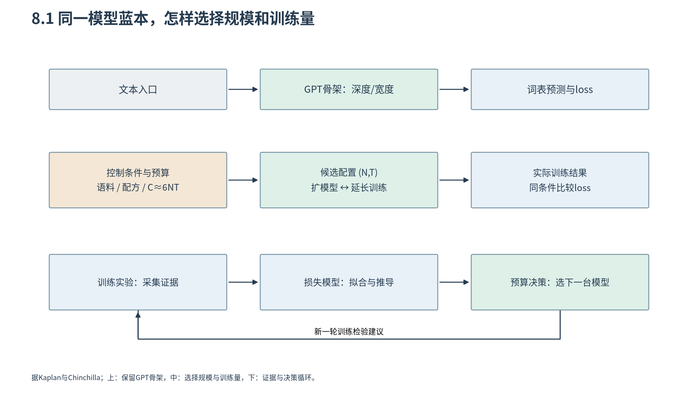
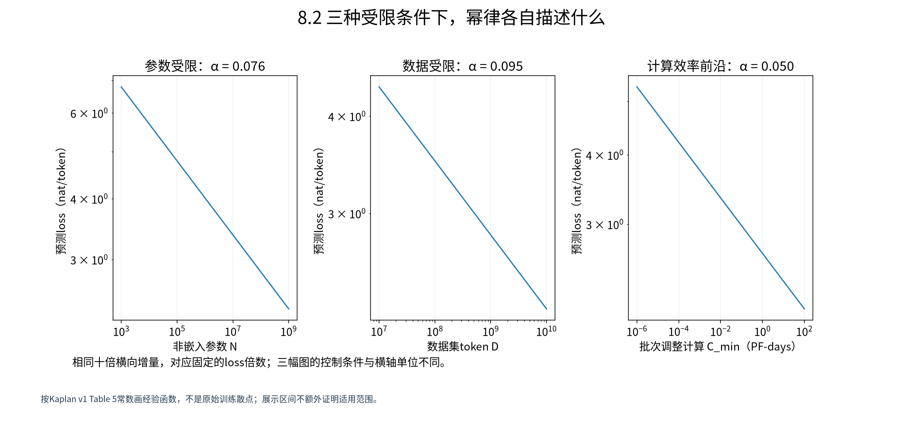
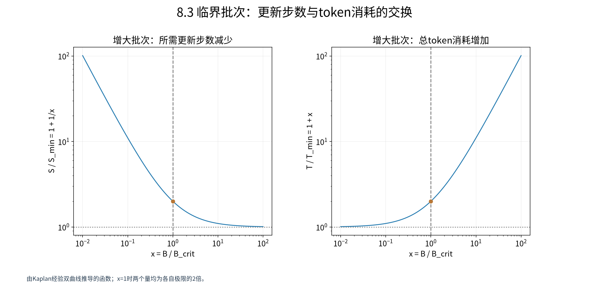
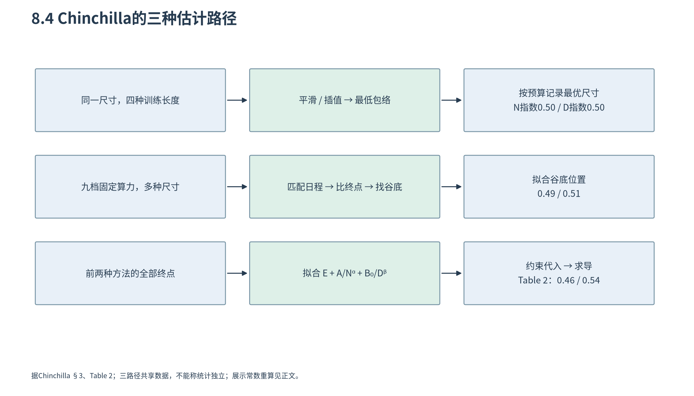
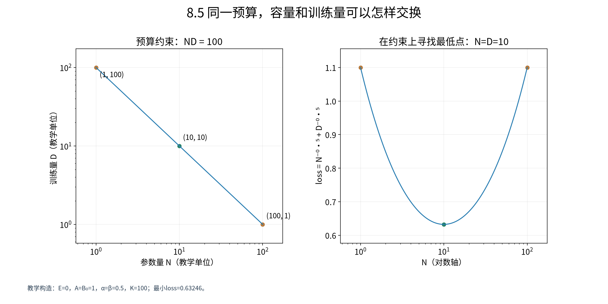
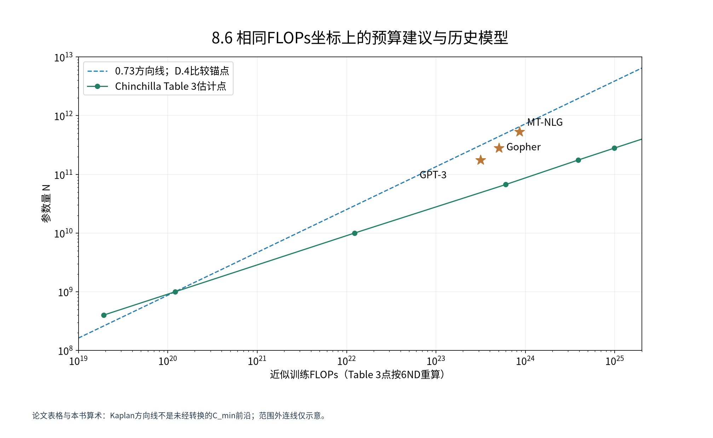
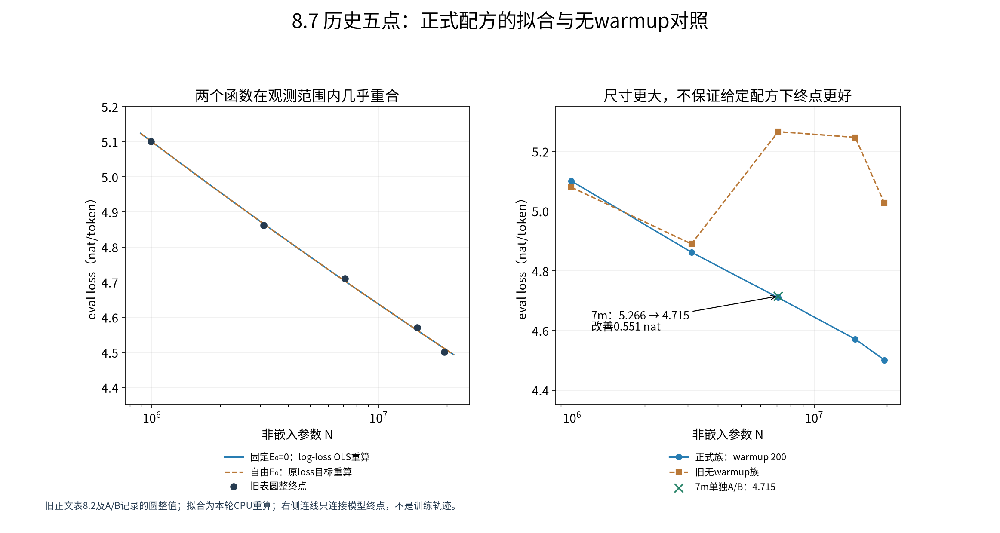
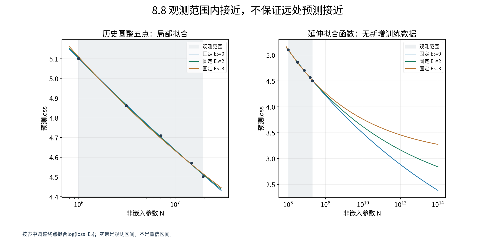

# 第8章　Scaling Laws：怎样把训练预算分给模型与数据

## 8.0 已经会改模型，接下来决定训练哪一台

前几章沿同一副 Transformer 基础讨论了不同目标、接口与训练配方。第7章把规模推到 GPT-3 的175B参数，并观察到上下文学习等现象。现在模型设计者面对的问题更具体：预算有限，是把网络做大一些、少训练一些，还是缩小网络、让它看更多文本？**本章研究的是模型规模与训练计划的联合选择：用实验建立损失模型，再在计算约束下寻找较好的配置。** 注意力公式可以保持不变，整机的深宽、训练数据量和日程却会随之变化。

图8.1把这项工作放回全册。第5章 T5 比较了增加模型、步数等不同用法，第6章 RoBERTa 说明配方影响结果，第7章展示更大模型的表现；本章把这些问题变成一份可以计算、也可以检验的预算建议。第9章再问建议能否装入设备、如何稳定执行，第11章用同族模型与等算力实验继续验证。



图的中央不是一个新网络层，而是实验—拟合—决策的循环。训练结果提供证据，数学把假设写清并推出预算分配，新的训练再检验建议。箭头不能反过来理解为“从 Transformer 定义必然推出一条固定规模定律”。

本章保留原来的展开顺序：先读 Kaplan 的不同经验关系，再理解 Chinchilla 的三种估计方法，讨论两者为什么不同，最后回到旧版五个小模型的实验。原稿中几处重要的跳跃将在正文补齐：$6ND$从哪里来，批次和步数怎样参与最优分配，拟合函数怎样导出最优点，以及一条很好看的曲线为什么仍可能无法外推。

> **记号约定**：$N$为参数规模，本章涉及Kaplan及本地族时采用非嵌入口径；$D$为可用训练数据集的token数量；$T$为累计处理的token次数；$B$为每步处理的token数；$S$为优化步数；$C$为训练计算量；$\ell$为平均交叉熵，单位nat/token。单次通过且每个位置只消费一次时 $T=D$，重复训练时则不能混用。Chinchilla原文用$D$表示训练token数量，引用其模型时我们沿用该字母，并明确它承担训练长度的角色。所有这些量均为标量。

## 8.1 预算表为什么先预测损失

**规模关系首先帮助我们估计：在相近的数据、模型族与训练协议下，增加资源能降低多少预测损失。** 它不是“花多少钱买多少智能”的无条件换算。损失与任务表现有关，却不是所有能力指标的充分描述；以损失做预算目标，是因为它连续、直接参与优化，并能在明确评测文本上比较。

### 8.1.1 从倍数变化理解幂律

幂律将相同倍数的资源增长对应到相同的损失比例，因此对数轴能把它显示成直线。这个性质便于比较预算回报，但只在拟合范围和相应实验条件内使用；它不等于任何能力都按同一比例改善。

假设一组实验在一定范围内近似满足 $\ell=A N^{-\alpha}$，$A>0,\alpha>0$。把模型扩大 $r$ 倍，则：

$$
\frac{\ell(rN)}{\ell(N)}
=\frac{A(rN)^{-\alpha}}{AN^{-\alpha}}
=r^{-\alpha}.
\tag{8.1}
$$

这个式子说的是相对回报：同样的倍数扩张，对应相同的损失比例，而不是相同的绝对下降。若 $\alpha=0.076$，十倍参数对应损失乘 $10^{-0.076}\approx0.8395$，约下降16.1%。是否真能得到这种回报，需要先确认模型、数据和优化是否处于拟合关系的适用范围。

取自然对数可得：

$$
\log\ell=\log A-\alpha\log N.\tag{8.2}
$$

于是双对数图上斜率为 $-\alpha$。横坐标从1到10和从10到100的距离相同，因为它表示相同倍数；不能按普通线性坐标读出“后一段只增加了同样几个参数”。如果关系中还有一个损失下限 $E$，即 $\ell=E+AN^{-\alpha}$，直线对应的是 $\log(\ell-E)$，不是无条件的 $\log\ell$。稍后小模型实验会展示，估计这个 $E$ 本身就可能很困难。

这条思路并非从大语言模型才开始。第1章的词向量研究已经比较过向量维度、语料规模与类比任务精度。Kaplan等把重点放在语言模型交叉熵及计算预算上，使它更直接服务预训练计划。第7章讨论的能力指标可以有阈值或离散评分；连续损失则更方便建立经验响应曲面，但也必须承认它与具体能力之间仍有一层关系要检验。[S1，§1、§7]

### 8.1.2 “多大、多长、多少算力”不是同一个量

训练成本的近似系数6来自线性层的一次前向和两次主要反向矩阵乘。它把模型规模与训练量连在一起，也说明“多见到数据”和“反复处理同一数据”不能混为一谈；长上下文与实际设备开销还需要另外核算。

先把参数与计算联系起来。一个线性层的输入 $X\in\mathbb R^{M\times a}$，权重 $W\in\mathbb R^{a\times b}$，输出 $Y=XW\in\mathbb R^{M\times b}$。$M$表示本次参与计算的token位置数。按一次乘法、一次加法各计一个FLOP的惯例，前向主项为 $2Mab$；反向的两个矩阵乘为：

$$
\frac{\partial\ell}{\partial X}=\frac{\partial\ell}{\partial Y}W^\top,
\qquad
\frac{\partial\ell}{\partial W}=X^\top\frac{\partial\ell}{\partial Y}.
\tag{8.3}
$$

其形状分别为 $(M,b)\cdot(b,a)\to(M,a)$ 和 $(a,M)\cdot(M,b)\to(a,b)$，每项主成本也约 $2Mab$。因此训练这层、处理 $M$ 个位置的主要计算为 $6Mab$。把各矩阵参数相加近似为 $N$，把全程处理的token次数相加为 $T$，得到：

$$
C\approx6NT=6NBS;\qquad\text{若单次通过， }T=D,\text{才写为 }C\approx6ND.
\tag{8.4}
$$

这里的6来自前向与反向计算，不是经验拟合指数。公式忽略了注意力分数与加权读取、非线性、归一化、优化器、通信及重计算等开销。以单层为例，QK转置相乘和注意力读取V的前向主项合计约 $4n^2d$；而常见宽度配置的层内参数约 $12d^2$。上下文越长，位置二次项越不能忽略。因此式(8.4)适合做指定密集模型范围内的预算近似，不是设备时间的精确预测。

这也说明数据集大小与训练长度为何要分开。100万个token的数据重复10次，$D$仍是100万，$T$约为1000万；计算花了十遍，但新信息并没有随计数自动变成十倍。原第4章的字符实验就反复消费小语料；本章后半的模型族则明确采用单次通过。

最后统一单位。一个 PF-day 指 $10^{15}$ FLOP/s 持续一天：

$$
1\ \text{PF-day}=10^{15}\times86400
=8.64\times10^{19}\ \text{FLOPs}.
\tag{8.5}
$$

GPT-3 约 $3.14\times10^{23}$ FLOPs 对应约3634 PF-days。它是运算数量，不表示一台标称设备必定需要这些天；设备有效吞吐、并行效率和执行开销还没有进入这个单位换算。第9章才把算法账本与实际资源联系起来。

## 8.2 Kaplan：从不同限制到计算最优路线

**Kaplan 的核心贡献，是把参数不足、数据不足和训练不足区分开，并用经验关系描述它们怎样影响损失。** 在其计算效率分析中，更大的模型可以用较少训练进度达到目标，于是有限预算倾向于“大一些的模型、在完全收敛前停止”。这项建议需要损失—规模—训练进度的模型支持，不能仅从 $C=6ND$ 或两条单变量曲线直接推出。

### 8.2.1 先看三组实验各自在限制什么

参数受限实验尽量提供足够数据和训练，让参数数量成为主要限制；数据受限实验则让模型足够大，并通过早停控制过拟合；计算受限实验要在预算内比较不同模型和训练长度的最佳结果。这三个问题的横轴可以分别是 $N,D,C$，但控制条件并不相同。

参数与数据的单变量关系写为：

$$
\ell(N)=\left(\frac{N_c}{N}\right)^{\alpha_N},\qquad
\ell(D)=\left(\frac{D_c}{D}\right)^{\alpha_D}.
\tag{8.6}
$$

在调整到计算高效训练的口径后，还得到：

$$
\ell(C_{\min})=\left(\frac{C_c^{\min}}{C_{\min}}\right)^{\alpha_C^{\min}}.
\tag{8.7}
$$

$C_{\min}$不是所有实验实际使用的原始计算量，而是经过批次效率调整后估计的最低计算量，8.2.3节会说明。表8.1保留论文的拟合数值。

|关系|指数|比例常数及单位|条件提醒|
|---|---|---|---|
|参数受限|$\alpha_N=0.076$|$N_c=8.8\times10^{13}$，非嵌入参数|数据和训练足够充足的拟合|
|数据受限|$\alpha_D=0.095$|$D_c=5.4\times10^{13}$ token|较大模型、合适早停|
|固定批次下的计算曲线|$\alpha_C=0.057$|$C_c=1.6\times10^7$ PF-days|尚未调整批次效率|
|计算效率调整后|$\alpha_C^{\min}=0.050$|$C_c^{\min}=3.1\times10^8$ PF-days|不同模型/进度的有效前沿|

表8.1来自固定v1的附录A **Table 5**；Table 4列的是关系式，Table 6列最优配置。旧稿把后两张的编号前移了一位，本轮对PDF第20页逐格核对后修正。常数的大小用于确定拟合曲线的位置，不是“建议实际训练到 $N_c$”的目标；远远超出实验范围时，不能把代数可计算误当成外推有效。



图8.2按表8.1常数重绘曲线，不是原论文训练散点。三个横轴和单位不同；各自线段的斜率说明相对响应，不能因为图上都画成直线就认为实验条件相同。[S1，§1.2、附录A]

这里的 $N$排除嵌入，主要计层内矩阵。宽度 $d$、层数 $L$、FFN宽 $4d$ 时，主项为 $N\approx12Ld^2$。第4章的GPT-2小档总量约124.44M，去掉词嵌入和位置表后约85.06M。Kaplan报告，不计嵌入能得到更清楚的规模趋势；这是一项实验计量选择，不表示嵌入没有训练成本。小模型词表很大时，两种计数差距尤其明显。[S1，§2.1、§3.2]

### 8.2.2 联合式怎样连接两种限制

**联合模型表达的是两种限制怎样同时存在：参数再多，有限数据仍会限制损失；数据再多，有限模型仍有容量限制。** 这份经验模型必须同时符合两个极限，但符合极限并不能唯一确定它的形式。下面的式子来自拟合选择，而非把式(8.6)机械相加。

Kaplan 使用：

$$
\ell(N,D)=\left[\left(\frac{N_c}{N}\right)^{a/b}+\frac{D_c}{D}\right]^b.
\tag{8.8}
$$

本小节用 $a,b$指联合拟合指数，避免和表8.1的不同拟合结果混用：$a=0.076,b=0.103,N_c=6.4\times10^{13},D_c=1.8\times10^{13}$。[S1，式1.5、Table 2]

先固定 $N$令 $D\to\infty$，第二项趋0，幂的乘积 $(a/b)b=a$，所以恢复 $(N_c/N)^a$。反过来令 $N\to\infty$，第一项趋0，恢复 $(D_c/D)^b$。两端都合理，中间怎样过渡仍要靠数据检验。

再把有限数据相对于无限数据的额外损失写出来。设 $u=(N_c/N)^{a/b}$，则 $\ell(N,\infty)=u^b$，因而：

$$
\begin{aligned}
\delta(N,D)
&=\frac{\ell(N,D)}{\ell(N,\infty)}-1\\
&=\left[1+\frac{D_c}{D}\left(\frac{N}{N_c}\right)^{a/b}\right]^b-1.
\end{aligned}\tag{8.9}
$$

比值中的无量纲项 $r=(D_c/D)(N/N_c)^{a/b}$ 决定数据惩罚。若希望相对惩罚不超过某个 $\delta_0>0$，逐步移项得：

$$
(1+r)^b\le1+\delta_0
\ \Rightarrow\ 
r\le(1+\delta_0)^{1/b}-1
\ \Rightarrow\ 
D\ge\frac{D_c(N/N_c)^{a/b}}{(1+\delta_0)^{1/b}-1}.
\tag{8.10}
$$

这才解释“维持同样的数据惩罚时，数据规模怎样随模型增长”：指数为 $a/b\approx0.738$，所以模型扩大8倍时，所需数据约扩大 $8^{0.738}\approx4.64$倍，约为5倍。论文结合其容许损失变化给出经验边界 $D\gtrsim5\times10^3N^{0.74}$。它描述特定实验范围内的过拟合控制，不是所有语料上的最少训练数据定理，更不是已经得到了同算力最优配置。[S1，§4.2，式4.2–4.4]

最后这一区别很重要。式(8.8)研究的是模型与有限数据的限制，早停是实验条件的一部分；计算最优还要知道达到某个损失需要训练多少步。原稿从这里直接跳到0.73/0.27，缺少的正是训练进度这一环。

### 8.2.3 临界批次：少花计算与少走步数如何取舍

**增大批次能减少达到目标损失所需的优化步数，但当批次超过一定范围，更多样本带来的额外信息会递减。** 因此最少步数与最少token处理量不是同一个目标。Kaplan利用临界批次修正实验的计算效率，使不同规模的训练过程有可比较的进度坐标。

先固定某个目标损失。令 $S_{\min}$ 是达到它所需步数的理想下限，$T_{\min}$ 是处理token数量的理想下限。论文采用的经验关系为：

$$
\left(\frac{S}{S_{\min}}-1\right)
\left(\frac{T}{T_{\min}}-1\right)=1,
\qquad T=BS,\qquad
B_{\rm crit}=\frac{T_{\min}}{S_{\min}}.
\tag{8.11}
$$

这个关系来自批次规模与训练效率研究，不能由普通梯度平均的方差公式单独证明。我们在接受该经验模型后，看看它推出什么。[S1，§5.1，式5.1–5.2]

令 $s=S/S_{\min}$、$b=B/B_{\rm crit}$，则 $T/T_{\min}=bs$。代回后 $(s-1)(bs-1)=1$，展开并约去两边常数，得到 $bs^2-(b+1)s=0$。取正的训练步数解：

$$
S=S_{\min}\left(1+\frac{B_{\rm crit}}B\right),\qquad
T=T_{\min}\left(1+\frac B{B_{\rm crit}}\right).
\tag{8.12}
$$

于是三种情况变得清楚：小批次 $B\ll B_{\rm crit}$ 时，$T$接近最低，但需要很多步；大批次时，$S$接近最低，却处理更多token；取临界批次时，二者都是各自下限的两倍。图8.3按这两个无量纲关系作图。



图8.3横轴是 $B/B_{\rm crit}$，不是绝对batch数。两条曲线分别标步数倍数和token倍数；交点为 $(1,2)$。**小批次不等于浪费算法算力**：在这个模型下，它接近最低token消耗。但它可能无法充分利用硬件并行，导致实际训练时间较长。这正是算法计算量、更新步数与墙钟时间必须分开的原因。

对实际在批次 $B$训练的运行，关系还给出：

$$
S_{\min}=\frac{S}{1+B_{\rm crit}/B},\qquad
C_{\min}=\frac{C}{1+B/B_{\rm crit}}.
\tag{8.13}
$$

这就是式(8.7)里的计算调整。原论文又发现，临界批次随目标损失近似满足 $B_{\rm crit}(\ell)=B_*\ell^{-1/b}$，$B_*=2.1\times10^8$ token、$b\approx0.21$。损失降低时临界批次增大；这与梯度噪声相对于有用更新的尺度有关，不能写成“训练越深，梯度噪声一定越小”。论文直接使用其经验测量来做后续分析。[S1，式5.3–5.5、Table 5]

### 8.2.4 从训练进度模型到最优分配

**更大模型的收敛极限较低，但给定计算下，它能完成的训练进度也更少；最优配置平衡这两种损失。** 这份平衡解释了Kaplan的大模型优先与早停建议，也说明其指数需要训练动力学的经验输入，不能只靠参数与数据的乘积约束。

论文对有效训练步数拟合：

$$
\ell(N,S_{\min})=\left(\frac{N_c}{N}\right)^a+
\left(\frac{S_c}{S_{\min}}\right)^s,
\qquad a>0,\ s>0.
\tag{8.14}
$$

第一项是这个模型足够训练后的剩余损失，第二项是有限进度的额外损失。Table 3给出 $a=0.077,s=0.76,N_c=6.5\times10^{13},S_c=2.1\times10^3$。这些是训练曲线拟合的常数，不是把表8.1两条曲线拼起来得到的。[S1，§5.2]

从 $T_{\min}=B_{\rm crit}S_{\min}$ 和 $C_{\min}=6NT_{\min}$ 出发，代入 $B_{\rm crit}=B_*\ell^{-1/b}$，得：

$$
S_{\min}=\frac{C_{\min}\ell^{1/b}}{6NB_*},\qquad
\ell=A N^{-a}+K N^s C_{\min}^{-s}\ell^{-s/b},
\tag{8.15}
$$

其中 $A=N_c^a$，$K=(6B_*S_c)^s$。请注意最后一项里也出现了 $\ell$：目标损失影响临界批次，进而影响训练进度，所以这是隐式关系。它正是这一推导比简单约束优化多出来的依赖。

在固定 $C_{\min}$ 下令 $\ell'=\mathrm d\ell/\mathrm dN$。分别对右边求导：

$$
\ell'=-aAN^{-a-1}
 +sKN^{s-1}C_{\min}^{-s}\ell^{-s/b}
 -\frac{s}{b}KN^sC_{\min}^{-s}\ell^{-s/b-1}\ell'.
\tag{8.16}
$$

最后一项来自隐式的损失依赖，不能漏掉。最优候选处 $\ell'=0$，该项消失；乘以 $N$ 后得到：

$$
aAN^{-a}=sKN^sC_{\min}^{-s}\ell^{-s/b}.
\tag{8.17}
$$

所以有限进度损失等于容量项的 $a/s$ 倍，而总损失为 $\ell=(1+a/s)AN^{-a}$。它回答了“为什么不训到完全收敛”：在这个预算模型下，继续压低第二项意味着少给模型分配参数；最优点保留了一个有限训练差额。

由 $N\propto\ell^{-1/a}$、$S_{\min}\propto\ell^{-1/s}$、$B_{\rm crit}\propto\ell^{-1/b}$，计算量为三者乘积，因此：

$$
C_{\min}\propto\ell^{-(1/a+1/s+1/b)},\qquad
\eta=\frac1{1/a+1/s+1/b},\qquad
\ell_*\propto C_{\min}^{-\eta},\quad
N_*\propto C_{\min}^{\eta/a}.
\tag{8.18}
$$

若只关心累计token消耗，由 $T_{\min}=C_{\min}/(6N_*)$，其指数就是 $1-\eta/a$。这一步与第4章的推导方式相同：先把依赖逐项写清，再收成可以记住的关系。参数指数来自容量、进度与批次三种经验响应共同作用。

这组关系还确实对应一个最优点，而不只是任意驻点。把式(8.15)移项，给定目标损失 $\ell$ 时要有 $AN^{-a}<\ell$，并且所需计算量正比于 $N\ell^{-1/b}(\ell-AN^{-a})^{-1/s}$。当模型小到容量项逼近目标损失时，括号趋0，所需计算发散；当模型无限增大时，线性因子 $N$使计算再次增大。中间的驻点满足式(8.17)，可以解出唯一的容量项比例，因此是该经验模型正域内的最低计算点。它不证明真实训练曲面处处都服从这个形式。

**数值口径说明。** 论文实验前沿报告 $N_*\propto C_{\min}^{0.73}$、$D_*\propto C_{\min}^{0.27}$（单次通过口径），以及批次/步数的约0.24/0.03指数；这些是经验拟合值。将上面列出的圆整常数 $a=0.077,s=0.76,b=0.21$ 代入式(8.18)，得到 $\eta\approx0.0525$、参数指数约0.681。原文§6.2给出约0.71的模型预测，附录B另给约0.052的损失指数。展示的近似数并不能逐位闭合；本章保留经验结果、展示值重算与原文近似的区别，不为了得到0.73反改代数。[S1，§6.1–6.2、Table 6、附录B]

因此“算力扩大十倍，参数约扩大5.37倍、数据约扩大1.86倍”是按经验0.73/0.27得到的预算摘要；它不等于普遍定理。Kaplan的意义在于给出了一条可检验的计算高效路线。下一节将看到，研究者扩大实验范围并改变训练长度的处理后，这条路线如何发生明显变化。

## 8.3 Chinchilla：用三种方法寻找同一预算下的最优模型

Chinchilla改变的首先是训练资源的分配方式：扩大模型时，也应显著增加训练token，而不是让参数增长远快于数据。这个建议来自三种估计方法和后续模型训练，不是由Transformer结构直接推出的定理。我们先看研究者怎样找到最优点，再完整推导参数化模型中的预算关系；这样，“模型与数据大致同步增长”就有了可检查的来路。[S2]

论文开篇列出的配置说明了问题的实际背景：

| 模型 | 参数 | 训练token | token/参数，本书计算 |
|---|---:|---:|---:|
| GPT-3 | 175B | 300B | 1.71 |
| Jurassic-1 | 178B | 300B | 1.69 |
| Gopher | 280B | 300B | 1.07 |
| MT-NLG | 530B | 270B | 0.51 |

模型规模在增长，训练token却大致停在同一档。它与“大模型、相对少的数据”的方向相符，但不能据此断言这些团队都按Kaplan定律制定了方案。Chinchilla要检验的是：**如果训练计算量保持不变，把一部分参数预算转成数据预算，会不会得到更好的模型？**

为此，研究者训练了400多个模型。摘要报告的范围是70M至16B以上参数、5B至500B训练token；这是一组同时改变模型和训练长度的实验，而不是沿一条固定数据量的曲线测几个模型。下面三种方法使用这批相关实验，从不同角度估计最优分配。它们并非统计独立的三批证据，尤其方法三直接使用前两种方法的终点。[S2，§1、§3]

### 8.3.1 方法一：从训练曲线中找出最低包络

第一种方法保留训练过程：在每一个计算预算上，找出所有候选训练曲线中损失最低的一条，再记录它属于哪个模型。它直接回答“如果我恰有这么多算力，已经试过的方案中哪个最好”，代价是结果依赖候选模型、训练长度的覆盖和曲线插值。

操作分成四步。

1. 固定若干模型尺寸，从70M到10B以上。每种尺寸训练四次，每次预先指定不同的训练token总量；最长与最短跨度相差16倍。
2. 每次训练的余弦学习率日程都与其计划长度相配，最终降至峰值的十分之一。于是“训得短”不是从一条长日程上随意截断，而是一项有自己完整日程的方案。
3. 对损失曲线平滑、插值。在同一横坐标 $C$ 处比较所有曲线，选出最低损失，并记下该点的 $N$ 和已消费token数 $D$。
4. 在1500个按对数间隔排列的预算上重复选择，再拟合 $N_*(C)$ 与 $D_*(C)$。

“包络”可以这样读：若横向看一条曲线，它是一个模型的训练历程；若竖着切过所有曲线，最下面那个交点就是该预算下的候选最优方案。随着预算增加，最低点可能从小模型切换到大模型。论文得到 $N_*\propto C^{0.50}$、$D_*\propto C^{0.50}$。其选出的点都位于各自训练日程的最后15%内，这也提示终段学习率衰减影响了比较结果。[S2，§3.1、Figure 2及脚注4]

这些指数不是把1500个点当作1500次独立训练得来的。它们大部分是对已有曲线的插值；平滑程度和网格密度不能创造新的实验信息。

### 8.3.2 方法二：沿等算力截面寻找谷底

第二种方法只比较完整训练的终点。在给定预算下，小模型可以读更多token，大模型只能读更少token；把这些方案的最终损失画在一起，就能看到两种不足之间的平衡。它比包络法更直接地检验最终配置，但只有真正覆盖谷底两侧，才能可靠地判断最优规模。

研究者选了九档计算预算，从 $6\times10^{18}$ 到 $3\times10^{21}$ FLOPs。每档预算扫描多种参数量，最大模型到16B；训练token由预算约束确定。用本章的近似成本式表示就是 $D=C/(6N)$，实际论文还使用附录F的计算核算。

例如在某一固定 $C$ 下，若把 $N$ 加倍，能支付的 $D$ 就减半。因此比较的不是“大模型与小模型谁的容量更大”，而是“大模型少训练与小模型多训练谁的最终损失更低”。每个方案的学习率衰减长度都匹配自己的训练长度。把终点损失对参数量画成等算力曲线，再对谷底附近作抛物线拟合，估计最优参数量。

论文得到 $N_*\propto C^{0.49}$、$D_*\propto C^{0.51}$。如果某档实验只有一侧下降，没有看到损失重新上升，就不能把边界上的最低点当成已找到内部最优点；它更可能是在提示需要扩大搜索范围。[S2，§3.2、Figure 3]

### 8.3.3 方法三：把所有终点拟合成一张损失曲面

第三种方法把参数不足与训练不足写成两个可拟合的项，从而得到可以代入预算约束、求导和外推的函数。好处是分配关系可解释；风险是曲面形式本身也是假设。式子拟合得好，并不能证明真实损失恰好由两个相互独立的物理过程相加而成。

论文采用：

$$
\widehat\ell(N,D)=E+A N^{-\alpha}+B_0D^{-\beta},
\qquad A,B_0,\alpha,\beta>0.
\tag{8.19}
$$

这里用 $B_0$ 表示拟合系数，避免与批次 $B$ 混淆。$E$ 是模型中不可继续降低的损失项；$AN^{-\alpha}$ 表示有限模型容量带来的差额；$B_0D^{-\beta}$ 表示有限数据和训练进度带来的差额。$D$ 在这里是训练实际见到的token数。$E$ 的解释与数据分布的熵有关，但拟合到的 $E$ 不是对自然语言熵的无条件测量，更不能跨分词器直接比较。

设第 $i$ 次实验的终点为 $(N_i,D_i,\ell_i)$。论文在对数损失上拟合，残差为 $r_i=\log\widehat\ell(N_i,D_i)-\log\ell_i$，最小化 $\sum_i H_\delta(r_i)$。Huber函数为：

$$
H_\delta(r)=
\begin{cases}
\frac12r^2,&|r|\leq\delta,\\
\delta(|r|-\frac12\delta),&|r|>\delta.
\end{cases}
\tag{8.20}
$$

小残差用平方惩罚，大残差改为线性增长，减少个别偏离点对拟合的支配；这不等于自动识别了异常原因。研究者使用 $\delta=10^{-3}$、L-BFGS优化和多组初值，报告 $E=1.69,A=406.4,B_0=410.7,\alpha=0.34,\beta=0.28$。多初值帮助寻找较好的拟合点，但不使预设曲面成为定理。[S2，§3.3、附录D.2]



图8.4的三行分别保留训练轨迹、比较等算力终点、拟合全部终点。读图时沿每一行从左到右看“输入是什么、怎样寻找最优、最终估计什么”。共同终点是 $N_*(C),D_*(C)$，三条路径的依赖不同，但实验数据有重叠。图据[S2]§3自绘，不是论文数据曲线。

### 8.3.4 从损失曲面推到预算分配：每一步为什么成立

这一推导给出一个明确的模型设计判断：最优配置不是让参数项与数据项数值相等，而是让它们对**相同比例的预算调整**产生相等的边际作用。在假设曲面和 $C=\kappa ND$ 成立时，参数与数据的增长指数由两个损失指数共同决定。接下来我们把预算、求导、最优性和比例关系依次接起来。

设 $\kappa$ 为每参数每训练token的近似成本，前面的粗核算取 $\kappa=6$。固定预算 $C$ 后，定义 $K=C/\kappa$，于是：

$$
ND=K,\qquad D=\frac K N,\qquad
f(N)=E+AN^{-\alpha}+B_0K^{-\beta}N^\beta.
\tag{8.21}
$$

原来是二维的 $(N,D)$ 选择，现在只剩一维。随着 $N$ 增大，第二项下降，第三项上升：更多容量减少容量不足，却挤掉了训练token。$E$ 与分配无关，只平移整条曲线。

分别对两项求导：$\mathrm d(AN^{-\alpha})/\mathrm dN=-\alpha AN^{-\alpha-1}$；$\mathrm d(B_0K^{-\beta}N^\beta)/\mathrm dN=\beta B_0K^{-\beta}N^{\beta-1}$。令两者和为零，再乘以正数 $N$：

$$
\alpha AN^{-\alpha}=\beta B_0K^{-\beta}N^\beta
=\beta B_0D^{-\beta}.
\tag{8.22}
$$

左边是参数量增加一个小比例时，容量项下降的幅度；右边是为它让出预算、减少同一比例的token时，训练项增加的幅度。两者相等，才没有继续沿预算曲线改善损失的方向。只有在 $\alpha=\beta$ 时，两项损失本身才相等。

现在解出 $N$。两边同乘 $N^\alpha K^\beta/(\beta B_0)$，得到 $N^{\alpha+\beta}=\frac{\alpha A}{\beta B_0}K^\beta$。记：

$$
G=\left(\frac{\alpha A}{\beta B_0}\right)^{\!1/(\alpha+\beta)},\qquad
N_*=G\left(\frac C\kappa\right)^{\!\beta/(\alpha+\beta)},\qquad
D_*=G^{-1}\left(\frac C\kappa\right)^{\!\alpha/(\alpha+\beta)}.
\tag{8.23}
$$

$D_*$ 的式子直接由 $K/N_*$ 得到。两个指数相加为1，符合 $ND=K$；**参数量的指数包含的是数据项的 $\beta$**，不能只凭名字把它写成 $\alpha/(\alpha+\beta)$。

这个驻点一定是模型内的最小值吗？令 $z=\log N$，把式(8.21)写成 $g(z)=E+Ae^{-\alpha z}+B_0K^{-\beta}e^{\beta z}$。二阶导数为：

$$
g''(z)=\alpha^2Ae^{-\alpha z}
 +\beta^2B_0K^{-\beta}e^{\beta z}>0.
\tag{8.24}
$$

函数在对数参数轴上严格凸；当 $z$ 向任意一端无穷延伸，总有一项发散，所以该驻点是唯一的全局最小值。这是**拟合函数的性质**。实际模型只能取某些层数、宽度和头数，训练还有显存、吞吐和并行约束；连续最优点最终要映射到可实现的邻近配置。

用一个不依赖论文常数的小例子检查。取 $E=0,A=B_0=1,\alpha=\beta=1/2,K=100$。最优是 $N=D=10$，损失 $1/\sqrt{10}+1/\sqrt{10}\approx0.63246$；取 $N=1,D=100$ 或反过来，损失都为 $1.1$。预算没有变，变的是容量不足与训练不足的比例。这里的 $N,D$ 是无量纲教学单位，不能当作十参数模型实验。



图8.5左侧的曲线是 $ND=100$，三个点计算量相同；右侧把同一约束代入损失，最低点落在 $(10,10)$。沿预算曲线走，是用训练量交换容量。图为上述教学构造，不是Chinchilla实验曲线。

代入论文展示的圆整指数 $\alpha=0.34,\beta=0.28$，式(8.23)给出约0.4516与0.5484；论文Table 2对方法三另报告0.46/0.54。展示常数重算与表中值并不精确相同，本章分别保留，不把0.548直接写成“四舍五入等于0.54”，也不在未取得完整拟合精度时替论文猜原因。三种方法共同支持的结论是**大致均衡增长**，不是三组数字完全相等。

### 8.3.5 “每参数约20个token”从哪里来，又不能怎样使用

近似相同的增长指数意味着最优token/参数比随预算变化较慢；比例的具体数值还取决于拟合常数、语料与训练配方。“20”可以帮助理解论文表格，却不能取代完整的预算问题，也不是所有模型必须遵守的架构常数。

由式(8.23)直接相除：

$$
\frac{D_*}{N_*}=G^{-2}
\left(\frac C\kappa\right)^{(\alpha-\beta)/(\alpha+\beta)}.
\tag{8.25}
$$

只有 $\alpha=\beta$ 时，这个比例才严格不随预算改变；即使如此，其数值仍是 $G^{-2}$，并不由“两个指数相等”自动确定为20。对不完全相等的指数，比例还会缓慢变化。

论文方法一的Table 3给出如下估计，本章将原有数据保留在这里：

| 最优参数量 | 训练token估计 | token/参数，本书计算 |
|---|---:|---:|
| 400M | 8.0B | 20.0 |
| 1B | 20.2B | 20.2 |
| 10B | 205.1B | 20.51 |
| 67B | 1.5T | 22.39 |
| 175B | 3.7T | 21.14 |
| 280B | 5.9T | 21.07 |
| 1T | 21.2T | 21.2 |
| 10T | 216.2T | 21.62 |

这是模型估计和圆整后的表格，不能写成“所有实测点严格20–21”。参数化方法外推到175B时，正文又给出超过4.2T token、约24 token/参数的估计。原论文并没有把社区常说的“20 tokens per parameter”作为适用于所有预算的定理；它还明确指出，万亿参数模型只有在极大的计算预算下才可能是该估计中的最优选择。[S2，§3.4、Table 3]

这里最容易混淆两种建议。GPT-3实际训练量300B，只相当于上表175B一行3.7T的约8.1%；这说明**若坚持175B参数**，按照该估计还需要更多训练计算。它不是说原预算不变，就能额外训练十二倍数据。**若预算固定**，则必须把模型缩小，腾出计算去增加token。前者问“这个尺寸需要多少钱才能充分利用”，后者问“手头这笔钱该选多大模型”。

### 8.3.6 预算建议如何回到真实模型

最终的检验仍是训练模型。Chinchilla选择70B参数、1.4T训练token，与280B参数、300B token的Gopher作近似同预算比较：参数减少，训练量增加。原文Figure 2用 $5.76\times10^{23}$ FLOPs标记Gopher预算，附录F的详细核算给约 $6.3\times10^{23}$；不同成本口径不能混成精确一致的数字。

论文Table 6报告的MMLU 5-shot平均分为Chinchilla 67.6、Gopher 60.0、GPT-3 43.9。MMLU的57个任务中，Chinchilla对Gopher为51胜、2平、4负。因此可以说总体显著改善，不能把它改写成每一个任务都获胜；只有Gopher对照承担这里的同预算检验，其他更大模型的比较并不自动构成同预算控制实验。[S2，§4、Table 6、Figure 6]

这不是只靠一次实验就证明了整个损失曲面，而是给预算选择提供了一个有分量的验证点。其训练配方相对Gopher也有变化，不能把全部下游分数提升严格分解为参数和数据交换的净因果效应。

第5章T5的规模消融已经出现过相近问题：在增加约四倍资源的比较里，模型与步数各增两倍的GLUE读数86.18，高于只把模型增四倍的85.91。这个局部结果说明“预算还可以分给训练量”，却不能单独推出跨规模的0.5指数。Chinchilla的贡献在于系统扫描这条选择轴，并把经验关系组织成可检验的预算模型。

## 8.4 两篇论文为什么给出不同的分配建议

Kaplan与Chinchilla的差异提醒我们：规模规律包含训练方法的影响。要比较模型容量，必须同时说明每个候选模型怎样训练、曲线在哪里取样，以及拟合覆盖了多大的范围。Chinchilla重点讨论学习率日程与模型范围两项差异，并用额外训练检验预测；这些是具体证据，不意味着所有分歧已经被唯一地分解完毕。

### 8.4.1 长日程上的中间点，不等于短日程的终点

假设一个模型最终打算训练130B token，学习率随整个跨度衰减。训练到30B时，我们可以取出一个损失。另一种方案从一开始就只打算训练30B，并在这30B内完成衰减。两者见到的token数相同，却没有走过同样的优化路径，因此最终损失可以不同。

Chinchilla指出，直接使用长日程的中间损失，会低估较短训练方案的效果；日程长度大致匹配实际训练token通常得到更好的最终损失。于是 $\ell(N,D)$ 不能只看 $N,D$ 两个标签而忽略得到该点的训练过程。固定预算比较时，模型越大、可分配的token越少，各候选点的日程差异又会改变整个谷底的位置；不能只凭一句“小模型受罚更多”来推出偏移方向。[S2，§2、附录B]

Kaplan使用3000步线性warmup和余弦衰减，不是“没有warmup”。该论文也研究过日程，讨论收敛结果对多种日程形状相对不敏感；附录D.6同时要求足够的累积学习率、warmup和末端衰减。**完成训练后的形状不敏感，不等于任意中间点对日程不敏感。** 两个命题的条件不同。[S1，§2.2、附录D.6]

这一区别与模型架构直接相关：我们想知道扩宽或加深模型值不值得，但观察到的终点还混入了模型被训练到何种程度。训练策略不充分，可能让有潜力的配置看上去无效。

### 8.4.2 扩大模型范围，也是对函数形式的检验

Chinchilla把搜索范围扩到16B，并指出计算—损失前沿有轻微曲率。Kaplan包含更大模型，但大量支撑点较小；不能把“主要拟合点多在100M以下”改成“论文从未训练超过100M的模型”，其模型范围达到约1.5B。

一条局部近似直线向远处延伸，会把很小的曲率积累成明显偏差。对幂律来说，这正是“在当前范围内好用”与“能跨几个数量级预测”的差别。扩大范围不是给旧直线增加几个装饰点，而是在检验它是否需要改变斜率或函数形式。

Chinchilla附录D.4还做了一个直接对照：在 $10^{21}$ FLOPs预算下，Kaplan关系推荐约4.68B参数，方法一推荐约2.86B。实际训练的两个模型为4.74B和2.80B，使用相同深宽比、0.5M token批次、$1.5\times10^{-4}$ 峰值学习率及十倍衰减；后者在训练末端表现更好。这支持该预算和配方下的新建议，但不把一次比较升级成任意模型范围的证明。[S2，附录D.4、Figure A4]

| 比较项 | Kaplan实验关系 | Chinchilla实验关系 |
|---|---|---|
| 最优参数指数 | 经验约0.73 | 三方法约0.50、0.49、0.46 |
| 最优训练token指数 | 经验约0.27 | 约0.50、0.51、0.54 |
| 按0.73/0.27或0.5/0.5扩大十倍计算 | 参数×5.37，token×1.86 | 参数和token各×3.16 |
| token/参数比 | 随预算增大而下降 | 大致稳定或缓慢变化，取决于估计方法 |
| 计算口径 | 非嵌入参数、累计token；另有批次调整后的 $C_{\min}$ | $6ND$近似及附录F详细核算；不能默认与前者每项一致 |
| 关键取样方式 | 训练曲线与固定日程下的经验拟合 | 多训练长度、匹配长度的日程、等算力终点 |
| 应保留的限制 | 批次修正、数据与模型范围、收敛定义 | 候选网格、拟合形式、训练配方、外推跨度 |



图8.6保留旧稿“最优线对照”的问题，但重新标清来源：Chinchilla点取Table 3；Kaplan方向线使用0.73指数，并以[S2]附录D.4给出的4.68B、$10^{21}$ FLOPs为比较锚点。它是该锚点下的教学比较线，不是把 $C_{\min}$ 与原始FLOPs直接当作同一坐标。GPT-3、Gopher、MT-NLG的位置按Table 1的参数和token用 $6ND$统一近似计算；图中差距不等于逐模型严格复现实验。

保留旧论文的价值，不要求替每一项外推结论辩护；接受新证据，也不要求把前一项工作写成完全无效。对模型设计者而言，真正有用的是知道该更新哪一项预算判断、证据覆盖哪里。下一节的小模型实验，会把这种方法意识落到能逐点检查的曲线上。

## 8.5 亲手拟合一条幂律：五个小模型能告诉我们什么

这一实验保留旧稿的完整研究问题：在同一份数据、同一训练量和统一配方下，改变GPT模型尺寸，观察损失如何变化，再尝试幂律拟合。它能让我们检查日程、拟合与外推之间的关系；五个小模型不能验证论文的全部规模规律，更不能独立确定自然语言的损失下界。

**历史实验说明。** 本节数字、曲线来自旧稿及2026年10月实验记录，原环境为Apple M5 Pro、MPS bf16训练与fp32评估。现工作区仍有训练脚本、研究记录和导出图，但原 `log/book2-ch08/` 原始JSON/CSV不在。本轮保留历史结果并核查脚本和记录，以CPU重新检查可从汇总值计算的代数、参数和拟合；没有重新训练该模型族，也无法从缺失的日志逐步复算原曲线和bootstrap样本。下面的“历史结果”与“本轮重算”据此区分。

### 8.5.1 同一个GPT工厂，五组尺寸

模型沿用第4章的pre-LN因果单塔：token嵌入加学习式位置编码，经过若干自注意力与FFN残差块，末端归一化，再用绑定的嵌入权重得到词表logits。这里没有新增架构部件；变化是层数、宽度与头数，因此这是对已有骨架的**规模选择**实验。

训练语料是OpenWebText的1.15GB子采样，共232,920篇文档。sp-8k分词器先在另取的约29MB、6000篇文档上训练，避免用大词表掩盖小模型本体的参数差异；编码后得到307,317,199个token，平均约3.82字节/token。byte fallback使未登录字符可分解编码，而不是都落进同一个未知符号。语料包装层的许可不替代各原始网页的版权。

token流尾部的1,200,000个token作为评估池，其余306,117,199个token可用于训练。这个实现保证训练与评估使用不同的token区间；它**并不单凭切流就证明文档完全隔离、近重复已清除或语义无泄漏**。跨边界文档和重复文本仍需要额外审查。保留这一限制，比把它写成“构造上零泄漏”更准确。

一次输入的形状为 $(b,t)=(32,256)$，其中这里用小写 $b$ 表示序列条数，避免与本章以token计的批次 $B=bt=8192$ 混淆。嵌入后是 $(32,256,d)$，每个头维度64，头张量为 $(32,h,256,64)$；最后得到 $(32,256,8192)$ 的词表logits。左移一位的目标与这些logits计算平均交叉熵。

脚本 `run_family.py` 直接复用第4章 `warmup_ablation.py` 中的GPT/Block定义。因果遮罩、归一化与权重共享保持一致；五组配置如下：

| 点 | 层数、宽度、头数 | 非嵌入参数 $N$ | 历史eval终值 | 历史秒/步 | 历史耗时 |
|---|---|---:|---:|---:|---:|
| 1m | 5层、128维、2头 | 991,616 | 5.101 | 0.039 | 3.4分钟 |
| 3m | 7层、192维、3头 | 3,114,432 | 4.862 | 0.068 | 5.9分钟 |
| 7m | 9层、256维、4头 | 7,108,352 | 4.710 | 0.098 | 8.5分钟 |
| 15m | 12层、320维、5头 | 14,796,160 | 4.571 | 0.160 | 13.8分钟 |
| 20m | 11层、384维、6头 | 19,519,872 | 4.501 | 0.184 | 15.9分钟 |

这些 $N$ 排除token与位置嵌入，保留块和末层归一化参数。每块参数为 $12d^2+13d$，末层为 $2d$，故 $N=L(12d^2+13d)+2d$，可直接复核表格。15m到20m不是增加层数，而是减少一层、加宽；因此实验比较的是**这组尺寸配方**，不能把所有变化严格归因于一个独立的“参数量旋钮”。

### 8.5.2 训练协议怎样保证比较有意义

五个模型都使用同一段39,993,344个输入token，共4882步，每步8192个。每一步从流的不同位置连续取输入和右移目标；相邻步可能共享预测边界token，但训练输入位置不重复。这是约40M token的一次通过，而不是把一小段文本反复循环到40M次呈现。旧实验曾在约28万token上重复训练32轮，得到很差的幂律拟合（记录 $r^2\approx0.43$）；因此正式实验改为连续的一次通过。这个负结果说明重复使用小数据会改变问题，不代表重复训练在任何场景都无效。

统一配方为峰值学习率 $10^{-3}$、200步warmup、随后余弦下降至 $10^{-4}$，AdamW的两个动量参数为0.9/0.95，梯度裁剪阈值1.0。所有点的总步数、日程和数据相同。由于本实验固定训练token，这里的同日程比较是明确的控制；它并不保证每种尺寸已经达到各自的最优学习率或计算最优状态。

评估每500步进行一次，使用fp32前向。旧记录先在小模型训练500步后测得逐token损失标准差约2.50，再选择401,408个eval token，即49个8192-token窗口。如果把这些损失看作独立同分布，均值标准误为：

$$
\operatorname{se}_{\rm iid}=\frac{2.50}{\sqrt{401408}}\approx0.00395.
\tag{8.26}
$$

这个数量级解释了原协议为什么选40万token；它不能证明终点损失的总误差小于0.005。文本中的token相关，而且不同训练种子也会改变模型。设第 $i$ 个token损失为随机变量 $X_i$，一般的均值方差应为：

$$
\operatorname{Var}\!\left(\frac1n\sum_iX_i\right)
=\frac1{n^2}\left(\sum_i\operatorname{Var}(X_i)
+2\sum_{i<j}\operatorname{Cov}(X_i,X_j)\right).
\tag{8.27}
$$

只有协方差项为零且方差相同时，才退化成 $\sigma^2/n$。想认真估计数据抽样的不确定性，可以按独立文档或较长文本块重采样；想估计训练随机性，还要重训多个种子。旧实验没有完成这两层完整核验，因此表格末位是记录精度，不是误差保证。

还可用Kaplan临界批次式做一次**跨域量级代入**：损失4.6对应 $2.1\times10^8/4.6^{1/0.21}\approx1.47\times10^5$ token，8192约为其5.6%。但分词器、语料和模型范围都已改变，这不是本实验测得的临界批次。即使接受该近似，8.2节也告诉我们小批次更接近最少token消耗，只是需要更多串行更新、可能不能充分利用硬件；不能据此写成“小批次必然浪费算术计算”。

### 8.5.3 必须保留的负结果：无warmup时曲线倒挂

原实验首先跑了无warmup版本，五个终点依次是5.080、4.890、5.266、5.247、5.027。3m模型优于三个更大的模型。如果只拿这些点拟合，很容易得出“增加容量没有帮助”的结论；但它们还没有排除训练配方不合适的可能。

旧记录随后对7m点做了控制比较：其余设置相同，加入200步warmup后，终点从5.266降至4.715，改善约0.551 nat。正式五点族统一加入warmup，7m终点为4.710。两次同配置运行的圆整差为0.005，旧精度更高的记录约0.004；它们不是一套已完成的多随机种子置信区间。

这项比较支持一个局部因果判断：**在该配置和运行条件下，改变warmup改善了7m终点。** 它没有观察参数空间的几何，也没有证明无warmup一定落入某个更差的“盆地”；曲线平滑下降只能说明损失没有明显发散，不能识别全部优化机制。第4章另一个小任务中，pre-LN的warmup效应还随训练/验证指标而不同，也提醒我们不要跨任务概括。

正式五点的终点单调下降，总耗时记录为47.4分钟。初始损失9.04–9.08接近均匀预测参考 $\log8192\approx9.011$，说明没有看到明显异常量级；接近这个数不是训练或实现整体正确的证明。相邻点的对数斜率约为−0.042、−0.038、−0.041、−0.056，最后一段更陡，但这是**跨模型终点的斜率**，不能拿来证明20m模型自身“还没收敛”。

### 8.5.4 从五个终点到拟合参数

拟合要回答的是“在这段观测范围内，能否用一个紧凑函数描述损失随尺寸的变化”。我们保留旧稿的两种拟合：一个允许损失下界自由变化，一个把它固定为零。前者增加了表达能力，也增加了参数相互补偿的空间；后者更容易拟合，但零下界是设定，不是数据证明。

模型写成：

$$
\widehat\ell(N)=E_0+A N^{-\alpha}.
\tag{8.28}
$$

当 $E_0=0$ 时，令 $x_i=\log N_i,y_i=\log\ell_i,a=\log A$，就有 $y_i\approx a-\alpha x_i$。对数坐标中的最小二乘目标是 $Q(a,\alpha)=\sum_i(y_i-a+\alpha x_i)^2$。

先对截距求导：$\partial Q/\partial a=-2\sum_i(y_i-a+\alpha x_i)=0$，得到 $a=\bar y+\alpha\bar x$。再代入对 $\alpha$ 的导数，把每个量减去均值：

$$
\alpha=-\frac{\sum_i(x_i-\bar x)(y_i-\bar y)}
{\sum_i(x_i-\bar x)^2},\qquad
A=\exp(\bar y+\alpha\bar x).
\tag{8.29}
$$

所以斜率并不是肉眼画出的“差不多一条直线”，而是五个对数坐标的协方差与方差之比。$N$ 在本式以**单个参数**为单位；若改用“百万参数”，斜率不变，$A$ 会改变。下面短代码直接使用表中圆整值重算：

```python
import numpy as np

# 历史表格的五个点；这里只重新拟合，不重新训练模型。
N = np.array([991616, 3114432, 7108352, 14796160, 19519872], dtype=float)
loss = np.array([5.101, 4.862, 4.710, 4.571, 4.501])
x, y = np.log(N), np.log(loss)  # 从幂律变成直线。
dx, dy = x - x.mean(), y - y.mean()
alpha = -(dx @ dy) / (dx @ dx)  # 负斜率就是指数。
A = np.exp(y.mean() + alpha * x.mean())
pred = A * N ** (-alpha)        # 回到原loss尺度，逐点检查残差。
print("alpha, A:", alpha, A)
print("预测值:", pred)
print("残差:", loss - pred)
```

本轮重算得到 $\alpha\approx0.0413,A\approx9.02$。最后几位会与原始未圆整终点的拟合不同，不能要求输入精度降低后仍逐位复现历史文件。

旧稿的完整双拟合结果如下，仍作为历史结果保留：

| 拟合 | 下界 $E_0$ | $A$ | $\alpha$ | 原loss尺度 $r^2$ | 500次case bootstrap记录 |
|---|---:|---:|---:|---:|---|
| A：自由下界 | 达下界0.000 | 9.016 | 0.0412 | 0.9990 | $\alpha$区间[0.0395,0.1273]，$E_0$区间[0.00,3.34]；455个有效样本中321个触及参数边界 |
| B：固定为0 | 0，预先设定 | 9.021 | 0.0413 | 0.9990 | $\alpha$区间[0.0394,0.0449]，$A$区间[8.76,9.56] |

查回旧脚本还能发现一个不能省略的比较条件：自由下界拟合在原loss尺度优化残差，固定零下界拟合在对数loss尺度回归。因此两者不仅约束不同，优化目标也不同。原表仍有描述价值，却不能把差异全部归因于“只开关一个下界参数”。本轮短验证额外给出统一原loss目标下的固定零与自由下界拟合，供检查这一点，不替换历史结果。

$r^2=1-\sum_i(\ell_i-\widehat\ell_i)^2/\sum_i(\ell_i-\bar\ell)^2$ 衡量的是相对于常数均值，曲线解释了多少这五点的变化。高 $r^2$ 表明范围内拟合很好，不表示95%的外推可信，也不衡量训练种子的不确定性。

### 8.5.5 为什么一条漂亮曲线仍定不住损失下界

五个点很适合展示幂律形状，却不足以稳定区分“未来趋向零”还是“未来停在某个正下界”。原因不是抽象的“数据少”三个字，而是当前区间里几个参数可以相互补偿：稍微提高下界，再调整幅度和指数，仍能贴近同一段曲线；到了远处，预测才明显分开。

从式(8.28)的参数敏感性直接看：

$$
\frac{\partial\widehat\ell}{\partial E_0}=1,\qquad
\frac{\partial\widehat\ell}{\partial A}=N^{-\alpha},\qquad
\frac{\partial\widehat\ell}{\partial\alpha}=-AN^{-\alpha}\log N.
\tag{8.30}
$$

在有限的 $\log N$ 区间里，这三种变化形状可能很相近，优化就难以唯一分辨谁造成了损失变化。也可以以区间中部 $N_0$ 为参考，令 $z=\log(N/N_0)$，写成 $AN^{-\alpha}=AN_0^{-\alpha}e^{-\alpha z}\approx AN_0^{-\alpha}(1-\alpha z+\frac12\alpha^2z^2)$。若区间内曲率很小，数据主要约束常数项 $E_0+AN_0^{-\alpha}$ 和斜率 $-\alpha AN_0^{-\alpha}$，却要估三个参数；足够可靠的曲率信息才有助于把它们分开。

本实验的参数范围只跨约1.3个十进制数量级，损失总降幅约0.60 nat。旧bootstrap的下界区间0–3.34很宽，大量拟合触及边界，正是这种不稳定的警报。case bootstrap只是从五个尺寸点中有放回抽样，重复尺寸会进一步减少不同横坐标；它不包含训练重跑、语料替换或超参数搜索带来的变化。不能把这些区间解释为覆盖所有不确定性的精确概率保证。



图8.7左侧用旧表的五个圆整终点重新拟合，展示自由下界与固定零下界在当前范围内几乎重合；具体拟合目标与历史表的区别见8.5.4节。右侧重绘旧无warmup和正式族的终点，另外标出7m单独A/B的4.715，避免把它与正式族4.710混为一点。连线只连接不同尺寸的终点，不是训练过程曲线。本轮没有重训；原图仍保存在过程归档中，其中固定幅度下的指数区间包络不能当作完整预测区间。



图8.8用表中五个圆整终点作教学重拟合：分别固定 $E_0=0,2,3$，拟合剩余参数。阴影带仅标观测到的参数区间，不是置信区间；区间外是函数外推，没有新增模型实验。请先看五点附近各条线的距离，再看远处的分离。图显示“范围内拟合”和“远处预测”为什么是不同问题。

因此本实验支持的结论是：这五个配置在统一的正式配方下，损失随尺寸平滑降低，纯幂律能很好地描述当前范围；自由下界的数值很不稳定。它不支持“已经测出下界为零”，也不支持把Chinchilla的 $E=1.69$ 当作另一种分词器下可直接套用的真值。

### 8.5.6 指数为什么不能直接与Kaplan的0.076比较

本实验固定约40M训练token；Kaplan的单变量容量曲线试图描述数据和训练足够时的模型规模效应。模型范围、语料、分词器、训练日程和尺寸配方也都不同。所以0.041与0.076的差异可以提出研究问题，却不能直接解释成“我们测得同一定律的精确缩小版”。

旧稿用Kaplan的经验条件 $D\gtrsim5\times10^3N^{0.74}$ 作过代入：20M参数需要约 $1.2\times10^9$ token，而本实验约40M，相差约30倍。这是值得保留的量级练习，但该条件来自不同语料和损失容忍度；Kaplan附录C还明确提醒小数据区拟合较差。它只能提示“有限数据可能重要”，不能证明本实验全族都处在某个已验证区间，更不能证明指数较小唯一由数据不足造成。

同样，五点的最后一段更陡不能证明训练未收敛；要检验收敛，需要看同一模型增加训练量后的曲线。想区分这些候选原因，可以固定模型改变训练token、为各模型匹配完整日程、增加随机种子，并扩大尺寸覆盖。这些是下一步实验设计，不是本轮已经取得的结果。

## 8.6 怎样读一条scaling曲线

读曲线的目的，是判断它能指导哪一种模型选择。先把坐标和实验条件读明白，再考虑外推；曲线平滑并不减少这些检查的必要性。

**第一，坐标上的量是什么。** 在log-log图上，纯幂律是一条斜率为 $-\alpha$ 的线；线性轴上的视觉弯曲不能直接判断收益是否消失。按 $\alpha=0.0413$，参数十倍后的损失比例是 $10^{-0.0413}\approx0.909$，约降低9.1%；按0.076约降低16.1%。这里比较的是loss比例，不是准确率提升多少，也不是减去下界后仍自动适用同一读法。

**第二，数据支持哪个区间。** 用本实验拟合式外推到10亿参数，$9.02(10^9)^{-0.0413}\approx3.83$；Kaplan容量式在同一点给约2.38。两者语料与训练条件不同，这个差距不能用来判定谁预测得准；它说明没有匹配条件时，不能把一条拟合线移到另一项实验上当答案。更干净的警示是图8.8：同一批数据、不同下界假设，也会得到明显不同的远处预测。

**第三，参数、计算和训练按什么口径计数。** GPT-2 small总参数124.44M，排除两类嵌入后约85.06M；坐标差异并不小。计算是原始FLOPs还是临界批次调整后的 $C_{\min}$？$D$ 是不同token数还是累计呈现次数？学习率衰减是否完成？不写清这些条件，线的位置和斜率就无法正确比较。

**第四，从损失跨到了什么结论。** 语言模型平均损失平滑下降，不保证每项下游任务、阈值指标或特定能力都按同一个幂律平滑变化。第7章对涌现指标的讨论在这里继续生效：损失规律能给容量和预算提供信息，但从平均损失到某项能力还需要单独证据。

最后，把小实验放到论文的计算坐标上。按非嵌入参数、$T=39,993,344$：

$$
C_{20m}\approx6\times19{,}519{,}872\times39{,}993{,}344
\approx4.684\times10^{15}\text{ FLOPs}.
\tag{8.31}
$$

五点相加约 $1.0925\times10^{16}$ FLOPs，约 $1.26\times10^{-4}$ PF-days。与GPT-3文中约 $3.64\times10^3$ PF-days相比，相差约2900万倍。这个换算只说明规模相距多远；它不是本机功耗、实际利用率或训练耗时的预测，也不让不同分词器上的损失自动可比。第9章将把这样的近似成本继续拆成参数、优化器状态、激活与工程预算。

## 8.7 回到模型演进：改变的不只是参数量

这一章没有给GPT增加新算子，却改变了设计整台模型的方法。给定预算，层数和宽度决定容量，也决定每个token的计算成本；训练长度决定模型有多少机会利用这份容量。规模规律把两个问题放到一起，使“多堆参数”变成一项需要与“多训练数据”比较的选择。

Kaplan展示了容量、数据、训练进度和批次之间可拟合的关系，并据此提出大模型、有限训练进度的计算高效路线。Chinchilla扩大实验范围、重审日程与终点比较，得到模型和训练量应大致同步增长的建议；同预算的后续训练为它提供了具体支持。两者之间的差异值得理解，而不是压缩成两个供背诵的指数。

五个小模型则保留了这项研究最容易被整齐图表掩盖的一面：日程改变会改写尺寸排名，高拟合优度也不能固定损失下界。模型设计者要同时看架构容量和训练是否充分，还要知道自己正在引用论文证据、历史实验，还是对一个假设模型做数学推导。

下一章把预算落到显存和训练过程：模型和优化器状态怎样存放，激活为何随序列与批次增长，混合精度和检查点怎样改变可行配置。再到Book3，现代开源模型会继续改造GPT骨架，并在训练成本与后续推理成本之间选择不同位置。若目标包含大量推理服务，愿意多训练一个较小模型也可能合理；“约20 token/参数”是训练计算目标下的经验摘要，不是所有产品成本函数的终点。

## 8.8 动手核验与资料入口

本轮不要求重跑历史长训练。先运行CPU短核验，对应本章的成本换算、临界批次、预算最优点和五点拟合：

```bash
source ./env.sh
python code/Book2-5-原稿润色/book2/verify_math.py --chapter 8
```

脚本打印计算量、最优点、损失项的边际平衡、圆整数据的拟合和残差。它没有训练模型，不产生新的MPS或NPU性能结论。输出会保存在本轮研究目录，和历史记录分开。

完整历史实验仍在 `code/Book2-预训练革命/ch08/`，各入口分工如下：

| 入口 | 作用 | 复跑前需要知道 |
|---|---|---|
| `data_prep.py` | 语料准备与分词 | 需要数据与分词器资产，检查许可、划分和输出目录 |
| `run_family.py --probe-tok-std` | 估计逐token损失标准差 | 不自动得到相关数据的均值标准误 |
| `run_family.py --warmup 200` | 正式五点族 | 旧脚本按原硬件设计，本机不能照抄原耗时预期 |
| `run_family.py --warmup 0 --out-name family_nowarmup` | 无warmup对照 | 独立输出名，避免覆盖正式结果 |
| `run_family.py --points 7m --warmup 200 --out-name ab_7m_w200` | 代表点比较 | 需进一步区分同配置重跑与不同种子 |
| `fit_scaling.py` | 双拟合与case bootstrap | 依赖原始终点文件；两种拟合的残差尺度不同 |
| `make_figures.py` | 由实验文件画图 | 原日志缺失时不能据此宣称完整复现 |

这些命令在工作区根目录运行，每次独立shell先执行 `source ./env.sh`。发布版旧命令块中混入Markdown链接的排版已在本稿清除。若进一步复跑，应先读脚本的设备与数据假设，使用新的输出目录并记录环境；本轮没有为润色默认启动训练。

可以用四个问题自查：能否从一次矩阵乘的前后向解释 $6NT$；能否不跳步得到式(8.23)；能否解释三种Chinchilla方法各比较什么；能否指出五点实验的高 $r^2$ 为什么既有价值、又不足以证明下界和远处外推。进一步实验可以改变 `--steps` 或扩展20m的训练量，但要匹配日程、保留独立输出、明确究竟改变了哪个条件。

**资料与证据说明。**

- [S1] Kaplan等，[Scaling Laws for Neural Language Models，arXiv:2001.08361v1](https://arxiv.org/pdf/2001.08361v1)。§3–6及附录B–D；PDF第20页Table 4汇总关系式、Table 5列拟合常数、Table 6列计算高效配置。旧稿相反的表号“勘误”已重新纠正。
- [S2] Hoffmann等，[Training Compute-Optimal Large Language Models，arXiv:2203.15556v1](https://arxiv.org/pdf/2203.15556v1)。§2–4、Table 1–3/6、附录B/D/F；本文以固定v1为依据，不把摘要与表格的圆整值强行统一。
- [S3] Raffel等，[Exploring the Limits of Transfer Learning with a Unified Text-to-Text Transformer](https://jmlr.org/papers/v21/20-074.html)。T5的规模与训练量比较延续本册第5章。
- [S4] Brown等，[Language Models are Few-Shot Learners，arXiv:2005.14165v4](https://arxiv.org/pdf/2005.14165v4)。训练配置与附录D计算量用于量级比较。
- 历史实验记录：`research/Book2-预训练革命/notes/07-批二实验数字.md`；本轮来源快照、逐节保留对照、数学输出和图示记录集中在 `research/Book2-5-原稿润色/book2/`。
