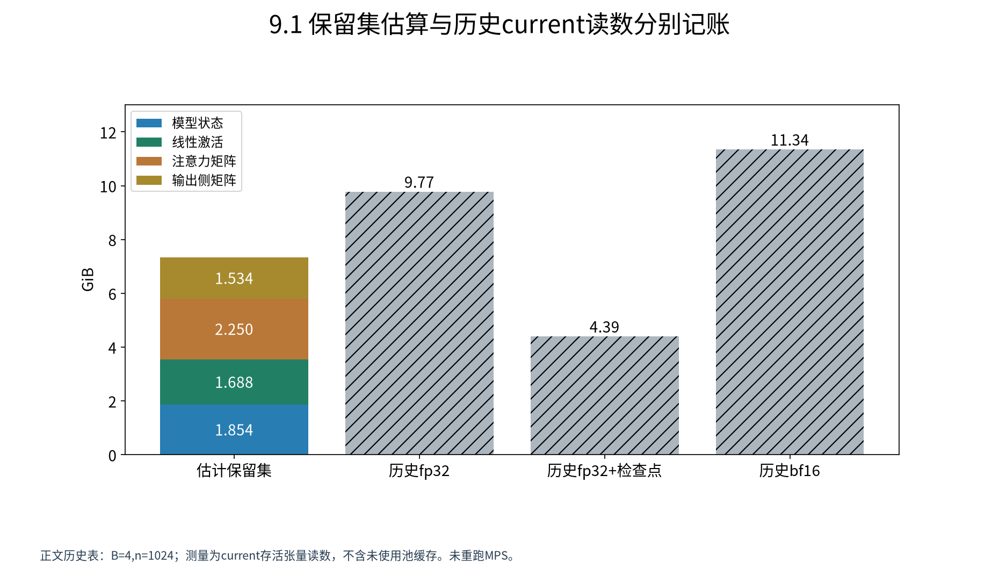
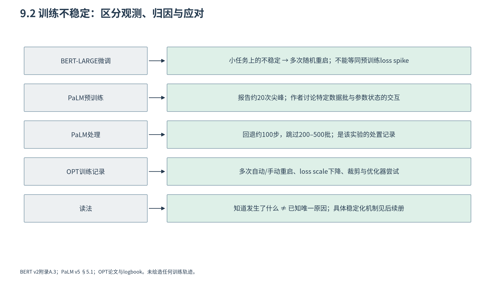

# 第 9 章 预训练工程账本：显存、算力与不稳定性

## 9.0 开篇：从全书到这里

第8章把模型与数据的选择写成了预算问题，但预算还必须落实到设备：模型状态与中间激活能否放下，一步需要多少计算，数值格式能否保留有效更新？本章沿用原有三本账与完整MPS探针，把这些约束接到第10章的GPT-2实现。先讲模型状态与激活，再讨论计算、混合精度、重算和训练不稳定记录；公式的用途是帮助规划与诊断，不是保证任意实现都恰好占用估计的字节数。

本章是规模化段（第 7-9 章）的最后一站，也是本册最后一个原理章——同时也包含配套实践：我们要在自己的机器上检查第 4 章构建的 GPT-2 124M，用一个分钟级探针比较不同配置的内存占用（code/ch09/memory_probe.py）——比较理论模型与历史峰值，并明确它们不能逐项等同。到章末你会发现：训练显存为什么是「两种常见Adam存储方案约16 bytes/参数，激活另算」；fp16训练的三类数值保护各自解决什么问题；为什么百亿参数以上的训练日志读起来像详细异常记录——以及为什么这一切只讲到「认得出异常」为止，处理方法登记在后册。

> **最小背景栏**：两样前置。①浮点格式：一个浮点数由符号位、指数位（exponent）、尾数位（mantissa）组成——**指数位决定动态范围**（dynamic range，最大最小可表示数差多少个数量级），**尾数位决定相对精度**（相邻可表示数差多近）。fp32 是 1+8+23 位；fp16 是 1+5+10 位（最大 65,504，最小正规数 $2^{-14}$，再往下到 $2^{-24}$ 只有次正规数，按舍入规则量化；小于最小次正规数一半时才必然舍为零，设备也可能冲刷次正规数）；bf16 是 1+8+7 位——与 fp32 具有相同的指数位数和最小正规数 $2^{-126}$，所以能覆盖相近的数量级；但最大有限值略小，最小正次正规数为 $2^{-133}$，并不等于 fp32 的 $2^{-149}$。9.4 节会具体使用这些数字。②优化器状态：Adam/AdamW 为每个参数维护一阶动量 $m$ 与二阶动量 $v$ 两个**与参数同形状**的状态张量（Book1 对应章节训练配方已教，本册第 4-8 章一直在用）——它们也占用显存，而且是 9.2 账本的大头之一。

## 9.1 预训练首先是工程：三本账的由来

这三方面的成本问题，在第1章就已经提出。GloVe的词向量从共现统计中拟合：60亿词语料、40万词表，仅构建共现矩阵，单线程就需要85分钟，300维模型一次迭代32核14分钟【证据等级：官方论文 D14-1162 §4.2】。到了GPT-3，不能把词表、语料和参数量混作同一种“规模”：其约五万词元的词表反而更小；训练消费量达到三千亿token，而参数从GloVe两套词向量的约2.4亿（40万词×300维×2）增加到1750亿，约729倍。导览0.5“一本账”的贯穿线索，正是要把这些不同的量逐项算清。**装不装得下**（显存）：模型状态、激活和临时工作区在运行中共用有限容量，某一时刻超限就会OOM（out of memory，显存溢出）。**花不花得起、跑多久**（算力）：$3.14\times10^{23}$ FLOPs要落实为设备时间与预算。**跑不跑得完**（稳定性）：损失可能出现尖峰或发散，损失缩放系数也可能持续下降。大规模集群中，失败还会浪费已经投入的设备时间，因此我们的顺序是先手算预算，再启动训练。

还要先立一个全书沿用的小约定：账本数的是**字节与浮点运算**，关键在于采用什么统计口径——第 8 章四问口径的纪律，在本章具体化为「GB 按 $10^9$ 进位（沿用 ZeRO 论文口径）、GiB 按 $2^{30}$ 进位（沿用本机实测口径）」，两套并存处会显式标注。

## 9.2 显存账本：16 bytes/参数，与另一半

先算与批量无关的那半——**模型状态**（model state）。想象训练某一步的瞬间，显存中存放着四类数据：参数、梯度、优化器状态、激活（activations，前向算出、反向要用的中间张量）。前三类的大小只跟参数量 $\Psi$ 有关，逐项记账就得到表 9.1 的两栏。

**表 9.1** 「16 bytes/参数」的两种口径（$\Psi$ 为参数个数；ZeRO 1910.02054 §3.1 逐字：$2\Psi+2\Psi+K\Psi$，$K=12$）

| 数据 | 口径 A：混合精度 + Adam | 口径 B：纯 fp32 + AdamW |
|---|---|---|
| 参数 | fp16，2 bytes | fp32，4 bytes |
| 梯度 | fp16，2 bytes | fp32，4 bytes |
| 主权重（master weights）副本 | fp32，4 bytes | ——（参数本身就是 fp32） |
| 一阶动量 $m$ | fp32，4 bytes | fp32，4 bytes |
| 二阶动量 $v$ | fp32，4 bytes | fp32，4 bytes |
| **合计** | **16 bytes/参数** | **16 bytes/参数** |

【证据等级：官方论文 1910.02054 §3.1（口径 A）；1710.03740（主权重副本动机）；1412.6980（Adam 状态定义，口径 B 据此推导）】

这张表显示了一个值得注意的巧合：**两条精度路线的结果相同，都恰好是 16**。口径A让相应的前向反向张量使用fp16，省下的每个参数 4 个字节，又被 fp32 主权重副本占用；口径 B 全部采用 fp32，逐项相加也得到 16。写成公式：

$$
M_{\text{state}} \;\approx\; 16\,\Psi \ \text{bytes}
\tag{9.1}
$$

| 符号 | 含义 | 形状 / 口径 |
|---|---|---|
| $M_{\text{state}}$ | 模型状态显存 | 标量（bytes） |
| $\Psi$ | 参数个数 | 全参数口径（含嵌入） |
| $16$ | 每参数字节数 | 表 9.1 两口径同值 |

这表示：**表9.1两种未分片Adam存储方案在各项同时存在时，模型状态约为16 bytes/参数；口径A还必须计入fp32主权重副本**。ZeRO 论文的锚点例：15 亿参数的 GPT-2，按这套方案模型状态约24 GB——而论文自己形容为 "meager"（单薄得可怜）的 fp16 参数本身只有 3 GB【证据等级：官方论文 1910.02054 §3.1】。我们的 124M 手算：$16\times124{,}439{,}808=1{,}991{,}036{,}928\approx1.99$ GB，其中 $m+v$ 恰好占一半（$\approx$0.996 GB）——**两个动量占该模型状态预算的一半**。


### 从存储清单到一步训练的生存期

16 bytes是一个存储方案的结果，不是任何训练都不能突破的下界。纯fp32 Adam在参数、梯度和两个动量都存在时是 $4+4+4+4=16$；如果梯度已释放，或状态被分片、卸载、量化，当前设备上的读数就会不同。混合精度也要核对是否真的另存主权重，而不能见到“半精度”就自动套同一张表。

一步训练可按生存期读：参数一直存在；前向逐层保存反向所需的中间量；反向逐段使用并释放中间量，同时产生梯度；优化器使用梯度与动量更新参数；下一步开始前清理梯度。第一次更新时Adam才可能创建两个动量，所以首次前向不代表稳态峰值。

设当前活跃模型状态为 $M_s(t)$，保存激活为 $M_a(t)$，临时张量与工作区为 $M_w(t)$。峰值是

$$M_{\rm peak}=\max_t\{M_s(t)+M_a(t)+M_w(t)\},\tag{9.1a}$$

而不是“每个子项各自最大值的总和”。不同子项的高点不一定同时发生。这个区别解释了为什么一张形状清单只能提供近似预算，仍需同步测量与实际实现分析。

而另一部分——激活——才是显存不足的常见原因。autograd按各运算的反向公式保存所需张量；有的需要输入，有的需要输出，并非所有前向结果都必须留下。逐运算数一数一个 GPT-2 Block 的前向要留下什么——按第 4 章已实现的块结构过一遍形状流转（fp16 记账，$s$=2 bytes/元素；$d/h$ 为头维）：

**一个 GPT-2 Block 的形状流转与反传保留集**（输入 $(B,n,d)$；末列列出与这些运算相关的激活保存需求，不重复计入参数）

| 步骤 | 运算 | 输入形状 | 输出形状 | 反传要留什么 |
|---|---|---|---|---|
| 1 | $\text{ln}_1$ | $(B,n,d)$ | $(B,n,d)$ | 输入及均值、逆标准差等统计量；具体保存方式依实现 |
| 2 | QKV合并投影 | $(B,n,d)$ | $(B,n,3d)$ | 线性层求权重梯度需保留输入；输出拆成的$q,k,v$又供后续注意力反传使用 |
| 3 | 拆头 | 3×$(B,n,d)$ | 3×$(B,h,n,d/h)$ | 仅为视图时不另计；若另行拷贝则需计入 |
| 4 | 分数 $qk^\top/\sqrt{d/h}$+掩码+softmax | $(B,h,n,d/h)$×2 | $(B,h,n,n)$ | 显式实现至少考虑softmax概率；分数、掩码、dropout等保留取决于后端 |
| 5 | 注意力×$v$、并头、投影 | 概率$(B,h,n,n)$及值$(B,h,n,d/h)$ | $(B,n,d)$ | 投影输入 1 份 |
| 6 | 残差加 | $(B,n,d)$×2 | $(B,n,d)$ | 加法本身不需保留输入值；相邻运算仍可能保存这些张量 |
| 7 | $\text{ln}_2$ | $(B,n,d)$ | $(B,n,d)$ | 输入及归一化统计量；其输出还供FFN线性层求权重梯度 |
| 8 | FFN 升维 $4d$+GELU | $(B,n,d)$ | $(B,n,4d)$ | $(B,n,4d)$ 2 份（fc 输出与 GELU 输出） |
| 9 | FFN 降维+残差加 | $(B,n,4d)$ | $(B,n,d)$ | — |

表中的线性项都随$Bnd$增长，但共享存储、算子融合和保存策略会改变实际份数，不能仅凭这张清单推出一个普适常数。为了手算，我们采用ZeRO论文对GPT-2类架构给出的近似：线性激活约相当于每层**12份隐藏向量**【证据等级：官方论文 1910.02054v3 §3.2、脚注3】。再单列显式注意力实现中的一份$(B,h,n,n)$矩阵，得到下面两项教学估算。它们表示张量规模，不能保证所有这些张量都在同一时刻以同一精度存活。

$$
M_{\text{act}}^{\text{lin}} \;\approx\; 12\,s\,B\,n\,d\,L \ \text{bytes}
\tag{9.2}
$$

$$
M_{\text{act}}^{\text{attn}} \;\approx\; s\,B\,h\,n^{2}\,L \ \text{bytes}
\tag{9.3}
$$

| 符号 | 含义 | 形状 |
|---|---|---|
| $B$ | 批内序列数 | 标量 |
| $n$ | 序列长 | 标量（GPT-2 为 1024） |
| $d$ | 隐藏维 | 标量（124M 为 768） |
| $h$ | 头数 | 标量（124M 为 12） |
| $L$ | 层数 | 标量（124M 为 12） |
| $s$ | 激活每元素字节数 | 标量；fp16=2 / fp32=4 |
| $V$ | 词表大小 | 标量；本章为50,257 |

这表示：式(9.2)以每层12份隐藏向量估计线性项；式(9.3)则给每层每头的一份显式注意力矩阵记账，**随序列长平方膨胀**。若后端不完整保存该矩阵，或同时保存多份同形中间量，就要相应调整这一项。Book1 立过的 $O(n^2)$ 复杂度警告（时间侧）在这里也体现为显存开销。把 124M 的数代进去（$B=8,n=1024,d=768,h=12,L=12$，fp16 记账）就得到表 9.2 的上半部。


**表 9.2** GPT-2 124M 训练显存总账（上：教学手算，$B=8$、激活按fp16记账、GB口径；下：历史MPS测量，$B=4$、各精度配置另列、GiB口径）

| 项 | 算式 | 结果 | 备注 |
|---|---|---|---|
| 模型状态 | $16\times124{,}439{,}808$ | **1.99 GB** | 表 9.1；$m+v$ 占 0.996 GB |
| 线性激活 | 式 (9.2)：$12\times2\times8\times1024\times768\times12$ | 1.81 GB | 12 份 $(B,n,d)$/层 |
| 注意力分数 | 式 (9.3)：$2\times8\times12\times1024^2\times12$ | **2.42 GB** | $n^2$ 大项 |
| 激活小计 | — | **4.23 GB** | **≈ 模型状态的 2.1 倍** |
| 输出侧宽矩阵 | $2\times2\times8\times1024\times50{,}257$ | ≈1.65 GB | logits 与交叉熵中间量各一份 $(B,n,V)$ |
| 实测：同步剖面（稳态第 2-4 步） | 零梯度后 → 前向后 → 反向后 | 3.97 → **10.19-10.73** → 5.46 GiB | 历史脚本的current_allocated_memory口径 |
| 实测：峰值（6 步，每配置独立子进程） | fp32 / bf16 / fp32+检查点 | **9.77 / 11.34 / 4.39 GiB** | 0.808 / 0.473 / 0.975 s/step（bf16 1.71×、检查点 +20.6%）；bf16 峰值不降反升，见「开关效应」 |

【证据等级：上半=本书算术；下半=本书实验（MPS，2026-10，`log/book2-ch09/memory_probe.json`（定版副本 `memory_probe_final.json`）与 `step_profile.json`，种子 20261002；峰值行三配置各在独立子进程实跑，避免前一个配置的进程状态延续到下一个配置）】

手算账的第一句结论：在表9.2的$B=8$估算中，激活小计4.23 GB已是模型状态的约2.1倍，注意力矩阵一项2.42 GB也超过了模型状态1.99 GB；输出侧两份$(B,n,V)$还未计入这个小计。**模型状态随参数量增长，激活还取决于批量、序列长及实现方式**。

这张账可以反过来帮助选批量，但先要固定序列长$n$。按上述统一激活精度$s$的估算法，每条序列的激活与输出侧预算为$A(n)=sL(12nd+hn^2)+2snV$。给定可用内存$M$，再为临时工作区预留$W$，便可取

$$B\leq\left\lfloor\frac{M-16\Psi-W}{A(n)}\right\rfloor.\tag{9.3a}$$

这里$M,W,A(n)$均以bytes计；若分子为负，说明这套模型状态方案已经超出预算。这个上限只用于选初始实验档位，实际能否运行仍要测量。特别是$n$改变时，不能只保持$Bn$不变：注意力项为$Bhn^2$，相同token批量也可能占用不同内存。第10章选冒烟批量、第11章排实验档位，都可先这样估算，再测量确认；临时减负则可减批量、缩短序列，或使用9.5节的检查点。

> **测量口径更正**：历史设备为Apple统一内存，不是本轮工作区硬件。`torch.mps.current_allocated_memory()`返回张量占用，**不包含MPSAllocator池中的未使用缓存**；`driver_allocated_memory()`才包含驱动分配、缓存池与MPS/MPSGraph相关分配。旧稿将current称为“含缓存池的上界”不正确。原记录中的current约4.6GiB与driver约13.4GiB是不同指标，应分别保留。轮询可能漏掉短暂峰值，因此20ms轮询与同步剖面也不保证相等。本轮未重跑MPS；表9.2数字保留为旧记录，不能据两个读数之差唯一定位缓存或临时张量。[PyTorch current说明](https://docs.pytorch.org/docs/2.10/generated/torch.mps.current_allocated_memory.html)；[driver说明](https://docs.pytorch.org/docs/2.10/generated/torch.mps.driver_allocated_memory.html)。

算完理论占用，再用实际测量来核对。探针 `memory_probe.py` 比较三种配置——同一个 124M 模型（由第 4 章 `warmup_ablation.GPT` 创建，全参数 124,439,808 逐位复验），同一批数据，依次比较fp32、bf16与fp32加检查点：

```python
# memory_probe.py 的记账与实验配置示意；完整运行逻辑见随书脚本。
# Psi 是独立参数数，B/n/d/L/h 分别是批量、长度、宽度、层数和头数。
theory = {
    "model_state_bytes": 16 * Psi,           # 指定 fp32 Adam 组合
    "linear_activation_bytes": 12 * 4 * B * n * d * L,
    "attention_matrix_bytes": 4 * B * h * n * n * L,
}
configs = [("fp32", False), ("bf16", False), ("fp32", True)]
for precision, checkpointing in configs:
    # 每组独立进程建模；历史默认无预热，6步计时含首次优化器状态分配。
    # 不能把各张量各自的最大值相加，冒充同一时刻的峰值。
    print(precision, checkpointing, theory)
```

读数分三层（表9.2下半）。第一层，**剖面**：历史稳态步骤的current读数在零梯度后约3.97 GiB，前向后升到10.19—10.73 GiB，反向后落回5.46 GiB。这表明前向和反向之间存活的张量显著变化，但没有逐张量跟踪时，不能把全部差额都归给某一种激活。首步记录为0.51（参数就位）→6.86（前向后）→2.00（反向后）→5.46 GiB（更新后）。Adam的$m,v$在首次更新时才创建，因此开训时的读数不能代表后续步骤。

第二层，**峰值对照**：fp32历史轮询峰值为9.77 GiB，高于保留集手算的7.33 GiB（1.854+1.688+2.250+1.534）。约2.4 GiB的差额提示这份简化账未覆盖真实运行中的全部存活张量和临时分配，不能用“未使用的池缓存”解释current读数。同步剖面的10.19—10.73 GiB来自另一次运行，与9.77也不必一致：20 ms轮询可能漏掉短峰值，不同运行的状态也可能不同。现有记录不足以把二者差异唯一归因于某一个因素。

第三层，**开关效应**：检查点减少块内中间量的长期保存，峰值从9.77降到4.39 GiB，但仍需保存段边界，并在反向重建部分中间量。这个对照显示了该策略在这次运行中的收益；不能再把4.39拆成“1.85+1.53+约1.0”，就声称已测清各部分贡献——后面这个约1.0只是相减所得的余量，不是独立测量。

bf16却出乎直觉：若某个张量确实从fp32改为bf16，其存储字节数会减半；但历史总峰值反而由9.77升到11.34 GiB，约增1.6 GiB，记录中的三次复跑方向一致。独立子进程避免前一配置的状态延续，却不能单凭这一点解释差额。autocast转换出的低精度权重、仍保留的fp32张量和算子临时工作区，都是需要进一步追踪的候选来源；不能套用其他设备的算子规则，便认定本次MPS运行各项占了多少。**减少部分张量的字节数，不保证最终峰值下降。**这次bf16配置的收益体现在时间：0.808→0.473 s/step，约1.71倍。图9.1将保留集估算与三组历史峰值并排，不把它们当成同一种可相加的量。



图9.1 显存账本与历史测量：左柱为fp32、$B=4,n=1024$的四项保留集估算，其余为fp32、fp32+检查点、bf16三组current轮询峰值。检查点配置峰值减少5.38 GiB（约55%），步时增加约21%；bf16配置更快，但峰值更高。这些结果属于2026年10月MPS记录，不是本轮复跑。【证据等级：本书历史实验汇总，原定版文件名为memory_probe_final.json】

## 9.3 算力账本：6ND 换算盒

显存回答「装不装得下」，算力账回答「跑多久、花多少」。这个计算预算可以用一个式子概括——第 7 章 7.1 节已经把直觉立好了（每参数看每 token 前向 2 次、反向 4 次浮点运算），式 (7.1) $C\approx6ND$ 直接搬来用；本节将它整理成一组换算方法，并补上单位与两头的参照系。

盒子里只有两个换算。第一，FLOPs 之定义自明；第二，PF-day（petaflop/s-day，$10^{15}$ FLOP/s 跑满一天）：

$$
1\ \text{PF-day} \;=\; 10^{15}\ \text{FLOP/s}\times86{,}400\ \text{s} \;=\; 8.64\times10^{19}\ \text{FLOPs}
\tag{9.4}
$$

PF-day是计算量单位，不是某种设备的实际运行天数。GPT-3的手算为$6\times174.6\times10^9\times300\times10^9=3.1428\times10^{23}$ FLOPs；先用未圆整结果换算，得到3637.5 PF-days，保留三位有效数字为$3.64\times10^3$，与官方附录Table D.1相符【证据等级：官方论文 2005.14165v4；算术见第7章】。$3.14\times10^{23}$只是前一个结果的圆整表示，不宜再拿它要求后三位完全一致。

再把计算量换成理想时间。A100的稠密fp16 Tensor Core运算峰值为312 TFLOP/s【证据等级：NVIDIA A100官方数据表，2021-06，厂商标称；使用稀疏性时的624不用于这里】。若始终达到该吞吐，一张卡一天完成0.312 PF-day，GPT-3这笔量相当于约1.17万A100卡天。另一头，用本书Mac历史实验的约6 TFLOP/s有效吞吐作算术参照，一天对应0.006 PF-day，于是

$$t\approx\frac{3637.5}{0.006}\ {\rm days}\approx606{,}250\ {\rm days}\approx1{,}661\ {\rm years}.$$

这是按固定吞吐折算的等效时间，不表示175B模型能放进这台Mac。312除以6虽为52，前者却是硬件峰值、后者是特定训练任务的有效吞吐，不能据此宣布两设备实跑训练恰差52倍。

第11章会把自家训练点放进论文的计算量坐标。先用第8章练习：最大的20m点，$6\times19{,}519{,}872\times39{,}993{,}344\approx4.7\times10^{15}$ FLOPs，约$5.4\times10^{-5}$ PF-days；全族合计约$1.3\times10^{-4}$ PF-days【证据等级：本书历史实验配置与算术】。124M模型按非嵌入$N=85{,}056{,}000$消费100M tokens，则约为$5.1\times10^{16}$ FLOPs，即$5.9\times10^{-4}$ PF-days。早期探针曾外推bf16约2.3小时，反算约6.2 TFLOP/s；这是计划值的内部核对，不是一次新的吞吐测量。第11章实际50M档按纯训练步时得到约5.76 TFLOP/s；若把评估、保存等时间也算入分母，数字还会降低。

式$6ND$的$N$必须随来源说明，不能一律写成非嵌入：本书小模型族按非嵌入参数计数，GPT-3这一手算则沿原论文附录使用全参数174.6B。它们都是近似计算量口径，横向比较时要注明差别。GPT-2原论文未披露完整训练算力，本书为124M排预算时也只能标作估算，不能把自算值写成原作者报告。

## 9.4 混合精度三件套：fp16 的刻度尺

账算完，来看第一种降低成本的方法，以及它为什么需要数值保护。动机 9.2 已经看见一半：bf16 一开，步时快 1.71 倍——至于省显存的那一半，9.2 刚上过口径课（保留集字节砍半，测得峰值却不降反升）。低精度可能减少搬运，并使用更高吞吐的计算单元；实际收益也受算子和设备影响。但 fp16（不是 bf16）的数值保护问题要从它的**刻度尺**讲起。

把浮点格式想成一把刻度随数值大小变化的尺子：指数位主要决定覆盖范围，尾数位决定局部精细程度。fp16最大有限值为65,504，最小正规数为$2^{-14}\approx6\times10^{-5}$，最小正次正规数为$2^{-24}$。按最近偶数舍入，绝对值不超过$2^{-25}$的小量会舍为零；设备若冲刷次正规数，还会有额外限制。

《Mixed Precision Training》v1给了两个应当分开看的证据。Mandarin语音识别模型约5%的**权重梯度**指数小于−24，乘学习率后的更新可能更小；直接把权重、激活、梯度都换成fp16时，相对准确率损失80%，加入fp32主权重后恢复到fp32基线【证据等级：1710.03740v1 §3.1、图2】。这个对照说明主权重的重要性，却不能把80%的损失全部归因于梯度下溢。另一个例子是SSD的**激活梯度**：损失缩放8倍便能恢复该实验的准确率。反过来，论文所列AlexNet等图像分类网络并不需要损失缩放，但仍使用fp32主权重等措施【同文§3.2、§4.1】。所以要先判断小量丢失发生在反向传播途中，还是在参数更新时，才能选择保护办法。

第二个问题出现在参数更新时。fp16在$[1,2)$内相邻数的间隔为$2^{-10}\approx9.8\times10^{-4}$，所以从$w=1$向上增加不足半间隔的小量，会被舍回1。例如$\Delta w=3\times10^{-5}$，只有向上半间隔的约6.1%，这次加法便没有改变权重。这里特意说“向上”：1以下的相邻间隔为$2^{-11}$，不能把1处的上下间隔当成相同。共同的问题是：**更新量即便不是零，也可能因权重附近的刻度太粗而被舍掉。**当更新相对权重变小时，这种风险可能增大，但并非每次训练都单调变化。

除了小梯度和小更新，点积还涉及许多数的累加：即使每个输入都可表示，低精度求和也可能不断丢失小贡献。表9.3因此把保护分成三个环节——参数更新、梯度传播和规约累加。


**表 9.3** 混合精度三件套（Micikevicius等，1710.03740v1）

| 件 | 做什么 | 解决什么问题 | 数字锚 |
|---|---|---|---|
| fp32 主权重 | 前向反向用 fp16；每步更新累积在一份 fp32 副本上 | 更新因舍入而丢失 | 无主权重的 fp16 训练：相对准确率损失80%（同上负载） |
| 损失缩放（loss scaling） | 损失乘与参数无关的$S>0$；$S>1$时放大梯度，裁剪前再除回去 | 减少反向传播中小梯度舍零 | 原论文测试的常数范围8—32K；SSD用8，bigLSTM用128。存为fp16的梯度不能超过有限范围；这还不足以保证所有中间运算都不溢出 |
| fp32累加 | 点积等规约用fp32累加器，按需转换结果 | 减少大量低精度数求和时的舍入误差 | 累加器精度与输入、输出精度是不同选择，不能由此直接推出整段训练的加速比 |

【证据等级：官方论文 1710.03740v1 §3、§4.5】

显存与速度还需分开算。fp16权重加fp32主副本共6 bytes，比单份fp32权重多50%，这项增量来自**主副本**，不是fp32累加器；论文报告整体内存需求约减半，是在激活等大项也使用半精度的实验条件下。文中2—8倍指硬件的半精度算术吞吐相对fp32的优势，不是各模型整段训练的实测加速范围。

这些措施分别保护不同环节，并非每个负载都必须启用全部三项。v1实验使用常数损失缩放；§3.2已经描述检测到溢出后跳过更新，结论部分才把自动调节缩放值列为后续方向。常数缩放也可以检测失败并跳过更新；动态缩放进一步自动调整了缩放值。后续工具把检测和调整组合起来，例如PyTorch的GradScaler默认在检测到非有限梯度时跳过更新并缩小缩放值，在连续若干次成功更新后再增大；其常用倍率为0.5和2，但缩放值并不保证始终大于1【实现对照：PyTorch 2.10 AMP文档】。9.6节的OPT记录会展示：自动调节仍可能不断下降，不能替代对数值异常来源的诊断。

最后回到历史MPS实验。本书第8章与本章探针采用bf16 autocast，主要理由是其正规数范围接近fp32，通常不需要fp16式损失缩放。但bf16的尾数更短，仍会舍入、下溢或溢出。autocast也不等于把所有张量统一改成bf16：具体运算使用何种精度，要看设备、框架版本、输入和算子规则，不能把CUDA规则直接套在MPS上。

速度方面，早期可行性探针在$B=8,n=256$的两次独立测量为1.71倍、1.96倍；本章$B=4,n=1024$探针为1.71倍【证据等级：本书MPS历史实验，2026-10】。所以“约1.7—2.0倍”只概括这几次配置，不是硬件恒定属性。它也不能与论文中的2—8倍算术吞吐直接比较。第11章可据探针估算时间，再用实际训练记录检验预算。


### 为什么缩放损失能保护梯度，却不能代替主权重

损失缩放把反向传播中的梯度暂时移到更易表示的数值范围，主权重则让小更新跨步累积。一个保护梯度的传递，一个保护参数的更新；混淆这两项，就无法判断数值问题发生在哪一段。

设真实损失为 $\ell(\theta)$，梯度 $g=\nabla_\theta\ell$，缩放常数 $S>0$。因为 $S$ 与参数无关，链式法则给出

$$\nabla_\theta(S\ell)=Sg,\qquad g=(Sg)/S.\tag{9.5}$$

在精确算术中两步抵消；在有限精度中，先放大可以让本来舍零的小量被保存。例如 $g=10^{-8}$ 在fp16中可能变0，乘 $S=1024$ 后约 $1.024\times10^{-5}$ 可以落入可表示区间，再在fp32中除回去得到近似原梯度。它仍包含量化误差，并且 $S$ 太大也可能造成溢出。

为什么先反缩放、再裁剪？令阈值为 $c$，范数裁剪为 $\operatorname{clip}_c(g)=g\min(1,c/\|g\|)$。如果先裁剪放大后的梯度再除回去，得到

$$\frac{\operatorname{clip}_c(Sg)}{S}=g\min\left(1,\frac{c}{S\|g\|}\right),\tag{9.6}$$

等效阈值变成 $c/S$。取 $\|g\|=2,c=1,S=1024$，正确裁剪后的范数应为1，错误顺序却得到约0.000977，更新会小上千倍。

主权重解决另一件事。以 $w=1$、每步增加 $3\times10^{-5}$ 为例，fp16每次独立相加都可能舍回1，累加20次仍是1；若先在fp32主副本中累积，20次约为1.0006，再映射到fp16就能跨过一个刻度。缩放损失后最终仍要恢复真实梯度，因此它本身不能消除参数更新的舍入。

FP32累加则保护点积等规约。它让许多低精度乘积在更细的累加器中求和，但不能恢复输入先前量化丢掉的信息。这三项都是降低特定误差来源的工程设计，不能保证任意模型不会发散。【来源：Mixed Precision Training，§3；以上数字为本书构造】

## 9.5 梯度检查点：用重算换取更少的存储

9.2节说明激活可能成为内存大项。降低这项成本的办法是：**反向需要的中间量，不必全部从首次前向一直保存。**先保存若干段的边界输入，反向到达某段时，再根据输入重算所需中间量，这就是梯度检查点（activation checkpointing）。对等规模的$L$层顺序网络分$k$段，边界与段内工作集分别约为$O(k)$和$O(L/k)$；取$k\approx\sqrt L$，得到$O(\sqrt L)$的激活内存，代价在理想模型中相当于多做一次前向。这里$L$是层数，不是token序列长。

Chen等的论文1604.06174报告：一千层残差网络的内存由48G降到7G；Titan X上ResNet和LSTM的20批运行比较中，额外时间约30%【证据等级：该文v2摘要、§5.4、图7】。ZeRO给出更接近语言模型的估算：1.5B GPT-2在$B=32,n=1$K时激活约60 GB，检查点后约8 GB，重算代价约33%【1910.02054v3 §3.2】。这些都是指定模型和实现下的结果，不是检查点固定的时间价格。

本书历史测量对应表9.2：峰值9.77→4.39 GiB，减少5.38 GiB（约55%）；步时0.808→0.975 s/step，增加20.6%。这个时间增量小于上述文献的约30%或33%，并不矛盾。重算只覆盖被包入检查点的部分，整步还包括其他前向运算、反向和优化器更新；具体比例要看实现。当前随书探针使用PyTorch非重入检查点，默认可以在重建所需中间量后提前停止重算，不能简单断言每块都完整执行两遍。【实现对照：PyTorch 2.10 checkpoint文档；当前环境未重跑历史MPS测量】

空间端同样要分清节省对象。检查点减少块内激活的保存，却不自动减少参数、梯度与Adam动量；4.39 GiB也不能由一张静态表逐项精确分解。分段数$k$是可以调整的：在等大层假设下，保存边界越多，单段重算工作集越小，两者需要平衡。论文还给出$O(\log L)$激活内存的极端方案，代价是$O(L\log L)$计算；“每Block一段”只是其中一种实用选择，并不等于平方根最优点。

即便降低了激活，模型也未必放得下。ZeRO报告的100B配置在$B=32$时，开启检查点后激活仍约60 GB，模型状态另计。渐近阶数下降没有消除层宽、批量等系数，更没有消除$16\Psi$那项。因此本册先掌握减批量、缩短序列、开检查点这几种办法；模型状态的多卡分摊留到Book4。历史设备报告的约37.44 GiB可用上限，只能说明当时124M探针的余量，不能保证换一档批量或换一个运行环境仍然足够。


这个平方根从何而来？设每层需要保存约 $a$ 字节，每段含 $L/k$ 层。前向只保留 $k$ 个边界，约 $ak$；反向处理当前段时重新构建该段中间量，约 $aL/k$。因此 $M(k)\approx a(k+L/k)$，求导得到 $M'(k)=a(1-L/k^2)$，令它为零即 $k=\sqrt L$。实际分段取整数，层大小不等时按代价划分，输出头等也需另算。

检查点必须重算同一个函数。若段内含dropout，反向重算要恢复对应随机状态；PyTorch检查点默认会为支持的设备保存、恢复这类状态。若关闭这一保护，或函数依赖的全局状态在两次调用之间变化，重算就未必对应原前向的梯度。它减少保存的激活，不减少参数与Adam动量。正文历史探针按Block划段，是一种可用策略，不能声称恰好实现了理论最优分段。

## 9.6 训练不稳定的现象学：三站实录

前两本账都算清了，第三本账最不可控：训练会出现数值异常。损失平稳下降几万步后毫无征兆地尖起、发散；缩放系数一路崩零；有时重启就好了，有时怎么都不好。本节做**现象学**——把异常与训练记录如实记下——而不开处理方法；图9.2整理三份记录；正文从微调波动讲到预训练尖峰，再看连续日志，按证据的细致程度展开。



图 9.2 三类训练不稳定记录。将观测和处置分开，不绘造历史训练轨迹，也不把微调波动与预训练尖峰归为同一原因。

第一站，2018，前传。BERT-LARGE 在小数据集上微调「有时不稳定」（"sometimes unstable"），官方采用的办法很直接：**同一 checkpoint 多次随机重启**（不同数据洗牌与分类头初始化），选 dev 最优【证据等级：官方论文 1810.04805 v2 §4.1、A.3】。注意两件事：这是**微调**侧的不稳定（样本只有三千多条的小任务），且处置是「重抽签」而非「找病因」。第3章bert-base的MRPC历史实验同一种子四跑，终点80.1—83.8，相差3.7个百分点；它与论文改变分类头初始化、数据洗牌的重启实验条件不同，不能当成同一机制的复现。第8章7m独立对照加入200步warmup后改善约0.55 nat，也只证明该局部配置的差异。三者都要求保留运行条件，不能合并成“大模型天生不稳”的证据。

第二站，2022，归因句。PaLM 540B（6144 块 TPU v4、780B tokens、梯度裁剪 global norm 1.0 全程在场）训练中观察到**约 20 次 loss spike（损失尖峰）**——"despite the fact that gradient clipping was enabled"，且**该团队报告的较小模型运行中未观察到同类尖峰**【证据等级：官方论文 2204.02311 §5.1】。它的账单按 6ND 手算：$6\times540\times10^{9}\times780\times10^{9}\approx2.5\times10^{24}$ FLOPs $\approx2.9\times10^{4}$ PF-days——GPT-3 的约八倍【本书算术，全参数口径】；批次日程也值得看一眼：批量 512（1M tokens）跑到 5 万步、加倍到 1024（2M）跑到 11.5 万步、再加倍到 2048（4M）到 25.5 万步收工，理由是小批量有利于前期样本效率，后期增大批量既能改善梯度估计，也能提高矩阵乘吞吐【证据等级：官方论文 2204.02311 §5】。

团队的处置是从尖峰前约100步的检查点重启，再跳过约200—500个数据批，随后训练得以继续。归因依据比处置动作更重要：他们从更早的检查点重放同一批数据时，尖峰没有复现，因此认为问题不是单由“坏数据”决定，而是**特定数据批与当时模型参数状态的组合**所致【证据等级：2204.02311v5 §5.1】。这依赖该团队可重放的训练设置，也只支持这组观察；不能推出数据永远无关，或任意换个检查点都能成功。回退并跳批改变了数据与参数状态的相遇方式，是一种经验恢复办法。梯度裁剪仍在场也不矛盾：它限制计算所得梯度的范数，并不保证前向激活、所有中间数值和后续优化轨迹都稳定；仅凭这份日志还不能确定每次尖峰的完整因果链。

第三站，2021-11 到 2022-01，全程实录。OPT-175B 的逐日 logbook（与论文 2205.01068 配套的独立 PDF）是大模型训练故障的第一手连续记录：992 张 80GB A100（FSDP 全分片 + 张量并行，作者报告达到最高147 TFLOP/s/卡的运算吞吐），硬件故障造成**至少 35 次手动重启**、轮换上百台主机，另有估算 **70+ 次自动重启**【证据等级：官方论文 2205.01068 §2-§3】。账本侧一句话：180B tokens 的 6ND $\approx1.9\times10^{23}$ FLOPs $\approx2.2\times10^3$ PF-days【本书算术，全参数口径】——约 GPT-3 的六成；但真实的开销远不止 FLOPs：论文估计碳排为75吨CO₂eq，脚注另称计入消融、基线实验和停机后，总成本估计约为前述估计的两倍——**账本不只是 FLOPs**【证据等级：官方论文 2205.01068，厂商自报口径】。

训练记录侧，我们逐日核了原始 PDF【证据等级：官方 logbook PDF（metaseq 仓库 OPT175B_Logbook.pdf，2026-10 目验；文本存 `log/book2-ch09-opt-logbook.txt`）】：最终 run 于 **2021-11-05 启动**（logbook 原话 "Run 11.0: LETS GO"），**2022-01-06 15:46 ET 完成**（"done training"）——含首尾 63 个自然日。论文明确列出的配置是**fp16权重、fp32 Adam状态与动态损失缩放**，与9.4的保护思路相接；表9.1中其余副本和梯度的存储方式，仍须另查实现。这份日志也让9.4节的数值问题变得具体：Run 11.4 在约 3.9k 步发散、11.5 在 5139 步再次发散，训练记录写着梯度范数尖峰、**损失缩放已低至 0.000122**、第 92 层注意力层归一化输入出现 $-\infty$；论文正文的归纳是：发散与「**动态缩放系数崩到 0**」相关、伴随末层激活范数尖峰；逐步降低裁剪阈值的过程在 logbook 中有清晰记录（11.2 把 2.5 降到 1.5、11.5 再降到 1.0），论文称从1.0进一步降到0.3**有助于稳定**；中途试换SGD，优化很快进入平台期，又换回AdamW。重置损失缩放状态帮助恢复了部分发散，但并非全部；更新Megatron实现则减轻了激活范数压力并改善吞吐。处方之外还有一句论文主旨值得记住：这类训练的隐性成本是「底层设施或训练过程本身失稳时所需的**人力开销**」。

这三份记录帮助我们建立几条诊断边界。第一，微调分数波动、预训练损失尖峰、硬件故障导致的中断，是不同事件，不能合成一条“规模越大必然越不稳”的规律。第二，裁剪限制一个量，不等于整个训练过程都受控；PaLM启用裁剪仍出现尖峰，OPT调低阈值有所帮助，两者并不冲突。第三，重启、跳批、改学习率和调整实现都是日志中的处置，但效果与适用范围要分别记录，不能说它们一律只是绕行或一律彻底修复。第四，持续下降的loss scale是检查非有限值与有限精度问题的线索，既不唯一指认原因，也不是大模型特有现象。

本章到这里先学会区分现象和解释。PaLM团队仍把更有原则的缓解方法列为后续工作。进一步的训练稳定性设计留到Book4第7章；本册不从少数日志推导一个未经验证的通用处方。

## 9.7 本章小结

现在可以回到开篇的三项问题。显存账先指定存储方案：表9.1两种方案在各项同时存在时约16 bytes/参数，124M为1.99 GB；再按形状估计激活与输出侧，并留出临时工作区。$B=8$的教学账中，线性激活与一份注意力矩阵合计4.23 GB，已超过模型状态；真实峰值还要看各项何时存活。历史检查点对照减少5.38 GiB峰值，说明改变激活保存策略可以有明显收益。

算力账用$6ND$估计计算量，用$8.64\times10^{19}$把FLOPs换成PF-days，再除以明确的有效吞吐估时间。GPT-3约$3.64\times10^3$ PF-days可折算为理想约1.17万A100卡天，或按6 TFLOP/s折算为约60.6万天；后者只是算术参照，不是Mac能够执行该训练的承诺。数值账则区分三种保护：主权重保存小更新，损失缩放减少反向小量舍零，fp32累加减轻规约误差。历史bf16探针约1.7—2.0倍加速、检查点约55%峰值下降和21%步时增加，都只属于相应配置。BERT、PaLM与OPT的记录进一步提醒我们：观察到异常后，还要核对数据、参数状态、数值格式和系统故障，不能仅凭“规模大”就解释一切。

**本章的判断顺序**：先按存储方案计算模型状态，再按形状和生存期估计激活；用计算量估预算，用有效吞吐估时间；遇到数值异常再分辨梯度下溢、参数更新舍入、溢出与优化过程。16 bytes/参数、6 FLOPs/参数/token和重算开销都有假设，不能把常用估算当成硬件定律。

镜头拉回全书：规模化段（第 7-9 章）到此走完——第 7 章看见 175B 与涌现，第 8 章拿到定律与自家曲线，本章把定律落到显存、算力与训练记录。三本账在手，「造一台 GPT-2 124M」的全部前置条件就绪：机器的形状（第 4 章差异清单）、目标函数（第4章因果语言建模与第5章范式对照）、训练循环的纪律（第 8 章实验、本章账本）都在手边。下一章开始实现：从零实现这台 124M，参数逐位对上官方的 124,439,808，在莎士比亚上先跑通初步训练。

> **【欠账】** 混合精度的三件套只是低精度长时间训练的起点：fp16 的梯度下溢、PaLM/OPT 的 spike 我们都只做了诊断——更低精度的训练配方，以及降低不稳定风险的归一化、裁剪设计与诊断方法，见 **Book4 第 7 章**。

## 9.8 动手验证（本章代码与实验清单）

- 探针（MPS、分钟级）：`python "code/ch09/memory_probe.py" --out-name memory_probe_new.json`。默认每配置独立进程，测6步、不预热，计时包含首次优化器状态分配；可显式设置`--warmup-steps`，但那是另一种测量口径。仅查看理论账可用`--theory-only`，CPU环境也能运行，不会进行训练。产物写入当前工作目录的`log/book2-ch09/`；已有同名结果会被拒绝。
- 历史参照是0.808/0.473/0.975 s/step及9.77/11.34/4.39 GiB，**不是当前脚本必须逐值达到的测试断言**。框架、模型初始化、机器状态与测量设置变化都可能改变结果。本轮未重跑MPS，原始定版JSON尚未恢复，正文保留既有实验汇总，不用新数据补造旧日志。
- 图表核算：`python "code/ch09/make_figures.py"`生成训练异常记录表；提供`--probe log/book2-ch09/memory_probe_new.json`时再画内存对照图。输出到`log/book2-ch09/figures/`，不覆盖正文图片；无实测的理论报告不会被画成“实测峰值”。
- 手算验收：任取第4章一个配置，先写明精度方案，算$16\Psi$，再按式(9.2)、(9.3)和输出侧两份$(B,n,V)$估算。固定$n$反推批量；再保持$Bn$不变而把$n$加倍，检查哪些项仍变大。
- 三问验收：损失缩放保护哪一段、为什么不能代替主权重？检查点为什么不能自动减少Adam状态？PaLM重放实验支持什么、又不能排除什么？最后说明16、6、$8.64\times10^{19}$各自的单位与假设。
- 变式实验（选做）：用`--batch 8`比较批量加倍，先核可用容量再运行，不预先保证仍能放入37.44 GiB；或用`--steps 20 --warmup-steps 2`与默认配置比较首次分配和后续步骤。两次采用不同输出名，并同时记录current与driver口径。
