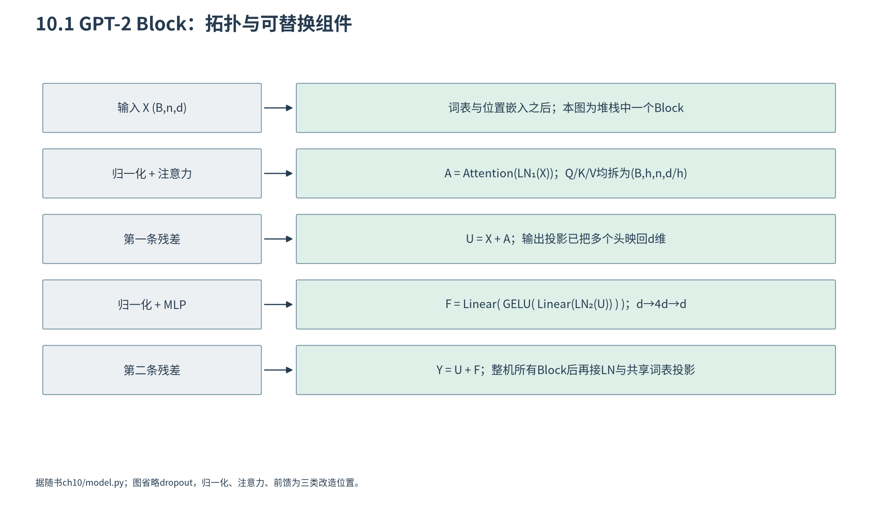
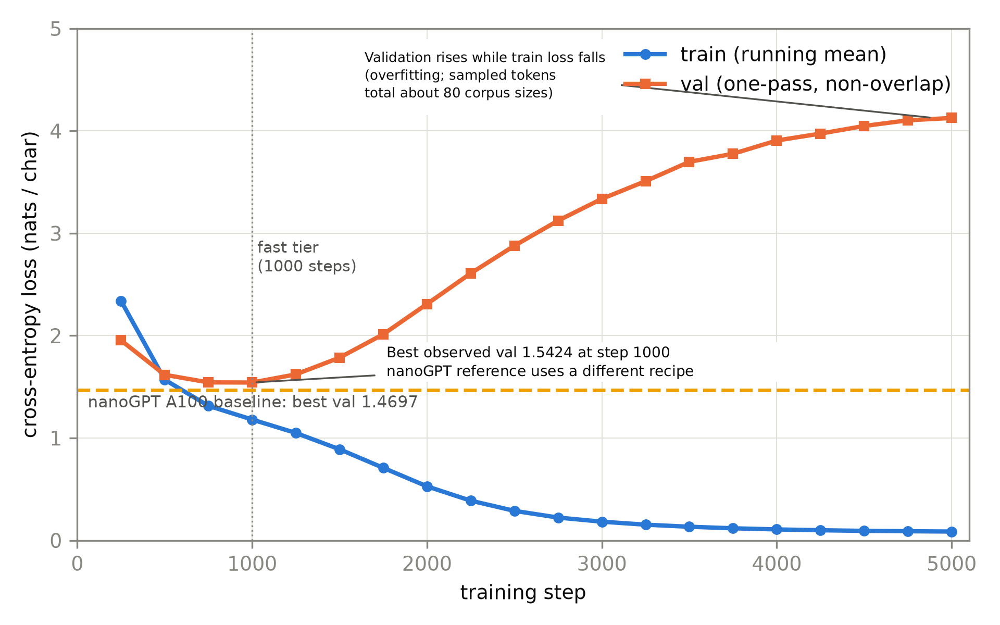
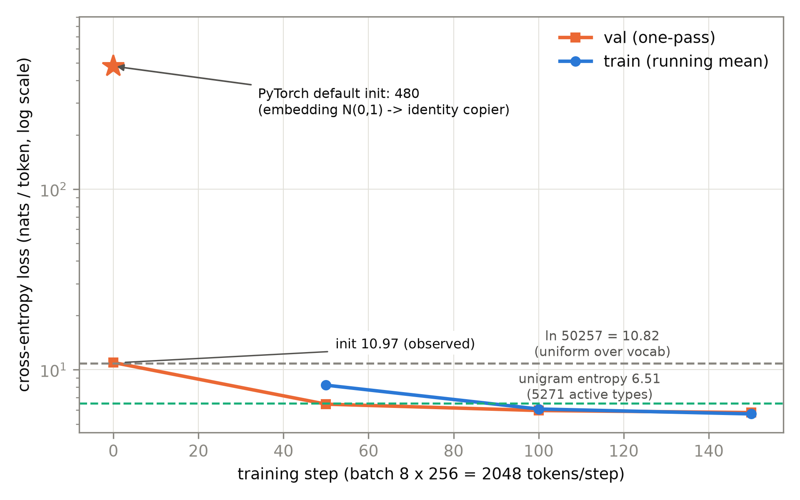

# 第 10 章 大项目 I：从零实现 GPT-2 124M

## 10.0 开篇：从全书到这里

上一章建立了内存、计算量与训练稳定性三本账：模型状态和激活怎样占用内存，参数量与训练token数怎样转化为计算量，数值异常又该怎样辨认。本章把这些约束落到一台可以核对的 GPT-2 124M 上。以第 4 章的结构比较为蓝图，我们实现模型、训练循环和两级验证：先用字符级小模型检查训练流程，再用完整 124M 规格检查参数、数值和资源需求。下一章再接入真实语料与官方权重。

本章保留旧稿 2026 年 10 月的 CPU/MPS 实验记录。它们不是本轮环境的重新测量；原始日志未全部随工作区保留，当前能够复核的是代码、参数算术和已有记录。复现命令表示实验入口，耗时与数值不作为换机后的保证。

本章要回答一个模型实现中的核心问题：**「我造的这台机器，凭什么让我相信它就是 GPT-2？」**我们要依靠三类相互补充的证据——参数逐位等于官方 124,439,808；随机权重同 config 下与 HF 实现对拍 logits 一致；训练循环冒烟时 loss 从 $\ln(\text{词表})$ 附近健康下降（10.1 节明确验收条件，10.2/10.5 节逐条完成验收）。造的过程分三步走：先在 Shakespeare 上用 10.65M 的小模型把训练循环跑通（10.4 节），再让 124M 整机开始训练冒烟（10.5 节），最后把「从 Book1 翻译机到 GPT-2」的四项改造在代码层面收拢成一张 diff（10.6 节）——单轨代码主线的第一次换装。章末你会拥有三项可继续使用的成果：`model.py`（三插槽 Block，下一册逐插槽改装的契约锚点，第 11 章对拍官方权重用的就是它）、`train.py`（包含热身、冒烟训练和独立parity_hf对拍入口；对拍调用model.py的模型，并不执行优化更新。第11章另备训练循环，其配置与依赖关系见11.0节）、两条自己机器上跑出来的 loss 曲线。模型实现完成后，下一章将使用真实语料、核对官方权重，并分析训练曲线。

> **最小背景栏**：本章只补三样。① GPT-2 的架构规格（12 层/768 维/12 头、ctx 1024、词表 50257、pre-LN+ln_f、绑定嵌入（tied embeddings）、$\mathcal N(0,0.02^2)$ 初始化）——第 4 章四项改造已逐项分析过，直接指回表 4.3；块内逐运算形状见第 4 章表 4.4，本章不重列。② 因果 LM 目标（用第 $t$ 位状态预测第 $t{+}1$ 个 token）——Book1 对应章节已教；它与 T5 的 span corruption 是预训练范式在 decoder-only 与 encoder-decoder 两端的不同选择，见第 5 章表 5.1。③ 训练循环的谱系：Book1 对应章节的循环 → 第 4/8 章参数化前身（`warmup_ablation.py`/`run_family.py`）→ 本章定版——依赖链声明见 10.3 节。

## 10.1 蓝图与验收先行：先立测试，再写代码

造一台 124M 的机器，最忌讳的是「照着教程敲完、跑通没报错、就当它对了」。第 2 章自写 BPE 时我们已经用过更可检验的办法：先写清可复算的验收条件，再动手实现。这一章把同样的纪律放大：**三条验收先行**，每条都机器判定、每条都有数字。

**验收①（参数逐位）**：`sum(p.numel() for p in model.parameters()) == 124_439_808`。官方口径怎么来的、论文 Table 2 为什么写 117M、OpenAI 后来怎么更正的——第 4 章相应的结构、实验或参数分析考据框已说明，此处直接引用结论：我们对账的对象是更正后的 checkpoint 实数 124,439,808【证据等级：openai/gpt-2 README的124M更正、公开配置与本书逐项计数；确切整数见表10.1】。这个断言进代码（`model.py` 自测段），运行自测入口时核账；普通构造函数不会自动运行这条断言。逐项账见表 10.1。

**验收②（结构对拍，parity check）**：历史对照使用HF `transformers` 5.18.0的 `GPT2LMHeadModel` 在**随机权重、同 config** 下对拍 logits。两个实现喂同一组随机初始化的权重、同一批输入，若固定输入上的 logits 在声明的容差内一致，就获得了两种实现一致的数值证据；有限输入的对拍不能证明对所有输入都等价——这是比「加载官方权重再对拍」（第 11 章的正题）更早可用的结构验收：不用下载任何权重就能做。对拍需要处理三项键映射问题（Conv1D权重转置、共享头的别名键、模块前缀映射），恰好是第 11 章加载官方权重的「三高危点」预演。

**验收③（冒烟健康，smoke test）**：训练循环在 124M 整机上冒烟，初始loss与均匀预测参照$\ln50257\approx10.82$处于相近量级，随后有限且总体下降。第 8 章的族实验已经把「初始 loss $\approx\ln(\text{词表})$」用作各配置初始化尺度的初步检查（sp-8k 词表下 9.04-9.08 对 $\ln 8192=9.01$），本章把它固化成循环内置的自检字段。这套做法贯穿全书：第 3 章 mini-GLUE 先立多数类基线再微调、第 8 章先定 eval 协议再跑族——本章只是把它推到「造一整台机器」的尺度。

三条验收背后是一份现成的**探针底座**。调研期的 `00-feasibility/` 七件探针（外加第 8 章开工时补的 OWT 子采样脚本）已帮助我们逐项检查了这些问题，本章按需取用、如实标注：

- 探针 (a) `01_probe_a_gpt2_124m.py`——124M 在本机的秒/步三口径（fp32/bf16/CPU）与内存峰值，并留下「默认初始化把初始 loss 冲到数百」的反面教材（10.5 节预算表的底数）；
- 探针 (b) `02_probe_b_shakespeare.py`——1000 步热身（warm-up run）先行跑通（val 1.606），10.4 节的对照基线之一；
- 探针 (c)/(d) BPE 管道与官方权重加载链路（第 2/11 章的底座）；探针 (e) 定下 6ND 口径与 eval 噪声底数（第 8 章已用）；探针 (f)/(g) 语料盘点与 mini-GLUE（第 3 章已用）。

本章代码与探针同种子（20261002），每个数字落 `log/book2-ch10/` 的 JSON 元数据（含设备/精度/eval 协议/初始 loss 自检），在日志与依赖齐备时可以按相同协议复算。工程蓝图一句话：**`model.py` 造机器、`train.py` 定循环、`shakespeare.py` 存热身配置**——第11章的官方权重对拍复用模型；训练实验则沿用第4/8章的参数化工厂，延伸同类配方，具体依赖不能混作同一个脚本。

**表 10.1** GPT-2 124M 参数逐项账（验收①的对账单；手算=第 4 章参数账本的同款算术，实测=`model.py` assert，CPU fp32，2026-10-03）

| 模块 | 算式 | 参数量 | 占比 |
|---|---|---|---|
| wte（输入=输出共享） | $50257\times 768$ | 38,597,376 | 31.0% |
| wpe（学习式位置查表） | $1024\times 768$ | 786,432 | 0.6% |
| 每块 attn | $\text{c\_attn }(768{\times}2304{+}2304) + \text{c\_proj }(768{\times}768{+}768)$ | 2,362,368 | — |
| 每块 mlp | $\text{c\_fc }(768{\times}3072{+}3072) + \text{c\_proj }(3072{\times}768{+}768)$ | 4,722,432 | — |
| 每块两 LN | $4\times 768$ | 3,072 | — |
| **12 × Block** | 每块 $7{,}087{,}872\times 12$ | 85,054,464 | 68.4% |
| ln_f | $2\times 768$ | 1,536 | 0.001% |
| **合计（=验收①断言）** | | **124,439,808** | 100% |

【证据等级：本书算术 + 本书实验（`model.py` 自测 assert 通过，CPU，2026-10-03）；与官方 checkpoint 逐位一致】

这张账单有两处值得留意。其一，非嵌入口径（6ND，扣 wte 与 wpe）恰为 $85{,}054{,}464+1{,}536=85{,}056{,}000$——第 8 章全族实验的 N 就是这个口径，机器造完，两章的参数统计就对应起来了。其二，每块 7,087,872 与 BERT-BASE 每层**完全同值**：两边是同一副块骨架（QKV 三投影合计 2304 输出维等价于 c_attn、FFN 同 4×768、LN 同），GPT-2与第3章所列BERT主体（含pooler，109,482,240参数）相差约15.0M，主要来自词表差 $(50257-30522)\times768\approx 15.16\text{M}$——二者单层参数数相同，但可见性、归一化位置和训练目标仍不同；同参数数不等于同计算（第 3 章的伏笔在数字上兑现）。这里共享词嵌入约占总参数31%，是解释绑定收益的重要数字；第3章若再计入BERT的MLM/NSP头，总数会变为110,106,428，与GPT-2的差则约14.33M。比较整机必须先确认输出头是否计入。

## 10.2 模型实现：三插槽的 Block

整机在第 4 章图 4.1 已经见过：$(B,n)$ 的 token id 进来，`wte` 查词嵌入、`wpe` 查位置嵌入，相加成 $(B,n,768)$ 的残差流，穿过 12 个 Block，`ln_f` 收尾，绑定头（tied head）把 768 维投影回 50257 个 logits——$(B,n,50257)$。现在进入 Block 内部，将各项计算写成代码。

**三插槽的切法**是本册代码资产对下一册的正式契约。“三插槽”指三类可替换组件：归一化、注意力、前馈，并非三条残差支路。当前Block有两条支路：第一条是LN加注意力，第二条是LN加前馈；两个LN分别位于两条支路的入口——

$$
\begin{aligned}
x &\leftarrow x + \mathrm{attn}\big(\mathrm{ln\_1}(x)\big)\\
x &\leftarrow x + \mathrm{mlp}\big(\mathrm{ln\_2}(x)\big)
\end{aligned}
\tag{10.1}
$$

这表示：归一化在支路入口（pre-LN，第 4 章改造②），主干上只有残差相加；注意力占第一条支路、前馈占第二条。所谓契约：**本册固定“归一化后计算支路、再与主干相加”的拓扑和两支路次序；下一册分别替换归一化、注意力或前馈组件。**接口仍接收和返回$(B,n,C)$，其中$C$为模型宽度，这让局部改动能够放回同一残差结构中比较。图 10.1 把这块机器连同每个张量的形状画全；块内逐运算的形状流转表第 4 章表 4.4 已列（`surgery.py` 末段同款打印），实现里每个关键步骤都带行内形状注释，此处不重列。



图 10.1 GPT-2 Block计算顺序。沿X→U→Y追踪两条残差；注意力出口已经包含合并头和输出投影，形状恢复为(B,n,d)。

插槽一 attention 里有一个实现选择：**合并式 QKV 投影**。$W_Q,W_K,W_V$ 三个 $768\times768$ 不分立成三个 `nn.Linear`，而是一个 $768\to 2304$ 的 `c_attn` 一次算出，再沿最后一维切三段：

```python
# CausalSelfAttention.forward 的主体；x 已经过本支路入口的 LN。
B, n, C = x.shape                         # 批量、序列长、模型宽度
h = self.n_head
q, k, v = self.c_attn(x).split(C, dim=2) # 一次投影得到 3C，再分别取 Q/K/V
# 三个张量都必须拆头；只变换 q 会让后面的矩阵乘法形状错误。
q = q.view(B, n, h, C // h).transpose(1, 2)  # (B,h,n,C/h)
k = k.view(B, n, h, C // h).transpose(1, 2)
v = v.view(B, n, h, C // h).transpose(1, 2)
score = (q @ k.transpose(-2, -1)) / math.sqrt(C // h)
score = score.masked_fill(self.mask[:, :, :n, :n] == 0, float("-inf"))
prob = F.softmax(score, dim=-1)           # 每一查询位置只在可见键上归一化
prob = self.attn_drop(prob)               # 训练时 dropout 后单行不必仍和为 1
heads = prob @ v                         # (B,h,n,C/h)：每个头独立读取
merged = heads.transpose(1, 2).contiguous().view(B, n, C)
y = self.resid_drop(self.c_proj(merged))  # 合并头后还要做输出投影
# 外层 Block 将 y 加回残差流；此处没有再次加 x。
```

一次大 GEMM（general matrix multiply，通用矩阵乘）通常有利于减少算子启动、改善矩阵乘的执行形态；具体收益仍取决于设备和实现；代价是切分顺序从此成为契约——`split(C, dim=2)` 切出的三段依次是 Q、K、V，官方实现就这么排布，顺序错误就会使加载的权重对应到错误的投影。照官方命名（`c_attn`/`c_proj`/`c_fc`），第11章搬权重时就能沿名称检查前缀、转置及共享别名。掩码用一个非持久化的下三角 buffer（`persistent=False`），不进 state_dict：这只是本实现的保存约定；HF不同版本可能在注意力模块或公共掩码工具中建立因果可见性。对拍要检查实际state_dict并过滤已确认的非参数掩码键，不能以“所有v5都一样”代替检查。

组装整机的 `GPT2` 类实现了这条张量计算流程，一行一个形状：idx $(B,n)$ 进来，`wte(idx)` 查出 $(B,n,768)$、`wpe(arange(n))` 查出 $(n,768)$，广播相加回 $(B,n,768)$；穿过 12 个 Block，隐藏维度保持不变；`ln_f` 收尾仍是 $(B,n,768)$；绑定头一乘——$(B,n,768)\cdot(768,50257)\to(B,n,50257)$；交叉熵前 reshape 成 $(B\cdot n,50257)$ 对 $(B\cdot n,)$ 的目标，得到一个标量。dropout 一处说明：官方 config 三处 pdrop=0.1（嵌入后/注意力权重上/残差出口），本模型保留嵌入后、注意力概率、注意力出口和MLP出口这四类dropout位置，但统一默认取0——这是本书配方；nanoGPT的shakespeare_char配置使用0.2；是否需要更强正则化应通过验证集判断，不能由语料小直接推出，要官方口径时 `GPT2Config(dropout=0.1)` 一开关即可，参数量与权重对拍不受影响（eval 模式下关闭）。还有一件小而要紧的事：整机由 `GPT2Config` 驱动而非散落的常数——验收②的前提就是「双方同一份 config」（12/768/12/1024/50257 五个数两边一字不差），而第 4 章表 4.2 的四档（124M/355M/774M/1.5B）在这套代码里只是 `n_layer/n_embd/n_head` 三个数字的变档。由 config 驱动，是为了让同一份实现可以复用到不同规格——第 8 章的族工厂如此，下一册的改装也如此。

插槽二 MLP 是三行：$768\to 3072$（4 倍沿袭原典）、GELU、$3072\to 768$。GELU 用 tanh 近似版：

$$
\mathrm{GELU}(x)=x\Phi(x)\;\approx\; 0.5\,x\Big(1+\tanh\big(\sqrt{2/\pi}\,(x+0.044715\,x^3)\big)\Big)
\tag{10.2}
$$

（逐元素作用于 $(B,n,3072)$；$x$=FFN 内层任一位置的激活值。这表示：负值压向零但留一点小尾巴、正值近线性——GPT-1 起替换原典 ReLU 的那个「平滑版 ReLU」，第 4 章清单外小差异表里的一句话，本章把它落成代码。）

> **实现核对：GELU 的函数名不是完整规格。**精确定义为 $x\Phi(x)$，其中 $\Phi$ 是标准正态分布函数；式 (10.2) 是常用 tanh 近似。公开 GPT-2 TensorFlow 实现采用这一近似，PyTorch 可用 `F.gelu(x, approximate="tanh")` 对应。不能简单说“BERT 一律用精确 erf 版”：Google 原始 BERT 的 `gelu` 函数也使用 tanh 近似，而不同库中相同名称可能对应不同实现。加载固定权重做对拍时，应核对函数本身以及误差容限。

位置与输出两处各有一行关键代码：`self.wpe = nn.Embedding(1024, 768)` 将上下文的硬上限限定为查表行数（改造③，第 4 章相应的结构、实验或参数分析中讨论的长度限制）；`self.head.weight = self.wte.weight` 一个 Python 引用赋值完成绑定（改造④）——输出投影与词嵌入共享同一块 $50257\times 768$ 存储，省下 38,597,376 个参数；它相当于绑定模型的 31.02%，或未绑定模型的 23.67%。节省比例必须说清分母。

**初始化要解决的问题，是让模型在尚未学习时输出尺度适中，而不是先对随机类别极度自信。**较小的嵌入标准差通常使初始损失接近 $\ln V$。下面推导的方差修正解释这一趋势，同时说明为什么它只是诊断近似：输出向量与嵌入的相关性、较大的 logits 都会破坏简单估计。

教学实现把线性权重与嵌入初始化为 $\mathcal N(0,s^2)$，$s=0.02$，偏置为零；两条残差支路的出口投影再使用 $s/\sqrt{2L}$。这里 $L$ 是 Block 数，$2L$ 是残差支路数。缩小每次增量，意在控制多层增量累积的尺度，并不是证明各层增量独立。GPT-2 报告描述了残差缩放；公开推理代码中的初始化默认值与复现训练约定应分开看，不能把教学实现的每个默认值都称为官方训练配方。

先固定一个位置：$V$为词表大小，$y$为目标类别；$h\in\mathbb R^C$是最终隐藏向量，$w_v\in\mathbb R^C$是第$v$行输出权重，$z_v=h^\top w_v$为标量logit。记初始化标准差为$s$，跨词表logits方差为$\sigma^2$。交叉熵是

$$\ell=\log\sum_{v=1}^V e^{z_v}-z_y.$$

设 $\bar z=V^{-1}\sum_v z_v$、$\overline{z^2}=V^{-1}\sum_vz_v^2$。在 logits 足够小时，把指数和对数分别展开到二阶：

$$
\begin{aligned}
V^{-1}\sum_v e^{z_v}&=1+\bar z+\tfrac12\overline{z^2}+O(\|z\|_\infty^3),\\
\ell&=\ln V+\bar z-z_y+\tfrac12(\overline{z^2}-\bar z^2)
 +O(\|z\|_\infty^3).
\end{aligned}
$$

第一行把逐类指数展开后取平均；第二行用 $\log(1+a)=a-a^2/2+\cdots$，保留到二阶。括号中是同一位置上logits的方差，作为二阶项非负；但固定目标的损失还包含$\bar z-z_y$，不能仅由方差增大断言每个样本的损失都增大。若再假定各 $z_v$ 独立、零均值、方差为 $\sigma^2$，并与目标标签独立，则 $\mathbb E\bar z=\mathbb Ez_y=0$、$\mathbb E\bar z^2=\sigma^2/V$，得到

$$
\mathbb E[\ell]\approx\ln V+\tfrac12\sigma^2(1-1/V)
\approx\ln V+\tfrac12 Cs^2.\tag{10.3}
$$

最后一步另用了一个模型近似：$z_v=h^\top w_v$，当 $w_v$ 各维独立、方差 $s^2$，且与 $h$ 独立时，$\operatorname{Var}(z_v\mid h)=s^2\|h\|^2$；在最终LN的初始增益为1、偏置为0，且输入方差远大于$\epsilon$时，典型$\|h\|^2$接近宽度$C$；训练后的增益和偏置则未必保持这一尺度。绑定权重会引入相关性，因此这里提供量级解释，不提供精确误差保证。

代入 $V=50257,C=768,s=0.02$，方差估计为 $0.3072$，损失约 $10.98$ nat。旧稿 CPU 固定批记录为 **10.99**；接近这个数支持初始化尺度合理，但不能单凭它证明掩码、右移目标和整个训练循环正确。

再看默认初始化的反面例。`init="default"`不只把嵌入换成PyTorch的$\mathcal N(0,1)$，也保留线性层的默认初始化，因此它不是只改$s$的单因素对照。按独立输出权重近似，普通logit的标准差量级为$\sqrt{768}\approx27.7$；历史记录为27.7—28.0。初始loss约480，早期同型探针约399，都远离正常初始化的约11。此时把$\sigma^2=768$代入式(10.3)得到约395，只是超出小量展开前提后的形式代入，不能当成480的预测。

历史逐位置检查还记录了更具体的现象：256/256个位置的top-1都是当前输入token，最大logit约316—486。绑定权重让当前token的嵌入沿残差流到达输出端后，还会与同一行词向量做内积。但中间经过了最终LN，不能直接把这个logit写成$\|w\|^2$。记最终状态为$h_t$、当前词向量为$e_t$，则$z_{\rm self}=h_t^\top e_t=\|h_t\|\|e_t\|\cos\theta_t$；当两者的范数都约为$\sqrt C$时，它的量级是$C\cos\theta_t$。正相关可以产生远高于其他随机词元的分数，具体角度取决于位置嵌入与各层支路。

一个四维例子能看清LN的影响：取$e=(1,-1,1,-1)$、$p=(1,1,-1,-1)$，忽略支路增量与$\epsilon$，则$h=\mathrm{LN}(e+p)=(\sqrt2,0,0,-\sqrt2)$，所以$h^\top e=2\sqrt2$，并不是$\|e\|^2=4$。这说明当前输入偏置可以保留下来，同时仍需计算归一化后的相关性。它不是未来目标泄漏：语言模型的标签仍右移一位；而`model.py`初始化自测采用独立随机标签，只作前向尺度诊断。较小初始化能减轻随机过度自信，但数学并不唯一指定标准差必须为0.02。

目标函数只需一行，但需要说明它对应的训练范式：`F.cross_entropy(logits.reshape(-1, V), targets.reshape(-1))`，targets 是输入错位一格——因果 LM，decoder-only 范式这端的标配；另一端是 T5 的 span corruption（第 5 章），架构与目标配套选择；两条路的谱系见第 5 章，综合比较留待第 12 章收束。

历史实现完成后，作者实际运行了验收①②，下面保留当时的结果。①的输出就两行：`total = 124,439,808 / non-embedding = 85,056,000`，assert 通过（表 10.1）。②的做法：`GPT2LMHeadModel(GPT2Config())` 随机初始化（不下载任何权重），把它的 state_dict 按映射搬进手写模型——剥 `transformer.` 前缀、`h.` 改 `blocks.`、Conv1D 的 (in,out) 权重转置成 Linear 的 (out,in)（48 处：12 块×4 个投影）、本模型在构造时已经共享权重，映射时再令head.weight键指向wte.weight对应张量，以满足严格加载的键清单；HF内存中的state_dict可能同时含两个共享别名，磁盘文件是否去重取决于保存方式——然后同输入对拍：

> **【实现对照框】验收②对拍实录**（CPU fp32，transformers 5.18.0，`train.py --parity-hf`，2026-10-03）：双方参数量同为 124,439,808；strict 加载无缺键多键；固定输入（种子 20261002 的随机 id 批 $(4,128)$）下 **max|Δlogits| = 0.0、argmax 一致率 1.0000、top-5 命中率 1.0000**（注意力取 eager 路径与手写同型；验收阈值 atol 1e-4，实际逐位相同）。权重逐位相同且 logits 逐位相同，是该固定输入下的对拍结果。【证据等级：本书实验（CPU，2026-10-03）】

> **本轮实现核验**：在已装transformers 5.14.1、torch 2.10 CPU fp32上，重新执行同尺寸随机权重对拍，固定输入$(4,128)$的最大logits差为$6.32\times10^{-6}$，低于$10^{-4}$阈值，argmax及前五项集合重合率均为1。HF的内存state_dict同时包含共享的wte与lm_head键。这次结果验证当前实现，不替代上面的历史5.18.0记录，也不是预训练权重或MPS训练复跑。

三项映射已在随机权重上接受检查。第11章还要核对实际下载文件的键清单、配置与分词器，再在固定真实文本上对拍，不能直接沿用本章随机模型的结论。

## 10.3 训练循环：把配方落成代码

模型实现完成后，还需要训练循环来更新参数。先声明依赖链：Book1 对应章节为翻译机写过训练循环，第 4 章 warmup 对照实验与第 8 章族实验用过它的参数化改写（`warmup_ablation.py`→`run_family.py`），本章把它定版为 `train.py`——该文件同时提供热身、冒烟训练循环和独立的随机权重对拍函数，后者不执行优化更新。这里先说明：第 11 章的正式产线（124M 训练与 iso 网格）为沿用第8章族的主要协议（b32×s256、warmup200、49批固定窗口eval），直接沿用 ch04 参数化工厂并延伸同一配方自备循环（`train_124m.py`/`iso_flop.py`，依赖链见 11.0 的声明）；两套实现采用相同的GPT-2基本结构，124M参数计数也都对上124,439,808/85,056,000；但计数相等不能证明初始化、数据和每个算子完全一致，实际对照仍要分别核验。先说明优化器、裁剪、日程与精度，再说明验证协议：

**AdamW，$\beta=(0.9,0.95)$，解耦权重衰减 0.1**。GPT-2 论文披露的优化器细节很少（只给了 batch 512 等少量口径；学习率与优化器未随论文完整披露——我们不做无出处引用），本配方参考nanoGPT通用训练循环，并按本书前身实验保持这些数值。有一处差异需要说明：nanoGPT 只对二维以上参数施权重衰减（偏置与 LN 不衰减），我们的定版循环为保持与第 4/8 章前身一致统一施加——这是一项真实的配方差异，其影响未经单独对照，不能认定可忽略。

**梯度裁剪1.0**：把本次梯度的全局范数限制到阈值。它不是发散保证书；当前代码还会在更新前检查loss与梯度是否有限，非有限时停止本次运行。

**余弦退火 + warmup 100 步**：热身峰值学习率为 $10^{-3}$，先线性上升，再余弦降到峰值的 0.1 倍。第 4 章说明 pre-LN 提供了绕过 LN 的局部恒等梯度路径，却没有保证任何学习率都稳定。历史四格实验中训练与验证排序并不相同，因此本章保留 warmup 作为配方的一部分，不把它解释成普遍必需或普遍无用。

**bf16 autocast 可选**：第 9 章混合精度三件套的落地——bf16的指数位与fp32同宽，正规数范围接近fp32、远宽于fp16，通常不需要 fp16 式 loss scaling，但仍有有限精度和下溢边界；早期MPS探针记录了矩阵乘低精度及若干归一化/损失算子fp32的输出情况，整体加速约1.7—2.0倍；具体规则仍取决于设备、版本与输入，不能据此推定所有后续运行的内部精度。数值对拍一律 CPU fp32 报数、bf16 会同时改变速度与数值舍入，不能当作只改变速度的开关，全书口径不变。

运行时还有一个档位选择：**fast检查早期行为，full观察更长训练过程**。fast 档（热身 1000 步、冒烟 150 步）几分钟，帮助发现循环中的明显错误，并观察早期下降趋势；较长档（热身5000步，以及第11章50M/100M token预算）有助于观察后续下降、平台或过拟合。两档共用同一代码与种子，只有数据流、随机状态和完整学习率日程一致时，fast 才是 full 的前段——你可以在通勤的十分钟里跑 fast，睡前再挂 full。

**eval协议：固定目标窗口，一次通过。**将验证段按block长度依次切窗，输入`ids[a:a+block]`预测`ids[a+1:a+block+1]`，每个被评估的目标位置只计一次；不足完整窗口的尾段不计，且每窗的上下文重新开始。按目标token数加权平均得到整段损失。固定窗口消除了每次重新抽样的波动，却不能消除有限语料的不确定性，也不意味着同一篇文字中的token彼此独立。Shakespeare验证段约11万字符，不应套用第8章曾采用的约40万位置便宣称有统一误差保证；跨模型比较还必须用相同文本、分词与上下文协议。

训练曲线的两条线也要分清：train是两次评估间各训练步的平均损失，val是当前检查点的固定窗口损失，二者不是对同一参数状态计算的两份平均。当前代码在eval时关闭梯度与dropout，结束后恢复原模式；这和是否重复抽样是两件独立的事。

> **【借用框】nanoGPT对照边界。**本章沿用其shakespeare_char常见的6层/384维/6头、64×256批型和5000步日程，但不声称配方完全一致。本轮核对的官方仓库固定提交`3adf61e`中，该任务dropout为0.2、$\beta_2=0.99$，训练入口默认不使用线性/LN偏置；本书历史配置为0、0.95并保留偏置。此外，权重衰减范围、GELU实现与评估协议也有差别。旧记录未保存当时参考的nanoGPT提交，因此这些差异用于约束比较，不能反推每一项造成了多少损失差。库和工具只作实现对照，不扩展本册模型知识边界。

工程件最后一层是 CLI 与元数据：`train.py` 以 `--task` 注册任务档（char 热身/smoke124 冒烟），`--steps/--bf16/--seed/--out-name` 全部可覆盖；每次运行把实际日期、种子、设备、精度、配置、语料与代码哈希、eval协议和初始loss写进独立产物JSON——第 8 章族实验立下的「运行元数据」纪律原样继承，第 11 章的正式训练只是往这个框架里换数据与档位。

## 10.4 热身：Shakespeare 上的 10.65M

上 124M 之前先热身，是工程纪律也是教学顺序：小模型一步零点几秒，训练循环的问题几分钟内就能暴露。热身机的主要尺寸参考nanoGPT shakespeare_char：6 层/384 维/6 头、字符级词表 65、batch 64×block 256、按本书扣除词嵌入与位置嵌入的口径，非嵌入参数为10,647,552，约10.65M。语料是 1.1MB 的 tiny shakespeare（公版莎剧子集），位置切分 90%/10% 为 train/val。实跑 full 档 5000 步（MPS fp32，种子 20261002，含 20 次一次通过 eval）：纯训练 0.356 秒/步、总 wall-clock 1798 秒 ≈ 30 分钟【证据等级：本书实验（MPS fp32，2026-10-03，`log/book2-ch10/shakespeare-full.json`；与批三数据下载共机，空闲机更快）】。fast 档 1000 步就是它的前段——同一日程（5000 步余弦）的前五分之一，约 6 分钟，曲线见图 10.2。

先把参数口径说清：本书热身模型总计10,770,816参数。nanoGPT该代码锚的默认计数只减位置嵌入、保留输出共享词嵌入，又省略偏置；它也可能显示约10.65M，不能由相同的四舍五入结果认定两模型逐项相同。

先看正式训练前的自检结果：初始 loss 实测 4.30，对 $\ln 65=4.17$ 约高0.13 nat；式(10.3)的简单方差修正为$Cs^2/2\approx0.08$。两者同量级，但现有记录不足以把余差逐项归给高阶项或残差支路。这与尺度估计相符，仍须配合其他验收。然后是曲线本身，它呈现出三个阶段：**急降**（初始验证随机批为4.30；到250步，区间train均值约2.34，val 同步跟到 1.95）、**触底**（val 在第 1000 步附近达到最低 **1.5424**）、**过拟合**（此后 train 持续下降到 0.087，val 却转而上升，最终达到 4.13）。第三阶段表现为明显的过拟合。重复使用小语料为此提供了条件，但不能仅由重复次数推出必然的曲线形状：5000 步 × 16,384 字符/步 ≈ 8200 万字符的采样量，对 100 万字符的训练集意味着**约80个训练集大小的累计采样量**——第4章约47倍语料消费量下的过拟合现象在 10.65M 档更加明显。训练损失下降而验证损失上升，直接说明泛化恶化；它不能单独区分逐字记忆、模式过拟合等内部机制。谷底的位置也值得看一眼：第1000步的累计采样量约等于16个训练集（$1000\times16{,}384/1.0\text{M}$）——此设置约十几遍之后验证表现开始恶化，与第 4 章「47 遍已反转」现象方向一致，但缺少能够单独确认原因的控制实验；这次检查的最优点恰好落在fast档末尾，但250步一次的评估不能证明连续训练过程的最低点严格在1000步，也不能保证换种子后仍如此。这也解释了社区口径为什么报 **best val** 而不是 final val：nanoGPT README 的 1.4697 是训练全程的谷值——本实验中最终值受过拟合影响；比较谷值时仍要对齐验证协议及检查次数。



图10.2 历史热身曲线：train（蓝，区间均值）与val（橙，固定检查点一次通过）先下降，已检查点中1000步的val最低1.5424，随后验证表现恶化。图中将这一现象标为过拟合；外部参照线使用不同配方，不能据两个最优值断言验证协议相同【本书实验（MPS fp32，2026-10）】；黄色虚线=外部基线 nanoGPT A100 的 best val 1.4697【证据等级：官方仓库 README（MIT 仓库，A100/CPU 两档），第三方自报】——混排图双源分别标注

下面按三种口径比较最低验证损失。其一，调研探针 (b)（恒定 lr、无日程，其余同口径）1000 步 val 1.606——我们的定版循环（余弦+100 步 warmup）同期 1.5424，两次记录相差约 0.06 nat；若要完全归因于日程，还应控制其余实现与运行差异。其二，nanoGPT A100 best val 1.4697：模型与数据相近、均报告 best val，但须继续核对全部训练配置，我们差 0.07 nat——尚未控制的差异包括10.3列出的dropout、优化器、偏置与GELU，以及权重衰减施加范围（nanoGPT 只衰减二维以上参数，我们对全部参数统一施加——10.3 节所述配方差异的影响）、硬件数值口径（A100 对 MPS fp32）、eval 协议（它随机采样 200 批估计、我们一次通过，二者统计不确定性需要另行估计）；不归结为单因，只把这两个数字作为不同配方下的参照。其三，nanoGPT 的 MacBook CPU 示例约为 1.88，但它的训练配置与计算预算不同，不能把这与 A100 数字的差归因于硬件本身。给本书的 1.5424 一个直观尺度：$e^{1.5424}\approx4.7$ 是困惑度，表示平均对数损失等价于均匀分布在约 4.7 个选项上的损失；它不表示每一步真的只剩 4.7 个候选。

热身已经提供了三类证据：训练循环可以运行，初期验证损失下降，继续训练后出现了明显过拟合。它们帮助发现问题，但没有证明所有实现细节都正确，也没有证明语料是唯一短板。下一节用完整124M规格进一步检查循环与资源需求；第11章再换较大的训练语料，讨论数据消费量与评估结果。

## 10.5 124M 冒烟：整机开始训练

热身验的是循环，冒烟验的是整机。语料用 tiny shakespeare 的**自训 sp-8k 编码**——与第8章采用同规格、但在莎士比亚文本上另训的sp-8k（sentencepiece BPE、vocab 8192、byte_fallback），分词器只在**前 10% 分片**上训练、与 LM 语料分离（第 8 章写进运行元数据的纪律），余下90%的文本先整体编码，再按token位置90%/10%切成LM训练段和验证段，历史结果约28.2万/3.1万token；这不是把原始文本直接按10%—90%和90%—100%切分。要点：sp-8k 的 id 全部小于 8192，天然落在 $[0,50257)$ 内——**124M 的词表与参数 assert 原样保留，冒烟只验训练循环健康，不追指标**（真语料 OpenWebText 上的正式训练属第 11 章）。批配置 b8×s256（2048 token/步），bf16，150 步。

冒烟第一眼就看初始 loss：实测 **10.97**——与式(10.3)约10.98的量级估计接近。这个数是便宜的尺度检查；仍须配合结构对拍、掩码和目标右移检查，才能发现仅靠损失量级看不出的错误。150 步走完，末段train均值约5.69、当前val一次通过约5.79（图 10.3）——记录点有限、总体下降、未报告NaN，验收③通过。下降为什么这么快、又下到哪里？我们顺手实算了语料的一元分布熵（`train.py` 把这笔账写进运行 JSON 的 `corpus_stats` 字段：28.2 万 train / 3.1 万 val token、训练段活跃 5271 种——8192 词表远没占满——词频熵 **6.51 nat**）【证据等级：本书实验（`log/book2-ch10/smoke124.json`，2026-10）】。验证损失 5.79 低于训练语料的经验一元熵 6.51，是值得继续检查的现象；但两者来自不同分片，后者不是验证集损失的严格“地板”。要判断模型比仅使用词频的基线强多少，应在同一验证集上计算训练词频模型的交叉熵，并处理未见词元。这里保留原记录作为尺度参照，不据此把损失差分解为句法、篇章等能力。

还有两个观察值得记录。其一（复现性）：冒烟在本章写作窗口跑了两次（初跑与计时口径修正后的重跑），同种子同窗口下曲线逐点相同（train 8.2152/6.0600/5.6928）；批三为 `corpus_stats` 落盘的复跑漂到 8.2156/5.6927——记录中出现约0.0005量级的末位差异，可能涉及MPS/bf16的数值行为；缺少完整重放证据时，不能唯一归因于某个算子（第 11 章正式登记同款现象），固定种子还须配合同一采样代码、调用顺序和随机状态，CPU fp32 侧在记录的固定配置与输入上得到逐位一致；不保证跨实现和硬件始终位级确定。其二，**输入未出现的词表行也可能通过输出端收到梯度**。共享嵌入 $E\in\mathbb R^{V\times C}$ 同时承担查表和分类权重。对一个位置的交叉熵，输出路径给第 $v$ 行的梯度是

$$\left.\frac{\partial\ell}{\partial E_v}\right|_{\rm output}
=(p_v-\mathbf1[v=y])h.\tag{10.4}$$

即使 $v\ge8192$ 从未作为本次输入或目标出现，在单个位置上，只要$p_v\ne0$且$h\ne0$，输出路径就给该行非零梯度；批内求和可能相消，有限精度也可能舍零。查表路径只向输入涉及的行累积梯度，而Adam动量和权重衰减还可能继续改变其他行，不能把“本次无查表梯度”等同于“参数必定不变”。因此，冒烟使用小范围 ID 是合法的循环测试，却不是 GPT-2 原词表语义的训练。SP 的同一个整数与 GPT-2 分词器中的同号词元没有对应语义。



图 10.3 124M 冒烟（自产，MPS bf16，种子 20261002）：初始loss历史记录10.97，式(10.3)的近似估计约10.98；0步来自随机验证批，后续点为一次通过验证，连线仅提示总体走势，150 步降至 val 5.79；橙色星标=PyTorch 默认初始化的同型前向（CPU fp32，480——「复读机」起点，见正文）；灰色虚线=$\ln 50257=10.82$（均匀分布的熵）；青色虚线=该语料一元分布熵 6.51（活跃 token 5271 种，`smoke124.json` 的 `corpus_stats` 实算）——训练一元熵只作参照，不能当作验证损失下界【证据等级：本书实验（MPS/CPU，2026-10-03，`log/book2-ch10/smoke124_bf16.json`（曲线）与 `smoke124.json`（一元分布账））】

速度与内存先保留各自的历史身份。模型状态按fp32参数、梯度、两动量全在场估计为$16\times124{,}439{,}808\approx1.99$ GB；本章短窗记录的current轮询峰值为5.0—5.3 GiB。早期长窗探针$b4\times s1024$另报fp32约0.793 s/步、5.4—5.6 GiB；第9章独立进程探针则报9.77 GiB。它们不是同一次测量，原始日志与完整采样时序尚未恢复，不能强行解释成彼此吻合。长窗既把每批token从2048增到4096，也增加注意力的平方项，不能只按token数缩放内存。

时间也有不同口径：早期空闲机探针记fp32 0.335、bf16 0.171 s/步；本章逐步同步并与其他任务共机时，bf16记0.440。若异步计时没有在整个区间两端同步，还可能漏计设备尚未完成的工作；仅凭汇总无法分离同步、实现和机器竞争的贡献。因此表10.2只是按旧探针值直线外推，真正排期应在目标环境用明确同步范围的短跑重新估算。

**表 10.2** 124M 训练预算外推（b8×s256=2048 token/步；秒/步=探针空闲机口径 0.335 fp32 / 0.171 bf16 / 1.63 CPU；直线外推、不含 eval 与存档）

| token 预算 | 达到预算至少需要的整步数 | MPS fp32 | MPS bf16 | CPU fp32 |
|---|---|---|---|---|
| 5M | 2,442 | 14 min | 7 min | 1.1 h |
| 20M | 9,766 | 55 min | 28 min | 4.4 h |
| 50M | 24,415 | 2.3 h | 1.2 h | 11.1 h |
| 100M | 48,829 | 4.5 h | 2.3 h | 22.2 h |

【证据等级：本书探针实测（`log/book2-feasibility/`，两轮独立复测）+ 本书算术外推；步数向上取整，时长按旧探针值取约数；第11章正式训练使用不同批型，需单独测量】

表10.2给下一章提供了数量级预算：50M约1.2小时、100M约2.3小时，均未包含评估和存档，也不是换机后的承诺。第11章实际使用32×256批型，并保留50M训练的总时间记录。GPT-2原论文没有披露足够的训练步数与总token消费量，因此不能再从本表推断我们的100M预算与原训练恰差多少个数量级。

## 10.6 从已知改装：四项改造的代码 diff

大项目的叙事主轴是「从已知改装」。第 4 章列出了改造方案，现在模型已经实现，四项改造在代码里各留下一段可指认的 diff——这就是单轨主线的第一次换装：**沿Book1已知的组件，抓住四条主要结构变化，理解GPT-2如何组装**。

**第一项改造：拆塔**。Book1 的机器是 `EncoderDecoder`——src 进 encoder、tgt 进 decoder、中间 cross-attention 传递源序列信息。GPT-2 的机器从函数签名就知道少了什么：`GPT2.forward(idx)` 只有**一条**输入流，没有 `src`/`tgt` 之分。原典到 GPT-1 的折叠是以「只用 decoder 堆」完成的（第 4 章「用而不论」），代码里它长这样：保留因果self-attention和FFN这两类子层的位置，cross-attention 那一格整个没有对应物。任务接口从「架构级条件化」换成自然语言 prompt——不在模型里，在数据里。

**第二项改造：LN 挪位**。Book1 的块是 `x = ln(x + attn(x))`（LN 在残差**和**之后）；定版块是 `x = x + attn(ln_1(x))`。两行代码字符级的差别，对应着第 4 章 warmup 对照实验要检验的结构差异——LN 挪进支路入口，主干保留局部恒等路径；warmup 的收益仍受规模、初始化和学习率影响。别忘了块的另一半：`ln_f` 在 12 个块之后收尾——pre-LN 拆走了出口的归一化，GPT-2在整机末尾补上LN，以规范进入共享输出头的状态尺度；它不直接约束每一层内部残差流，也不意味着没有它就必然发散。

**第三项改造：位置编码从公式到查表**。Book1 对应章节的正弦公式在代码里是一个按需计算的函数；GPT-2 是 `nn.Embedding(1024, 768)`——1024 行参数，行号即位置。改动的代价直接写在形状里：查表输入越界即报错，位置表直接限制到 1024；正弦公式虽可计算更大索引，也从未保证模型在任意长度上泛化（`forward`对`1 <= n <= block_size`的显式检查 就是这一长度限制在代码中的体现）。

**第四项改造：继承并落实权重共享**。原典三处共享嵌入省 37.9M（Book1 对应章节的账）；GPT-2保留输入与输出这一组共享关系——`self.head.weight = self.wte.weight`，一行引用赋值，输入查表与输出投影是**同一块存储**；这是从早期 Transformer/GPT-1 继承的选择，不是 GPT-2 首创。第 4 章算过解绑的代价是 38.6M（31%），第 11 章搬官方权重时还会再遇到它：某些去重保存的文件只留共享权重的一份键，加载时要把文件清单与模型别名对应起来。

四条主线之外还有GELU、模型深宽、上下文长度和训练任务等差异，第4章已分别登记。贯穿它们的不变量是我们熟悉的张量与组件关系：多头拆分、残差相加、FFN升降维，以及通过下一token损失更新参数。GPT-3最小档虽同为12层/768维/12头，也不能叫“原样继承”：它把上下文扩到2048，并采用交替的稠密与局部稀疏注意力，见第7章。下一册的逐组件改装，正是在这些相同与不同之处上继续推进。

最后回答一个合理的疑问：HF 一行就能加载 GPT-2，为什么要亲手造一遍？工程的答案在本章已经兑现——正因为机器是我们造的，官方权重的三高危点（转置/绑定/前缀）我们是**预先排练**过的而不是踩坑后补学的，参数账能逐位对上、初始loss的量级有公式可供诊断。教育的答案更长一点：调包给你一台黑盒，亲手实现则让你知道「哪里能改、改了有什么代价」——Book3的逐组件改装、Book6的推理理论及Book7—8的引擎分析，都建立在这些认识之上。

顺带把单轨主线的位置说清：这是演化线（Book1 翻译机 → 本章 GPT-2 → 下一册的现代开源骨架，更远的选做路段见导览 0.5 的路线图）的第一次换装。四项改造 diff 的意义在于它是**可对账的**——每项改造在第 4 章都有原文依据、本章有代码落点、账本上有数字（解绑 38.6M、查表 1024 行、pre-LN 改变梯度路径，但训练仍需合适的学习率日程）。往后每次换装，我们都沿用同一张表：动哪一格、为什么、代价是什么。

## 10.7 本章小结

开篇的问题——凭什么相信我们造的机器就是 GPT-2——现在有三类可以执行检查的证据：参数逐位 124,439,808（表 10.1 的账在 assert 里固化）；固定输入上的随机权重对拍在声明容差内通过；旧环境零差值记录见10.2节；历史整机冒烟初始损失接近$\ln50257$，150步验证损失约5.79。围绕这三条验收，我们拿到了定版的 `model.py`（三插槽 Block、契约留给下一册，第 11 章对拍的正主）、定版的 `train.py`（本章热身与冒烟的循环底座，也包含独立对拍入口；第11章另备循环并保留自己的数据与日程，见11.0依赖声明）、热身与冒烟两条真曲线，以及一张 5M-100M token 的预算表。

**带走的心智**：忘掉代码细节，请留下两件。第一件是**「验收先于实现」的实践方法**——参数逐位、结构对拍、冒烟健康，三条都可机器判定、都先于代码写定；以后再造任何一台模型，先问「我怎么知道它对了」，而不是「它跑起来了没」。第二件是**把初始损失作为有假设的诊断量**：小而近似独立的随机 logits 给出 $\ln V+\tfrac12 Cs^2$ 的量级解释。异常高的损失提示检查初始化、输出尺度和目标；接近 $\ln V$ 也不能排除掩码或标签错误。将算术、结构对拍和训练观察结合，才能逐层缩小问题范围。

镜头拉回全书：范式段教会我们为什么造 decoder-only，规模化段给了定律与账本，本章将两者结合，实现了一个可以运行的模型。但机器上跑的还是 1MB 的莎翁——**喂真数据、对官方权重、看真曲线**，损失-算力图上把我们自己的点画进 Kaplan 与 Chinchilla 的坐标系，是大项目 II 的三件正事。

## 10.8 动手验证（本章代码与实验清单）

- 参数 assert + 初始化警示实验（CPU前向诊断，不训练）：`python "code/ch10/model.py"`——检查124,439,808/85,056,000的参数断言；10.99/480是历史初始化对照，当前只检验相应尺度并报告实值
- 验收②结构对拍（CPU 约 1 min）：`python "code/ch10/train.py" --parity-hf`——历史固定配置记录 max|Δlogits|=0.0；复现时检查声明容差，不要求所有环境位级相同、首选预测和前五项的历史一致率为1.0000；小配置局部检查可用`--parity-small`
- Shakespeare 热身（MPS）：fast 档约 6 min：`python "code/ch10/shakespeare.py"`；full 档约 30 min（本窗口口径，与后台任务共机；空闲机更快）：`python "code/ch10/shakespeare.py" --steps 5000`
- 124M 冒烟（MPS bf16 约 1-2 min，首次跑会现场训练 sp-8k 分词器约 2 s）：`python "code/ch10/train.py" --task smoke124 --steps 150 --bf16`
- 核算图：`python "code/ch10/make_figures.py"`默认画Block结构；用`--char-report`或`--smoke-report`传入自己的完整运行报告再画曲线。输出到`log/book2-ch10/figures/`，不补造缺失历史轨迹，也不覆盖正文图。
- 产物保护：模型自测用`--out`另命名；训练、对拍和热身用`--out-dir/--out-name`隔离结果。已有结果会被拒绝；这些训练入口从头开始，不是断点续训。
- 验收点：能否不看书画出三插槽 Block 并说明哪部分是契约、哪部分是改装位；能否推导式 (10.3) 并解释 480 的复读机机制；表 10.2 的外推口径（2048 token/步、空闲机）换一台机器怎么重算
- 变式实验（选做）：把 `model.py` 的 `initializer_range` 改成 0.05/0.1 重跑 `model.py`，检验初始loss与式(10.3)的近似在哪些尺度下相符、何时偏离；或把热身 `--steps` 减到 250 只跑 fast 前段，对照曲线形状

> **【欠账】** 本章无新增跨册钩（N1-N4 已在第 4/8 章埋设；Block 插槽契约见 10.2 节预告句）。一处口径声明：本册教学生成代码按**全量重算**口径（每生成一个 token 重跑整段前向，本册边界内「故意留笨」的一处）——省下的工程（KV 缓存的账本）自 **Book3 第 6 章**开立、Book6第4/6章展开，本册只登记不实现（第 11 章 11.3 节按此口径引用）。章内衔接：官方权重对拍四步、OpenWebText 数据管道与损失-算力曲线 → **第 11 章**。
