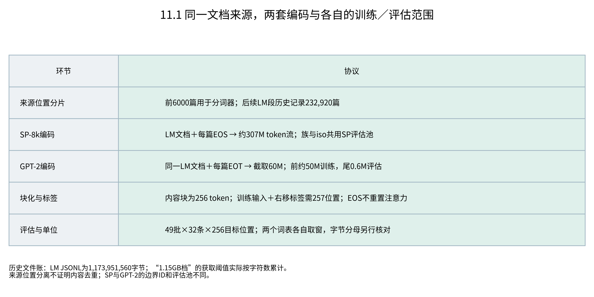
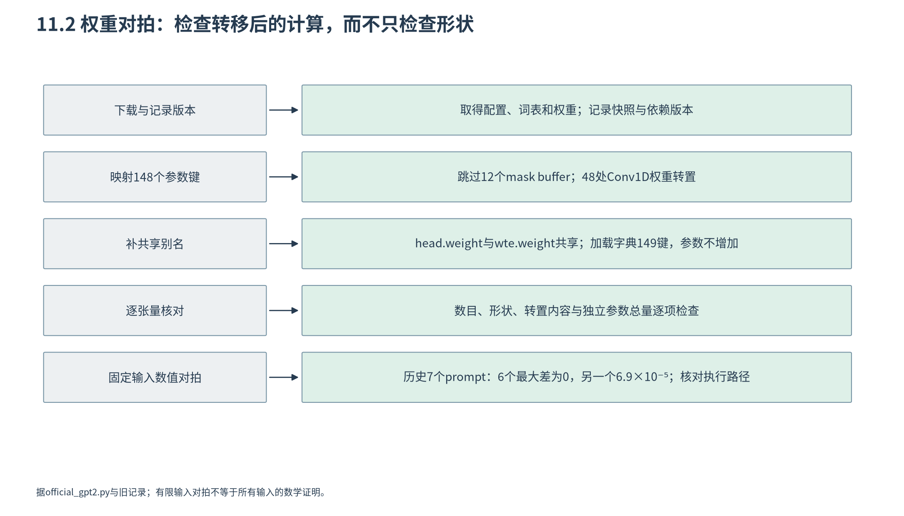
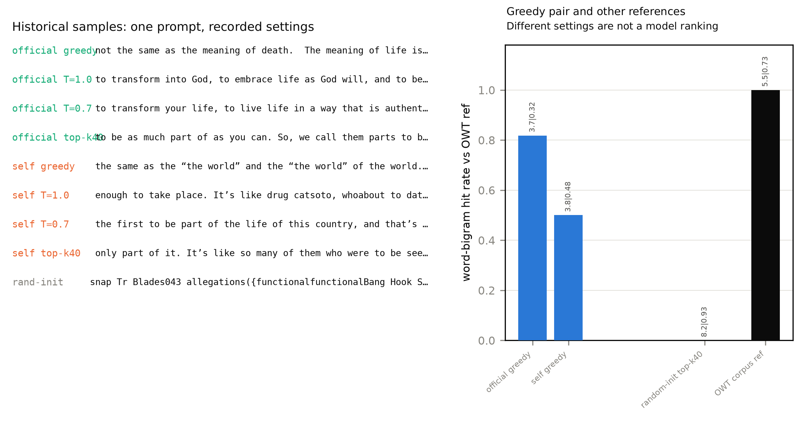
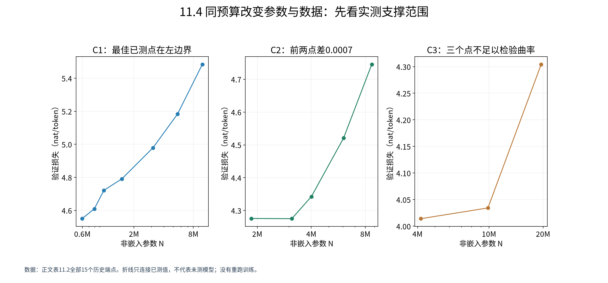
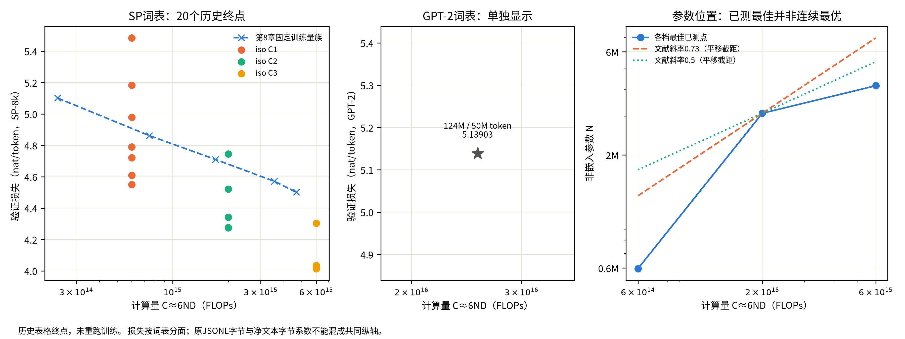

# 第 11 章 大项目 II：数据、权重与损失-算力曲线

## 11.0 开篇：从全书到这里

上一章我们完成了模型实现：三插槽 Block 的 124M，参数逐位对上官方 124,439,808，随机权重在固定输入上与HF对拍通过，冒烟曲线从 $\ln 50257$ 附近健康起步。但它至今使用的还是 1MB 的莎士比亚文本——第 10 章末尾已经预告了本章的任务：「喂真数据、对官方权重、看真曲线，损失-算力图上把我们自己的点画进 Kaplan 与 Chinchilla 的坐标系，是大项目 II 的三件正事」。这三件事正好对应本章的三个工作环节：数据管道把 OpenWebText的历史子采样语料变成一次通过的训练流（11.1 节）；官方权重对拍用四步把「我们造的机器」与「OpenAI 训出的那台机器」接通（11.2 节）；然后机器开始训练，50M token 的 fast 档曲线加一张 15 点的 iso-FLOP 网格，练习第 8 章的实验设计：在固定计算量下改变参数与数据分配，观察哪些趋势有支撑、哪些外推没有支撑（11.4 节）。

与第 10 章的「凭什么相信机器是对的」对应，本章要回答的问题是：**「我们实现的模型在真实语料上训练后，所得曲线凭什么能与论文中的定律比较？」**比较需要统一统计口径——参数口径（本书$6ND$采用非嵌入参数）、算力单位（FLOPs 与 PF-days）、损失口径（per-byte 等共同单位，同时核对原始文本、边界和上下文协议）、以及如何报告最低损失的规范。第 8 章我们已经遇到过统计口径不一致的问题（日程倒挂差点写进正文），本章在实验设计阶段就明确这些规范，最后在 11.6 节收拢成本册的「诚实条款」——它规定了一台 ≈6 TFLOP/s 的笔记本电脑，「训成」一台 GPT-2 的标准是什么。

> **最小背景栏**：三处已知基础，以及一项本章将补齐的计量约定。①第 8 章全部：幂律式 (8.1)/(8.5)、Chinchilla 三种方法中的 iso-FLOP 轮廓（8.3 节）、读曲线四问（8.6 节）——本章曲线对应那章介绍的方法；②第 9 章 9.3 节换算盒（$C\approx 6ND$、PF-days）；③第 10 章的机器与预算：`model.py` 是 11.2 对拍官方权重所用的模型实现、表10.2给出数量级参照，11.4另报实际批型、键映射三高危点已在 10.2 节预演——这里说明代码依赖关系：11.4 的训练产线（`train_124m.py`/`iso_flop.py`，及 11.3 采样的自训侧）为沿用第8章族的主要训练设置（同 b32×s256、warmup200、49批固定窗口eval），沿用 ch04 参数化 GPT 工厂并延伸 ch10 循环的配方自备循环，并不 import ch10 的 `train.py`；两套实现的基本GPT-2结构和124,439,808/85,056,000参数计数一致，实际数据、初始化及评估协议仍须分别核对（「工厂实现与五处复用」的代码史见 12.5 节图 12.2）；④token↔word 困惑度换算在本章 11.1 节的换算盒中介绍。

## 11.1 数据管道：真语料的三道工序

模型要使用真实数据训练，第一道工序是选择语料。第8章已经选定OpenWebText子集，第10章的小语料过拟合则说明：扩大模型之前，还要核算训练会怎样重复使用文本。历史下载任务称“1.15GB档”，但脚本停止条件实际累加的是字符数；后续账本记录LM主语料232,920篇、JSONL文件约1,119.6 MiB。字符数、净文本UTF8字节数与带包装的文件字节数不能混用。

选择OpenWebText，是因为它尝试复刻WebText的网页收集思路，也能提供本项目所需的数据量。卡片把数据包装标为CC0，并说明发布者不拥有所抽取网页文本；本书保留获取脚本，不随书分发原语料。主语料编码后约307M token，每个实验点实际所取的训练前缀均不超过训练池容量；多个实验仍会反复使用同一批文档，不能把“每点一次通过”说成“全部实验合计只读一次”。

关于数据来源，有一个定义需要明确：WebText 原版 = “Reddit 上获得至少 3 karma 的外链，再经抽取、清理和去重等处理”【证据等级：官方论文 GPT-2 §2.1】；OpenWebText 的 karma 管道说法出自其 GitHub 项目自述，HF 卡片本身未载明 karma 细节——它是「管道与 URL 集的复刻」，不是逐字节同一数据【证据等级：第三方复刻（GitHub 自述），卡片核验 2026-10】。顺带一句 GPT-2 论文自己的记忆化检查：他们对 WebText 与若干常见语言模型测试集做过8-gram重叠分析，按其文本规范化规则得到的平均比例为3.2%【证据等级：官方论文 §4】——「模型是在背还是在学」的担忧从那个年代就有，我们的一次通过减少了显式重复训练，但还需要文档去重与训练—评估重叠检查，不能独自保证没有记忆化。

第二道工序是**分词器分片分离**。第 8 章冒烟档的教训（分词器与 LM 语料同源、28 万 token 跑 32 遍、拟合 $r^2$ 只有 0.43）提示我们把数据量、重复消费和评估分离分别记录；低$r^2$不能单独归因于分词器是否同源。正式设置中的sp-8k 分词器只在独立的 6000 篇 / 29MB 分片上训练，LM主语料跳过前6000篇，从后续文档开始，两段按来源位置分离；232,920篇是LM段的记录数，分词器分片另计。本章第二套编码（官方口径的 50257 词表，tiktoken gpt2）不训练分词器、直接使用官方词表（第 2 章已对拍 tiktoken≡HF，B 级），同一文档流按原顺序重编码出 60M token 的 gpt2 流（训练实际消费首 50.0M，一次通过），流末尾留 600,000 token 作 eval 池，与训练段在 token 位置上间隔约 9.4M。位置互斥不等于文档或内容去重，不能据此排除语义重复与所有数据泄漏。

本章正式训练的eval批型沿用第8章：固定种子 49 批 × (32×256) = 401,408 个被评估位置；8192 是一批的位置数，不是单条序列长度；评估采用fp32前向——这个数不是随意选取的，是第 8 章在本语料上实测逐 token 标准差 2.50 反推的（若这些损失独立同分布，$\mathrm{se}=2.50/\sqrt{401{,}408}=0.0039<0.005$；实际 token 有相关性，重复或重叠窗口也会降低有效样本量，因此这个数字只是独立性近似），iso网格与124M曲线沿用相同的评估位置数量；两个词表各有自己的评估流，不是逐位置相同的文本窗口【证据等级：本书实验（`log/book2-ch08/tok_std.json`）】。

第三道工序是**块化**：一篇篇文档怎样变成$(B,n)=(32,256)$的训练窗？图11.1给出整个数据流程。法A将每篇文本编码并追加EOS/EOT，再拼接成长流；法B在每篇文档内部单独切窗，不把短尾段补成完整窗口。两者的取舍是能否跨文档利用剩余位置。

先按**内容块**做库存账，暂不计右移标签。旧记录在前2000篇上给出：拼接流切成9940个完整256-token块，剩42 token；逐篇切块得到8949块，丢弃253,738 token，利用率90.03%，平均每篇尾料约127 token。这些数字说明逐篇丢尾的代价，却还不是可训练样本的精确数量。预测下一token时，一个长度$n$的输入还需后面一个目标位置：长度$L$的流可按步长$n$取$\lfloor(L-1)/n\rfloor$个完整输入/目标窗。逐篇独立时也要分别保留这个目标余量。

跨文档窗口则必须从**文档交界的位置**来数。对只考察输入内容的块，将内部交界落在的非整块位置映射到窗口编号，再去重；一个窗口含多个交界也只算一次。若输入和标签都要求来自同一文档，还要检查右移的最后一个标签。取两个长度都为8的文档、块长4，四个内容块都能各自落在一篇文档内；取三个长度都为2的文档，第一个完整内容块就跨过了交界。文档本身长不长，不能代替这个判断。

> **历史计数勘误**：旧脚本把“某篇文档跨越多个块”误当成“某块包含多篇文档”，因此其1986个跨文档窗、约20%的报告不能继续作为有效测量。原始语料尚未恢复，这里只纠正算法并用构造例验证，不填一个未经实测的新比例。上面的9940/8949等内容分块账与这一错误计数是不同项目。

拼接流里的边界可以直接看到：历史示例为`…Wolf/Wired UK] Red Dwarf has been [EOS] 下一篇…`，交界附近ID为`[359, 4425, 7107, 7077, 1232, 2760, 7109, 2, 2603, …]`。其中2是该SP词表的EOS；GPT-2的EOT为50256，二者不能互换。边界词元给模型提供了文档结束的信号，但没有自动清除注意力上下文。只要两个文档落在同一输入窗口，后一篇仍可能看见前一篇；若EOS恰在窗末，它还可能用来预测下一篇首词。因此不能说加入EOS就保证模型“该断则断”。逐篇切法控制了这种跨篇可见性，代价是更多尾料。公开GPT-2论文与推理代码不足以确认完整训练块化管道，本书把法A明确作为自己的实现选择。

图 11.1 两套编码与各自训练用途。32×256是一批评估位置数，不是长度8192的单条输入；token位置互斥不保证内容去重。

最后一道小工序是**换算盒**。我们的损失是 nats/token，但社区几十年的语言模型传统报 word-level 困惑度（WikiText 系基准），两者比较时需要换算单位。设总负对数似然为 $S$、token 数 $n_t$、词数 $n_w$，则

$$
\ln \mathrm{PPL}_{word} \;=\; \frac{S}{n_w} \;=\; \frac{n_t}{n_w}\cdot\ln \mathrm{PPL}_{token}
\tag{11.1}
$$

| 符号 | 含义 | 取值 / 口径 |
|---|---|---|
| $\mathrm{PPL}_{token}$ | token 级困惑度 $=e^{L}$ | 标量；$L$=nats/token |
| $\mathrm{PPL}_{word}$ | word 级困惑度（社区传统口径） | 标量 |
| $n_t/n_w$ | 每 word 的 token 数 | 随词表与语料浮动，**必须实测** |

这表示：**同一份总负对数似然，除以token数得到每token损失，除以词数得到每词损失；两个分母的比例就是换算系数**。这个系数依赖文本与计数协议。旧记录在前56,000篇完整文档上报告：gpt2 词表（50257）为 **1.376 token/word**（4.398 B/token），sp-8k（8192）为 **1.600 token/word**（3.782 B/token）【证据等级：本书实验（`data.py step_conversion`，2026-10）】。这组数据中GPT-2平均每token对应的字节更多；不能把这个方向推广为任意两套不同算法、不同语料训练出的词表。旧统计还给GPT-2计入逐篇EOT，却未给SP计入EOS，不能不加说明地把两项都称为训练流的完整口径。这只是总负对数似然的单位换算：词数规则、文本归一化、未知词处理和上下文窗口必须一致，才能用于比较。它不自动把任意子词模型变成同一个归一化的词级模型。形式上将「token PPL 100」分别配以上述两个比率，得到的 word PPL 差 $100^{1.600}/100^{1.376}\approx 2.8$ 倍，直接跨词表比较绝对 PPL，问题就出在这里。

换算示例采用WikiText-2。这里首先要确定“词”如何数：数据集同时提供raw和已处理UNK的版本，而本书旧代码取raw-v1再按空白切词，不能直接当作标准word-level协议。发布卡片的许可正文与metadata分别列CC BY-SA4.0及3.0/GFDL，本书仅保留获取入口，数据落入实验目录。

计数基线需要先构造有效的概率分布。设训练词表外的词统一映射为$\langle\mathrm{unk}\rangle$，为它显式留出计数，再让所有词的概率和为1。本书在训练中没有UNK时为它补一个伪计数，其余词用训练计数，最后以全部计数之和归一化。例如训练词流为a、b、b时，$P_1(a)=1/4$、$P_1(b)=2/4$、$P_1(\langle\mathrm{unk}\rangle)=1/4$；不能先分完$1/3+2/3$，再额外加一份未知词概率。插值bigram用

$$P(w_2\mid w_1)=\frac{c(w_1,w_2)+\gamma P_1(w_2)}{\sum_u c(w_1,u)+\gamma},\qquad\gamma=5.$$

分母数的是实际有后继的$w_1$位置；若某词只在流末出现，就不能把这个无后继位置也当成一次转移。无已见后继时，该式自然退回归一化的$P_1$。这样，“多看一个词的上下文”才对应另一个可以检验的概率模型；验证集损失是否更低仍需测量。

> **历史基线边界**：旧程序报告unigram 1800.6、插值bigram 1304.1，验证OOV率3.36%。复核发现，它在已用完全部概率质量后另给未知词概率，bigram分母也没有排除无后继位置，因此这两个数不能再作为已经正确归一化的PPL基线。原结果保留作算法勘误记录；随书实现修正后需按固定版本数据重新计算，不能沿用旧数宣称改善了三成。

11.3节会保留自训模型在WikiText-2上的历史损失，用它说明同一总似然的换算条件。真正比较计数模型与神经模型时，还需统一原始文本、UNK映射、被计分的位置和上下文重置，不能仅因结果都叫“word PPL”便排列高低。

## 11.2 官方权重对拍四步：将官方权重加载到手写模型

数据准备好后，接下来检查预训练文件能否正确装入这份实现：把 OpenAI 训好的官方权重搬进我们手写的 `model.py`。第 10 章的验收②用**随机权重**检查了固定输入下两种实现的数值一致性，这提供了已测输入下的结构一致性证据，却没有检验预训练文件是否被正确读入——只有当官方权重经过我们的键映射搬进手写模型后输出在明确的数值容差内一致，手写模型才算完成了与官方权重的对接。全程四步，脚本 `official_gpt2.py`，全部 CPU fp32【证据等级：本书实验（`log/book2-ch11/official_parity.json`，2026-10）】。

**第一步：下载最小文件集。**历史下载时，HF仓`openai-community/gpt2`的清单为26个文件、总量约1.6GB——里面 TF/Flax/Rust/ONNX 四种重复权重格式，本文文本对拍只取所需的权重、配置和分词器文件：`model.safetensors` 522.7 MiB，加分词器与配置约2.7 MiB，**合计525.4 MiB**；旧脚本按$2^{20}$ bytes换算却把字段写成MB，这里更正单位。下载过程有两点需要说明：匿名下载实测出现过两次挂起（调研期 bert 262MB 处与 gpt2 辅助 blob 处各一次，重试即恢复，中断可能留下`*.incomplete`；应先核对下载工具的续传状态，不直接删除仍在使用的残件）【证据等级：本书调研实测（2026-10-02）】；公开 GPT-2 仓库随附 Modified MIT License，与第 4 章相同。原文说明不主张生成内容所有权、请求负责任使用和标明生成来源，并说明生成内容不必携带软件许可文本；这里按原文描述，不另作授权范围的扩张解释。书中提供获取与加载脚本，不再分发下载权重。取得一个版本快照后，手写模型的权重、HF参考模型和分词器都从同一目录读取，并记录文件哈希；否则不同版本间的差异可能被误认为键映射错误。

**第二步：键映射，处理三项易错点。**历史所用safetensors文件含160个键，加载到手写模型时要处理三个问题，第 10 章在随机权重上排练过，这次使用实际的官方权重：**问题 A（Conv1D 转置）**——HF 的 Conv1D 权重是 (in,out) 排布（`addmm` 语义），`nn.Linear` 是 (out,in)（$xW^\top+b$ 语义），四处投影权重共 **48 处转置**（12 块 × c_attn/c_fc/c_proj(mlp)/c_proj(attn)）；其中 `attn.c_proj` 是 (768,768) 方阵，忘了转置**不报错，却会在没有提示的情况下输出错误结果**——最隐蔽的一处，逐权重核对和logits对拍都能发现这个问题，单看形状不够。

**问题B（共享别名）**——历史文件160键中只保留wte，没有lm_head。手写模型构造时已经把词嵌入与输出头绑为同一个参数；严格加载还需要相应的head.weight别名键，所以映射字典要为它提供同一份权重。别名不增加独立参数量，其他保存格式也可能同时保留两个别名，应以实际文件为准。

**问题 C（无前缀）**——该历史raw checkpoint顶层键没有 `transformer.` 前缀（这是文件中的实际命名形式），`h.{i}` 改名 `blocks.{i}`，另有 12 个 `h.{i}.attn.bias` 遗留 causal-mask buffer 要跳过（本书mask为`persistent=False`；不同HF版本的掩码组织另查实际实现）。160 − 12 = **148 个原参数键**。随后代码补入共享参数的别名 `head.weight`，交给 `strict=True` 的字典是 **149 键**；共享别名没有增加独立参数量。

**第三步：参数逐项对账。**逐组清点 checkpoint 张量并与表 10.1 的手算账对上（表 11.1）。历史加载后逐键`torch.equal`均为True；当前实现还核对dtype，并限定源权重与目标均为fp32。在这一前提下，转换到正确排布后的数值应逐位相同，不能把低精度升为fp32后数值相等也称作原样拷贝。

**表 11.1** 官方权重对账与 logits 对拍（CPU fp32，transformers 5.18.0 / tiktoken 0.14.0，2026-10）【证据等级：本书实验（`official_gpt2.py`，`log/book2-ch11/official_parity.json`）】

| 项 | 数值 | 判定 |
|---|---|---|
| checkpoint 键数 → 映射后 | 160 → 148 个参数键 → 149 个加载键（补 head 别名） | strict 加载通过 |
| Conv1D 转置 | 48 处（attn.c_proj 方阵在内） | 逐位 torch.equal ✓ |
| wte / wpe | 38,597,376 / 786,432 | 与表 10.1 逐位一致 |
| 12 × Block + ln_f | 85,054,464 + 1,536 | 同上 |
| 总参 / 非嵌入（6ND） | **124,439,808 / 85,056,000** | assert 通过 |
| max\|Δlogits\|（vs HF eager，7 prompt） | **0.0（6/7）**；6.9×10⁻⁵（p6） | 最大绝对差 < 10⁻⁴ |
| argmax 一致率 / top-5 全命中率 | 7/7 / 7/7 | 通过 |
| max\|Δlogits\|（vs 探针基线，sdpa 路径） | 6.9×10⁻⁵ ~ 1.4×10⁻⁴ | 见正文口径注 |

**第四步：固定 7-prompt logits 对拍。**7 条 prompt 覆盖短事实 / 重复诱导 / 长段落 / 德语 / 代码 / 算术 / 单字符（token 长度 1~31），两侧同输入（$(1,n)$ 进、$(1,n,50257)$ 出、取末位 $(50257,)$）比 max|Δ|。结果比预期更加一致：**六条 prompt 的 max|Δlogits| 严格为 0.0**，唯一非零的单字符 prompt 差 $6.9\times10^{-5}$（与浮点执行路径差异相容；这次记录没有逐算子定位全部来源）；argmax 一致 7/7、top-5 全命中 7/7【证据等级：本书实验（CPU，2026-10）】。这里还有一项关于对拍口径的经验：与探针基线（2026-10-02 存盘，走 transformers 默认 sdpa 注意力路径）的最大差是 $1.4\times10^{-4}$——**这次sdpa基线与eager结果的差达到了$10^{-4}$量级，不能拿源码阅读时预估的$10^{-6}$替代实际测量**，图11.2整理核对流程，具体差值保留在表11.1。教训归入第 7 章立的口径自觉清单：对拍数值前先对齐的不只是精度，还有算子的实现路径。

图 11.2 对拍四步。148个原参数键加共享别名成为149个加载键；有限prompt的数值一致是验证证据，不是全输入等价证明。

对拍过了，顺手做两条生成 sanity——它们是后面 11.3 节的预告，也是两则现成教例。教例一：`The capital of France is`，贪心续写是 **" the capital of the French Republic, and the capital of the French Republic is the capital of the French…"**——复读机式的循环；而 " Paris" 只以 p=0.032 排在 top-5 第 5 位（第 1 位是 " the"，p=0.085）。教例二：`2 + 2 = 4, 3 + 3 = 6, 4 + 4 =`，下一 token **" 8" 概率 0.361**（次位 " 7" p=0.198）——答对了？贪心再往下写：**" 8, 5 + 5 = 10, 6 + 6 = 12, 7 + 7 = 15,"**——$7+7=15$。这个例子显示：当前提示下前几项正确，不能保证后续算术可靠。它不能揭示模型内部究竟只用了哪一种“表面规律”，但足以否定把一次正确续写当作通用算术能力的证据。第一则循环续写也说明，局部最高概率的连续选择未必产生适合阅读的整段文本。下面将同一模型的分布保留下来，比较不同取样方法。

## 11.3 采样生成：从概率分布得到文本

**采样改变的是使用分布的方法，不是模型学到的权重。**贪心每步选择概率最高的 token，某些提示下会反复进入高概率的局部模式；随机采样能探索其他续写，但也可能引入错误。不存在“采样必然优于贪心”的结论，选择取决于任务需要确定答案还是多样文本。

设某一步 logits 为 $z\in\mathbb R^V$，温度 $T>0$ 给出

$$p_T(i)=\frac{e^{z_i/T}}{\sum_j e^{z_j/T}},\qquad
\frac{p_T(i)}{p_T(j)}=\exp\big((z_i-z_j)/T\big).\tag{11.4}$$

后一个式子直接解释温度：固定分数差为 2，$T=1$ 时概率比为 $e^2$，$T=0.5$ 时变成 $e^4$。降温扩大相对偏好；升温削弱相对偏好；有唯一最大分数时，$T\to0$ 集中到最大项。它改变置信程度，不会把错误最大项变正确。

top-k 再取分数最大的集合 $A_k$，以 $p'_T(i)=p_T(i)\mathbf1[i\in A_k]/\sum_{j\in A_k}p_T(j)$ 取样。低概率尾部被排除，可能减少异常续写，也可能排掉合理但罕见的词。GPT-2 报告附录多组样例使用 $k=40$；这只是该实验的选择，不是通用最优值。截断后归一化的思路可参阅 Fan 等的层次故事生成论文（1805.04833）。

本册采样器每步全量重算前缀。若输入长$P$、生成$G$个token，且总前缀未超过模型上下文上限，线性投影累计处理的位置数为$GP+G(G-1)/2$；全注意力累计处理的成对位置与$\sum_{t=0}^{G-1}(P+t)^2$成正比。前者对$G$是二次、后者含三次项，不能把整机所有计算都概括成“平方复杂度”。旧记录 40 token CPU 续写约 1.2 秒只是指定输入与机器下的计时。后续册将通过缓存复用已经计算的历史状态。

对同一prompt（`The meaning of life is`），官方与自训两组的每种解码都重置采样种子，各写40 token。官方权重与自训模型（50M token fast 档，训练同配同种子复跑并保留权重；复跑终值 5.1428，与 11.4 节的 5.1390 差 0.004——这是同种子两次记录的差异量级，现有材料不足以把原因唯一定位为某个MPS算子）并排，外加一台随机初始化124M的top-k40样例；旧代码这一次没有重新设置采样生成器，而是沿用了上一组的状态，不能把它称为同seed的greedy对照。样例保留在图11.3左栏，随书新实现则对每个模型、每种解码分别重置生成器。肉眼先看三行代表：官方贪心写出 " not the same as the meaning of death.\n\nThe meaning of life is not the same as…"——**官方权重贪心也会复读**，只是这里重复的是完整句子（型例比低到 0.32）；官方 T=1.0 采样的文本随即变得多样，写出一小段神学色彩的论辩；自训 50M 的 T=1.0 样例是 " enough to take place. It's like drug catsoto, whoabout to date bymetal people…"——**出现了可辨认的英文片段，也夹有catsoto、whoabout等不自然的词形或连接**；随机初始化则是 "snap Tr Blades043 allegations({functionalfunctionalBang…"——杂乱的子词组合。除了直接阅读，还可以用**词法统计**作定量描述（诚实条款的验收口径：词长、空格率、型例比、对语料 bigram 的命中率），图 11.3 右栏。

图11.3 历史生成样例与词法统计。左侧保留官方/自训四种解码及一个随机初始化top-k40样例；右侧实际画出了官方greedy、自训greedy、随机top-k40和OWT参照四项，并未包含全部温度配置。随机对照与前两项解码不同，OWT参照还来自建立参考集合的文本，不能把四柱直接排列成模型质量等级。【证据等级：本书历史实验，2026-10；原sampling.json未恢复】

词法统计为这些短样例补充了可计算的描述。旧脚本把OWT前2000篇、约30万词以内的相邻词对组成参考集合，统计续写中有多少词对出现过。这里有两个实现细节：旧集合把文档词流直接接起来，因而包含少量人为跨篇词对；它按整篇加入，在达到词数阈值时可能略超上限。新实现按文档分别提取并记录真实范围。

历史记录中，官方greedy命中率0.818，自训greedy为0.500；随机初始化的0.000却来自top-k40采样，不能冒充第三个greedy结果。随机行的平均词长8.21、空格率0.105，自训样例3.81/0.196，语料参照5.48/0.151，描述的是这些特定文本，不能据一行参照定义自然语言的正常范围。OWT参照文本又取自参考集合内第一篇，其高命中率不代表独立测试成绩。

每条续写只有约几十个相邻词对，而且这些词对相互依赖。一个命中与否就能明显改变比例，但不能据此给出未经估计的“±0.1”可靠误差界。若要比较模型，应固定解码设置、任务与文本处理，并增加独立提示和采样重复。

解码设置同样会改变这些统计量。旧记录中，官方$T=1$样例命中率0.375，而自训$T=0.7$样例为0.821；这个交叉比较不能推出自训模型更好，因为模型和解码同时变了。固定模型后比较不同温度，可以研究解码效果；固定解码后比较不同模型，也还需要多条样例，而不是把“解码之间不可比”当成绝对禁令。自训top-k40的一个片段是`"…they wanted to know what was just the truth to the human world."`，它展示了局部通顺的可能性，却没有证明截断必然提高正确性。看起来通顺，与分布或任务表现可靠，仍是不同问题。

11.1的换算盒在这里也需要一个反例。旧代码在WikiText-2 valid前24个256-token窗口上测得6.821 nats/token，再乘**整份**valid统计的1.156 token/word，得到约2660。该读数保留为历史近似；由于分子只来自前6144个被计分token、比率却来自全valid，不能把它写成式(11.1)的精确应用。旧代码还直接连接数据行而未补分隔，词计数与另一脚本逐行切词的对象不完全相同。修正实现必须先固定文本拼接规则，再在同一实际评分范围上计总负对数似然和分母，遇到词元切到半个词或UTF8字符时明确边界约定。

6.821与OWT的约5.14也不能把差值全部归于“文风不同”：数据域、窗口选择和上下文都发生了变化。加上11.1中计数基线的归一化问题，旧1800.6/1304.1与约2660不能用于模型排名。**单位换算只重新分配同一总似然，不会修复概率模型、文本或评分范围的不一致。**

## 11.4 损失—算力曲线：把预算问题变成可检验实验

数据管道和权重对拍都已通过检查，本节是全册的核心产出：**用自己实现的模型、准备的数据和实验网格，把特定数据与训练设置下的损失变化画成实测曲线**。数据分三层，一层比一层接近论文的坐标系。

**第一层：124M 的 50M token 真曲线。**第10章表10.2提供了50M预算的数量级参照，但本次改用下述批型：50257 官方词表重编码的 OWT 流、b32×s256（8,192 token/步）、warmup 200 + 余弦 $10^{-3}\to10^{-4}$、bf16 训练 / fp32 eval，6,104 步 = 50,003,968 token **每个训练目标位置只消费一次**。三组数字先过自检：初始 loss **10.9513**（$10.9513\approx\ln50257+0.1264$；第10章式(10.3)仅提供有假设的尺度解释，不是这三个历史读数的精确预测）；eval 轨迹 13 个点从 6.4145 单调降到 **5.13903**，无回弹（train/eval 末差 0.022 nat，方向正常）；wall **78.9 min**（纯训练 0.726 s/步、11,283 token/s），旧字段记3,625 MiB（约3.5 GiB）；代码实际只在eval结束后读取current并取这些读数的最大值，**没有轮询训练峰值**，不能据此与37.4 GiB容量相减估算完整余量【证据等级：本书实验（MPS bf16/fp32，2026-10，`log/book2-ch11/train124_fast.json`）】。有效算力按$6ND$除以**累计纯训练步时**得到约**5.76 TFLOP/s**；若分母改用含评估等开销的78.9分钟，总体约为5.39 TFLOP/s。下文预算估算采用约5.76 TFLOP/s的纯训练口径，读者换算总耗时时还需加回评估等开销。

这13个评估点还能用$L=B D^{-\beta}$拟合，历史结果为$\beta=0.0907$、$r^2=0.994$；允许自由下界$E$时，拟合又贴近0。它描述的是同一条余弦退火轨迹，而不是独立改变训练token数得到的多次最终结果：早期检查点处于较高学习率阶段，末点已经完成退火，各点还共享先前的优化历史。因此高$r^2$只说明这段轨迹与所拟合曲线接近，不能把指数直接当成可迁移的Scaling Law。

Kaplan和Chinchilla也不是一概使用固定学习率：前者通常采用warmup加余弦，后者的iso-FLOP实验把余弦周期配到各自预算终点。真正需要区分的是实验对象和取点方法，而不是简单分成“变学习率”和“固定学习率”。自由$E$拟合与固定零下界的对数拟合还使用了不同残差目标；轨迹点重采样给出的区间，不能自动解释为独立重训的不确定性。

用最后损失做一道算术练习：$e^{5.139}\approx170.6$是token困惑度，它表示相同平均对数损失的均匀分布尺度，不是每一步真的剩下171个候选。若暂用全语料描述比率1.376，形式换算为$e^{1.376\times5.139}\approx1178$；由于这不是实际eval窗的同范围词数比，只能作换算演示。要报告精确的每词归一化分数，应回到同一评分范围的$S/n_w$。

**第二层：iso-FLOP 网格——Chinchilla §3.2 的缩小版。**单条曲线只回答「这台机器学得多快」，要回答「这笔钱该怎么花」需要网格。设计沿用第 8 章相应的预算与实验分析方法二：固定一档总算力 $C$，档内扫不同 $N$，数据量由 iso-FLOP 约束（式 (11.2)）决定

$$
D \;=\; \frac{C}{6N}
\tag{11.2}
$$

（$C$=FLOPs 名义值；$N$=非嵌入参数；$D$=该点训练 token 数。这表示：**算力固定时，模型大一些，训练数据量就得少一些——每个点都是同一笔钱的一种花法**）。三档 $C\in\{6\times10^{14},\,2\times10^{15},\,6\times10^{15}\}$（相邻分别约 ×3.33、×3），中间档加密到 5 点，共 15 点（全表见 表 11.2），最大$N$为19,519,872（约19.5M），最大$D$为239,501,312（约239.5M），各点消费量均在约306M训练池范围内。配方与全族统一：b32×s256、warmup 200（第 8 章倒挂教训的正式修正）、AdamW(0.9,0.95,wd 0.1)+clip 1.0、bf16/fp32、49批固定窗口eval——历史iso与第8章族使用同一个SP分词器、同一eval池和抽样函数，因此可在这一限定下比较。当前修订补上了旧采样漏掉的末合法起点，新运行须使用新的协议标记，不能要求逐值复现旧窗集；此外，第4章还修正了残差出口的初始化。旧曲线属于当时实现，新脚本不能自动继承这些历史终值。

这里还需要记录实验设计的调整过程：初版网格按第 8 章 Kaplan 曲线的走势把各档谷底预设在了偏大的 N，C1档所测损失随N减小而下降之后，连续四次自适应补小点（1.5M→1M→0.79M→0.60M）并把 C2/C3 整体下移——**网格范围要根据观测调整，不能把预设谷底当成已经找到的最优值**，最终 15 点超出设计书的 3×3=9，总机时 216 min【证据等级：本书实验（MPS bf16/fp32，2026-10，`log/book2-ch11/iso_flop.json`）】。

**表 11.2** iso-FLOP 网格 15 点全表（N=非嵌入参数实数；D=C/6N 取整后反报，名义 C 偏差 ≤0.04%；eval=终步 401,408 token fp32；旧协议按独立 token 近似估计误差约 0.004；未覆盖训练种子、相关性与模型选择不确定性）【证据等级：本书实验（2026-10，`iso_flop.json`）】

| 点 | (层数,维度,头数) | N 非嵌入 | D (token) | 步数 | eval 终值 |
|---|---|---|---|---|---|
| c1g | 3L×128×2 | 595,072 | 168,050,688 | 20,514 | **4.5498** |
| c1f | 4L×128×2 | 793,344 | 126,050,304 | 15,387 | 4.6096 |
| c1e | 5L×128×2 | 991,616 | 100,843,520 | 12,310 | 4.7216 |
| c1d | 6L×144×2 | 1,504,512 | 66,469,888 | 8,114 | 4.7904 |
| c1a | 7L×192×3 | 3,114,432 | 32,112,640 | 3,920 | 4.9790 |
| c1b | 7L×256×4 | 5,528,832 | 18,087,936 | 2,208 | 5.1833 |
| c1c | 8L×320×5 | 9,864,320 | 10,133,504 | 1,237 | 5.4844 |
| c2a | 6L×160×2 | 1,856,000 | 179,601,408 | 21,924 | **4.2757** |
| c2b | 7L×192×3 | 3,114,432 | 107,028,480 | 13,065 | **4.2750** |
| c2c | 9L×192×3 | 4,004,160 | 83,247,104 | 10,162 | 4.3425 |
| c2d | 10L×224×4 | 6,050,688 | 55,091,200 | 6,725 | 4.5207 |
| c2e | 11L×256×4 | 8,687,872 | 38,371,328 | 4,684 | 4.7457 |
| c3a | 8L×208×4 | 4,175,392 | 239,501,312 | 29,236 | **4.0141** |
| c3b | 8L×320×5 | 9,864,320 | 101,376,000 | 12,375 | 4.0343 |
| c3c | 11L×384×6 | 19,519,872 | 51,232,768 | 6,254 | 4.3044 |

**这张网格最有价值的结果，是告诉我们下一轮该补哪些点；它还不足以确定一条计算最优定律。**下面分别读三档。先看观测值，再看拟合值，最后问拟合依赖的假设是否受到实验检验。

C1 中，N 从 9.86M 减至 0.60M，所测损失一路下降，最佳已测点为 595,072 参数、4.5498。旧二次拟合给出约 116k 的外推顶点，留一法在约 0.3k–250k 间摆动，说明顶点对数据选择极敏感。**只能确认最小已测模型最好，不能直接证明连续全局最优满足 $N^*<595072$。**后者还需要单峰、局部趋势可延伸等假设。由 306M token 池得到的 $N\ge C/(6\times306\text M)\approx327$k 是一次通过条件下的可行性边界，不是统计估计的最优模型下界。下一轮应在允许的更小 N 区域补点，并检查相应形状与学习率。

C2 的五点中，1.856M 与 3.114M 的损失为 4.2757、4.2750，相差只有 0.0007，随后三个大模型的损失升高。对$x=\ln N$拟合 $a x^2+b x+c$，当 $a>0$，导数 $2ax+b=0$ 给出顶点 $N_{\rm fit}=\exp[-b/(2a)]\approx2.34$M。这里用自然对数，所以以$\exp$还原；脚本用$\log_{10}N$时相应以10的幂还原，顶点所对应的$N$相同。这只是从拟合形状得到的插值建议。原脚本向每个损失点加入独立高斯扰动，标准差设为 0.004，再重复拟合；其 95% 分位区间为 [2.27M,2.40M]。**这是指定噪声与二次形状下的条件区间，不是实际多种子训练获得的置信区间。**留一法 2.04M–2.38M 反映另一种敏感性，也未涵盖所有训练变动。

C3 的三个点给出 4.0141、4.0343、4.3044。前两个点差 0.0202 nat，旧二次拟合顶点约 6.11M，位于 4.18M 与 9.86M 之间。三个点恰能确定三个二次系数，没有残差自由度可检验曲率形状；不能因顶点在区间内，就宣称真正谷底被两侧约束住，也不能用独立 token 近似把差值断言为“5 个可靠标准误”。应补中间点和独立训练重复，才有资格缩小建议范围。

历史吞吐记录从 c1g 的 0.91 TFLOP/s 到 c3c 的 5.26 TFLOP/s，124M 记录约 5.76 TFLOP/s。这些记录与较大矩阵摊薄固定执行开销的解释相容，但仅凭汇总还不能分离所有性能因素；它不是本机所有工作负载的硬件峰值。

图 11.4 按表 11.2 的全部 15 个历史点重绘。曲线只连接观测点以帮助阅读，不把连线当作未测模型的真实损失。C1 最佳点处在左边界；C2 前两点近似持平；C3 只有三点。旧拟合顶点的含义与局限见正文。

**第三层：斜率与论文坐标系。**把三档的 $N^*$ 连起来问「算力涨十倍，最优模型该涨几倍」，就是 compute-optimal 斜率

$$
\gamma \;=\; \frac{d\log N^*}{d\log C}
\tag{11.3}
$$

这里 $N^*(C)$ 表示在指定模型族、数据与训练协议下的最优参数量。若假设 $N^*=kC^\gamma$，取对数便得到 $\log N^*=\log k+\gamma\log C$，所以式 (11.3) 的斜率回答“算力扩大一倍，最优参数量扩大多少”。关键困难不在求斜率，而在各档 $N^*$ 尚未被可靠测定。

旧分析保留三个读数：使用三个已测 argmin 得到 0.855；使用 C2/C3 的二次顶点得到 0.874；混用 C1 边界点与高档拟合顶点得到 1.014。这三个数描述**选择不同锚点的敏感性**，不是斜率的上下界，也不能写成真实 $\gamma$ 的置信区间。把 C1 锚点改成 0.33M 会得到约 1.27，进一步表明结论依赖未测点的设定。

Kaplan 的 0.73 与 Chinchilla iso-FLOP 方法约 0.50 可作为方法对照，但本实验不能据此支持或反驳其中一条定律。我们的算力只跨一个数量级、模型最大约19.5M；各点学习率没有独立调优，训练步数从 1,237 到 29,236，余弦日程分别以自己的终点退火。形状、日程、数据量一起变化，尚不能归因于参数规模本身。

同样，旧分析基于已测点或拟合顶点得到的 token/parameter 比约 282、60.9、26.8，是这些选择下的预算账，不是普遍最优配比。Chinchilla 的约 20 token/参数只是相关规模上的近似总结，第 8 章已说明表格取值与拟合舍入会改变比例。旧拟合还给出 $L^*\propto C^{-0.062}$；只有两个可靠性有限的拟合顶点时，指数也只能作描述，不能因为接近论文某一指数就宣布复现成功。

网格里还有本章最有说服力的一组对照数字。第8章借鉴Kaplan方法的模型族实验固定训练量约40M，族中最大20m点（N=19.5M）花算力 $4.68\times10^{15}$ 拿到 4.5013；本章 iso 网格的 c2a（N=1.86M、D=179.6M）花算力 $2.00\times10^{15}$——**不到一半——拿到 4.2757，低 0.23 nat**【证据等级：本书历史实验，两组采用相同SP分词器与旧eval窗集】。注意口径：这不是同算力对照（c2a 的 C 更小），写法是「不到一半的算力反而更好」。这直接支持一个局部判断：在这两组配置中，较小模型配更多数据的结果更好。两组并非各自由 Kaplan 与 Chinchilla 定律严格给出的最优配置，也不是同预算比较，因此不能称作两条定律的胜负实验。

最后把各组计算量放到同一横轴上，但先审查纵轴是否真的可比。旧图曾用SP损失除3.82、GPT-2损失除4.398，称为共同的nat/byte坐标。第8章代码复核表明，3.82的分子是**包含JSON包装与转义的文件字节数**，4.398的分子却是**净文本UTF8字节数**；二者不只是采样文档不同。前述SP的3.782又来自不计EOS的完整文档统计，也不能拿来直接修正任意eval窗口。

正确的字节归一化仍从同一总似然出发：在明确文本预处理、边界事件及评分范围后，用$S/n_{\rm byte}$得到nat/byte；若要bits/byte，再除$\ln2$。两个模型还须在相同文本和可见上下文上计分，单位相同本身不保证公平。由于旧记录未保存足以重建这些分母的完整eval文本，不能从这些材料推出“校正后的”共同字节成绩。图11.5因此将SP系列与GPT-2系列按词表分面，保留各自原始nats/token和全部计算量；右图继续展示已测argmin及平移截距后的文献斜率参照。

按已声明的$6ND$定义计算的数值，不受这项字节问题影响；但非嵌入口径未完整计入词表读出和注意力交互，词表改变时也不能把它当精确设备成本。15点iso网格合计约$3.7\times10^{-4}$ PF-days，加第8章族约$1.3\times10^{-4}$，两族合计约$5.0\times10^{-4}$；124M这一跑另约$2.95\times10^{-4}$ PF-days。相对GPT-3手算的3637.5 PF-days，它约为$8.1\times10^{-8}$，也就是约一千二百万分之一。这里比较的是指定参数口径下的近似算术量，不是设备总时间或实验能力的同比例缩放。

图11.5 保留15个网格点、第8章固定数据族5点和124M历史终点；损失按SP/GPT-2词表分别展示，不将失配的字节系数变成共同纵轴。已测最佳参数位置与文献斜率只作方法比较，参考线的截距经过平移，不代表论文预测这些小模型的最优值。

旧稿把网格外推到 124M 一跑的 $C=2.55\times10^{16}$，给出 $N\approx21$–26M、$D\approx160$–200M。这些数字在此保留为**需要新增实验验证的候选方案**，而非最优值。当前实际配置为非嵌入 N=85.06M、D=50M；它证明的是我们完成了指定规格的训练练习，不能由一个网格外推宣称“比最优大 3–4 倍”。历史除法曾得到1.1686与1.1784，但字节分子的定义已失配，评估文本和可见信息量也未对齐；这两个数保留为失效换算的记录，不能据此判断哪个模型更好或瓶颈在哪里。正确的下一步是在同一预算、同一词表和相同评估协议下跑候选配置，而不是继续强化未经检验的外推。

## 11.5 ICL 探针：124M 档的上下文学习（选做）

第 7 章介绍 ICL 现象时留下了一个问题（7.2 节预告）：在我们自己手里的官方权重上，few-shot 到底表现如何？本节用本地前向做三个小探针（不调任何外部 API——冻结纪律），保留旧zero-shot与few-shot提示的贪心输出，并先检查它们是否真的问了同一个问题，实录收进表11.3。

**表 11.3** ICL 探针三任务实录（官方权重本地前向，贪心解码；p=末位 top-1 token 概率；续写=贪心再写 8 token）【证据等级：本书实验（CPU，2026-10，`log/book2-ch11/sampling.json`）】

| 任务与末尾问题 | 原zero-shot记录 | 原few-shot记录 | 可作的判读 |
|---|---|---|---|
| 首都问答 | **" Rome"**（p=0.157） | **" Rome"**（p=0.443） | 两档都对；示范把置信度抬高近 3 倍 |
| 反义词：zero问hot，few问big | " cold"（p=0.163）✓ | " big"（p=0.317）✗ | 后者复读题面；问题不同，不能说同题加示范后由对变错 |
| 英译法：zero问cheese，few问dog | " cheese"（p=0.120）✗ | " from"（p=0.023）△ | 后者未给出dog的正确法语词；不能把两种问题当同题配对 |

首都任务的两份提示都问Italy，Rome的首token概率从0.157增至0.443，可报告这一提示配对上的变化。反义词与翻译却在加入示例时同时换了末尾问题，所以旧表不能支持“few-shot使同题由对变错”的因果判断。随书脚本固定每组相同的末问题；表11.3仍保留原提示的输出，不能把这些旧答案归给修改后的问题。

这些短续写仍有教学价值：可以分别检查模型是否延续格式、是否复读题面、是否给出当前问题的正确答案。但一枚首token或8-token续写不是完整任务评估，“from”也不是dog的正确翻译。要研究示范作用，还需同题配对、多种提示和明确评分，而不是由三个例子推断普遍能力。

第 7 章 GPT-3 的大规模评测提供了跨模型趋势；本节不是那条曲线上的严格可比新点，因为语料、模型、任务和提示协议都不同。若要研究规模是否改善关系学习，应固定任务集与提示构造，多例、多种子比较多个规模，并预先规定如何评分。这里的小探针承担的是提出问题和展示实物的作用。

## 11.6 训成标准：诚实条款

将三个工作环节的证据放在一起，可以给「大项目训成了吗」一个正式的回答。先明确验收条款（对应前文三条工作线及其证据边界）：

> **诚实条款（有限预算的教学实验）**：历史Mac/MPS在124M、32×256批型上，按$6ND$除累计纯训练步时得到约5.76 TFLOP/s；第10章另一个批型曾外推100M约2.3小时，不能混成同一次实际测量。GPT-2原始训练总算力未随论文充分披露，本书不据二手说法补出精确差距。项目交付的是可检查的模型实现、指定输入上通过的权重对拍、下降的历史训练曲线和可复核的实验协议。幂律拟合用于描述观测，短生成样例用于提出问题；两者都不能代替规模定律或通用能力的验证。

按这份标准，已有记录支持三项交付：固定官方权重在指定输入上对拍通过；自训损失随训练量下降；生成样例出现了比随机初始化更多的自然词法模式。124M 轨迹的幂律拟合 $r^2=0.994$ 是同一退火过程的描述，15 点网格提示预算分配的重要性，但不足以确认计算最优定律。

对比官方模型也不应被一概禁止：在相同测试文本、分词器、窗口与评分方式下，可以比较预测表现；不能把这种表现差异全部归因于架构或训练配方，因为训练数据与预算并未对齐。一次有限预算的教学复现，价值在于把实现、数据协议和可检验假设建立起来，并诚实保留无法回答的问题。

## 11.7 本章小结

本章完成了从模型到实验的三条连接。数据管道明确词表、文档边界、训练段和验证段；权重映射把转置、共享参数和键名对应落成检查；训练记录与 15 点网格把计算预算转成可讨论的曲线。原有数字都应带着产生它们的设置阅读。

读预算曲线时，最重要的是依次问：最低点是否处在已测范围内部；拟合形状和噪声假设是否受到检验；换一种训练日程、种子或模型形状后结论是否稳定。边界上的最好点不是连续最优值的严格界，条件扰动区间也不是所有不确定性的总和。这些区别决定了我们下一轮应该补实验，还是已经可以给预算建议。

下一章回到架构选择：把 BERT、GPT、T5 的目标与用法放在一起，讨论为什么因果单塔适合某些应用，又为什么其他分支继续存在。历史演进将以这些条件和取舍收束，而不是用单次实验宣布所有架构的统一排名。

## 11.8 动手验证（本章代码与实验清单）

- 数据入口：先运行`python "code/ch11/data.py" --help`查看阶段与输入。`--stages corpus,chunking,conversion`核语料、块化与编码比率；`--stages wikitext2`单独计算正规化词基线，需要datasets及指定数据版本。旧20%跨文档比例、1800.6/1304.1基线不能再当成功断言。
- 官方权重对拍：`python "code/ch11/official_gpt2.py" --snapshot-dir 已有快照目录`；未给本地目录时获取所需文件，并记录所解析的版本。检查参数、别名和声明容差，不要求新环境重复旧六条零误差。原160键是历史文件形态，不是所有快照的硬编码验收值。
- iso网格：`python "code/ch11/iso_flop.py" --smoke`只跑三个300步独立日程，不能作为固定预算结果；正式运行去掉`--smoke`。同名续跑须配置、语料与代码身份一致；分析用`--analyze-only --input 原报告路径 --out-name 新分析名`，不覆盖原报告。
- 124M训练：`python "code/ch11/train_124m.py" --prep-only`先准备流；再运行`python "code/ch11/train_124m.py"`。旧数据若缺身份旁件，应使用新的`--out-dir`准备，不能凭文件存在即视为完整。本书约1.3小时是历史50M档耗时，当前入口不会自动承诺相同速度。
- 采样直接复用保留的断点：`python "code/ch11/sample.py" --self-checkpoint log/book2-ch11/ckpt_train124_fast.pt --snapshot-dir 已有官方快照目录`。默认只加载；确实要另训时才显式给`--train-steps 6104`。`--with-wikitext`是额外评分项，严格记录被计分的目标范围，切在词内时不报告精确word PPL。
- 图表核算：`python "code/ch11/scaling_curve.py"`读取已有完整报告，在log目录另存两图与点表。历史终点汇总须显式标记`--historical`；这不表示恢复了原始训练日志。所有新产物使用独立输出名，图源不覆盖正文图。
- 验收点：解释方阵漏转置为何不报形状错误、共享别名为何不增加参数；说明C1已测最佳点为何不是连续最优的界；从同一总负对数似然推导token/word/byte的分母关系，并指出哪些旧数据不足以完成该换算。
- 变式实验（选做）：缩短`--train-steps`时，同时记录余弦日程也缩短了，不能称为只改训练量的对照。删减C2网格点后观察候选顶点和条件区间如何变化，不预设区间必然变宽；考察词法统计时固定解码、多提示重复，不预设指标必然靠近语料参照。

> **【欠账】** 本章 11.5 节用官方权重观察了 few-shot 的实际表现——「无梯度更新却像学了一样」这个现象的能力侧（指令遵循、推理范式、test-time compute）见 **Book5 第 10 章**；它的长 prompt 在服务侧的经济学（前缀缓存）见 **Book6第7章**（第 7 章 7.2/7.3 节提出的问题，在此回应）。
