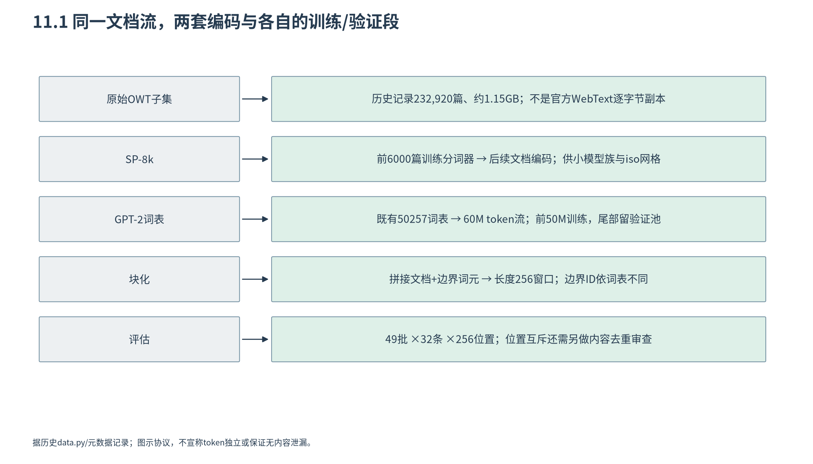
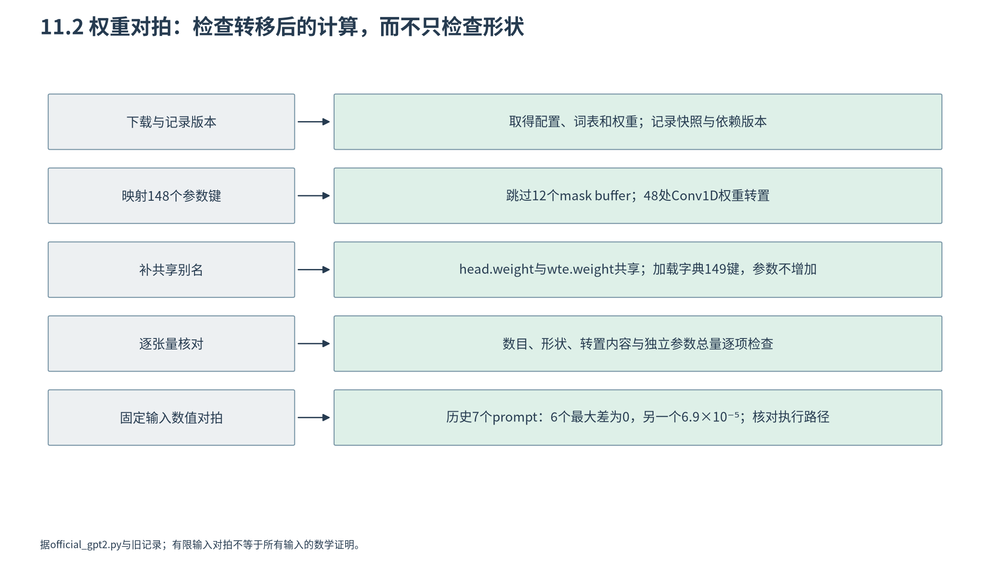
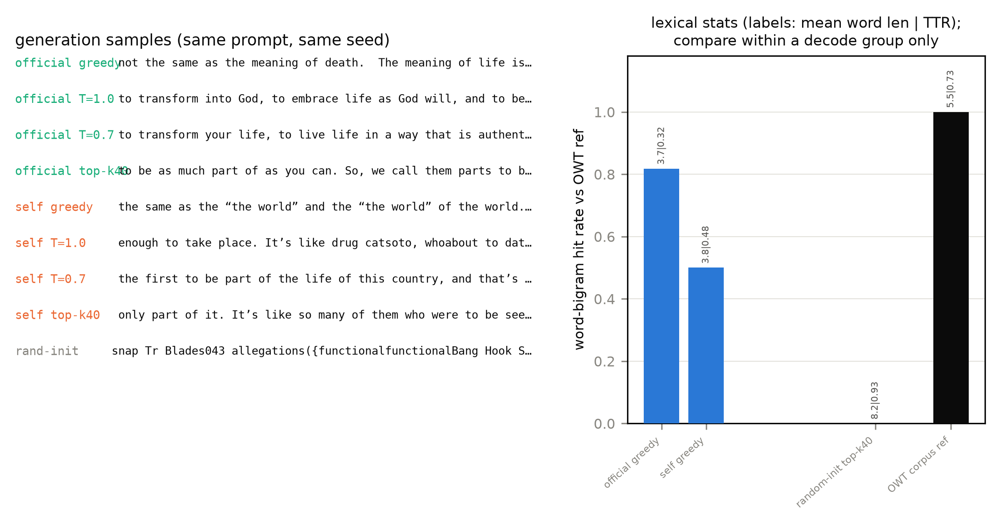
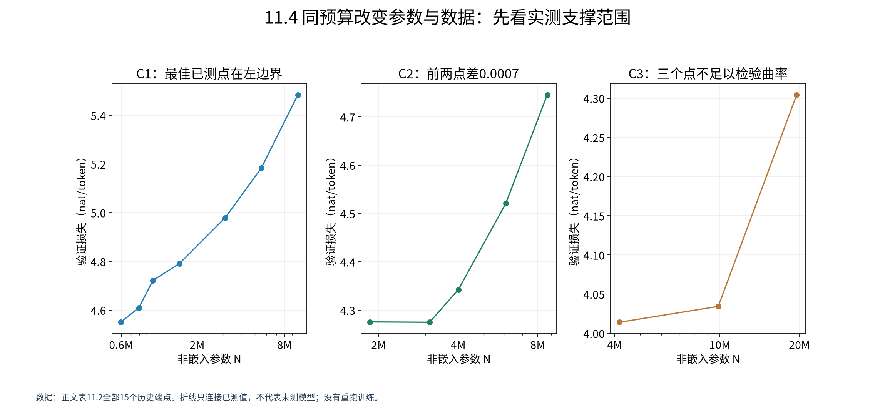
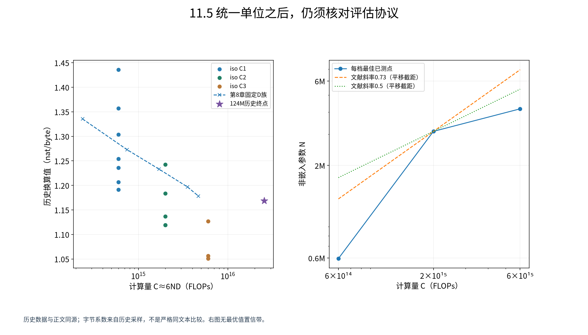

# 第 11 章 大项目 II：数据、权重与损失-算力曲线

## 11.0 开篇：从全书到这里

上一章我们把机器造出来了：三插槽 Block 的 124M，参数逐位对上官方 124,439,808，随机权重与 HF 实现逐位相同，冒烟曲线从 $\ln 50257$ 附近健康起步。但它至今吃的还是 1MB 的莎翁——第 10 章末尾的结语已经替本章点了名：「喂真数据、对官方权重、看真曲线，损失-算力图上把我们自己的点画进 Kaplan 与 Chinchilla 的坐标系，是大项目 II 的三件正事」。这三件事正好对应本章的三条产线：数据管道把 OpenWebText 的 1.15GB 真语料变成一次通过的训练流（11.1 节）；官方权重对拍用四步把「我们造的机器」与「OpenAI 训出的那台机器」接通（11.2 节）；然后机器开始训练，50M token 的 fast 档曲线加一张 15 点的 iso-FLOP 网格，练习第 8 章的实验设计：在固定计算量下改变参数与数据分配，观察哪些趋势有支撑、哪些外推没有支撑（11.4 节）。

与第 10 章的「凭什么相信机器是对的」对应，本章要回答的问题是：**「我造的这台机器喂真数据训出来的曲线，凭什么能和论文里的定律对话？」**对话需要双方说同一种语言——参数口径（6ND 非嵌入）、算力单位（FLOPs 与 PF-days）、损失口径（per-byte 等共同单位，同时核对原始文本、边界和上下文协议）、以及「谷底怎么报」的诚实纪律。第 8 章我们已经吃过口径的亏（日程倒挂差点写进正文），本章把这些纪律全部前置到实验设计里，最后在 11.6 节收拢成本册的「诚实条款」——它规定了一台 ≈6 TFLOP/s 的笔记本电脑，「训成」一台 GPT-2 的标准是什么。

> **最小背景栏**：四处前置，均已教过。①第 8 章全部：幂律式 (8.1)/(8.5)、Chinchilla 三种方法中的 iso-FLOP 轮廓（8.3 节）、读曲线四问（8.6 节）——本章曲线是那章的兑现；②第 9 章 9.3 节换算盒（$C\approx 6ND$、PF-days）；③第 10 章的机器与预算：`model.py` 是 11.2 对拍官方权重的正主、表 10.2 兑现于 11.4、键映射三高危点已在 10.2 节预演——一句依赖链的诚实声明：11.4 的训练产线（`train_124m.py`/`iso_flop.py`，及 11.3 采样的自训侧）为与第 8 章族**严格同协议**（同 b32×s256、warmup 200、49 固定窗 eval），沿用 ch04 参数化 GPT 工厂并延伸 ch10 循环的配方自备循环，并不 import ch10 的 `train.py`；两套实现同构，且同过 124,439,808/85,056,000 两条 assert（「工厂实现与五处复用」的代码史见 12.5 节图 12.2）；④token↔word 困惑度换算在本章 11.1 节内以换算盒自建。

## 11.1 数据管道：真语料的三道工序

机器要吃真数据，第一道工序是选语料。第 8 章族实验已经把选型做完：tiny shakespeare 只够热身（第 10 章 80 遍背谱的教训），正式训练需要「一次通过」量级——约 250M token。落点是 **OpenWebText 子采样 1.15GB**（232,920 篇 / 1,119.6MB，`00-feasibility/08_owt_subsample.py` 流式抓取）。选它有三层理由：数据集卡片标注 CC0，但原网页内容的权利并不因此统一改变；本项目保留获取脚本，原语料不随书打包；它是 WebText 的社区复刻，GPT-2 血统最正；量级恰好（全量 38GB 太重，1.15GB ≈307M token 覆盖第 8 章全族加本章全部实验还有余）。血统里有个口径值得钉死：WebText 原版 = “Reddit 上获得至少 3 karma 的外链，再经抽取、清理和去重等处理”【证据等级：官方论文 GPT-2 §2.1】；OpenWebText 的 karma 管道说法出自其 GitHub 项目自述，HF 卡片本身未载明 karma 细节——它是「管道与 URL 集的复刻」，不是逐字节同一数据【证据等级：第三方复刻（GitHub 自述），卡片核验 2026-10】。顺带一句 GPT-2 论文自己的记忆化检查：他们对 WebText 与各测试集做过 8-gram 重叠分析，重叠均值 3.2%【证据等级：官方论文 §4】——「模型是在背还是在学」的担忧从那个年代就有，我们的一次通过减少了显式重复训练，但还需要文档去重与训练—评估重叠检查，不能独自保证没有记忆化。

第二道工序是**分词器分片分离**。第 8 章冒烟档的教训（分词器与 LM 语料同源、28 万 token 跑 32 遍、拟合 $r^2$ 只有 0.43）换来一条写进运行元数据的纪律：sp-8k 分词器只在独立的 6000 篇 / 29MB 分片上训练，LM 主语料自第 6001 篇开始——两段互斥。本章第二套编码（官方口径的 50257 词表，tiktoken gpt2）不训练分词器、直接使用官方词表（第 2 章已对拍 tiktoken≡HF，B 级），同一文档流按原顺序重编码出 60M token 的 gpt2 流（训练实际消费首 50.0M，一次通过），流末尾留 600,000 token 作 eval 池，与训练段在 token 位置上间隔约 9.4M。位置互斥不等于文档或内容去重，不能据此排除语义重复与所有数据泄漏。eval 协议全书同款：固定种子 49 批 × (32×256) = 401,408 个被评估位置；8192 是一批的位置数，不是单条序列长度、fp32 前向——这个数不是拍出来的，是第 8 章在本语料上实测逐 token 标准差 2.50 反推的（若这些损失独立同分布，$\mathrm{se}=2.50/\sqrt{401{,}408}=0.0039<0.005$；实际 token 有相关性，重复或重叠窗口也会降低有效样本量，因此这个数字只是独立性近似），iso 网格与 124M 曲线全部沿用【证据等级：本书实验（`log/book2-ch08/tok_std.json`）】。

第三道工序是**块化**：一篇篇文档怎么变成 $(B,n)=(32,256)$ 的训练窗？图 11.1 把三道工序画成一张管道图。块化有两种切法，教学点就藏在差异里。**法 A（本项目采用的拼接流）**：文档间插入 EOS/EOT 后扁平拼接成一条长流，按 256 定长切窗——窗**可以跨文档边界**。**法 B（文档边界对齐）**：每篇独立切窗、末窗不足 256 丢弃。取前 2000 篇实测对比【证据等级：本书实验（`data.py step_chunking`，2026-10）】：法 A 得 9,940 窗、利用率 ≈100%（余料仅流末不足一窗的 42 token）、其中约 20%（1,986 窗）跨文档边界；法 B 得 8,949 窗、利用率 90.03%、丢弃尾料 253,738 token（平均每篇约 127 token）。法 A 的「跨边界」不是缺陷而是设计：拼接流里模型「看见」的边界就是 `…Wolf/Wired UK] Red Dwarf has been [EOS] 下一篇…` 这样的序列（实测首个交界的 id 序列 `[359, 4425, 7107, 7077, 1232, 2760, 7109, 2, 2603, …]`，`2` 是此例 SP 词表的 EOS；GPT-2 词表的 EOT ID 是 50256，两者不能互换），EOT 既是分隔符也是教材——模型顺带学会「文档到此为止、换主题该断则断」。法 B 窗内纯单文档、无此学习压力，代价是每篇约 127 token 的平均尾料。本项目选 A；公开 GPT-2 论文与推理代码不足以确认完整训练数据管道的所有块化细节；B 留在这里作对照，是为了让你在「干净的数据格式」与「零浪费的吞吐」之间能算出这笔账。

图 11.1 两套编码与各自训练用途。32×256是一批评估位置数，不是长度8192的单条输入；token位置互斥不保证内容去重。

最后一道小工序是**换算盒**。我们的损失是 nats/token，但社区几十年的语言模型传统报 word-level 困惑度（WikiText 系基准），两边对话需要一架桥。设总负对数似然为 $S$、token 数 $n_t$、词数 $n_w$，则

$$
\ln \mathrm{PPL}_{word} \;=\; \frac{S}{n_w} \;=\; \frac{n_t}{n_w}\cdot\ln \mathrm{PPL}_{token}
\tag{11.1}
$$

| 符号 | 含义 | 取值 / 口径 |
|---|---|---|
| $\mathrm{PPL}_{token}$ | token 级困惑度 $=e^{L}$ | 标量；$L$=nats/token |
| $\mathrm{PPL}_{word}$ | word 级困惑度（社区传统口径） | 标量 |
| $n_t/n_w$ | 每 word 的 token 数 | 随词表与语料浮动，**必须实测** |

这表示：**每个词平均被切成 $n_t/n_w$ 个 token，token 级的「每次犹疑」连乘 $n_t/n_w$ 次，就是词级的犹疑**。这个系数不是常数，它在同一批文档（前 56,000 篇）上实测：gpt2 词表（50257）为 **1.376 token/word**（4.398 B/token），sp-8k（8192）为 **1.600 token/word**（3.782 B/token）【证据等级：本书实验（`data.py step_conversion`，2026-10）】——词表越大、单 token 承载越多、系数越小。这只是总负对数似然的单位换算：词数规则、文本归一化、未知词处理和上下文窗口必须一致，才能用于比较。它不自动把任意子词模型变成同一个归一化的词级模型。同是「token PPL 100」，在两套词表下换算出的 word PPL 差 $100^{1.600}/100^{1.376}\approx 2.8$ 倍，跨词表比绝对 PPL 就是这么出的事故。着陆坐标取 WikiText-2（CC BY-SA，卡片文本 4.0 与 metadata 3.0+GFDL 双标不一致，保守起见只落 `log/` 不随书分发、引用时注明二者）：在本语料 valid 上 gpt2 的系数实测 1.156，我们顺手用 200 万训练词数了 word 级计数基线——unigram 困惑度 **1800.6**、计数插值 bigram **1304.1**（教学级实现：OOV 记 `<unk>` 回退、bigram 用 $\gamma=5$ 计数插值，非 SOTA；WikiText-2 只有 200 万训练词、valid 的 OOV 率 3.36%，计数模型在这个语料上先天贫血）【证据等级：本书实验（`data.py step_wikitext2`，2026-10）】。

这两个数给 word 级坐标系立了两根界桩：只认词频的模型在千级，多看一个词的上下文能降三成——11.3 节我们自己的模型换算过来落在这根轴上的什么位置，届时回头看。

## 11.2 官方权重对拍四步：把「我们的机器」接到「他们的机器」上

数据就位，先办一件更要紧的事：把 OpenAI 训好的官方权重搬进我们手写的 `model.py`。第 10 章的验收②用**随机权重**检查了固定输入下两种实现的数值一致性，但那只说明「图纸相同」；图纸相同不等于「我们拥有官方训出来的那台机器」——只有当官方权重经过我们的键映射搬进手写模型后输出逐位复现，两条产线才算接通。全程四步，脚本 `official_gpt2.py`，全部 CPU fp32【证据等级：本书实验（`log/book2-ch11/official_parity.json`，2026-10）】。

**第一步：下载最小文件集。**HF 仓 `openai-community/gpt2` 全仓 26 个文件约 1.6GB——里面 TF/Flax/Rust/ONNX 四种重复权重格式，只取 PyTorch 必需集：`model.safetensors` 522.7MB + 分词器与配置 2.7MB，**合计 525.4MB**。两条下载实录值得入书：未鉴名下载实测出现过两次挂起（调研期 bert 262MB 处与 gpt2 辅助 blob 处各一次，重试即恢复，中断残留 `*.incomplete` 需清理）【证据等级：本书调研实测（2026-10-02）】；公开 GPT-2 仓库随附 Modified MIT License，与第 4 章相同。原文说明不主张生成内容所有权、请求负责任使用和标明生成来源，并说明生成内容不必携带软件许可文本；这里按原文描述，不另作授权范围的扩张解释。书中提供获取与加载脚本，不再分发下载权重。

**第二步：键映射，三高危点的正片。**checkpoint 是 160 个键的 safetensors，进我们模型要过三道坎，第 10 章在随机权重上排练过，这次是带真权重的实操：**坎 A（Conv1D 转置）**——HF 的 Conv1D 权重是 (in,out) 排布（`addmm` 语义），`nn.Linear` 是 (out,in)（$xW^\top+b$ 语义），四处投影权重共 **48 处转置**（12 块 × c_attn/c_fc/c_proj(mlp)/c_proj(attn)）；其中 `attn.c_proj` 是 (768,768) 方阵，忘了转置**不报错、静默输出垃圾**——最阴的一处，验收只能靠 logits 对拍兜底。**坎 B（tied 缺键）**——checkpoint 只存 `wte` 一份，160 键里根本没有 `lm_head`，加载时须显式补绑 `head.weight = wte.weight`（第 4 章改造④的工程面）。**坎 C（无前缀）**——raw checkpoint 顶层键没有 `transformer.` 前缀（OpenAI TF 转换遗产），`h.{i}` 改名 `blocks.{i}`，另有 12 个 `h.{i}.attn.bias` 遗留 causal-mask buffer 要跳过（v5 已废弃持久化，我们的 mask 本就是 `persistent=False`）。160 − 12 = **148 个原参数键**。随后代码补入共享参数的别名 `head.weight`，交给 `strict=True` 的字典是 **149 键**；共享别名没有增加独立参数量。

**第三步：参数逐项对账。**逐组清点 checkpoint 张量并与表 10.1 的手算账对上（表 11.1）。加载后逐键 `torch.equal` 全部为 True——权重搬运是拷贝，必须逐位相同。

**表 11.1** 官方权重对账与 logits 对拍（CPU fp32，transformers 5.18.0 / tiktoken 0.14.0，2026-10）【证据等级：本书实验（`official_gpt2.py`，`log/book2-ch11/official_parity.json`）】

| 项 | 数值 | 判定 |
|---|---|---|
| checkpoint 键数 → 映射后 | 160 → 148 个参数键 → 149 个加载键（补 head 别名） | strict 加载通过 |
| Conv1D 转置 | 48 处（attn.c_proj 方阵在内） | 逐位 torch.equal ✓ |
| wte / wpe | 38,597,376 / 786,432 | 与表 10.1 逐位一致 |
| 12 × Block + ln_f | 85,054,464 + 1,536 | 同上 |
| 总参 / 非嵌入（6ND） | **124,439,808 / 85,056,000** | assert 通过 |
| max\|Δlogits\|（vs HF eager，7 prompt） | **0.0（6/7）**；6.9×10⁻⁵（p6） | 最大绝对差 < 10⁻⁴ |
| argmax 一致率 / top-5 全命中率 | 7/7 / 7/7 | 通过 |
| max\|Δlogits\|（vs 探针基线，sdpa 路径） | 6.9×10⁻⁵ ~ 1.4×10⁻⁴ | 见正文口径注 |

**第四步：固定 7-prompt logits 对拍。**7 条 prompt 覆盖短事实 / 重复诱导 / 长段落 / 德语 / 代码 / 算术 / 单字符（token 长度 1~31），两侧同输入（$(1,n)$ 进、$(1,n,50257)$ 出、取末位 $(50257,)$）比 max|Δ|。结果比预期更硬：**六条 prompt 的 max|Δlogits| 严格为 0.0**，唯一非零的单字符 prompt 差 $6.9\times10^{-5}$（与浮点执行路径差异相容；这次记录没有逐算子定位全部来源）；argmax 一致 7/7、top-5 全命中 7/7【证据等级：本书实验（CPU，2026-10）】。这里还藏着一个口径课：与探针基线（2026-10-02 存盘，走 transformers 默认 sdpa 注意力路径）的最大差是 $1.4\times10^{-4}$——**注意力实现路径（sdpa vs eager）的实测差比静态源码调研预估的「1e-6 量级」大两个数量级**，图 11.2 右侧把它们画在同一把对数尺上。教训归入第 7 章立的口径自觉清单：对拍数值前先对齐的不只是精度，还有算子的实现路径。

图 11.2 对拍四步。148个原参数键加共享别名成为149个加载键；有限prompt的数值一致是验证证据，不是全输入等价证明。

对拍过了，顺手做两条生成 sanity——它们是后面 11.3 节的预告，也是两则现成教例。教例一：`The capital of France is`，贪心续写是 **" the capital of the French Republic, and the capital of the French Republic is the capital of the French…"**——复读机式的循环；而 " Paris" 只以 p=0.032 排在 top-5 第 5 位（第 1 位是 " the"，p=0.085）。教例二：`2 + 2 = 4, 3 + 3 = 6, 4 + 4 =`，下一 token **" 8" 概率 0.361**（次位 " 7" p=0.198）——答对了？贪心再往下写：**" 8, 5 + 5 = 10, 6 + 6 = 12, 7 + 7 = 15,"**——$7+7=15$。这个例子显示：当前提示下前几项正确，不能保证后续算术可靠。它不能揭示模型内部究竟只用了哪一种“表面规律”，但足以否定把一次正确续写当作通用算术能力的证据。第一则循环续写也说明，局部最高概率的连续选择未必产生适合阅读的整段文本。下面将同一模型的分布保留下来，比较不同取样方法。

## 11.3 采样生成：让分布开口说话

**采样改变的是使用分布的方法，不是模型学到的权重。**贪心每步选择概率最高的 token，某些提示下会反复进入高概率的局部模式；随机采样能探索其他续写，但也可能引入错误。不存在“采样必然优于贪心”的结论，选择取决于任务需要确定答案还是多样文本。

设某一步 logits 为 $z\in\mathbb R^V$，温度 $T>0$ 给出

$$p_T(i)=\frac{e^{z_i/T}}{\sum_j e^{z_j/T}},\qquad
\frac{p_T(i)}{p_T(j)}=\exp\big((z_i-z_j)/T\big).\tag{11.4}$$

后一个式子直接解释温度：固定分数差为 2，$T=1$ 时概率比为 $e^2$，$T=0.5$ 时变成 $e^4$。降温扩大相对偏好；升温削弱相对偏好；有唯一最大分数时，$T\to0$ 集中到最大项。它改变置信程度，不会把错误最大项变正确。

top-k 再取分数最大的集合 $A_k$，以 $p'_T(i)=p_T(i)\mathbf1[i\in A_k]/\sum_{j\in A_k}p_T(j)$ 取样。低概率尾部被排除，可能减少异常续写，也可能排掉合理但罕见的词。GPT-2 报告附录多组样例使用 $k=40$；这只是该实验的选择，不是通用最优值。截断后归一化的思路可参阅 Fan 等的层次故事生成论文（1805.04833）。

本册采样器每步全量重算前缀。若输入长 $P$、生成 $T$ 个 token，线性投影累计处理的位置数为 $TP+T(T-1)/2$；全注意力累计处理的成对位置则与 $\sum_{t=0}^{T-1}(P+t)^2$ 成正比。前者对 $T$ 是二次、后者含三次项，不能把整机所有计算都概括成“平方复杂度”。旧记录 40 token CPU 续写约 1.2 秒只是指定输入与机器下的计时。后续册将通过缓存复用已经计算的历史状态。

同一 prompt（`The meaning of life is`）、同一固定种子，四种解码各写 40 token，官方权重与自训模型（50M token fast 档，训练同配同种子复跑并保留权重；复跑终值 5.1428，与 11.4 节的 5.1390 差 0.004——同种子重跑的 MPS 非确定性量级，如实登记）并排，外加一台随机初始化的 124M 作「出厂状态」对照——样例收进图 11.3 左栏。肉眼先看三行代表：官方贪心写出 " not the same as the meaning of death.\n\nThe meaning of life is not the same as…"——**官方权重贪心也会复读**，只不过它的复读是整句整句的高档复读（型例比低到 0.32）；官方 T=1.0 采样立刻活过来，写出一小段神学色彩的论辩；自训 50M 的 T=1.0 样例是 " enough to take place. It's like drug catsoto, whoabout to date bymetal people…"——**词是真词、搭配半通半不通**；随机初始化则是 "snap Tr Blades043 allegations({functionalfunctionalBang…"——彻底的子词汤。肉眼之外用**词法统计**定量（诚实条款的验收口径：词长、空格率、型例比、对语料 bigram 的命中率），图 11.3 右栏。

图 11.3 采样对照（自产）：左=同一 prompt 四种解码 × {官方, 自训 50M} 的续写照录（含随机初始化对照，官方=青、自训=橙、随机=灰）；右=续写的词法统计——词级 bigram 对 OWT 参考集的命中率，柱上标注「平均词长|型例比」，按解码分组着色（同组内可比、跨组不可比，见正文）【证据等级：本书实验（CPU 采样/MPS bf16 训练，2026-10，`log/book2-ch11/sampling.json`）】

词法统计为这些样例补充了可计算的描述【证据等级：本书实验（CPU 采样，2026-10，`log/book2-ch11/sampling.json`）】。最能分档的是 bigram 命中率——续写里相邻词对能在 OWT 参考集（前 2,000 篇的词 bigram 全集）里找到的比例，贪心档排成干净的阶梯：**官方 0.818、自训 0.500、随机初始化 0.000**——50M token 的训练让「词与词怎么接」的命中率从零拉到一半，官方的充分训练再拉到八成。词的形态学同向：随机初始化的平均词长 8.21、空格率 0.105（未训练的分布很少采样出带前导空格的 token，字符都黏成一坨），自训 3.81/0.196、语料参照 5.48/0.151——自训模型的词长与空格节奏已经落进真语的区间。两个诚实的注脚。其一，每行续写只约 30 个 bigram，命中率的末位有 ±0.1 量级的单样本噪声——这些数字当「量级与排序」读，不当千分位读。

其二，也是更有意思的一课：**解码参数对词法统计的影响不小于模型好坏**——官方 T=1.0 的命中率掉到 0.375（从完整分布采样会走进语料里没有的搭配），自训 T=0.7 却高达 0.821（锐化把采样压回高频搭配）——单看

这两个数会得出「自训比官方好」的荒唐结论。词法统计对照必须**同解码配对**：图 11.3 右栏每种解码内部官方/自训/随机三列可比，解码之间不可比。顺带一个惊喜：自训模型的 top-k=40 样例（"…they wanted to know what was just the truth to the human world."）读起来竟相当顺——截断把欠训练模型的噪声尾巴剪掉了，看起来比它实际的能力更好；「看起来通顺」与「分布学得好」是两件事，这在读任何模型 demo 时都值得默念一遍。

采样对照还送了一份数字给 11.1 节的换算盒：自训模型在 WikiText-2 valid 上的 token 损失实测 **6.821 nats/token**（fp32、24 窗×256 token），乘上该语料的 gpt2 系数 1.156，word PPL $=e^{1.156\times6.821}\approx$ **2,660**【证据等级：本书实验（MPS fp32，2026-10）】。这个落点要带着两句诚实注脚读。其一，这是**跨语料**评测——Reddit 风的 OWT 上训练、维基文风的 WikiText-2 上考试，域差一口吃掉约 1.7 nat/token（OWT 上 5.14，这里 6.82），数值只作换算演示。其二，1,800/1,304 的计数基线与约 2,660 的换算值使用了不同的词处理、未知词映射与评估范围，不能据此宣布本模型输给计数模型。它们保留在这里用于演示单位换算和协议差异。若要作模型排名，需要在同一原始测试文本上重新计算总负对数似然，统一计数规则和上下文重置方式。换算本身只改变单位，不会自动消除这些差别。

## 11.4 损失—算力曲线：把预算问题变成可检验实验

管道通了对拍过了，本节是全册的核心产出：**自家机器 + 自家数据 + 自家网格，把「花更多钱买多少智能」画成自己测出来的曲线**。数据分三层，一层比一层接近论文的坐标系。

**第一层：124M 的 50M token 真曲线。**第 10 章表 10.2 第三行的兑现：50257 官方词表重编码的 OWT 流、b32×s256（8,192 token/步）、warmup 200 + 余弦 $10^{-3}\to10^{-4}$、bf16 训练 / fp32 eval，6,104 步 = 50,003,968 token **一次通过零重复**。三组数字先过自检：初始 loss **10.9513**（$\ln 50257=10.8248+0.126$，式 (10.3) 的预言第三次咬合——冒烟档 10.97、热身档 4.30 之后）；eval 轨迹 13 个点从 6.4145 单调降到 **5.13903**，无回弹（train/eval 末差 0.022 nat，方向正常）；wall **78.9 min**（纯训练 0.726 s/步、11,283 token/s），MPS 峰值 3.5 GiB（3,625 MiB，allocator 轮询口径）≪ 37.4 GiB 上限【证据等级：本书实验（MPS bf16/fp32，2026-10，`log/book2-ch11/train124_fast.json`）】。有效算力按 6ND 口径：$6\times85{,}056{,}000\times50{,}003{,}968/\text{s}\approx$ **5.76 TFLOP/s**——调研期「本机 ≈6 TFLOP/s」的锚点在此兑现，这个数就是诚实条款的分母。曲线形状也验了幂律：整条轨迹拟合 $L=B\,D^{-\beta}$ 得 $\beta=0.0907$、$r^2=0.994$（E 自由拟合再次把不可约项压到 0——第 8 章「支撑域不足则地板不可辨识」的教学点在此复现）。但引用红线同 JSON 挂账：**这是单条余弦退火轨迹上的幂律，早期点在高学习率下、末点在退火末端，与 Kaplan/Chinchilla 固定学习率大网格的 $L(D)$ 不是同一对象**——只作「幂律形态在退火轨迹上仍成立」的描述，禁止当 scaling 指数与文献并列。换算示例留给读者一道口算：token PPL $=e^{5.139}\approx170.6$——每个 token 还在约 171 个候选里犹疑（第 10 章热身档「每字符 4.7 选」的同款读法），word PPL $=e^{1.376\times5.139}\approx1{,}178$（11.1 节换算盒的直接应用）。

**第二层：iso-FLOP 网格——Chinchilla §3.2 的缩小版。**单条曲线只回答「这台机器学得多快」，要回答「这笔钱该怎么花」需要网格。设计照抄第 8 章相应的预算与实验分析方法二：固定一档总算力 $C$，档内扫不同 $N$，数据量由 iso-FLOP 约束（式 (11.2)）决定

$$
D \;=\; \frac{C}{6N}
\tag{11.2}
$$

（$C$=FLOPs 名义值；$N$=非嵌入参数；$D$=该点训练 token 数。这表示：**算力固定时，模型买大点、数据就得买少点——每个点都是同一笔钱的一种花法**）。三档 $C\in\{6\times10^{14},\,2\times10^{15},\,6\times10^{15}\}$（相邻分别约 ×3.33、×3），中间档加密到 5 点，共 15 点（全表见 表 11.2），全部 $N\le$19.5M、$D\le$239.5M ≤306M 训练池（一次通过纪律不破）。配方与全族统一：b32×s256、warmup 200（第 8 章倒挂教训的正式修正）、AdamW(0.9,0.95,wd 0.1)+clip 1.0、bf16/fp32、49 固定窗 eval——且 **eval 窗集与第 8 章逐位相同**，两章数字可以画进同一张图。一段实验实录也值得照实记下：初版网格按第 8 章 Kaplan 曲线的走势把各档谷底预设在了偏大的 N，C1 档实测整条单调降之后，连续四次自适应补小点（1.5M→1M→0.79M→0.60M）并把 C2/C3 整体下移——**谷底的位置是测出来的不是设计出来的**，最终 15 点超出设计书的 3×3=9，总机时 216 min【证据等级：本书实验（MPS bf16/fp32，2026-10，`log/book2-ch11/iso_flop.json`）】。

**表 11.2** iso-FLOP 网格 15 点全表（N=非嵌入参数实数；D=C/6N 取整后反报，名义 C 偏差 ≤0.04%；eval=终步 401,408 token fp32；旧协议按独立 token 近似估计误差约 0.004；未覆盖训练种子、相关性与模型选择不确定性）【证据等级：本书实验（2026-10，`iso_flop.json`）】

| 点 | (层数,维度,头数) | N 非嵌入 | D (token) | 步数 | eval 终值 |
|---|---|---|---|---|---|
| c1g | 3L×128×2 | 595,072 | 168,050,688 | 20,514 | **4.5498** |
| c1f | 4L×128×2 | 793,344 | 126,050,304 | 15,387 | 4.6096 |
| c1e | 5L×128×2 | 991,616 | 100,843,520 | 12,310 | 4.7216 |
| c1d | 6L×144×2 | 1,504,512 | 66,469,888 | 8,114 | 4.7904 |
| c1a | 7L×192×3 | 3,114,432 | 32,112,640 | 3,920 | 4.9790 |
| c1b | 7L×256×4 | 5,528,832 | 18,087,936 | 2,208 | 5.1833 |
| c1c | 8L×320×5 | 9,864,320 | 10,133,504 | 1,237 | 5.4844 |
| c2a | 6L×160×2 | 1,856,000 | 179,601,408 | 21,924 | **4.2757** |
| c2b | 7L×192×3 | 3,114,432 | 107,028,480 | 13,065 | **4.2750** |
| c2c | 9L×192×3 | 4,004,160 | 83,247,104 | 10,162 | 4.3425 |
| c2d | 10L×224×4 | 6,050,688 | 55,091,200 | 6,725 | 4.5207 |
| c2e | 11L×256×4 | 8,687,872 | 38,371,328 | 4,684 | 4.7457 |
| c3a | 8L×208×4 | 4,175,392 | 239,501,312 | 29,236 | **4.0141** |
| c3b | 8L×320×5 | 9,864,320 | 101,376,000 | 12,375 | 4.0343 |
| c3c | 11L×384×6 | 19,519,872 | 51,232,768 | 6,254 | 4.3044 |

**这张网格最有价值的结果，是告诉我们下一轮该补哪些点；它还不足以确定一条计算最优定律。**下面分别读三档。先看观测值，再看拟合值，最后问拟合依赖的假设是否受到实验检验。

C1 中，N 从 9.86M 减至 0.60M，所测损失一路下降，最佳已测点为 595,072 参数、4.5498。旧二次拟合给出约 116k 的外推顶点，留一法在约 0.3k–250k 间摆动，说明顶点对数据选择极敏感。**只能确认最小已测模型最好，不能直接证明连续全局最优满足 $N^*<595072$。**后者还需要单峰、局部趋势可延伸等假设。由 306M token 池得到的 $N\ge C/(6\times306\text M)\approx327$k 是一次通过条件下的可行性边界，不是统计估计的最优模型下界。下一轮应在允许的更小 N 区域补点，并检查相应形状与学习率。

C2 的五点中，1.856M 与 3.114M 的损失为 4.2757、4.2750，相差只有 0.0007，随后三个大模型的损失升高。对 $x=\log N$ 拟合 $a x^2+b x+c$，当 $a>0$，导数 $2ax+b=0$ 给出顶点 $N_{\rm fit}=\exp[-b/(2a)]\approx2.34$M。这是从一个拟合形状得到的插值建议。原脚本向每个损失点加入独立高斯扰动，标准差设为 0.004，再重复拟合；其 95% 分位区间为 [2.27M,2.40M]。**这是指定噪声与二次形状下的条件区间，不是实际多种子训练获得的置信区间。**留一法 2.04M–2.38M 反映另一种敏感性，也未涵盖所有训练变动。

C3 的三个点给出 4.0141、4.0343、4.3044。前两个点差 0.0202 nat，旧二次拟合顶点约 6.11M，位于 4.18M 与 9.86M 之间。三个点恰能确定三个二次系数，没有残差自由度可检验曲率形状；不能因顶点在区间内，就宣称真正谷底被两侧约束住，也不能用独立 token 近似把差值断言为“5 个可靠标准误”。应补中间点和独立训练重复，才有资格缩小建议范围。

历史吞吐记录从 c1g 的 0.91 TFLOP/s 到 c3c 的 5.26 TFLOP/s，124M 记录约 5.76 TFLOP/s。这说明在这些批型上，较大矩阵更能摊薄固定执行开销；它不是本机所有工作负载的硬件峰值。

图 11.4 按表 11.2 的全部 15 个历史点重绘。曲线只连接观测点以帮助阅读，不把连线当作未测模型的真实损失。C1 最佳点处在左边界；C2 前两点近似持平；C3 只有三点。旧拟合顶点的含义与局限见正文。

**第三层：斜率与论文坐标系。**把三档的 $N^*$ 连起来问「算力涨十倍，最优模型该涨几倍」，就是 compute-optimal 斜率

$$
\gamma \;=\; \frac{d\log N^*}{d\log C}
\tag{11.3}
$$

这里 $N^*(C)$ 表示在指定模型族、数据与训练协议下的最优参数量。若假设 $N^*=kC^\gamma$，取对数便得到 $\log N^*=\log k+\gamma\log C$，所以式 (11.3) 的斜率回答“算力扩大一倍，最优参数量扩大多少”。关键困难不在求斜率，而在各档 $N^*$ 尚未被可靠测定。

旧分析保留三个读数：使用三个已测 argmin 得到 0.855；使用 C2/C3 的二次顶点得到 0.874；混用 C1 边界点与高档拟合顶点得到 1.014。这三个数描述**选择不同锚点的敏感性**，不是斜率的上下界，也不能写成真实 $\gamma$ 的置信区间。把 C1 锚点改成 0.33M 会得到约 1.27，进一步表明结论依赖未测点的设定。

Kaplan 的 0.73 与 Chinchilla iso-FLOP 方法约 0.50 可作为方法对照，但本实验不能据此支持或反驳其中一条定律。我们的算力只跨一个数量级、模型不超过 19.5M；各点学习率没有独立调优，训练步数从 1,237 到 29,236，余弦日程分别以自己的终点退火。形状、日程、数据量一起变化，尚不能归因于参数规模本身。

同样，旧分析基于已测点或拟合顶点得到的 token/parameter 比约 282、60.9、26.8，是这些选择下的预算账，不是普遍最优配比。Chinchilla 的约 20 token/参数只是相关规模上的近似总结，第 8 章已说明表格取值与拟合舍入会改变比例。旧拟合还给出 $L^*\propto C^{-0.062}$；只有两个可靠性有限的拟合顶点时，指数也只能作描述，不能因为接近论文某一指数就宣布复现成功。

网格里还埋着本章最强的一组叙事数字。第 8 章的 Kaplan 单曲线实验是「固定 D=40M 堆 N」，顶点 20m（N=19.5M）花算力 $4.68\times10^{15}$ 拿到 4.5013；本章 iso 网格的 c2a（N=1.86M、D=179.6M）花算力 $2.00\times10^{15}$——**不到一半——拿到 4.2757，低 0.23 nat**【证据等级：本书实验，同分词器同 eval 窗集，直接可比】。注意口径：这不是同算力对照（c2a 的 C 更小），写法是「不到一半的算力反而更好」。这直接支持一个局部判断：在这两组配置中，较小模型配更多数据的结果更好。两组并非各自由 Kaplan 与 Chinchilla 定律严格给出的最优配置，也不是同预算比较，因此不能称作两条定律的胜负实验。

最后把全部自家点送进论文坐标系——第 9 章换算盒的兑现，图 11.5。纵轴用 per-byte 损失（$L_{tok}/(B/\text{token})$，转换到共同的字节单位：sp-8k 除以 3.82、gpt2 除以 4.398），横轴 $C=6ND$ FLOPs。15 个网格点、第 8 章 5 点、124M 的 fast 点同图；右图把 $N^*(C)$ 的 band 与两条文献斜率并排。PF-days 换算：iso 网格 15 点合计 $3.7\times10^{-4}$ PF-days，加第 8 章族 $1.3\times10^{-4}$，自家全部网格合计 $5.0\times10^{-4}$；124M 一跑 $2.95\times10^{-4}$ PF-days——GPT-3（$3.64\times10^3$ PF-days）的约 $8\times10^{-8}$（GPT-3 约为它的 1200 万倍，与第 8 章族「两千九百万分之一」同型句式）。我们仍然住在论文坐标系的左下角，但同一单位还不够：两个词表必须在相同文本、边界与可见上下文上评估，才能把差值解释为模型优劣。这里的 3.82、4.398 是历史语料换算比；3.82 与前述 3.782 的采样范围不同，不混称同一次测量。

图 11.5 保留历史损失—计算量点，并把 15 点网格、固定数据族和 124M 点区分标记。字节换算沿用历史系数，只供量级定位；右图展示已测 argmin 的位置，以及平移截距后的文献斜率参考线，不再把旧三个拟合读数画成置信带。

旧稿把网格外推到 124M 一跑的 $C=2.55\times10^{16}$，给出 $N\approx21$–26M、$D\approx160$–200M。这些数字在此保留为**需要新增实验验证的候选方案**，而非最优值。当前实际配置为非嵌入 N=85.06M、D=50M；它证明的是我们完成了指定规格的训练练习，不能由一个网格外推宣称“比最优大 3–4 倍”。历史 per-byte 估计 1.1686 与另一词表 20M 点的 1.1784 也不能单独证明瓶颈所在，因为评估文本和可见信息量未严格对齐。正确的下一步是在同一预算、同一词表和相同评估协议下跑候选配置，而不是继续强化未经检验的外推。

## 11.5 ICL 探针：124M 档的上下文学习（选做）

第 7 章立 ICL 现象时留了个尾巴（7.2 节预告）：在我们自己手里的官方权重上，few-shot 到底表现如何？本节用本地前向做三个小探针（不调任何外部 API——冻结纪律），zero-shot 与 few-shot 并排，贪心解码，实录收进表 11.3。

**表 11.3** ICL 探针三任务实录（官方权重本地前向，贪心解码；p=末位 top-1 token 概率；续写=贪心再写 8 token）【证据等级：本书实验（CPU，2026-10，`log/book2-ch11/sampling.json`）】

| 任务 | zero-shot | few-shot | 判读 |
|---|---|---|---|
| 首都问答 | **" Rome"**（p=0.157） | **" Rome"**（p=0.443） | 两档都对；示范把置信度抬高近 3 倍 |
| 反义词 | " cold"（p=0.163）✓ | " big"（p=0.317）✗ | few-shot 反而复读题面 |
| 英译法 | " cheese"（p=0.120）✗ | " from"（p=0.023）△ | 抄到示范答案 fromage 的首 token，第二个 token 即断 |

这三个提示展示了两种可观察的变化：示范可能改变答案 token 的概率，也可能使续写延续示范格式。首都任务的 Rome 概率从 0.157 增至 0.443，并继续写出关于 Madrid 的句子；反义词任务却从正确转为复读题面；翻译只生成了答案前缀。这些现象说明“格式跟随”和“当前答案正确”应分别检查，但三个提示不足以证明模型普遍具备前者、缺乏后者。

第 7 章 GPT-3 的大规模评测提供了跨模型趋势；本节不是那条曲线上的严格可比新点，因为语料、模型、任务和提示协议都不同。若要研究规模是否改善关系学习，应固定任务集与提示构造，多例、多种子比较多个规模，并预先规定如何评分。这里的小探针承担的是提出问题和展示实物的作用。

## 11.6 训成标准：诚实条款

三条产线走完，可以给「大项目训成了吗」一个正式的回答。先把条款立起来（本册写作前置任务定稿，各项细节随后文逐句兑现）：

> **诚实条款（compute-limited 演示口径）**：本机（M5 Pro，MPS bf16）对 124M 模型的有效算力实测 ≈6 TFLOP/s（6ND 口径）；训练 1 亿 token 需 ≈2.3 小时。GPT-2 原始训练的官方算力消耗未随论文公布（常见复述为多 GPU 数周量级，属二手转述、未核），与本机相差多个数量级。因此本项目的「训成」标准是**趋势与结构复现**而非绝对指标：损失-算力曲线呈幂律并可与第 8 章拟合衔接；官方权重对拍验证架构实现的正确性；随机初始化自训模型只要求 loss 曲线健康与生成文本具备词法统计特征，与官方模型比较预测表现时对齐评估协议，且不把差异全部归因为架构。

按这份标准，已有记录支持三项交付：固定官方权重在指定输入上对拍通过；自训损失随训练量下降；生成样例出现了比随机初始化更多的自然词法模式。124M 轨迹的幂律拟合 $r^2=0.994$ 是同一退火过程的描述，15 点网格提示预算分配的重要性，但不足以确认计算最优定律。

对比官方模型也不应被一概禁止：在相同测试文本、分词器、窗口与评分方式下，可以比较预测表现；不能把这种表现差异全部归因于架构或训练配方，因为训练数据与预算并未对齐。一次有限预算的教学复现，价值在于把实现、数据协议和可检验假设建立起来，并诚实保留无法回答的问题。

## 11.7 本章小结

本章完成了从模型到实验的三条连接。数据管道明确词表、文档边界、训练段和验证段；权重映射把转置、共享参数和键名对应落成检查；训练记录与 15 点网格把计算预算转成可讨论的曲线。原有数字都应带着产生它们的设置阅读。

读预算曲线时，最重要的是依次问：最低点是否处在已测范围内部；拟合形状和噪声假设是否受到检验；换一种训练日程、种子或模型形状后结论是否稳定。边界上的最好点不是连续最优值的严格界，条件扰动区间也不是所有不确定性的总和。这些区别决定了我们下一轮应该补实验，还是已经可以给预算建议。

下一章回到架构选择：把 BERT、GPT、T5 的目标与用法放在一起，讨论为什么因果单塔适合某些应用，又为什么其他分支继续存在。历史演进将以这些条件和取舍收束，而不是用单次实验宣布所有架构的统一排名。

## 11.8 动手验证（本章代码与实验清单）

- 数据管道核账 + 两种块化 + 换算盒 + WikiText-2 基线（约 3 min，含 WT2 下载）：`python "code/ch11/data.py"`——应打印拼接流 20% 跨文档窗、法 B 利用率 90.03%、gpt2 1.376 / sp-8k 1.600 token/word
- 对拍四步（CPU 约 1 min，权重已缓存）：`python "code/ch11/official_gpt2.py"`——应打印 149 个加载键 strict（148 个原参数键）、六项 assert 全真、max|Δ|=0.0（6/7）与两条 sanity 生成
- 采样对照 + ICL 探针（自训复跑 6104 步约 80 min MPS；已有 `self124m.pt` 时加 `--skip-train` 秒级出采样件）：`python "code/ch11/sample.py"`
- 损失-算力曲线汇编与出图 11.4（谷底三联）/图 11.5（招牌曲线，秒级，读现成 JSON）：`python "code/ch11/scaling_curve.py"`
- 复现 iso 网格（~3.6 h，断点续跑安全）：`python "code/ch11/iso_flop.py"`（先 `--smoke` 2 min 冒烟；`--analyze-only` 秒级重算拟合）
- 复现 124M fast（~1.3 h，首跑自动执行 50257 重编码 15 s）：`python "code/ch11/train_124m.py"`
- 验收点：能否不看书画出对拍四步并说出三高危点各自的失败模式（转置方阵静默错 / tied 缺键 / 前缀剥除）；能否解释为什么 C1 只有已测最佳点、三个斜率读数不能当作置信区间；能否用换算盒把 5.14 nat/token 换算成 word PPL 并说出系数为什么要实测
- 变式实验（选做）：把 `sample.py --train-steps` 降到 1500 重训一个更欠训练的自训模型，看词法统计各指标如何随训练量向语料参照行靠拢；或把 `iso_flop.py` 的 C2 档网格左右各去掉一点重跑 `--analyze-only`，看谷底 CI 如何变宽——支撑域的体感

> **【欠账】** 本章 11.5 节在官方权重上摸到了 few-shot 的地面端——「无梯度更新却像学了一样」这个现象的能力侧（指令遵循、推理范式、test-time compute）见 **Book5 第 10 章**；它的长 prompt 在服务侧的经济学（前缀缓存）见 **Book6 第 6 章**（第 7 章 7.2/7.3 节立桩，此处收线）。
