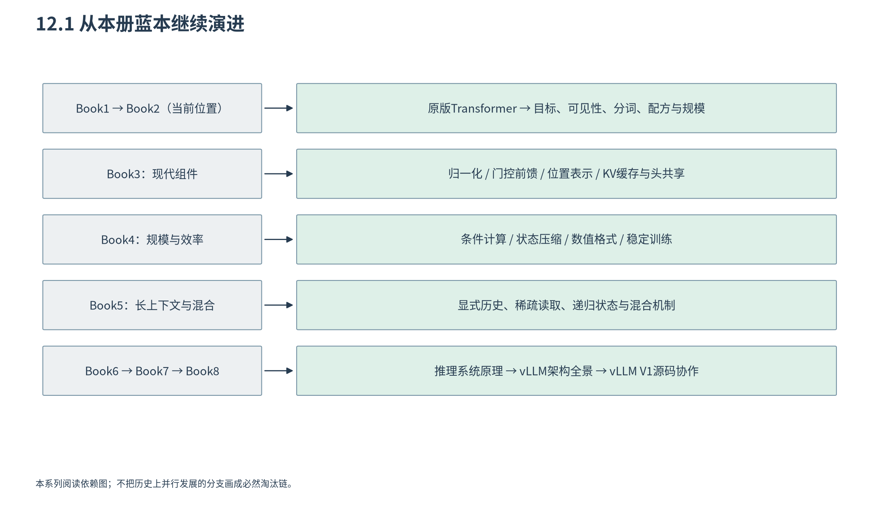

# 第 12 章 收束：架构选择的条件与后续演进

## 12.0 开篇：从全书到这里

上一章让我们把结构图、参数、数据和计算预算放进同一个实验。本章回到整册最初的问题：同一套 Transformer 部件，为什么会分化出不同的预训练路线？我们已经有 BERT 的双向表示、GPT 的因果续写、T5 的文本到文本接口，也有 RoBERTa 对训练配方的重新检验。收束时需要解释这些路线怎样适应不同用法，而不是宣布某个结构永远获胜。

本章完成三件事。先用 2022 年一项架构与目标的受控比较，讨论 decoder-only 优势的条件；再把上下文长度和生成成本接到后续各册；最后汇总代码与术语。GPT-3、Gopher、Chinchilla、PaLM、OPT 展示了因果单塔的重要性，但同期 T5、T0 等编码器—解码器路线也持续发展。“代表性大模型大量采用单塔”与“所有旗舰清一色采用单塔”是不同判断。

这里新增的主要来源是 Wang 等《What Language Model Architecture and Pretraining Objective Work Best for Zero-Shot Generalization?》（2204.05832v1）。阅读时同时关注架构、预训练目标、是否经过多任务微调和测试集；这些条件共同定义了论文的问题。

## 12.1 架构选择：decoder-only 在什么条件下占优

先回看前几章留下的证据。T5的编码器—解码器路线在所报告24项任务中的18项达到当时最优；第5章的近似参数、计算量对齐档中，共享参数双塔比前缀LM高约1个GLUE点，但这不是单独开关交叉注意力的实验。BERT也展示了双向表示配合微调的价值。GPT-2的zero-shot结果则各有边界：摘要ROUGE-1为29.34，1BW困惑度为42.16，后者仍高于所列21.8基线【证据等级：官方论文GPT-2 §3；T5 v4 Table 2/14，第4、5章已核】。这些结果不能用年份排成一种架构淘汰另一种的故事；要解释后来因果单塔在通用生成中的广泛采用，需要把预训练目标与使用方式一起比较。

**2022年的这项比较把问题收窄为可检验的实验。**BigScience的Wang等人比较三种结构：因果解码器CD、非因果解码器ND，以及编码器—解码器ED。这里“非因果”指条件部分可以双向读取，生成目标仍按自回归方式输出；它不是让预测位置偷看答案。目标也分三种：全序列语言建模FLM、只在续写段计损失的前缀目标PLM，以及T5式跨度重建MLM。结构与目标并非任意搭配：CD采用FLM或MLM，ND与ED采用PLM或MLM，因此是六种组合，不是三乘三的九种。【证据等级：2204.05832v1 §2.1—3.2】

六个模型均使用C4，按论文定义各处理约168B个token位置，计算预算近似对齐；位置数不等于都受损失监督的位置数。接下来分两种用法：预训练后直接进行零样本评估，以及先用T0-Train混合做约13B token的多任务提示微调（MTF），再评估。后者的“零样本”指测试时不给该题的示范、考察迁移表现，并不是整个模型训练过程从未见过监督任务。第5章已有多任务学习的背景，这里新增的是把相同微调流程用于不同结构与目标。【证据等级：同文§3.2—3.4】

第一种设定首先只比较三个FLM/PLM模型：CD-FLM、ND-PLM、ED-PLM。MLM模型没有列入这张纯预训练主表；作者根据早期检查点的直接提示结果，认为其不适合在未经适配时这样使用。这个选择本身也是结论范围的一部分。Table 3中，CD-FLM的EAI-Eval平均准确率44.2，高于43.5与39.9；T0-Eval为42.4，高于41.8与41.7。后者三项都接近所列41.7随机基线，不能只强调ED恰好同值，而把另外两项读成很强的泛化能力。【证据等级：2204.05832v1 §4.1、Table 3、附录E.1】

两套平均值的算法也不同：EAI-Eval按各数据集的一套提示得分取平均；T0-Eval先在每个任务的多个提示间取中位数，再跨11个数据集取平均。因而同样是“1分”，也不能不看聚合规则就视为同一种改进。本文EAI随机基线在Table 3/8为32.9，附录D Table 5及Table 6题注又写33.3；本书保留这一原文差异，以所引用表格为准。【证据等级：同文§3.4及相应表格】

设定二立刻给出边界：六种组合都经过约13B token的MTF后，最优组合的排序改变，**编码器-解码器+MLM 反超到 51.3/60.6，压过因果解码器的 50.4/51.4**【证据等级：官方论文 2204.05832 v1 附录 E.2 Table 8】。这里比较的ED预训练目标也从前表的PLM换成了MLM，不能把两张表的领先者变化全部归因于“只增加微调”。引用这一结论时，必须保留其适用条件：**本实验中的因果单塔+FLM 在未经 MTF 的测试中领先**；在本文所测 MTF 配方下，双塔+去噪目标反超；这不是对任意微调协议的定理——而且反转幅度在 T0-Eval（+9.2 分）远大于 EAI-Eval（+0.9 分），但不能把它解释为“T0 测试任务直接被用于微调”。论文区分 T0-Train 与 T0-Eval；相反，EAI-Eval 中 MRPC、QQP、SciQ 与训练集存在交集。测试任务、提示集合和汇总方式不同，都会影响两套基准的差距；作者还没有排除 C4 预训练污染。

结论中还有一处优势幅度需要说清：因果解码器对**非因果解码器**的优势其实不足 1 分（44.2 对 43.5、42.4 对 41.8）——真正拉开的是对编码器-解码器的 4.3 分（EAI-Eval）。所以这份证据精确说的是“在Table 3所列的三种结构—目标组合中，CD-FLM均值最高，ED-PLM较低”，而不是「因果掩码本身值几分」；把资源比较与准确率差分开读，不能从并列出现推断唯一因果来源，是引用这项比较结果时的另一项要求。

这组结果怎样联系到模型设计？先分清三种理由。

**使用接口。**因果单塔把任务说明、示范和待回答部分放在同一序列中，训练的续写动作可以直接用于提示式推理。GPT-3 的 few-shot 结果证明这种接口在其设置下有实用价值。不过，文本指定任务并不是单塔独占：T5 已把任务统一为文本输入和文本输出，编码器—解码器也能接受任务说明与示范。单塔的优势应落在所测训练与使用方式的匹配上，而不是把其他结构描述成无法提示。

**监督位置。**FLM在论文的626个位置上全部计损失，PLM平均只在一半位置计损失；跨度去噪约有512个输入位置和114个目标位置，只在目标上计损失。因此18%来自$114/(512+114)$，是总处理位置中的目标比例，不是原始未损坏文本有18%被遮。第5章给出的默认跨度例为568个原始token、85个损坏token、28段，加入哨兵与EOS后得到512/114。更多受监督位置说明目标怎样使用文本，但不自动证明信息效率更高：预测难度、条件信息和目标冗余也在变化，单个损失位置不能机械换成等量能力。

**资源账。**论文为近似对齐预训练计算量，选择 11.0B 的双塔与 4.8B 的单塔；其双塔配置约多 10% 计算。这里的比例属于指定层数、长度与架构组合，不是任意推理场景都固定缴纳的开销，也不是双塔必须使用两倍参数的结构定理。第 4 章单独计算交叉注意力参数，则回答另一个局部问题：保持宽度和层数时，加一组交叉注意力投影要增加多少参数。

这三条帮助我们理解为什么因果单塔成为通用生成的重要底座，却不能推出“整个领域最终选择了不微调”。指令微调本身就是持续发展的路线；模型的接口、预训练和后训练要作为一套设计来比较。表 12.1 保留原来的五组证据，把结论限制在各自设置之内。

**表 12.1** 架构选择的证据对照（自排；各行为同一问题的不同侧面，读时先看设定再读数字）

| # | 证据（设定） | 关键数字 | 读法 | 证据等级 |
|---|---|---|---|---|
| 1 | T5 受控消融（T5研究，微调范式） | 共享参数双塔 82.81 > 前缀 LM 81.82 > 因果 LM 74.70（论文近似P/M档） | 该配对设置下共享参数双塔比前缀 LM 高约 1 分，不能将差值全部归因于一个算子（82.81 是共享参数档；不共享的双塔基线为 83.28）——「双塔没死」的第 5 章结论原样成立 | 官方论文1910.10683v4 §3.2.4/Table 2（第5章表5.1已引） |
| 2 | 架构×目标网格（2022，纯 zero-shot） | CD-FLM 44.2/42.4；ND-PLM 43.5/41.8；ED-PLM 39.9/41.7 | 本实验未经 MTF 时 CD-FLM 领先 | 官方论文 2204.05832 v1 §4.1 Table 3、附录 D Table 5 |
| 3 | 同网格加 MTF（2022，指令微调） | ED-MLM 51.3/60.6 反超 CD-FLM 50.4/51.4 | 六组合经相同MTF后，ED-MLM均值最高；不同于前表的ED-PLM | 官方论文 2204.05832 v1 附录 E.2 Table 8 |
| 4 | 桥的账本（近似算力对齐） | 4.8B 对 11.0B 参数；所测配置约多 10% 计算；同宽同12层时，移除交叉注意力投影约省28.4M | 给定配对配置的资源比较，不能推广成固定倍率 | 官方论文 2204.05832 v1 §3.1/Table 1；本书实验（第 4 章相应的结构、实验或参数分析账本） |
| 5 | 接口的兑现（2020，few-shot） | LAMBADA 86.4、TriviaQA 71.2；本册三组旧提示中只有首都问答同题；其余保留为单例观察 | 提示式接口在论文评测中获得实证，小探针不替代系统评测 | 官方论文 2005.14165 v4 §3（第 7 章已核）；本书实验（第 11 章 11.5 节） |

第 11 章的预算实验提供了一个不同层面的对照。表 12.1 的第 4 行比较了资源成本，而本册自己的 iso-FLOP 网格恰好为「预算会改变配置选择」提供了实践例子：同分词器同 eval 窗集下，iso网格中的已测点c2a（N=1.86M、D=179.6M）用 $2.00\times10^{15}$ FLOPs 拿到 4.2757，好于第8章借鉴Kaplan设计的固定数据族中最大模型20m（N=19.5M、D=40M）花 $4.68\times10^{15}$ 才拿到的 4.5013——不到一半的算力反而更好【证据等级：本书实验（MPS bf16/fp32，2026-10，`log/book2-ch11/iso_flop.json`；口径：非同算力对照，见第 11 章 11.4 节）】。范式之争与 scaling 之争说明了同一个道理：**答案都不在「哪个架构/哪个花法绝对更优」，而在“在这一预算和用法下，哪些方案在所测范围内更合适”**——第 8 章的口径纪律，同样适用于范式比较。

边界条件本身也提供了一条理解产业发展的线索。MTF后的比较说明编码器—解码器在所测用法中仍有优势，却不能仅据一次比较预测某条路线会发展多久——做这组实验的 BigScience 阵营，其 T0 本身就是双塔底座，同期的 FLAN 走的也是「微调解锁任务」的路线（2022 年视角一句带过，机制归 Book5 的后训练链）。

同一篇论文的第5节还给出一条折中路线：先保留因果LM的用途，需要多任务模型时，再改变条件区的可见性并继续做跨度重建。这里从CD变为ND只切换注意力掩码，参数张量和单塔计算框架保留；它没有增加编码器或交叉注意力，因而不是把单塔变回双塔。模型仍需适配训练，不能以为改完mask就立即拥有另一种目标下的能力。

具体路径为CD-FLM预训练168B→ND-MLM适配51B→MTF 13B。论文Figure 6右图比较达到指定MLM验证损失所需的新增训练量：相对从零训练ND-MLM约快3.3倍，相对从零训练CD-MLM最高9.1倍；这不包括已付出的168B底座成本，也不是推理提速。加入底座后，获得两种用途的总成本要重新核算。

Table 8中，适配路线最终为52.3/54.9；相同总预训练量219B下，继续CD-FLM后做CD-MTF为51.3/52.1，只在MTF时改为ND为52.3/52.0。适配路线在这三项控制中取得并列最高的EAI值和最高T0值，却仍低于前述ED-MLM的T0值60.6，而且后者少用51B预训练token。结论是：保留已训底座并调整目标有可检验的价值，双塔路线则由它自己的实验结果支持；不能把两个论证混为一条无条件最优路线。【证据等级：2204.05832v1 §5、Figure 6/7、Table 8】

回看交叉注意力这条演进线：2017 Transformer 用它让解码器显式读取编码后的源序列；BERT 和 GPT 分别选取编码侧与因果生成侧；T5 保留双塔并系统比较单塔前缀目标；2022 年的实验继续把结构选择放回目标与用法中检验。前缀 LM 的可见性矩阵可以模拟“先读条件再生成”的信息范围，但同一堆栈的自注意力与双塔交叉注意力并不是相同计算图。模型演进保留了这些分支，因为它们封装信息、分配参数和接受训练信号的方式不同。

## 12.2 四段旅程回望：每段带走的心智

把这些条件明确以后，再回看全册的四段路线。导览 0.4 节把本册画成四段，现在分别概括每段的主要认识——它们与各章小结的表述同源，这里只保留最核心的内容。

**第一段：范式为何改变（第 1 章）。**五环论证链从「标注数据不够了」出发：静态词向量证明可以从文本中构造训练问题，ELMo 将表示细化到具体词例，ULMFiT 提供微调配方，GPT-1/BERT 采用 Transformer 底座。带走的心智：**监督信号可以从语料里自造——把文本的一部分当考题、另一部分当答案；这些设计回应了表示、数据与迁移的具体限制；历史仍有并行探索，并非唯一必然路线。**

**第二段：范式三物种（第 2-6 章）。**分词器把任意文本变成 id（第 2 章），三种「架构×目标」组合各自形成一条路线：BERT 的双向掩码重建（第 3 章）、GPT 的因果预测（第 4 章）、T5 的双塔跨度损坏（第 5 章），RoBERTa 证明不动架构、只改配方的复跑能走多远（第 6 章）。带走的心智：**掩码约束模型能看见哪些位置，损失函数规定训练要完成什么预测——这些路线复用基本部件，但结构组织、可见性与目标共同分化；而胜负的读法全在口径：对齐的是参数还是算力、一次动了几个变量、训练配方是否得到充分利用。**

**第三段：规模化（第 7-9 章）。**GPT-3 将参数规模扩大到 175B，展示了上下文学习这一范式级现象（第 7 章）；Scaling Laws把所测损失与参数、数据和计算量的关系表述为幂律与预算分配的比较（第 8 章）；工程账本把定律落实到显存、算力和训练异常记录（第 9 章）。带走的心智：**指标变换会影响曲线形状（读能力断言先问测量口径）、scaling 曲线依赖实验设计，并非脱离实验条件的自然规律（每项结果都附有适用条件）、训练内存需同时计算模型状态、激活和临时量，16 bytes/参数只适用于本书列明的精度与优化器组合**——还要记住三个常用常数：指定 Adam 精度组合下每参数 16 bytes、密集参数近似下每参数每训练 token 6 FLOPs、1 PF-day $=8.64\times10^{19}$ FLOPs。

**第四段：造机与收束（第 10-12 章）。**验收先于实现——参数总量精确核对到124,439,808、固定输入下两种实现的logits在声明容差内一致、冒烟从 $\ln 50257$ 健康起步（第 10 章）；喂真数据、对官方权重、把自家点画进论文坐标系，以诚实条款定义「训成」（第 11 章）；最后汇总比较结论与尚待解决的问题（本章）。带走的心智：**「我怎么知道它对了」先于「它跑起来了没」；有限资源下，先验收可检查的结构、数值对照与训练记录，再讨论趋势和谷底三问；拟合形状本身不证明定律被复现。**

四段连起来回答了导览的问题：怎样把逐任务训练的Transformer变成能迁移到多种用法的预训练模型？先由文本构造监督，再选择分词器、可见性和目标，然后核算数据与计算预算，最后亲手实现并检验。导览0.5节的三条贯穿线索也在这里汇合：代码线把各章脚本连成模型与实验流程，细账见12.5节；伏笔线回应Book1的七项问题，并为后册登记七项继续研究的方向，细账见表12.2；参数—数据—计算账则从124M与175B手算延续到内存预算及第11章5.76 TFLOP/s的历史纯训练口径。这些成果让读者既能追踪计算，也能核查结论的依据；需要展开细节时，可以沿四段路线回看各章。

## 12.3 两项待解决的问题：上下文长度与推理成本

导览0.5节按主题列出贯穿问题。沿用Book1的线索编号，其中F3/F5/F6/F7/F9/F15已在前十一章回应；本章再把F10的上下文问题接到后续研究——以及它连带的另一笔账。这两笔的共性是：**本册先明确问题与成本，具体改造交由后续册展开**——相关思路并非全部晚于 2022 年；这里按教学依赖把完整机制放到位置、缓存与推理章节，本册先把问题交代清楚。

**第一笔：上下文长度（F10）。**Book1第1章已区分两类限制：逐位注意力缓解固定状态的压缩瓶颈，长上下文仍涉及位置泛化、检索与资源容量。两者相连，却不是完全相同的问题。这里先量出本册模型的具体长度限制。本册主线上下文长度是一条硬上限链：GPT-1 的 512、GPT-2 的 1024（§2.3 原文 "increase the context size from 512 to 1024"，第 4 章表 4.2 已核）、GPT-3 的 2048（"All models use a context window of $n_{ctx}=2048$ tokens"）【证据等级：官方论文 GPT-2 PDF §2.3；2005.14165 v4 §2.1，均直引】。学习式位置表为什么形成一个直接限制？GPT-2 的位置嵌入是 $1024\times768$ 参数矩阵，未经修改不能查询第 1025 行。训练窗口则决定哪些位置参数被训练过：本书 fast 档虽保留 1024 行，却只用长度 256 的窗口，不能据此认为其余位置已有可靠表示。**可执行长度、训练覆盖长度与可靠使用长度要分开。**扩表、重新训练或更换位置机制能够改变限制；限制不是无法改造的自然常数。

Kaplan 附录 D.5 观察到，更大模型在很靠前的位置也可能被较小、短窗训练的模型超过。这提醒我们，模型规模、训练量与位置上的条件信息共同影响损失；它不能证明长上下文普遍不重要。若评测大量集中在短依赖位置，整体平均损失也可能掩盖少量长距离检索失败。后续长上下文章节因此既要检查平均损失，也要检查目标任务。

还要把窗口大小换算成文本长度——第 2 章提出的分词问题，在这里进入上下文预算。token 计数是按词表的，不是按字的：第 2 章选取的两段中文在 GPT-2 词表下恰为每字 2 token（`北京` 2 字 4 token、`北京清华大学` 6 字 12 token，第 2 章表 2.5 实测）【证据等级：本书实验（tiktoken，2026-10）】。因此，同一个 token 窗口对应的文本量有两种计数方式：GPT-2 的 1024 token 约合 744 个英文词（每词 1.376 token，第 11 章换算盒实测），若仅把上述中文探针的每字2 token比例用于预算，则1024和2048 token分别对应约512与1024字；这并不是实际编码一篇千字新闻的测量。实际估算容量时，应先编码目标文本：字符数与英文词数不是同一单位，且切分率依赖文本；这些换算只能作为所举样例的预算示意，不能推广成中文容量恒为英文一半。

这些问题的后续章节已列入 Book1 登记表，这里沿用该表的安排：**工程主线在 Book3 第 7 章**（$2\text{k}\to32\text{k}$ 的外推工程线），**KV 的账本在 Book3 第 6 章开立**（推理侧每多看一个 token 要付什么钱，从那里开始算）；**1M 上下文的收束论在 Book5 第 8 章**（超长上下文的路线之争在第 4 章铺陈）；**前缀缓存与KV压缩分别见Book6第7、14章，状态基础见第4章**。这就是 N7——F10 的接力棒，本册提出的最后一项后续问题。

**第二笔：推理成本。**本册生成器每产生一个 token，就把已有前缀再算一次。设原始提示长 $P$，要生成 $T$ 个 token，第 $t$ 次前向处理 $P+t$ 个位置（$t=0,\ldots,T-1$）。因此线性投影累计处理

$$\sum_{t=0}^{T-1}(P+t)=TP+\frac{T(T-1)}2.\tag{12.1}$$

如果从长度 1 起算，便得到旧稿的 $T(T+1)/2$。这个和式统计的是重复处理的位置；全注意力还需统计每步的成对位置，累计量与 $\sum_t(P+t)^2$ 成正比。明确两种工作量以后，就能看出下一次改造的方向：保留已经算出的历史键值，不必每轮重做全部线性投影。新增代价是需要管理跨步状态，并让它与位置、请求和设备保持一致。

第 11 章 CPU 生成 40 token 约 1.2 秒的历史记录展示了指定输入下的实际代价，但不能由单次计时推出所有长度的复杂度。Book3 从因果性解释缓存为何可复用；Book6 再研究预填充、解码、状态容量、批处理及加速方法。上下文与推理成本在这里连接起来：多看历史既改变模型可用的信息，也改变状态与计算预算。

## 12.4 下一册预告：插槽化时代

两项问题已交代清楚，现在可以汇总全册的问题清单。表 12.2 是本册十四项前后承接问题的完整清单——甲栏七笔 Book1 旧账的回收状态、乙栏七笔新钩的去向，与导览0.5节的问题总览首尾呼应：导览提出的问题，在这里逐一交代处理情况。

**表 12.2** 本册伏笔总账（自排；F=Book1 留下本册回收，N=本册埋设交后册；去向按当前正式书稿目录核对；表中编号是阅读线索，不是历史路线唯一性的证明）

| # | 钩子（一句话） | 本册处置 | 后续去向 |
|---|---|---|---|
| F3 | 并行化红利：可以规模化的资格 | 第 1 章开场回收；第 8/10-11 章三次兑现（定律定量化、亲手训 124M） | — |
| F7 | BPE 黑盒：借用了三次的工具 | 第 2 章全量回收（三幕，四个数字逐一复算核对） | — |
| F9 | 交叉注意力的折叠 | 第 3/4/5 章三触点 + 本章 12.1 节汇总（五站谱系+综合比较） | 余脉（检索与注意力本体）：Book5 第 10 章 |
| F5 | 归一化位置、初始化与 warmup 的关系 | 第 4 章改造②解禁 + warmup 对照实验 | 谱系之争：Book3 第 2 章（即 N1） |
| F6 | 位置编码外推：2017 年的半句承诺 | 第 4 章小回收（1024 位口径交代；Book1 外推实验不可并比） | 主线：Book3 第 4/7 章（即 N2）；Book5 第 8 章 |
| F15 | 权重共享：绑与解的小开关 | 第 4 章改造④回收（解绑增加 38.6M；省额占未绑定总量 23.67%；BERT 侧回指第 3 章） | Book3 第 5 章（即 N3） |
| F10 | 固定容量→上下文长度 | 本章 12.3 节登记（长度限制与文本预算示例） | Book3 第 7 章等（即 N7，见 12.3 节点名） |
| N1 | 归一化零件自身的演化史（更简变体与 pre/post 之争） | 第 4 章末埋设 | Book3 第 2 章 |
| N2 | 学习式位置编码的 1024 位之墙（旋转式做法与外推工程） | 第 4 章末埋设 | Book3 第 4 章（原理）/第 7 章（工程） |
| N3 | 以LLaMA式配置为例的输入输出解绑 | 第 4 章末埋设 | Book3 第 5 章 |
| N4 | LLaMA式模型对训练量与使用成本的权衡 | 第 8 章末埋设 | Book3 第 1 章 |
| N5 | 低精度与训练稳定化的处方 | 第 9 章末埋设 | Book4 第 7 章 |
| N6 | few-shot 现象的能力侧与系统侧 | 第 11 章末埋设 | Book5第10章；Book6第7章 |
| N7 | 上下文长度主线（F10 的接力棒） | 本章 12.3 节埋设 | Book3第6/7章；Book5第4/8章；Book6第4/7/14章 |

图12.1把这些后续问题放回八册的阅读顺序。

图 12.1 后续各册的位置。由本册目标与预算出发，逐步进入组件、效率、混合架构及推理系统；Book7为架构全景，Book8为源码剖析。

下一册继续沿用已经实现的 GPT-2 作为比较蓝本，但不会把现代模型写成一串孤立的新名词。每次改造都先定位：归一化怎样影响尺度与训练，门控前馈怎样改变表示变换，旋转位置机制怎样表达相对位置，KV 头共享怎样改变增量计算的状态成本。保留接口有助于逐项实验，也要检查接口契约是否真的允许直接替换。

LLaMA 家族将作为整机案例，联系训练数据量、模型大小和使用成本。它受到计算预算研究的启发，但并非机械采用统一的“每参数 20 token”处方；当部署成本进入目标，训练阶段更久地训练小模型也可能合理。我们会继续用“遇到什么限制—修改哪里—数学支持什么—收益与代价是什么”的顺序理解这些变化。

## 12.5 册末清点：代码资产与术语表

最后汇总代码和术语两项成果。

**第一份是代码。**图12.2展示两条实际实现线。历史统计为18份正文实践代码、4,768行，另有8份可行性探针1,371行，不计绘图脚本；这些是2026年10月的版本记录，修正实现后行数会改变，不用它们验收当前文件是否完整。代码清单与入口见配套README，数学检查另外计数。第4章warmup_ablation.py的参数化GPT工厂，被第8章族训练、第9章显存探针，以及第11章iso网格、124M训练和采样自训侧复用。采样通过训练入口及检查点加载使用工厂，五种用途不等于五份一模一样的训练循环。

另一条线是第 10 章 `model.py` 的三插槽定版，第 11 章对拍官方权重与随机初始化对照用的就是它。从Book1翻译机到本册模型的教学演进可以概括为：Book1 的块实现（第 4 章改造的基础）→ GPT-2 式工厂 → 定版三插槽 → 等待下一册的逐插槽改装。这些脚本相互关联，记录了模型逐步实现的过程。

图 12.2 原实践代码的实际依赖。ch04参数化工厂与ch10定版实现是两条用途不同的线，新数学检查不替代原训练项目。

**第二份是词汇**。汇总第 0-11 章全部术语首现处（按术语获得中英对照与定义处登记，「本书用语」为本册自创、无通行英译），沿 Book1 册末术语表格式列于下方，按首现章排序——它同时是全书索引的骨架。

| 术语 | 英文 | 首现 | 一句话定义 |
|---|---|---|---|
| 预训练 | pre-training | 导览 | 先从较广的数据学习可迁移表示或预测分布；后续可微调，也可直接提示使用 |
| 微调 | fine-tuning | 导览 | 以已有权重为起点，为目标任务或用法继续训练；数据不必少，也不一定只有人工标签 |
| 分词器 | tokenizer | 导览 | 把文本映射为词元 ID 的部件；可逆性取决于归一化、覆盖和未知词处理 |
| 掩码语言模型 | masked language model, MLM | 导览 | 遮住部分词例让模型还原的预训练目标（BERT） |
| 因果语言模型 | causal language model | 导览 | 只看过去、逐位预测下一词元的预训练目标（GPT） |
| 跨度损坏 | span corruption | 导览 | 遮掉若干连续跨度并重建内容的T5目标；默认平均跨度长3 |
| 上下文学习 | in-context learning, ICL | 导览 | 推理时权重不变，用上下文示范或说明影响预测；不保证理解或正确完成任务 |
| 零样本 / 少样本 | zero-shot / few-shot | 导览 | 推理时不给/给K条示范；本处权重不变只指推理阶段 |
| 规模定律 | scaling laws | 导览 | 在指定数据、模型族与训练范围内拟合损失随参数、数据、计算量变化的经验关系 |
| 涌现 | emergence | 导览 | 某些指标上小模型近随机、较大模型显出能力的观察；须区分机制变化与测量效应 |
| 范式三物种 | （本书用语） | 导览 | encoder-only / decoder-only / encoder-decoder 三种架构×目标组合 |
| 差异清单 | （本书用语） | 导览 | 两代机器逐项对照「改了哪里、为什么改、代价是什么」的改造记录 |
| 插槽 | slot | 导览 | Block 内可替换子层（注意力/前馈）的改装位 |
| 语言模型 | language model, LM | 第 1 章 | 计算序列（或下一位词元）概率的模型——预训练信号的免费来源 |
| 词向量 / 词嵌入 | word vectors / embeddings | 第 1 章 | 每个词对应一个固定维度向量的静态表示 |
| 跳字 / 连续词袋 | skip-gram / CBOW | 第 1 章 | word2vec 的两种预测方向（中心词↔上下文） |
| 负采样 | negative sampling | 第 1 章 | 用数据词对与噪声词对训练二分类的目标；并非精确 softmax 的无损捷径 |
| 共现矩阵 | co-occurrence matrix | 第 1 章 | 全语料「词×上下文」计数表（GloVe 的原料） |
| 双向语言模型 | bidirectional LM, bi-LM | 第 1 章 | 前向+后向两个 LM 拼装的上下文表示（ELMo） |
| 自监督 | self-supervised | 第 1 章 | 从语料自身构造问题与答案的训练信号 |
| 灾难性遗忘 | catastrophic forgetting | 第 1 章 | 微调新任务时旧能力大幅退化的现象 |
| 分层学习率微调 | discriminative fine-tuning | 第 1 章 | 每层用不同学习率的微调（ULMFiT 配方件） |
| 渐解冻 | gradual unfreezing | 第 1 章 | 从输出层往输入层逐层解冻的微调（ULMFiT 配方件） |
| 特征法 | feature-based | 第 1 章 | 冻结预训练表示、只训下游头的用法（对照微调法） |
| 五环论证链 | （本书用语） | 第 1 章 | word2vec→GloVe→ELMo→ULMFiT→GPT-1/BERT 的前史递进链 |
| 词元 | token | 第 2 章 | 分词器输出的编码单位，可对应子词、字符、字节或特殊标记 |
| 子词 | subword | 第 2 章 | 词与字符之间的中间切分单位 |
| BPE | byte-pair encoding | 第 2 章 | 从字符或字节等基础符号起步，迭代合并高频相邻对的编码算法 |
| 压缩率 | compression rate | 第 2 章 | 平均每 piece 承载的文本量（口径 A/B/C 三种分子） |
| unk 率 | unk rate | 第 2 章 | 输出中未知词标记占词元总数的比例；不等于丢失字符比例 |
| 基础符号集 | base symbol set | 第 2 章 | BPE 起步用的最小符号集合（字符或字节） |
| 字节级 BPE | byte-level BPE | 第 2 章 | 完整保留256字节基础符号的BPE，可覆盖合法Unicode文本的UTF8字节 |
| 预分词 | pre-tokenization | 第 2 章 | BPE等编码前的片段划分步骤；GPT-2用正则，其他方案不必如此 |
| WordPiece | WordPiece | 第 2 章 | 文献以提高似然为动机的子词方案；原训练器未公开，BERT推理采用最长匹配与`##`续接 |
| SentencePiece | SentencePiece | 第 2 章 | 语言无关的分词工具箱（▁ 表空格） |
| 子词正则 | subword regularization | 第 2 章 | 训练时按 unigram 概率采样多种切分 |
| 碎片化税 | （本书用语） | 第 2 章 | 字节兜底在未见语料上每字多占 piece 的代价 |
| 下一句预测 | next sentence prediction, NSP | 第 3 章 | 区分真实后续段与随机段的BERT第二目标；第6章检验其与输入构造的共同影响 |
| 困惑度 | perplexity, PPL | 第 3 章 | 平均负对数似然$L$的指数$e^L$；比较须统一概率模型、文本、计数与上下文协议 |
| 句对 | sentence pair | 第 3 章 | 两段文本拼进一个序列的 BERT 输入格式 |
| GLUE | GLUE | 第 3 章 | 九项自然语言理解任务的基准集合；论文汇总时应核对是否排除了 WNLI |
| 多数类基线 | majority-class baseline | 第 3 章 | 始终猜训练集中最多类别的参照成绩；不是任意模型成绩的数学下界 |
| GELU | Gaussian Error Linear Unit | 第 3 章 | $x\Phi(x)$，以标准高斯CDF作门控；gelu_new使用tanh近似 |
| 任务条件化 | task conditioning | 第 4 章 | GPT-2 的 $p(\text{output}\mid\text{input},\text{task})$：任务说明写进上文 |
| 自然语言提示 | prompt | 第 4 章 | 用自然语言写成的任务说明或示例开头 |
| 前置归一化 | pre-LN | 第 4 章 | LN 挪进残差支路入口的布局（改变局部梯度路径，不能保证不需要 warmup） |
| 绑定嵌入 | tied embeddings | 第 4 章 | 输出投影复用输入嵌入矩阵（GPT-2 中省额占未绑定总量约 23.67%） |
| 接口税 | （本书用语） | 第 4 章 | 交叉注意力的额外参数与计算；同宽同12层投影参数约28.4M |
| warmup 对照实验 | （本书用语） | 第 4 章 | 撤掉 warmup 对照 post-LN/pre-LN 训练稳定性的实验 |
| 分阶段发布 | staged release | 第 4 章 | GPT-2逐档放出模型权重的发布安排 |
| 冒烟测试 | smoke test | 第 4 章 | 短步数开始训练、验证训练循环健康的最小实验 |
| 文本到文本 | text-to-text | 第 5 章 | 将一切任务统一为「文本进、文本出」的接口 |
| 哨兵 | sentinel token | 第 5 章 | 标记被遮跨度边界的专用词元 |
| 前缀语言模型 | prefix language model | 第 5 章 | 条件前缀双向可见、续写因果，并只在续写位置计损失的模型/目标设置 |
| 算力对齐 | FLOPs-matched | 第 5 章 | 以明确计算量定义近似匹配实验预算；不自动消除其他混杂因素 |
| C4 | Colossal Clean Crawled Corpus | 第 5 章 | Common Crawl 经十条规则清洗出的 745GB 语料 |
| 规模三花法 | （本书用语） | 第 5 章 | 4× 算力的三种花法：更大模型/更久训练/更多集成 |
| 复跑研究 | replication study | 第 6 章 | 架构冻结、只改配方重训一遍的对照研究（RoBERTa） |
| 动态掩码 | dynamic masking | 第 6 章 | 训练时重采样掩码；原BERT也预生成多个静态副本，两者不能简化为一次对多次 |
| 配方 | recipe | 第 6 章 | 数据、批量、步数、掩码方式等训练侧选择的总称 |
| 混合精度 | mixed precision | 第 6 章 | 不同计算、参数或状态采用不同精度的训练方案；主权重和累加精度须逐项说明 |
| 指标整流器 | （本书用语） | 第 7 章 | 非线性指标与有限样本能使平滑变化看起来陡峭；并非所有能力变化的统一解释 |
| 幂律 | power law | 第 8 章 | $y=Ax^{-\alpha}$ 的标度关系（log-log 图上的直线） |
| 非嵌入参数 | non-embedding parameters | 第 8 章 | 本书扣除词嵌入与位置表后的参数量；其他论文的$N$须另核 |
| 算力最优 | compute-optimal | 第 8 章 | 给定总算力下损失最低的 $(N,D)$ 组合 |
| iso-FLOP 轮廓 | iso-FLOP contours | 第 8 章 | 固定近似算力改变$N$与$D$所得损失轮廓；观测区间未必出现U形谷底 |
| 等比处方 | （本书用语） | 第 8 章 | 在论文研究范围内参数与数据近似同比增长的预算规律；不是通用固定比例 |
| 不可约项 | irreducible term, $E$ | 第 8 章 | 参数化损失式的渐近下界；仅凭有限区间拟合不能认定测到了数据熵 |
| 临界批次 | critical batch size, $B_{crit}$ | 第 8 章 | 论文模型中权衡步数与计算效率的转折批量，随损失与设置变化，并非通用唯一最优值 |
| 显著欠训练 | significantly undertrained | 第 8 章 | 在指定计算预算与模型族下，现有模型相对数据量偏大、尚可通过重新分配预算改善的判断 |
| 支撑域 | support | 第 8 章 | 拟合结论所依据的实测区间——读曲线先问它 |
| 一次通过 | single pass | 第 8 章 | 训练位置至多消费一次；不等于内容无重复，也不保证没有记忆化 |
| 模型状态 | model states | 第 9 章 | 参数、梯度与优化器状态；容量取决于精度、优化器和分片方式 |
| 激活 | activations | 第 9 章 | 反向所需的前向中间量；朴素注意力含随序列长度平方增长的项，具体容量依实现 |
| 损失缩放 | loss scaling | 第 9 章 | 放大损失后反向，再还原梯度；配合溢出检查，裁剪须在还原后进行 |
| 梯度检查点 | gradient checkpointing | 第 9 章 | 只存少量激活、反向时重算的省显存技术 |
| 损失尖峰 | loss spike | 第 9 章 | 训练中途损失突跳的不稳定现象（PaLM 20 次） |
| PF-days | PF-days | 第 9 章 | 以1 PFLOP/s持续一天对应的计算量：$8.64\times10^{19}$ FLOPs |
| 验收先于实现 | （本书用语） | 第 10 章 | 先写定机器可判定的验收标准，再编写模型实现代码的方法 |
| 对拍 | parity check | 第 10 章 | 固定输入与执行条件，按声明容差比较实现输出；有限样本不是全输入等价证明 |
| 换算盒 | （本书用语） | 第 11 章 | 对同一总负对数似然，按相同评分范围的token、word或byte数重新归一化 |
| 贪心解码 | greedy decoding | 第 11 章 | 每步取概率最大词元；可能产生重复，但不是所有重复的唯一原因 |
| top-k 采样 | top-k sampling | 第 11 章 | 截断到概率前 k 再重归一化采样（k=40 出处 GPT-2 附录） |
| 词法统计 | lexical statistics | 第 11 章 | 词长、空格率、型例比、bigram 命中率的文本指纹 |
| 型例比 | type-token ratio | 第 11 章 | 不同词形数除以词例总数；受文本长度和分词规则影响，不直接等于质量 |
| 损失-算力曲线 | loss-compute curve | 第 11 章 | 以评估损失对计算量作图；$6ND$是本书近似，曲线是否适合幂律须检验 |
| per-byte 损失 | per-byte loss | 第 11 章 | 同一评分范围的总负对数似然除以净文本字节数；边界与上下文仍须对齐 |
| 谷底三问 | （本书用语） | 第 11 章 | 最优点是否被测量范围包围、拟合假设是否受检验、不确定性涵盖了哪些来源 |
| 诚实条款 | （本书用语） | 第 11 章 | 有限预算下明确实现、数值检查、训练记录及结论边界的验收约定 |

## 12.6 本章小结：带着可改造的蓝本继续

本册从“监督信号能否由文本自身提供”出发，走过表示学习、分词、三类预训练目标、配方改进、规模规律与训练实践。Transformer 的核心部件被重复使用，但目标、可见信息、接口、数据与预算持续变化。沿这条线看，模型演进不是把旧模型整体推倒，而是不断识别限制，选择需要改造的部分，再用数学和实验判断是否得到所需性质。

合上书时，应同时保留两种能力：可以沿张量与概率追踪模型在算什么，也可以追问一个实验结论由哪些条件支撑。参数核算和固定输入对拍能检查实现；损失曲线与消融提供经验依据；它们各自不能替代另一个层次的证明。

下一册以本册的 GPT-2 蓝本为起点，进入归一化、门控、位置与缓存等组件的逐项改造。本册保留的代码、数据协议和预算账，将成为比较新设计的共同起点。
