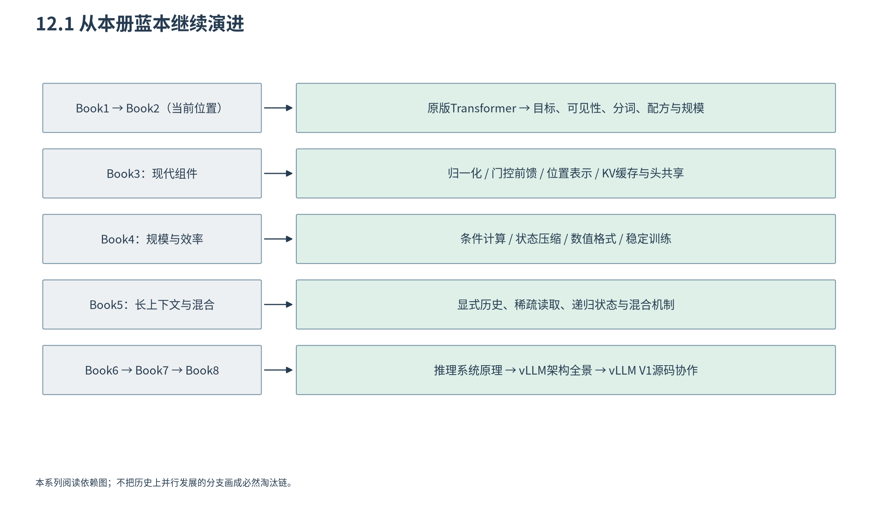
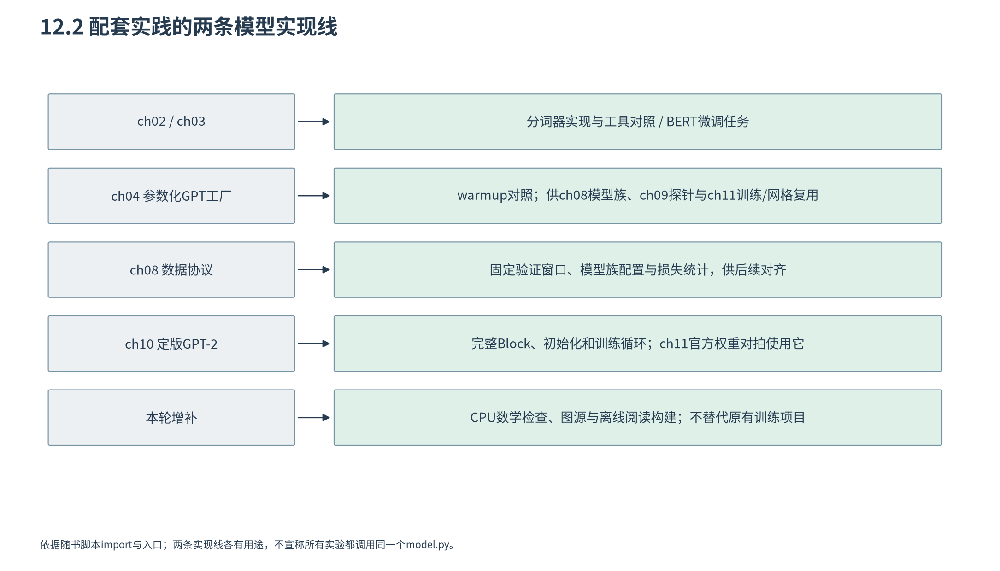

# 第 12 章 收束：架构选择的条件与后续演进

## 12.0 开篇：从全书到这里

上一章让我们把结构图、参数、数据和计算预算放进同一个实验。本章回到整册最初的问题：同一套 Transformer 部件，为什么会分化出不同的预训练路线？我们已经有 BERT 的双向表示、GPT 的因果续写、T5 的文本到文本接口，也有 RoBERTa 对训练配方的重新检验。收束时需要解释这些路线怎样适应不同用法，而不是宣布某个结构永远获胜。

本章完成三件事。先用 2022 年一项架构与目标的受控比较，讨论 decoder-only 优势的条件；再把上下文长度和生成成本接到后续各册；最后汇总代码与术语。GPT-3、Gopher、Chinchilla、PaLM、OPT 展示了因果单塔的重要性，但同期 T5、T0 等编码器—解码器路线也持续发展。“代表性大模型大量采用单塔”与“所有旗舰清一色采用单塔”是不同判断。

这里新增的主要来源是 Wang 等《What Language Model Architecture and Pretraining Objective Work Best for Zero-Shot Generalization?》（2204.05832v1）。阅读时同时关注架构、预训练目标、是否经过多任务微调和测试集；这些条件共同定义了论文的问题。

## 12.1 架构选择：decoder-only 在什么条件下占优

先回看前几章留下的证据。2019 年的观察者有充分理由相信双塔才是未来：T5 用原典双塔拿下 24 个任务中的 18 个 SOTA（第 5 章），受控对照里（共享参数档、参数-算力双对齐）显式交叉注意力值约 1 分；BERT 的微调生态统治理解侧。而 GPT-2 的 zero-shot 赌注看起来输了一半——摘要 ROUGE-1 只有 29.34、离专用系统差一个身位，1BW 上 42.16 对基线 21.8 仍输【证据等级：官方论文（GPT-2 PDF）§3，第 4 章已核】。三年后风向彻底倒转，比较结论必须解释这个反转，而不是跳过它。

**2022 年的这项比较把问题收窄为可检验的实验**。BigScience 的 Wang 等人（作者名单里有 T5 的 Roberts 与 Raffel——也是 T5 研究的参与者，第 5 章 5.4 节已介绍）把架构三档（因果解码器 causal decoder；非因果解码器 non-causal decoder，即前缀语言模型；编码器-解码器 encoder-decoder）与目标三档（全序列自回归 FLM；前缀 LM 目标 PLM；掩码重建 MLM，T5 式跨度损坏）组成六种组合，同数据（各 168B token 的 C4）、同算力训练，然后**分两种用法评测**：纯 zero-shot 直接考，和加一轮多任务指令微调（multitask finetuning, MTF——用的正是 T0 训练混合、13B token，第 5 章 5.5 节的多任务路线）之后再考【证据等级：官方论文 2204.05832 v1 §3.1-3.4】。设定一的判决干净利落：**纯 zero-shot 下因果解码器最强**——EAI-Eval 平均 44.2，高于非因果解码器的 43.5 与编码器-解码器的 39.9；T0-Eval 同向（42.4 对 41.8 与 41.7——编码器-解码器恰好压在随机基线上，是最刺眼的一行）【证据等级：官方论文 2204.05832 v1 §4.1 Table 3 与 §3.4（随机基线 32.9/41.7；论文内部两值并存——附录 D Table 5 底行与 Table 6 题注印 33.3，Table 3/8 印 32.9，本书取与所引数字同表的 32.9）】。

设定二立刻给出边界：**加 13B token 的 MTF 之后排序反转，编码器-解码器+MLM 反超到 51.3/60.6，压过因果解码器的 50.4/51.4**【证据等级：官方论文 2204.05832 v1 附录 E.2 Table 8】。这一结论必须原样带边界引用：**本实验中的因果单塔+FLM 在未经 MTF 的测试中领先**；在本文所测 MTF 配方下，双塔+去噪目标反超；这不是对任意微调协议的定理——而且反转幅度在 T0-Eval（+9.2 分）远大于 EAI-Eval（+0.9 分），

但不能把它解释为“T0 测试任务直接被用于微调”。论文区分 T0-Train 与 T0-Eval；相反，EAI-Eval 中 MRPC、QQP、SciQ 与训练集存在交集。测试任务、提示集合和汇总方式不同，都会影响两套基准的差距；作者还没有排除 C4 预训练污染。结论里还有一处力度要如实标注：因果解码器对**非因果解码器**的优势其实不足 1 分（44.2 对 43.5、42.4 对 41.8）——真正拉开的是对编码器-解码器的 4.3 分（EAI-Eval）。所以这份证据精确说的是「带显式桥的双塔在 zero-shot 下最吃亏、纯因果解码器稳定占先」，而不是「因果掩码本身值几分」；把资源比较与准确率差分开读，不能从并列出现推断唯一因果来源，是引用这份判决的第二个纪律。

这组结果怎样联系到模型设计？先分清三种理由。

**使用接口。**因果单塔把任务说明、示范和待回答部分放在同一序列中，训练的续写动作可以直接用于提示式推理。GPT-3 的 few-shot 结果证明这种接口在其设置下有实用价值。不过，文本指定任务并不是单塔独占：T5 已把任务统一为文本输入和文本输出，编码器—解码器也能接受任务说明与示范。单塔的优势应落在所测训练与使用方式的匹配上，而不是把其他结构描述成无法提示。

**监督位置。**全序列自回归目标几乎在每个目标位置计算损失；论文的跨度去噪只预测被遮内容和哨兵，输出长度约占原序列的 18%。更多受监督位置解释了两种目标如何使用同一段文本，但不自动证明信息效率更高：预测难度、条件信息和目标冗余也在变化。不能把一个 token 的损失机械视为等量能力增益。

**资源账。**论文为近似对齐预训练计算量，选择 11.0B 的双塔与 4.8B 的单塔；其双塔配置约多 10% 计算。这里的比例属于指定层数、长度与架构组合，不是任意推理场景都固定缴纳的开销，也不是双塔必须使用两倍参数的结构定理。第 4 章单独计算交叉注意力参数，则回答另一个局部问题：保持宽度和层数时，加一组交叉注意力投影要增加多少参数。

这三条帮助我们理解为什么因果单塔成为通用生成的重要底座，却不能推出“整个领域最终选择了不微调”。指令微调本身就是持续发展的路线；模型的接口、预训练和后训练要作为一套设计来比较。表 12.1 保留原来的五组证据，把结论限制在各自设置之内。

**表 12.1** 架构选择的证据对照（自排；各行为同一问题的不同侧面，读时先看设定再读数字）

| # | 证据（设定） | 关键数字 | 读法 | 证据等级 |
|---|---|---|---|---|
| 1 | T5 受控消融（2019，微调范式） | 共享参数双塔 82.81 > 前缀 LM 81.82 > 因果 LM 74.70（P/M 双对齐档） | 该配对设置下共享参数双塔比前缀 LM 高约 1 分，不能将差值全部归因于一个算子（82.81 是共享参数档；不共享的双塔基线为 83.28）——「双塔没死」的第 5 章结论原样成立 | 官方论文 1910.10683 v4 §3.2.2（第 5 章表 5.1 已引） |
| 2 | 架构×目标网格（2022，纯 zero-shot） | 因果解码器 44.2/42.4 最强；编码器-解码器 39.9，T0-Eval 41.7=随机基线 | 本实验未经 MTF 时 CD-FLM 领先 | 官方论文 2204.05832 v1 §4.1 Table 3、附录 D Table 5 |
| 3 | 同网格加 MTF（2022，指令微调） | ED-MLM 51.3/60.6 反超 CD-FLM 50.4/51.4 | 在所测 MTF 设置下排序翻转 | 官方论文 2204.05832 v1 附录 E.2 Table 8 |
| 4 | 桥的账本（同算力对齐） | 4.8B 对 11.0B 参数；所测配置约多 10% 计算；124M 档拆桥省 28.4M | 给定配对配置的资源比较，不能推广成固定倍率 | 官方论文 2204.05832 v1 §3.1/Table 1；本书实验（第 4 章相应的结构、实验或参数分析账本） |
| 5 | 接口的兑现（2020，few-shot） | LAMBADA 86.4、TriviaQA 71.2；本册三个提示展示格式与答案可能分别变化 | 提示式接口在论文评测中获得实证，小探针不替代系统评测 | 官方论文 2005.14165 v4 §3（第 7 章已核）；本书实验（第 11 章 11.5 节） |

第 11 章的预算实验提供了一个不同层面的对照。表 12.1 的第 4 行是判决的经济学，而本册自己的 iso-FLOP 网格恰好给「预算会改变配置选择」上过一节实训课：同分词器同 eval 窗集下，iso-FLOP 谷点 c2a（N=1.86M、D=179.6M）用 $2.00\times10^{15}$ FLOPs 拿到 4.2757，好于第 8 章 Kaplan 族顶点 20m（N=19.5M、D=40M）花 $4.68\times10^{15}$ 才拿到的 4.5013——不到一半的算力反而更好【证据等级：本书实验（MPS bf16/fp32，2026-10，`log/book2-ch11/iso_flop.json`；口径：非同算力对照，见第 11 章 11.4 节）】。范式之争与 scaling 之争是同一堂课的两次开课：**答案都不在「哪个架构/哪个花法绝对更优」，而在「这笔钱、这种用法下哪个更优」**——第 8 章的口径纪律，原封不动地适用于范式判决。

边界条件不是判决的脚注，它自己也是一条产业线索。MTF 反转预告了编码器-解码器在指令微调生态里的长期生命力——做这组实验的 BigScience 阵营，其 T0 本身就是双塔底座，同期的 FLAN 走的也是「微调解锁任务」的路线（2022 年视角一句带过，机制归 Book5 的后训练链）；而同一篇论文的第五节还给了一条务实的折中：**一份底座、两种用途**——先训因果解码器+FLM，需要指令微调时再做一次非因果 MLM 适配（实验里收敛加速最高 9.1 倍），流水线 CD-FLM(168B)→ND-MLM(51B)→MTF 最终拿到 52.3/54.9，分别取得 52.3/54.9；不能把不同基准上的结果合成无条件优势【证据等级：官方论文 2204.05832 v1 §5、Table 8/Figure 7】。你看，连判决的赢家阵营自己都在保留改装的口子——「带边界的判决」在工程上的意思是：底座按胜出方造，但别把双塔的路拆死。

回看交叉注意力这条演进线：2017 Transformer 用它让解码器显式读取编码后的源序列；BERT 和 GPT 分别选取编码侧与因果生成侧；T5 保留双塔并系统比较单塔前缀目标；2022 年的实验继续把结构选择放回目标与用法中检验。前缀 LM 的可见性矩阵可以模拟“先读条件再生成”的信息范围，但同一堆栈的自注意力与双塔交叉注意力并不是相同计算图。模型演进保留了这些分支，因为它们封装信息、分配参数和接受训练信号的方式不同。

## 12.2 四段旅程回望：每段带走的心智

把这些条件明确以后，再回看全册的四段路线。导览 0.4 节把本册画成四段，现在每段收一句总账——它们与各章小结的表述同源，此处只留最粗的一层。

**第一段：范式为什么（第 1 章）。**五环论证链从「标注数据不够了」出发：静态词向量证明考题可以自造，ELMo 把表示升到词例级，ULMFiT 交付微调配方，GPT-1/BERT 采用 Transformer 底座。带走的心智：**监督信号可以从语料里自造——把文本的一部分当考题、另一部分当答案；这些设计回应了表示、数据与迁移的具体限制；历史仍有并行探索，并非唯一必然路线。**

**第二段：范式三物种（第 2-6 章）。**分词器把任意文本变成 id（第 2 章），三种「架构×目标」组合各自成物种：BERT 的双向掩码重建（第 3 章）、GPT 的因果预测（第 4 章）、T5 的双塔跨度损坏（第 5 章），RoBERTa 证明不动架构、只改配方的复跑能走多远（第 6 章）。带走的心智：**一张掩码表决定模型看哪个方向，一个损失函数决定它练什么能力——物种的分化在目标不在骨架；而胜负的读法全在口径：对齐的是参数还是算力、一次动了几个变量、配方吃没吃足。**

**第三段：规模化（第 7-9 章）。**GPT-3 把参数拧到 175B 并交出上下文学习这个范式级现象（第 7 章）；Scaling Laws 把「花更多钱买多少智能」写成幂律与等比处方的对垒（第 8 章）；工程账本把定律落到显存、算力与训练病历（第 9 章）。带走的心智：**指标变换会影响曲线形状（读能力断言先问测量口径）、scaling 曲线是实验设计的函数不是大自然的裸照片（每张答案卡背面印着口径条款）、训练内存需同时计算模型状态、激活和临时量，16 bytes/参数只适用于本书列明的精度与优化器组合**——外加三个随身常数：指定 Adam 精度组合下每参数 16 bytes、密集参数近似下每参数每训练 token 6 FLOPs、1 PF-day $=8.64\times10^{19}$ FLOPs。

**第四段：造机与收束（第 10-12 章）。**验收先于实现——参数逐位 124,439,808、随机权重与 HF 逐位相同、冒烟从 $\ln 50257$ 健康起步（第 10 章）；喂真数据、对官方权重、把自家点画进论文坐标系，以诚实条款定义「训成」（第 11 章）；最后摊开判决与欠账（本章）。带走的心智：**「我怎么知道它对了」先于「它跑起来了没」；资源差几个数量级时，把验收押在趋势与结构上（幂律形状、对拍通过、谷底三问），这是复现的一门独立手艺。**

四段连起来正好回答导览的问题「把互联网灌进这台机器会发生什么」：先说清为什么非灌不可，再配齐灌法的三块拼图，然后把「灌多少」变成可计算的定律，最后亲手灌一次。导览 0.5 节还许诺过三条贯穿线索，此处一并收线：**代码线**从第 2 章的自写 BPE 长到第 11 章的曲线脚本，一台机器逐步长成（细账见 12.5 节图 12.2）；**伏笔线**七笔旧账全清、七笔新钩埋定（细账见 12.4 节表 12.2）；**一本账**从第 4 章的 124M 逐项账本、第 7 章的 175B 手算，记到第 9 章的 16 bytes/参数与 PF-days、第 11 章的 5.76 TFLOP/s 本机分母——参数、算力、数据三栏在每一章都在进账。三条线在第四段收拢成同一个物件：一台你知道每一颗螺丝价钱、验过每一次改装的机器。四段的章末小结各自存了细账，迷路时按段回看即可。

## 12.3 两笔大账登记：上下文长度与推理成本

本册欠账总账（导览表 0.2）里，七笔 Book1 旧账（F3/F5/F6/F7/F9/F10/F15）已在前十一章逐一回收，本章只剩最后一笔 F10 要正式登记——以及它连带的另一笔账。这两笔的共性是：**本册先明确问题与成本，具体改造交由后续册展开**——相关思路并非全部晚于 2022 年；这里按教学依赖把完整机制放到位置、缓存与推理章节，本册只负责把借据誊清楚。

**第一笔：上下文长度（F10）。**Book1 对应章节的欠账句原文：「注意力的发明本来就是为了打破容量的墙；七年后墙换成了上下文长度，武器换成了外推与压缩，但战斗是同一场。」现在把「墙」的具体位置量出来。本册主线上下文长度是一条硬上限链：GPT-1 的 512、GPT-2 的 1024（§2.3 原文 "increase the context size from 512 to 1024"，第 4 章表 4.2 已核）、GPT-3 的 2048（"All models use a context window of $n_{ctx}=2048$ tokens"）【证据等级：官方论文 GPT-2 PDF §2.3；2005.14165 v4 §2.1，均直引】。学习式位置表为什么形成一个直接限制？GPT-2 的位置嵌入是 $1024\times768$ 参数矩阵，未经修改不能查询第 1025 行。训练窗口则决定哪些位置参数被训练过：本书 fast 档虽保留 1024 行，却只用长度 256 的窗口，不能据此认为其余位置已有可靠表示。**可执行长度、训练覆盖长度与可靠使用长度要分开。**扩表、重新训练或更换位置机制能够改变限制；限制不是无法改造的自然常数。

Kaplan 附录 D.5 观察到，更大模型在很靠前的位置也可能被较小、短窗训练的模型超过。这提醒我们，模型规模、训练量与位置上的条件信息共同影响损失；它不能证明长上下文普遍不重要。若评测大量集中在短依赖位置，整体平均损失也可能掩盖少量长距离检索失败。后续长上下文章节因此既要检查平均损失，也要检查目标任务。

墙的宽度还要按文字计价——第 2 章埋的钉子在此钉进预算表。token 计数是按词表的，不是按字的：第 2 章选取的两段中文在 GPT-2 词表下恰为每字 2 token（`北京` 2 字 4 token、`北京清华大学` 6 字 12 token，第 2 章表 2.5 实测）【证据等级：本书实验（tiktoken，2026-10）】。于是同一扇窗两种容量：GPT-2 的 1024 token 约合 744 个英文词（每词 1.376 token，第 11 章换算盒实测），却只合约 512 个汉字；GPT-3 的 2048 约合 1024 个汉字——一篇千字新闻刚好把它填满。「上下文长度是预训练时代的出厂设定」在中文世界还有一层加倍的含义：字符数与英文词数不是同一单位，且切分率依赖文本；这些换算只能作为所举样例的预算示意，不能推广成中文容量恒为英文一半。这笔账的偿还地址已在 Book1 登记表立档，此处按其口径点名：**工程主线在 Book3 第 7 章**（$2\text{k}\to32\text{k}$ 的外推工程线），**KV 的账本在 Book3 第 6 章开立**（推理侧每多看一个 token 要付什么钱，从那里开始算）；**1M 上下文的收束论在 Book5 第 8 章**（超长上下文的路线之争在第 4 章铺陈）；**缓存经济学与 KV 三线压缩在 Book6 第 6/3 章**。这就是 N7——F10 的接力棒，本册埋下的最后一笔新钩。

**第二笔：推理成本。**本册生成器每产生一个 token，就把已有前缀再算一次。设原始提示长 $P$，要生成 $T$ 个 token，第 $t$ 次前向处理 $P+t$ 个位置（$t=0,\ldots,T-1$）。因此线性投影累计处理

$$\sum_{t=0}^{T-1}(P+t)=TP+\frac{T(T-1)}2.\tag{12.1}$$

如果从长度 1 起算，便得到旧稿的 $T(T+1)/2$。这个和式统计的是重复处理的位置；全注意力还需统计每步的成对位置，累计量与 $\sum_t(P+t)^2$ 成正比。明确两种工作量以后，就能看出下一次改造的方向：保留已经算出的历史键值，不必每轮重做全部线性投影。新增代价是需要管理跨步状态，并让它与位置、请求和设备保持一致。

第 11 章 CPU 生成 40 token 约 1.2 秒的历史记录展示了指定输入下的实际代价，但不能由单次计时推出所有长度的复杂度。Book3 从因果性解释缓存为何可复用；Book6 再研究预填充、解码、状态容量、批处理及加速方法。上下文与推理成本在这里连接起来：多看历史既改变模型可用的信息，也改变状态与计算预算。

## 12.4 下一册预告：插槽化时代

两笔大账登记完毕，伏笔台账可以总决算。表 12.2 是本册十四笔钩子的完整账目——甲栏七笔 Book1 旧账的回收状态、乙栏七笔新钩的去向，与导览表 0.2 首尾呼应：当时它们是「预告」，现在是「回执」。

**表 12.2** 本册伏笔总账（自排；F=Book1 留下本册回收，N=本册埋设交后册；回收/去向章号按丛书总览 v1.1 与 Book1 登记表 v1.1，后册若调整章序须回表改版）

| # | 钩子（一句话） | 本册处置 | 后续去向 |
|---|---|---|---|
| F3 | 并行化红利：可以规模化的资格 | 第 1 章开场回收；第 8/10-11 章三次兑现（定律定量化、亲手训 124M） | — |
| F7 | BPE 黑盒：借用了三次的工具 | 第 2 章全量回收（三幕，四数字逐个复算钉死） | — |
| F9 | 交叉注意力的折叠 | 第 3/4/5 章三触点 + 本章 12.1 节合龙（五站谱系+综合比较） | 余脉（检索与注意力本体）：Book5 第 10 章 |
| F5 | 归一化位置、初始化与 warmup 的关系 | 第 4 章改造②解禁 + warmup 对照实验 | 谱系之争：Book3 第 2 章（即 N1） |
| F6 | 位置编码外推：2017 年的半句承诺 | 第 4 章小回收（1024 位口径交代；Book1 外推实验不可并比） | 主线：Book3 第 4/7 章（即 N2）；Book5 第 8 章 |
| F15 | 权重共享：绑与解的小开关 | 第 4 章改造④回收（解绑增加 38.6M；省额占未绑定总量 23.67%；BERT 侧回指第 3 章） | Book3 第 5 章（即 N3） |
| F10 | 固定容量→上下文长度 | 本章 12.3 节登记（硬上限链+预算表） | Book3 第 7 章等（即 N7，见 12.3 节点名） |
| N1 | 归一化零件自身的演化史（更简变体与 pre/post 之争） | 第 4 章末埋设 | Book3 第 2 章 |
| N2 | 学习式位置编码的 1024 位之墙（旋转式做法与外推工程） | 第 4 章末埋设 | Book3 第 4 章（原理）/第 7 章（工程） |
| N3 | 「绑与解」在下一代被反悔 | 第 4 章末埋设 | Book3 第 5 章 |
| N4 | 「更少参数、更多数据」的开源第一单 | 第 8 章末埋设 | Book3 第 1 章 |
| N5 | 低精度与训练稳定化的处方 | 第 9 章末埋设 | Book4 第 7 章 |
| N6 | few-shot 现象的能力侧与系统侧 | 第 11 章末埋设 | Book5 第 10 章；Book6 第 6 章 |
| N7 | 上下文长度主线（F10 的接力棒） | 本章 12.3 节埋设 | Book3 第 6/7 章；Book5 第 4/8 章；Book6 第 3/6 章 |

图 12.1 后续各册的位置。由本册目标与预算出发，逐步进入组件、效率、混合架构及推理系统；Book7为架构全景，Book8为源码剖析。

图 12.1 后续各册的位置。由本册目标与预算出发，逐步进入组件、效率、混合架构及推理系统；Book7为架构全景，Book8为源码剖析。

下一册继续沿用已经实现的 GPT-2 作为比较蓝本，但不会把现代模型写成一串孤立的新名词。每次改造都先定位：归一化怎样影响尺度与训练，门控前馈怎样改变表示变换，旋转位置机制怎样表达相对位置，KV 头共享怎样改变增量计算的状态成本。保留接口有助于逐项实验，也要检查接口契约是否真的允许直接替换。

LLaMA 家族将作为整机案例，联系训练数据量、模型大小和使用成本。它受到计算预算研究的启发，但并非机械采用统一的“每参数 20 token”处方；当部署成本进入目标，训练阶段更久地训练小模型也可能合理。我们会继续用“遇到什么限制—修改哪里—数学支持什么—收益与代价是什么”的顺序理解这些变化。

## 12.5 册末清点：代码资产与术语表

最后一节清点两份可带走的资产。

**第一份是代码**——图 12.2 是全书代码资产的总览。正文代码 18 件、合计 4,768 行（另有 8 件可行性探针共 1,371 行作参考底座、各章图脚本不计入）【证据等级：本书统计（`wc -l`，2026-10，批三复核含 ch07 `handcalc.py` 入账）】，按四段旅程排布。这张图里最重要的一条线是橙色的单轨依赖链：第 4 章 `warmup_ablation.py` 的参数化 GPT 工厂（warmup 对照实验的副产品）被第 8 章族训练、第 9 章显存探针、第 11 章 iso-FLOP 网格、124M 训练与采样对照的自训侧五处复用——一个工厂养大五个实验；另一条线是第 10 章 `model.py` 的三插槽定版，第 11 章对拍官方权重与随机初始化对照用的就是它。从 Book1 翻译机改装而来的演化在图上是闭环的：Book1 的块实现（第 4 章手术的底座）→ GPT-2 式工厂 → 定版三插槽 → 等待下一册的逐插槽改装。这不是十八个孤立的脚本，是一台机器逐步长成的代码史。

图 12.2 原实践代码的实际依赖。ch04参数化工厂与ch10定版实现是两条用途不同的线，新数学检查不替代原训练项目。

**第二份是词汇**。汇总第 0-11 章全部术语首现处（按术语获得中英对照与定义处登记，「本书用语」为本册自创、无通行英译），沿 Book1 册末术语表格式列于下方，按首现章排序——它同时是全书索引的骨架。

| 术语 | 英文 | 首现 | 一句话定义 |
|---|---|---|---|
| 预训练 | pre-training | 导览 | 先在海量无标注文本上训练通用能力、再按任务定型的两阶段范式 |
| 微调 | fine-tuning | 导览 | 以预训练权重为初始化、在少量标注数据上继续训练 |
| 分词器 | tokenizer | 导览 | 把文本映射为词元 ID 的部件；可逆性取决于归一化、覆盖和未知词处理 |
| 掩码语言模型 | masked language model, MLM | 导览 | 遮住部分词例让模型还原的预训练目标（BERT） |
| 因果语言模型 | causal language model | 导览 | 只看过去、逐位预测下一词元的预训练目标（GPT） |
| 跨度损坏 | span corruption | 导览 | 连续遮掉一段再让模型重建的 T5 目标（平均段长 3） |
| 上下文学习 | in-context learning, ICL | 导览 | 不更新权重、把示范写进上下文就让模型照做的用法 |
| 零样本 / 少样本 | zero-shot / few-shot | 导览 | 推理时不给 / 给 K 条示范（权重全程冻结） |
| 规模定律 | scaling laws | 导览 | 损失随参数、数据、算力按幂律变化的定量关系 |
| 涌现 | emergence | 导览 | 小模型没有、大模型跨阈值才出现的能力现象（第 7 章定义与争鸣） |
| 范式三物种 | （本书用语） | 导览 | encoder-only / decoder-only / encoder-decoder 三种架构×目标组合 |
| 差异清单 | （本书用语） | 导览 | 两代机器逐项对照「动了哪、为什么、代价几许」的手术记录单 |
| 插槽 | slot | 导览 | Block 内可替换子层（注意力/前馈）的改装位 |
| 语言模型 | language model, LM | 第 1 章 | 对序列（或下一位词元）算概率的模型——预训练信号的免费来源 |
| 词向量 / 词嵌入 | word vectors / embeddings | 第 1 章 | 每词一张固定维向量的静态表示 |
| 跳字 / 连续词袋 | skip-gram / CBOW | 第 1 章 | word2vec 的两种预测方向（中心词↔上下文） |
| 负采样 | negative sampling | 第 1 章 | 用数据词对与噪声词对训练二分类的目标；并非精确 softmax 的无损捷径 |
| 共现矩阵 | co-occurrence matrix | 第 1 章 | 全语料「词×上下文」计数表（GloVe 的原料） |
| 双向语言模型 | bidirectional LM, bi-LM | 第 1 章 | 前向+后向两个 LM 拼装的上下文表示（ELMo） |
| 自监督 | self-supervised | 第 1 章 | 从语料自身构造考题与答案的训练信号 |
| 灾难性遗忘 | catastrophic forgetting | 第 1 章 | 微调新任务时旧能力大幅退化的现象 |
| 分层学习率微调 | discriminative fine-tuning | 第 1 章 | 每层用不同学习率的微调（ULMFiT 配方件） |
| 渐解冻 | gradual unfreezing | 第 1 章 | 从输出层往输入层逐层解冻的微调（ULMFiT 配方件） |
| 特征法 | feature-based | 第 1 章 | 冻结预训练表示、只训下游头的用法（对照微调法） |
| 五环论证链 | （本书用语） | 第 1 章 | word2vec→GloVe→ELMo→ULMFiT→GPT-1/BERT 的前史递进链 |
| 词元 | token | 第 2 章 | 分词器输出的最小单位（子词/字符/字节） |
| 子词 | subword | 第 2 章 | 词与字符之间的中间切分单位 |
| BPE | byte-pair encoding | 第 2 章 | 字符起步、迭代合并最高频相邻对来生长词表的子词算法 |
| 压缩率 | compression rate | 第 2 章 | 平均每 piece 承载的文本量（口径 A/B/C 三种分子） |
| unk 率 | unk rate | 第 2 章 | 词表外 piece 的占比（必须声明 piece 级口径） |
| 基础符号集 | base symbol set | 第 2 章 | BPE 起步用的最小符号集合（字符或字节） |
| 字节级 BPE | byte-level BPE | 第 2 章 | 基础符号集取 256 字节的 BPE（unk 恒为零） |
| 预分词 | pre-tokenization | 第 2 章 | BPE 合并前先切片段的正则（GPT-2 的空格例外） |
| WordPiece | WordPiece | 第 2 章 | 按似然增益选合并的子词方案（BERT，`##` 记号） |
| SentencePiece | SentencePiece | 第 2 章 | 语言无关的分词工具箱（▁ 表空格） |
| 子词正则 | subword regularization | 第 2 章 | 训练时按 unigram 概率采样多种切分 |
| 碎片化税 | （本书用语） | 第 2 章 | 字节兜底在未见语料上每字多占 piece 的代价 |
| 下一句预测 | next sentence prediction, NSP | 第 3 章 | 判断句对是否相邻的 BERT 第二目标（第 6 章翻案） |
| 困惑度 | perplexity, PPL | 第 3 章 | 每词元犹疑度的指数化读法 $e^L$——跨词表必须换算后才能比 |
| 句对 | sentence pair | 第 3 章 | 两段文本拼进一个序列的 BERT 输入格式 |
| GLUE | GLUE | 第 3 章 | 九项自然语言理解任务的基准集合；论文汇总时应核对是否排除了 WNLI |
| 多数类基线 | majority-class baseline | 第 3 章 | 永远猜训练集多数类的下限成绩 |
| GELU | Gaussian Error Linear Unit | 第 3 章 | 用高斯 CDF 近似门控的激活函数（`gelu_new`=tanh 近似版） |
| 任务条件化 | task conditioning | 第 4 章 | GPT-2 的 $p(\text{output}\mid\text{input},\text{task})$：任务说明写进上文 |
| 自然语言提示 | prompt | 第 4 章 | 用自然语言写成的任务说明或示例开头 |
| 前置归一化 | pre-LN | 第 4 章 | LN 挪进残差支路入口的布局（改变局部梯度路径，不能保证不需要 warmup） |
| 绑定嵌入 | tied embeddings | 第 4 章 | 输出投影复用输入嵌入矩阵（GPT-2 中省额占未绑定总量约 23.67%） |
| 接口税 | （本书用语） | 第 4 章 | 交叉注意力层的参数与计算开销（124M 档 ≈28.4M） |
| warmup 对照实验 | （本书用语） | 第 4 章 | 撤掉 warmup 对照 post-LN/pre-LN 训练稳定性的实验 |
| 分阶段发布 | staged release | 第 4 章 | GPT-2 逐档放出权重的数据政策 |
| 冒烟测试 | smoke test | 第 4 章 | 短步数开始训练、验证训练循环健康的最小实验 |
| 文本到文本 | text-to-text | 第 5 章 | 一切任务压成「文本进、文本出」的统一接口 |
| 哨兵 | sentinel token | 第 5 章 | 标记被遮跨度边界的专用词元 |
| 前缀语言模型 | prefix language model | 第 5 章 | 前缀全可见、续写段因果的折中架构（折叠的机械蓝图） |
| 算力对齐 | FLOPs-matched | 第 5 章 | 消融时以计算量（而非参数量）对齐的公平口径 |
| C4 | Colossal Clean Crawled Corpus | 第 5 章 | Common Crawl 经十条规则清洗出的 745GB 语料 |
| 规模三花法 | （本书用语） | 第 5 章 | 4× 算力的三种花法：更大模型/更久训练/更多集成 |
| 复跑研究 | replication study | 第 6 章 | 架构冻结、只改配方重训一遍的对照研究（RoBERTa） |
| 动态掩码 | dynamic masking | 第 6 章 | 每次喂入时重新采样掩码模式（对照静态一次性生成） |
| 配方 | recipe | 第 6 章 | 数据、批量、步数、掩码方式等训练侧选择的总称 |
| 混合精度 | mixed precision | 第 6 章 | 低精度算、fp32 存的训练精度方案 |
| 指标整流器 | （本书用语） | 第 7 章 | 非线性指标与有限样本能使平滑变化看起来陡峭；并非所有能力变化的统一解释 |
| 幂律 | power law | 第 8 章 | $y=Ax^{-\alpha}$ 的标度关系（log-log 图上的直线） |
| 非嵌入参数 | non-embedding parameters | 第 8 章 | 扣除嵌入与位置表的参数量（$6ND$ 的 $N$ 口径） |
| 算力最优 | compute-optimal | 第 8 章 | 给定总算力下损失最低的 $(N,D)$ 组合 |
| iso-FLOP 轮廓 | iso-FLOP contours | 第 8 章 | 同算力档内扫 $N$ 得到的 U 形损失曲线（三方法之二） |
| 等比处方 | （本书用语） | 第 8 章 | 在论文研究范围内参数与数据近似同比增长的预算规律；不是通用固定比例 |
| 不可约项 | irreducible term, $E$ | 第 8 章 | 参数化拟合中数据熵的地板项（支撑域不足则不可辨识） |
| 临界批次 | critical batch size, $B_{crit}$ | 第 8 章 | 随损失下降而增大的最优批次规模律 |
| 显著欠训练 | significantly undertrained | 第 8 章 | Chinchilla 对每参数 token 数远低于处方者的结论 |
| 支撑域 | support | 第 8 章 | 拟合结论所依据的实测区间——读曲线先问它 |
| 一次通过 | single pass | 第 8 章 | 训练位置至多消费一次；不等于内容无重复，也不保证没有记忆化 |
| 模型状态 | model states | 第 9 章 | 参数、梯度与优化器状态；容量取决于精度、优化器和分片方式 |
| 激活 | activations | 第 9 章 | 前向中间量的显存占用（随 $B\cdot n\cdot L$ 线性、$n^2$ 膨胀） |
| 损失缩放 | loss scaling | 第 9 章 | 反向前放大损失防 fp16 梯度下溢（三件套之一） |
| 梯度检查点 | gradient checkpointing | 第 9 章 | 只存少量激活、反向时重算的省显存技术 |
| 损失尖峰 | loss spike | 第 9 章 | 训练中途损失突跳的不稳定现象（PaLM 20 次） |
| PF-days | PF-days | 第 9 章 | 一天 1 PFLOPs 的算力单位（$8.64\times10^{19}$ FLOPs） |
| 验收先于实现 | （本书用语） | 第 10 章 | 先写定机器可判定的验收标准、再写实现的造机姿势 |
| 对拍 | parity check | 第 10 章 | 同输入下两个实现的输出逐位比对的验证法 |
| 换算盒 | （本书用语） | 第 11 章 | token↔word 困惑度互折的实测系数工具 |
| 贪心解码 | greedy decoding | 第 11 章 | 每步取概率最大词元；可能产生重复，但不是所有重复的唯一原因 |
| top-k 采样 | top-k sampling | 第 11 章 | 截断到概率前 k 再重归一化采样（k=40 出处 GPT-2 附录） |
| 词法统计 | lexical statistics | 第 11 章 | 词长、空格率、型例比、bigram 命中率的文本指纹 |
| 型例比 | type-token ratio | 第 11 章 | 不重复词数与总词数之比（复读度指标） |
| 损失-算力曲线 | loss-compute curve | 第 11 章 | 把 eval 损失对 $6ND$ 算力画出的幂律曲线 |
| per-byte 损失 | per-byte loss | 第 11 章 | nats/token 除以每 token 字节数——共同计量单位之一；仍须对齐文本、归一化和可见上下文 |
| 谷底三问 | （本书用语） | 第 11 章 | 最优点是否被测量范围包围、拟合假设是否受检验、不确定性涵盖了哪些来源 |
| 诚实条款 | （本书用语） | 第 11 章 | 资源受限时把「训成」定义为趋势与结构复现的验收标准 |

## 12.6 本章小结：带着可改造的蓝本继续

本册从“监督信号能否由文本自身提供”出发，走过表示学习、分词、三类预训练目标、配方改进、规模规律与训练实践。Transformer 的核心部件被重复使用，但目标、可见信息、接口、数据与预算持续变化。沿这条线看，模型演进不是把旧模型整体推倒，而是不断识别限制，选择需要改造的部分，再用数学和实验判断是否得到所需性质。

合上书时，应同时保留两种能力：可以沿张量与概率追踪模型在算什么，也可以追问一个实验结论由哪些条件支撑。参数核算和固定输入对拍能检查实现；损失曲线与消融提供经验依据；它们各自不能替代另一个层次的证明。

下一册以本册的 GPT-2 蓝本为起点，进入归一化、门控、位置与缓存等组件的逐项改造。本册保留的代码、数据协议和预算账，将成为比较新设计的共同起点。
