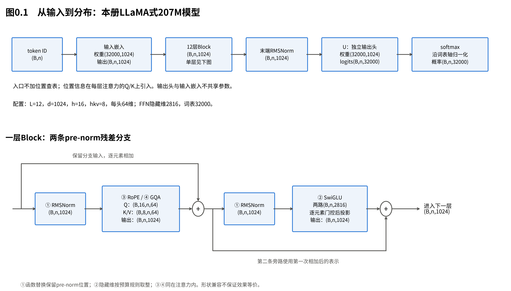

# 导览：沿GPT蓝本理解LLaMA组件

> 带着一个问题读：**从GPT-2的蓝本走向LLaMA式模型，每个部件为什么改变，改变后又要检查什么？**本册先给出整机和阅读路线，具体推导与实验在后续章节展开。207M、48MiB等数字都带有配置条件，不代表任意LLaMA模型或设备。

Book2已经建立了因果语言模型的蓝本：文本经过分词和嵌入，进入重复的注意力与前馈Block，再得到下一词元分布。本册沿这台机器继续改造。问题不再只是怎样构造预训练任务，而是怎样让部件更适合训练、位置表示和增量生成的约束。

LLaMA是本册的整机案例。它组合了已有研究中的RMSNorm、SwiGLU和RoPE，并用公开来源数据进行大规模训练。其价值不能简单概括为“什么都没发明”，也不能把它写成所有后续模型唯一的祖先。对学习架构的人而言，这个案例提供了一条清晰路线：先理解单个组件想获得的性质，再检查多个组件如何在同一计算图中配合。

教学蓝本会经历四类替换和一个出入口调整：归一化、前馈、位置、KV头组织，以及输入输出权重解绑。我们尽量保留pre-norm残差Block的基本拓扑，让每次变化可定位；但投影形状、参数量、缓存接口和初始化都需要重新检查。所谓“插件式改造”不是保证任意零件可以直接插上，而是要求把替换的边界与连带影响说明白。

> **最小背景栏**：本册只假设你完整读过 Book1（能独立写出 2017 年 Transformer：多头注意力与三种角色、因果掩码、post-LN 与 FFN 数据流、正弦位置编码、参数账本——Book1 对应章节）与 Book2（理解GPT-2的结构与训练流程；实际完成长训练不是先修要求：四改造、分词器与词表、scaling laws、工程账本——Book2 第 2/4/8/9/10-11 章）。除此之外自包含：每个新组件都先教到「你能凭书稿画出它」再投入使用。

## 0.1 读完这本书，你会拥有什么

先说清目的地。合上这本书时，你会有三样东西：

**第一，一台能沿组件来源检查的LLaMA式207M模型，以及配套运行设计。**Book2的GPT-2既是教学比较蓝本，也供部分模块消融直接导入后换件；本册的共用组件库与逐章实现则提供新组件及数值参照。第2—6章分别解释归一化、前馈、位置编码、输入输出解绑与KV头组织，第10章再将第2/3/4/6章的组件import进同一台整机。模块消融在GPT-2对象中替换指定子模块，第10章则另行组装整机；两种使用方式都应按实际import和配置核对。指定配置的总参数为207,119,360，第10章会逐项核对。完整训练入口和历史短训曲线继续保留，全量长训仍按既定实践范围暂缓；运行设计用于核对数据、配置与预算，换设备后还须重新检查依赖和实际吞吐。

**第二，四件组件的选型判断力。**RMSNorm、SwiGLU、RoPE、分组查询注意力（GQA，grouped-query attention）——每一件都按同样的顺序讨论：它解决什么现实问题、代价是什么、论文怎么验证、你自己在笔记本上运行消融实验后观察到什么。读完你应该能回答这样一个选型问题：下一台机器，这个位置是否采用它？为什么？

**第三，一本KV缓存容量账。**第6章从因果生成解释为什么历史K/V可以复用，再按层数、KV头数、每头宽度、序列长度、批量和数值精度计算张量载荷。例如本册207M配置在单条2048-token序列、每元素2字节时，K/V合计48MiB；它不含模型权重、临时激活或分配器预留。验证时将手算与实际张量的元素数、元素字节数对齐，而不把这些载荷当成进程显存峰值。长度增加确实会推高存储需求，但模型能否可靠使用更长上下文，还要看位置、训练覆盖与任务表现。

这些成果之外，还有一种比较方法：先分清正在改变哪个量，再讨论收益。查询头数、KV头数和每头维度不是同一个变量；固定其他几何时，把16组KV改为8组，缓存载荷减半，却不能由此保证质量不变。2017年关于多头与头维的实验，也不能直接替代后来GQA的质量—成本比较。每章小结都会回到同一个问题：**这项机制留下了怎样的判断方法，使用它时必须保留哪些条件？**

## 0.2 卷间契约：从 Book2 出发

先明确册与册之间的知识衔接：上一册介绍了什么，本册新增什么，又怎样改动已有架构。表 0.1 是本册与 Book1/Book2 的完整契约——需要确认知识范围时，可以回看。

| 契约栏 | 明细 | 地址 |
|---|---|---|
| **已知基础**（两册已教，直接指回、不再重教） | 多头注意力与三种注意力角色 | Book1第3、4章 |
| | 因果掩码、整机组装与参数账本 | Book1第7章 |
| | post-LN与FFN的数据流 | Book1第6章 |
| | 正弦位置编码与外推假设 | Book1第5章；第9—10章历史实验 |
| | GPT-2四项结构对照（单塔/pre-LN/学习式PE/继承绑定） | Book2 第 4 章 |
| | 分词器与词表（中文探针、文本容量预算示例） | Book2 第 2/12 章 |
| | Scaling Laws 与等比处方 | Book2 第 8 章 |
| | 预训练工程账本 | Book2 第 9 章 |
| | GPT-2 124M 三插槽实现与训练 | Book2 第 10-11 章 |
| **本册新增** | RMSNorm：归一化零件的演化 | 第 2 章 |
| | SwiGLU：门控前馈与隐藏维的账 | 第 3 章 |
| | RoPE（旋转位置编码，rotary position embedding）深剖 | 第 4 章 |
| | 绑与解、词表三权衡、config 反推架构法 | 第 5 章 |
| | KV cache 账本与 MQA→GQA | 第 6 章 |
| | 外推工程链：PI/NTK/YaRN | 第 7 章 |
| | LLaMA1/2/3 组装与代际 | 第 8 章 |
| | 无论文模型怎么读（config 逆向） | 第 9 章 |
| **架构修改**（四连改装+附加一刀，逐一改动） | 第一例：pre-LN中的LayerNorm → RMSNorm（位置保留） | 第 2 章 |
| | 第二例：GELU-$4d$前馈 → SwiGLU（隐藏维约$\frac{8}{3}d$，再按规则取整） | 第 3 章 |
| | 第三例：$w_{pe}$ 位置查表 → RoPE | 第 4 章 |
| | 出入口调整：tied → untied；词表另由50257改为32000 | 第 5 章 |
| | 第四例：MHA → GQA（16 头共享 8 组 KV） | 第 6 章 |

表 0.1 卷间契约三栏（自排）

三栏分别回答先修、新知识和实际改动。先修栏给出需要回看的具体章节；新增栏说明本册要建立哪些机制；改动栏把它们放回GPT-2蓝本。Book2并非只讲训练，本册也并非只讲架构：前者已重组塔、目标与接口，后者仍需实验和预算来判断组件是否适用。

教学顺序先从归一化与前馈开始：它们都保持残差流输入输出宽度，便于观察局部变化，但内部形状、参数及数值性质并不相同。位置改造随后从入口移到注意力内部；出入口一章再核算词表和共享；最后建立增量生成的状态账，解释为何要改变KV头组织。这是概念依赖的安排，不是说任意组件无需适配就能互换。

## 0.3 先看一眼我们要造的机器

出发前先看图0.1的完整数据流，再看其中一层Block的放大图。上部连接输入、12层主体和词表输出；下部把四类组件改动放回同一残差块。与Book2图0.1对照时，既看保留的职责，也看新几何和接口。

图0.1 本册LLaMA式207M模型的结构示意。上部为整机，下部为一层Block；①归一化、②前馈、③RoPE、④GQA分别对应第2/3/4/6章，U表示独立输出头。几何为$d=1024,L=12,h=16,h_{kv}=8,d_{ff}=2816,V=32000$。残差流始终为$(B,n,1024)$，两路注意力头的形状分别为$(B,16,n,64)$和$(B,8,n,64)$。依据本册配置与逐章组件代码绘制；它是教学示意，不是性能实验，也不代表所有LLaMA型号。

沿数据流从左到右看一遍，记住五处改动的位置——第 2-6 章介绍每项改动时，都会回到这张图定位：

- **入口少了一张表**：token 查表 $w_{te}$（形状 $(32000,\,1024)$）之上，GPT-2 那张 1024 行的位置查表 $w_{pe}$ 整件拆除（在上部数据流中已不再出现）——位置信息改在每层注意力的 Q 与 K 上现做，这就是插座③（第 4 章），全书数学最重的一章；
- **每层 Block 中替换两类组件**：两处归一化从LayerNorm换成RMSNorm，整机末端也作同样替换（插座①，第 2 章）；前馈从 GELU 两矩阵换成 SwiGLU 三矩阵带门，隐藏维先按$\frac{8}{3}d$估计，再向上取到256的倍数，本配置为2816（插座②，第 3 章）；
- **注意力改变了 KV 头的共享方式**：16 个查询头共享 8 组 KV 头（$h$=16、$h_{kv}$=8），不再是 16 个查询头各自使用一组 KV 头——这是插座④（第 6 章），也是明确 KV 存储成本后顺理成章的一项改动；
- **输出层改用独立权重**：输出头保存独立的$(32000,1024)$权重，不再与输入嵌入共用参数。读出将$(B,n,1024)$映射为$(B,n,32000)$的logits，softmax才得到概率。解绑与词表从50257改为32000分别影响参数量，第5章会把两笔变化拆开核算。

除这五处，其余零件——残差流、Block 拓扑、单塔 decoder-only——保留主要组织关系，细部配方仍须逐项核对；宽度从 768 涨到 1024、层数仍是 12。因此，本册实现模型的方法与 Book2 一脉相承：不是重造，是改装。

## 0.4 旅程地图：四段

全册分为四个阶段。需要确认当前内容在全书中的位置时，可以查看下表：

| 段 | 章 | 我们在做什么 | 一句话 |
|---|---|---|
| 为什么 | 第 1 章 | 比较权重、公开训练信息与计算预算；分析LLaMA的动机及训练/使用成本 | 开源为什么需要「更少参数、更多数据」 |
| 逐插槽改装 | 第 2-6 章 | RMSNorm → SwiGLU → RoPE → untied 插曲 → KV 账本与 GQA，每章一刀：限制→改造→消融验收 | 四项改造换完，机器还是那台机器 |
| 工程与谱系 | 第 7-9 章 | 外推方法与四干预免重训实验（其中YaRN-lite不等完整方法） → 三代 LLaMA 的组件组合与比较 → 无论文模型读法 | 换完零件的新问题：更长的上下文、代际对表、没论文的模型 |
| 整合与收束 | 第 10-11 章 | 四插槽 import 整机+冒烟+整合短训+设计文档 → 汇总结论、回顾前后承接的问题，并说明两类成本核算在后册的用途 | 完成整合，汇总成果 |

注意这段路线的用意：先讲清**为什么**（第1章分析LLaMA案例的训练与使用成本），再**改动**（第 2-6 章每章一个插槽，第 6 章顺手开立 KV 账本），然后处理**换件之后的新问题**（第 7 章问「上下文窗口能扩展多长」——本册第二项重点实验是同一个模型免重训、只改 RoPE 参数的四干预对照；第 8 章汇总前七章的组件证据，回答「为什么采用这套组合」；第 9 章教一门新手艺：论文缺席的模型怎么读），最后**整合与清点**（第 10 章四插槽齐装，第 11 章收束）。每章开头都有一节「从全书到这里」——帮助读者确认当前内容在全册中的位置，需要时可以回读。

## 0.5 三条贯穿线索

全书贯穿三条线索。沿着它们阅读，十二章的内容就能联系起来。

**一条代码线。**Book2第10章的GPT-2提供比较蓝本，部分消融脚本还直接导入它，例如第2章build_arm先构造GPT-2再替换归一化。00-feasibility中的组件库提供另一套可复用的实验骨架与数值参照。第2—6章讲解并实现相应组件，第10章实际import第2/3/4/6章的教学文件来组装整机；各章对拍按具体输入、精度和容差检查。教学顺序与文件依赖并非完全重合，有些早期实验会借用共用库中尚未展开的部件。读者应按每章入口运行已声明的实验，不能把“学完任意一节”理解成已经拥有完整终态模型。

**一条问题线。**前两册留下的归一化、位置、权重共享、头数与状态成本问题，在这里重新获得具体答案。下面保留这些问题的去向，帮助读者把章节连接起来；不同分支按知识依赖展开，并不是历史上严格接续的淘汰顺序。

| 设计问题 | 本册动作 | 状态 / 后续去向 |
|---|---|---|
|  K 与 V 拆开各自缓存：推理时代的账 | 第 6 章回顾四处前文问题后正式介绍 | 本册回收 |
|  位置编码外推的承诺 | 第 4 章重估原理+第 7 章工程全链 | 本册回收；收束论 → Book5 第 8 章 |
|  FFN 的门控思想（GLU 里冒头） | 第 3 章介绍六年的发展过程 | 本册回收；FFN 下一刀 → Book4 第 2-5 章 |
|  权重共享：绑与解的小开关 | 第 5 章四拨事实链（与 N3 同址） | 本册回收 |
|  多头结构改造：在原实验条件下缩$d_k$的结果怎样重读 | 第 6 章「账本变了」三步论证 | 本册回收；工程视角 → Book4 第 6 章 |
|  归一化零件自身的演化 | 第 2 章谱系收口 | 本册回收 |
|  学习式位置编码的 1024 位之墙 | 第 4 章结构性解除+第 7 章硬墙→软墙 | 本册回收 |
|  下一代对「绑与解」作出不同选择 | 第 5 章（并入 F15） | 本册回收 |
|  LLaMA对训练与使用预算的权衡 | 第 1 章主场+第 8 章第二落点 | 本册回收 |
|  上下文长度主线（F10 接力棒） | 第 7 章主场+第 6 章账本联动 | 本册回收；收束论 → Book5；账 → Book6 |
|  warmup 的限制与 pre-LN | Book2 第 4 章已收 | 接力半句在第 2 章（续 N1） |
|  上下文长度：出厂设定 | Book2 第 12 章已登记 | 接力棒=N7，第 6/7 章 |
|  低精度与训练稳定化的处方 | 无本册落点 | Book4 第 7 章 |
|  few-shot 的能力侧与系统侧 | 无本册落点 | Book5第10章；Book6第7章 |
|  FFN 换「专家群」的路线与拒绝它的稳定性权衡；KV 的更低秩折叠；config 分析方法的复用 | 第 3/6/8/9 章埋设 | Book4 |
|  后训练链；外推与状态压缩的哲学分岔；头维「净土」 | 第 4/7/8 章埋设 | Book5 |
|  KV 账本的三股省法；大项目重启锚与消费线衔接 | 第 6/10 章埋设 | Book6 |

表 0.2 跨册问题与阅读去向。后续章节围绕各自问题展开，不要求记住管理编号。

**一本账。**本册把参数、KV容量和计算预算分开核算：参数账从 Book1 开立、Book2 对到 124M 逐位，本册对到 207M 逐位，还要升级成“用config提出结构假设，再以实现和权重核对”的方法（第 5 章建立方法，第 9 章实际应用）；KV 账第 6 章新开立，是上面说的那本显存账；预算账继续使用$6ND$近似，但逐项声明是否包含嵌入及其他被省略计算，第 1 章手算 LLaMA 的三笔算力账，第 10 章写进设计文档的重启预算表。外加一笔小账：token 账——Book2 提出的中文分词问题（每汉字折几个 token）在第 5 章讨论词表变化时重新核对。对成本的明确核算仍然贯穿整套丛书。

## 0.6 阅读范围与实践方式

本册以LLaMA1—3为组件主线，Llama 4仅用于说明如何由配置和实现重建结构。更晚的型号不是衡量本册完整性的标准；重要的是理解归一化、门控、位置和状态管理的机制，并能识别它们在新模型中的变化。专家模型、状态压缩、混合架构和服务调度，分别在后续各册展开。

207M实践提供组件实现、整机组装、参数核算、训练入口与运行设计。完整长训不属于阅读本册的必要条件。正文的MPS实验是2026年10月的历史记录，短算例与论文结果分别标明来源；设备、依赖和语料不同，不能保证重复得到相同耗时或末位数值。数据与权重不随书打包，运行实践需要按脚本说明取得资源。

数学推导单元先交代结论、用途和模型意义，再展开计算。只读首段可先建立路线；需要判断一个替换是否合理时，应回到它的假设、形状和证据边界。章节末尾的小结把局部机制放回整机，实践部分则帮助检查能够被数值验证的关系。

接下来先讨论整机选型：在达到所需能力的前提下，为什么可能愿意多花一些训练计算，换取一个使用成本更低的模型？这个问题会决定后面组件改造究竟服务哪些约束。
