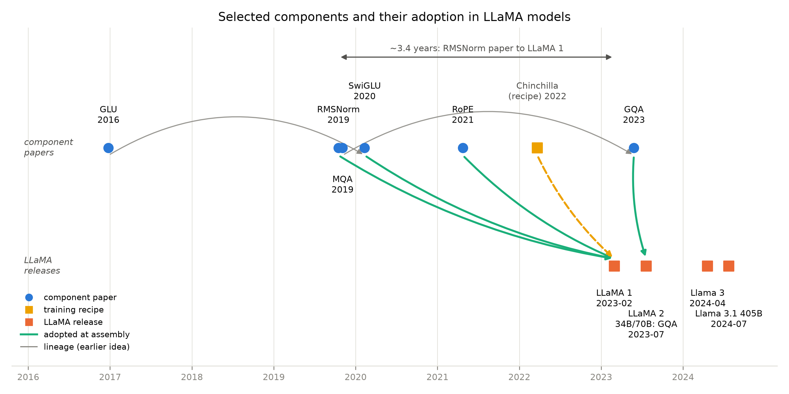

# 第 1 章 从训练预算到使用预算：为什么多训小模型

## 1.0 开篇：从全书到这里

导览已经介绍了全书的安排：我们要以Book2的GPT-2三插槽模型为比较蓝本，逐项换上 LLaMA 式的现代组件，最终装出一台 207M 的整机；归一化、激活、位置、注意力这四处改造位置也已明确。但开始改造之前，还需要回答一个更根本的问题：**凭什么要换？**这些组件当年为什么会被采用？回答不了这个，后面的每一章都只是「照着别人的机器抄」，而不是「理解了别人的机器再造」。

Book2的预算分析留下一个新的问题：训练结束并不是模型成本的终点。同样达到某个性能目标，较小的模型可能需要更长训练，却在之后每次使用时更便宜。本章先分析这个目标变化，再读LLaMA的动机、模型配置与算力账；之后各章才有依据讨论组件为什么这样选。

> **需要回忆的工具**：训练计算近似 $C\approx6ND$；$N$为声明口径下的参数数，$D$为训练token量；$1$ PF-day $=8.64\times10^{19}$ FLOPs。GPU-hour则统计设备数乘运行小时，并非固定大小的计算量，必须同时给出设备与利用率。

## 1.1 同一份预算研究，为什么会引出不同选型

Chinchilla研究的是指定训练预算下，怎样在参数与数据之间取得较低损失。论文用三种相互补充的方法估计这一关系，不是三项完全独立的证据；约20 token/参数是所研究规模上的近似总结，不是每个模型必须满足的常数。GPT-3的175B与300B训练token对应约1.7 token/参数，说明当时一些配置更偏向增加模型规模。

70B/1.4T的Chinchilla在与Gopher相近的训练预算下取得更好结果，支持重新考虑参数与数据的分配。但若把训练后的使用成本也计入目标，训练最优的配置未必仍然最合适。LLaMA把这个问题写进了引言：为不同推理预算训练尽可能好的模型，可能需要比只看训练计算时更多的数据。

因此，“更少参数、更多数据”不是不受条件约束的优胜公式。首先需要有可用的高质量数据，其次需要更长训练确实继续改善目标能力，最后还要判断使用次数是否足以抵偿额外训练成本。下面先看公开研究面对的资源条件，再把这两本账连接起来。

## 1.2 公开模型需要哪些可研究的资源

在GPT-3最初发布的背景下，研究者可以阅读论文和使用服务，但没有公开的175B权重可供任意修改。这里要区分三类资源。

**权重**使人能够在本地检查结构、提取表示、继续训练和替换部件；仅有API通常无法完成这些内部实验。**使用接口**让人评测输入输出，却受服务版本、费用和功能限制。它仍可用于有效研究，但很难完全控制模型内部变量，不能简单等同于可下载模型。

**训练数据与完整配方**决定另一个层次的复现。论文提供混合比例和大致超参数，并不意味着训练文档、去重结果、数据次序与全部工程选择都可取得。LLaMA引言以“Books—2TB”和社交对话等仅有名称或未公开的数据为例，指出某些模型难以从公开资源完整重建；不能把这个例子直接当成GPT-3特定书籍语料的精确披露。

LLaMA选择公开来源数据，并报告了数据比例、模型和训练设置，为同类研究提供了重要起点。但公开来源、公开权重、完整可复现与开源许可并不是同一个概念。LLaMA1最初的研究用途许可也不能用“研究上可复现”重新定义成无条件开源。这里关注的是：研究者能获得什么、可以检验哪些结构问题、哪些训练细节仍然未知。

选择另训模型不是逻辑上的唯一出路；使用API、研究较小模型和复现某些部件都有不同价值。本书选择从公开组件和数据出发，是为了让结构改造可解释、可运行、可比较。

## 1.3 LLaMA 的动机五段：把偏离写在第一段

选择公开资源进行研究的动机已经明确。而亲手实现模型之前，首先要明确选型。LLaMA 的论文（Touvron 等，Meta AI，2023）正文不长，但它的引言与摘要几乎每一句都值得逐字读。我们把动机五段按原文过一遍，每段之后用自己的话解释它的含义。

第一段，**以已有研究结论为起点**。论文引言的第一层递进是：

> "However, recent work from Hoffmann et al. (2022) shows that, for a given compute budget, the best performances are not achieved by the largest models, but by smaller models trained on more data."
> 【证据等级：官方论文 2302.13971 v1 §1 直引】

这句话承接Book2第8章的一项研究发现：在论文考察的预算与模型范围内，把原来偏向参数的资源分一部分给训练数据，可以得到更好的模型。它不等于同预算下参数越少越好；模型缩得过小，同样会受容量限制。LLaMA以这项预算研究为起点，接下来进一步改变要优化的目标。

第二段，**推理预算——训练账之外的第二本账**。紧接着，论文话锋一转：

> "However, this objective disregards the inference budget, which becomes critical when serving a language model at scale. In this context, given a target level of performance, the preferred model is not the fastest to train but the fastest at inference, and although it may be cheaper to train a large model to reach a certain level of performance, a smaller one trained longer will ultimately be cheaper at inference."
> 【证据等级：官方论文 2302.13971 v1 §1 直引】

这里需要区分两个问题：给定训练计算量，哪种参数与数据配置的损失更低；给定可接受质量和实际使用需求，哪个方案的总成本更合适。Chinchilla主要研究前一个问题，LLaMA引文把注意力转向后一个问题。较小模型往往每次前向计算较少，但为了达到相近质量，可能需要额外训练。**训练成本先付，使用成本随调用积累；能否抵偿额外训练，取决于之后用多少次、每次真正省多少。**本节稍后会把这个条件写成不等式。第6章的KV容量与读取成本，则会补充参数主项之外的使用约束。

第三段，**偏离声明——它没有照抄 Chinchilla**。这是五段中最能体现研究写作坦诚的一段：

> "For instance, although Hoffmann et al. (2022) recommends training a 10B model on 200B tokens, we find that the performance of a 7B model continues to improve even after 1T tokens."
>
> "The focus of this work is to train a series of language models that achieve the best possible performance at various inference budgets, by training on more tokens than what is typically used."
> 【证据等级：官方论文 2302.13971 v1 §1 直引】

注意方向：Chinchilla 说 10B 配 200B tokens（每参数 20 个）；LLaMA的7B档使用1T；按Table 2实际标称6.7B代入，每参数约149个token，约为20这一参照的7.5倍（这个比值的正式记号是下一节的式 (1.2)）。把四档全算出来更清楚（数字来自表 1.1 的自算列）：7B 档 $R=149$、13B 档 $R=77$、33B 档 $R=43$、65B 档 $R=21.5$。读懂数列的关键在两端：**65B 贴着 Chinchilla 近似参照（约20），模型规格越小，每个参数对应的训练 token 越多**。LLaMA 不是照抄等比配方，而是以训练预算研究为参照，并明确改变优化目标——65B的比率在数值上接近该参照，但这不足以证明它是论文精确给出的最优配置；小档则明显偏向更多训练。额外训练是否值得，仍要用质量与后续使用成本判断。

还有一层证据值得分清：引句中的“we find”是作者对继续训练后表现改善的观察，不是从比例公式必然推出的保证。原文Figure 1给出训练损失轨迹，§3.7又记录若干问答与常识任务随训练变化，并指出SIQA、WinoGrande等例外。因此不能把“performance”不加区分地改写成所有任务都提高，也不能说这一观察推翻了Chinchilla；两项工作提出的优化问题本来就不同。拟合用于提出可检验的配置建议，实测用于判断该建议在特定任务和预算下是否有用。

这里还值得单独谈谈研究写作中的坦诚。LLaMA 把「我们偏离了主流配方」写在论文第一页：偏离多少（7B 对 10B、1T 对 200B）、为什么偏（推理预算），一次说清。它没有假装自己遵循 Chinchilla，也没有悄悄超训而不作解释。对比一下常见的反面写法——宣称「达到最优性能」而不交代口径——本章要保留的写作方法是：**工程写作的诚实，就是把偏离和理由一起交出去**。这与我们在 Book2 里反复训练的「读文献先问口径」彼此对应：阅读时检查他人的统计口径，写作时交代自己的统计口径。

第四段，**公开数据宣言**。

> "Unlike Chinchilla, PaLM, or GPT-3, we only use publicly available data, making our work compatible with open-sourcing, while most existing models rely on data which is either not publicly available or undocumented (e.g. 'Books – 2TB' or 'Social media conversations')."
>
> 摘要："We train our models on trillions of tokens, and show that it is possible to train state-of-the-art models using publicly available datasets exclusively, without resorting to proprietary and inaccessible datasets."
> 【证据等级：官方论文 2302.13971 v1 §1、Abstract 直引】

这是对1.2节公开资源问题的回应。Table 1列出CommonCrawl、C4、GitHub、Wikipedia、书籍、ArXiv、StackExchange七类来源，§2.1概述各自预处理；这仍不等于公开了最终每一条训练文档和全部工程细节。Table 2中大档训练1.4T token、小档1.0T，引用“1.4T”时要说明具体档位与累计训练量。【证据等级：LLaMA v1 §2.1、Tables 1—2】

数据重复也应按表逐项读。原文概括多数来源约一次、维基与书籍约两遍，但Table 1在1.4T档给出的epoch依次为1.10、1.06、0.64、2.45、2.23、1.06、1.03；它并不是严格的每个位置只消费一次，更不证明文本内容已经完全去重。Book2五点族的“每点一次通过”属于另一套取样协议。两者训练token量的约35,000倍之比，只说明$1.4\mathrm T/40\mathrm M$这一计数量级，不能替代语料或训练质量比较。

第五段，**成绩单**。

> "In particular, LLaMA-13B outperforms GPT-3 (175B) on most benchmarks, and LLaMA-65B is competitive with the best models, Chinchilla-70B and PaLM-540B."
> 【证据等级：官方论文 2302.13971 v1 Abstract 直引】

结论章的表述更加鲜明："LLaMA-13B outperforms GPT-3 while being more than 10× smaller"【证据等级：官方论文 2302.13971 v1 §8 直引】。落到一个具体基准上看：MMLU 5-shot，LLaMA-13B 得 46.9，GPT-3 175B 得 43.9——参数是对方的约 1/13，这一项已经反超【证据等级：官方论文 2302.13971 v1 Table 9】。65B 档得 63.4，与 Chinchilla-70B 的 67.5 差约4.1分，论文提出一种可能解释："A potential explanation is that we have used a limited amount of books and academic papers in our pre-training data … that sums up to only 177GB, while these models were trained on up to 2TB of books"【证据等级：官方论文 2302.13971 v1 §3.6 直引】——这里177GB包括85GB书籍与92GB学术论文，不是纯书籍的大小；作者把这类数据较少列为一种可能解释，尚不能排除其他训练与评估因素。注意这项说明与实验成绩的关系：赢了说 most（多数基准，不是全部），较低成绩则提出一种可能解释。这组成绩也体现了较小参数规模的可用性：13B 的体量，仅fp16权重约需26GB；能否装载或继续训练还取决于卡容量、优化器状态、激活和训练方式——较小规格为更多研究环境提供了可用起点，但完整预训练仍需要大量资源。

五段读完，核心动机可以概括为一句话：**用公开的数据、按修改过的处方、训练一系列面向实际使用的模型**。但「更少参数、更多数据」不能停在口号上——它是一笔账，下一节我们把它算给自己看。

### 把两本账连起来：小模型多训何时可能回本

**较小模型的训练成本可以更高，但当累计使用量足够大时，总成本仍可能更低。**这个结论需要先假设两种配置达到了可接受且相近的任务质量；数学只计算成本分界，不保证小模型经更多训练一定能达到目标。

设候选A、B的参数量分别为 $N_A,N_B$，训练token量为 $D_A,D_B$，之后都处理累计$U$个推理token；这里累计的是前向实际处理的位置，包括提示和生成位置，不能只拿API返回的输出词元数来代入。先用一个忽略注意力二次项、通信及执行效率差异的近似：训练每参数每token约6 FLOPs，推理前向约2 FLOPs，并假定能复用历史状态，避免每生成一位都重新投影全部前缀。于是生命周期的模型计算主项为

$$C_A(U)\approx6N_AD_A+2N_AU,\qquad
C_B(U)\approx6N_BD_B+2N_BU.\tag{1.3}$$

这里 $N,D,U$ 均为标量计数。第一项是一次性训练工作，第二项是随使用累计增长的工作。若B更小，即 $N_B<N_A$，且训练工作量更高，即$N_BD_B>N_AD_A$，要使B总量更少，需要

$$6N_BD_B+2N_BU<6N_AD_A+2N_AU.$$

把训练项移到左边、使用项移到右边，得到

$$U>\frac{3(N_BD_B-N_AD_A)}{N_A-N_B}.\tag{1.4}$$

先把额外训练计算$6(N_BD_B-N_AD_A)$除以每个推理位置节省的$2(N_A-N_B)$，约去系数2，就得到式(1.4)。因此式中分子不是未经约分的完整训练FLOPs。单位也能核对：分子是“参数×token”，分母是参数，因此分界量仍是token。如果B的训练工作量不高于A，分子非正，就没有正的成本交叉门槛；训练工作量恰好相等时，$U=0$仍是平局，$U>0$才让较小B严格占优；若B没有更小，当前不等式的方向和解释也要重新检查。

例如只作教学构造，A为10B参数、200B训练token，B为5B参数、600B训练token。A训练约 $1.2\times10^{22}$ FLOPs，B约 $1.8\times10^{22}$；B多付 $6\times10^{21}$。每个推理token在该近似下省 $2(10-5)\times10^9=10^{10}$ FLOPs，所以累计约600B推理token后，两者总工作量交叉。这不是两台真实模型等质量的实验，也不包含延迟与显存；它把“多训小模型”的判断条件明确写了出来。

模型架构在这里重新进入问题：KV缓存、头数、数值格式和硬件利用率都会改变实际使用成本。后面讨论GQA时，我们不仅问参数量有没有减少，还要问生成每一步保留和读取多少历史状态。两本账连接起来，才解释了为什么组件改造既面向训练，也面向使用。

## 1.4 三笔算力账：把「更少参数、更多数据」算给自己看

上一节已经说明了动机，接下来需要亲手核算其中的数字。LLaMA-13B的近似训练计算量为何约为GPT-3的四分之一，需要先核对参数和token的统计口径。工具还是 Book2 第 9 章 9.3 节的换算方法，账本只需两行公式。第一行是训练算力：

$$
C \;\approx\; 6\,N\,D \tag{1.1}
$$

| 符号 | 含义 | 形状 / 口径 |
|---|---|---|
| $C$ | 训练总浮点运算量 | 标量，单位 FLOPs |
| $N$ | 参数个数 | 标量；**本章口径 = 全参数**（口径声明见表 1.1 注①） |
| $D$ | 训练 token 总数 | 标量，单位 tokens |

这里的6来自密集矩阵乘法主项：一次前向约有一次乘和一次加，参数梯度与输入梯度的两次矩阵乘法再贡献约4。并非每类参数在每个位置都真的执行同样六次操作；输入嵌入查表、输出词表投影和注意力交互需要分别核算。沿用Book2的近似账法，可以先比较数量级，不能把它直接当成硬件实际执行计数。第二行给出每参数对应的训练token比率：

$$
R \;=\; \frac{D}{N} \tag{1.2}
$$

这表示：$R$是累计训练token数与参数量的比值，并不逐个统计每个参数实际接收了多少独立样本——Chinchilla 的近似参照（约20）、GPT-3 的限制（1.7）、LLaMA 的偏离（149/77/43/21.5），说的都是它。

两行公式、五档模型，code/ch01/handcalc.py 一次算完（`row` 与 `triangle_65b` 两个函数；纯 CPU 算术、秒级、输出落 `log/book3-ch01/`）。实跑结果汇成表 1.1。

**表 1.1** GPT-3 与 LLaMA1 四档的算力账对照（$N$ 为论文全参数口径；6ND 与 PF-days 两列为本书算术）

| 模型 | $N$（全参数） | 训练 tokens $D$ | $R=D/N$ | $6ND$（FLOPs） | PF-days | GPU 时（A100-80GB） | 证据 |
|---|---|---|---|---|---|---|---|
| GPT-3 | 174.6B | 300B | 1.7 | $3.14\times10^{23}$ | $3.64\times10^{3}$ | —（未披露） | 2005.14165 v4 Table D.1；6ND 手算沿 Book2 第 9 章 |
| LLaMA-7B | 6.7B | 1.0T | 149 | $4.02\times10^{22}$ | 465 | 82,432 | N/D/GPU 时=2302.13971 v1 Table 2/15；$R$/6ND/PF-days=本书算术 |
| LLaMA-13B | 13.0B | 1.0T | 77 | $7.80\times10^{22}$ | 903 | 135,168 | 同上 |
| LLaMA-33B | 32.5B | 1.4T | 43 | $2.73\times10^{23}$ | 3,160 | 530,432 | 同上 |
| LLaMA-65B | 65.2B | 1.4T | 21.5 | $5.48\times10^{23}$ | 6,339 | 1,022,362 | 同上 |

注①（口径声明）：LLaMA各档采用Table 2圆整后的总参数，GPT-3采用附录Table D.1列出的174,600M。Book2第8章已经区分Kaplan及本地族的非嵌入N与Chinchilla的含嵌入N，不能说6ND只有一种通用参数口径。按LLaMA的两份词表矩阵$2\times32000\times d$核算，它们约占65B档0.8%、13B档2.5%、7B档3.9%；这些小比例说明该项口径差异的量级，却不消除注意力交互、激活、重算等其他开销。

注②：$R$、6ND、PF-days 出自 `handcalc.py` 实跑（1 PF-day $=8.64\times10^{19}$ FLOPs，Book2 式 (9.4)）；论文口径 6.7/13.0/32.5/65.2B 即对外通称 7/13/33/65B。

注③：GPT-3 未披露 GPU 时——为它记账只能 6ND 自估（Book2 第 9 章登记过的引用纪律）。

先看最关键的两行。**13B 档**的乘法在草稿纸上三十秒就能走完：$6\times13=78$，$10^{9}\times10^{12}=10^{21}$，所以 $6ND=78\times10^{21}=7.80\times10^{22}$ FLOPs；除以 $8.64\times10^{19}$ 得 903 PF-days。对 GPT-3 的 $3.14\times10^{23}$（$3.64\times10^{3}$ PF-days）之比是 0.248——**约四分之一**。也就是说，按上述主项估计，LLaMA-13B的训练计算量约为GPT-3的四分之一；另据LLaMA作者汇总，它在多数所测基准上超过GPT-3（1.3 节的成绩单）。「更少参数、更多数据」的账本形态就是这一行：参数砍到约 1/13（175B 对 13B），数据量增加到三倍多（300B 对 1T），总训练计算量反而降到 1/4。再把本书的实验放在同一尺度上比较：Book2 第 8 章我们五个模型的训练全族合计约 $1.3\times10^{-4}$ PF-days——LLaMA-13B 这 903 PF-days 是它的约 700 万倍【证据等级：本书实验（Book2 ch8 实测账本 + 本章算术）】。同一套坐标系里差七个数量级，但坐标是同一套——它让教学实验与论文预算可以作数量级对照，却不能据此声称小实验已经复现大模型能力。

**65B 档**：$6\times65.2\times10^{9}\times1.4\times10^{12}\approx5.48\times10^{23}$ FLOPs，约为 GPT-3 的 1.74 倍——量级上已与 Chinchilla-70B 相近（后者 $6\times70\times10^{9}\times1.4\times10^{12}\approx5.9\times10^{23}$，本书算术）：参数同档、tokens 同量、预算同级，于是 63.4 对 67.5 的约4.1分差距不能仅凭预算同量级就归因于数据（177GB书籍及学术文本对最高2TB书籍，见1.3节的口径说明）。

表里还有一列论文口径的 GPU 时，它给了我们做**三角互证**的机会——把同一报告的计算量、GPU小时和吞吐代入同一组单位关系，检查是否自洽。吻合不是真实性证明，不吻合则提示继续核查定义与舍入。

**第一本账，6ND**（上表自算列）：65B 档 $5.48\times10^{23}$ FLOPs。

**第二本账，GPU 时**：论文 Table 15 记 65B 训练共 1,022,362 GPU 时【证据等级：官方论文 2302.13971 v1 Table 15】；§2.4 又说训练跑在 2048 张 A100-80GB 上："When training a 65B-parameter model, our code processes around 380 tokens/sec/GPU on 2048 A100 GPU with 80GB of RAM. This means that training over our dataset containing 1.4T tokens takes approximately 21 days."【证据等级：官方论文 2302.13971 v1 §2.4 直引】。除一下：$1{,}022{,}362\div2048\div24\approx20.8$ 天【本书算术】——与论文自述的「约 21 天」吻合。

**第三本账，吞吐**：还是那句话里的 380 tokens/s/GPU，全程处理的 token 有 $2048\times380\times20.8\times86{,}400\approx1.40\times10^{12}$ 个——在原记录的近似精度下接近1.4T累计训练token【本书算术】。

三项核算还可以换算到同一指标。把第一本账摊到第二本账的时间上：$5.4768\times10^{23}\div(1{,}022{,}362\times3600\ \text{s})\approx148.8$ TFLOP/s，即每张 A100 的有效算力；从第三本账直接乘出来是 $380\times6\times65.2\times10^{9}\approx148.7$ TFLOP/s——用未圆整数字计算，两种代入方式相对相差约0.1007%，可概称约0.10%，不能严格写成小于0.1%【本书算术】。相对A100-80GB所列FP16/BF16密集Tensor Core峰值312 TFLOP/s，这个模型计算主项吞吐约为48%（624为稀疏口径，不能混用；硬件标称来自NVIDIA官方规格）；又因为 6ND 不计注意力二次项与通信开销（Book2 第 8 章注过的 Kaplan 近似），若要计算实际硬件执行利用率，还需另数执行的算子与重算；通信时间不会自动变成浮点工作量。

三本账来自同一研究报告，相关输入并不独立；相互吻合支持数量级自洽，不能替代独立计时或训练复现。这种「同一事实三条账」的核数习惯，比记住其中任何一个数字更有用。

最后再看训练之外的开发开销。论文§6估计，项目开发使用2048张A100-80GB约5个月，按其假设得到2,638 MWh与1,015 tCO₂eq。这里采用GPU小时×400W×PUE 1.1估计电量，再用0.385 kg CO₂eq/kWh的统一电网因子换算排放；这些不是电表读数，也不是根据实际机房电网逐时统计的排放。约5个月的叙述没有给出完整占用时序，不能与电量再拼成精确的连续满载证明。【证据等级：LLaMA v1 §6/Table 15，作者估计】Book2的OPT记录也提醒过我们：最终一次训练之外，还有开发、试验和系统开销。

## 1.5 已有组件怎样组成LLaMA的整机

预算问题说明了为什么要同时关心训练与使用，却还没有唯一决定每个组件。稳定性、表示能力、位置信息和实现成本要分别检查。LLaMA在§2.2列出三项选择及灵感来源，我们沿原文看它具体改了哪里；这些动机不等于已经完成全部单组件消融。

> "**Pre-normalization [GPT3].** To improve the training stability, we normalize the input of each transformer sub-layer, instead of normalizing the output. We use the RMSNorm normalizing function, introduced by Zhang and Sennrich (2019)."
>
> "**SwiGLU activation function [PaLM].** We replace the ReLU non-linearity by the SwiGLU activation function, introduced by Shazeer (2020) to improve the performance. We use a dimension of 2/3·4d instead of 4d as in PaLM."
>
> "**Rotary Embeddings [GPTNeo].** We remove the absolute positional embeddings, and instead, add rotary positional embeddings (RoPE), introduced by Su et al. (2021), at each layer of the network."
> 【证据等级：官方论文 2302.13971 v1 §2.2 直引】

请特别注意这三段话的**引用结构**：每一处改动都在引用别人的论文——RMSNorm 是 Zhang 与 Sennrich 2019 年的，SwiGLU 是 Shazeer 2020 年的，RoPE 是 Su 等 2021 年的；连方括号里的 [GPT3]、[PaLM]、[GPTNeo] 都是「灵感来源」的记号——pre 归一化 GPT-3 用过，SwiGLU 这件零件 PaLM 先装进过旗舰，位置方案在文中以[GPTNeo]标注灵感来源。**这三项组件都有清楚的前期研究来源。**它的贡献是把三件别人造好的零件，配上公开数据与修改过的配方，组装成一台证明「纯公开数据也能到旗舰级」的机器——也为后来许多公开权重模型提供了一套可以比较的结构蓝本。

把这件事画下来，就是图 1.1：横轴是时间，上轴是组件论文，下轴是 LLaMA 代际；青色连线是「被组装」，灰色弧线是「思想前史」。时间线上最醒目的是这些**间隔**：RMSNorm 从 2019 年 10 月发表到被 LLaMA1 组装，等了 3.4 年；SwiGLU 等了 3 年；最快的 RoPE 也等了将近 2 年。各组件在不同研究中发展了数年，LLaMA1 在 2023 年 2 月一次集齐。图上还有两条灰色前史弧线值得先记下：门控思想 2016 年就在 GLU 里冒头（第 3 章的前史），MQA 2019 年就已提出——它与2023年5月的GQA引出第6章。LLaMA1采用MHA，LLaMA2在34B与70B档采用GQA，而7B/13B保留MHA；这份配置差异不说明某模型只是“没赶上”一种发明。

图 1.1 组件-组装双轴时间线（自绘）：上轴蓝点=组件论文（v1 日期经 arXiv 版本史核）、黄方=Chinchilla 配方、下轴橙方=LLaMA 代际（arXiv/官方许可锚日期）；青色连线=本图所列采纳关系（GQA仅指LLaMA2的34B/70B档），灰色弧线=思想前史（GLU→SwiGLU、MQA→GQA）；时间间隔不证明此前没有其他模型采用这些组件【证据等级：arXiv 版本史+官方许可（经本册核对）+ 本书自绘】

组件论文各有自己的实验范围：RMSNorm同时研究循环网络与Transformer，SwiGLU在所选Transformer变体中比较目标和下游结果，RoPE则在RoFormer等设置中验证。**零件级证据不等于整机级证据。**它们不能保证组合后、放大规模或更换训练配方仍获得相同收益；论文时间线也不足以解释某次组装为何发生在特定年份。LLaMA提供了这套组合在其数据、规模与配方下的整机证据，后续替换仍需重新检查。本册的模块实验，以及LLaMA2对注意力方案的比较，都是继续提出并检验局部问题，而不是从此可以无风险地换件。

这张图定义了本书要讲的**插槽化时代**。LLaMA之后，许多稠密语言模型继续沿相近蓝本改进组件，但新架构探索没有停止。本册选择组件替换作为理解这些设计的一条路线：LLaMA2在部分大档改变KV头组织（第6章），Llama3保持主要残差拓扑，但词表、上下文、RoPE基频、训练数据和具体模型规格都需逐项比较（第 8 章的代际总表）。从此读任何一台新模型，最有助于理解它的问题仍然是第 0 章图 0.1 里那四格插座：**它换了哪个插槽？**我们的改装流水线与本册路线图也就此铺开——

- 第 2 章拔第一格：归一化插槽，LayerNorm 换 RMSNorm（这一组件自 2019 年以来的完整发展过程）；
- 第 3 章动前馈：激活插槽，GELU 前馈换 SwiGLU 门控前馈，顺带算清 2/3·4d 的参数账；
- 第 4 章动位置：位置编码插槽，1024 位查表墙换 RoPE 旋转（本册数学最重的一章）；
- 第 5 章插曲：出入口解绑与词表的账（untied 与 32k 词表——四连之外附加的一刀）；
- 第 6 章拔第四格：注意力插槽，MHA 换 GQA，KV 显存账本正式开立；
- 第 7-9 章工程与谱系：长上下文外推的三代配方、LLaMA 三代组装对表、「没有论文的模型怎么读」；
- 第 10-11 章：四插槽齐装成 207M 整机（改装史直接写在 import 语句里），收束成册末的判断力。

到第 10 章你会发现，那台机器的每个零件都有出处：一篇论文、一次消融、一笔我们亲手算过的账。

## 1.6 本章小结

本章把选型分成两层：公开权重与训练信息决定哪些研究可被外部检验，训练及使用预算决定哪些配置值得投入。Chinchilla提供特定训练预算下的参数—数据分配建议；LLaMA把推理预算也纳入目标，给小档更多训练token。按本章声明的6ND主项，13B档约为GPT-3的四分之一，65B档则与Chinchilla-70B处于相近数量级；质量比较各自保留论文的任务与条件。GPU小时、吞吐和近似计算量能互相核对，但不是三次独立实验。

**带走的心智**：第一，先写出两类成本再判断“多训小模型”是否划算。较小模型未必更便宜地达到同一质量，但若每次使用确实更省、累计使用量越过分界，就可能在总计算量上占优；反之也可能永远收不回额外投入。第二，按部件定位模型变化，再核对原有接口、数值性质与实验条件是否仍成立。已有整机成功提供了比较起点，不保证后续每次替换都成功；继承已有组件也不排除新的架构贡献。

镜头拉回全书：四段旅程的第一站（为什么）走完，选型与账本在手，接下来三站全是动手——逐插槽改装（第 2-6 章）、工程与谱系（第 7-9 章）、整合与收束（第 10-11 章）。接下来就开始第一项组件改造：**先把第一个插槽拔下来——从那颗最不起眼的归一化零件开始。**那里还有上一册留下的一个问题，下一章开始分析归一化。

## 1.7 动手验证（本章代码清单）

- 算力账三笔（秒级，产物落 `log/book3-ch01/`）：`python code/ch01/handcalc.py`（本书目录；在外层工作区运行时先激活env.sh，并把脚本路径加上书目录前缀）——应打印表 1.1 的全部自算列与 65B 三角互证（20.8 天、$1.40\times10^{12}$ tokens、148.8 与 148.7 TFLOP/s 两种代入方式的结果吻合）；自定变式档位时务必加 `--out-name` 防覆写。
- 图 1.1 复现（秒级）：`python code/ch01/make_fig_1_1.py`
- 验收点：不看书画出式 (1.1)(1.2) 并说出口径（$N$ 全参数、PF-day 定义）；手算 13B×1T 的 6ND 并说出它与 GPT-3 的比值；复述 LLaMA 偏离声明的方向与理由；解释三项核算为什么能相互吻合。

主要来源：[LLaMA原报告，v1](https://arxiv.org/abs/2302.13971v1)，尤其§1、§2.2、§2.4与Table 15。
