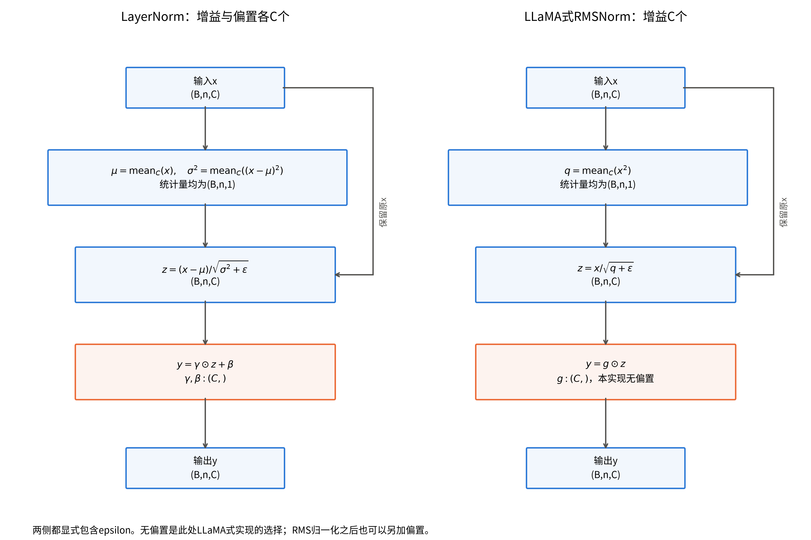
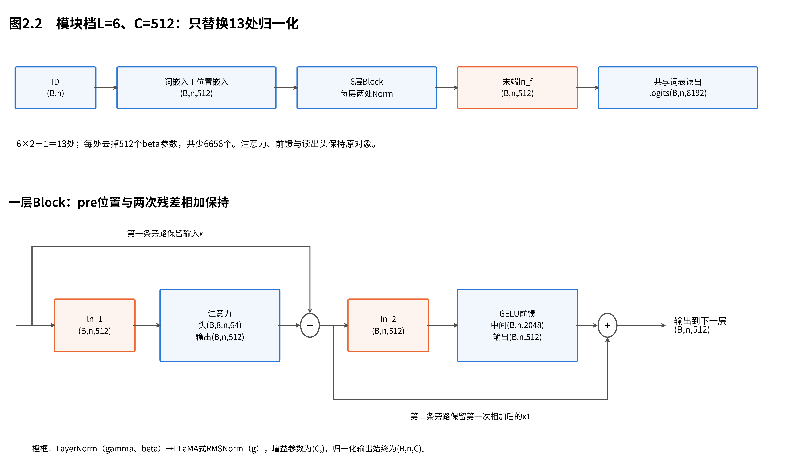
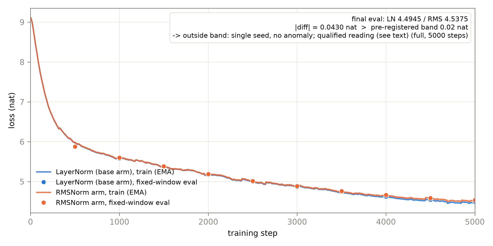

# 第 2 章 pre-RMSNorm：归一化零件的演化

## 2.0 开篇：从全书到这里

上一章解释了模型选型为何要同时考虑训练与使用。本章开始改造GPT-2蓝本中的归一化函数：保持pre-norm残差拓扑，把LayerNorm换成RMSNorm。输入和输出仍为 $(B,n,C)$，但同形状不代表同一函数；我们需要知道替换保留了什么性质，又舍弃了什么。

问题分三层：均值与尺度分别怎样影响表示，RMSNorm的正尺度性质如何影响局部梯度，以及这些数学性质能支持多强的训练结论。模块示例采用6层、宽度512，因此有 $2L+1=13$ 处归一化；这不是上一册12层124M整机的25处，两个规格的数字不能混用。

> **需要回忆的计算**：pre-norm Block为 $x\leftarrow x+F(\operatorname{Norm}(x))$。主干有局部恒等路径，但能否稳定训练仍取决于初始化、学习率、深度与其他组件。Book2四格实验给出的是特定设置下的观察，不是pre-norm不需要warmup的定理。

## 2.1 先区分归一化的位置与函数

归一化有两个可以分别讨论的设计维度。把LN从残差相加后移到子层入口，改变的是它在计算图中的位置；把LN换成RMSNorm，改变的是函数本身。前者决定哪些梯度路径经过归一化，后者决定哪些输入方向被消除或缩放。

这两个维度不能互相代替。采用pre位置并不要求使用RMSNorm，采用RMSNorm也不必然意味着pre位置。原RMSNorm论文中的Transformer比较是在当时结构的归一化位置原位替换；本章在GPT式pre位置上做组件实验，因此应分别交代论文证据与本书实验。

我们的改造目标是减少归一化所需的统计与操作，同时检查损失和执行成本是否可接受。它首先是一个待检验的设计选择，而不是先认定LayerNorm多做了无用工作再寻找理由。

## 2.2 LayerNorm 在做的两件事

先回顾 Book1 的公式，这次从组件替换的角度逐项检查。对残差流上的某个位置向量 $\mathbf{x}\in\mathbb{R}^C$（LayerNorm 家族的口径：归一化对象是「一层神经元上的加权和」，即该位置的全部 $C$ 维）：

$$
\operatorname{LN}(\mathbf{x})_i=\frac{x_i-\mu}{\sqrt{\sigma^2+\varepsilon}}\,\gamma_i+\beta_i,
\qquad
\mu=\frac{1}{C}\sum_{j=1}^{C}x_j,\quad
\sigma^2=\frac{1}{C}\sum_{j=1}^{C}(x_j-\mu)^2
\tag{2.1}
$$

这表示：先把这个向量的均值移到零，再按其波动幅度缩放（分母还含稳定项），最后逐维乘增益、加偏置。它对整句张量的作用是 $(B,n,C)\to(B,n,C)$——形状全程不变，每个位置沿末维单独计算均值与总体标准差，两个统计张量均为$(B,n,1)$；按位置独立计算不代表不同位置的数值在统计上独立。

**LayerNorm把表示分成均值方向与其余方向，再控制其余方向的尺度。**这个几何结构说明它去掉了哪类信息，不直接证明该信息对任务必然有害。令 $\mathbf1\in\mathbb R^C$ 为全1向量，可写

$$x=\mu\mathbf1+v,\qquad \mathbf1^\top v=0.$$

减去均值就是投影到与 $\mathbf1$ 正交的超平面。若每个通道都加同一标量 $b$，则新均值为 $\mu+b$，所以 $(x+b\mathbf1)-(\mu+b)\mathbf1=v$，LN对这种平移严格不变。这里的“平移”是统一通道偏移；任意逐通道偏移并不具有同样结论。

除以标准差则处理 $v$ 的尺度。忽略$\varepsilon$且输入方差非零时，对正数$a$有 $\sigma(ax)=a\sigma(x)$，因此正尺度变化被抵消；保留固定 $\varepsilon>0$ 后只是当方差远大于 $\varepsilon$ 时近似如此。负缩放还会翻转方向。增益 $\gamma$ 与偏置 $\beta$ 位于归一化之后，不会恢复已经丢失的输入均值。

取 $x=(1,2,3,6)$，$\mu=3$、$v=(-2,-1,0,3)$，方差为 $3.5$。减均值前后的方差相同，是因为方差本来就以均值为参照定义；这不证明中心化对优化没有贡献。RMSNorm提出的研究问题是：在某些网络中，能否保留整体幅度控制而不显式投影掉均值方向？必须同时检查代数性质与训练结果，才能回答。图2.1显示这项候选变化的计算位置。



图 2.1 LayerNorm（左）与LLaMA式RMSNorm（右）的计算图（依据式2.1/2.2自绘，示意级）。橙框标出最后的可学习变换：左侧有增益和偏置，右侧只有增益；统计量为$(B,n,1)$，输出均为$(B,n,C)$。右侧旁路把原输入送到缩放步骤。

## 2.3 RMSNorm：按总能量缩放

先明确修改的动机，再看公式。RMSNorm 论文的开场实验画了两条收敛曲线：GRU 机器翻译上，按训练步数计，LayerNorm 确实比无归一化基线收敛快（前一万步里基线 loss 才到 7.0 时，LN 已到 5.4）；但把横轴换成墙钟时间，LN 对应的 loss 则为 5.9——每步额外的归一化计算，抵消了部分收敛收益【证据等级：官方论文 1910.07467 v1 §1 Figure 1】。这篇论文希望得到一种「质量不降、开销更小的归一化方法」：它需要在给定任务中检查质量与运行时间；经验上的结果接近不等于两个函数数学等价。

它的答案是：去掉重中心化这一步，只留重缩放，叫 RMSNorm（root mean square layer normalization，均方根层归一化）【证据等级：官方论文 1910.07467 v1 §4】：

$$
\operatorname{RMSNorm}(\mathbf{x})_i=\frac{x_i}{s_\varepsilon(\mathbf{x})}\,g_i,
\qquad
r(\mathbf{x})=\sqrt{\frac{1}{C}\sum_{j=1}^{C}x_j^2},\quad s_\varepsilon(\mathbf{x})=\sqrt{r^2(\mathbf{x})+\varepsilon}
\tag{2.2}
$$

这表示：不减均值，直接除以表示向量整体幅度的量，再逐维乘以增益。分母从「标准差」换成了「均方根」（root mean square，各分量平方平均再开方），统计量从两项（$\mu$、$\sigma$）减少为一项；本章采用LLaMA式无偏置版本，因此可学习参数从两组（$\gamma,\beta$）减为一组（$g$）；一般RMS归一化之后也可以保留偏置，见本节考据框。论文名字里的 root mean square 就是这个分母。论文原式未带 $\varepsilon$；实现中的稳定项改变零点附近和精确缩放不变性的结论，因此下面用 $r$ 表示纯RMS、$s_\varepsilon$ 表示实际分母。

**符号表**（式 (2.1)/(2.2) 通用；形状列按模块档 $C=512$ 的实际张量记）：

| 符号 | 含义 | 张量形状 |
|---|---|---|
| $\mathbf{x}$（论文记 $\mathbf{a}$） | 某位置进入归一化的残差流向量 | $(B,n,C)$ 的每一行 $(C,)$；全句 $(B,n)$ 个 |
| $\mu,\ \sigma$ | 该向量的均值 / 标准差 | 各 $(B,n,1)$ |
| $r, s_\varepsilon$ | 纯均方根 / 加稳定项后的分母 | 各 $(B,n,1)$ |
| $\gamma,\ \beta$ | LN 的逐维增益 / 偏置 | 各 $(C,)$ |
| $g$ | RMSNorm 的逐维增益 | $(C,)$ |
| $\varepsilon$ | 防除零小量（2.7 节专门讨论取值） | 标量 |
| $W$ | 讨论不变性时归一化上游的线性映射 | $(C,d_{\mathrm{in}})$，上游输入 $u\in\mathbb R^{d_{\mathrm{in}}}$ |

**两种归一化的差别由“总能量”和“去均值后的能量”决定。**先展开方差，而不是直接记一个结论：

$$\begin{aligned}
\sigma^2&=\frac1C\sum_j(x_j-\mu)^2\\
&=\frac1C\sum_jx_j^2-\frac{2\mu}{C}\sum_jx_j+\mu^2\\
&=r^2-2\mu^2+\mu^2=r^2-\mu^2.
\end{aligned}$$

所以纯统计量满足

$$r^2=\sigma^2+\mu^2,\qquad s_\varepsilon^2=\sigma^2+\mu^2+\varepsilon.\tag{2.3}$$

在四维例子中，$r^2=(1+4+9+36)/4=12.5=3.5+9$。取增益全1、偏置0并令 $\varepsilon=0$，LN输出约 $(-1.069,-0.535,0,1.604)$，RMSNorm输出约 $(0.283,0.566,0.849,1.697)$。RMSNorm分母虽更大，但它没有减去均值，分子也不同，所以不能推导“输出一定更大”或“一定更小”；两个输出的欧氏范数此时都等于 $\sqrt C=2$。

先令增益全1、偏置为0，忽略稳定项并排除未定义输入。从几何上看，LN先投影到零均值超平面，再缩放到该平面与球面的交线上；RMSNorm直接沿原向量方向缩放到球面。输入均值为0、两边增益和稳定项相同、LN偏置为0时，两者逐项相等；若稳定项为0，还要求输入非零。这是一组充分条件，不把它当所有退化参数下的必要条件，例如在两式都有定义时，若两边增益全0且偏置为0，非零均值输入也会得到同样的零输出。一般情况下，它们保留的方向信息不同。历史CPU fp32例中，零均值构造的最大数值差约 $2.4\times10^{-7}$；这是有限精度下的等价检查，不是所有输入都等价。

恒等式说明了「什么时候等」，还没有回答「为什么可以尝试删去中心化」。论文的论证分三层，值得逐层分析，因为它展示了怎样论证一项组件简化。

第一层是**假设**：LayerNorm 的成功常被归功于两条不变性，作者假设主要起作用的是重缩放不变性，重中心化贡献有限——原文明确说这是 argue 与 hypothesize，不是证明【证据等级：官方论文 1910.07467 v1 §1】。

第二层是**有条件的代数性质**。纯RMS满足 $r(ax)=|a|r(x)$，因此对 $a>0$、$x\ne0$ 且 $\varepsilon=0$，有 $ax/r(ax)=x/r(x)$。如果上游输入为 $u$，权重 $W\in\mathbb R^{C\times d_{\rm in}}$，令 $W'=\delta W$、$\delta>0$，并要求$Wu\ne0$，便得到

$$\frac{W'u}{r(W'u)}=\frac{\delta Wu}{\delta r(Wu)}=\frac{Wu}{r(Wu)}.\tag{2.4}$$

保留稳定项时，$\delta x/\sqrt{\delta^2r^2+\varepsilon}=x/\sqrt{r^2+\varepsilon/\delta^2}$，所以固定 $\varepsilon$ 并不保持精确不变。只放大某些通道也不满足整体缩放的条件。相反，输入加 $b\mathbf1$ 通常改变方向，RMSNorm不具备LN对统一通道平移的不变性。旧fp32探针中，加3使两函数出现明显不同，乘2.5仅见约 $10^{-6}$ 的差异；这些读数要结合非零epsilon与舍入解释。

第三层是**几何图像**：RMSNorm 把每个向量缩放到半径 $\sqrt{C}$ 的球面附近（这里指乘增益前、稳定项可忽略时的输出；非均匀增益会改变球面形状）。有趣的是，直接缩放到单位球面的欧氏范数归一化（与 RMS 只差一个 $\sqrt{C}$ 因子）在论文实验中「未能奏效」，作者猜想按 $\sqrt{C}$ 缩放球面、使各维保持常见数值范围才是关键——注意这是作者猜想，不是结论【证据等级：官方论文 1910.07467 v1 §4】。

### 梯度中的尺度因子是怎样得到的

**归一化的局部导数会削弱纯径向尺度变化，但不能保证整网训练稳定。**下面推导这个导数，便能明确“隐式学习率适配”依赖哪些条件，而不是把它当作自动刹车的比喻。

先省略增益，令 $f(x)=x/s$、$s=\sqrt{x^\top x/C+\varepsilon}$。对任意微小变化 $dx$，链式法则给出

$$ds=\frac{x^\top dx}{Cs},\qquad
 d(x/s)=\frac{dx}{s}-\frac{x}{s^2}ds.$$

把标量 $x^\top dx$ 写回矩阵乘，得到

$$J_f(x)=\frac1sI-\frac{xx^\top}{Cs^3}.\tag{2.5}$$

其中 $J_f\in\mathbb R^{C\times C}$。第二项是外积：第 $(i,j)$ 项为 $x_ix_j/(Cs^3)$，表示改变任一通道也会通过共同分母影响所有输出。若带增益 $g$，再左乘 $\operatorname{diag}(g)$。

用两个方向检验这个矩阵。与 $x$ 正交的扰动 $v$ 满足 $x^\top v=0$，故 $J_fv=v/s$；沿原方向则

$$J_fx=\left(\frac1s-\frac{r^2}{s^3}\right)x
=\frac{\varepsilon}{s^3}x.\tag{2.6}$$

所以 $\varepsilon=0$ 时径向导数为0，正是尺度不变性的微分形式；$\varepsilon>0$ 时不再严格为0。此时导数规模在零点附近由 $1/\sqrt\varepsilon$ 控制，稳定项不仅是避免除零的形式补丁。

进一步令$a=Wu\ne0$，并假定损失对$W$的依赖都经过这个归一化分支。在正整体缩放$W'=\delta W$、零稳定项及其他网络参数固定时，前向输出相同，$J_f(\delta a)=J_f(a)/\delta$，从而通过链式法则得到对应权重梯度缩小为原来的 $1/\delta$。这就是论文讨论的尺度适配来源。它不等于Adam的最终更新也严格按此比例变化，更不能推出无需warmup；优化器状态、权重衰减、稳定项与其他路径都会参与实际更新。

论文还报告了RNNSearch解码器GRU的hidden-to-hidden映射统计：Table 5的跨位置平均均值，未归一化baseline约−1.60，LN约−0.51，RMSNorm约−0.73。这些是该循环模型中的观测，不是本章GPT残差流的测量。Figure 4把初始化中心移到0.2后，RMSNorm的曲线比LN稳定，但两者都不如原初始化；不能把“保留均值”概括成任何模型中总能提升稳定性的定理。【来源：RMSNorm v1 §6.1、Table 5、Figure 4】

> **【考据框】论文原式带偏置，「无偏置」是 LLaMA 的选择。** RMSNorm 论文的一般形式是 $y=f\!\big((W\mathbf{x}/r(W\mathbf{x}))\odot g+b\big)$——逐维偏置 $b$ 在论文原式（§4.1 式 5）里是存在的。把它删掉的是后来的实现侧：Meta 官方参考实现与 HF 的 `LlamaRMSNorm` 都只有一个 `weight` 参数张量，T5 的简化 LayerNorm 同样无 bias【证据等级：官方论文 1910.07467 v1 §4.1 式 5 + 源码】。所以严格说，LLaMA 的零件 = 「RMSNorm 去掉 bias」，写作与对拍时都不要把「无偏置」说成 RMSNorm 定义的必然组成。再看参数量：LN 每处两个参数张量（$\gamma,\beta$ 各 $(C,)$），RMSNorm 每处一个——本书模块档每处省 $512$ 个参数，全机 13 处共省 $6{,}656$ 个。

**形状流转表**（RMSNorm 前向，$(B,n,C)$ 全程不变维，逐运算列）：

| 步骤 | 运算 | 输入形状 | 输出形状 | 说明 |
|---|---|---|---|---|
| 1 | 转换为 fp32 | $(B,n,C)$ | $(B,n,C)$ | 统计量算在 fp32（官方纪律，见 2.5 节） |
| 2 | 平方、末维均值 | $(B,n,C)$ | $(B,n,1)$ | 均方 $\mathrm{RMS}^2$，无中心化 |
| 3 | 加$\varepsilon$、rsqrt | $(B,n,1)$ | $(B,n,1)$ | 计算分母倒数；加法与rsqrt是否融合依实现 |
| 4 | 逐元素乘 | $(B,n,C)\times(B,n,1)$ | $(B,n,C)$ | 只重缩放 |
| 5 | 归一化结果回投，再乘$g$ | $(B,n,C)\times(C,)$ | $(B,n,C)$ | 增益dtype可能使最终输出再次提升；无bias |

对照LN的逻辑计算，RMSNorm不再显式计算并减去均值，而改用一次均方规约；LLaMA式版本还省去偏置加法及一组参数。逻辑统计量减少不等于访存次数恰好减半，融合实现也可能一次遍历处理多个统计量，具体速度必须实测。

论文还研究pRMSNorm，用一部分通道估计RMS，6.25%是其所测设置之一。它依赖分量分布与部分统计的代表性；§5报告过采样部分太小时的梯度不稳定，§6.1也将某些实现未提速归因于张量切片效率。这是作者在特定实现中的解释，不是所有切片都慢的定理。图像分类又给出另一项边界：Table 10中LN测试误差10.49%，高于baseline的8.96%，RMSNorm为8.83%；单组任务结果不能决定归一化方法在所有场景中的排名。【证据等级：RMSNorm v1 §5、§6.1、§6.4/Table 10】

## 2.4 谱系：两条演进线与同期出现的简化方案

理解了归一化组件，再回到时间线（表 2.1），你会发现「归一化演化」其实是两根独立的轴：一根对应**位置**（归一化放在残差求和之内还是之外），一根对应**函数**（归一化的公式长什么样）。Book2 的warmup对照实验走完了位置轴的前半程，本章沿RMSNorm展开函数轴上的一次变化。两根轴的交汇点，就是本章标题中的pre-RMSNorm：pre说明位置，RMSNorm说明函数。

表 2.1 归一化谱系时间线（两轴：位置轴 = post→pre，函数轴 = LayerNorm→RMSNorm；各事件证据等级随行标注）

| 年份 | 事件 | 轴 | 出处与等级 |
|---|---|---|---|
| 2015 | BatchNorm，「内部协变量漂移」叙事源头 | 前史 | 官方论文（RMSNorm §2 综述转述） |
| 2016-07 | LayerNorm 诞生 | 函数轴起点 | 官方论文 1607.06450 v1 |
| 2017 | 原版 Transformer：post-LN + warmup 4000 | 位置轴起点 | Book1相关章节已核 |
| 2019-10 | **RMSNorm**：函数级简化 | 函数轴 | 官方论文 1910.07467 v1（NeurIPS 2019） |
| 2019-10 | **T5**：pre 排布 + 简化 LN（只缩放、无 bias） | 两轴各半步 | 官方论文 1910.10683 v4 §2 |
| 2019-12 | N&S：特定翻译设置下，PRENORM配合小初始化无需warmup | 位置轴 | 官方论文 1910.05895 v2（Book2 已核） |
| 2020-02 | Xiong：pre/post 梯度分析 | 位置轴 | 官方论文 2002.04745 v2（Book2 已核） |
| 2020-07 | GPT-3：沿用pre-LayerNorm（上下文及注意力模式另有差异） | 位置轴出现了重要应用、函数轴未动 | 官方论文 2005.14165 v4 §2.1 |
| 2023-02 | **LLaMA：pre-RMSNorm** | 两轴合流 | 官方论文 2302.13971 v1 §2.2 |

表里有两处值得停下来细看。第一处是 2019 年 10 月那两行的**同期出现**：RMSNorm 与 T5 同月出现，T5 的简化 LayerNorm 在数学上就是无 bias 的 RMSNorm——它自己的原话是「我们使用 layer normalization 的简化版本，只重缩放激活、不加偏置」（"We use a simplified version of layer normalization where the activations are only rescaled and no additive bias is applied."），并且明确把它挪到了每个子组件的输入侧【证据等级：官方论文 1910.10683 v4 §2】。在谱系里 T5 的角色比「另一个发明者」更重要：它是简化 LN 的**大规模应用先例**——这套归一化经 T5 的大规模训练得到过验证，为后来者提供了「敢用」的先例。HF 源码里两者的关系直接写在 docstring 中：`T5LayerNorm` 自述「无 bias、不减均值……亦称 Root Mean Square Layer Normalization」，`LlamaRMSNorm` 的 docstring 第一句就是「equivalent to T5LayerNorm」【证据等级：源码 transformers 5.18.0，`modeling_t5.py` L50-66 / `modeling_llama.py` L53-58】。

> **【考据框】同月发表与引用边界。** T5研究的v1发表于2019-10，本文所引v4上传于2023-09；该v4的参考文献里没有 Zhang & Sennrich，RMSNorm的v1发表于2019-10-16，早于T5公开v1，在其参考文献中也未见T5——两文同月出现且未相互引用；仅凭参考文献不能证明作者之间是否知晓对方工作【证据等级：官方论文（两文参考文献互查零命中，调研期核对，台账 C-22）】。这里可以确认的是发表时间与方法相似性，不能据此证明某种简化在历史上必然出现，也不能从文献表推断作者私下是否交流。

第二处是 GPT-3 那一行：在GPT-2/GPT-3这条线上，归一化位置采用pre，函数仍是LayerNorm；LLaMA后来在pre位置上采用RMSNorm。表中同期T5已经说明，不能把这段局部谱系说成整个领域的函数轴四年没有变化。论文对此的说明十分明确，值得整句直引，因为它是区分组件位置与函数的清楚例子：

> 「Pre-normalization [GPT3]. 为改善训练稳定性，我们对每个 transformer 子层的输入而非输出做归一化。我们使用 RMSNorm 归一化函数，由 Zhang 与 Sennrich (2019) 引入。」（"To improve the training stability, we normalize the input of each transformer sub-layer, instead of normalizing the output. We use the RMSNorm normalizing function, introduced by Zhang and Sennrich (2019)."）【证据等级：官方论文 2302.13971 v1 §2.2】

注意引文的引用结构：**排布归 [GPT3]，函数归 Zhang & Sennrich**——改哪个位置、组件来自何处，一句话交代清楚，这正是本册方法在官方论文中的具体体现。

> **【考据框】理论链是后人补的谱系，LLaMA 自己没引。** 今天讲 pre-norm 的教材动辄引 Xiong et al.（2002.04745 v2）与 Nguyen & Salazar（1910.05895 v2）的梯度分析，但 LLaMA 论文的参考文献里**这两篇都不在**——归一化设计段引用的是GPT3与Zhang、Sennrich 2019（参考文献表逐条核对，两 ID 均零命中）【证据等级：官方论文 2302.13971 v1 参考文献表】。而且 LLaMA 虽用 pre-norm，训练配方里仍保留 **2000 步 warmup**（§2.3）——pre-norm没有给出对所有规模免除warmup的保证；保留2000步是该研究的训练配方事实，不能自行推测唯一决策理由。这与 Book2 warmup对照实验的结论一致：结构分析说明梯度路径变化，具体稳定性与最优配方仍需实验；保留配方事实即可。读谱系时要分清「事后的理论解释」与「当时的决策依据」。

## 2.5 改装第一例：13 处换件，拓扑零改动

组件实现与发展脉络已经明确，现在开始改造。这是本册四连改装的第一次替换，也是全书第一次亲手把一篇 2019 年论文的零件装进我们自己的机器——按纪律，改动之前先在整机中定位要改动的位置。图 2.2 把 Book2 第 10 章的底座与一个 Block 的内部并排画出：归一化在整机上共 $2L+1$ 处（每个 Block 的 `ln_1`、`ln_2`，加上出口 `ln_f`），模块档 $L=6$ 共 **13 处**；attn 插槽、mlp 插槽、块拓扑、读出头，全部不碰。选归一化当第一课还因为它可供核对的依据最完整：同形替换（对拍面最小）、参数量只涉及一个参数张量的变化、HF 有逐行同构的官方实现可对——改动范围清楚，才能建立可靠的组件替换方法。



图 2.2 改装第一例的位置（依据随书GPT-2模块档计算图自绘，示意级）。上方是整机，下方展开一个Block；橙框标出每层两处归一化及末端归一化，共13处。两条残差旁路分别保留各子层入口的输入。

改造所需的代码很少。教学重写件（code/ch02/rmsnorm.py，类 `RMSNorm`）：

```python
class RMSNorm(nn.Module):
    """RMSNorm：只重缩放、不重中心化。输入 (B,n,C) -> 输出 (B,n,C)。"""

    def __init__(self, hidden_size, eps=1e-6):
        super().__init__()
        self.weight = nn.Parameter(torch.ones(hidden_size))   # (C,) 增益 g，初始全 1
        self.variance_epsilon = eps                           # rsqrt(mean(x^2)+eps)

    def forward(self, x):
        dtype = x.dtype                                   # 记住原 dtype
        x32 = x.float()                                   # (B,n,C) 上抛 fp32（统计量精度）
        ms = x32.pow(2).mean(-1, keepdim=True)            # (B,n,C)->(B,n,1) 均方 RMS^2
        x32 = x32 * torch.rsqrt(ms + self.variance_epsilon)   # (B,n,C)*(B,n,1)->(B,n,C)
        return self.weight * x32.to(dtype)                # 先回投再乘g；g为fp32时最终输出可升为fp32
```

换装只动归一化对象本身（`ablation_norm.py` 的 `build_arm`，import 复用 Book2 底座、组件库对应实现 `llama_slots.RMSNorm`）：

```python
m = GPT2(GPT2Config(vocab_size=8192, n_positions=1024, n_layer=6, n_embd=512, n_head=8))
if arm == "rmsnorm":
    for blk in m.blocks:                        # 6×2 处块内归一化：pre 位置不变，只换零件
        blk.ln_1 = RMSNorm(N_EMBD, eps=1e-5)    # (16,512,512) -> (16,512,512)
        blk.ln_2 = RMSNorm(N_EMBD, eps=1e-5)
    m.ln_f = RMSNorm(N_EMBD, eps=1e-5)          # 末尾同步换装（共 13 处）
```

接着核对三项变化。参数账：每处从 $2C$（$\gamma+\beta$）降到 $C$（$g$），模块档 $13\times512=6{,}656$ 个，整机从 23,633,920 降到 23,627,264【证据等级：本书实验（CPU，2026-10，`ablation_norm.py` 参数账字段）】——占比不到万分之三，GPT-2 124M 档同理只省 19,200 个，参数节省很小，不能用这点减参解释整体加速；本章更关注统计计算、数值性质与训练结果。形状账：所有 13 处都是 $(B,n,C)\to(B,n,C)$ 的同形替换，残差流宽度全程不受影响，`x = x + attn(ln_1(x))` 的计算连接保持不变——**pre-RMSNorm 与我们已有的 pre-LN 在拓扑上逐行同构**，Meta 官方实现的 `TransformerBlock` 前向也是同样的两行残差【证据等级：源码（Meta llama 参考实现 `model.py` L383-410）】。第三笔是 $\varepsilon$ 的账：换装代码里显式写 `eps=1e-5` 而不依赖任何默认值（HF `LlamaConfig` 与手写件的默认都是 `1e-6`），这使两臂与所列LLaMA2/3主线配置使用同一取值；不把它推广成任何衍生型号必须相同。这个参数在不同代模型中的取值也有变化，2.7 节将专门讨论。

> **【实现对照框】HF transformers 5.18.0 `LlamaRMSNorm`（modeling_llama.py L53-70）。** 官方实现的骨架与我们上面九行完全同构，三个工程点值得对照：①所据实现把统计量放在 fp32 计算（`hidden_states.to(torch.float32)` 后 `pow(2).mean`），结束后`.to(input_dtype)`回投再乘weight；如果增益仍为fp32，bf16输入的输出可再次提升为fp32，不能只看回投一句就判断最终dtype。历史反例：bf16 直接算均方，与 fp32 上抛路径的最大相对偏差 $4.07\times10^{-3}$，这里比较的是均方统计的相对误差，不是最终归一化误差；对$q=\operatorname{mean}(x^2)$，系数$(q+\varepsilon)^{-1/2}$的绝对导数在小分母时较大，但相对敏感度为$\frac12 q/(q+\varepsilon)\le\frac12$，两种误差不能混称“都会放大”【证据等级：本书实验（CPU，2026-10，`rmsnorm.py` bf16 反例）】；②用 `torch.rsqrt` 而非 `1/sqrt`（数学上等价，浮点舍入和融合效果仍须检查）；③docstring 自述「equivalent to T5LayerNorm」。对拍结果：同一权重、同一输入 $(4,64,512)$，CPU fp32 下手写件与组件库对应实现、与 HF 官方件在 $\varepsilon=10^{-6}$ 与 $10^{-5}$ 两档下全部 `torch.equal` 逐位一致（max|Δ|=0）【证据等级：本书实验（CPU fp32，2026-10，`rmsnorm.py` 对拍节）】。当前核验环境torch2.10.0已提供torch.nn.functional.rms_norm；API存在不自动说明每种设备都走同一融合内核，也不保证比手写路径快。本章保留手写件以对照公式。当前transformers5.14.1的实际前向也已核：同权重、同输入的两档epsilon对拍可单独重做，不把历史5.18.0读数改称当前结果。这里的T5“equivalent”首先指归一化公式：当前两实现的回投位置有差别，bf16输入配fp32增益的局部反例已出现不同输出，不能把公式相同推广为所有dtype逐位一致。

## 2.6 验收：简化归一化后，质量是否下降

换完零件要验收，先交代判据记录的真实时序。现有过程记录写明：fast结果已经取得，在full运行前登记$|\Delta|\le0.02$ nat的差值带。因此它是对full的事前判断规则，不能称对fast同样盲设。旧记录把带内叫“等价成立”，本章保留这个历史标签，但只将其解释为该次结果落入所设带宽；没有独立重复和预定的统计等效检验，不能据此证明两个训练方法等效。速度另列，不与损失差混成一个分数。【来源：本书历史过程记录，2026-10】

这个0.02源于Book2逐token标准差2.50在独立同分布假设下除以$\sqrt{401408}$所得约0.004，再取五倍。相关token、窗口重叠和训练路径变动都可能使这项近似失效。表2.2的0.0126等数则来自49个批均值的样本标准差再除$\sqrt{49}$，是另一种粗估计，并不是0.004的实际复测。两臂用同窗时，差值误差还要考虑协方差，不能直接把单臂SE当成两臂差的SE。

实验设计沿用 Book2 五件套：模块档 $d{=}512/L{=}6/h{=}8/V{=}8192$、$B{=}16\times T{=}512$、AdamW $(0.9,0.95)$ + wd 0.1 + clip 1.0 + 余弦退火 + warmup 100；同种子（20261002）先建 GPT-2 底座再换装，两臂的 attn/mlp/wte/wpe 初始权重逐位相同（两种 norm 的全 1/全 0 初始化不消耗随机数，底座构造的 RNG 抽样序列两臂完全一致；`RMSNorm.weight` 保持全 1，与 LN 的 $\gamma{=}1,\beta{=}0$ 起点对齐），训练数据按步号取完全相同的批——预定干预是13处归一化，包括是否减均值、是否保留beta以及实现精度路径；它不等于只改变一个中心化算子。实验按两段式跑：fast 档（1000 步）先出数供写作，full 档（5000 步）在晚间独占窗口补结论，两档判据相同。

先看论文已经做过、我们不必重复的一组实验：RMSNorm 论文在其Transformer设置中报告无归一化baseline训练失败（BLEU 0），该基线在论文设置中失败，不能推广成任何Transformer都必须使用归一化【证据等级：官方论文 1910.07467 v1 §6.1 Table 4 Baseline 行】；我们的问题只在「LN 换 RMSNorm」这一格。

结果按两段呈现（表 2.2 与图 2.3）。健康校验先行：两臂两档全程无发散，初始 loss 同为 9.115（9.1153 对 9.1152，fast/full 两档亦逐位复现），接近$\ln8192\approx9.01$的常用诊断尺度；初始值有限且相近不能独自证明所有掩码、目标与梯度路径正确；曲线形态正常下降，tail300 与固定窗 eval 同向。fast 档（1000 步，lr 已完全退火）：两臂 eval loss 5.5216 对 5.5324，$|\Delta|=0.0108$ nat，落在后来为full登记的同一差值带内，两次中点评测差均为 $0.01$ 上下，两条曲线彼此接近。full 档（5000 步，主判读）：两臂 eval loss $4.4945\pm0.0126$ 对 $4.5375\pm0.0126$，$|\Delta|=0.0430$ nat——**超出预注册带宽**。

差值超出带宽后，就按预先登记的处理规则分析，这正是这套制度存在的原因。第一步查优化异常：两臂 `diverged=False`、曲线平滑下降、无病态形态——在这些检查项中未发现异常，不能据此排除所有实现或优化问题。

第二步看差异出现在哪个阶段：逐步差序列（RMSNorm 减 LayerNorm）为 $0.010, 0.024, -0.0005, 0.013, 0.015, 0.018, 0.018, 0.038, 0.042, 0.043$（每 500 步一评）——前3500步差值约在−0.0005到0.024之间变化，其中0.024也略高于0.02带宽（甚至出现过 $-0.0005$），差异集中出现在**退火后段**，与 fast 档（完全退火、带内）的形态合起来看，与训练后期的路径差异相容，但曲线本身不足以确认原因。因此，结论必须遵守预先约定的范围：**单种子、23.6M 档、41M token 口径下，full 档 RMSNorm 臂高 0.043 nat（约 $1\%$ 相对），可以说这次full运行中RMSNorm验证损失更高，不能推广成普遍更差**【证据等级：本书实验（MPS，2026-10，`ablation_norm.py` full 档；独占晚间窗口顺序执行，稳态速度与 fast 档一致 ±0.4%）】。

这次实验暴露的是判据覆盖范围的局限。固定窗口反复评测不会产生独立的新样本；逐token近似与批间SE都没有包含不同训练种子的变动。即使差值没有越过0.02，也不能自动得到统计等效；越过了，也不能仅凭曲线形状把原因定位为“后期路径分岔”。后续章节应重新交代各自的判据与重复，而不是引用本章便视为已计入路径方差。

论文Table 4的Transformer-base在300k步后，LN与RMSNorm的Test14 BLEU为26.6/26.8、Test17均为27.7。它支持所测配置中结果接近；表中时间的重复标准差也不是质量的多种子误差，不能把“comparable”改成统计等效定理。本书第二种子仍未复跑，表2.2保留原档位与种子范围。【证据等级：RMSNorm v1 §6.1/Table 4；本书历史实验】

表 2.2 LN vs RMSNorm 消融数字（模块档 23.6M；fast=1000 步 / full=5000 步，full 为主判读档；同种子同批序；速度双口径并排——论文档与本机档语境不同，数字不可互挪）

| 口径 | 臂 | 参数 | tail300（train） | eval_final ± 批间SE粗估计（401,408位置） | 稳态耗时 |
|---|---|---|---|---|---|
| 本机 full 档（MPS，bf16，主判读） | LayerNorm | 23,633,920 | 4.4689 | **4.4945 ± 0.0126** | 0.1915 s/step |
| 本机 full 档（MPS，bf16，主判读） | RMSNorm | 23,627,264 | 4.5157 | **4.5375 ± 0.0126** | 0.2194 s/step |
| 本机 fast 档（MPS，bf16；lr 已退火） | LayerNorm | 同上 | 5.5436 | 5.5216 ± 0.0115 | 0.1908 s/step |
| 本机 fast 档（MPS，bf16；lr 已退火） | RMSNorm | 同上 | 5.5540 | 5.5324 ± 0.0116 | 0.2194 s/step |
| 本机探针 B（MPS，fp32 全程，150 步） | LayerNorm → RMSNorm | 23.6M | — | — | 0.2890 → 0.3184 s/step |
| 论文 Transformer 档（V100，2019 TF 实现，沿其归一化位置替换） | LayerNorm → RMSNorm | base 档 | — | BLEU 26.6 → 26.8（test14） | 248 → 231 s/1k 步 |



图 2.3 LN与RMSNorm的历史消融曲线（full档5000步；原数据为`log/book3-ch02/curve_*_full.csv`与`ablation_norm_full.json`）。细线为训练损失EMA，圆点为固定窗评估；退火后段差距增大。图中“无异常”仅指所查损失曲线与发散标志未见异常，不能排除所有实现问题；0.02是为full事前登记的描述性差值带。【证据等级：本书实验，MPS，2026-10】

速度数据需要详细说明，因为这类数字最容易在转述中失去原有条件。论文的声明是「7%∼9% 加速」，出自 Transformer 档 Table 4（248→231 s/1k步，耗时减少$6.9\%$；pRMSNorm的225 s对应减少$9.3\%$；相应吞吐倍数分别约为1.074和1.102）【证据等级：官方论文 1910.07467 v1 §6.1 Table 4】——该结果来自当时的内部TensorFlow实现和V100计时，不能仅由逻辑图推断访存恰好减半，或将同一百分比搬到其他内核。而摘要里那个「7%∼64%」的大区间，约64%的端点具体来自Table 8图文检索OE模型的pRMSNorm，12.02→4.34 s/100步，减少63.9%；该模型以GRU编码句子。普通RMSNorm在同表为7.12 s、减少40.8%，模型、变体和实现都不能省略，**严禁把这个数字挪用到 Transformer 上**（这里必须区分模型类型）。

再看本机：bf16 autocast 训练里 RMSNorm 臂反而**慢**——full 档稳态 0.2194 对 0.1915 s/step（丢前 20 步预热），耗时比 $1.15\times$（探针 B 的 fp32 全程口径同样慢，$1.10\times$）【证据等级：本书实验（MPS，2026-10，`ablation_norm.py` full/fast 两档稳态值与 `probe_b_module.json`；独占 MPS 窗口实测】。一种需要算子剖析进一步确认的解释在实现层：本机的 `nn.LayerNorm` 走 PyTorch 融合 kernel，一次算完统计与归一化；我们的 RMSNorm 是手写多算子路径（pow→mean→rsqrt→乘，外加 fp32 上抛/回投），多出几次访存往返。两代语境各自的数字都真实：论文实现与本书实现走了不同的算子路径；算法少一项统计，并不自动意味着每种设备上更快。「RMSNorm 更快」是一项带有时代条件的结论——这本身就是效率声明的时代语境教学点。

引用这些结果时还要区分采用与消融。本书已核的LLaMA1/2/3报告中，未见将归一化函数单独替换的直接对照；不能从“采用RMSNorm”推导出“LLaMA消融证明RMSNorm更好”。本章能直接比较的证据来自RMSNorm组件论文和本书模块实验，且两者的任务、实现与预算不同。组件证据要回到相应实验，而不能由采用者的整体成绩代替。【来源：三份LLaMA报告的架构与实验部分；本书既有复核记录P-14】

## 2.7 $\varepsilon$ 代际：一枚没有标准答案的小旋钮

最后一小节留给这个容易被忽略、却会影响结果的小参数。epsilon既避免除零，也控制小均方区域的函数尺度和导数；当$r^2$与epsilon同量级时，不能把它当可忽略的形式常数。取值还需结合统计量的计算精度和输入范围判断——各家的选择是工程惯例而非理论推论。位置也要对齐：两侧的 $\varepsilon$ 都加在「方差/均方」上再开方（LN 是 $\sqrt{\sigma^2+\varepsilon}$，RMSNorm 是 $\sqrt{r^2+\varepsilon}$），不是开完方再加——对拍时两侧的写法必须同构。逐 config 核出来的代际账：LLaMA1 的 7B/13B/33B 三档是 $10^{-6}$，65B 却是 $10^{-5}$（同一代内部就不一致）；Llama 2 与 Llama 3 全系统一 $10^{-5}$【证据等级：config 逆向（官方 params.json 社区转录 + HF 镜像 config 双源一致）】。有三个容易忽略的问题：其一，所引HF LlamaConfig的**默认值是$10^{-6}$**（`configuration_llama.py` L73），而真实 Llama 2/3 权重是 $10^{-5}$——对拍时不从 config 读、抄默认值，就会拿到一对数值上「都对不上」的实现【证据等级：源码 transformers 5.18.0】；

其二，Meta 参考实现自己也不一致（`ModelArgs.norm_eps` 默认 $10^{-5}$，`RMSNorm` 类默认却是 $10^{-6}$，实际生效前者）【证据等级：源码（Meta llama 参考实现）】；

其三，对照系里 `torch.nn.LayerNorm` 默认 $10^{-5}$、`T5LayerNorm` 默认 $10^{-6}$——GPT-2 底座换装时两侧 $\varepsilon$ 口径本来就可能不同。本书的处理写进纪律：$\varepsilon$ 一律从 config 读、对拍两档全测（2.5 节的对拍正是 $10^{-6}/10^{-5}$ 双档逐位一致）；本章消融取 $10^{-5}$，对齐 LLaMA2/3 出厂口径。代际从 $10^{-6}$ 收敛到 $10^{-5}$ 这件事本身不必过度解读——相关比例取决于每个位置的均方$r^2=\|x\|^2/C$，不是仅看总范数或模型参数量；增加宽度不自动使epsilon更可忽略。

## 2.8 本章小结

归一化函数可以简化，但“删掉中心化”并不是数学上证明中心化无用。RMSNorm在乘逐维增益前保持输入方向并按总能量缩放，LN则先消除统一通道均值方向；它们在零均值、匹配增益和偏置等条件下相等，一般输入上不同。尺度性质与Jacobian解释了局部响应，训练质量和执行时间仍需分别检查。

论文Transformer比较给出接近的任务结果，本书历史模块实验则留下更复杂的观察：fast档差0.0108 nat，full单种子差0.0430 nat，超过原设带宽；手写RMSNorm在该MPS路径上还更慢。保留这些差异，比用“换了没坏”概括所有结果更有帮助。判断替换时，要同时核对函数性质、拓扑、数值精度、参数和实际执行路径。

**需要记住的两条轴是位置与函数。**pre/post讨论归一化位于哪条路径，LN/RMS讨论它怎样处理方向和尺度。两者可以组合，却不能把一个维度的证据当成另一个维度的保证。

把镜头拉回整机：四插槽换掉了第一个，Block 的接线图上 13 个橙框已经点亮，但 `ln_1` 后面的注意力、`ln_2` 后面的前馈仍沿用 2019 年的结构。下一次替换动前馈——那个在无偏置主项账中约占块内矩阵参数三分之二、在本章整机中约占53%的前馈结构，凭什么要再多一条「门」？接下来就改造这个参数量很大的组件。

## 2.9 动手验证

在本书目录、已激活既有环境时运行下列命令。若从外层工作区调用，保留工作区为当前目录，把脚本路径加上书目录前缀；数据和输出默认读取当前目录的log。

```bash
python code/ch02/rmsnorm.py
python code/ch02/ablation_norm.py --help
```

第一条做CPU性质探针与组件/HF对拍，记录实际版本、容差和输出dtype，不下载权重；第二条只看训练入口。确有原语料和相应设备时，再用--steps 1000 --out-name 新名称运行fast，或以5000步运行full。两种总日程不同，不能把fast当full轨迹的前1000步。默认warmup为100，短于这一预算时必须显式调整。

新训练按配置、种子、数据内容和模型代码核对断点身份；完成的权重保留，非有限损失或梯度在更新前中止，失败臂不进入比较。新版评估抽样补上末合法起点，运行环境也可能不同，因此不能要求新结果逐值复现表2.2的历史记录。这里实际导入Book2第10章GPT2；其冻结底本已经按目标标准差重新初始化残差出口，不能与Book2另一工厂的旧缩放问题混为一谈。

图2.1/2.2是结构示意，可以由随书图源单独生成；图2.3是历史训练曲线，重画必须具备真实CSV与对应报告，不能从几个终值拼造中间曲线。绘图默认另存log，不覆盖正文图片。

```bash
python code/ch02/make_figures.py --plots structure
python code/ch02/make_figures.py --plots curves --report 原报告路径 --historical
```

自检时分别回答：为什么固定epsilon破坏精确尺度不变；为什么同形状不等函数；为什么两臂同窗需要配对分析；为什么49批SE和独立token近似SE不是一回事；为什么历史速度必须保留设备与实现口径。

主要来源：[RMSNorm原论文，v1](https://arxiv.org/abs/1910.07467v1)。数学性质采用正文显式列出的稳定项、缩放符号与增益条件。
