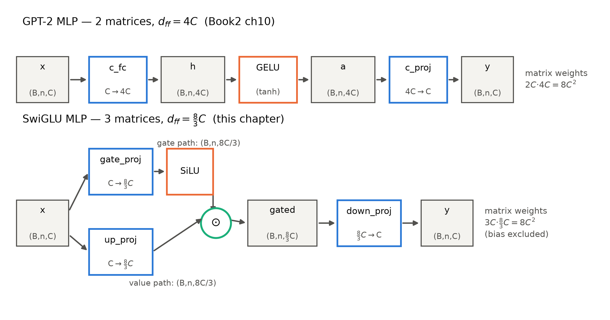
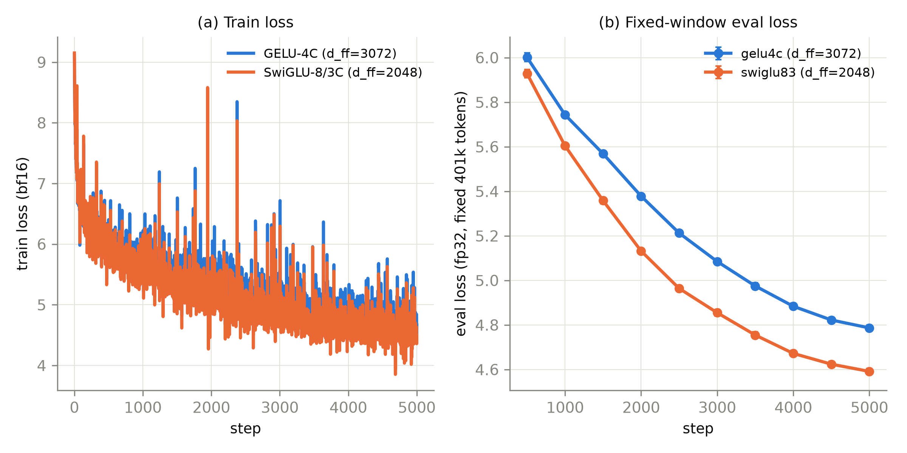
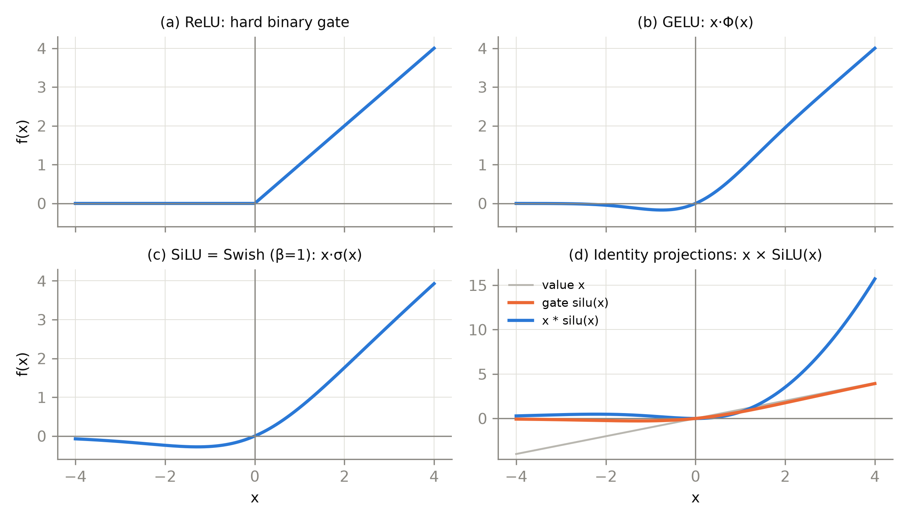

# 第 3 章 SwiGLU：前馈插槽的门控化

## 3.0 开篇：从全书到这里

上一章保持pre位置，把LayerNorm换成了RMSNorm：不再显式中心化，每处少了一组偏置参数。数学上保留了什么、实验中付出什么代价，现在也有了分别核对的依据；full单种子损失差超出原设带宽，因此不能笼统称为无损替换。接着看导览图0.1，注意力和前馈仍待改造。本章先动前馈：已经有了“升维—非线性—降维”，为什么还要增加一条独立的门支路？

具体要回答三个问题。其一，GPT-2 的 `c_fc→GELU→c_proj` 已经从ReLU改成了平滑的GELU，独立的门支路增加了哪种计算关系？其二，门控前馈从两个矩阵变成三个矩阵，参数凭空多出一半？不——LLaMA 的 $d_{ff}$ 从 $4C$ 缩到 $\tfrac{8}{3}C$，这项参数对齐是本章的重点，也是「换组件=换账本」这一方法的第一次完整实践。其三，在我们自己的 49.6M 小机器上、主矩阵预算对齐且偏置差另计时，这次改造是否值得——一条自己跑出来的消融曲线作答。产出三样：一件换好的 FFN 插槽（code/ch03/swiglu.py 的 `SwiGLUMLP`）、一本 $8C^2$ 参数账、一份两臂对照实验。

本章结束时，四格插座换完两格，单轨主线（Book2 的 GPT-2 底座逐格换装）已讲完四项中的两项。接下来最难处理的部分——位置信息——留给下一章。

> **最小背景栏**：本章默认你已读过 Book1相关章节（FFN 是逐位置独立的子层：$C\to 4C\to C$、4:1 扩展率、参数与计算的双重大户；以及门控与残差可以组合的说明）与Book1第1章1.5节（ConvS2S 在同一位置用门控线性单元 GLU 的公式）；Book2 第 4 章（GPT-1/2 差异清单里的 GELU，`gelu_new` tanh 近似）与第 10 章（`model.py` 三插槽 Block——`ln_1/attn/ln_2/mlp`，本章改造的基础与待替换组件都在其中）。3.6 节的实验协议直接沿用 Book2 第 8 章的五件套与固定窗 eval 噪声口径。符号约定：残差流宽度记 $C$（即各论文的 $d$ / $d_{model}$，LLaMA 源码的 `dim`），FFN 中间维记 $d_{ff}$（HF config 的 `intermediate_size`）。

## 3.1 一笔六年的旧账

改动之前，先回看 Book1 留下的问题。第 6 章讲 FFN 子层时埋过一句：

> 「FFN 后续还会挨两刀——先换激活、再连整体结构一起换，门控思想在 GLU 里已经冒头——账记在 Book3 与 Book4，此处只留一个地址，不展开机制。」【证据等级：Book1相关章节成稿直引】

本章兑现第一次改造。而「门控思想在 GLU 里已经冒头」这半句，背后是六年的发展过程：2016 年 12 月，FAIR 的 Dauphin 等人提出门控线性单元（Gated Linear Unit，GLU），用在做语言建模的**卷积**网络里，门控卷积在 Google Billion Word 上超过了同一量级的 LSTM【证据等级：官方论文 1612.08083 v3 §5】；2017 年 5 月，同期的 ConvS2S 把 GLU 装进机器翻译的卷积块——Book1相关章节那台翻译机的直接对手用的正是它。一个月后 Transformer 登场，FFN 却用了「裸 ReLU」：这说明当时Transformer采用了另一种前馈形式，不能从中推断作者因为残差而放弃门控。门控与残差可以同时存在：前者调制特征，后者提供相加路径；原论文没有给出把二者视为互斥方案的论证。

三年后的 2020 年 2 月，Google 的 Shazeer（2017 原典八作者之一、Transformer共同作者之一）将 GLU 家族引入 Transformer 的 FFN，这就是本章的主角论文《GLU Variants Improve Transformer》；又两年，PaLM 在旗舰规模的模型中采用 SwiGLU；2023 年 2 月，LLaMA 将它作为开源模型结构的标准组件【证据等级：官方论文 2002.05202 v1 / 2204.02311 v4 / 2302.13971 v1】。LLaMA 的架构一节只有一句话交代这件事，值得逐字读：

> 「SwiGLU activation function [PaLM]. We replace the ReLU non-linearity by the SwiGLU activation function, introduced by Shazeer (2020) to improve the performance. We use a dimension of $\frac{2}{3}4d$ instead of $4d$ as in PaLM.」【证据等级：官方论文 2302.13971 v1 §2.2】

两件事都在这句里：换激活（SwiGLU），缩维度（$\frac{2}{3}\cdot 4d$）。还有一件这句话**没有**提到的事：本书所核的LLaMA1/2/3报告中，未见归一化函数或前馈激活的单独替换对照【来源：三报告架构与实验部分，既有复核记录P-14】。SwiGLU 的证据链在 Shazeer 2020 和后续采用者那里，不在 LLaMA 自家实验——这个证据分工先记住，3.3 节核对原始证据，3.6 节给出本书的实验。

## 3.2 GLU：让数据自己决定门开多大

先建立画面，再谈公式。GPT-2 的 FFN 子层是一条流水线：特征（残差流送来的 $(B,n,C)$）升维到 $(B,n,4C)$，再由 GELU 逐元素进行非线性变换，再降维回 $(B,n,C)$ 送回去。GLU 把子层改成**两条支路**：一条是候选内容——$x$ 经投影 $V$ 得到，不经过激活；另一条是门支路——同一个 $x$ 经投影 $W$，再过一个 sigmoid，输出压到 $(0,1)$ 之间的「开合度」。两条支路逐元素相乘：门开到 0.9，这个通道的值就保留九成；门关到 0.05，就只保留 5%。为看清两条支路，先省略偏置；原GLU也可以在两次投影后分别加偏置。这里采用本章后续FFN的无偏置记法：

$$
\mathrm{GLU}(x)\;=\;\sigma\!\left(xW\right)\ \odot\ xV
\tag{3.1}
$$

| 符号 | 含义 | 形状 |
|---|---|---|
| $x$ | 输入（残差流一段） | $(B,n,C)$ |
| $W$ | 门支路投影（原论文记号） | $(C,d_{ff})$ |
| $V$ | 值支路投影（保持线性） | $(C,d_{ff})$ |
| $W_{\rm gate},W_{\rm up}$ | 完整SwiGLU中的两组升维投影 | 各$(C,d_{ff})$ |
| $W_{\rm down}$ | 将乘积映回残差宽度 | $(d_{ff},C)$ |
| $\sigma$ | sigmoid，$\sigma(z)=1/(1+e^{-z})$ | 逐元素 |
| $\odot$ | 逐元素乘 | $(B,n,d_{ff})\odot(B,n,d_{ff})\to(B,n,d_{ff})$ |

这表示：每个中间通道都有自己的调节系数，这个系数并非人为指定（不是 ReLU 的「正数全开」也不是 dropout 的「随机关」），而是由输入经投影$W$计算出来的。训练通过损失梯度更新$W$，推理时$W$固定，不同输入仍会产生不同门值。可以用手算理解门值的大小：$\sigma(0)=0.5$（数值上保留一半，不表示概率意义的“不确定”），$\sigma(2)\approx 0.88$（强烈放行），$\sigma(-2)\approx 0.12$（强烈抑制），$\sigma(6)\approx 0.998$（几乎全开）——一个连续、可微、逐通道的阀门。再往子层里走一步，拿 $d_{ff}=3$ 的玩具档算一遍乘法：设某位置的值支路输出 $\boldsymbol{v}=(0.7,\,-1.5,\,3.0)$、门支路输出 $\boldsymbol{g}=(2,\,-2,\,0)$，则门控后的结果为 $\sigma(\boldsymbol{g})\odot\boldsymbol{v}\approx(0.62,\,-0.18,\,1.50)$——第一个通道的值保留近九成，第二个压到一成出头（负值连同符号一起缩），第三个恰好保留一半。这个例子显示了逐元素乘法怎样调节值支路；完整模块还需两组学习到的投影，把$(B,n,C)$分别映为两个$(B,n,d_{ff})$张量。（记号考据一句：Dauphin 原式把 sigmoid 挂在第二支路、卷积语境写作 $(X*W+b)\otimes\sigma(X*V+c)$，Shazeer 2020 挪到第一支路——两文互为镜像、功能等价；本章此后统一用 HF 命名：过激活的门支路叫 **gate**，线性支路叫 **up**。）

**独立门支路让同一特征的强弱由另一组投影决定；梯度也因此出现两条不同路径。**这解释了结构增加了什么自由度，却不直接证明它必然优于GELU。先看第 $j$ 个中间通道，使用列向量输入 $x\in\mathbb R^C$ 表达局部微分：

$$a_j=w_j^\top x,\qquad b_j=v_j^\top x,\qquad
z_j=\phi(a_j)b_j.$$

这里 $w_j,v_j\in\mathbb R^C$ 是两组投影的第 $j$ 个方向，$\phi=\sigma$ 对应GLU。乘积法则给出

$$dz_j=b_j\phi'(a_j)w_j^\top dx+\phi(a_j)v_j^\top dx,
\quad\nabla_xz_j=b_j\phi'(a_j)w_j+\phi(a_j)v_j.\tag{3.2}$$

第一项经过门函数导数，第二项经过线性值支路。sigmoid门接近1时，第二项不会额外乘上接近0的sigmoid导数，但仍要乘 $v_j$，再经输出投影和其他网络层；它不是残差层的恒等项 $I$，不能称为“无损梯度高速路”。门接近0时，这条路也会受抑制。

如果为了观察标量形状特意令两支路都为同一个 $x$，才得到 $d[x\sigma(x)]/dx=\sigma(x)+x\sigma'(x)$。实际GLU中两套投影不同，不能拿这个特殊式子代替整个网络的Jacobian。门控tanh单元（GTU）把值支路也压到$(-1,1)$：标量写作$\tanh(a)\sigma(b)$。当tanh饱和时，它的导数接近0；GLU保留线性值支路，少了这一个可能衰减梯度的因子。这是Dauphin论文讨论的梯度结构差异，并非任意深度稳定的保证。

再看不带激活的Bilinear变体。它的一个通道是

$$z_j=(w_j^\top x)(v_j^\top x)
=\sum_{r=1}^{C}\sum_{t=1}^{C}w_{rj}v_{tj}x_rx_t.\tag{3.8}$$

逐项展开能看见特征之间的乘积：输入第 $r$ 与第 $t$ 个分量共同影响结果。把输出写为 $y=\sum_j z_jd_j$，其中 $d_j\in\mathbb R^C$ 为输出投影方向，就能把机制与整机连接起来：每个位置先生成多组乘性交互，再组合成要加回残差流的修正。SwiGLU在这种结构上对门支路使用SiLU，仍不读取其他token；跨位置的信息来源是前面的注意力。

从这个视角回看 ReLU，可以得到另一种解释——Dauphin 写道，ReLU 单元可以看作门控单元的简化：$\mathrm{ReLU}(X)=X\odot\mathbb{1}[X>0]$，门「取决于输入的符号而激活」【证据等级：官方论文 1612.08083 v3 §5.2】。也就是说 ReLU 不是「没有门」，而是一枚**二值硬门**：只有全开、全关两档，开合完全由符号决定，判定规则本身固定，但输入通常来自可学习投影，投影参数仍可训练。于是激活的演进有了一个统一的坐标系：从硬门到软门，从由同一投影值决定缩放系数，到另设一组投影来计算系数。GLU在所测卷积网络中取得了较好结果：在参数量可比较、经过交叉验证的设置下（原话特意声明 "for fair comparison, we carefully cross-validate models with a comparable number of parameters"），在GBW约100小时的比较预算内，GLU比ReLU低约5个困惑度点；另一组完整模型比较中，GCNN-13 达到 38.1、优于同设置 LSTM 的 39.8；更大的 GCNN-14B 用 8 张 GPU 训两周到 31.9，对照的大 LSTM 用 32 张 GPU 三周才到 30.6——GPU数量是四分之一，按卡数乘周数粗计为六分之一GPU周；输出层近似等设置也不同，不能将其直接解释为同任务实现快了六倍【证据等级：官方论文 1612.08083 v3 §5.2 与 Tables 2/3】。这些结果给出了卷积语言模型中的经验证据。把同一结构用于Transformer仍需重新比较，这正是下一节的任务。

## 3.3 变体比较：GEGLU 与 SwiGLU 的较好结果

将 GLU 引入 FFN 时，Shazeer 2020 采用了系统比较的方法：既然门支路上的非线性可以是任何函数，就逐一尝试各种激活函数。下面列出这些门控变体（记号承式 (3.1)，激活都挂在 $W$ 支路上）：

$$
\begin{aligned}
\mathrm{GLU}(x)&=\sigma(xW)\odot xV, &\quad \mathrm{Bilinear}(x)&=(xW)\odot(xV),\\
\mathrm{ReGLU}(x)&=\max(0,\,xW)\odot xV, &\quad \mathrm{GEGLU}(x)&=\mathrm{GELU}(xW)\odot xV,
\end{aligned}
\tag{3.3}
$$

第五种是本章主角：在门支路上使用 SiLU，并组成完整的 FFN。

$$
\mathrm{FFN}_{\mathrm{SwiGLU}}(x)\;=\;\Big(\mathrm{Swish}_{1}\big(xW_{\text{gate}}\big)\ \odot\ xW_{\text{up}}\Big)\,W_{\text{down}}
\tag{3.4}
$$

式 (3.4) 表示：升维两次（gate 与 up 各一次，$(B,n,C)\to(B,n,d_{ff})$ 各一份），门支路过 Swish 后与 up 支路逐元素相乘，再降维回 $(B,n,C)$——三次投影、一次乘法，这概括了三矩阵FFN的主要连接；SiLU本身还包括sigmoid与乘法，不能把图上的一次乘法当总运算量。门上的非线性是

$$
\mathrm{Swish}_{\beta}(x)\;=\;x\,\sigma(\beta x),\qquad \beta=1\ \text{时即 SiLU（torch 的 F.silu）}.
\tag{3.5}
$$

这表示：先算一个开门倾向 $\sigma(\beta x)$（取$\beta>0$时，增大它会让零点附近的过渡更陡），再把它当系数乘回 $x$ 自己——Swish 是「自己给自己当门」的函数，这正是 3.7 节「自门」一词的出处。这里有三点需要说明。其一，Swish工作通过自动搜索研究激活函数（Ramachandran et al. 2017 用搜索找激活函数，arXiv:1710.05941——「用算力换结构」时代的注脚），$\beta=1$ 的特例 SiLU 才是工程默认；它与 Book2 第 4 章 GPT 用的 GELU(tanh 近似) 长得很像（3.7 节的四景图里两者并排），都是「零点附近软过渡、负半轴留一点小尾巴」——在SwiGLU中，SiLU的输出继续作为系数去乘另一条投影；在普通SiLU-FFN中则直接进入降维投影。差别在计算连接，不能只看激活曲线。其二，包装成 FFN 时**去掉了 bias**——Shazeer 注明「Following the T5 codebase, we use a version with no bias」，本章所据LLaMA配置采用无偏置版本，HF实现则由配置控制【证据等级：官方论文 2002.05202 v1 §2】。其三，有一点需要特别注意：SiLU 并不严格落在 $(0,1)$——它正值区可以超过 1、负区有一个 $-0.28$ 的浅谷，所以 SwiGLU 的「门」是广义的调制旋钮，不是严格的阀门（3.7 节四景图的 (d) 栏里门曲线清晰越过 1）。

变体介绍完后，再看 Table 1 的实验结果：T5-base 骨架（$C=768$、12+12 层），$d_{ff}$ 从 3072 缩到 2048（参数预算对齐，账在 3.4 节细算），C4 去噪目标预训练——6.5 万步短跑（4 个种子报标准差）与 52.4 万步长跑两档：

**表 3.1** GLU变体族预训练对数困惑度（heldout log-ppl，越低越好；重排自 Shazeer 2020 Table 1）

| FFN 变体 | 65,536 步（4 短跑 std） | 524,288 步 |
|---|---|---|
| FFN_ReLU（baseline） | 1.997 (0.005) | 1.677 |
| FFN_GELU | 1.983 (0.005) | 1.679 |
| FFN_Swish | 1.994 (0.003) | 1.683 |
| FFN_GLU | 1.982 (0.006) | 1.663 |
| FFN_Bilinear | 1.960 (0.005) | 1.648 |
| FFN_ReGLU | 1.953 (0.003) | 1.645 |
| FFN_GEGLU | **1.942** (0.004) | **1.633** |
| FFN_SwiGLU | 1.944 (0.010) | 1.636 |

【证据等级：官方论文 2002.05202 v1 §3.2 Table 1】

表中写的是困惑度的对数。对相同目标位置，平均负对数似然为$\ell=-\frac1M\sum_t\log p(y_t\mid\text{条件})$，困惑度为$e^\ell$，所以log-ppl就是这个平均损失；$1.633$不是困惑度本身。只有目标、分词和评价数据相同，差值及相应困惑度比才可直接解释。

阅读这张表时，需要分清三个层次。第一层：**本表长训结果中，门控变体的损失都低于非门控变体**——长跑列里，三个非门控变体的 log-ppl（1.677–1.683）均高于五个门控变体的 log-ppl（1.633–1.663），两族的数值范围没有重叠；门控族里最弱的一档恰是挂裸 sigmoid 的 FFN_GLU（1.663，即式 (3.1) 的原型），仍优于全部非门控，这支持继续考虑门控结构，但不能推广为所有任务、预算和初始化下都更优。

第一层里还藏着一项更有力的补充观察：Bilinear——门支路不使用激活函数，纯 $(xW)\odot(xV)$ 裸乘法——长跑 1.648 仍优于全部非门控变体；Dauphin 那边也有同款观察（纯 bilinear 远好于线性网络，GLU 再好一截）【证据等级：官方论文 1612.08083 v3 §5.3】。连「没有门函数的门」都赢过了精心设计的激活，支持继续研究乘性结构的作用；它没有把收益严格分解为“乘法贡献多少、门形状贡献多少”——这为 3.2 节的梯度机制解释补了一层实证。

第二层：**GEGLU与SwiGLU给出表中较低结果**（长训1.633与1.636）；短训四种子的标准差不能直接当成长训差值的显著性检验，论文原话也只是「The GEGLU and SwiGLU variants produce the best perplexities」——并不存在「SwiGLU 严格最优」的论文结论。

第三层更要紧：**下游微调噪声大**。GLUE/SuperGLUE/SQuAD上各变体互有胜负。这里每个完整预训练模型只做一次混合任务微调，表中是在开发集上按任务选出的最佳检查点成绩，并非多种子平均；原T5的标准差另列，不能移作这些变体的误差。（论文原话承认「While the results are noisy, the new GLU-variants perform best on most of the tasks」；SuperGLUE 均分 SwiGLU 74.56 最高，GLUE 均分却是 ReGLU 84.67）【证据等级：官方论文 2002.05202 v1 §3.3 Tables 2-4】。工业界（PaLM、LLaMA等模型）最终选了 SwiGLU 而非数字上略好的 GEGLU——这张表没有给出“SwiGLU优于GEGLU”的判定，因而不能据此替采用者补写唯一决策原因；采用事实与具体选择理由应分开。论文作者对「为什么有效」的态度，在结尾一句话里表达得很直接：

> **【考据框】** Shazeer 2020 全文最后一句："We offer no explanation as to why these architectures seem to work; we attribute their success, as all else, to divine benevolence."（对这些架构为何有效，我们不提供解释；它们的成功，一如其他一切，归于神的恩典。）【证据等级：官方论文 2002.05202 v1 §4 逐字】——论文给出了结构定义与实验结果，但没有给出解释效果优势的理论。这不是作者的怠慢，而是这类「经验组件」的常态：先有证据，后被采用，机制解释仍然缺乏。对本册的方法论寓意是：证据等级栏里「组件论文的表格」与「机制理解」要分开记账——我们展开了乘性结构的两条梯度路径（3.2 节），但那是**候选解释**，不是论文对较好结果给出的解释。

## 3.4 2/3 隐藏维：把参数账算平

门控虽有收益，但增加第三个矩阵也有代价。两矩阵FFN的主矩阵参数为$2\cdot C\cdot 4C$；门控后变三个投影，若 $d_{ff}$ 维持 $4C$，参数涨 50%——旗舰模型也许可以承担，但这样无法保持比较中的参数预算不变，也不符合 LLaMA 的预算选择。Shazeer 的解法一句话：「All of these layers have three weight matrices, as opposed to two for the original FFN. To keep the number of parameters and the amount of computation constant, we reduce the number of hidden units $d_{ff}$ … by a factor of 2/3.」【证据等级：官方论文 2002.05202 v1 §2 逐字】。展开成手算：

$$
\underbrace{2\cdot C\cdot 4C}_{\text{两矩阵，}d_{ff}=4C}\;=\;\underbrace{3\cdot C\cdot \tfrac{8}{3}C}_{\text{三矩阵，}d_{ff}=\frac{8}{3}C}\;=\;8C^{2}
\tag{3.6}
$$

这表示：矩阵从两个变三个，那把每个矩阵的宽度缩到原来的三分之二——三乘以三分之二等于二，仅计无偏置投影矩阵时，参数与每token乘加对数回到 $8C^2$；若一次乘与一次加各算一个FLOP，对应约 $16C^2$ FLOPs。激活函数、逐元素乘和执行开销另计（Book1相关章节的账本二里 FFN 每位置 $8d^2$ 次乘加，正是这里的数）。拿本章实验档手算一遍：$C=768$，两矩阵 $d_{ff}=3072$，参数 $2\times 768\times 3072=4{,}718{,}592$；三矩阵 $d_{ff}=2048$，参数 $3\times 768\times 2048=4{,}718{,}592$——逐位相等，这就是 3.6 节实验选 768 宽的原因（$\tfrac{8}{3}\times 768=2048$ 整除，零误差）。

但还要同时核算另一项成本：**主矩阵预算可对齐，激活与实际执行成本仍可能变化**。两矩阵的中间激活是 $(B,n,4C)$ 一份；三矩阵要同时持有 gate 与 up 两份 $(B,n,\tfrac{8}{3}C)$，仅这两份投影结果合计 $\tfrac{16}{3}C\approx5.33C$，比一份 $4C$ 宽结果多约三分之一。实际反向保留哪些激活、是否融合或重算决定峰值内存，不能把这个局部计数当成整机显存必涨1/3。

$\tfrac{8}{3}C$ 大多不是整数，落地要取整，LLaMA 的取整方式写在官方参考实现里，三行代码值得逐行读（Meta `llama/model.py`，`FeedForward.__init__`）：

```python
hidden_dim = int(2 * hidden_dim / 3)              # hidden_dim 初值 = 4*dim → 8C/3（向零取整）
if ffn_dim_multiplier is not None:                # Llama-2 70B 起为 1.3（见下）
    hidden_dim = int(ffn_dim_multiplier * hidden_dim)
hidden_dim = multiple_of * ((hidden_dim + multiple_of - 1) // multiple_of)  # 向上取整到 multiple_of 倍数
```

写成与三行代码一致的式子：$m$是放大系数（不设置时为1），$q$是对齐倍数（默认256）：

$$
h_0=\lfloor8C/3\rfloor,\quad h_1=\lfloor m h_0\rfloor,\quad d_{ff}=q\left\lceil h_1/q\right\rceil
\tag{3.7}
$$

这表示：先将$8C/3$向下取整，再乘放大系数并再次向下取整，最后向上对齐到$q$的倍数；$q$默认256，表中的部分大模型取4096。每一步次序都属于公式，不能省成一次四舍五入。`multiple_of=256` 的注释原文只有一句："make SwiGLU hidden layer size multiple of large power of 2"——$256=2^8$；为什么偏爱 2 的幂，注释没展开，工程通行理解是维度对齐对硬件与切分更友好，此为惯例而非论文结论，如实记。这个公式能不能真的复现各家 config？我们把 LLaMA1/2/3 七档全部复算一遍（code/ch03/swiglu.py 的 `llama_d_ff`，运行输出逐档 OK）：

**表 3.2** d_ff 七档对账（复算公式 (3.7) vs config 实测）

| 模型 | $C$ | multiplier | multiple_of | 复算 $d_{ff}$ | config 实测 | $d_{ff}/C$ | 证据等级 |
|---|---|---|---|---|---|---|---|
| LLaMA-1 7B | 4096 | — | 256 | 11008 | 11008 | 2.69 | config 逆向（HF 镜像） |
| LLaMA-1 13B | 5120 | — | 256 | 13824 | 13824 | 2.70 | 同上 |
| LLaMA-1 33B | 6656 | — | 256 | 17920 | 17920 | 2.69 | 同上 |
| LLaMA-1 65B | 8192 | — | 256 | 22016 | 22016 | 2.69 | 同上 |
| Llama-2 70B | 8192 | 1.3 | 4096 | 28672 | 28672 | 3.50 | config 逆向（mult 为社区引述，见注） |
| Llama-3 8B | 4096 | 1.3 | 256 | 14336 | 14336 | 3.50 | 同上 |
| Llama-3 70B | 8192 | 1.3 | 4096 | 28672 | 28672 | 3.50 | 同上 |

【证据等级：复算=本书实验（CPU，2026-10，7/7 吻合）；config 值=config 逆向（HF 公开镜像）；Llama-2 70B 的 `multiple_of=4096` 与 `ffn_dim_multiplier=1.3` 为社区转述官方 params.json（datascience.SE 与 llama.cpp PR 双源一致），引用须注明】

给定表中的放大系数与对齐倍数，七档计算结果都与所列配置一致；这不表示仅凭最终宽度能唯一反推出这两个参数。可以看到两项事实。第一，「$\tfrac{8}{3}$」是**配方，而非固定规则**：四档 LLaMA-1 落在 2.69–2.70（取整的痕迹），TinyLlama 甚至是 2.75（5632/2048，config 逆向）；第二，Llama-2 70B 起 `ffn_dim_multiplier=1.3` 把比率抬到 3.5——所列型号采用了不同的参数预算，Shazeer 的「严格 $8C^2$」是对齐实验口径，工程上要的是「差不多这个量级、且是 2 的幂的倍数」。连我们自己的 207M（第 10 章）也会因取整而增加参数：$C=1024\to\tfrac{8}{3}C=2730.67\to 2816=11\times 256$，每层 FFN 参数 $3\times 1024\times 2816=8{,}650{,}752$，比 $8C^2=8{,}388{,}608$ 多 **3.125%**——取整的账，改谁的 config 都要算。

最后看反例。PaLM 同样用 SwiGLU，但明说「The feed-forward size $d_{ff}$ is always $4\times d_{model}$」——不缩，相对同宽、同中间维的无偏置两矩阵FFN，多出50%矩阵参数及主乘加对数，实际耗时另计；它的修改列表还专门补了一句「Note that this does require three matrix multiplications in the MLP rather than two…」【证据等级：官方论文 2204.02311 v4 架构修改列表与模型规格】。把两种哲学放到 7B 档算一算更清楚：LLaMA-1 7B 每层 FFN 参数 $3\times 4096\times 11008\approx 135.3\text{M}$（32 层共约 4.33B）；若按 PaLM 式不缩，同样的三矩阵要 $3\times 4096\times 16384\approx 201.3\text{M}$——每层多 66M、全模型多约 2.11B，总量膨胀三成。同一种激活函数，对应两种预算选择：LLaMA 的立场是「参数预算刚性，同预算内换更好的结构」（式 (3.6) 的恒等式就是它的尺）；PaLM 的立场是「采用不同的中间维预算」（论文披露了这个配置，没有证明它是因“不差钱”或切分方便而选择）。仅凭这两份配置不能判断谁普遍更优。**组件选择要结合预算判断**，先明确预算约束，再判断组件的价值。请记住这一判断方法，第 8 章组装对照上还要用它。

## 3.5 改装第二例：MLP 插槽换装

参数账已经算清，现在回到模型实现。改造对象仍是 Book2 第 10 章 `model.py` 的三插槽 Block：`x = x + attn(ln_1(x)); x = x + mlp(ln_2(x))`。上一章动了 `ln_1/ln_2`（和 `ln_f`），这一章只动 `mlp` 一格——注意力原封不动，等第 6 章。对 Book2 的 `MLP`（`c_fc: C→4C`、GELU(tanh)、`c_proj: 4C→C`，均带 bias）的 diff 一共三条：

1. **矩阵结构**：`c_fc/c_proj` 两矩阵 → `gate_proj/up_proj/down_proj` 三矩阵（$C\to d_{ff}$、$C\to d_{ff}$、$d_{ff}\to C$），全部无 bias——GPT-2 MLP 的 `c_fc/c_proj` bias 也一并拔掉（$C=768$ 档全模型少 23,040 个参数，-0.05%，随参数账如实报）；
2. **中间维**：$d_{ff}=4C\to\tfrac{8}{3}C$（3072→2048），无偏置主矩阵的参数与乘加对数恒等（式(3.6)）；
3. **门上的非线性**：`gelu_new`（GELU tanh 近似，Book2 第 4 章的差异清单）→ `F.silu`（$\mathrm{Swish}_{\beta=1}$，式 (3.5)）——注意激活**只挂在 gate 支路**，up 支路保持线性，这正是「门控」区别于「逐层激活」的结构特点。

替换后的计算流程见图 3.1：上排是 GPT-2 的两矩阵流水线，下排是三矩阵门控流程——同一份输入 $(B,n,C)$ 分两路升维、SiLU 门控、逐元素乘、压回。逐运算的形状流转列为表 3.3（正文讲解与代码注释共用这份账）：



图 3.1 门控前馈的计算流程：GPT-2 两矩阵 MLP 与 SwiGLU 三矩阵 MLP 对照（自绘示意级；每个张量框标注形状，$d_{ff}=4C$ 对 $d_{ff}=\tfrac{8}{3}C$，两种结构的主矩阵权重同为$8C^2$；GPT-2偏置另计）

**表 3.3** SwiGLU-MLP 形状流转表（$B$=批，$n$=序列长，$C$=残差流宽，$d_{ff}$=中间维）

| 步骤 | 运算 | 输入形状 | 输出形状 | 说明 |
|---|---|---|---|---|
| 1 | `gate_proj` | $(B,n,C)$ | $(B,n,d_{ff})$ | 门支路（过 SiLU 后作门控系数） |
| 2 | `up_proj` | $(B,n,C)$ | $(B,n,d_{ff})$ | 值支路：候选内容，保持线性 |
| 3 | SiLU（式 (3.5)） | $(B,n,d_{ff})$ | $(B,n,d_{ff})$ | 逐元素，$x\sigma(x)$ |
| 4 | $\odot$ 逐元素乘 | $(B,n,d_{ff})\times(B,n,d_{ff})$ | $(B,n,d_{ff})$ | 门控：值×门 |
| 5 | `down_proj` | $(B,n,d_{ff})$ | $(B,n,C)$ | 压回残差流宽度 |

对应实现代码是本章交付的 code/ch03/swiglu.py（教学重写件），核心五行：

```python
# code/ch03/swiglu.py 的 SwiGLUMLP.forward
def forward(self, x):
    gate = self.gate_proj(x)          # (B,n,C) -> (B,n,d_ff)：门支路原始输出
    up = self.up_proj(x)              # (B,n,C) -> (B,n,d_ff)：值支路（线性，被门调制）
    gated = F.silu(gate) * up         # (B,n,d_ff)：SiLU(gate) 作门控系数乘上值（式 (3.4)）
    return self.down_proj(gated)      # (B,n,d_ff) -> (B,n,C)
```

换装件按全书插槽 import 契约交付：类名 `SwiGLUMLP(cfg)`、参数键位与 HF 的 `LlamaMLP` 逐一同名（`gate_proj/up_proj/down_proj`，无 bias），`cfg` 只读 `hidden_size/intermediate_size` 两个字段。验收是两道 CPU fp32 对拍，实测都过：与配套组件库对应实现 `00-feasibility/llama_slots.py` 的 `SwiGLU` 同权重前向 **max|Δ|=0.000e+00（逐位一致）**；与 HF transformers 5.18.0 的 `LlamaMLP` 同 config 同权重 `load_state_dict(strict=True)` 直搬，**max|Δ|=0.000e+00、argmax 一致率 1.0000**【证据等级：本书实验（CPU，2026-10）】。零差异不奇怪——两边本来就是相同的计算连接，对拍还核对形状、权重排列和数值路径；相同数学公式本身不保证任意设备与dtype逐位相等。第10章会导入这一组件；映射HF权重时，还要同时匹配三个矩阵的形状、排列、激活与偏置设置。本轮在torch2.10.0+cpu、transformers5.14.1下也完成同权重CPU对拍，最大差为0；这是当前局部验证，与上列历史版本读数分开记录。

> **【实现对照框】** HF transformers 5.18.0 `modeling_llama.py` 的 `LlamaMLP`（L163-176）：`down_proj(act_fn(gate_proj(x)) * up_proj(x))` 一行即全部，与式 (3.4) 逐符号对应；`act_fn` 由 config 的 `hidden_act="silu"` 字符串经 `ACT2FN` 字典延迟实例化（`F.silu` 与 `nn.SiLU()` 数值等价）；bias 由 `mlp_bias` 字段控制、默认关。一个 config 逆向的命名考据：`hidden_act` 只命名**门上的非线性**，三矩阵门控结构本身硬编码在 `LlamaMLP` 类里——所以光读 config 说得出「用了 silu」，说不出「这是 SwiGLU」。字段未能说明的结构，需要从实现中读取，这是第 5 章 config 反推法要正式处理的边界。

## 3.6 模块消融：同预算下的一次改造

组件已替换，现在回答开篇第三个问题：这项改造是否值得。实验设计的第一个教学点就在「怎么比」——**若问题是同参数预算下哪个结构更好，就需要对齐参数；若研究的是其他约束，也可以选择同计算量或同时间，但必须明确问题**。若拿 GELU-4C（$d_{ff}=3072$）对 SwiGLU-4C（$d_{ff}=3072$）比，SwiGLU 赢了分不清是门控好还是参数多 50% 的功劳；若对 SwiGLU-$\tfrac{8}{3}C$ 比而不做参数核对，取整盈余又会混进来。所以主实验选 $C=768$ 的**零误差档**：$3\times 768\times 2048=2\times 768\times 3072=4{,}718{,}592$ 逐位相等（脚本 assert 锁死，盈余 0.0%）；另留一个 $C=512$ 的 sanity 档演示「反面教材」：$\lceil\tfrac{8}{3}\cdot 512\rceil_{256}=1536$，三矩阵参数反而**盈余 +12.5%**——参数不对齐时「谁赢」没有单变量意义，这正是主实验宁可用更宽的 768 档的原因。（探针期曾按 128 倍数规则取整到 1408，正式消融统一到官方 256 倍数规则——探针数字只作历史记录，不进正文。）

这次消融重新从GPT-2底座构造两臂，保留LayerNorm；它不是接着第2章RMSNorm训练检查点再加SwiGLU。这样才能单独观察本章前馈替换这一组改动，四组件合装留给第10章。协议与第2章相同：两臂从同一份 GPT-2 底座出发（同种子、同 RNG 序列，注意力/归一化/嵌入初始权重逐位相同），`gelu4c` 臂保留原装 MLP，`swiglu83` 臂只换 `mlp` 插槽；换装件重打 GPT-2 口径初始化（gate/up的正态初始化标准差为$0.02$，down的标准差为$0.02/\sqrt{2L}$，与被换的 `c_proj` 同待遇）；这仍同时改变前馈结构、激活、偏置与相应初始化，不宜将差值只归因于一种梯度通路。

这里需要区分两种方差控制。ConvS2S为sigmoid-GLU推导了专属初始化：在零均值、独立近似与小方差等条件下，门接近$1/2$，乘积输出方差近似成为值支路的$1/4$，因此给出权重方差$4/n_l$，即标准差$\sqrt{4/n_l}$；其中$n_l$为该卷积层的扇入数【来源：ConvS2S v3附录A.1】。本书则沿用GPT-2底座对残差出口的深度缩放约定；二者关注的计算位置不同，不能用前一推导证明后一配方已为SwiGLU最优化。

训练沿用 Book2 五件套（AdamW 0.9/0.95、wd 0.1、clip 1.0、余弦、warmup 100），两臂按步号取**完全相同的数据批**；eval固定抽49批、每批16个512位置窗口，共401,408个预测位置，使用fp32前向；批间SE约0.012只是固定窗分组后的粗估计，相关或重叠窗口不保证独立。历史判据是在fast结果已知、full尚未启动时登记的，其中保留了“小档可能只出现很小差距”的负结果预案。$0.02$ nat沿用第2章的经验差值带，并没有经过覆盖训练种子方差的校准；带内不证明等效，带外也不自动意味着统计显著。更不能从某个小档差距小就推导“组件收益必随规模显现”。

论文长档的$1.677-1.636=0.041$来自524,288步，而非65,536步短档。其每批128例，每例输入512位置、目标114位置，分别约343.6亿输入位置和76.5亿目标位置；本章5000步为$5000\times16\times512=40{,}960{,}000$个下一词预测目标。前者是编码器—解码器的填空任务，后者是单塔续写；预算相差很大，但两种位置计数也不能混成同一种训练token后直接比较效应量。【来源：GLU Variants v1 §3.2】

fast 档（1000 步，lr 日程按 1000 步收尾）得到的数据已经超出0.02这一差值带；由于登记时fast已知，不能再把它当作对事前盲设预期的独立检验：两臂终评 **gelu4c 5.6795±0.0125 vs swiglu83 5.5428±0.0118**，原报告差值**0.1366 nat**（显示的四位小数直接相减为0.1367，末位应按原报告保留）——超出0.02的经验差值带，方向与论文一致（门控更低）；且差距随训练放大（500 步中途差 0.076 → 1000 步 0.137）【证据等级：本书实验（MPS bf16 训练/fp32 eval，2026-10）】。

full档（5000步、41M token，两臂同日程退火）给出更长训练记录：**gelu4c 终评 4.7866±0.0134，swiglu83 终评 4.5914±0.0134，差 0.1952 nat**——约为原差值带宽的9.8倍，方向仍与论文一致；两臂初始 loss 9.13–9.15（≈$\ln 8192$ 加初始化方差项）、全程无发散、无断点续跑，这些健康指标未见异常，但不足以证明所有实现与优化细节都正确【证据等级：本书实验（MPS bf16 训练/fp32 eval，2026-10，独占 MPS 窗口）】。轨迹比终值更有信息量：差距从 500 步的 0.073 一路放大到 2500 步的峰值 0.249，随余弦退火收尾小幅收窄到 0.195——在每500步记录的评估点上均未落回带内；未测的中间时刻不能由连线断定。两臂的训练与固定窗 eval 曲线见图 3.2，右图所画评估点的单臂SE误差棒分离，但单臂SE不是配对差值的置信区间。



图 3.2 GELU-4C vs SwiGLU-8/3C 消融曲线（自产，full 5000 步，参数对齐档 $C=768$：每层 FFN 矩阵参数 $4{,}718{,}592$ 逐位相等；左=训练损失 bf16，右=固定窗 eval fp32，误差棒=49 批批间 se）【证据等级：本书实验（MPS，2026-10）】

但预案的纪律还要执行最后一步——完整说明实验规格的限制。0.195 这个数**不能**与论文的 0.04 并列成「复现」：本实验是 49.6M 参数、41M token、8k 词表的欠训练小档，论文是 768 宽、数十亿 token、52 万步的旗舰档，数据、词表、目标全不同。这组实验的方向与论文一致，但仍是本模型、数据和单种子下的观察；跨任务或跨规模的方向也需要新的验证。至于「为什么小档的差距反而更大」，诚实的答案是我们不知道——一种候选解释是，在训练不足的阶段，门控的乘性梯度通路（3.2 节）先带来了收益，但单种子证据不足以裁决机制，登记为悬案，留给更高算力的重启实验（第 10 章设计文档）。

速度与内存单列：full 稳态 0.3211 vs 0.3274 s/step（约+2.0%；若要分解原因，还需对投影、激活与访存单独计时），两臂 wall-clock 28.4+29.0 min；旧报告称“MPS峰值增量”的读数为1146→1535；按原脚本实际定义，是每步更新后采样的current_allocated_memory最大值减去训练前基准，除以$2^{20}$，单位应为MiB，不能视为捕获了瞬时训练峰值——激活从 $4C$ 一份变 $\tfrac{8}{3}C$ 两份的空间账（3.4 节），与更多中间激活的解释相容，但总峰值不能由这两份张量直接完全解释【证据等级：本书实验（MPS，2026-10）】。单种子是本协议的边界（丛书规范：单种子+方差讨论替代多种子）：eval的批间SE约0.013仅粗略描述所抽批均值的离散程度，不覆盖优化路径方差；0.195 nat 的差距是它的十五倍，不能由评估SE推断跨训练种子方向不会翻转；「差距的精确数值」应读作本种子本档位的实测，不是总体均值。

## 3.7 收拢：激活演进的两条正交轴

前馈子层动完了，把 ReLU→GELU→SwiGLU 这条演进线收拢一下——它其实不是一条线，是**两条正交的轴**。轴一是**平滑化**：从 ReLU 的硬折角到 GELU 的软过渡，缩放系数从符号判定换成连续的$\Phi(x)$，完整激活为$x\Phi(x)$，零点附近不再有生硬的转折。轴二是**门控化**：可把GELU的$\Phi(x)$理解为由同一特征计算的“自门”，再与独立投影得到的“他门”比较（SwiGLU：门由**另一条带参数的支路**算出，门有了独立的参数和调节作用）。两轴可以拆开评价：原始GLU的sigmoid门本来就是平滑函数；独立投影与激活函数的选择是两项可以分别比较的变化；GELU 平滑，但门止步于「自门」；SwiGLU 站在两轴的交点上——平滑的门函数（SiLU）+ 独立的门支路（$W_{\text{gate}}$）。四幅函数景并排见图 3.3：ReLU 的硬折角、GELU 与 SiLU 形状非常接近的平滑曲线（过渡区与尾部都有数值差异）、以及右下角把「值×门」拆开看的门控乘积——灰线是特征本身，橙线是门，蓝线是门控后的结果。



图3.3 激活函数与一个特殊标量门控例（教学构造，$x\in[-4,4]$）：(a) ReLU 二值硬门；(b) GELU；(c) SiLU（$\mathrm{Swish}_{\beta=1}$）；(d) 特意令两投影均为恒等的标量例：值 $x$、系数 $\mathrm{silu}(x)$ 和乘积；实际SwiGLU的两个投影独立，不能由此图推断其所有输出符号。各子图纵轴范围不同，以容纳(d)中的乘积；例如$x=4$时，SiLU约为3.928，乘积约为15.712。

回到整机：四格插座换完两格——归一化（第 2 章）与前馈（本章），Block 里只剩注意力一格原装（第 6 章动它，且要先把位置的账算了）。每次换装我们都做了同一件事：核对预算、明确一组替换改动、对拍与消融——这套流程本身也是你正在掌握的方法。

## 3.8 本章小结

开篇三问，逐一作答。**凭什么多一条门？**——GLU 把 FFN 的单流水线改成值×门两条支路：门值由输入经学习到的投影计算（式(3.1)），梯度沿门与值两支路回流，值路径免去一个门函数导数但不等于恒等路径（式 (3.2)，对照 GTU 的双路压缩与 ReLU 的二值硬门）；Shazeer 的变体网格系统尝试了不同的门支路激活，门控变体整体取得较好结果、GEGLU与SwiGLU处在较低一组，数值并不并列，也没有长训显著性检验（表 3.1）。

**参数账怎么算平？**——三矩阵缩 $\tfrac{8}{3}$：$3\cdot C\cdot\tfrac{8}{3}C=8C^2$，主矩阵参数与乘加对数相等、两份投影激活的局部计数多1/3，实际内存依实现而定（式 (3.6)）；落地按式(3.7)依次取整、放大并对齐到指定倍数（式 (3.7)，表 3.2 七档复算全中），Llama-2 70B 起更乘 1.3 放大到 3.5 倍率——PaLM 不缩、LLaMA 缩，两种预算哲学都对，取决于账本约束。

**小机器上值不值？**——主矩阵参数完全对齐、总参数因偏置略有差别；限定前馈替换、同批同日程：full 5000 步终评差 0.195 nat（swiglu83 更低，原经验带宽的近十倍；fast 1000 步即达 0.137），方向与论文一致、量级远大于论文档位——档位限定与悬案登记见 3.6 节；速度代价 +2.0%；两份投影激活的局部计数多1/3，实际内存依实现而定；这些开销也在实测中有所体现。零件本体验收也过了：`SwiGLUMLP` 与 llama_slots 对应实现逐位一致、与 HF `LlamaMLP` 零差异。

**带走的心智**：即使忘记具体数字，也请记住三句话。**第一，值与门提供了一种理解前馈变换的视角，不能把所有FFN都定义成同一个门控结构**——从 ReLU 的二值硬门到 SwiGLU 的带参软门，这些视角说明了结构上的区别，性能排序仍须回到具体实验；往后你读任何前馈变体，先找它的门在哪、门由谁决定。**第二，换组件=换账本**——同预算下替换结构，是 LLaMA 组件化的标准做法，$8C^2$ 恒等式是那把尺，取整与 multiplier 是工程中可调整的设置；看到任何新模型的 `intermediate_size`，先算它对 $C$ 的比率，你就知道它站在哪种预算哲学上。**第三，经验先于解释**——取得较好结果的组件，也可能缺少机制论证（divine benevolence），证据等级栏里「表格」与「理解」分开记，这是阅读组件论文时应遵守的基本要求。

到这里，机器的前一半已经现代化：归一化更简了，前馈具备了门控结构。但位置信息方面仍有两个尚未解决的问题——2017 年的正弦公式，和 Book2 那面 1024 行的查表墙（Book1 F6 与 Book2 N2 两笔欠账的主场）。下一章处理最难的一项改动：把位置**转**进注意力里——我们会与Book1的正弦方案比较，并实际替换当前GPT-2入口的1024行学习式位置表；当前机器并没有同时装着这两种位置编码。

> **【欠账】** Book1相关章节埋下的「FFN 后续还会挨两刀」的第二刀：本章已改变前馈内部投影、激活与偏置，FFN仍逐位置把表示映回残差宽度，内部已经从两投影变成三投影——把子层拆成「路由 + 多个专家群」、按 token 挑专家来用、参数不再每次全上这一次改造，属于规模与效率的主线。→ Book4 第 2-5 章

## 3.9 动手验证

在书目录、已激活既有环境时运行；若从外层工作区调用，保留工作区为当前目录并给脚本加书目录前缀。数据与输出默认位于当前目录的log。

```bash
python code/ch03/swiglu.py
python code/ch03/ablation_ffn.py --help
python code/ch03/make_figures.py --only 1,3
```

第一条做CPU组件对拍、参数账和七档宽度复算，打印实际库版本；结果接近只是这些输入与条件下的核验。第三条只画计算图和函数图，另存log；复画历史图3.2必须给真实报告与相邻CSV，使用`--only 2 --report 原报告路径 --historical`，不能从终评值补造训练轨迹。

有原语料及相应设备后，才运行训练：`--steps 1000 --out-name 新fast名称`或`--steps 5000 --out-name 新full名称`；历史MPS两臂耗时约12分钟与57分钟，不是当前设备承诺。`--cells sanity512`演示取整盈余，不作同参数结论。新入口核对数据、配置、代码和日程后续跑，保留完成权重；失败臂不能进入比较。新版评估包含末合法起点，因此不要求逐数重现旧表。

练习时检查三件事：手算$C=1024$的3.125%矩阵参数盈余，并另列bias；解释独立gate/up投影为何不能由一个标量曲线代替；从config与实现一起确认激活、三投影结构及权重形状。参数名相同是权重映射的起点，不是任意模型兼容的证明。

主要来源：[GLU v3](https://arxiv.org/abs/1612.08083v3)、[GLU变体 v1](https://arxiv.org/abs/2002.05202v1)。公式(3.2)与(3.8)是对独立投影结构的展开，不代表论文已证明其训练优势的唯一原因。
