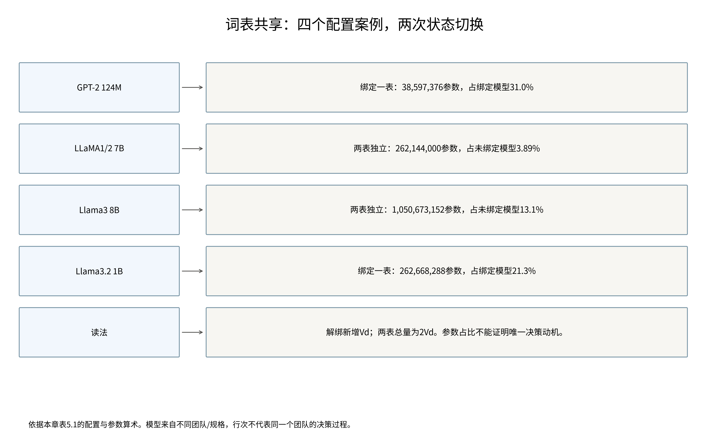
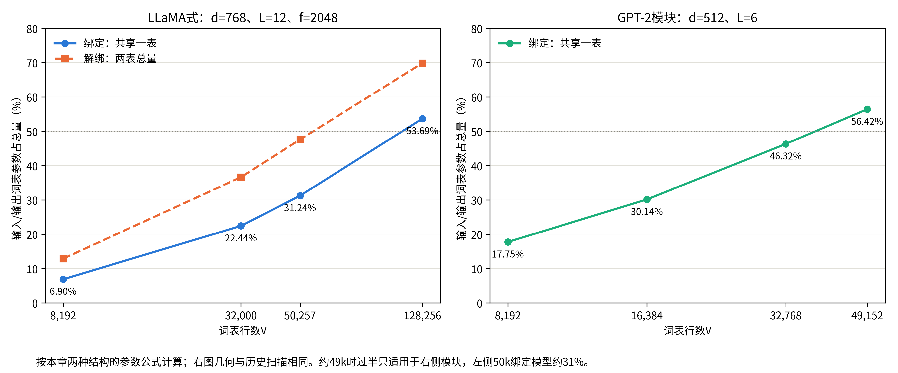
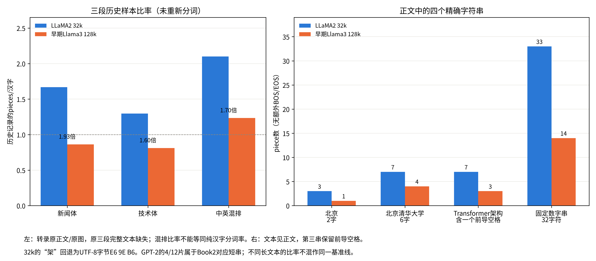
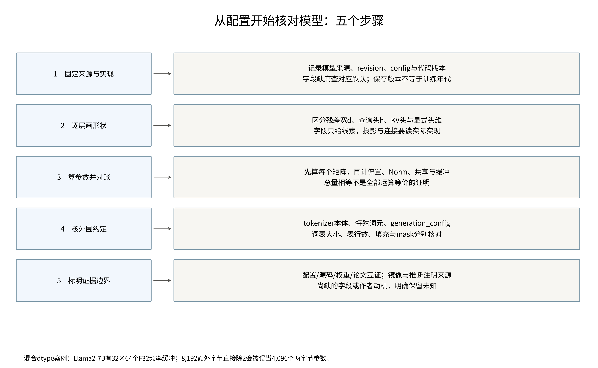

# 第 5 章 untied 与词表：出入口的账

## 5.0 开篇：从全书到这里

上一章我们把第三格插座换好了：位置信息从 1024 行查表变成转进注意力里的角度，模型可以正常运行，我们也观察到了外推时的性能限制。四连改装（归一化、前馈、位置、注意力）至此完成三格，注意力中的KV头组织尚未改动。但动它之前，本章先绕到机器的**两端**——入口的词表与出口的读出头。入口把词元ID映射成表示，出口把末层表示映射成词表分数；两者可以使用同一组参数，也可以独立学习。这个选择同时改变参数预算和可训练函数的约束，不能只看成存储开关。

Book2已经说明GPT-2共享表包含38,597,376个参数，占绑定模型约31.0%；如果与未绑定模型比较，节省比例约23.67%。本章所有百分比都要明确分母，并区分“词表两端的总开销”与“解绑额外增加的一张表”。

所以本章要回答三个问题：**绑与解的开关，实际被拨成了什么样？**（5.1-5.2 的四个配置样本）**解绑的账在不同尺寸的机器上怎么变，在我们自己的 207M 上又是多大？**（5.3）**词表本身要多大？**（5.4-5.5 的三权衡与四臂扫描实验）本章还将建立一项可复用的方法——**config 反推架构法**（5.6）：配置能补充结构字段，字段的具体含义还要结合实现与权重形状核对。本章结束时，输入与输出两端的参数将核对完毕，207M的两张词表矩阵合计65.5M参数，其中解绑新增的是32.8M——为什么在小模型中仍选择这项显著开销，5.7 说明具体改动及其理由。

> **最小背景栏**
> - Book1相关章节的三处权重共享与参数账本（编码器嵌入、解码器嵌入、输出投影三表互绑，省 37.9M）；GPT-1 式 $P(u)=\mathrm{softmax}(h_n W_e^\top)$ 的公式层绑定。
> - Book2第4章共享权重分析改造④：GPT-2 的 `logits = h·wte^T` 一表两用，绑定省 38.6M（占 124,439,808 的 31.0%），所据原始GPT-2检查点不另存一份输出表；其他框架可能保留两个别名键，键名数量本身不能证明参数是否共享。
> - Book2 第 2 章分词器全家福：BPE 合并、byte-level 基础词表、表 2.5 的中文实测（GPT-2 词表下每汉字约 2 token）；第 12 章将这一观察用于上下文预算。
> - Book2 第 10 章三插槽底座：`wte` 查表在入口、`head` 绑定 `wte` 在出口——本章改动的两处。
> - 本章重点是共享参数的约束、词表成本与config字段读法；用到的梯度和bpb换算会在相应位置展开。

## 5.1 一笔横跨两册的旧账

先梳理这项参数核算的来龙去脉。在输入输出词表及ID对齐的设置中，Transformer原典共享三处权重；这既减少参数，也约束输入表示与输出分类权重；GPT-1/GPT-2 单塔之后，共享只剩两处——入口的 `wte` 与出口的 `head`，在本书的PyTorch GPT-2底座中，赋值让它们成为**同一个参数对象**：`self.head.weight = self.wte.weight`，一表两用，参数计数器只数一份。Book2 第 4 章的账本上写着：绑定省 38,597,376 参数，占 124M 档的 31.0%——这说明共享对该规格的参数预算影响很大，不能单凭这项比例还原作者的全部决策理由。

奇怪的是下一代。本章所列LLaMA1/2及Llama3的8B等主线型号把这两处**解开**（untied，解绑）了：入口 `embed_tokens` 与出口 `lm_head` 是两个独立的 $(V,d)$ 矩阵，各自初始化、各自训练。同一个开关，GPT-2 拨在「绑」（tied，权重绑定），LLaMA 拨在「解」——这就是 Book2 章末那半句「在下一代被改变选择」的所指。

要理解这次选择的变化，得先把「开关拨了什么」看清。设词表大小为 $V$、残差流宽度为 $d$，出入口的参数账只有一行：

$$
N_{\text{vocab}} = V \cdot d \cdot \left(2 - \mathbb{1}_{\text{tied}}\right)
\tag{5.1}
$$

符号表：$V$（词表大小，标量，即词表矩阵的行数）｜$d$（残差流宽度，标量，即每行多少维）｜$\mathbb{1}_{\text{tied}}$（绑定指示符，标量，绑定为 1、解绑为 0）｜$N_{\text{vocab}}$（出入口参数量，标量）。这表示：出入口的账就是「一张 $(V,d)$ 的表值多少钱；如果没绑定，买两张」。GPT-2 是 $50257\times 768\times 1=38.6\mathrm{M}$，LLaMA-7B 是 $32000\times 4096\times 2=262\mathrm{M}$——算子形状可以不变，但参数空间和两条梯度路径的关系已经改变。**绑定同时是参数预算与模型约束的选择**；接下来需要区分配置事实与选择理由。

### 同一张表为什么不只是少占一份存储

**绑定要求输入表示和输出分类权重接受两条任务路径的共同更新；解绑则允许它们独立变化。**形状不变掩盖了这一点。设输入表 $E\in\mathbb R^{V\times d}$、输出表 $H\in\mathbb R^{V\times d}$，隐藏表示为 $h\in\mathbb R^d$，logits为 $z=Hh\in\mathbb R^V$。对单个目标词元$y$，令$p=\operatorname{softmax}(z)$、交叉熵$\ell=-\log p_y$，把$h$视作输出层的给定输入。由$\partial\ell/\partial z_v=p_v-\mathbf1[v=y]$和$z_v=H_vh$，输出路径梯度是

$$\frac{\partial\ell}{\partial H_v}=(p_v-\mathbf1[v=y])h^\top.\tag{5.4}$$

这里$H_v$与相应梯度均为$(1,d)$行向量，$h$为$(d,1)$列向量。输入路径则通过查表、后续Block和隐藏表示回传。若绑为$H=E$，共享参数的梯度必须把两条路径相加：

$$\nabla_E\ell=\left.\nabla_E\ell\right|_{\rm input}
+\left.\nabla_H\ell\right|_{H=E,\rm output}.\tag{5.5}$$

这可以形成有用的参数约束，也限制两种角色独立适应。它不意味着输入一定需要“平滑几何”、输出一定需要“相斥几何”，更不能直接证明大模型解绑必然更好。把共享表复制成两份相同初值，只会在复制瞬间保持前向一致；此后两份收到不同梯度，训练通常不再等价。共享约束作用于参数本身，不能用“两份数值暂时相等”替代。

固定隐藏维时，绑定也没有消除词表读出计算。输入查表每个位置选一行，输出却通常要计算$V$个类别的点积，约 $2Vd$ FLOPs/位置。共享减少独立参数和相关状态，并不把这个乘法删掉。这一区别会进入后面的词表大小比较。

## 5.2 四个配置样本：同一个开关的当代史

把式 (5.1) 套进各代真实 config，得到一张时间线表【证据等级：config 逆向（各代 config 直读+公式复算，本书 `config_infer.py`，CPU，2026-10；Llama 3.2 为冻结点外 config 事实——仅 tie 级引用，双镜像一致）】：

表 5.1 tie 开关四个样本账（词表账 = 嵌入 + 输出层参数；占比 = 词表账 / 参数总量）

| 世代（年份） | tie 开关 | $V$ | 词表账（参数） | 参数总量 | 占比 |
|---|---|---|---|---|---|
| GPT-2 124M（2019） | **绑** | 50,257 | 38,597,376（一份） | 124,439,808 | **31.0%** |
| LLaMA1/2 7B（2023） | **解** | 32,000 | 262,144,000（两份） | 6,738,415,616 | **3.89%** |
| Llama 3 8B（2024-07） | **解** | 128,256 | 1,050,673,152（两份） | 8,030,261,248 | **13.1%** |
| Llama 3.2 1B（2024-09） | **绑** | 128,256 | 262,668,288（一份） | 1,235,814,400 | **21.3%** |



图5.1 四个模型配置案例与两次绑定状态切换（按表5.1自绘，示意级）。每行分别给出共享一表或独立两表及其占当前模型总参数的比例；箭头表示读取该模型的配置事实，不表示同一团队按这条顺序作出决策。

四个样本展示的是“绑定→解绑→仍解绑→绑定”，只有两次状态切换，而且GPT-2与LLaMA并非同一个开发团队。表中可以直接读出参数占比随模型宽度、主体大小和词表大小改变；不能从这些占比反推每次决策的唯一动机。

GPT-2绑定表占31.0%；LLaMA1/2的7B两端总量占3.89%；Llama3-8B扩大词表后两端总量占13.1%；Llama3.2-1B的共享表占21.3%。这些事实说明大小不同的模型面对不同预算压力，但采用了某种配置不等于已证明其他选择不可行。“绑不起”“因占比小才解绑”都需要额外证据，参数比例本身不能作答。

> **【考据框】三篇论文的沉默。** 你可能会想，这么重要的决策总该有论文论证吧。本书所核架构与实验部分没有给出针对绑定开关的独立消融或明确选择理由。LLaMA1（arXiv:2302.13971 v1）§2.2 只声明三处改动——pre-normalization、SwiGLU、rotary embeddings，全文 grep「tied/untied/tying」零命中；LLaMA2（arXiv:2307.09288 v2）同样零命中；Llama 3（arXiv:2407.21783 §3.2）明说架构「does not deviate significantly from Llama and Llama 2」，改动清单四条（GQA、文档掩码、RoPE 基频、新分词器），无一字论 tying。这些论文没有明确给出本选择的动机或独立消融；不能仅凭其他模型也解绑，就推断确定的继承路径——这恰好是「论文不说的部分要靠 config 才能看见」的最佳引子，5.6 节的方法论由此而来。

社区当然补过解释，常见的三条，引用时一律标二手推断。**规模账**——嵌入占比随尺寸骤降，解绑边际成本可忽略：其中“占比在这些配置中较低”可由表5.1复算；“可忽略”则取决于预算和任务，不是算术结论。5.3节还要把双表总量与解绑增量分开。

**职责论**——输入嵌入是查表（要平滑的语义几何），输出层是 softmax 竞争分类器（要拉开类间距离），同一张矩阵承担两种职责，既是正则约束，也限制了独立调整；文献根据其实是反向的旧证据：Inan等人的工作（2016年首发，arXiv:1611.01462）从其损失框架导出权重共享，并在PTB语言模型实验中验证效果，Press & Wolf 2017（arXiv:1608.05859）发现复用输出嵌入做输入反而提升 LSTM 语言模型——都是「绑定有收益」时代的结论，外推到 7B 属二手推断【证据等级：官方论文（LSTM/小模型时代）+ 二手推断（外推部分）】。

**深度论**——decoder-only 深模型的残差流范数随深度增长，末层隐状态与输入嵌入尺度失配，直接转置当输出矩阵「几何上别扭」：这仍是社区层面的候选解释；LLaMA在读出前还有末层RMSNorm，不能直接拿未归一化残差流的范数替代实际读出输入。这里缺少把深度、归一化、绑定与质量收益逐一控制的证据【证据等级：二手推断】。Llama3.2的小型号提供了绑定的另一组配置事实，但采用行为本身仍不是选择原因的解释。

> **【考据框】教学实现也有自己的配置选择。** Karpathy的llama2.c在`model.py`中令`tok_embeddings.weight = output.weight`，共享输入与输出参数，而本章所据LLaMA1/2配置为untied。所核源码还明确写有共享注释及weight-tying链接，不能称为“没有说明的静默绑定”。对于小模型，共享确实能减少独立参数；但仅凭这个收益不能断定作者的唯一动机。阅读教学代码时，应将共享方式、投影形状与被对照模型逐项比较，而不是把“复刻”理解为所有细节完全相同。【来源：llama2.c官方仓model.py，Transformer.__init__；本章配置表】

## 5.3 解绑的账：不同模型尺寸下的开销

介绍完这些配置事实，现在仔细核算解绑的开销——这一节的手算全部来自本书 `config_infer.py`（code/ch05/config_infer.py），CPU 秒级可复算【证据等级：本书复算（公式手算，锚点=config 逆向+官方论文表格），2026-10】。

先计算 7B 档的参数占比。分子是式 (5.1)：$32000\times 4096\times 2 = 262{,}144{,}000$。分母是整机参数：按 5.6 节的公式 (5.2) 手算 LLaMA1-7B 全部结构得 $6{,}738{,}415{,}616$（与论文Table2的6.7B及模型卡的6.74B在各自取整精度上一致）。相除：**3.89%**。这两个百分比还不能直接作“解绑一次”的比较：GPT-2的31.0%是一张表占绑定模型总量，7B的3.89%是两张表占未绑定模型总量。设固定其他结构时的绑定总量为$N_t$、未绑定总量为$N_u$，则$N_u=N_t+Vd$。解绑相对原绑定模型的增幅是$Vd/N_t$；未绑定模型的两端总占比才是$2Vd/N_u$。

7B的一张表为131,072,000，假设绑定后的总量为6,607,343,616，所以解绑增幅约1.98%，新增那一表占实际未绑定总量约1.95%；原表的两端总占比3.89%仍然正确，只是回答了另一个问题。GPT-2同口径解绑增幅为31.0%。顺着尺寸再往外推，占比一路骤降：两张表总占比依次为13B 2.52%、33B 1.31%、65B 0.80%、70B 0.76%；解绑增加的单张表占相应当前总量的一半。同一个开关，在 124M 上是显著预算选择，在 70B 上只是很小的一部分。

但账还有另一个自变量：词表。把骨架固定、只换词表，第一个权衡就体现出来了（图 5.2 左）。取一台 $d=768$、$L=12$、$f=2048$ 的 LLaMA 式玩具骨架（tied 口径），依次装入四张词表：sp-8k（Book2/3 自训）嵌入 6,291,456、占 91,245,312 总参的 **6.90%**；LLaMA 32k 占 **22.44%**；GPT-2 的 50,257 占 **31.24%**；Llama 3 的 128,256 占 **53.69%**——若解绑成两份，更是 **69.9%**【证据等级：本书复算（`config_infer.py` 固定骨架换词表账，CPU，2026-10）】。一句话：**128k 词表装进 768-d 玩具骨架，仅嵌入就占用过半参数预算**；这说明在所列固定主体与共享方式下，大词表的相对开销高，不构成128k只能用于4k宽度以上模型的限制。Book2 当年给 scaling 族自训 sp-8k 词表，正是为了避免这一问题（Book2 第 2 章末「小模型若背 50257 的词表，嵌入矩阵会把模型本体淹没」的预言，在这里有了精确数字）。

最后算我们自己的机器。207M 定版 config（$V=32000$ untied、$d=1024$）：词表两端总量$=32000\times1024\times2=65{,}536{,}000$，占总参$207{,}119{,}360$的**31.6%**。解绑新增一表32,768,000，相对绑定版本174,351,360增加约18.79%，占当前未绑定总量约15.82%——在本模型中是一笔显著开销，但不是前面所有样本中的最大占比。这里有一个值得留意的巧合：GPT-2 是「绑一份、占 31%」，我们是「解两份、占 31.6%」——同样显著的占比，却作出了相反的选择。GPT-2 面对的 31% 是 2019 年「省下的钱能再买小半台模型」；我们面对的 31.6% 为什么仍要付？三个理由。其一，**对齐出厂口径**：本册的任务是把 GPT-2 底座改装成 LLaMA 式骨架，出口的几何也是骨架的一部分——本册选定的LLaMA1/2式参照配置采用untied，因此207M也采用这一约束，第10章要对拍的是这一特定untied配置；HF也支持绑定，不能把独立输出表说成所有HF对拍的必要条件。其二，**F15 主线的完整体验**：你在自己的机器上核算这笔显著开销，你能直接比较绑定与解绑的参数及梯度约束；这种实践帮助理解选择空间，但不能替代模型作者未披露的决策理由。其三，**实验条件的清楚划分**：第2、3、4、6章组件实验保留Book2的sp-8k语料与tied底座；本章词表扫描则显式改变词表和相应token流，解绑只发生在第 10 章的整机——不把整机的词表与绑定变化混入前面的组件对照。

## 5.4 词表要多大：三权衡

开关的账算完了，还剩开关背后那个更大的问题：$V$ 本身取多大？这要先看清 32k 和 128k 两张词表**里面装的是什么**。

LLaMA1/2 的 32k 是 sentencepiece BPE。论文原句一句话给全三条设计决策：「我们用 BPE 算法（Sennrich et al., 2015）分词，实现用 SentencePiece；**把所有数字拆成单个数位**；未知 UTF-8 字符**回退到字节**分解（字节回退，byte fallback）」【证据等级：官方论文 2302.13971 v1 §2.1（意译，三条决策逐条对应原文）】。历史实验从公开镜像读取所据tokenizer.model并统计构成【证据等级：本书实验（sentencepiece 0.2.2，CPU，2026-10；双镜像同 hash，引用复核台账 C-52 已销项）】：`GetPieceSize()=32000`，恰好等于 3 个特殊 token（`<unk>`=0、`<s>`=1、`</s>`=2）+ 256 个字节 token（`<0x00>`–`<0xFF>`，占 id 3–258）+ 31,741个普通piece（包括基础字符与合并片段，不能等同合并规则条数）。读取 config 时还会发现两个细节：其一，**没有 `<pad>`**——`PieceToId('<pad>')` 返回 0，也就是 unk 的 id，而 config 里 `pad_token_id` 恰好也写 0，这是该配置对运行时ID的指定，不表示分词器多出一个独立PAD词条；是否据此填充还取决于数据整理与mask实现；读取 config 时，需区分分词器中不存在独立PAD项与模型config用某ID处理填充这两种含义；

其二，**`[INST]` 不是特殊 token**——Llama-2-Chat 的对话标记在 32k 词表里只是普通文本，切成多个 piece，官方 chat 格式全靠字符串拼接（出处为 Llama-2 模型卡【证据等级：模型发布材料，经镜像核对】）。还有一个版本考据：**32000 这个数在 LLaMA1 论文里根本没写**（Table 2 只有参数/维度/头数/层数），首次明确写在 LLaMA2 §2.2 的「The total vocabulary size is 32k tokens」【证据等级：官方论文 2307.09288 v2 §2.2】。

Llama 3 换了 128k 新词表，论文给的动机两支：「我们使用 128K 词表。词表组合了 tiktoken 的 100K token 与另外 28K 个 token 以更好支持非英语语言。对比 Llama 2 分词器，新分词器把英文样本的压缩率从**每 token 3.17 字符提升到 3.94**——同等训练算力能『读』更多文本。增加 28K 非英语 token 同时改善了压缩率与下游表现，且不影响英文分词」【证据等级：官方论文 2407.21783 §3.2（意译）】。config 里的实值是 128,256，分解开恰好是 **128,000 基础 + 256 个特殊位**（id 128000–128255），所据早期Llama3词表快照中的非保留位记录为5个（`<|begin_of_text|>`、`<|end_of_text|>`、`<|start_header_id|>`、`<|end_header_id|>`、`<|eot_id|>`），其余 251 个全是 `<|reserved_special_token_N|>` 占位——预留位后启用是词表前瞻性的小案例【证据等级：本书实验（tokenizers 0.23.2 直读本地缓存实物）】。论文 Table 3 写 "128,000" 与 config 的 128,256 并不矛盾：前者数基础词表，后者含特殊位；**参数账以config中的表尺寸为起点，并与实际权重形状核对**——5.6 节的 8,030,261,248 只有乘 128,256 才逐位对上，这正是「config 反推」优先级的第一课。

增大词表也有代价，需要考虑三项权衡。

**权衡一：词表参数占比。** 5.3节的固定骨架账说明，词表表尺寸不变时，主体参数越多，词表占比越低；固定主体却扩大词表时，占比会上升，所列小模型样本甚至超过一半（图5.2）。这不是任何宽度和词表组合都成立的固定比例。

**权衡二：token 效率，尤其中文。** 这里继续讨论 Book2 在两处提出的中文分词问题：Book2 第 2 章表 2.5 埋设（GPT-2 词表下每汉字约 2 token，`北京` 2 字 4 token、`北京清华大学` 6 字 12 token）、第 12 章预算表收口（不同文本与词表的容量应分别估计，中文字符与英文词不能直接当作同一单位）。本册把谱系补成三档（图 5.3 左，固定文本实测）：GPT-2 的 50,257（字节级）约 2.0–2.3 片/汉字（Book2 口径指回）；LLaMA2 的 32k 在新闻体/技术语/中英混排三段文本上分别 **1.667 / 1.297 / 2.100** 片/汉字；Llama 3 的 128k 降到 **0.863 / 0.811 / 1.233**【证据等级：本书实验（CPU 固定文本，与 Book2 同源探针口径，2026-10）】。这些是原三段样本的记录，原表标为pieces/汉字；混排段还涉及英文和标点，不能把该比率直接理解成纯汉字部分的分词率。当前归档缺少完整原文和原计数探针，尚不能逐项复核分子、分母的处理，故保留历史读数而不声称已重新测得同一比率。按这三条历史记录计算，32k 与 128k 的比率约在 1.60—1.93 之间；它描述这些样本，不能当作所有中文文本的固定倍率。

极端例子三连（图 5.3 右）：`北京` GPT-2 4 片 / 32k 3 片（`▁`、`北`、`京`——空格标记 ▁ 自己占一片）/ 128k **1 片**（常用双字词直接进词表，此例中两个汉字对应一个token）；`北京清华大学` 12 / 7 / 4；最能说明问题的例子是 ` Transformer架构`：32k 切 7 片，因为「架」不在 32k 的汉字 piece 里，走了 `<0xE6><0x9E><0xB6>` 三字节的 **byte fallback**——论文那句「未知字符回退到字节」的机制可以直接看出；128k 只要 3 片。数字串也有类似情况：LLaMA1 论文的「逐位拆数」决策让 `2024` 在 32k 下是 `▁`/`2`/`0`/`2`/`4` 五片，128k实现先用最多三位一组的数字预分词规则，再在各组内应用BPE；这个词表把`2024`编码为`202`和`4`两片；32字符的固定数字串`20240721 3.14159265358979 128256`为33片对14片，**2.36 倍**。当前公开镜像上的短串复算也确认了这些计数，且发现前导空格不可省略：` Transformer架构`为7/3片，去掉前导空格则为6/3片。当前sentencepiece0.2.2、tokenizers0.22.2的结果与原三段长文本读数分开记录。

英文文本还保留一组历史验证：同一段论文摘要 4.17 → 4.81 字符/piece（+15.4%），与论文口径的 3.17 → 3.94（+24.3%）**同方向、不同幅度**——样本依赖的官方数字怎么读，这个对拍本身就是教学点。

**权衡三：有效上下文。** token 计数是按词表的，不是按字的——同一个 ctx 窗口，在同类文本上的汉字容量可粗估为ctx除以样本的pieces/汉字。以新闻体口径：ctx 2048 在 32k 词表下装约 1,228 字、128k 下约 2,373 字（1.93 倍）；ctx 131,072时按原比率估算约78,627对151,879字。这是样本比例外推，实际还需留出特殊词元、提示与生成预算，不能保证任何中文文本都装下这个字数。**同一段文本每少占一个 piece，就能多留出一个上下文位置——上下文长度是预设的，词表效率决定同样窗口能容纳多少文本**（这正是 Book2 第 12 章 N7 主线在词表侧的形状，长窗工程在第 7 章展开）。

三项权衡可以概括为一句话：**词表大小体现了嵌入参数与上下文利用效率之间的取舍；模型主体越大，这项效率收益的相对参数代价越小；主体越小，就越需要仔细核算。** Llama3的8B配置配128k词表，呈现了这两项成本与效率的组合（两表参数占 13.1%；论文英文样本压缩率提升约 24.3%，部分历史中文样本记录接近两倍，均须保留各自样本条件）；Llama3.2的1B样本配同一词表时采用绑定；预算能解释这项选择的一个约束，不能证明它是被迫或唯一原因，是在同一组权衡里把开关拨向另一头——四个样本史与三权衡，本来就是同一项成本分析的两个方面。

## 5.5 词表扫描：四臂实测

上述权衡的前两笔账已有公式和固定文本实验支持，但还有一笔无法仅靠纸面推导确定：同一副骨架、同一份训练预算下，$V$ 的大小在质量与速度上的**综合表现**——词元频次、切分粒度、读出规模与训练文本覆盖量都会改变。实验可以给出所选协议下的结果；要分离词表的单独作用，还要进一步对齐预算、原文与初始化等条件。设计沿用第 2-4 章的模块档协议，判据照例**预注册**在先（实验比较条件见本节）：四臂 $V\in\{8192, 16384, 32768, 49152\}$（49152=192×256，256 倍数口径的 GPT-2 粗档），同一副 $d=512$/$L=6$/$h=8$ 的 tied GPT-2 底座只改 `vocab_size`；分词器使用与语言模型语料分开的同一份训练分片；8k臂直接复用Book2分词器，另外三臂按相同配方各自训练（sp-BPE/字节回退同配方、只变 $V$，分词器语料与 LM 语料分离的 Book2 纪律沿用），各臂用自己的 token 流、同起点同预算——**四臂同token预算不等于同算力**：V变大会增加读出矩阵计算，参数量也不同；能说明的是同训练token数量下各配置的结果。

跨词表比质量，先要解决「尺」的问题：nats/token不能直接作相同文本质量的跨词表比较；一个token覆盖多少字节随分词器与文本而变，损失没有“词表一大就必然变高”的定律。可以换算到共同的**每字节比特数**（bits per byte，bpb）：

$$
\mathrm{bpb} = \frac{\mathcal{L}}{\ln 2 \;\cdot\; \beta}
\tag{5.3}
$$

符号表：$\mathcal{L}$（每 token 平均损失，nat/token，标量——各臂固定49批、每批16窗，共401,408个预测位置 的 fp32 eval）｜$\beta$（严格公式中为同一被评分文本的bytes/token；历史扫描借用另一个样本均值作近似，标量）｜$\mathrm{bpb}$（每字节比特数，标量）。这表示：把「每 token 的损失」除以「每 token 装的字节」再折成比特——它只完成单位换算。严格比较还要在相同原始文本、归一化、文档边界和可见上下文上计算总负对数似然，不能靠一个平均bytes/token系数消除实验协议差别。

从总量推一次更清楚。对同一测试文本，设总负对数似然为$S$ nat、被评分词元数为$T$、对应原文字节数为$B$，则 $\mathcal L=S/T$、$\beta=B/T$，所以

$$\mathrm{bpb}=\frac{S}{B\ln2}
=\frac{S/T}{(B/T)\ln2}.\tag{5.6}$$

若不同模型实际评分的不是同一段文本，或者固定token窗口对应不同可见字节数，上式仍可各自换单位，却不构成控制变量后的质量排名。现存扫描脚本正是按各自token流取尾部验证池，不能保证原始文本位置对齐；其$\beta$还取自语料首2000篇的另一个压缩样本，并非被评分文本的$B/T$。因此表里的bpb首先是借用样本平均压缩率得到的换算估计，连单臂也不等于直接计算的$S/(B\ln2)$。下面保留原表与观察，同时把这个限制放在读数之前。

表 5.2 词表扫描四臂（1000 步/臂 fast 档——卷级大纲契约：本章实验单档；train bf16 autocast / eval fp32，种子 20261002，MPS 独占窗口顺序执行）【证据等级：本书实验（`vocab_scan.py`，2026-10）】

| 臂 | $V$ | 参数 | 嵌入占比 | bytes/token | nats/token（臂内） | **bpb换算估计** | s/step |
|---|---|---|---|---|---|---|---|
| v8192 | 8,192 | 23,633,920 | 17.75% | 3.809 | 5.5256 | **2.0930** | 0.190 |
| v16384 | 16,384 | 27,828,224 | 30.14% | 4.243 | 5.9134 | **2.0107** | 0.219 |
| v32768 | 32,768 | 36,216,832 | 46.32% | 4.547 | 6.1456 | **1.9500** | 0.281 |
| v49152 | 49,152 | 44,605,440 | 56.42% | 4.671 | 6.2148 | **1.9194** | 0.352 |



图5.2 两种模型结构的词表参数占比，均按对应参数公式重算。左为$d=768,L=12,f=2048$的LLaMA式骨架，右为$d=512,L=6$的GPT-2模块，右侧几何与历史表5.2相同。约49k时超过一半只适用于右图；左图50k绑定模型仍约31%。这是参数算术，不是本轮训练测得的新性能。

三类读数分别反映一个方面。**账的方向**（参数占比可推算，压缩率方向由本次样本观察）：$V$ 每升一档，压缩率从 3.809 升到 4.671 bytes/token（+22.6%）、嵌入占比从 17.75% 升到 56.42%——5.4 节权衡一在本档实测中得到体现，49,152 的词表把过半参数放在输入/输出共享表上；这些参数还参与读出，不只用于输入查表。

**换算值的方向**：四臂bpb估计单调下降，2.0930 → 2.0107 → 1.9500 → 1.9194（−8.3%）——预注册里这一条刻意**不设方向**（大 $V$ 的嵌入行训练不足与小 $V$ 的压缩损失两侧皆有先例，属开放问题），本次四臂的结果呈单调变化、表中换算差值较大，但未建立跨词表、跨原文及训练种子的同一误差模型，按预注册条款如实升级为「本档观察」：这些独立验证流上的bpb换算值随V下降；由于压缩系数另取样本，且评分文本和字节上下文未严格对齐，不能将差值全部解释为词表导致的质量收益——但须带足限定（1000 步短训、单种子、tied、英文语料），不是「词表越大越好」的结论句。

**每步耗时**：0.190→0.352 s/step，增加约85%；固定每步token数时，吞吐相应下降约46%。词表读出规模随$V$上升，但各算子对该实测差值贡献多少仍需单独剖析，「预估 <10%」的预期与本档实测不符，实际代价比预想的更大。还可以检查一组结果的一致性：v8192 臂的 nats 5.5256 与第 2 章 base 臂（5.5216）、第 4 章 wpe 臂（5.5279）同协议族——按相同数据来源、种子及49批固定窗协议设计，数字接近可作线索，但不能据此证明数据处理没有偏移；还需核数据hash、评估起点、初始化与运行版本。相同种子也不保证不同词表下的主体权重相同，因为嵌入尺寸改变了随机数消耗。



图5.3 历史分词记录的重新排版。左侧保留三段样本比率，原文及原计数探针缺失，未作重新测量；右侧为正文列明的四个精确字符串，无额外BOS/EOS，其中第三串含一个前导空格。右侧32k/128k计数已由当前公开镜像复核；GPT-2短串计数另见Book2，未与不同文本的长段比率混画成同一基准线。

## 5.6 config 反推五步法：拿到没读过的模型先读 config

本章一路走来已经积累了许多「论文没说、config 才说」的例子：tying 的沉默、32000 的缺席、128,000 对 128,256 的口径差、pad 的错位。把这些例子归纳成一项可复用的方法——**config 反推架构法**。往后你遇到任何一台没读过、甚至没发论文的模型（第 9 章的 Llama 4 就是全程演练），可先取得小体积的config.json，并记下模型来源与固定修订版本，再与实现、权重形状和论文交叉核对，走五步（图 5.4）。



图5.4 从配置到结构核对的五步流程（自绘，示意级）。各类证据按所回答的问题互相核对，不能把它们排列成对所有问题都适用的单一等级。

**第一步，认家族。** 读 `model_type`（给出模型家族线索，自定义实现还要核实际代码）、`architectures`（任务头类型：`LlamaForCausalLM` = 带 lm_head 的自回归）、`transformers_version`——这个字段通常记录保存配置时所用的transformers版本，能提供实现线索，但不等于训练时期或模型版本（例如所据Llama2/3配置分别记录4.31/4.40系列保存版本），而**字段缺席也是信息**：所据部分LLaMA1/2-7B配置快照不写 `rope_theta`（=默认 10000）、不写`num_key_value_heads`（在所据LlamaConfig默认补为查询头数，故为MHA）——旧 config 中省略的字段，需要结合默认值解读。

**第二步，重建图纸。** 按字段-部件映射表把架构在脑中重画一遍：

表 5.3 config 字段 → 结构部件映射（LLaMA 系；节选，完整字段说明由config_infer.py写入报告）

| 字段 | LLaMA1-7B | Llama3-8B | → 结构部件 |
|---|---|---|---|
| `vocab_size` $V$ | 32000 | 128256 | `embed_tokens` 行数 = `lm_head` 行数（词表账） |
| `hidden_size` $d$ | 4096 | 4096 | 残差流宽度；$\div$ 头数 = head_dim；若有显式head_dim字段，应按实现读取，不能一概由d/h推断 |
| `intermediate_size` $f$ | 11008 | 14336 | SwiGLU 三矩阵宽（名义 $\tfrac{8}{3}d$ 取整 256 倍数；后世另有 3.5$d$ 档） |
| `num_hidden_layers` $L$ | 32 | 32 | Block 重复数（参数账大头乘数） |
| `num_key_value_heads` $h_{kv}$ | （缺席）= $h$ | 8 | GQA 分组（第6章展开；本表缺席含义须经所据实现默认核对） |
| `rope_theta` | （缺席）10000 | 500000 | RoPE频率基底base（不是每一对维度的角频率） |
| `tie_word_embeddings` | false | false | 出入口绑/解（本章主角） |
| `rms_norm_eps` | 1e-06 | 1e-05 | RMSNorm 分母 $\varepsilon$（第 2 章 eps 考据） |

**第三步，算账对拍**——五步中的核心环节。整机参数公式可以从投影形状逐项相加。对本章所选无偏置LLaMA式Block，假定 $h d_k=d$，注意力有四个矩阵：Q投影 $(hd_k,d)$、K/V各 $(h_{kv}d_k,d)$、输出投影 $(d,hd_k)$。它们共 $2dhd_k+2dh_{kv}d_k=2d^2+2dh_{kv}d_k$ 个参数。SwiGLU的gate/up各$(f,d)$，down为$(d,f)$，共$3df$；两处RMS增益各$d$，共$2d$。$L$层之外再加末层增益$d$和入口/出口表，便得到下面的总式。

这不是所有名为LLaMA的派生模型的通用公式。显式head_dim若不满足 $hd_k=d$，应保留 $2dhd_k$；有偏置、额外投影、部分层不同或参数共享时也要重新计数。先列形状再简化，才不会让一个熟悉的公式遮住真实结构。

整机参数一行公式：

$$
N = Vd\left(2-\mathbb{1}_{\text{tied}}\right) + L\left(\underbrace{2d^2 + 2d\,h_{kv}\,d_k}_{\text{注意力}} + \underbrace{3df}_{\text{SwiGLU}} + 2d\right) + d
\tag{5.2}
$$

符号表：$d_k = d/h$（每头维，标量）｜$h_{kv}$（KV 头数，标量，MHA 时 $h_{kv} d_k = d$、注意力项退化为 $4d^2$）｜其余同式 (5.1)。这表示：**总参 = 词表账 + 层数 × 每层账 + 收尾那枚 norm**——每层是「q/o 全宽、k/v 按 KV 组缩、SwiGLU 三矩阵、两枚 norm」。拿 Llama 3-8B 的 config 代入：$128256\times 4096\times 2 + 32\times(2\times 4096^2 + 2\times 4096\times 8\times 128 + 3\times 4096\times 14336 + 2\times 4096) + 4096 = 8{,}030{,}261{,}248$。然后对拍——这一档能对上**四方**：手算（式 5.2）、该检查点在统一两字节参数且无额外张量条件下的safetensors index total_size÷2（该字段表示张量payload总字节，不是含文件头的文件总大小：16,060,522,496÷2）、远程逐张量 numel 求和（HTTP Range 只读各分片头部、不下载 16GB 权重）、以及 transformers meta 设备建模计数——历史四项记录**逐位一致**，全部为8,030,261,248。当前另对[NousResearch镜像固定修订315b2009](https://huggingface.co/NousResearch/Meta-Llama-3-8B/tree/315b20096dc791d381d514deb5f8bd9c8d6d3061)的四个分片头部复核，也得到291个BF16张量、同一numel与总payload字节数；只读头部不等于校验权重内容。随书参数脚本只重做本地可得证据，内置远程读数是历史锚，不是每次运行都重新请求了远程header【证据等级：本书复算 + config 逆向 + 第三方复测（远程 header，调研期读数），2026-10】。

**第四步，读外围三件**：tokenizer_config（词表构成/add_bos 行为——5.4 节的 128,256 分解就在这里核）、generation_config（采样默认）、tokenizer 本体（32k 构成统计）。

**第五步，证据分级**：固定版本config与相应实现互相核对，再与权重形状和论文规格交叉检查；镜像必须标注出处，动机推断不能冒充字段事实——反推的产出不是「架构图」，是**带证据等级的架构图**。

> **【考据框】2,048 个浮点的悬案：对拍不一致时怎么办。** 五步法真正需要仔细分析的，是结果「对不上」的时候。Llama-2-7b 的 index total_size÷2 = 6,738,419,712，比式 (5.2) 的架构实际参数量 6,738,415,616 **多 4,096**。追下去：旧检查点比架构多 32 个张量——每层一个 `rotary_emb.inv_freq`、shape [64]、**F32**（4.31 时代转换脚本落盘的 RoPE 频率缓冲，现代实现已不持久化、按需重算）。逐字节对账：$6{,}738{,}415{,}616\times 2\,\mathrm{B}$（FP16参数，每个2字节）$+\,32\times 64\times 4\,\mathrm{B}$（F32 缓冲）$= 13{,}476{,}839{,}424$ = index total_size，完全一致；那 4,096 个「幻影参数」就是 8,192 字节缓冲被「÷2」快捷口径误读的产物；当前对[NousResearch镜像固定修订8efe6c9b](https://huggingface.co/NousResearch/Llama-2-7b-hf/tree/8efe6c9b93655b934e27bd9981e3ec13e55aee9d)的两个分片头部重新核对，确认291个F16权重张量和32个F32缓冲。所有张量numel总和比独立模型参数多2048，而不是4096；后者只是统一除以2造成的错误折算【证据等级：本书复算 + 第三方复测（远程 Range 读 header，调研期读数；`config_infer.py` 内置该对账 assert）】。两个教训：一，「total_size÷2」这类简化算法在混用 dtype 时会给出错误结果；二，**对支持Range的服务，可读取每个分片的头部以核对张量名、形状与dtype，避免下载权重payload；仍须检查206状态、Content-Range及固定分片身份**——第 9 章将直接复用这一方法。至于 Llama-3-8B 为何无此悬案：4.40 时代转换，291 个张量没有混入这类缓冲——检查点内容也存在代际差异。

五步走完，我们便能画出一张标明已知字段与未决部分的结构图；总参数对上也不证明每个算子及数据流都一致。这套程序 + 式 (5.2) 的手算能力，是本章介绍的可复用方法——第 8 章的代际对表、第 9 章的 Llama 4 逆向、第 10 章的 207M 参数 assert，都以此为基础。

## 5.7 附加一刀：untied 落进 207M

介绍完分析方法，再回到模型改造。按本册的编号口径，改装四连是第 2/3/4/6 章的归一化、前馈、位置、注意力；本章这一项改造是**四连之外的附加一刀**（图 0.1 里那个空心圆 U）——它不在 Block 里，在机器的两端。改动前的例行问句：动的是整机哪一格？答：入口的 `wte` 不动，动的是出口——把 Book2 底座里那句绑定（`self.head.weight = self.wte.weight`，Book2 第 4 章实现对照框已介绍）拆掉，`head` 换成独立的 $(V,d)$ 参数。数据流全程只变最后一行的「用哪张表」（收进表 5.4）：

表 5.4 出入口形状流转表（207M，$B$=批、$n$=序列长、$V=32000$、$d=1024$）

| 步骤 | 运算 | 输入形状 | 输出形状 | 说明 |
|---|---|---|---|---|
| 入口查表 | $E[\mathrm{ids}]$ | $(B,n)$，$E:(V,d)$ | $(B,n,d)$ | 每位置读取一行参数；不是对整表做稠密乘法 |
| Block 栈 ×12 | 残差流经过 | $(B,n,d)$ | $(B,n,d)$ | 恒宽，四类组件改造所在的位置 |
| 末层 RMSNorm | $h=x\odot g/\sqrt{\operatorname{mean}(x^2)+\varepsilon}$ | $(B,n,d)$，$g:(d,)$ | $(B,n,d)$ | 出口前的最后一枚 |
| 出口投影（tied） | $h\cdot E^{\top}$ | $(B,n,d)\cdot(d,V)$ | $(B,n,V)$ | 复用入口表转置 |
| 出口投影（untied） | $h\cdot H^{\top}$ | $(B,n,d)\cdot(d,V)$ | $(B,n,V)$ | $H\in(V,d)$ 独立参数 |

这项改造的代价与收益都可以逐项说明。代价：参数 $+V\times d = 32{,}768{,}000$，词表账从一份 32.8M 变两份 65.5M，两表合计占全机31.6%；这不是最大的组件类别，12层FFN合计约103.8M参数，占约50.1%；独立参数需要保存两份；文件中是否去重及键名布局还取决于序列化格式。收益：出口几何独立（末层隐状态不必迁就输入嵌入的几何——职责论的账，至少不再受到共享参数的相互限制）；与第10章选定untied配置的参数约束对齐；加载时还要核对全部形状与键名；以及 F15 主线的完整闭环——你在自己的机器上拥有了「解绑的 LLaMA 式骨架」，四个样本史的最后一拨逻辑（小机身回绑）也在你的选择清单里出现过、被你按出厂口径否决了。顺带预告一项需要分开分析的初始化问题：Book2式(10.3)的 $Cs^2/2$ 来自随机logits方差，并非绑定专有；解绑不会自动消除它。绑定还可能引入输入与输出的额外相关性，两者应分开分析——这笔账第 10 章冒烟时对表。

至此，207M 的 config 只剩最后一格没动过：注意力。

## 5.8 本章小结

开篇的三问，逐一回答。**开关被拨成了什么样？**——四个样本：GPT-2绑定（单表占31.0%）→所列LLaMA1/2解绑（7B双表占3.89%）→ Llama 3-8B 128k 词表下回升（13.1%，仍解）→ Llama3.2-1B绑定（单表占21.3%）；所核论文未给出该开关的独立消融或明确动机，社区三条解释只能标二手推断，llama2.c的显式权重共享是「教学复制品第一处偏差」的具体例子。

**解绑的账怎么变？**固定其他结构，新增总是一张$Vd$表；相对绑定版本的增幅是$Vd/N_t$。GPT-2例约31.0%，7B例约1.98%，本书207M例约18.79%。表5.1的3.89%、本书两表合计31.6%则采用未绑定总量作分母，描述两端总开销。这两种百分比不能互相替代。

**词表要多大？**——三权衡（嵌入占比 / token 效率 / 有效上下文）一本账：Book2 两段中文短例中 GPT-2 约 2 pieces/汉字；另三段历史样本中，32k 记录为 1.3—2.1、128k 为 0.81—1.23，两者比率约 1.60—1.93，完整原文缺失，不能拼成已重测的同文三档基准；明确短串 `北京` 的计数则是 4→3→1；四臂扫描实测：历史不同验证流上的bpb换算值下降约8.3%，不视为严格同文本质量比较、嵌入占比增至 56.4%、每步耗时增加约85%。方法论遗产：config 反推五步（认家族/重建图纸/算账对拍/读外围/分级），Llama 3-8B 四方逐位 8,030,261,248，Llama-2-7B 的 4,096 幻影参数逐字节归因到 2,048 个 F32 inv_freq 缓冲。

**带走的心智**：即使忘记具体数字，也请记住三句话。**其一，绑与解是账本决策，不是教条**——这些模型样本给出不同的共享选择，但占比不是唯一动机的证明；看到任何模型的 tying 设置，先算式 (5.1) 占比再谈理由，理由未披露时就保留未知。**其二，词表大小体现了嵌入参数与上下文利用效率之间的取舍**——模型主体越大，这项效率收益的相对参数代价越小；主体越小，就越需要仔细核算。同一段文本每少占一个 piece，就能多留出一个上下文位置。**其三，拿到没读过的模型，先读 config**——论文交代方法与实验，config给出字段；二者都须与实际实现和权重核对；五步走完，你手里是一张每个字段都带证据等级的图纸，第 9 章还将使用这张图。

把镜头拉回全书：输入与输出两端核对完毕，机器的参数账 207,119,360 已逐位核对，四连改装只剩注意力一格。但动它之前，得先开一本新账——推理的账：生成每一个 token 时，「记住前面说过什么」要付多少钱。标准整段训练会产生K/V与其他中间激活，只是通常不跨优化步把它们当作同一条序列的推理缓存继续保存。自回归生成则希望复用已处理前缀的K/V；在几何和精度固定时，这份缓存随保存长度线性增长。下一章将解释为何能够复用、要保存多少，以及减少KV头数改变了哪笔成本。

## 5.9 动手验证

在书目录、已激活既有环境时调用。若从外层工作区运行，给脚本加书目录前缀，默认数据及输出留在当前目录log。

```bash
python code/ch05/config_infer.py --out-name 新名称
python code/ch05/vocab_scan.py --help
python code/ch05/make_figures.py --help
```

参数程序重做内置配置算术与当前可用的meta模型计数；可选缓存实物必须指定清楚来源。报告分别列本次计算、当前读取、历史锚点与未执行项，不能把缺缓存后的常量比较称为重新完成了四方远程审计。相同输出名不会覆盖旧报告。

词表扫描只有在准备好分词器训练语料和语言模型语料后才运行：历史档为每臂1000步，四臂MPS训练约18.5分钟，另有分词与切流成本。新入口按来源hash复用分词器/数据/断点，数据不足或配置变化必须明确失败；不能用同名缓存拼接不同实验。默认四臂预算与原表保持一致，原MPS表不作为当前设备的预期数值。

验收时分别回答：固定骨架解绑新增多少、相对哪个总量；共享参数的梯度怎样由两条路径相加；同参数数目为何仍不能证明架构完全一致；用另一个文本样本的bytes/token换算loss为什么只是估计。将式(5.2)应用于显式head_dim、带偏置或共享层模型之前，必须先恢复逐投影形状账。

配置表保留历史模型快照。短字符串的当前复算与缺原文的三段中文历史比率分列；参数脚本里的远程常量仍标历史锚；正文另列本次固定修订头部复核，不将两种执行方式混同。
