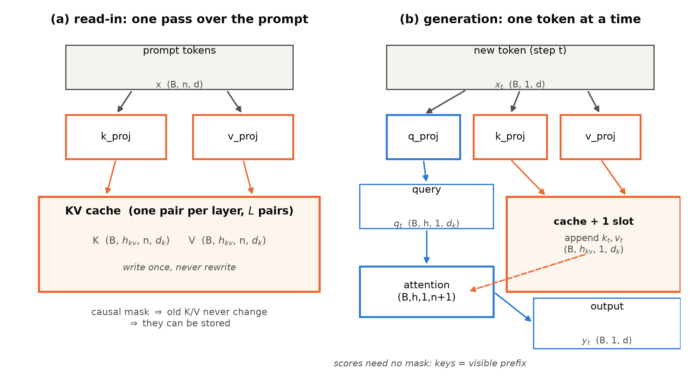
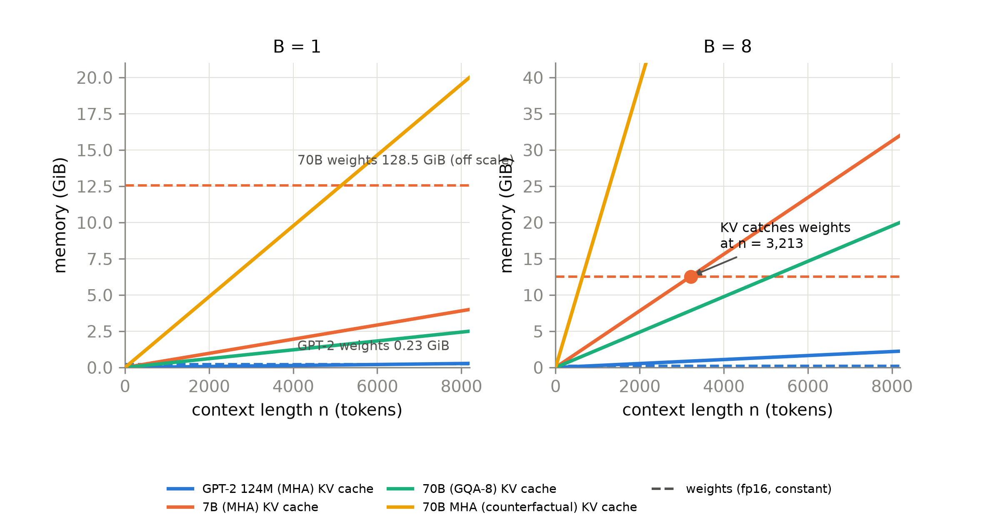
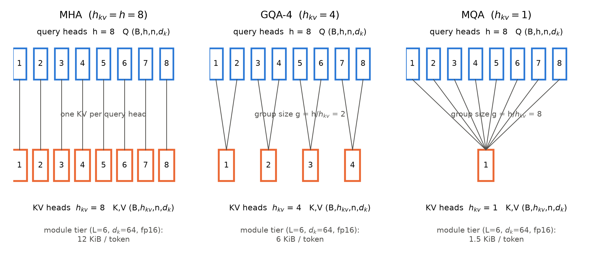
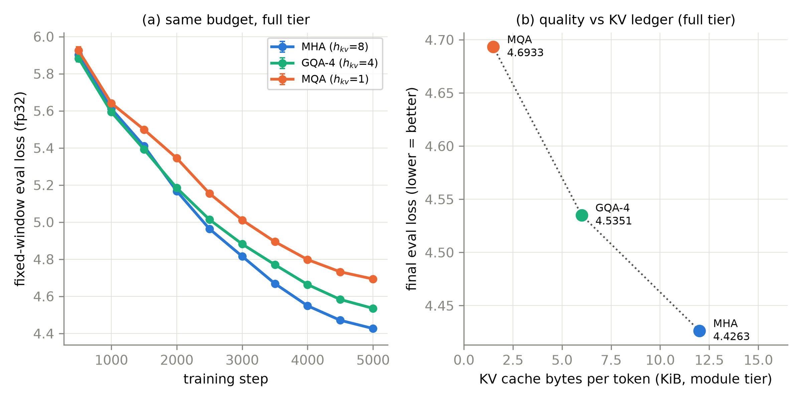

# 第 6 章 KV cache 正式登场：从 MQA 到 GQA

## 6.0 开篇：从全书到这里

上一章我们把出入口的账结清了：词嵌入与输出投影解绑，207M 的参数账逐位钉死在 207,119,360（三成付给两份嵌入，买出厂口径）；「拿到没读过的模型先读 config」的五步反推法也进了工具箱。至此 Book2 三插槽底座上的改装四连已经换了三格——归一化（第 2 章）、前馈（第 3 章）、位置编码（第 4 章）——外加出入口的附加一次改造（第 5 章），Block 里只剩注意力一格还挂着 2019 年的原装多头注意力。而上一章结尾留了半句话：动这最后一次改造之前，得先开一本新账——生成每一个 token 时，「记住前面说过什么」要付多少钱；标准整段训练也需要注意力激活，但自回归生成要在多次前向之间保留历史状态，因而形成另一种生命周期的内存成本。本章就来开它。

注意力这一次改造与前几刀有个本质不同：换 RMSNorm、换 SwiGLU、换 RoPE，同时改变训练与推理的计算，只是此前重点放在表示和训练对照；而注意力插槽的现代改装（共享 KV 头）的动机几乎全在**推理时**——不先把推理的账本立起来，这一次改造为什么该动、动多深，就无从谈起。所以本章的路线是先账本后改造：先把两册书里反复挂号的那本「推理时代的账」正式开立，算到字节、对拍到实测；再读两篇论文——2019 年一次改造砍到底的 MQA 与 2023 年砍到折中点的 GQA；然后改动、消融、验收。本章也是全书叙事从「训练侧」转向「服务侧」的转折点：从这里往后，「每个 token 要付多少钱」开始和「训到多少分」同等重要。

本章结束时，注意力插槽换装完毕，四格插座全部现代化；同时一本随上下文长度线性增长的账会立在你面前——而上下文长度，正是下一章的主角。

> **最小背景栏**：本章只需要三件行李。①因果掩码：解码器自注意里位置 $i$ 看不见 $j>i$（Book1相关章节的禁区表）；②字节的账：fp16/bf16 每元素 2 字节，$1\,\text{KiB}=1024$ 字节、$1\,\text{MiB}=1024\,\text{KiB}$（二进制口径，全书统一）；③「算力」与「带宽」之别：乘加算得快慢是算力（FLOPs），把数据从显存搬进计算单元快慢是带宽——Book2 第 9 章的工程账本里见过它们，本章只需记住「搬运也要钱，而且常常比计算贵」。

## 6.1 从重复前向提出状态复用问题

Book1用完整前缀计算每一步生成，目的是先讲清因果模型的概率语义。若依次处理长度1到9的前缀，累计计算45个位置，比只处理9个新位置多5倍。Book2的GPT-2采样器沿用这条易理解的路径，旧CPU记录中40个token的续写约1.2秒。这个数字不是缓存加速比，却指出可以进一步检查的重复工作。

要减少重复，首先必须证明哪些中间结果在追加token后仍然相同。K与V来自不同投影，分别参与打分和加权读取；缓存并不是此时才把“地址”和“内容”分开，而是把已经分开的计算结果跨步保留下来。省下计算的同时，存储持续增长，因此需要两本账：复用了哪些运算，以及保留了多少状态。

本章先建立复用条件，再算字节，最后讨论共享KV投影的MQA与GQA。这样可以清楚区分两种改造：缓存重新组织同一个模型的计算，头共享则改变模型参数化，通常需要训练或适配。

## 6.2 增量生成：因果性送的礼物

**在固定参数、固定位置规则和因果可见性下，追加未来token不会改变历史位置的逐层状态，因此历史K/V可以复用。**这个结论不是因为每层K只看一个原始token：深层输入已经包含其可见前缀。证明要沿层传播一次。

设第 $\ell$ 层位置j的输入为 $h_j^{(\ell)}$。第0层的token和位置表示由既有前缀确定，新词元只追加在末尾，不修改这些输入。假设某层全部历史位置的输入都未改变，那么位置j的查询、键、值由固定投影得到；因果注意力只读取 $i\le j$ 的键值，这些位置按假设都相同，故注意力输出相同。逐位置归一化、前馈与残差相加也相同，因此 $h_j^{(\ell+1)}$ 不变。由层数归纳，所有层历史K/V都保持一致。

RoPE的单个键使用其**绝对位置**的旋转 $R_j$，相对性在与查询做内积时出现。只要位置和频率规则保持，缓存可保存旋转后的K与未旋转的V。参数更新、改变历史前缀、改变频率表或启用不一致的随机dropout，都会破坏上述条件。后续层不能在任意这些变化发生后仍无条件复用旧缓存。

那 Q 为什么不缓存？因为 $q_j$ 只影响第 $j$ 步自己的输出，输出一旦产出、交给下一层，通常的下一词元生成不再读取旧查询，因此无需像K/V那样持久保存；这是本计算流程的复用需求，不是所有算法都不能保存Q。于是一次自回归生成在工程上自然劈成两段（全书用自然语言称呼它们）：**一次读入**——整段 prompt 一把前向，K/V 从第一层到最后一层逐层算好、写进缓存；**逐 token 生成**——每步只对新 token 做三件事：三次投影（各一个位置）、取 RoPE 表里第 $t$ 行做旋转、拿 $q_t$ 对缓存里全部 $t+1$ 个键做一场注意力。图 6.1 把两段的数据流与全部张量形状画在一起：缓存的形状是每层一对 $(B,h_{kv},n,d_k)$——K 一份、V 一份，全模型 $2L$ 张；新 token 每步只往每对里追加一格 $(B,h_{kv},1,d_k)$。



图 6.1 KV cache 数据流与形状（自绘，示意级）：左=一次读入（整段 prompt 的 K/V 一次写好），右=逐 token 生成（每步 q_t 对全缓存做注意力、缓存只追加不改写）；两段共用同一本缓存，橙色=KV 通路、蓝色=查询与输出通路

### 缓存长度怎样决定遮罩

**单个新查询只面对有效历史和自身时，没有未来列要遮；一次追加多个词元时仍需要带偏移的因果遮罩。**这比简单记“有缓存就不用mask”更准确。

假设缓存已有P个有效位置，本次再输入q个位置。查询矩阵的行号为 $i=0,\ldots,q-1$，对应绝对位置P+i；键列号 $j=0,\ldots,P+q-1$。可见条件是

$$M_{ij}=\begin{cases}0,&j\le P+i,\\-\infty,&j>P+i.\end{cases}\tag{6.5}$$

例如P=3、q=2时，第一条新查询看列0—3，第二条看列0—4，矩阵是

$$\begin{pmatrix}0&0&0&0&-\infty\\0&0&0&0&0\end{pmatrix}.$$

直接对2×5矩阵套不带历史偏移的左上三角mask会错。q=1且所有键都有效时，整行可见；若批内有padding、未写满的预分配缓存或其他可见性限制，仍需另行遮罩。Book6将讨论更复杂的请求与内存管理，本章先把数学边界固定。

现在算第一笔账。全量重算口径下，生成 $T$ 个词元累计的前向位置数是

$$\sum_{t=1}^{T} t=\frac{T(T+1)}{2} \tag{6.1}$$

这表示：越写到后面，每一步背的前缀越沉，浪费按平方涨。$T=9$ 时是 5 倍（Book1 的算例）；$T=1024$（GPT-2 满窗）时累计约 524,800 个位置，约等于把整段前向白算 **512 遍**【证据等级：本书复算】。带缓存的增量算法把每步压回 1 个新位置：同样的数学，换个记账方式就是两个数量级。这笔账在我们的机器上也有过现场——Book2 第 11 章 11.3 节实测「40 token 的 top-k 续写在 CPU 上 1.2 s，每一步都把整段 prompt 白算一遍，生成长度的平方级浪费」，当时说「这个省下的工程正是推理册要赚的第一笔大钱」；本章 `gqa.py` 的 `incremental_vs_full` 探针把同一件事重演了一遍：手写逐层缓存、逐 token 生成，与整段全量前向逐位对拍，$\max|\Delta|=1.2\times10^{-7}$（fp32 下 matmul 归约顺序的舍入差，无实质分歧），$n=64$ 时全量口径累计 2,080 个前向位置、增量口径 64 个【证据等级：本书实验（CPU fp32，2026-10）】。

这些位置数只直接衡量投影与前馈的重复。还要另算注意力：不用缓存时，第t步完整前向的成对打分数量与 $t^2$ 成正比，累计 $\sum_{t=1}^Tt^2=T(T+1)(2T+1)/6$；使用缓存时只计算新查询对t个键，累计 $\sum_{t=1}^Tt=T(T+1)/2$。因此在这个从长度1起算的简化例子里，注意力累计工作从立方量级降为平方，逐位置主体从平方降为线性。实际有prompt时还需加一次读入成本，不能把位置数比例直接称作端到端加速比。

到此第一笔账结清：缓存让每位置投影与前馈避免重复，但整机仍有随历史增长的注意力读取。但立刻冒出新问题——这些存起来的 K/V 要占多大地方？新账本开立。

## 6.3 第一本账：把显存算到字节

每个 token、每一层，要为它存 K 与 V 各 $h_{kv}$ 个头、每头 $d_k$ 个数；fp16 下每个数 2 字节。于是每 token 的缓存字节数是

$$\text{KV bytes/token}=2\times L\times h_{kv}\times d_k\times b \tag{6.2}$$

这表示：每生成一个 token，每层的每个 KV 头各记 $d_k$ 个数，K、V 各记一遍（式首的 2 就是这个「各一遍」）。式中四个量各管一件事，符号表如下（$b$ 是每个元素的字节数）：

| 符号 | 含义 | 张量形状/取值 |
|---|---|---|
| $B$ | 批内并发序列数 | 标量（服务侧杠杆） |
| $L$ | 层数 | 标量（结构杠杆） |
| $n$ | 当前缓存有效长度（含输入提示与已处理的生成词元） | 标量（使用侧杠杆） |
| $h$ | 查询头数 | $Q\in(B,h,n,d_k)$ |
| $h_{kv}$ | KV 头数 | $K,V\in(B,h_{kv},n,d_k)$；MHA 时 $h_{kv}=h$ |
| $d_k$ | 每头维度 | 标量（2017 年定下的尺寸） |
| $b$ | 每元素字节 | fp16/bf16 为 2 |
| $g$ | 组内查询头数 $h/h_{kv}$ | GQA 用（6.5 节） |

注意这四个杠杆的性质：$L$ 与 $h_{kv}\cdot d_k$ 是**结构决定**的（图纸上的），$n$ 与 $B$ 是**使用决定**的（跑起来才有）。序列级账再乘 $n$、服务级再乘 $B$。这张账统计有效缓存载荷；对恰好分配这些形状的张量可与实际载荷对齐，完整进程峰值还可能含预分配、元数据和临时工作区——表 6.1 给出几档带几何标签的手算数，`kv_probe.py` 在 MPS 上逐 case 构造真实布局的 $(B,h_{kv},n,d_k)$ fp16 张量对（每层一对、共 $2L$ 个），实测分配差与手算**逐字节相等**（7/7 case 偏差 0.00%）【证据等级：本书实验（MPS，2026-10）】。

表 6.1 KV 账本手算表（fp16、B=1；几何标签随行，防两套几何混用）

| 模型（几何标签） | $h_{kv}$ | KV/token | n=1024 | n=2048 | n=4096 | n=8192 |
|---|---|---|---|---|---|---|
| GPT-2 124M（L=12, h=12, $d_k$=64, MHA） | 12 | 36 KiB | 36 MiB | 72 MiB | 144 MiB | 288 MiB |
| 207M cand1（L=12, h=16, $d_k$=64, GQA） | 8 | 24 KiB | 24 MiB | **48 MiB**✓ | 96 MiB | 192 MiB |
| ↳ 同几何反事实 MHA / MQA | 16 / 1 | 48 / 3 KiB | — | **96 / 6 MiB**✓ | — | — |
| 216M 三兄弟·MHA（L=16, h=16, $d_k$=64） | 16 | 64 KiB | — | **128 MiB**✓ | — | — |
| 216M 三兄弟·GQA-4（L=16） | 4 | 16 KiB | — | **32 MiB**✓ | — | — |
| 216M 三兄弟·MQA（L=16） | 1 | 4 KiB | — | **8 MiB**✓ | — | — |
| LLaMA1-6.7B（L=32, $d_k$=128, MHA） | 32 | 512 KiB | 0.5 GiB | 1 GiB | 2 GiB | 4 GiB |
| LLaMA2-70B（L=80, h=64, $d_k$=128, GQA-8） | 8 | 320 KiB | — | 0.625 GiB | 1.25 GiB | 2.5 GiB |
| ↳ 70B 反事实 MHA | 64 | 2.5 MiB | — | 5 GiB | **10 GiB** | 20 GiB |

（✓=kv_probe 实测逐字节吻合；加粗=正文引用的锚点数字。来源：GPT-2 与 LLaMA 档几何=官方论文 Table 2/1，207M 与三兄弟=本册 config 定版，全部字节数={本书复算}）

读这张表要有两眼。第一眼看**时代**：GPT-2 124M 满窗 KV 才 36 MiB，权重 0.23 GiB——KV 只占一成半，2019 年这不是一本大账（当年痛在重算的计算量）；到 7B 档 8k 窗就要 4 GiB、70B 档若不用 GQA 则 4k 窗就要 10 GiB，账本长成了硬约束。第二眼看**剪刀差**：权重是常数——装进显存就不再动；KV 是过原点的直线——斜率正是式 (6.2)。图 6.2 把两族线画在一起：7B 档（fp16 权重 12.55 GiB，按第 5 章式 (5.2) 的精确参数 6,738,415,616 计）在并发 $B=8$ 时，单条序列的平均 KV 只要 **3,213 个 token**就追平权重（$B=1$ 时 25,705）【证据等级：本书复算】；同一张图上，70B 反事实 MHA 的 KV 线在 $B=8$ 下约 640 个 token 就烧掉一部 7B 的身家（12.55 GiB），而真身 GQA-8 的直线斜率只有它的八分之一。服务一个模型，「常驻成本」与「随用量长的成本」从此要分开记账。



图 6.2 剪刀差（自绘）：实线=KV cache 随上下文线性增长（斜率=式 6.2），虚线=权重（常数）；左 B=1、右 B=8；橙点=7B 档 B=8 时 KV 追平权重的位置（n=3,213，按精确参数 6,738,415,616 复算）。70B 权重 128.5 GiB 超出量程

### KV存储和注意力计算为什么要分开核算

**头共享主要减少可复用的键值表示与其读取量，查询侧的历史打分仍按h个头进行。**以B=1、已有n个位置的一次生成步为例，QK打分和AV读取各约 $2Lhnd_k$ FLOPs，合计

$$C_{\rm attn}\approx4Lhnd_k,\qquad
M_{\rm KV}=2Lh_{kv}nd_kb.\tag{6.6}$$

二者相除，得到仅针对这一部分计算与理想一次KV读取的强度

$$I_{\rm attn}\approx\frac{2h}{h_{kv}b}\quad\text{FLOPs/byte}.\tag{6.7}$$

取7B几何L=32、h=h_kv=32、d_k=128、n=4096、b=2，KV载荷为2GiB，对应注意力两次矩阵乘约 $2.15\times10^9$ FLOPs，即约1 FLOP/byte。旧稿把它与约13GFLOPs的主体参数前向近似相配，混合了两类工作；后者还要读取权重，不能只用KV字节当分母。

若h保持32而h_kv降为1，注意力主乘法数近似不变，理想KV读取量降到1/32，局部强度升到32 FLOPs/byte。但整机仍有权重读取、投影、前馈和实际内核开销，不能据此宣布延迟必然快32倍。这个分项核算说明了MQA为什么值得研究，也明确了实验需要验证什么。

## 6.4 省账本的第一次改造：MQA

要对式 (6.2) 改动，先看哪个变量砍得动。$d_k$？2017 年就告诉我们砍它伤质量（6.6 节细说）。$L$？砍层等于砍深度。$b$？每位数上的事先记账不展开。$n$ 和 $B$ 是用户给的，轮不到图纸管。剩下一个：**份数 $h_{kv}$**——而且它表示独立学习的键值投影组数，不能视为原本相同张量的无意义副本：32 个查询头各自配一套 K/V，用的是同一份 $x_j$、同样的 $d_k$，凭什么要 32 份？

2019 年 11 月，Shazeer 一个人把这一次改造砍到底：**多查询注意力（Multi-Query Attention, MQA）**——$h$ 个查询头原封不动，K 与 V 各只留 **1 个头**，全部查询头共享【证据等级：官方论文 1911.02150v1 §3】。用本章的符号说就是 $h_{kv}=1$：式 (6.2) 的账直接除以 $h$，7B 档每 token 从 512 KiB 落到 16 KiB。形状上，$(B,h,n,d_k)\to(B,1,n,d_k)$——头维只剩一格、可直接挤掉，故也记作 $(B,n,d_k)$。注意每一头的 $d_k$ 一毫米没动——这句朴素的话是 6.6 节的钥匙。

刀砍了，质量掉多少？Shazeer 的实验设计本身就是教学范例：WMT14 英德翻译，6 层 encoder-decoder，基线与 MQA 版**全部对齐到 211M 参数**——省下的 KV 投影参数用加宽 FFN 补回（$d_{ff}$ 4096→5440），参数总量对齐，但注意力与FFN的容量分配一起改变，应把它看成同预算结构方案比较。结果见表 6.2 上半：对数困惑度 1.424→1.439，BLEU 26.7→26.5——掉了，但掉得很少；beam-4 测试集上反而 28.4→28.5 拿了全场最高（噪声级反超，如实记录、不作文章）。真正有冲击力的是**替代方案行**：同样把参数补齐，砍头数或缩每头维度（$h{=}1$、$h{=}2/d_k{=}64$、$h{=}4/d_k{=}32$、$h{=}8/d_k{=}16$）的四个方案，Billion-Word 语言建模上 PPL 29.9→31.2/31.1/31.0/30.9，全都掉 1.0 以上；共享 KV 只掉 30.2（+0.3）【证据等级：官方论文 1911.02150v1 Table 1/3，PDF 逐字核过】。省同样多的 KV，砍「份数」远比砍「每份大小」便宜。

表 6.2 MQA/GQA 论文数字重排（质量行为 MHA 基线 → 共享方案；速度为 MQA 论文 TPUv2 与 GQA 论文 TPUv4 各自口径，不可跨论文并比）

| 来源与设置 | 对比项 | 数字 | 读法 |
|---|---|---|---|
| MQA·WMT14（6 层，211M 对齐） | ln PPL (dev) | 1.424 → 1.439 | 税 +0.015 |
| 同上 | BLEU dev / test(beam4) | 26.7→26.5 / 28.4→28.5 | 后者噪声级反超 |
| MQA·Billion-Word（192M 对齐） | dev PPL | 29.9 → 30.2 | 税 +0.3 |
| 同上·替代方案四行 | dev PPL | 31.2 / 31.1 / 31.0 / 30.9 | 砍头缩维税 +1.0~1.3 |
| MQA·速度（TPUv2） | 解码器 µs/token | 46 → 3.8（≈12.1 倍） | 带宽瓶颈的直接兑现 |
| 同上 | 编码器 µs/token / 训练步 ms | 1.7→1.5 / 433→425 | 读入与训练几乎不动 |
| GQA·T5-XXL 五任务平均 | 平均分 | MHA 47.2 / GQA-8 47.1 / MQA 46.6 | GQA-8 与 MHA 差 0.1 |
| GQA·推理时（TPUv4，样本级） | $T_{infer}$ s/样本 | 1.51 → 0.28（GQA-8，≈5.4 倍）/ 0.24（MQA，≈6.3 倍） | 口径≠MQA 论文的逐 token 微基准 |
| GQA·uptraining | 转换/续训 | Mean > First > Random；α=0.05 | T5-XXL 约 600 TPUv3 芯片日 |

速度才是这篇论文的题眼：解码器每 token 摊销耗时 **46 µs → 3.8 µs，约 12.1 倍**（beam-4 解码也有 203→32 µs、约 6.3 倍）；而编码器几乎不动、训练步几乎不动。「哪快哪不快」恰好把瓶颈指给你看——Shazeer 在 §1 写得直白：增量推理的速度「受限于重新装载那些编码注意力层状态的大型 keys 与 values 张量所需的内存带宽」（"limited by the memory bandwidth necessary to reload the large 'keys' and 'values' tensors"），而现代硬件上「计算能力可以比内存带宽高两个数量级」【证据等级：官方论文 §1/§2.3.1，原文直引】。逐 token 生成是搬运受限的：一次读入整段算 K/V 时数据被复用得足足的，带宽不疼；只有每步搬 2 GiB 只做 13 GFLOPs 的增量步疼（6.3 节的账头在此兑现）。论文的复杂度分析把这话写成了式子：增量 MHA 每步的访存/计算比为 $\Theta(n/d+1/B)$（这里B是批量，论文记b；不要与每元素字节混用），MQA 把 $n/d$ 项砍掉 $h$ 倍【证据等级：官方论文 §2.4.1（节号经 PDF 目录复核）】。论文在该执行设置中把主要收益联系到较小的KV访存；KV投影乘法也减少，但不能把端到端倍率简单等同于某一项计数——记住这个口径，6.8 节我们自己实测时会再撞见它。

这么好的东西，为什么 2019 年没人理？时间线说明一切【证据等级：官方论文/技术报告/config 逆向，逐条】：2019-11 论文发表，无修订、引用寥寥——后来采用者逐步面对更大的状态与吞吐约束；不能仅由发表与采用时间判断此前无人关注；2022-04 **PaLM**（8B/62B/540B）全系采用，原话是 MQA「对模型质量与训练速度呈中性影响，却在自回归解码时显著节省成本」，前沿大厂第一次把它当默认件；2022-11 Google 服务侧的 Pope et al. 从推理经济学论证 MQA 配合模型切分可把上下文做长 32 倍；2023 年两记重锤——GQA 论文把它推广成分组、LLaMA2 在 34B/70B 上采用 GQA；2023-09 Mistral-7B 让 7B 档也用上 8 组；2024-07 Llama 3 全系 GQA-8，出厂默认化完成。**一篇 2019 年的论文，等它的时代等了三年**——等的就是 6.3 节那本账长成硬约束的过程。

## 6.5 不砍到底的智慧：GQA

MQA 留了两个尾巴。其一，$h_{kv}=1$ 砍得太狠，质量税在更大模型上会更疼——头数随规模涨（PaLM 540B 有 48 头、LLaMA2-70B 有 64 头），一次改造切到 1，削减比例越来越凶。其二更工程：服务大模型要把层内计算切到多卡，**1个KV头不能按多头方式均分到多卡**，常见的按头切分实现会在卡间复制该头，减少分片后的收益；并不意味着相对MHA完全没有节省（下文 LLaMA2 的服务侧定夺正是为此选了 8）。2023 年 5 月，Google 的 Ainslie 等人给出松紧可调的推广——**分组查询注意力（Grouped-Query Attention, GQA）**：「GQA 把查询头分成 $G$ 组，每组共享一个键头与一个值头」【证据等级：官方论文 2305.13245 §2.2，原文直引】。用本书符号：$h_{kv}=G$，组内 $g=h/h_{kv}$ 个查询头共用一组 K/V；边界处 $G=1$ 即 MQA、$G=h$ 即 MHA——MQA与MHA是离散组数选择的两端；通常要求h能被h_kv整除，GQA 是旋钮本身。图 6.3 画出三档头分组；配对规则是**组内连号**：

$$\text{第 } i \text{ 个查询头（编号自 0 起）配第 } \left\lfloor i/g \right\rfloor \text{ 个 KV 头},\qquad g=\frac{h}{h_{kv}} \tag{6.3}$$

这表示：查询头按相邻 $g$ 个一组切，第几组就看几个 KV 头——不是隔一个取一个。这个细节写错不会报错、只会静默掉分（HF 的头序正是连号共享，`repeat_kv` 组内相邻扩张）。



图 6.3 MHA/GQA-4/MQA 头分组示意（自绘，h=8）：上行=查询头（蓝，$(B,h,n,d_k)$），下行=KV 头（橙，$(B,h_{kv},n,d_k)$），连线=共享关系；底注=统一模块档（L=6、$d_k$=64、fp16）的 KV 每 token 字节

GQA 论文自己最硬的贡献是 **uptraining（检查点改造+短续训）**：已有的 MHA 大模型不必从头重训。两步——第一步改造检查点，把原 $h$ 组 KV 投影按组**平均池化（mean-pool）**成 $h_{kv}$ 组：

$$W^K\in(d,\,h\cdot d_k)\ \xrightarrow{\text{view}}\ (d,\,h_{kv},\,g,\,d_k)\ \xrightarrow{\text{mean over }g}\ (d,\,h_{kv}\cdot d_k) \tag{6.4}$$

（$W^V$ 同理；用人话说——把 $g$ 张索引卡叠印成一张，而不是撕掉 $g-1$ 张）。第二步按原配方原数据续训原始步数的 $\alpha$ 比例，主实验 $\alpha=0.05$（T5-XXL 约花 600 TPUv3 芯片日）。转换方式的消融给出直觉舒服的排序：**Mean > First（取第一头）> Random（重初始化）**——保留信息多者胜。续训比例的消融更有信息量：GQA 转换完**不续训就基本能用**，MQA 不续训明显塌；两者都在 5% 处增益显著、10% 后边际递减——「砍得越狠越依赖补课」，GQA 的折中点体质在这里已经显形【证据等级：官方论文 2305.13245 §2.1/§3.1，Fig 4/5】。

主结果收进表 6.2 下半的 GQA 行（T5-XXL 五任务平均）：MHA 47.2 分、GQA-8 47.1 分、MQA 46.6 分；推理时间 1.51 s → 0.28 s（≈5.4 倍）/0.24 s（≈6.3 倍）【证据等级：官方论文 Table 1；倍数=本书复算】。论文摘要的自我总结是「uptrained GQA 以接近 MQA 的速度取得接近 MHA 的质量」——慢 MQA 一点点，把质量税几乎抹平。组数从 1 加到 8 只添很少推理开销、再往上（16/32/64 直到 MHA）代价递增，该设置中的GQA-8是一个质量与时间折中；8不是所有头数、硬件和任务的最优组数【证据等级：官方论文 Fig 6】。

另有两个边注值得带走：其一，GQA 论文把共享 KV 同时用在 decoder 自注意与交叉注意、却**不用于 encoder 自注意**——encoder 整段并行计算，数据搬得足足的，带宽不是瓶颈；「论文重点检验了逐token生成中这类节省」这个判断，在两篇论文里各出现了一次。

其二，附录 A 藏着一条训练侧的诚实记录：从头训的 MQA 在预训练中频繁 loss spike、长输入任务微调直接发散，uptrained 的 MQA 稳一些但方差大，uptrained 的 GQA 稳定——作者明说没深究根因。Book2 第 9 章那些 loss spike 的噩梦在这里有了新主角：**砍 KV 头也是训练稳定性的变量**，这为「GQA 比 MQA 温和」再添一票【证据等级：官方论文 2305.13245 附录 A】。

> **【考据框】「LLaMA2 只有 70B 用了 GQA」是讹传。**论文 Table 1 明列 **34B 与 70B 两档打 ✓**（7B/13B 打 ✗），表注原话 "Bigger models — 34B and 70B — use Grouped-Query Attention (GQA) for improved inference scalability"；34B 一档训而未发（脚注：来不及做足够的安全测试），江湖便只记住了 70B。而「LLaMA2 用了 GQA」这句话本身也是偷懒的说法——**7B 与 13B 至今是 MHA**（32 个 KV 头，config 逆向可证），Falcon-40B 也常被讹传为 MQA，实际 config 是 8 个 KV 头的分组共享。引用代际事实，一律回到 Table 1 与 config 双锚。

LLaMA2 的附录 A.2.1 是这场落地的完整案卷：动机句正是 6.3 节的账——「随着上下文窗或批大小增长，MHA 模型中 KV cache 尺寸相关的内存成本显著增长」；消融固定 **30B 规模、150B token**，三臂 MHA/MQA/GQA，**参数补齐协议**与 Shazeer 同思路（MQA 的 FFN ×1.33、GQA ×1.3）。Table 18 逐任务互有胜负——MMLU 三臂 28.0/26.5/26.9，HumanEval 7.9/7.3/7.9，GQA 的 BoolQ 反而最低——论文自己的读法是「GQA 与 MHA 基线大体相当、平均好于 MQA」，**不是全面碾压**【证据等级：官方技术报告 2307.09288 A.2.1/Table 18】。值得你我多看一眼的是它的实验哲学：单变量、同预算、参数补齐——与我们 6.8 节的等参数三臂同款思想，只是它用 FFN 放大补参数、我们用几何等参，第 8 章对照。服务侧的定夺同样写在那页：最大模型按单机 8×A100 部署，MQA 的 1 个 KV 头少于卡数没法沿头切、只能全卡复制（KV 账等于 GQA）；GQA-8 与 8 卡天然对齐。Figure 24 的吞吐-批曲线给出账本的可视化证词：**MHA 在 ctx=256 时 batch 1024 直接 OOM、ctx=2k 时 batch 128 就 OOM；MQA/GQA 一路跑到实验上限**【证据等级：官方技术报告 Fig 24 题注】。此后 Llama 3 全系 GQA-8（「8 个 key-value 头，以提升推理速度并缩减解码期 KV cache 尺寸」，Table 3 三档 KV 头均 8）【证据等级：官方技术报告 2407.21783 §3.2/Table 3】——从 70B（64 查询头/8 KV 头，$g=8$）到 405B（128/8，$g=16$），**查询头翻倍、KV 头不动**；全系 KV/token 只随层数缓涨（8B/70B/405B 按式 (6.2) 得 128/320/504 KiB）——Q 头数随规模涨、KV 账本被钉住，GQA「等比例省」在大谱系上就是这个样子【证据等级：本书复算（config 观察）】。

> **【实现对照框】HF transformers 5.18.0 的 GQA 落点**（`modeling_llama.py`）：`repeat_kv`（L179-188）三步 `[:, :, None]`→`expand`→`reshape` 把 $(B,h_{kv},n,d_k)$ 撑回 $(B,h,n,d_k)$，`n_rep==1` 直通——「GQA-$h$=MHA」的代码形态；组规模唯一真源是 `num_key_value_groups = num_attention_heads // num_key_value_heads`（L225）；`k_proj/v_proj` 的输出宽度就是 `num_key_value_heads * head_dim`（L234/237）——**KV 投影的省，可见于形状本身**。config 侧 `num_key_value_heads` 缺省回填 `num_attention_heads`：**默认 MHA，GQA 是显式声明才有的形态**，历史层积就写在默认值里。KV cache 的写入点在 L262（`past_key_values.update`）。一个本机实测的细节：`expand` 只给视图、`reshape` 落盘**真复制**（写穿透测试：改输出不动输入、两存储独立）——repeat 视图在算子内临时撑回 $h$ 份，**缓存里始终只有 $h_{kv}$ 份**。省的是常驻账本，不是瞬时工位。

## 6.6 机制回顾：不是 2017 错了，是账本变了

四节下来，一个反问已经憋在你喉咙里：Book1相关章节明明说过，**缩 $d_k$ 伤质量**——2017 年的 (B) 行消融里 $h{=}8$ 固定、$d_k$ 64→32→16，BLEU 单调变差；现在你告诉我把 KV 头从 32 砍到 8 甚至 1，每头 $d_k$ 不动、几乎不掉分？这两件事不矛盾吗？

不矛盾，因为改变的是不同维度。缩小d_k会改变单头打分空间；减少查询头h会减少并行读取方式；保持h和d_k、减少h_kv，则让多个查询在同一组键和值表示上分别计算注意力。查询头仍可产生不同分布，但不能再各自拥有完全独立的K/V投影。

用h=4、h_kv=2的小例子看得更具体。头0、1使用第0组K/V，头2、3使用第1组。即使共享K/V，$q_0$与$q_1$不同，softmax后的权重和输出仍可不同；但如果任务需要这两个头在不同键表示空间里匹配，结构就施加了约束。**保存的份数减少与表示自由度改变是同一项设计的两面**，不能说表征容量与搬运账单完全解耦。

MQA论文的替代方案和GQA/LLaMA2的比较说明，在它们的训练设置中，这种约束有时比直接缩查询头或头维更合算。质量差0.2 BLEU、0.3 PPL或0.1平均分分别来自不同任务，不能拼成无条件定律。后面的本书实验也保留其参数差与单种子边界。

这个论断在我们自己机器上也有现场。可行性探针曾把模块档（$h{=}8$）一次改造砍到 $h_{kv}{=}2$ 跑 150 步：loss 比 GPT-2 底座高 **0.28 nat**——粗砍档的质量税当场显形；而 6.8 节的正式消融里，KV 头从 8 砍到 4 再砍到 1，质量单调付税（+0.11、再 +0.16 nat）。砍得越狠、税越重，旋钮的位置感，两档实验都给了同一方向的读数【证据等级：本书实验（MPS，2026-10）】。

## 6.7 改装第四例：注意力插槽改动

账立了、论文读了、灵魂收了，现在改动。底座还是 Book2 第 10 章的三插槽 Block：注意力的原装是 GPT-2 式 **c_attn 合并投影**——一个 $(C,3C)$ 的矩阵把 Q/K/V 一次算完（Book1相关章节的多头入场券）。这一次改造要把它拆开，而且拆成**两种宽度**：

- $W^Q\in(d,\,h\cdot d_k)$ 与 $W^O\in(h\cdot d_k,\,d)$：查询与输出**全宽**，一点不动；
- $W^K,W^V\in(d,\,h_{kv}\cdot d_k)$：KV 投影**窄**——207M 档 $d{=}1024$、$h{=}16$、$h_{kv}{=}8$、$d_k{=}64$ 下，q_proj 是 $(1024,1024)$、k_proj/v_proj 是 $(1024,512)$，每层注意力参数 $2d^2+2d\cdot h_{kv}d_k=3{,}145{,}728$（`gqa.py` 探针 6 手算=实测逐位）【证据等级：本书实验（CPU fp32，2026-10）】。

窄在这里、只在这里：**KV 的账本省在投影端，不在注意力计算端**。整条数据流的形状流转收进表 6.3：

表 6.3 GQA 插槽形状流转表（单层；$g=h/h_{kv}$，缓存形状随行标注）

| 步骤 | 运算 | 输入形状 | 输出形状 | 说明 |
|---|---|---|---|---|
| 1 | q_proj + view/transpose | $(B,n,d)$ | $(B,h,n,d_k)$ | 查询头全宽 |
| 2 | k_proj / v_proj + view/transpose | $(B,n,d)$ | $(B,h_{kv},n,d_k)$ | K在下一步旋转后入缓存；V可直接入缓存 |
| 3 | RoPE（第 4 章插槽） | 同上 | 形状不变 | 只旋 q/k；v 不转 |
| 4 | repeat_kv | $(B,h_{kv},n,d_k)$ | $(B,h,n,d_k)$ | 组内连号复制（式 6.3） |
| 5 | 打分×scaling | $(B,h,n,d_k)\!\cdot\!(B,h,d_k,n)$ | $(B,h,n,n)$ | 因果掩码作用于此 |
| 6 | softmax（fp32）+ 加权 | $(B,h,n,n)\!\cdot\!(B,h,n,d_k)$ | $(B,h,n,d_k)$ | 对拍五约定之一 |
| 7 | 拼头 + o_proj | $(B,h,n,d_k)$ | $(B,n,d)$ | 输出全宽回残差流 |

步骤 4 有两种等价写法。**repeat 视图**（上表）：把 $(B,h_{kv},n,d_k)$ 沿头维撑回 $(B,h,n,d_k)$，然后整段注意力代码一行不改地照跑——接口统一，HF eager 路径即此。**分组视图**：把查询重排成 $(B,h_{kv},g,n,d_k)$，与 $(B,h_{kv},1,n,d_k)$ 的 KV 广播计算——表达式无需显式复制KV；底层广播、矩阵布局与内核是否产生临时量仍要检查。两种写法输出逐位一致（`gqa.py` 探针 3 实测 $\max|\Delta|=0$）；repeat 视图的复制发生在算子内的临时工位上（探针 4 的写穿透证据），缓存本体始终 $h_{kv}$ 份。教学件 code/ch06/gqa.py 的 `GroupedQueryAttention`（契约签名 `forward(x, cos, sin)`，cos/sin 由第 4 章的 `rope.py` 供给）用 repeat 视图落地，与组件库对应实现 `llama_slots.GroupedQueryAttention` 在 MHA/GQA/MQA 三档逐位一致（$\max|\Delta|=0$），手写 `repeat_kv` 与 HF `modeling_llama.repeat_kv` 在四个 $n_{rep}$ 档全部 `torch.equal`【证据等级：本书实验（CPU fp32，2026-10）】。想看 C 语言版的最朴素实现，llama2.c（MIT）的 `run.c` 是现成参照——一块启动时分配的静态数组、逐 token 写入第 $pos$ 格，与本节手写 cache 同构；Raschka 的 bonus 章有 M4 机器上的基准数字【证据等级：厂商自报】。

刀落下去，整机图景里的一格换了件：Block 四格插座——归一化、前馈、位置、注意力——至此**全部现代化**，加上第 5 章出入口的解绑，207M 档的图纸与 LLaMA 出厂口径只差组装（第 10 章的事）。但改动之前悬着的问题还没验收：砍份数到底付多少质量税？下一节用受控实验回答。

## 6.8 组数扫描：省账本要付多少质量税

协议沿用第 2、3 章的统一协议（实验比较条件见本节）：统一模块档 $d{=}512$/$L{=}6$/$h{=}8$/$V{=}8192$、$B{=}16$/$T{=}512$（8192 token/步），Book2 五件套配方，同种子同数据批；三臂唯一变量是 KV 头分组——**mha8**（$h_{kv}{=}8$）/ **gqa4**（$h_{kv}{=}4$）/ **mqa1**（$h_{kv}{=}1$），对应 KV/token 12 KiB / 6 KiB / 1.5 KiB，严格 8:4:1。参数差如实标注：模块档**不做 FFN 补齐**（三臂 23,621,632 / 22,048,768 / 20,869,120，差量全在 k/v 投影宽度）——等参数补齐版正是表 6.1 里的 216M 三兄弟（$L{=}16$/V=8192 几何，三臂逐位同为 216,006,656），**只算账不训练**，作参照系；三臂数字汇成表 6.4。

表 6.4 组数扫描消融（统一模块档；eval=固定 49 窗 401,408 token、fp32；单种子；s/step 为 full 稳态）

| 臂 | $h_{kv}$ | 参数 | KV/token | tail300（fast/full） | eval_final（fast/full） | s/step |
|---|---|---|---|---|---|---|
| mha8 | 8 | 23,621,632 | 12 KiB | 5.5709 / 4.3929 | 5.5505±0.0117 / **4.4263±0.0120** | 0.1932 |
| gqa4 | 4 | 22,048,768 | 6 KiB | 5.5607 / 4.5116 | 5.5434±0.0120 / **4.5351±0.0127** | 0.2855 |
| mqa1 | 1 | 20,869,120 | 1.5 KiB | 5.6041 / 4.6653 | 5.5894±0.0116 / **4.6933±0.0131** | 0.2061 |

三臂的固定窗 eval 曲线与「质量-KV」反向读数并排见图 6.4：左图三条曲线的相对位置就是质量排序，右图把终评对着 KV 字节画——账本每便宜一档（横轴左移），纵轴单调上抬。



图 6.4 组数扫描消融（自产，统一模块档，full 5000 步，单种子）：左=固定窗 eval 曲线（误差棒=49 批批间 se）；右=终评对 KV 每 token 字节——质量降序与 KV 字节降序的反向关系【证据等级：本书实验（MPS，2026-10）】

full档（5000步、41M token、三臂同日程退火）在本次单种子运行中得到明确排序，也把 fast 档的一层薄雾吹开了：**mha8 4.4263 < gqa4 4.5351 < mqa1 4.6933**——预注册的质量排序严格成立，KV 头从 8 砍到 4、再砍到 1，质量付 **0.109 与 0.158 nat**（批间带宽的 9 倍与 13 倍）；三臂全程无发散、训练与 eval 曲线单调健康【证据等级：本书实验（MPS bf16 训练/fp32 eval，2026-10，独占窗口）】。而 fast 档曾把 gqa4 与 mha8 的差距读进噪声带（−0.007 nat）——回看 full 的 eval 轨迹，这差距是随训练**长出来**的：1000 步 −0.019（gqa4 尚略优、仍在噪声带内），约 2000 步过零，2500 步 +0.050、3500 步后稳定在 +0.11 一线。fast与full回答不同训练阶段的结果，不能用早期近似持平保证更长训练也相同：欠训练档上「容量砍半」的税还没显影——与第 3 章门控前馈的教训同款（效应量随训练显影），档位限定必须写满。

判读按预注册走三条。**质量主判据**：排序 $mha8\le gqa4\le mqa1$ 成立且 full 档严格单调；fast 档的「GQA-4 近似无损」读数如实撤回，登记为欠训练档现象（1000 步内差距未显影）。**本章主判据——质量-KV 反向关系**：KV 字节 12→6→1.5 KiB 严格 8:4:1 下降，质量 4.426→4.535→4.693 单调上升——账本每省一档，质量付一档税，反向关系比 fast 档更干净。**速度副判据（单独报，不与质量混算）**：full 稳态 gqa4 反而慢 48%（0.2855 vs 0.1932 s/step）、mqa1 慢 7%（0.2061）；repeat_kv的临时物化是可能因素，当前结果不足以隔离全部算子代价（6.7 节探针 4 的现场版）：KV常驻状态减少，但训练阶段的内核成本和总参数也改变；不能由这组计时反推出每一项瓶颈；与 MQA 论文解码加速 12 倍的口径（带宽语境、TPU）分开各说各话，勿并比。这恰好是 6.4 节那句「12 倍来自省搬运不来自省乘加」的本地注脚：我们的训练循环每步都做全量前向（数据搬得足足的），账本上的节省要等到逐 token 生成时才兑现——推理时代的收益，训练台上量不到。

这笔税的成分还要拆开看：模块档**不做参数补齐**，gqa4/mqa1 比 mha8 少 6.7%/11.6% 参数——税里既有「共享 KV」也有「参数变少」两份贡献，单变量是几何（KV 头分组），参数差量随行标注。补齐了参数的受控桌（LLaMA2 A.2.1 的 FFN ×1.3、30B/150B token）读到的才是「GQA 与 MHA 大体相当」；我们的 216M 等参数三兄弟正是那张桌子的只算账版（表 6.1）。两桌并读，207M 定版选 $h_{kv}{=}8$（16 个查询头、组内 2 头）而不是 4 或 1 的理由就齐了：小模型欠训练档上砍狠了真疼，「GQA-8 折中点」要靠规模与参数补齐来买。

档位限定照统一协议说满：单种子、fast=1000 步/full=5000 步、8192 词表欠训练小档；方向也仅由本设置支持，迁移到其他设置需要验证，「差距的精确数值」是本种子本档位的实测。把三个时间尺度并排看——探针 150 步 $h_{kv}{=}2$ 粗砍档 +0.28 nat（6.6 节）、full 5000 步 $h_{kv}{=}4$ +0.109、$h_{kv}{=}1$ +0.267——这些不同设置的点不能共同证明损失随砍幅和训练时长普遍单调变化，旋钮的位置感比任何单一数字都更有教学价值。

## 6.9 本章小结

本章先证明缓存复用的条件，再讨论改变KV投影组数的架构取舍。前者在参数、位置规则和因果可见性固定时，重新组织同一模型的计算；后者减少独立键值表示，改变模型函数，通常需要训练或检查点适配。两种变化不能混称为无损压缩。

缓存的有效载荷由层数、KV头数、头维、元素字节和有效长度共同决定。投影与前馈可避免历史位置重算，注意力仍要读取可见历史；因此“增量生成”不等于整个生成过程变成线性计算。分项核算存储、乘法与搬运，才知道GQA能节省哪部分。

**需要保留的判断是：共享表示换取较少状态，收益和代价同时存在。**本书full组数扫描得到MHA损失最低、GQA居中、MQA最高的历史结果，并且手写GQA训练未加速；论文中的解码加速发生在其他模型与内核条件下。把这些条件带回每个结论，才可以用架构知识指导新的配置选择。

放回全书旅程：Block 的四格插座至此全部换完，207M 的图纸与 LLaMA 出厂口径只差组装。而本章立起来的这本账，把一个变量推到了聚光灯下——**上下文长度 $n$ 正是 KV 账本的主变量**：把 2k 的窗拉到 8k，KV 直线斜率不变、账面直接翻四倍。可是先撞墙的还不是显存——是位置编码：第 4 章我们拆了 RoPE 的结构，却没回答「训练时只见过 2k 以内位置的模型，推理时喂 8k 会怎样」。下一章就撞这面墙，并学会三种「训练后租窗」的配方。

> **【欠账】** KV 这本账开立之后，省它的路子从此分三股——架构侧（把 $h_{kv}$ 再往小做只是第一次改造）、精度侧（每位数上省）、淘汰侧（该忘的就别留），三股怎么拧、各值多少钱是 Book6 第 3/5 章的正题；而架构侧更深的一次改造——把 $h_{kv}\cdot d_k$ 本身做更低秩的折叠——属于 Book4 第 6 章。本册把账立好，收账的留给他册。

## 6.10 动手验证

- **教学重写件与三重对拍**（CPU 秒级，6.2/6.7 节全部自测数字的来源）：
  ```bash
  cd 工作区根目录 && source env.sh && \
    python code/ch06/gqa.py
  ```
  预期产出：对拍① 与 llama_slots 对应实现三档（MHA/GQA-4/MQA）$\max|\Delta|=0$；对拍② 手写 repeat_kv 与 HF `modeling_llama.repeat_kv` 四个 $n_{rep}$ 档 `torch.equal=True`；对拍③ 分组视图与 repeat 视图 $\max|\Delta|=0$；写穿透（改 y 不动 x）；增量 vs 全量 $\max|\Delta|=1.2\times10^{-7}$（$n{=}64$ 时 2,080 对 64 个前向位置）；207M 档每层注意力参数 3,145,728（手算=实测）。
- **KV 账本 probe**（秒级，表 6.1 实测列的来源）：
  ```bash
  cd 工作区根目录 && source env.sh && \
    python code/ch06/kv_probe.py --out-name kv_probe
  ```
  预期产出：手算表（三模型×三方案×三窗长）+ 两套命名账（207M@2048=48 MiB，MHA 反事实 96/MQA 6；三兄弟 128/32/8 MiB，参数逐位 216,006,656）+ 实测 7/7 逐字节吻合（MPS；产物落 `log/book3-ch06/`）。
- **组数扫描消融**（fast ≈12 min 三臂 / full ≈58 min 三臂，MPS 独占窗口、单进程顺序执行）：
  ```bash
  cd 工作区根目录 && source env.sh && \
    python code/ch06/ablation_gqa.py --steps 1000 --out-name fast
  python code/ch06/ablation_gqa.py --steps 5000 --out-name full
  ```
  预期产出：`log/book3-ch06/ablation_gqa_{fast,full}.json` + `curve_{臂}_{档}.csv`；三臂参数 assert、KV 几何账随 JSON 输出。
- **复画图 6.1-6.4**（秒级；图 6.4 需先有消融产物，full 在则自动用 full）：
  ```bash
  cd 工作区根目录 && source env.sh && \
  ```
- **验收点**：能手算任一模型任一 $(n,B)$ 的 KV 显存并说出四个杠杆里哪两个是结构决定的；能解释 MQA 的 12 倍为什么来自带宽而本机训练台上量不到；能把「不是 2017 错了，是账本变了」的三步论证独立复述；能写出式 (6.3) 的连号配对并说出写错为什么静默。

主要来源：[MQA v1](https://arxiv.org/abs/1911.02150v1)、[GQA v3](https://arxiv.org/abs/2305.13245v3)、[LLaMA2 v2，附录A.2.1](https://arxiv.org/abs/2307.09288v2)。缓存等价性采用本文列明的固定参数、位置与可见性条件。
