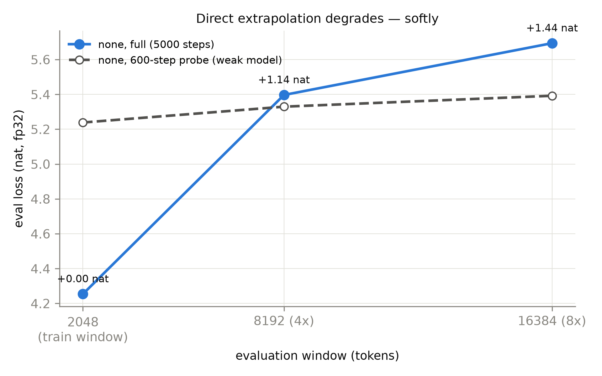
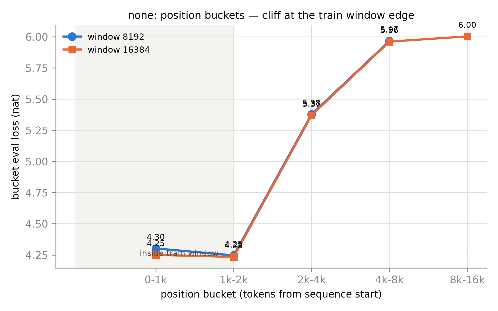
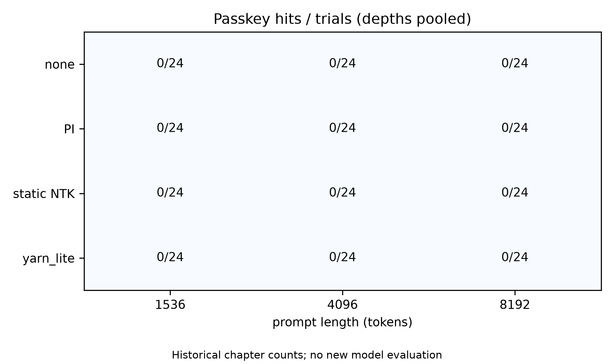
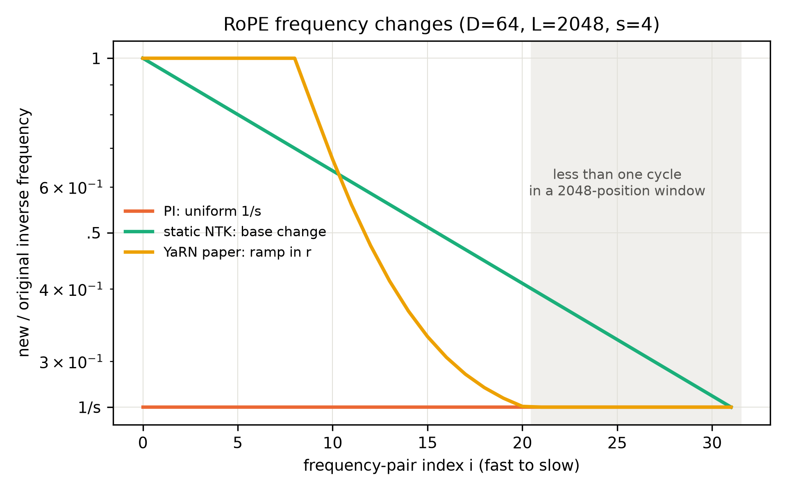
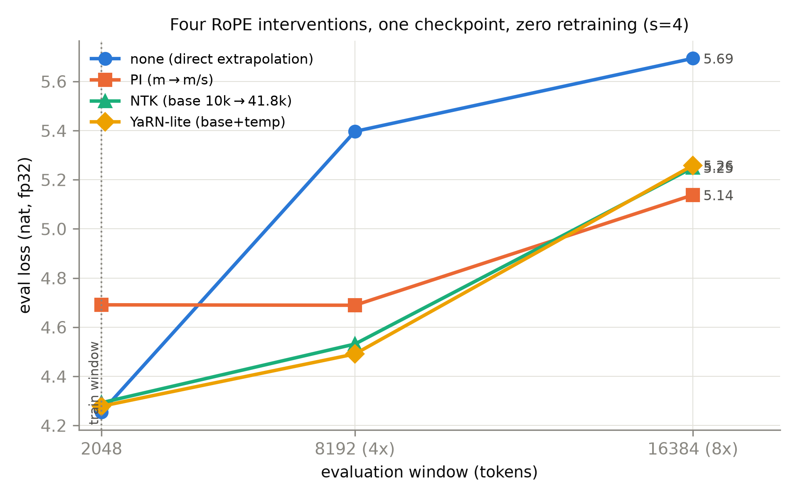

# 第 7 章 长上下文工程线：外推的三代配方

## 7.0 开篇：从全书到这里

上一章我们建立了 KV 成本核算方法：每多看一个 token，推理侧要付多少字节、哪些改造能降低这项单位成本，账目已经清楚。但那本账回答的是「看得起吗」，还有一件事它管不着——**模型本身看得动吗**。一台用 2048 token 窗口训出来的模型，你提供足够的显存、把 8192 个 token 喂进去，它表现如何？第 4 章 4.9 节的换件实验预告过答案的方向：RoPE 臂训 512 测 2048，4×越窗的历史损失差约0.49 nat，长窗内的位置分桶也随位置变差；其中长窗与原窗评估取样方式不同，损失差不能全归因于长度——但那是 512 小窗上的一次预告。本章把问题放到正式范围上，并且不止分析，还要改进。

这一章在全书旅程第三段（工程与谱系）的起点，要回答的问题只有一个，但它是前面三个问题的汇合：**已有预训练模型怎样通过位置变换和必要的继续训练，适应更长上下文？**产出三样：对三代配方（PI→NTK-aware→YaRN）机制的理解——全落在第 4 章那张波长谱表上，三种配方都改变频谱，YaRN还调整注意力打分的尺度；本册第二核心实验——同一个 2k 窗 checkpoint、免重训、只改 RoPE 参数的四干预对照；一本代际账——「出厂设定」与「训练后扩窗」两条路在 2024 年如何汇流。本章结束时，四格插座全部换完，我们也能区分插座③在可计算长度、适配成本与有效能力上的边界；下一章将比较三代 LLaMA 的组件组合。

> **最小背景栏**：本章默认你已读过第 4 章（RoPE：每对维度一根「表针」，逆频率 $\theta_i=\text{base}^{-2i/D}$ 从 $1$ 指数递减到约 $10^{-4}$，波长谱表与快慢指针图像见该章图 4.3；旋转只作用于注意力内的 Q 与 K，$\cos/\sin$ 查表 $(1,n,d_k)$ 作用于 $(B,h,n,d_k)$）与第 6 章（KV 账本：每 token 字节 $=2Lh_{kv}d_k b$，上下文长度是主变量）。Book2 第 12 章 12.3 节的中文预算表（两段中文短样本在GPT-2词表下恰为每字2 token，不能推广为所有中文）在章末回扣；训练协议沿用 Book2 五件套（第 10 章）。符号约定：$L$=训练窗（本章 2048），$L'$=目标窗，$s=L'/L$ 为扩窗倍数，$b$=RoPE 底数（config 的 `rope_theta`），$D$=头维 $d_k$（本章 64），$\lambda_i$=第 $i$ 对维度的波长——本章 $L$/$b$ 与第 6 章公式同名不同义（那里是层数与每元素字节数），以各章符号表为准。

## 7.1 可运行长度、训练长度与有效长度

第4章已经区分了位置表的索引限制与模型的长度泛化。RoPE可以计算更大的索引，但若模型未见过相应的位置、内容和长度组合，能运行不代表能正确使用更远的信息。第6章又给出另一个约束：即便模型能力足够，KV状态和注意力计算仍会增长。

本章比较三类改变：PI统一缩小位置步长；NTK-aware非均匀调整频率；YaRN组合分段频率插值与注意力缩放。完整研究方法可能包含继续训练，不能把“预训练后扩窗”统称为“权重完全不动”。本书另外保留一个冻结权重的四干预小实验，用于观察仅改变位置侧参数会发生什么；它不替代论文的大模型适配实验。

评估也要分两条线。困惑度测量平均预测损失；检索任务检验某个远处信息是否被实际利用。如果模型在原训练窗内就不能完成检索，不能把窗外零分单独归因于扩窗失败。带着这条判断，先看旧实验的完整记录。

## 7.2 问题现场：给 2k 窗模型做一次 8k 体检

这里先说明本书如何获得这份实验记录。实验对象是专门为此训的一台 mini：组件库对应实现 `llama_slots.LLaMA`，$d=256$、4 层、4 头、$V=8192$、RoPE $\theta=10^4$，共 7,407,872 参数（脚本 assert 逐位锁死）——第 2-6 章的模块实验都在 512 token 窗上做，这台唯一的目的就是把**训练窗口固定在 2048**。训练沿用五件套，B=8、T=2048，full 档 5000 步共 81.9M token；评测沿用Book2分出的heldout文件（文件分开不自动证明文本无重复），三个窗长（2048/8192/16384）各评393,216个目标token，fp32前向。脚本从同一评估流首部按窗长分块，三个设置的目标索引都是1—393,216，因而目标内容相同；区别在于在哪里重置上下文。长窗可见更多历史，同时使用更远的位置，两项变化共同影响损失。两个协议决定先于数字讲。其一，**判据预注册**：六条方向判据与负结果处置条款在full启动前落盘；此时已有600步探针和fast档先例，不能把判据说成看过任何相关结果之前就确定（实验比较条件见本节），头一条就是「断崖或渐进，按实测如实报」——600 步的探针先例只见过渐进（8k 仅 +0.09 nat），本节的判断必须以 full 档结果为依据。

其二，**双口径**：ppl 之外必须配检索测试——YaRN 论文附录提醒过，「困惑度未必是模型能否注意到所有 token 的好指标」【证据等级：官方论文2309.00071v3附录B.5】：平均损失可能主要由易预测的局部词元决定，某个远距离关键信息即使没有被利用，也未必明显推高平均值。所以本章的 passkey 协议是真实文本 filler 中段埋一个 5 位数字针、末尾提问、贪心解码12 token，检查目标五位数字串是否出现在续写中。这个“包含匹配”比整条答案精确相等更宽松；还要确认分词后完整数字能在解码预算内输出。测试同时覆盖训练窗内的1536位置，以及窗外的4096/8192位置。

数字到位（full 档 5000 步，训练健康无发散，尾部 300 步 train loss 4.234）。同窗基线：2048 窗 eval loss **4.254**（ppl 70.4）。直接外推：8192 窗 **5.397**（ppl 220.7）——**+1.14 nat、困惑度翻 3.1 倍**；16384 窗 **5.694**（ppl 297.1），+1.44 nat【证据等级：本书实验（MPS bf16 训练/fp32 eval，2026-10，单种子）】。这正是性能限制的直接表现：程序没有报错，质量却大幅下降。更有信息量的是退化幅度的**变化**——三档训练程度的结果依次排列：600 步探针 +0.09 nat（渐进）、2000 步 fast +0.53、5000 步 full **+1.14**（图 7.1）——这三个历史设置中，训练更久的模型越窗损失增量更大；这不是任意训练时长与外推退化之间的普遍单调关系。已知的600步探针提醒我们：不同训练状态可以出现不同退化形态，不能仅凭曲线形状确认同一种内部机制；YaRN论文对一个已用PI扩到32k的7B模型测得64k处ppl超过 $10^2$，说明适配后的模型仍可能再次越界；本书曲线提供了另一组退化观察，不能据形状把两者判为同一机制。fast/full的余弦日程各自缩放到总步数，比较也不是只增加训练时长。



图 7.1 直接外推的退化曲线（自产，full 5000 步 vs 600 步探针，none 干预，纵轴 eval loss、增量以各自同窗 loss 为基线；ppl 口径 70.4/220.7/297.1；393,216 token/点，fp32）【证据等级：本书实验（MPS，2026-10，单种子）】

按位置分桶可以进一步定位损失增加出现在哪些区段（图 7.2）：8192 窗内，训练窗内的三段平稳且**尾段损失最低**（4.31→4.29→4.25）；2k—4k桶的均值升至**5.38**，4k-8k 段继续恶化到 **5.97**；16384 窗再添一段 6.00。这组结果显示越过训练窗后的桶均值较高；桶宽为数百到数千位置，不能据此断言第2049个位置恰好发生跳变，也不能推断模型显式识别了窗口边界。分桶同时混合了位置、可见历史和文本内容，注意力内部机制还需要其他测量。



图 7.2 none 干预的位置分桶（自产，full 档：8192 与 16384 两窗长的分桶 loss，桶边界按 2 的幂对齐；灰底=训练窗内——窗内桶均值接近，窗外桶均值明显升高；旧图保留历史读数，不表示已定位逐词元跳变）

passkey 那一栏则为全章提供了一个需要如实说明的参照：四干预 × 三窗长 × 三深度 × 8 试验共288次解码（36个设置格、72个配对上下文），**全部零命中**——包括训练窗内的 1536 档（图 7.3）。预注册的弱模型条款如期生效：loss约4.25的7.4M checkpoint在本提示、filler和12-token解码协议下没有成功找回数字，全表按**协议验证档**报告。它不能区分四种配方谁的检索能力更好，也不能证明该模型对所有检索任务都无能力【证据等级：本书实验（2026-10，单种子）】。但这组测试仍有作用：协议全部跑通——配对设计、KV cache 增量解码与全量重算的逐 token 自检（四干预全一致，第 6 章增量算法的首次实际应用）；还给出了一个反例，说明仅看 ppl 的局限——同窗ppl约70并不保证本passkey协议成功，**平均预测损失与特定检索行为必须分别测量**，YaRN 附录那句「困惑度未必是好指标」从另一个角度得到了体现。协议可供后续checkpoint复用，但须先验证词表、配置与提示理解；第10章整合模型不是替换文件路径就能直接比较的同一个对象。



图7.3 passkey历史计数矩阵：每格汇总同一长度下三个深度、各8次试验，共24次；四干预共享对应上下文，全部为0/24。图据本章原记录转绘，未重新评测模型；这些全零计数不能提供四种干预的检索优劣排序。

## 7.3 失败机制：波长谱上的三个分析

实验记录拿到手，现在问机制。回看第 4 章的波长谱表（图 4.3）：$D$维组成 $D/2$ 对维度，每对对应一种角频率，第 $i$ 对的逆频率 $\theta_i=b^{-2i/D}$，波长（转一整圈要多少个 token）$\lambda_i=2\pi/\theta_i$。拿本章实验的几何手算（$D=64$、$b=10^4$）：最快的第 0 对 $\lambda_0\approx 6.3$——连续位置坐标中的周期约6.28，并不是恰好6个整数位置后精确重复；最慢的第 31 对 $\lambda_{31}\approx 4.7\times10^4$——四万七千个 token 才转完一圈。**训练窗只有 2048**：快针在窗内转了几百圈；实际整数位置只采样有限相位，并不覆盖每一个角度；慢针——凡是 $\lambda_i\geq L$ 的维度（本例 $i\geq 21$，约三分之一的频率对）——**在任意一个2048位置窗口内都不足一圈**【证据等级：本书算术（与第 4 章 d=128 档谱表同法）】。下面依次分析三个方面。

分析一：**位置超出分布**。RoPE 对 Q、K 做的是「按位置旋转」，位置 $m$ 的旋转角是 $m\theta_i$。按索引0到 $L-1$ 计，单窗口最大未取模角度是 $(L-1)\theta_i$，常近似写作 $L\theta_i$；推理位置扩展到约 $4L$ 时，一些慢频率会取到训练窗口没有覆盖的相位范围；联合频率模式与内容也随之改变。PI论文还给出一个固定内容系数的分析与拟合例子：注意力分数可写成若干三角函数的线性组合。不同项在训练区间内相互抵消，不保证在区间外继续抵消，因此区间内分数较小与区间外分数很大可以同时发生。论文Figure 2采用最小二乘构造这种现象，并非对所有训练模型都必然退化的证明。固定有限q/k时仍有范数界，不能理解成数学上完全无界【证据等级：官方论文 2306.15595 §2.2】。他们还算了一笔账：作者在其LLaMA几何和数值范围中比较插值余项界与一个外推分数上界，报告前者约小600倍（"at least $2\times294.73\sim600\times$ smaller"）——外推界比插值界大两个数量级以上，这个数字 7.4 节马上要用【证据等级：官方论文 2306.15595 §2.3 式 5-8 之后】。

分析二：**打分改变会怎样传到输出**。一行分数 $z_j$ 经softmax变成 $p_j=e^{z_j}/\sum_k e^{z_k}$；若某个不相关远处位置的分数被抬高，它占据的权重可能增加，其余位置的权重也会因分母改变而减少。这里既可能变尖，也可能变平，不能只凭“频率被压缩”断言熵一定上升。7.2节的分桶直接测到的是损失变化，尚未测到哪个头或哪一项分数造成变化。PI与YaRN提供解释线索；把这一解释落实到本书模型，还需另外观察注意力分布，不能拿损失曲线替代。

分析三：**长窗本身的账**。就算外推修好了，长窗也不是免费的：注意力打分矩阵是 $(B,h,n,n)$，序列长度的平方级——本册探针在同类小模型上实测，序列从 1024 涨到 8192，单步耗时涨 **25.4 倍**（纯注意力的 $n^2$ 理论是 64 倍，整机计时还包含线性子层、内存分配与具体内核；本探针未逐项分离这些贡献）【证据等级：本书实验（MPS，2026-10，探针 D）】；KV 账本那边（第 6 章）则随长度线性涨——207M档（层数12，此处不以本章训练窗符号 $L$ 表示层数；$h_{kv}{=}8$、$d_k{=}64$）@2048 是 48MiB，@8192 就是 192MiB（表 6.1）。「看得动」要付两笔钱：本章处理位置变换与长度泛化问题；算力与显存账的系统性优化留给推理各册，第 6 章末已登记欠账。

三个分析合起来，正好回应了 N2 提出的问题：查表式的墙是**硬墙**——GPT-2原有1024行位置表无法直接索引第1025个位置，需要扩表或改实现；RoPE 的墙是**软墙**——每个位置都算得出旋转角，模型照常前向，但相位、上下文长度与内容组合可能超出训练分布，本书实测平均损失上升；检索在原窗已经零分，不能再说它仅因越窗失效。索引限制可以通过扩表、改实现或换编码处理，长度泛化则需要**位置方案、训练与评测共同检验**——修法就是接下来三节的三代配方。

## 7.4 第一代配方 PI：把新窗缩小了装进旧窗

2023 年 6 月，Meta的Chen等人提出一种系统性扩窗方法：位置插值（Positional Interpolation，PI）【证据等级：官方论文 2306.15595】。核心一行式子——把目标窗 $L'$ 的位置索引先线性压回训练窗 $L$ 内，再交给原来的 RoPE：

$$
f'(x,\,m)\;=\;f\!\left(x,\;\frac{mL}{L'}\right)\;=\;f\!\left(x,\;\frac{m}{s}\right)
\tag{7.1}
$$

| 符号 | 含义 | 形状/取值 |
|---|---|---|
| $f$ | 原模型采用的固定频率RoPE变换（以分数位置 $m/s$ 计算三角函数，频率在此保持固定） | 查表 $(1,L',d_k)$，其位置坐标落回 $[0,L)$ |
| $m$ | 目标窗内的位置号 | $m\in[0,L')$，缩放后 $m/s\in[0,L)$ |
| $s=L'/L$ | 扩窗倍数 | 本章实验 $s=4$（$2\text{k}\to8\text{k}$） |

这表示：**新窗口中的每个位置，都映射到训练窗口内的位置**——目标窗中的最大索引8191压到2047.75，以原RoPE公式计算角度；不是把每个分数位置取整成已有表行。等价的频率视角更常用：位置乘 $1/s$ 就是全部逆频率除以 $s$（HF的 `linear` 缩放正是直接 `inv_freq /= factor`）【证据等级：历史源码5.18.0；本轮在5.14.1的 `_compute_linear_scaling_rope_parameters` 中核对】。关键在方向：PI 不是把外推边界推远，而是**把新窗缩小步长装进旧窗**——论文原话说，任意两个 token 的最大相对距离「从 $L'$ 降回了 $L$」，位置和相对距离按名义窗范围缩回 $[0,L)$，实际整数端点的细微差别见下段推导；内容、候选数量和分数位置仍可能与训练分布不同。这对应着 7.3 节分析一讨论的两种界相差 600 倍的结果：插值避免直接使用训练区间外的距离，但区间内部的非整数位置还需要平滑性分析，而不是仅靠“范围回来了”就保证效果。

### 区间回到原范围之后，为什么还要检查平滑性

**PI对一个固定打分函数的帮助，是把未见过的远距离改成已知相邻整数距离之间的插值问题；这给出局部误差控制，而不保证完整模型立即恢复。**令正偶数 $D$ 为头维，$b>1$；本节用 $t$ 表示距离坐标，与7.6节的温度不是同一变量。设 $a(t)=\operatorname{Re}\sum_{i=0}^{M-1}h_i e^{it\theta_i}$，$M=D/2$，内容系数 $h_i$ 暂时固定。若相邻整数 $u,u+1$ 处的打分已知，取 $t\in[u,u+1]$，其线性插值为

$$\ell(t)=(u+1-t)a(u)+(t-u)a(u+1).\tag{7.7}$$

为何误差由二阶导数控制？端点处误差为0；对内部点，构造 $F(z)=a(z)-\ell(z)-K(z-u)(z-u-1)$，选 $K$ 使 $F(t)=0$。$F$ 在 $u,t,u+1$ 三处为0，连续使用两次Rolle定理，存在中间点 $\xi$ 使 $F''(\xi)=0$，即 $K=a''(\xi)/2$。因此

$$|a(t)-\ell(t)|\le\frac12\sup_{z\in[u,u+1]}|a''(z)|
(t-u)(u+1-t).\tag{7.8}$$

三角基函数可逐项微分，$a''(z)=-\operatorname{Re}\sum_i h_i\theta_i^2e^{iz\theta_i}$，于是令 $H=\max_i|h_i|$，得到 $|a''(z)|\le H\sum_i\theta_i^2$。频率 $\theta_i=b^{-2i/D}$ 给出有限几何和

$$\sum_{i=0}^{M-1}\theta_i^2
=\frac{1-b^{-2}}{1-b^{-4/D}}.\tag{7.9}$$

又因 $(t-u)(u+1-t)\le1/4$，所以本书采用保留有限项的界

$$|a(t)-\ell(t)|\le\frac H8\frac{1-b^{-2}}{1-b^{-4/D}}.\tag{7.10}$$

这一步保留了H：如果内容系数很大，界仍可能很松；它也只处理固定q/k对应的打分函数，没有替代整网评估。PI论文给出的“约600倍更小”是其LLaMA设置中两种界的比较，不能解释成真实误差或困惑度必然改善600倍。本文保留有限几何和，避免把连续近似常数当成任意头维下的精确值。还有一个端点细节：长度 $L$ 的训练输入实际索引止于 $L-1$，PI最大映射位置为 $L-1/s$，比最后一个训练整数位置略大。最后不足一个单位的区间不能直接声称有两个训练网格点夹住；余项公式仍成立，但右端打分是否受训练约束是额外前提。

例如D=128、b=10000时，式(7.9)约为4.00，所以插值误差界约0.50H。与之相对，在远处t没有相邻已约束点时，只知道训练区间表现好，无法直接套用同一局部余项。固定系数全局仍有 $|a(t)|\le\sum_i|h_i|$，只是这个界可能大到对实际打分没有帮助。这才是“插值比直接外推更易控制”的数学含义。

代价是**原窗的分辨率**：同样的 2048 个位置挤在原来四分之一的角度区间里，相邻 token 的角度差缩到 $1/s$，局部相位差也随之缩小，模型需要适应这种变化；这并不意味着数学上两个相邻位置必然相同——论文的定性判断是「PI 迫使原窗内的位置编码居住在一个窄得多的区域」【证据等级：官方论文 2306.15595 §3.2】。这一「同窗代价」在 7.7 节的实验中有具体读数，留到那里讨论。

修法虽小，纯改推理参数的免微调版仍嫌粗糙——PI 直接套在 LLaMA-7B 上不微调，8192 窗的 ppl 是 16.10（微调 1000 步后回到 6.95）【证据等级：官方论文 2306.15595 Table 3】——所以 PI 论文的主张是**配一小段微调**：在 Pile 上「数万到数十万条样本」、约 **1000 步**（lr 2e-5/1e-5、warmup 20 步、8k 窗用 32 张 A100）就能更好地适应扩展后的窗口【证据等级：官方论文 2306.15595 Abstract/§2.4/§3.1】。对照实验明确了插值对于扩窗的作用：直接外推的对照组即使微调 **10000 步**，passkey 有效窗 $k_{\max}$ 只从 2048 推到 **2560**；PI组200步就把论文定义的有效窗扩到目标上限：每个测试距离重复10次，$k_{\max}$ 要求所有不超过它的测试距离命中率至少20%。这不等于每次检索都成功；Table 4中7B扩32k的600步行还曾回落到18,432【证据等级：官方论文 2306.15595 §3.3 与 Table 4】。结果数字：LLaMA-7B 与 13B 扩到 32768（33B 到 16384、65B 只到 8192），PG19 困惑度 7B@32k 为 7.23/6.91/6.77（分别在 2048/8192/32768 窗评测）、13B@32k 为 6.54/6.28/6.09，proof-pile 上 7B@32k 为 2.82/2.39/2.48【证据等级：官方论文 2306.15595 Tables 1/2】。顺读一个细节：同一扩窗模型在2048窗评7.23、32768窗评6.77；更长可见上下文本身可能降低损失，不能仅由这两个值确认相对原模型的短窗损失。要判断后者，须对齐模型与评估长度：Table 1列出原7B同窗7.20，PI32k模型同窗7.23，比它高0.03；Table 2的Proof-pile同窗则由2.77升至2.82。这些差值只对应所列模型与语料。

这类“训练后扩窗”方案就此成形：**从已有预训练模型出发，增加约千步微调与全维均匀压缩，把 2k 的窗口扩展到 32k**。代价是原窗口的分辨率。社区很快追问：这代价，能少付点吗？

## 7.5 第二代配方 NTK-aware：社区的三行代码与八字诀

第二代的出身与第一代不同：它**没有论文**。2023 年 6 月 29 日，网名 bloc97 的研究者在 Reddit 的 LocalLLaMA 版发帖，标题即结论——「NTK-Aware Scaled RoPE allows LLaMA models to have an extended (8k+) context size without any fine-tuning and minimal perplexity degradation」（NTK 感知缩放的 RoPE 让 LLaMA 免微调获得 8k+ 上下文，困惑度退化极小）【证据等级：社区配方（bloc97 帖 2023-06-29，经 YaRN 论文转述核对）——本册证据等级制度的又一档正式启用】。先声明纪律：NTK-aware 系全体（含动态 NTK）按**社区配方**等级引用，公式锚定在 YaRN 论文的转述上，帖作叙事源。

bloc97 的问题分析与 7.4 节讨论的代价问题完全吻合：PI 把**所有**频率均匀压到 $1/s$，而「对 RoPE 的傅里叶空间做简单的线性插值是很次优的，它让网络无法区分**非常靠近**的 token 的次序与位置」【证据等级：社区配方，bloc97 帖正文】——近邻分辨靠的正是快针，均匀压缩把最不该动的快针也压了。方案只有八个字：**高频外推、低频插值**。回看波长谱：快频率在训练窗内经历多圈，这为保留高频分量提供了启发，但单频已绕多圈不保证联合位置与内容分布可外推；慢频率在训练窗内未走完一圈，直接延长位置更容易进入未覆盖的相位范围，因此可尝试给予它们更强插值。

实现上的巧妙之处在于：要按维度区别对待，不必给每对维度写一个系数——**只改 base**：

$$
b'\;=\;b\cdot s^{D/(D-2)}
\tag{7.2}
$$

这表示：按频率索引非均匀调低转速——转速指数式分布在各维间，调 base 自动做到「快针几乎无感、慢针显著放慢」。从代数上可以看清这一点：新旧逆频率之比是 $\theta'_i/\theta_i=s^{-2i/(D-2)}$，第 0 对（最快）恰好等于 1（一点不动），最慢对恰好等于 $1/s$（全幅插值），中间平滑过渡。拿本章实验算：$s=4$、$D=64$，$b'=10^4\times4^{64/62}\approx 41{,}829$——最慢维的波长从约4.7万拉长到约18.8万位置。更精确的对应关系是：目标长度增为4倍、最慢频率降为1/4，所以该频率在目标窗内走过的总角度约等于原来2k窗内的总角度；仅说两者都不足一圈还不够。帖子自述代码改动「只有 3 行」，等效于线性 scale=4 的扩窗取 $\alpha=8$（base 放大系数）时困惑度退化更小，4k 内无需微调【证据等级：社区配方】。

### 指数来自哪条设计约束

**在保留最快频率的同时，让最慢频率恰好缩为1/s，便得到式(7.2)的指数。**这不是NTK理论自动给出的普适最优解，而是一个容易实现的频谱端点约束。

设底数放大为 $b'=ab$，则 $\theta_i'/\theta_i=a^{-2i/D}$。i=0时比值恒为1，无需额外操作；最慢对的索引为 $i=M-1=(D-2)/2$。要求该点比值为1/s，就有

$$a^{-(D-2)/D}=s^{-1}
\ \Longrightarrow\ 
-\frac{D-2}{D}\ln a=-\ln s
\ \Longrightarrow\ a=s^{D/(D-2)}.\tag{7.11}$$

因此D必须大于2。D=2只有一个频率，不可能用同一个base旋钮同时做到“最快不动”与“最慢缩1/s”。对中间索引，代回即得 $s^{-2i/(D-2)}$，频率平滑过渡。这说明公式为什么长成这样，却没有决定哪一个s会在某任务上最好；YaRN对该社区方法的讨论也指出最佳底数通常还需经验选择。

静态版还有一处浪费：base 按目标窗的 $s$ 一次调足，而推理时的实际序列常常远短于目标——一段 3k 的问句也要承担 8k 档的压缩代价。动态 NTK 把「按需」再推一步：

$$
b' = b\cdot\Big(\frac{s\cdot \max(\text{seq\_len},L_{\max})}{L_{\max}} - (s-1)\Big)^{D/(D-2)}
\tag{7.3}
$$

这表示：序列还未超过训练窗口时不作改动，超了才按**当前实际长度**逐步加大 base——未越过训练窗的序列保留原频率，较长序列再调整；这不是对输出精度的无条件保证。这个变体同样源自社区（HF 源码的 docstring 明写 credits to /u/bloc97 与 /u/emozilla），本轮在实际安装的transformers 5.14.1中核对 `_compute_dynamic_ntk_parameters`；指数使用实际旋转维数，全头旋转时才等于本章的 $D$【证据等级：源码实现】。注意式(7.3)里的 $s$ 是该实现的配置factor，不能简单认成当次长度比：若配置 $s=4$、当前长度为 $4L$，括号内是13，而静态式(7.2)使用的是4，两式在目标长度处并不相同。

动态缩放还要与第6章的缓存条件一起检查。若旧键按 $R_i^{\rm old}$ 存入缓存，新查询改用 $R_t^{\rm new}$，其内积为 $q_t^\top(R_t^{\rm new})^\top R_i^{\rm old}k_i$，通常不等于同一频率规则下的相对旋转。一种明确的做法是在一次生成开始前固定频率，并始终按此规则计算。若中途改频率，要与“新规则下全量重算”严格一致，还必须处理历史隐状态：第一层的旧键可从未旋转投影重新旋转，但更高层的历史输入已经依赖旧频率下的注意力，连旧V也可能改变，单纯重旋每层旧K不足以恢复等价。可以在换规则时重算前缀，或明确采用近似缓存策略并另做评估。

> **【实现对照框】从配置读到实际算法。**历史稿所据为transformers 5.18.0，本轮核对安装版5.14.1的 `modeling_rope_utils.py`：`linear`对应频率均匀缩放，`dynamic`按长度改变底数，`yarn`组合频率混合与注意力因子。旧配置常用 `rope_scaling`，该版本会标准化到 `rope_parameters`；应一起读取 `rope_type`、`factor`、原训练长度和实际旋转维度。它们说明当前实现怎样构建位置函数，却不能单凭字段恢复模型训练历史，也不证明长窗能力已经验收。本章实验实现的是静态PI、静态NTK与自定义yarn_lite，未运行动态NTK，也不能声称与完整HF YaRN算法逐项相同。

## 7.6 第三代配方 YaRN：分段、温度与第一次 128k

2023 年 8 月底，Peng 等人将这条社区工程路线整理为正式方法：YaRN（Yet another RoPE extensioN）【证据等级：官方论文 2309.00071】。其方法定义是分段频率插值与注意力缩放的组合；论文还给出分阶段扩窗的训练安排。下面先拆两项机制，再看训练怎样配合。

**第一件：NTK-by-parts——明确「哪些维度插值、哪些维度不插值」。** 静态NTK-aware由一个底数决定整条平滑曲线；by-parts进一步用波长阈值，将频谱明确分为**保留、过渡、全幅插值三个区间**。三步走：先算每对维度的波长

$$
\lambda_i=\frac{2\pi}{\theta_i}=2\pi\,b^{2i/D}
\tag{7.4}
$$

（这表示：第 $i$ 根表针转一整圈要多少个 token）；再算训练窗装得下几个波长，频段比 $r(i)=L/\lambda_i$；最后用斜坡函数 $\gamma$ 决定该维度的处理方式——$r<\alpha$（波长比窗还长）则 $\gamma=0$、全幅插值，$r>\beta$（波长远短于窗）则 $\gamma=1$、原样保留，中间线性过渡，频率改写为

$$
\theta'_i=(1-\gamma)\,\frac{\theta_i}{s}+\gamma\,\theta_i
\tag{7.5}
$$

这表示：**慢针除以 $s$、快针一个不动、中间地带按比例折中**。这里的“线性”要说明自变量。按论文v3式(11)，线性发生在 $r=L/\lambda_i$ 上：

$$\gamma(r)=\begin{cases}0,&r<\alpha,\\
(r-\alpha)/(\beta-\alpha),&\alpha\le r\le\beta,\\1,&r>\beta.
\end{cases}\tag{7.12}$$

取α=1、β=32、s=4：r=0.5的慢频率缩为0.25倍，r=40的快频率保持1倍，r=16.5时γ=0.5，频率比为 $0.5/4+0.5=0.625$。由于r与维度索引i是指数关系，这不等于在i上直接画直线；若某实现使用索引区间线性插值，应按该实现说明，不能称两种坐标下的斜坡完全相同。

这一差别也出现在实际库中：transformers 5.14.1的YaRN函数先把圈数阈值反解为维度索引，再在索引区间上画斜坡，默认还对边界取floor/ceil。它与式(7.12)在 $r$ 坐标上线性混合有相同的快慢分区思想，中间数值一般不同。图7.4按论文v3的 $r$ 斜坡绘制，不把它冒充HF逐维输出。

超参原文明给：$\alpha=1$、$\beta=32$（Llama 家族）【证据等级：官方论文 2309.00071 §3.2】。调整方向与 NTK-aware 一致，差别在可控——每个频率分量的处理都有明确判据。谱系如实记：by-parts的社区来源在YaRN中标为bloc97 (2023b)；kaiokendev的SuperHOT则对应与PI并发的线性位置缩放工作，两项来源不能混淆【证据等级：官方论文 2309.00071 §3.1 与 2306.15595 并发声明】。

**第二件：注意力温度——调整打分的整体尺度。** 频率改变后，注意力分布也可能改变。YaRN作者据实验选择了注意力缩放；不能仅由频率压缩推出每个查询的分布必然变平。YaRN 的修法是在 softmax 前引入温度 $t$：

$$
\mathrm{softmax}\!\left(\frac{\mathbf{q}_m^{\top}\mathbf{k}_n}{t\sqrt{D}}\right),\qquad
\sqrt{1/t}\;=\;0.1\ln s+1
\tag{7.6}
$$

这表示：当 $s>1$ 时，打分除以小于1的温度后再归一化；对固定的一行分数，这会提高相对高分项的权重，但不能倒推原先每行都因插值变平。论文推荐以扩窗倍数 $s$ 代入经验拟合式；换模型或任务时仍需验证。这个式子的记号有一段勘误故事：早期中文转述常写成「$1/t=0.1\ln s+1$」，历史修订记录曾对v1/v2/v3三版PDF作核对，本轮重新核对v3公式图形，根号确实在（v2 式 22 / 现行 v3 式 15）——「1/t」的读法是 PDF 文本层把根号字形抽丢造成的伪影【证据等级：本轮所据为官方论文v3式(15)，旧版本结果另属历史审读】。拟合来源也如实报：LLaMA1 四档免微调拟合而成，同样的 $t$ 对 Llama-2 也相当适用。实现上有一个简洁的技巧：不改注意力代码，把 $\cos/\sin$ 查表整体乘上 $\sqrt{1/t}$——Q、K 各乘一次，内积恰好放大 $1/t$ 倍，可在预生成的表中合并缩放，不额外引入一个完整注意力算子；实际开销仍由实现决定，且与 HF 源码互证（`get_mscale(scale)=0.1·ln(scale)+1` 乘在 $\cos/\sin$ 上）【证据等级：官方论文v3 §3.3—3.4；本轮核对transformers 5.14.1，未显式覆盖attention_factor时使用该默认经验因子】。拿数字感受：$s=16\to t\approx0.613$（打分放大 1.63 倍）、$s=32\to t\approx0.551$（1.81 倍）；我们实验的 $s=4\to t\approx0.771$（1.30 倍）。

**训练安排：从64k继续扩到128k。**YaRN论文以Llama 2的4k窗口为起点，先取 $s=16$，在64k序列上微调400步；再从这个checkpoint出发，取 $s=32$ 追加200步，仍用64k序列训练，最后评估到128k。因而它展示了“训练段长64k、评估到128k”的结果；有效范围来自评测，不能只由设置了 $s=32$ 宣布【证据等级：官方论文2309.00071v3 §4.1—4.2】。

预算也要按这条流程计算。v3给出的全局批量为64，每段65,536个位置，因此前400步约处理 $400\times64\times65{,}536=1.678\text{B}$ 个输入位置，追加200步约0.839B，合计约2.517B。这是按步数、全局批量和段长计算的输入位置总数；特殊词元、目标移位和文本复用情况另按数据管道核算。论文摘要的“少10倍token、少2.5倍步数”是相对所选先前方案的概括，不能不带比较对象地套到每个长度。附录B.2给出的直接对照是Llama 2 7B扩到8k：YaRN用400步，PI用1000步，困惑度接近。这个特定比较才支持2.5倍的步数差。

成绩单（proof-pile 困惑度，窗 8k→128k 五点）呈现了三代配方的差异：曾被 PI 扩到 32k 的 Together 7B，在 64k/96k/128k 上 ppl 爆到 $>10^2$/$>10^3$/$>10^4$（扩过的窗也会再爆）；手调 base 到 $10^6$ 的 Code Llama 7B 维持 2.55/2.54/2.71；YaRN $s{=}32$ 的 7B 是 2.45/2.36/**2.37**、13B 是 2.31/2.23/**2.24**——论文判定句：YaRN 是「第一种成功把 Llama-2 的有效上下文扩到 128k 的方法」；Table 9中7B和13B的passkey context均达到128k，定义为检索准确率至少80%的最大测试长度；99.4%则是各个不超过该长度的测试档位的平均准确率，并非单独128k点的准确率。代价也需要如实记录：短任务 ARC-c 52.1、HellaSwag 78.4、MMLU 41.7、TruthfulQA 37.3（原版 Llama-2 为 53.1/77.8/43.8/39.0），论文报告 $s=16$ 到32的平均下降约0.49；按Table 3中两种模型、各四任务共八个分数复算，为**0.4875个百分点**，并非相对下降0.49%，也不是相对原始Llama 2的差值。7B单独平均下降0.575个百分点，13B为0.4个百分点【证据等级：官方论文v3 Tables 3/7/9；百分点差为本书复算】。

三代配方至此已介绍完毕。把它们放回同一张波长谱（图 7.4）：PI 是一条压平到 $1/s$ 的水平线——全维插值；NTK-aware 是一条从 1 平滑滑到 $1/s$ 的曲线——隐式分级；YaRN在旋转圈数r上用分段线性权重；画到频率索引上，中间段一般不是直线——显式分级，再外加一个温度旋钮。三者的对照列于**表 7.1**。

**表 7.1** 外推三代配方对照（自排；公式与出处均带版本锚）

| | PI | NTK-aware（含动态 NTK） | YaRN |
|---|---|---|---|
| 干预动作 | 位置 $m\to m/s$（式 7.1，全维均匀 $1/s$） | base $\times s^{D/(D-2)}$（式 7.2；动态版按实际长度调，式 7.3） | by-parts斜坡（式7.4—7.5）+温度（式7.6）；论文另配渐进扩窗训练 |
| 冻结权重结果 | 报告7B@8k ppl 16.10，微调后6.95 | 社区与本章有指定设置观察，非任意模型保证 | 论文有无微调比较；本章lite仅为部分机制实验 |
| 微调主张 | ~1000 步 | 原社区方法强调免微调；YaRN的特定消融中32k终点微调后仍不如PI，非通则 | 128k流程400+200步；按v3几何约2.517B输入位置 |
| 主要代价 | 原窗分辨率（同窗税） | 部分维越界、名义倍数不保证有效长度 | 短任务均值下降约0.49个百分点（两模型八分数，s16→32） |
| 证据等级 | 官方论文 2306.15595 | 社区配方（bloc97 2023-06-29；经 YaRN v2 式 14-16 转述） | 官方论文 2309.00071（式号带版本） |



图 7.4 三代配方在波长谱上的干预点（自绘，示意级）：纵轴为改写后与改写前的逆频率比 $\theta'_i/\theta_i$（对数轴，$1/s$ 处即全幅插值、1 处即不动），横轴为频率对下标（本册实验几何 $D=64$、$L=2048$、$s=4$）；灰底为 $\lambda_i\geq L$ 的慢针区（训练窗内从未转完一圈的维度，$i\geq21$）；YaRN 的分段斜坡按 $\alpha=1$、$\beta=32$ 画出（本图只画论文的频率分段，不包含温度；7.7节yarn_lite使用NTK底数与YaRN温度，频谱不等于图中YaRN曲线）

## 7.7 四干预对照：同一个 checkpoint 上的扩窗实验

实验记录与方案都齐了，现在做本章的主实验——本册第二核心：**同一台 2k 窗 mini、同一个 checkpoint、免重训，只改 eval 侧的 RoPE 参数，四路对照**。设计要点三条。其一，干预只发生在 $\cos/\sin$ 查表的重建上——权重一个字节不动，在同一长度和同一批目标上，实验直接比较这些位置侧变换的影响；跨长度比较还包含可见上下文变化：机型还是那台机型（整机图 0.1 的插座③原地不动），变的只是位置编码的三个旋钮。

其二，四路配方按 $s=4$ 统一配置：`none` 原样直接外推；`pi` 位置 $m\to m/4$（式 7.1）；`ntk` base $10^4\to41{,}829$（式 7.2）；`yarn_lite` 在 ntk 的 base 之上再把 $\cos/\sin$ 乘 $0.1\ln 4+1\approx1.1386$（式 7.6 的温度）——如实交代：YaRN 本体的 by-parts 斜坡（式 7.4-7.5）**不在**本实验里，它是NTK底数调整与YaRN温度因子的自定义组合，命名带 `_lite` 就是不冒充全貌。

其三，判据照旧预注册：六条方向判据在 full 启动前落盘，容许并列、方向相反时按预先规定的办法处理。查表重建的形状流转见表 7.2——本实验选取的四路在这一层由三个标量开关控制（`pos_scale`/`base`/`mscale`）：这个冻结权重实验只覆盖三个位置侧开关，不是全部长上下文工程自由度。

**表 7.2** 干预侧 RoPE 查表重建的形状流转（`extrapolate.py` 的 `rope_cache_variant`，四干预共用）

| 步骤 | 运算 | 输入形状 | 输出形状 | 说明 |
|---|---|---|---|---|
| 1 | 逆频率 | $(D/2,)$ | $(D/2,)$ | $\theta_i=b'^{-2i/D}$；NTK/YaRN-lite 换 $b'=41{,}829$ |
| 2 | 位置缩放 | $(n,)$ | $(n,)$ | $t=m\cdot$`pos_scale`；PI 在此 $m\to m/4$ |
| 3 | 外积 | $(n,)\times(D/2,)$ | $(n,D/2)$ | 角度表 $t\theta_i$ |
| 4 | 拼接+乘温度 | $(n,D/2)$ | $(1,n,D)$ | $\cos/\sin$ 各乘 `mscale`（YaRN-lite=1.1386） |
| 5 | 施旋 | $(B,h,n,D)\times(1,n,D)$ | $(B,h,n,D)$ | 只旋 Q/K（第 4 章 4.6 节的结论在此复用） |

主结果见**表 7.3** 与核心图 7.5——同一组权重在四种干预下的结果。

**表 7.3** 四干预 × 三窗长 eval（full 5000 步 checkpoint，s=4，免重训；各窗长 393,216 token，fp32；格式 loss/ppl）

| 干预 | 2048（同窗） | 8192（4× 目标窗） | 16384（二次越界） |
|---|---|---|---|
| none | **4.254** / 70.4 | 5.397 / 220.7 | 5.694 / 297.1 |
| pi | 4.691 / 109.0 | 4.689 / 108.8 | **5.138** / 170.4 |
| ntk | 4.293 / 73.2 | 4.531 / 92.9 | 5.249 / 190.4 |
| yarn_lite | 4.279 / 72.1 | **4.491** / 89.2 | 5.259 / 192.2 |

【证据等级：本书实验（MPS bf16 训练/fp32 eval，2026-10，单种子；fast 2000 步档六条方向判据已全中，full 复核一致）】

按预注册六条逐一验收。①软墙成立：none@8k 比同窗差 +1.14 nat。②三种干预都改善了损失：8k 档最差的 pi（4.689）也比 none 好 0.71 nat，最优的 yarn_lite 降低了 **0.91 nat**（ppl 220.7→89.2）。③PI 同窗税成立：pi@2k 比 none@2k 差 **+0.44 nat**，且 **pi@8k（4.689）与pi@2k（4.691）非常接近**。这是本checkpoint在同一目标集上的观察；PI的数值映射并不强制两种上下文长度得到相同损失，更多可见历史与更远位置可能产生相互抵消的影响。

分桶更直白：pi 的 8k 分桶五段全在 4.68-4.74（桶间差 0.06），none 的桶间差是 1.72——**本次PI结果中，桶间差缩小，但训练窗内的损失高于none**；0.06仍是非零差，不能称彻底平坦。

④8k 档排序 **yarn_lite（4.491）≤ ntk（4.531）≤ pi（4.689）≤ none（5.397）**，与预注册预期级一致；在这两臂仅改变mscale的协议下，0.04 nat差与注意力缩放关联；它不证明所有模型都能因此获得相同收益——两臂base相同，因此这0.04 nat是该checkpoint、该目标集上增加mscale后观察到的差值。

⑤16k 二次越界：四路相对各自的 8k 值全部再退化，none 仍最糟；但干预间排序**翻转**——pi（5.138）反超 ntk（5.249）与 yarn_lite（5.259，两者差约0.01；本实验未估计训练种子或样本重抽方差，不能判为噪声）成为最优。如实报并解读：干预都是按 8k 设计的，16k 对谁都是越界——NTK系底数按4倍扩窗设置，PI在16k末端也会映射到约4k，均超出最初2k训练坐标范围。慢频率再次进入未覆盖区间是解释线索，但本实验没有把频率与内容/上下文变化逐项分离。在这些终点中，PI从8k到16k的损失增量较小，不能推成所有模型都按此排序。这个实验中的现象，正对应着 YaRN 渐进扩展中按目标窗口调整设置的做法。

⑥分桶压缩成立：yarn_lite 的 8k 桶差 0.43（4.27→4.70），分桶读数中的明显上升推迟到4k以后的区间；这不等于已经证明所有4k以内检索都可靠。



图 7.5 四干预对照（自产，full 档核心图：同一 2k checkpoint、免重训、只改 RoPE 参数，s=4；竖虚线=训练窗边界；右端标注 16k 终值——注意 16k 档 pi 反超的翻转）【证据等级：本书实验（MPS，2026-10，单种子）】

passkey 双口径与档位限定收尾。passkey 全表维持 7.2 节的协议验证档（全零、弱模型条款），四干预在这项检索指标上无法区分。平均损失有改善、检索测试仍无成功，两列并不矛盾；它们衡量的是不同方面。完整说明实验规格的限制：本实验是 7.4M 参数、82M token、8k 词表、单种子的机制对照，与论文档位（7B/13B、大规模预训练后继续适配，词表、数据和评测协议均不同）只能作方法和现象对照，连方向的跨设置迁移也需验证，绝对值不可比；四条曲线的排序与形态是本机实测，不是三代配方的排行榜——排行榜要拿同预算微调档去做，那是第 10 章设计文档里的重启候选。

## 7.8 支线与代际账：两条路的汇流

三代配方讲完，先补一条支线。RoPE 面世四个月后的 2021 年 8 月，Press 等人的 ALiBi（Attention with Linear Biases）提出过**另一种主张**：位置信息不进嵌入、不进旋转，直接给注意力分数加距离偏置：第 $h$ 个头用正斜率 $m_h$，对因果可见位置 $j\le i$ 加 $-m_h(i-j)$，得到 $(B,h,n,n)$ 分数矩阵。自身距离0不罚，较近位置罚得少、远处罚得多；未来位置仍另用因果掩码。卖点直指本章主题：「在 1024 长度序列上训练的 13 亿参数模型，外推到 2048 直接可用，无需任何额外训练」【证据等级：官方论文 2108.12409 摘要】。其论文还提供了一项第三方证据：WikiText-103 上 1024训练、2024评估（约2倍），正弦编码困惑度爆到 51.09、**RoPE 31.17**、ALiBi 自己 18.05【证据等级：官方论文 2108.12409 Table 3】——这是该模型和WikiText-103验证集上直接外推退化的早期记录；不能把它与摘要中1.3B模型1024→2048的另一项结果混作同一设置，也不能据此判定所有RoPE模型都会同样退化。那 ALiBi 为什么没有成为主线？这里只有**谱系叙述、没有判决实验**：LLaMA系列选择RoPE，围绕现成权重的扩窗工作因此有了共同的改造对象；另一些模型仍采用ALiBi，本章以MPT作为ALiBi采用实例，不声称该路线止于某一家族【证据等级：谱系叙事，非实验结论】。这些采用记录说明本书为何沿RoPE展开，不能作为两种编码在所有任务上优劣的判决。

主线上，长上下文一直有**两条路**在并行。第一条是**出厂设定**：每代加窗都在预训练账本上投入实际训练成本——LLaMA1 窗 2048（$\theta=10^4$）；LLaMA2 翻倍到 4096，并附一个消融交代这笔账：同架构同超参、只把窗从 2k 提到 4k、各训 150B tokens，长文任务 NarrativeQA 的 F1 从 **0.21 涨到 17.26**——论文给出的SCROLLS任务集合平均输入约3.5k，这个2k模型在NarrativeQA上的得分极低，该表没有随机基线。它提供的是窗口长度改变后任务分数变化的官方记录【证据等级：官方论文 2307.09288 附录 A.2.1 与 Table 16】；Llama 3 原生 8192，同时把底数提到 **500,000**（引 Xiong et al.：该值在 32,768 以内有效）【证据等级：官方论文 2407.21783 §3.2 与 Table 3】；该报告所述Llama 3 405B以**六阶段长上下文预训练**从 8K 到 128K，付约 **800B tokens**，判据是「短上下文性能完全恢复+该长度大海捞针全通过」【证据等级：官方论文 2407.21783 §3.4.2】。第二条路就是本章的**训练后扩窗**：PI 付 1000 步，NTK-aware 零步，YaRN 付 400+200 步——其中PI与YaRN都包含继续训练；位置变换与训练配方共同构成扩窗方案。

两条路在 2023-2024 年汇流了，一个交汇点是**调整RoPE频率**。扩窗这边：bloc97调整base，YaRN按波长区间混合频率并缩放打分，并非只把同一个base调大；出厂这边：Code Llama 长上下文微调时把底数从 10,000 一次提到 **1,000,000**（原话：这一提升允许处理长得多的序列、并降低对短距注意力的偏置），配16,384窗口继续训练：按论文默认10,000步、每批2M token计算为约20B；但报告同时列出例外，Code Llama 7B改为3000步，34B为11,000步、每批1M，不能把20B套给每一档【证据等级：官方论文 2308.12950 §2.4/§2.6；YaRN 论文将此识别为 NTK-aware 思想的微调版落地——注意 Code Llama 原文并无 NTK 字样，这是本册红线】；Llama 3 把 $\theta$ 定为 $5\times10^5$；Llama 3.2-1B 进一步带 `llama3` 型 rope_scaling、factor 32【证据等级：config 逆向（冻结点外白名单级引用）】。扩窗方法由此写入模型发布时的 config——第 5 章「config 即图纸」再次兑现：`rope_scaling`等字段记录具体位置变换；有些实现属于本章讨论的家族，有些采用不同分段规则，仍要按模型和版本核对。

最后回应 N7 提出的问题。上下文长度是 KV 账本的主变量（第 6 章），也是算力账的平方项（7.3 节的 25.4 倍锚）；本章补上第三面——**位置规则与能力的适配成本**：可计算长度可以扩展，有效利用更远信息则需要训练与评测共同确认。换成中文文本，还要核算实际容量：Book2 第 12 章指出的现象——两段中文短样本在GPT-2词表下恰为每字2 token。若仅借用这个比例做预算，8192/32,768/131,072 token分别约合4096/16,384/65,536字，还要扣掉提示和输出预留；这是算例，不是长篇中文的实测容量；改变词表可以提高文本的编码效率（第5章指定历史中文样本中，新分词器所需token显著减少，不能仅由词表大小推出所有文本的倍数），但「窗口大小需要换算成文本量」不变【证据等级：本书实验（Book2 ch2 表 2.5/ch12 预算表，ch5 词表扫描）】。“能看多长”因此需要同时说明资源、位置规则和能力证据；「看了记不记得住」是 passkey 那一栏的事——长度与检索，永远是两道独立的验收。

## 7.9 本章小结

本章把扩窗拆成了位置变换、适配训练与能力验证。PI把距离压回原数值范围，局部插值余项解释为什么这一做法比完全不受训练区间约束的外推更易控制；NTK-aware通过频谱端点约束得到底数调整；YaRN进一步选择分段混合和经验注意力缩放。数学说明各开关如何作用，实际能力仍由训练和评测决定。

本书冻结权重实验保留了明确的局部结果：8k时三种干预都改善平均损失，PI在原窗也付出损失，16k时干预排序改变；passkey在训练窗内外均零命中，因而没有提供检索能力改善的证据。yarn_lite不是完整YaRN，不能用它给三类论文方法排名。

**理解长上下文，先问改变了哪张频谱、配了多少训练，再问测到了哪种能力。**频率压缩不保证内容分布回到训练时；动态规则还必须检查各层旧 K/V 是否仍与新规则下的前向一致。序列更长同时增加候选、计算和状态成本，某一个缩放因子无法替代这些检查。

到这里，本册的组件改造部分正式结束：四格插座全部换新，出口解绑，位置编码的性质、适配方法与验证边界已经连起来，扩窗方法也已介绍。各组件都经过验证，成本也已核算——下一步是去看别人如何用同一套组件构建三代旗舰。下一章把 LLaMA1/2/3 摆上装配线：组件组合、训练数据和配方分别怎样变化，各自的证据又能支持哪些判断。

> **【欠账】** 外推不是唯一的路：把远处的信息压进固定容量的状态，是另一条哲学。两条路怎么在 2026 年的旗舰里合流（外推与状态压缩的官方调和，config 事实见第 9 章），收束论在 Book5。→ Book5 第 8 章

## 7.10 动手验证

从工作区根目录运行，输出写入log。新shell重新激活环境；已有checkpoint可用--eval-only仅评估，历史长训练无需为了阅读本章重跑。

```bash
source ./env.sh
BOOK3="$PWD/from-models-to-vllm/book3-modern-open-source-skeleton"
```

- **四干预外推核心**（fast ≈13 min / full ≈29 min，MPS，计时独占窗口；免重训 eval 另加 ≈2 min）：
  ```bash
  python "$BOOK3/code/ch07/extrapolate.py" --steps 2000 --out-name fast
  python "$BOOK3/code/ch07/extrapolate.py" --steps 5000 --out-name full
  # 产物：log/book3-ch07/extrapolate_{fast,full}.json（四干预×三窗长主表+分桶）
  #       + curve_train_{out}.csv + mini2k_{out}.pt（终态 ckpt，供 passkey.py）
  # 四干预公式核对（meta.interventions）：pi pos_scale=0.25；ntk base=41829.4；
  #   yarn_lite base=41829.4 + mscale=1.13863（=0.1·ln 4+1）
  ```
- **passkey 双口径**（fast ≈10 s / full ≈40 s；先跑 extrapolate 拿 ckpt）：
  ```bash
  python "$BOOK3/code/ch07/passkey.py" --ckpt log/book3-ch07/mini2k_full.pt \
      --out-name full --trials 8 --depths 0.25,0.5,0.75
  # 产物：log/book3-ch07/passkey_full.json（self_check 自检 + 准确率矩阵）
  # 启动自检：缓存解码 vs 全量重算四干预逐 token 一致（KV cache 实现的守门）
  ```
- **复画图 7.1-7.5**（秒级-分钟级；实验图需先有对应档位 JSON）：
  ```bash
  python "$BOOK3/code/ch07/make_figures.py" --only 4 --out-dir log/book3-ch07/figures
  # 实验图显式提供 --extrapolate-report / --passkey-report；旧报告加 --historical
  # 图7.3原文全零计数的转绘：--only 3 --historical-passkey-summary
  # 图7.1/7.2/7.5保留原历史图；无原始报告时不反造其曲线。
  ```
现有训练资产可用--data-dir和--tokenizer定位；新结果使用独立out-name/out-dir。新脚本保留历史默认模型与四干预公式，增加运行身份、失败保护与成功断点保存；可信旧checkpoint缺完成标记时须显式加--historical-checkpoint。passkey数字抽样现在包含99999并覆盖末合法filler起点，记录实际分词器hash，不能把新运行称为旧288次试验的逐值重放。

- **验收点**：能在波长谱上指出三代配方的干预点并说出各自的代价（式 7.1/7.2/7.5-7.6）；能说明均匀缩频与非均匀缩频怎样改变相位差，并区分数学变化和需要评测的质量结论；能把PI的同窗损失与yarn_lite的8k读数对回其干预，并指出哪些机制解释尚未直接测量；能区分原始RoPE的数学性质、后续扩窗实证与Code Llama作者自己的术语，不把后人的方法归类写成原论文自称。

主要来源：[PI v2](https://arxiv.org/abs/2306.15595v2)、[YaRN v3](https://arxiv.org/abs/2309.00071v3)、[Code Llama v3](https://arxiv.org/abs/2308.12950v3)。正文式(7.8)—(7.10)保留有限几何和，区分严格数值界与原论文的近似比较。
