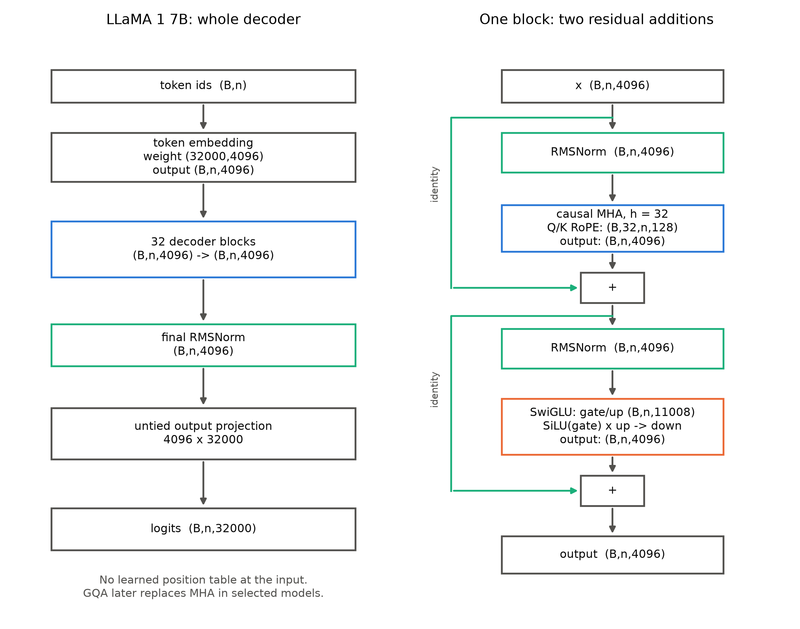
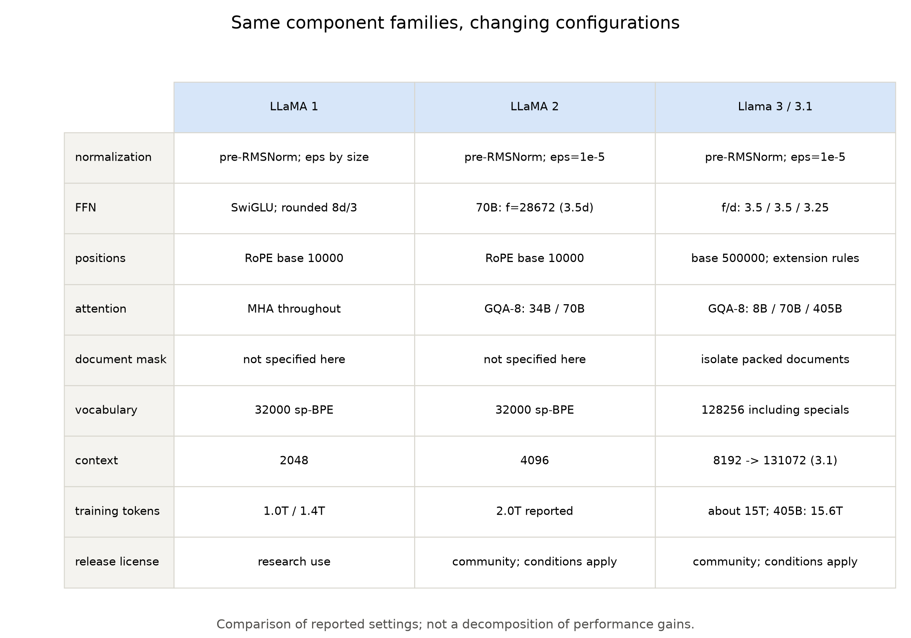
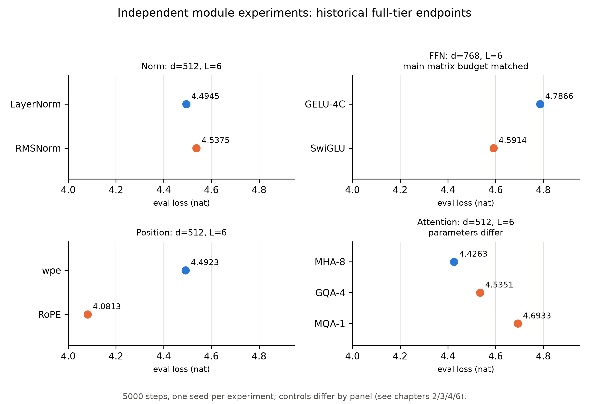

# 第 8 章 LLaMA1/2/3：组装与代际

## 8.0 开篇：从全书到这里

上一章把位置变换、适配训练与能力验证连成了一条线：四类组件已经介绍完，出入口解绑与扩窗方法也都有了明确的适用条件。我们仍未证明小模型具备可靠的长程检索能力，但已经知道该怎样分别检查资源、位置规则和任务表现。现在把各组件放回整机，比较LLaMA1/2/3怎样调整结构、数据与训练配方。

本章位于全书第三部分（工程与谱系）的中段，要回答两个问题。第一个是回顾性的：**为什么是这套组合？**第 2-6 章逐项替换了四类组件，每类都有相应的限制与观察结果，但「这四件为什么能同时装进一台机器、还恰好长成一个时代的默认骨架」——这个整机级的问题，需要结合整机实现与训练证据来回答；三代LLaMA提供了一组具体案例。第二个是前瞻性的：**代际靠什么翻新？**先说本章最希望你记住的事实：2023 年 2 月骨架定型之后，三代保留了主要残差Block形式，但GQA、词表、位置规则和数据组织都有变化；“主体相似”不等于“架构完全未变”。本章将给出四项内容：一张整机图（图 8.1）、一张逐格标证据等级的代际总表（表 8.4）、一张插槽清单总表的初版（表 8.5，第 10 章定版），以及 N4 问题的第二次讨论。章末还会看到：三代都有论文可查，模型发布时也可能没有同时给出足够的技术报告。这也引出了下一章的问题。

> **最小背景栏**：本章是全册引用数字最密集的一章，但几乎不需要新的前置知识——LLaMA1 的动机五段与算力三笔账在第 1 章（表 1.1 直接沿用），四件套的机制与消融在第 2-6 章，外推的代际账在第 7 章 7.8 节，参数公式在第 5 章式 (5.2)，GPT-2 训练配方在 Book2 第 10 章、scaling laws 在 Book2 第 8 章。引用时只标明证据等级和前文位置，不重复讲解；本章不新增长训练，主要复核已有公式、配置与实验汇总，动手验证使用第 5 章的 config 反推脚本。

## 8.1 把组件放回整机：四类组件、四组设计约束

前七章逐章考察了各组件的限制、改造与观察结果。现在把这些讨论放在一起，考察组件之间的组合。第 1 章 1.5 节逐字读过 LLaMA1 §2.2 的三改原话，当时看的是引用结构——这三类组件均有更早的公开来源。再读这三段话，这次换一个问题：**每项改动带来了什么？**

> "Pre-normalization [GPT3]. To improve the training stability, we normalize the input of each transformer sub-layer, instead of normalizing the output. We use the RMSNorm normalizing function"——归一化的改动带来**稳定**与**简化**：报告以训练稳定性解释pre位置选择；RMSNorm省去中心化步骤。两项选择并不等于已经在LLaMA中分别做过充分消融（第 2 章）。
>
> "SwiGLU activation function [PaLM]. We replace the ReLU non-linearity by the SwiGLU activation function, introduced by Shazeer (2020) to improve the performance. We use a dimension of 2/3·4d instead of 4d"——前馈的改动提升**性能**：按主矩阵预算缩减中间宽度后，改用门控三矩阵结构；取整、偏置与实际训练条件另算（第 3 章）。
>
> "Rotary Embeddings [GPTNeo]. We remove the absolute positional embeddings, and instead, add rotary positional embeddings (RoPE), introduced by Su et al. (2021), at each layer of the network."——位置编码的改动引入**相对位置**：去掉入口处的位置查表，通过每层注意力中 Q/K 的旋转表示位置信息（第 4 章）。
> 【证据等级：官方论文 2302.13971 v1 §2.2 直引（第 1 章 1.5 节已全文引过，此处取关键分句）】

第四类组件采用得更晚：LLaMA2 把大档的注意力换成 8 组共享 KV 的 GQA（Ainslie et al. 2023），Llama 3 全系采用——这项改动节省**推理开销**：在其他几何与使用条件相同时，KV载荷变为MHA的 $h_{kv}/h$；70B的64/8头是1/8，8B的32/8头则是1/4，不能统一写成1/8（第 6 章）。四类组件分别回应四组设计约束：稳定与简化、同预算下的性能、相对位置、推理开销。

这些组件有可区分的接口：归一化作用于逐位置隐藏向量，前馈将隐藏表示映回同一宽度，RoPE变换Q/K，GQA改变K/V投影宽度。接口清楚，使逐项替换和测试成为可能；但它们的数值行为并不独立。归一化改变进入Q/K与门控的尺度，GQA影响哪些键值表示共享，位置频率又影响打分。因此“作用位置不同”不能推出“互不干扰”。

整机组合需要检查形状、精度、初始化、缓存与优化。单组件论文的结果不自动传递到另一模型，某家模型采用它也不能隔离其独立收益。LLaMA的报告说明组合能够训练出相应模型，具体哪一项贡献多少，仍需要控制变量的实验。第2—6章的小模型对照帮助学习这套方法，但不能填补大模型未做的所有消融。


至此可以正式给出全册反复使用却始终没下定义的那个词——**组装学（assembly）**：把已有组件装入同一计算图，检查接口、数值和训练是否匹配，再用整机任务检验组合；后续既可做组件替换，也可探索新的结构。图 8.1 就是这台默认骨架的整机图。要说明的是：本图按官方模块实现与LLaMA1 §2.2重画，集中呈现语言decoder内部的形状流转；Llama3报告Figure 1另有整体架构与训练流程总览，两图的讲解层次不同，模型尺寸采用 LLaMA1-7B 的发布配置，每个张量框都标明形状。



图 8.1 LLaMA 整机架构（自绘重制，示意级——结构依据＝官方模块实现、LLaMA1 §2.2、Table 2与config；聚焦语言decoder内部；几何取 7B 档：$d{=}4096$、$L{=}32$、$h{=}32$、$d_k{=}128$、$d_{ff}{=}11008$、$V{=}32000$；右侧展开单个Block，明确两次残差相加；图中按LLaMA1使用MHA。后续GQA替换仅在旁注说明，入口不再加GPT-2的位置查表）

沿数据流看一遍整机，先建立「粗但完整」的整体图景：token 序号 $(B,n)$ 先过 $w_{te}$ 查表变成 $(B,n,4096)$ 的残差流——注意入口处**没有**位置查表，与GPT-2入口另加1024行 $w_{pe}$ 的做法不同；然后数据经过 32 层 Block，每层两个子层的入口各有一个 pre-RMSNorm，注意力子层对 Q 与 K 做旋转（GQA 时代只换 K/V 投影的份数），前馈的gate/up两条投影各从 $(B,n,4096)$ 到 $(B,n,11008)$，对gate施SiLU后逐元素相乘，再经down映回 $(B,n,4096)$；经过最后一层后，再做末端 RMSNorm，由独立的 $lm\_head$（untied）映射为 $(B,n,32000)$ 的词表logits。四类组件在数据流中的位置，对应 8.6 节插槽清单的各行；后文比较 config 时，都可以回到这张图确认改动位置。

## 8.2 LLaMA1 各档配置与训练配方

LLaMA1公开的尺寸与训练超参数使结构核算有了起点，但不足以精确重建全部训练过程。下面按Table 2重排各档配置（$d_{ff}$ 与参数两列为本册复算补齐——论文 Table 2 不含 $d_{ff}$，按第 3 章 $\lceil 8d/3\rceil_{256}$ 规则与第 5 章 config 反推对上，全部过 assert）。

**表 8.1** LLaMA1 四档 config（引 Table 2；$d_{ff}$/参数=本册复算，ch05 `config_infer.py` 同源）

| 档位（论文口径） | $d$ | $h$ | $L$ | $d_{ff}$ | lr | batch | tokens | 参数（复算） |
|---|---|---|---|---|---|---|---|---|
| 6.7B（通称 7B） | 4096 | 32 | 32 | 11008 | 3.0e-4 | 4M | 1.0T | 6,738,415,616 |
| 13.0B（13B） | 5120 | 40 | 40 | 13824 | 3.0e-4 | 4M | 1.0T | 13,015,864,320 |
| 32.5B（33B） | 6656 | 52 | 60 | 17920 | 1.5e-4 | 4M | 1.4T | 32,528,943,616 |
| 65.2B（65B） | 8192 | 64 | 80 | 22016 | 1.5e-4 | 4M | 1.4T | 65,285,660,672 |

【证据等级：官方论文 2302.13971 v1 Table 2；$d_{ff}$/参数列＝本书复算（第 5 章式 (5.2)，config_infer assert 同源）】注：论文名义值6.7/13.0/32.5/65.2B、对外通称7/13/33/65B与表中config精确计数分别注明；名义标签不必等于精确计数四舍五入后的值；两小档 1.0T、两大档 1.4T，全系 4M token 批。

训练超参数更值得仔细看。与 Book2 第 10 章训练 GPT-2 124M 的五项设置并排比较，结果见表 8.2：

**表 8.2** 训练配方对照（LLaMA1 §2.3 逐字 vs 本书 GPT-2 124M 五件套）

| 项 | LLaMA1（§2.3） | Book2 ch10（GPT-2 124M） | 一句话判读 |
|---|---|---|---|
| 优化器 | AdamW，$\beta_1{=}0.9,\beta_2{=}0.95$ | AdamW，$\beta_1{=}0.9,\beta_2{=}0.95$ | 完全同款 |
| weight decay | 0.1 | 0.1 | 同款 |
| 梯度裁剪 | 1.0 | 1.0 | 同款 |
| lr 日程 | cosine，终 lr＝峰值 10% | cosine 1e-3→1e-4（＝10%） | 同型 |
| warmup | 2000 步 | 100 步 | 该报告与教学实验采用不同预算；不能仅由规模推出步数 |
| batch | 约4M token | Book2第10章124M冒烟：2048 token（8×256） | 约2000倍；不同实践档位不得混用 |
| 数据使用 | 主要来源接近一遍，Wikipedia/书籍多遍 | 小莎剧反复采样；OWT项目采用连续流 | 按实际任务区分，不能统称一次通过 |

【证据等级：官方论文 2302.13971 v1 §2.3 直引；Book2 第 10 章成稿】

优化器名称和若干数值相同，有助于看出配方的延续，但不能把教学超参数只按批量倍数放大就当成旗舰配方。数据、训练时长、初始化、并行和稳定性都会参与选型。下面保留LLaMA1的数据配比，观察“公开来源”实际如何成为可训练的混合语料。


**表 8.3** LLaMA1 数据配比（引 Table 1）

| 来源 | 采样占比 | 1.4T 下 epoch | 磁盘 |
|---|---|---|---|
| CommonCrawl（CCNet 管线） | 67.0% | 1.10 | 3.3 TB |
| C4 | 15.0% | 1.06 | 783 GB |
| GitHub | 4.5% | 0.64 | 328 GB |
| Wikipedia | 4.5% | 2.45 | 83 GB |
| Books（Gutenberg+Books3） | 4.5% | 2.23 | 85 GB |
| ArXiv | 2.5% | 1.06 | 92 GB |
| StackExchange | 2.0% | 1.03 | 78 GB |

【证据等级：官方论文 2302.13971 v1 §2.1 Table 1】

报告在发布时将这些来源描述为公开可得；这是第1章讨论数据来源透明度的实例，不表示今天仍能按原路径取得完全相同的语料。不过，配比表只是结果。报告还给出了处理管线的主要步骤，但这不意味着全部训练文档、顺序与执行细节都能精确重建：CCNet 行级去重加语言识别加 n-gram 质量过滤、GitHub 只取宽松许可项目并按文件精确去重、ArXiv 去 LaTeX 宏、StackExchange 取 28 大站按分数排序……「公开数据」从来不等于「拿来就用」，报告称分词后的训练数据约1.4T token，大档模型也训练1.4T token；结合各源epoch，应把训练呈现量与去重后的独立文本量分开，不能把1.4T简单理解为所有文本都恰好读一遍【证据等级：官方论文 §2.1 各源处理要点】。词表侧的 SentencePiece BPE（数字逐位切分、未知字符回退到字节级）第 5 章已讲到字节层面的细节（与表 5.3 同源），此处不重复。

最后汇总成本与比较结论。算力成本在第 1 章已经算过，这里只列出关键数字：65B 档 1,022,362 A100-80GB GPU 时、2048 卡约 21 天（$1{,}022{,}362\div2048\div24\approx20.8$ 天，6ND/GPU 时/吞吐三本账互证见第 1 章 1.4 节）【证据等级：官方论文 Table 15/§2.4＋本书算术】。性能比较采用 MMLU 5-shot：65B 得 **63.4**，Chinchilla-70B 67.5，GPT-3 175B 43.9，自家 13B 46.9【证据等级：官方论文 Table 9】。从这些数字可以得到两点。其一，在这项MMLU比较中，13B高于GPT-3——参数约 1/13、训练算力约 1/4（$7.80\times10^{22}$ 对 $3.14\times10^{23}$ FLOPs，表 1.1），这是“更少参数、更多训练数据”的一个具体结果；MMLU超过不等于所有基准都超过，也不能仅据此建立历史上的“第一次”。

其二，65B 对 Chinchilla 差 4 分，论文作者给出了解释，原话是："A potential explanation is that we have used a limited amount of books and academic papers in our pre-training data … that sums up to only 177GB, while these models were trained on up to 2TB of books."【证据等级：官方论文 §3.6 直引】——书籍与学术论文合计177GB（Books 85GB加ArXiv 92GB），与对照模型报告的至多2TB书籍语料口径不同，这是作者提出的可能解释，不是排除了其他因素的因果结论。这句话与论文第一页的偏离声明首尾呼应：领先时说most（多数基准，不是全部），落后时提出尚待检验的可能解释。这正是第 1 章说的「把偏离和理由一起交出去」的工程写作品格，在结果分析中的体现。

## 8.3 LLaMA2：四项改动，引入 GQA

半年后的LLaMA2，报告重点列出四组预训练变化（把数据清洗与配比合并为一组），原话一句话说完："more robust data cleaning, updated our data mixes, trained on 40% more total tokens, doubled the context length, and used grouped-query attention (GQA) to improve inference scalability for our larger models"【证据等级：官方论文 2307.09288 v2 §1 直引】。逐项对应本册讨论的内容：数据清洗与配比是配方侧的事；token 数 1.4T→**2.0T**——论文口径 2.0T，Llama 3 论文回述作 1.8T（两报告数值不同，未在此取得足以确认差异原因的说明），本书一律用 2.0T 并加注【证据等级：官方论文 2307.09288 v2 §2.1＋2407.21783 §1 口径注】；上下文 2048→4096，这笔账的官方消融（NarrativeQA 的 F1 从 0.21 涨到 17.26——该模型在NarrativeQA上得分极低；报告的平均3.5k指SCROLLS任务集合，未给随机基线）第 7 章 7.8 节已引；第四项是引入本册重点讨论的 GQA。

**必须先明确哪些档位采用了 GQA，中文资料在这一点上经常出错**：论文 Table 1 与附录 A.2.1 双锚——只有 **34B 与 70B** 两档用了 GQA，均采用8个KV头；以公开的70B配置为例，64个查询头每8个共享一组KV。34B的头部几何须另据其具体配置核对。**7B与13B仍是MHA**，KV头分别为32和40【证据等级：官方论文 2307.09288 v2 Table 1+A.2.1＋config 双锚】。34B 还有一个在脚注中说明的情况：已完成训练，但未发布——"We are delaying the release of the 34B model due to a lack of time to sufficiently red team."【证据等级：官方论文 §1 脚注直引】。

为什么只有较大档位改用 GQA，又为什么选择 GQA 而没有选择 MQA？LLaMA2 给出了一项与本章直接相关的官方注意力消融（附录 A.2.1），这项实验可与本书对照方案并排读，但控制条件需要分别列明：**固定约30B模型规模、各训150B token，比较注意力与FFN容量分配方案**，MHA/MQA/GQA 三臂；为了让总参数量接近，MQA 臂把 FFN 维放大 ×1.33、GQA 臂 ×1.3 补齐预算【证据等级：官方论文 A.2.1 直引】。这与第 6 章三个等参数模型（216M、几何配平、只算账）采用的是同一种思路——**同参数预算下比较不同容量分配**；本书也通过调整FFN宽度配平，只是采用 $L=16,V=8192$ 的另一组几何，而且没有训练这些216M模型（第 6 章 6.8 节已对照注明）。成品配置也可从参数分配角度观察：70B 的 $d_{ff}=28672=3.5d$，与L1同宽度档的22016相比增加约30.2%（第 3 章 3.4 节的 multiplier 账，1.3 系数为社区引述口径）——70B的KV投影变窄而FFN变宽，总参数68.98B仍高于L1-65B的65.29B。在相同 $d=8192,L=80,V=32000$ 下，KV投影每层少117,440,512个参数，FFN每层多163,577,856个，80层合计净增3,690,987,520，与两档总参数差吻合。这个核算说明预算怎样变化，但不能仅靠参数倒算证明成品设计中的全部因果动机【证据等级：config 逆向＋本书复算】。三项消融结果分别为：MMLU 28.0/26.5/26.9，GSM8K 4.9/4.8/5.3，HumanEval 7.9/7.3/7.9——GQA 与 MHA 大体打平、MQA 平均微降【证据等级：官方论文 Table 18；150B token 短训口径，绝对值不可与成品模型并比】。作者据此给出的比较结论是："based on the ablation results and ease of scaling inference, for the 34B and 70B Llama 2 models we chose to use GQA instead of MQA."【证据等级：官方论文 A.2.1 直引】

推理实验提供了更有力的证据。图 24 的吞吐实验（8×A100-80GB）：批量从 1 起翻倍直到显存溢出——**MHA 臂在上下文 256 时批量 1024 处直接内存耗尽、上下文 2k 时 128 处耗尽，而 MQA 与 GQA 臂在同一设定下跑通**【证据等级：官方论文 2307.09288 v2 Figure 24 及图注直引】。这就是第 6 章 KV 成本分析在官方实验中的表现：剪刀差图（图 6.2）里权重常数线与 KV 直线的交点，只表示这两类容量相等，并不是OOM边界。是否耗尽还取决于权重、缓存、临时区等总量能否装入设备；论文OOM实验另外给出了特定硬件与部署下的实证。节省开销所换来的批量吞吐上限，是「不是 2017 错了，是账本变了」这一判断最有价值的一次体现。

再简要汇总其余几项变化。算力：70B 1,720,320 GPU 时，全家族（含未发布的 34B）累计 3.3M【证据等级：官方论文 Table 2】。性能：70B MMLU 68.9——比 L1-65B 涨约 5 分，对 GPT-3.5 的 70.0 差 1.1 分，代码差距仍大（HumanEval 29.9 对 48.1，论文自认 "there is a significant gap on coding benchmarks"）【证据等级：官方论文 §2.3/Tables 3-4】。许可：从研究用途限制转向允许符合条款的商业使用（Llama 2 Community License，2023-07-18）。第2条按版本发布时前一自然月、许可使用者及关联方的相关产品或服务月活是否超过7亿，规定须另向Meta申请授权；使用与再分发还有其他条件，不能只看这一个门槛。[官方许可原文](https://raw.githubusercontent.com/meta-llama/llama/main/LICENSE)。这改变了权重使用的条件，但llama2.c代码自己的MIT许可与模型权重许可是两件事，生态采用也不能归因于单一变化。至于把预训练模型训练成对话助手（Llama 2-Chat：先监督微调，再进行五版迭代的反馈强化训练），本册只到流程图一级——整套后训练流程是 Book5 第 10 章的主要内容，欠账框见章末。

## 8.4 Llama 3：保留主体，扩大数据与训练规模

2024 年 7 月的 Llama 3 论文，开篇就说明了代际变化的主要原因，原话是："Llama 3 uses a standard, dense Transformer architecture (Vaswani et al., 2017). It does not deviate significantly from Llama and Llama 2 in terms of model architecture; our performance gains are primarily driven by improvements in data quality and diversity as well as by increased training scale."【证据等级：官方论文 2407.21783 v1 §3.2 直引】——主要Block形式相近，作者把增益主要归于数据质量、多样性与训练规模；原文并未说架构完全未变。本节将用具体数字逐项说明这句话。

先看「规模」，将两种口径并排列出：全系预训练语料约 **15T** 多语 token（对比句原文 "about 15T multilingual tokens, compared to 1.8T tokens for Llama 2"）；旗舰405B的更具体报告值为**15.6T**，总预算 **3.8×10²⁵ FLOPs、约为最大 LLaMA2 的 50 倍**，硬件至多 16K 张 H100（700W、80GB HBM3）【证据等级：官方论文 §1/§3.3】。往后任何地方见「15T」都要知道它是全系约数、旗舰另有15.6T这一更具体的报告值，仍不是逐token计数日志——两口径并存是引用纪律（只写一个数的见 8.5 考据框）。架构侧的改动则收在一行 config diff 里：词表 32k→**128k**（报告称100k既有token加28k非英文增补；发布配置共128,256项，含特殊词元；英文样本压缩率 3.17→3.94 字符/token——第 5 章的账）；上下文 4k→**8k 原生**；RoPE 底数 $\theta=10^4\to 5\times10^5$（引 Xiong et al.：该值在 32,768 以内有效——第 7 章 7.8 节「出厂设定」路线的落点）；GQA 从较大档位专用，改为**全系 8 个 KV 头**（8B/70B/405B 查询头 32/64/128，KV 头一律 8——第 6 章讨论的折中方案成了默认配置）【证据等级：官方论文 §3.2＋Table 3＋config 双锚】。主要组件类型相近，实际变化还包括FFN宽度与文档间掩码：8B/70B/405B的FFN宽度分别为14,336/28,672/53,248，即残差宽度的3.5/3.5/3.25倍；报告还说明，同一序列内不同文档之间不互相注意。这些变化都应进入配置比较，不能只列四种组件的名字。

方法上的新进展在于把**模型选型与能力预测**接起来。先在 $6\times10^{18}$ 到 $10^{22}$ FLOPs的若干预算下训练40M—16B模型，比较同预算验证集loss；用二次曲线拟合每条iso-FLOP曲线，取谷底，再拟合预算与最优训练token量的关系。报告据此外推到 $3.8\times10^{25}$ FLOPs，建议约402B参数、16.55T token，并考虑谷底较平缓，最终选择405B。小模型实验采用25万至4M token批量、2e-4至4e-4峰值学习率等对应设置【证据等级：官方论文2407.21783v1 §3.2.1】。

规格选定后，还要预测它在下游任务上能做得怎样。论文另走两步：先把这些候选模型在任务正确答案上的归一化负对数似然与训练FLOPs关联，再把该似然与准确率联系起来；第二步加入训练预算更高的Llama2模型，补充曲线高端的参照。论文用ARC Challenge展示了这条预测链。它将训练预算连接到可解释的任务指标，但并没有把前面的选型目标换成严格最大化下游准确率。Book2的小模型实验介绍过这类拟合思路与外推限制；这里展示的是工业规模应用，模型族、语料和评测范围仍是结论的条件。

数据处理涉及一系列工序，以下转述其中的要点：三重去重（URL 级、文档近重复、行级——一行在每 30M 文档桶出现超 6 次即删）；启发式过滤；**模型质量分类器**——用 Llama 2 按质量描述给网页打标、蒸馏出 DistilRoberta 再给全库打分，「用上一代给下一代洗数据」；代码与数学专用管线；将文档识别归类到176种语言的多语言管线（不等于对176种语言都承诺同等能力）；连**数据混合比也通过scaling-law实验筛选，并用更大的候选模型确认**【证据等级：官方论文§3.1.1—3.1.2；后训练数据处理中另有语义去重，不混作这里的预训练步骤】。报告v1 §3.4.3明确写，在最后40M token期间将学习率线性退火到零、保持128k窗口，并平均退火期间的checkpoint得到最终预训练权重。这里保留其报告口径；同文§3.1.3用40B token比较数据质量的8B退火实验是另一项设置，不据此替换40M，也不凭这段文字推造未披露的精确执行步数【证据等级：官方论文v1 §3.4.3】。

长上下文这笔账第 7 章 7.8 节已从外推侧读过：405B模型六阶段继续预训练8K→128K、投入约800B token、成功判据是「短上下文性能完全恢复＋该长度大海捞针全通过」。这里再说明两条路线的交汇：Llama 3 同时用了出厂加大 $\theta$（5×10⁵）与六阶段继续训练（将扩窗训练形成系统流程）——第 7 章说两条路在 2024 年汇流，这里就是汇流点本身。

还有一句引语必须原样留下，因为它是通往后续册的入口。论文 §1 谈管理复杂度："we opt for a standard dense Transformer model architecture (Vaswani et al., 2017) with minor adaptations, rather than for a mixture-of-experts model (Shazeer et al., 2017) to maximize training stability."【证据等级：官方论文 2407.21783 v1 §1 直引】——宁可要稠密骨架的小修小补，也不把前馈换成专家群去换参数规模，理由：训练稳定性。这个「拒绝」本身是一份证词：被拒绝的那条路线难在哪里、代价有多大，正是 Book4 开卷要回答的问题（章末欠账框登记）。

最后梳理时间线，记录「论文晚于权重」的发布顺序：2024-04-18 官方博客首发 8B/70B，同文预告最大模型仍在训（"Our largest models are over 400B parameters and, while these models are still training…"）【证据等级：官方博客】；2024-07-23 Llama 3.1 发布 405B（官方许可版本日期锚）【证据等级：官方许可】；07-31 论文 v1 上线 arXiv。成绩单须带上版本与阶段：论文Table 1说明其结果针对Llama3.1，Table 2列的是指令微调后模型。MMLU 5-shot，405B **87.3**（8B 69.4、70B 83.6），对 GPT-4o 89.1、GPT-4(0125) 85.1、Claude 3.5 Sonnet 89.9——开源旗舰正式进入第一梯队【证据等级：官方论文 Table 2（微调后版本）；评测为厂商自报口径】。

## 8.5 代际总表：逐格比较，注明依据

读完三代模型的报告，现在将它们汇总成表。表 8.4 六行——训练 tokens、架构组件、词表、上下文、GQA、许可——每格带证据锚；图8.2进一步展开配置差异，同时列出组件形式、FFN宽度、文档掩码以及外围配置。

**表 8.4** LLaMA 三代代际总表（逐格证据锚；档位列入表头）

| 维度 | LLaMA1（2023-02；7/13/33/65B，论文 6.7/13.0/32.5/65.2B） | LLaMA2（2023-07；7/13/70B，34B 训而未发） | Llama 3/3.1（2024-04 首发 8B/70B；07-23 增 405B） |
|---|---|---|---|
| 训练 tokens | 1.0T/1.0T/1.4T/1.4T {S1 Table 2} | 2.0T 全系 {S2 Table 1}（L3 论文回述 1.8T，报告口径差异，原因未确认） | 约 15T；旗舰报告15.6T {S3 §1}，不是逐token精确计数 |
| 架构组件 | pre-RMSNorm＋SwiGLU＋RoPE 三改定型 {S1 §2.2} | 保留主要Block类型；GQA用于34B/70B，70B另加宽FFN {S2 Table 1＋A.2.1/config} | 保留主要Block类型；GQA全系，FFN宽度/文档掩码/位置规则有变化 {S3 §3.2/Table 3} |
| 词表 | 32k SentencePiece（数字逐位、字节回退）{S1 §2.1＋config} | 32k（指定英文样本3.17字符/token）{config＋S3 §3.2} | 128k tiktoken 系（实值128,256；同一英文样本3.94字符/token）{S3 §3.2＋config} |
| 上下文 | 2048 {config；S2 Table 1 追认 2k} | 4096 {S2 Table 1} | 4月版8k→3.1版128k；六阶段＋800B是405B训练记录{S3 §3.4.2} |
| GQA | 无（全系 MHA）{S2 Table 1 反证} | 34B＋70B：8 组 KV {S2 A.2.1＋config} | 全系 8 KV 头 {S3 Table 3＋config} |
| 许可 | 研究专用、非商用 {官方口径} | 按社区许可有条件商用，含700M门槛等条款 {官方许可2023-07-18} | 社区许可，保留使用/再分发等条件（3.1版2024-07-23）{[官方许可](https://raw.githubusercontent.com/meta-llama/llama-models/main/models/llama3_1/LICENSE)} |

注：{S1}=2302.13971 v1、{S2}=2307.09288 v2、{S3}=2407.21783 v1；config信息按各行实际发布快照核对；结构手算不替代完整训练日志。



图8.2 代际对照（自绘，示意级）：同一组件类型可以沿用，宽度、位置规则、头分组与掩码却可能变化。表中同时注明主要配置差异；未明确报告的项不补成“相同”。该图是结构与配方清单，不分解各项性能贡献。

这张图应当横向逐行读：归一化与门控前馈的基本形式延续下来，FFN中间宽度却有调整；注意力先在Llama2大档改为GQA，再在Llama3全系采用；位置底数、文档掩码与词表也有变化。训练数据从1.0T/1.4T到2.0T、再到约15T，长窗训练和许可条件同样需要单列。因此，比较“主体形式”与比较“完整配置”是两个层次；第11章会用这张清单收束组件化时代的演进。

> **【考据框】代际表的三个高频讹传（反面教材，引用前先自查）**。其一，「LLaMA2 用了 GQA」不注档位——7B/13B 是 MHA，GQA 只落在 34B（训而未发）与 70B{Table 1＋A.2.1 双锚}。其二，「Llama 3 用 15T 训练」不注口径——15T是全系约数、旗舰15.6T是报告中更具体的值，两数并存{§1}。其三，33B→65B 在 GSM8k（maj1@256）上 35.6→50.9 的跳变常被转述为「涌现」——论文全无此说，且全文根本无 pass@8 指标（社区 grep 命中系 pass@80 的子串，本册调研期复核）。另附一处参数讹传：405B 的 `rope_theta` 网传 800,000，双镜像 config 核得 500,000{config 逆向}。

## 8.6 汇总四类组件的消融实验

8.1 节指出过一处证据缺口：本章直接引用了LLaMA2的GQA同预算比较；其余组件的采用不能直接换算为独立收益。本册第 2-6 章在 20-50M 模块档上完成了这部分实验练习，各自围绕一个插槽组织对照，同时说明参数、初始化与预算差异；部分full判据登记前已有fast先例，应分别注明。图 8.3 与表 8.5 汇总了四章的消融结果，也是第 10 章插槽清单总表（表 10.3）的初版：我们 207M 整机图纸上的每一个插槽选择，背后都有这样一行证据。



图8.3 四组独立模块实验的历史终点评估（按第2/3/4/6章已刊数字转绘；各组full 5000步、单种子、MPS训练及fp32评估）。点图仅显示各组对照结果：第3章为 $d=768$、主矩阵同参而偏置不同，其余为 $d=512$；注意力组统一采用无偏置分立投影。它们不是逐件累计改装的207M实验，组间绝对loss也不能直接解释成组件贡献。

下面分别解释四组读数。**归一化组**检查的是约定差异带内的任务结果，不是函数等价性：LN 4.4945对RMSNorm 4.5375，差 +0.043 nat 超出预注册带宽、且差异集中在退火后段——该次运行确实得到更高的损失；单种子不能推出RMSNorm普遍更差，未通过描述带也不能改称等价。论文档支持其指定任务中结果接近，不能覆盖本实验不同设置的结果（第 2 章 2.6 节的完整判读）；这项改动带来的是简化，而不是得分提升。

**前馈组**：主矩阵同参、GELU偏置多23,040个参数的设置下，GELU-4C为4.7866，SwiGLU-8/3C为4.5914，差−0.1952 nat，方向与 Shazeer 的 Table 1 一致；本书差值大于论文对应设置的数值，但语料、目标和预算不同，原因未被单独定位（第 3 章 3.6 节）。

**位置组**：同窗 wpe 4.492 对 RoPE 4.081，−0.411 nat；更重要的读数在窗外——RoPE臂4×越窗的历史损失差约+0.493 nat；长窗与原窗取样不同，不能全部归因于纯长度效应。RoPE能够运行到该长度而损失上升，wpe则在2048位置前向时报错（硬墙拆除的完整证据链在第 4 章 4.9 节）。

**注意力组**是四组中一组“改造后该运行损失更高”的结果；归一化组也有较高的读数。注意力组中，$h_{kv}$ 从 8 减到 4，再减到 1，评估损失4.4263→4.5351→4.6933依次升高，对应的代价依次为 0.109/0.158 nat，换来 KV 字节数按 8:4:1 递减——207M 定版选组内 2 头（$h{=}16$、$h_{kv}{=}8$）而没有减到最少，这是参考共享比例与预算作出的设计选择，本章没有直接比较207M各种KV头配置并证明8头最优（第 6 章 6.8 节）。

词表扫描的历史换算值为2.093→1.919 bpb（约−8.3%）；各臂验证文本未严格对齐，换算系数又取自独立压缩样本；既不能给出同文本质量排名，也不能称逐臂测到了严格的净文本bpb。嵌入占比为 17.8%→56.4%（第 5 章 5.5 节）——207M 档 untied 双份嵌入占参数 31.6%，为对齐 LLaMA 出厂口径仍选择解绑（第 5 章 5.7 节）。

**表 8.5** 插槽清单总表（初版；第 10 章表 10.3 定版）

| 插槽 | 旧件（GPT-2 底座） | 新件（LLaMA 式） | 改动章 | 历史读数（四插槽full；词表fast） | 文献锚 |
|---|---|---|---|---|---|
| 归一化 | pre-LayerNorm | pre-RMSNorm（无 bias、eps 1e-5） | 第 2 章 | 经验差值带：+0.0430 nat超0.02带；非统计等效检验，单种子；组件简化 | 1910.07467 |
| 前馈激活 | GELU-4C 两矩阵 | SwiGLU 三矩阵 $\tfrac{8}{3}d$ | 第 3 章 | 主矩阵同参、偏置不同：−0.1952 nat；差值仅本设置 | 2002.05202 |
| 位置编码 | $w_{pe}$ 查表（1024 墙） | RoPE（$\theta{=}10^4$，只旋 Q/K） | 第 4 章 | 同窗−0.4110 nat；长窗差约+0.493（取样不同）；解除位置表索引限制 | 2104.09864 v5 |
| 注意力 | MHA（$h{=}h_{kv}$） | GQA（207M：$h{=}16$、$h_{kv}{=}8$） | 第 6 章 | 质量-KV 反向：8→4→1 付 0.109/0.158 nat，KV 8:4:1 | 2305.13245 |
| 出入口 | 原GPT-2 tied 50257；模块实验用tied 8192 | untied＋词表 32000 | 第 5 章 | 历史bpb换算−8.3%（评估范围不完全一致）；两端总参数占31.6%，解绑额外开销为一张表 | 论文沉默（负结论）＋config |

【证据等级：本机读数为2026-10历史MPS实验，单种子；四插槽full 5000步，词表fast 1000步。文献锚为对应组件论文。词表扫描未同时检验解绑的独立质量作用。】

把表 8.5 与 LLaMA2 附录 A.2.1 并排，可以作出这样的判断：**两者都用明确的比较方案检验结构选择，但控制条件并不相同**。官方30B实验在同token预算下重新分配注意力与FFN参数；本书模块实验有不同的参数和初始化约束，216M补齐方案又仅做核算。不能只按规模缩小，就把两者视为同一实验。第 10 章整机落成时，每个 import 进来的零件背后都有这样一行证据——第 0 章许的愿「这台机器的每个零件都有出处」，在这里兑现了一半，剩下一半在装配现场。你也可以亲自验证：表8.1的参数以及表8.4所涉配置不必只靠书中给出的数字，第 5 章的 config 反推脚本变档复算即得（命令行在 8.9 节）。

## 8.7 小模型为什么训练得更久（N4 第二落点）

最后讨论本章剩下的问题：Llama 3 的 8B 小档也训练了 15T token，这样做是为了什么？算一笔 $R$ 账（$R=D/N$，第 1 章式 (1.2)，本书算术、$N$ 取 config 精确参数）：LLaMA1-65B的 $R\approx21.4$，接近常用的每参数约20个训练token的粗略参照；LLaMA2-70B $R\approx29$；Llama 3 的 405B $R\approx38$、70B $R\approx213$、**8B的 $R\approx1{,}868$**；除以粗略参照20约为93.4，即九十余倍【证据等级：本书算术】。代际轨迹一望便知：旗舰的训练 token 相对参数量逐代增加，小档模型的这一比例最高。这不是失控，是**有意过训练（intentional over-training）**，而且有明确的历史脉络——第 1 章逐字读过的 L1 偏离声明（7B 在 1T 之后仍在涨；为各档推理预算造最好的模型）就是它的第一代文本。Llama 3 明确写出了同一思路："While our scaling laws suggest our flagship model is an approximately compute-optimal size for our training budget, we also train our smaller models for much longer than is compute-optimal. The resulting models perform better than compute-optimal models at the same inference budget."【证据等级：官方论文 2407.21783 v1 §1 直引】——作者把旗舰描述为在其数据与预算上的近似计算最优，小档则有意训练更久，以改善相同推理预算下的表现；这是该报告的设计取舍与结果归纳。

这把第1章的生命周期成本问题带回了整机选择：如果先用约20 token/参数作粗略参照，8.03B参数对应约0.161T训练token，而15T是它的九十余倍。这个算术比较说明训练投入明显偏向小模型，但0.161T不是已经验证的真实最优点。增加小模型的训练量，是希望用一次性训练成本换取更好的质量，同时保持较低的每token服务成本；还要结合数据质量、预期调用量和实际部署测量，才能判断这笔投入是否合算。

### 规格选择与能力预测是两步，不能换名为两种“最优”

**Llama3的两阶段能力预测没有把全部规格选择改成直接最大化准确率。**论文§3.2.1先在各算力预算上测验证集损失，拟合iso-FLOP二次曲线并取最低点；这些点用于拟合最优训练token量随计算量的关系。报告据此提出约402B参数、16.55T token的配置，再考虑谷底较平缓，最终选择405B。这一步仍以损失曲线寻找候选配置。

随后，作者用这些模型预测下游表现：先关联训练计算与下游正确答案的负对数似然，再关联该似然与准确率，并加入Llama2家族作为高预算参照。它让预算预测连接到更容易解释的任务指标，但不能据此说前一步已经变成严格的“下游准确率最优”。两阶段都依赖拟合、模型族和评估设置，并非把小模型规律无条件推到任意规模。

小模型多训的目标仍应接回第1章的生命周期账。以8,030,261,248参数和约15T训练token计算，R约1868；把它除以约20得到九十余倍，只是与一个常见近似比例的算术比较，不等于已证明真实最优训练量精确等于上述约0.161T参照。需要同时问：所用数据和质量目标是什么，训练预算与预计使用量是什么，外推模型在哪个范围经过验证。这样既保留了“更多训练换更便宜使用”的思想，也避免把历史比例当成固定处方。

## 8.8 本章小结

本章把组件重新放回三代整机。RMSNorm、SwiGLU、RoPE与GQA分别提供了可解释的接口和性质，但它们通过隐藏表示、打分尺度和优化相互作用。组合被模型训练采用，与某一组件独立带来多少收益，是不同的证据层次。

代际表保留了数据量、词表、上下文、头数与配方的变化。LLaMA1/2的基础模型成绩，与Llama3报告中的指令模型成绩也不能无条件串成同一受控曲线；“所有增益都与架构无关”并没有实验依据。读变化时，应先列出同时改变的因素，再区分报告的解释、实验证据和自己的推断。

**一张可修改的整机图，配合几份分开的账，是本章的主要收获。**参数、训练token、使用成本与任务表现各自有口径；主体形式相似不代表变化无关紧要，配置采用也不等于最优性证明。这样的阅读方法比记住某代模型的单个分数更容易迁移。

回到全书的安排：工程与谱系部分还剩最后一站，我们已经考察了三代旗舰，也备齐了自己的 207M 设计图和每个插槽的证据。下一章专门处理技术报告缺席或不充分的情形。三代都有论文可查——有些模型发布时技术报告不足，或者报告与模型版本未完全对应。没有论文的模型怎么读？下一章将介绍具体的阅读方法。

> **【欠账】** 把预训练模型训练成对话助手的整套后训练流程——Llama 2-Chat 的监督微调加五版 RLHF 迭代、Llama 3 的六轮 SFT＋DPO——本册只到流程图一级，机制与安全对齐细节全数后置。→ Book5 第 10 章
> **【欠账】** Llama 3 以训练稳定性为由拒绝了 MoE（把 FFN 换成专家群）：被拒绝的路线训练难在哪里、代价几何、又为何在 2025 年后重新成为主流——Book4 开卷的主角。→ Book4 第 3 章

## 8.9 动手验证

- **四代九档配置与两个教学参照的参数核算**（CPU 秒级；本章与第 5 章共用底座，变档即得表 8.1/表 8.4 的参数口径）：
  ```bash
  source ./env.sh
  BOOK3="$PWD/from-models-to-vllm/book3-modern-open-source-skeleton"
  python "$BOOK3/code/ch05/config_infer.py" --out-name book3_ch08
  ```
  预期产出：十一项手算 assert 全部 `==`（LLaMA 家族四代九档——L1 四档 6,738,415,616 / 13,015,864,320 / 32,528,943,616 / 65,285,660,672；L2 两档 7B 6,738,415,616（与 L1-7B 同数——GQA 之前两代 MHA 同构）、70B 68,976,648,192（$h_{kv}{=}8$）；L3-8B 8,030,261,248、405B 405,853,388,800；L3.2-1B 1,235,814,400（tied 回绑档——第 5 章四拨第四拨的 assert 实物）；另加本册 207M=207,119,360 与 GPT-2 底座档 124,439,808）——GQA 在注意力投影上省出的参数，在 70B 与 8B 两格直接可见；JSON默认写入工作区 `log/book3-ch05/`；手算账户、缓存配置与meta模型计数分别记录，不把“等于内置参考值”当成下载权重逐张量核对。
- **复画图 8.1-8.3**（机制图来自配置；图8.3按各章已刊full终点转绘，明确保留历史来源）：
  ```bash
  python "$BOOK3/code/ch08/make_figures.py" --only 1,2,3 --out-dir log/book3-ch08/figures
  ```
- **验收点**：不看书画出图 8.1 并标出四件套的论文出处与年份；代际总表任一格能给出证据锚；能说清GQA在LLaMA2落在哪两档，并区分公开的设计理由与没有逐档单独验证的原因；能把 8B 档 $R\approx1{,}868$ 的账手算出来，并复述「两把尺子一本账」的判读法。

主要来源：[LLaMA v1](https://arxiv.org/abs/2302.13971v1)、[LLaMA2 v2](https://arxiv.org/abs/2307.09288v2)、[Llama3 v1](https://arxiv.org/abs/2407.21783v1)。基础/指令模型、训练阶段和报告口径分别注明。
