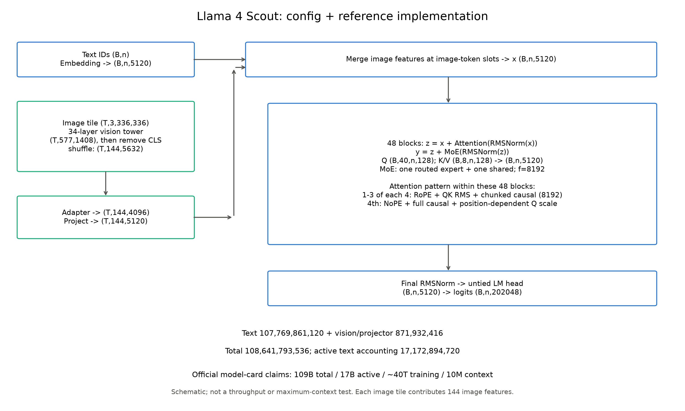

# 第 9 章 资料不完整时怎样读模型：Llama 4 配置与实现

## 9.0 开篇：从全书到这里

上一章借助论文、配置和实验比较三代整机。本章换一个资料条件：当发布说明不足以重建全部结构和训练过程时，怎样从公开模型卡、配置、实现与权重形状逐步确认所知？本章以 Llama4 为案例，重点介绍阅读步骤，而不是替模型发布补写一篇完整的训练报告。

本章保留 Scout 与 Maverick 的配置表、参数核算与代际差异，进一步区分三种问题：文件写了什么、代码怎样解释它、这些事实足以支持什么结论。专家路由的深层训练机制留给Book4，这里只用它说明不同层型如何进入整机账本。

## 9.1 模型资料不止一篇论文

可以取得的资料包括开发者模型卡、发布说明、配置、分词器与推理实现。Meta的Llama4发布博客及官方模型卡提供了模型规格与训练披露，因此不能把这个案例描述成“官方文字全部消失，只剩转述”。本章查阅模型卡和固定版本的 Transformers 实现，并将旧配置扫描记录作为注明时间的实验材料。[官方模型卡](https://github.com/meta-llama/llama-models/blob/main/models/llama4/MODEL_CARD.md)、[发布说明](https://ai.meta.com/blog/llama-4-multimodal-intelligence/)。

各类资料承担不同职责。配置描述模型构造参数，但可能省略默认值、携带旧字段，或与实际执行版本不匹配；它不是“厂商不得不诚实”的保证。实现解释字段如何变成运算，权重形状帮助检查参数是否对应；模型卡给出训练和评测披露，却仍可能没有全部数据配比与优化细节。相互核对，比建立一条“配置永远高于论文”的固定等级更有用。

旧扫描使用 unsloth 与 RedHatAI 镜像，并保留了来源和转换版本。两个镜像一致是有价值的检查，但可能来自同一上游，不能当作完全独立的证据。官方权重访问若有许可与登录要求，应按规定取得访问；公开模型卡和代码不因此失去参考价值。本章的参数算术不需要下载上百GB权重。

权重索引只负责定位张量分片；如果需要逐张量形状和dtype，还要读相应分片头部。对于支持 HTTP Range 的公开文件，可以只读取头部；服务器不支持或访问受限时，应记录这些限制，不能把取不到文件等同于模型信息不存在。

## 9.2 配置与实现互证：以 Scout 双镜像为例

模型卡提供规格，配置给出尺寸，实现解释运算。接下来按构造顺序阅读：先建立整机图景，再把字段对应到部件，最后核算参数。Scout 的两个镜像用于检查结构字段的一致性；Maverick 使用本次固定的 unsloth 配置，不把它也算作双镜像验证。

### 识别家族，粗读整机

识别模型家族，先看根级的三个字段：`model_type = "llama4"`、`architectures = ["Llama4ForConditionalGeneration"]`、`transformers_version = "4.52.4"`【证据等级：unsloth 配置快照】。类名提示我们检查“条件”来自哪里，不能仅凭名字判定多模态；继续找到内嵌的 `vision_config`，再到整机前向中确认视觉特征汇入文本序列，才能补全这条证据链。`transformers_version` 记录保存配置时的库版本，不保证读者当前执行的版本，也不能单凭 4.51 与 4.52 的差别断言某次转换修复了哪些问题。



图9.1 Llama 4 Scout 整机示意。文本嵌入与视觉特征先合并，再经过 48 个带两次残差相加的 Block、收尾归一化和输出头；每四层的说明是同一主体的层型分工。尺寸来自固定镜像配置，字段语义核对 Transformers v4.52.4；官方规模和训练量另标为模型卡声明。T 表示送入视觉编码器的图块总数。

先看图 9.1，建立对整机的初步认识：它仍直接继承了 LLaMA 的结构——pre-RMSNorm、分组查询注意力、门控前馈、旋转位置编码，四个插槽的延续关系清晰可见，但也有三处明显不同。其一，左边多出一座视觉塔，图像特征经过投影，替换图像占位符对应的嵌入，随后与文本共用残差流（原生多模态）。其二，前馈插槽从「一份门控前馈」换成了「一份共享 + 十六份路由的专家群，每 token 取一份」。其三，位置编码不再层层都旋，而是 3:1 交错。现在逐字段确认这三个「不同」——每个字段到部件的映射就是第 5 章表 5.3 那张地图的 2025 版（表 9.1）。

表 9.1 Llama 4 Scout 的主要结构字段（Scout 双镜像对照，部分字段经默认值补齐；不是完整配置文件）

| config 字段（未注明者位于 text_config） | 值（Scout） | → 部件/读法 | 等级 |
|---|---|---|---|
| 根级 `architectures` | Llama4ForConditionalGeneration | 原生多模态整机（内嵌 vision_config） | config 逆向 |
| `hidden_size` / `num_hidden_layers` | 5120 / 48 | 残差流宽 $d$ / Block 数 $L$ | config 逆向 |
| `num_attention_heads` / `num_key_value_heads` / `head_dim` | 40 / 8 / 128 | GQA 分组：$h \times d_k = 40\times128 = 5120 = d$ 恰好拼满 | config 逆向 |
| `num_local_experts` / `num_experts_per_tok` | 16 / 1 | 前馈插槽 → 专家群：16 份里每 token 取 1 份 | config 逆向 |
| `moe_layers` / `interleave_moe_layer_step` | 全 48 层 / step 1 | 专家层布局（Maverick 索引 1、3、…、47 为专家层，0、2、…、46 为稠密层；索引从 0 起） | config 逆向 |
| `intermediate_size` / `intermediate_size_mlp` | 8192 / 16384 | 专家宽 $f$ / 稠密层宽 $f_{\text{mlp}}$（Scout 的稠密宽闲置） | config 逆向 |
| （源码补读）shared expert | 宽同 $f=8192$ | 每 token 常开的一份共享前馈——config 无此字段，参考实现读出 | 官方参考源码 |
| `no_rope_layers` | [1,1,1,0]×12 | 在所据v4.52.4实现中：36层旋转且分块，12层不旋转且全局；须按使用点解释字段名 | config 逆向 |
| `attention_chunk_size` | 8192 | 旋转层按绝对位置分块；块内只看当前位置及此前位置 | config 逆向 |
| `rope_theta` / `rope_scaling` | 500,000 / llama3 型 factor 16（orig 8192） | base 与 Llama 3 相同；两频率阈值均为 1，实际分段见下文 | config 逆向 |
| `max_position_embeddings` | 10,485,760 | 声明上下文 10M（Maverick 为 1M） | config 逆向 |
| `vocab_size` / 根级 `tie_word_embeddings` | 202,048 / false | 出入口两份嵌入（untied 沿用 LLaMA 传统） | config 逆向 |
| `use_qk_norm` | true（Maverick 为 false） | 旋转层的 Q/K 过一道名为L2Norm的无参数均方根缩放（源码级） | config 逆向 + 参考源码 |
| `attn_temperature_tuning` / `floor_scale` / `attn_scale` | true / 8192 / 0.1 | NoPE 层按查询位置缩放 Q；与第 7 章的温度调节相关，但不是同一配方 | config 逆向 |
| `rms_norm_eps` / `attention_bias` | 1e-5 / false | pre-RMSNorm 的 epsilon / 注意力线性层是否带偏置 | config 逆向 |
| `cache_implementation` | "hybrid" | 推理期缓存策略的字段登记（本册不展开） | config 逆向 |

### 重建图纸：逐一确认三个「不同」

**前馈区**（图 9.1 主体中的 FFN 插槽）。`num_local_experts = 16` 配 `num_experts_per_tok = 1`：十六份可选门控前馈，每个 token 选择一份，专家宽 $f=8192$。先看形状：路由器把残差向量从 $(B,n,d)$ 映射为分数 $(B,n,E)$，这里 $d=5120$、$E=16$；分数最大的专家被选中。这些原始分数不是概率。v4.52.4 对选中分数取 sigmoid，再把所得系数乘在该专家的**输入**上；未选专家对应零输入。该分支沿用第 3 章的门控计算：$(B,n,d)\xrightarrow{W_g,W_u}(B,n,f)\times2\xrightarrow{\operatorname{silu}(\cdot)\odot}(B,n,f)\xrightarrow{W_d}(B,n,d)$。内部有非线性，所以先缩放输入不能随意改成最后缩放输出。另有一份同宽的**共享前馈**，始终接收未作路由缩放的输入；两路输出相加仍为 $(B,n,d)$。共享份在 config 中没有单独开关，是从 `shared_expert` 读出的【证据等级：Transformers v4.52.4，`Llama4TextMoe.forward`】。config 给出十六份可选专家，源码补出第十七份共享专家，两步完成后才有完整账目。这个参考路径还会把零输入的未选分支放入批量运算，因此“选一份”的结构口径不证明实际实现只计算一份专家。

**位置区**有一个容易读反的地方：字段名叫 `no_rope_layers`，不代表列表中1必然表示“不用RoPE”。在固定的Transformers v4.52.4实现中，注意力层直接把该元素赋给 `use_rope`，同一布尔值参与选择分块注意力。因而 `[1,1,1,0]` 实际表示前三层使用RoPE并采用分块可见性，第四层不用RoPE而采用全局可见性。48层对应36个前者与12个后者。

```python
# 固定阅读锚：Transformers v4.52.4 的Llama4实现。
use_rope = config.no_rope_layers[layer_idx]  # 1在这里表示启用RoPE
use_chunked = config.attention_chunk_size is not None and bool(use_rope)
# 继续追到RoPE调用及chunk mask，不能只根据字段名猜布尔语义。
```

继续看掩码，分块也有明确含义：位置 $p$ 所属块号是 $\lfloor p/8192\rfloor$，只能看同块中不晚于自己的位置。以从 0 开始的位置计，8191 还在首块，8192 已进入下一块；这与“向前保留最近 8192 个位置”的滑动窗口不同。全局层则在因果约束下看全部历史。iRoPE 一名见于开发者发布说明；它对具体任务有多大帮助，仍需训练与评测证据，不能只凭 3:1 列表回答。

Scout 的 base 为 500,000，缩放类型为 `llama3`、factor 为 16、原范围为 8192。还有两个不能略过的字段：`low_freq_factor` 与 `high_freq_factor` **都等于 1**，并非第 7 章示例中分开的两个阈值。按实现的规则，原波长短于 8192 的频率保持，长于 8192 的频率除以 16；两阈值之间没有非零宽度的平滑过渡区。本次 CPU 检查的 64 个频率没有恰好落在边界，输出有限；但 Transformers 5.14.1 仍警告两阈值应严格有序。这是需要保留的兼容性信息，不能默改配置，也不能据有限输出保证全部后端兼容。

乘积 $16\times8192=131{,}072$ 不是严格的“旋转覆盖半径”：RoPE 公式没有在这里设置硬边界。它与声明上下文 10,485,760 相差 80 倍，只是一组字段算术，不能推出另一些层“填补了 80 倍能力缺口”。可运行范围、位置构造与任务能力仍须分别确认。

**出入口区**。词表 202,048、`tie_word_embeddings = false`——这里可以直接套用第 5 章的参数计算方法：两份嵌入各 $202{,}048 \times 5120 = 1{,}034{,}485{,}760$。外围三项中的 token id（第四步）也先记下：`bos = 200000`、`pad = 200018`、图像起止 `boi/eoi = 200080/200081`、`image_token = 200092`——特殊与多模态 token 集中在 200,000+ 区段，这些 ID 只能提示特殊词元的分布；“20万基础+2048预留”的完整分解仍需读取词表与特殊项清单，不能由最大ID直接证明（tokenizer 文件的词条与特殊项未逐项核对，登记为悬案，9.6 节继续讨论）。

再看看视觉塔。配置中的 34 层、宽 1408、patch 14 和 336px，如何接到文本的 5120 维？每个图块有 $(336/14)^2=576$ 个 patch，加一个 CLS 后编码器处理 $(T,577,1408)$，其中 $T$ 为图块总数。去掉 CLS，再将相邻 $2\times2$ 个位置的通道重排到一起，得到 $(T,144,5632)$；适配器按 $5632\to4096\to4096$ 投影，整机再按 $4096\to5120$ 投影，才得到可汇入文本残差流的图像特征。这条路径既缩短图像序列，又完成维度对齐，不能从“视觉宽 1408”直接跳到“投影输入 4096”。塔内仍用带偏置的两矩阵 FFN 与 LayerNorm；两侧选择不同组件，不能说某类函数已被全面淘汰【证据等级：配置与 v4.52.4 视觉实现】。“SigLIP 系”属于社区谱系归类，本章不据此补写训练继承关系。

Q/K 归一化同样要查使用位置。Scout 的 `use_qk_norm=true` 只作用于旋转层，除数为 $\sqrt{\operatorname{mean}(x^2)+\varepsilon}$，没有可学增益，因而不增加参数。类名虽含 L2Norm，却不是按单位欧氏范数缩放。NoPE 层另按查询位置计算系数并缩放 Q；v4.52.4 的分支没有检查训练或推理模式，不能说它只在推理时生效，也不等同于第 7 章 YaRN 的常数尺度调节。零参数操作仍会改变前向行为，参数数目相等不保证运算相同。

### 双镜像核对：空字段由默认值补齐

本次固定的 Scout 两份配置中，unsloth 显式保存 `[1,1,1,0]×12`，RedHatAI 量化变体则保存空列表，序列化版本字段为 `4.51.0.dev0`。空表是不是“全部层都旋”？v4.52.4 配置类将它转成缺省值，生成每四层前三层旋转的布局；当前 5.14.1 解析也得到同一结果，结构字段对照一致。量化变体与原精度镜像结构一致，不表示权重字节布局相同。两个版本字段只能提示继续查转换记录，不能单凭它们解释空表产生的原因。

本章固定三份配置的 revision：Scout 的 unsloth 为 `afd8e498…`、RedHatAI 为 `fc1b4f4c…`，Maverick 的 unsloth 为 `86c5ecb6…`，完整值写入配套程序。`config_reverse.py` 的 `effective` 读取生效字段，`infer_rows` 建结构表，`param_account` 与 `meta_count` 分别算账。网络路径固定 revision；离线时显式提供本地文件，不在下载失败后悄悄换成另一年代的配置。

## 9.3 参数账 assert：从汇总参数量回到具体形状

接下来用参数账检查结构推断——第 5 章式 (5.2) 的参数账公式在专家层与稠密层混排时需要扩展，但扩展只涉及已经讲过的组件。本式针对本章无偏置文本配置，满足 $h d_k=d$；每个专家层有一份宽度同为 $f$ 的共享前馈，Q/K 缩放不含可学参数：

$$N = Vd\,(2-\mathbb{1}_{\text{tied}}) \;+\; L\,\big(\underbrace{2d^2 + 2\,d\,h_{kv}d_k}_{\text{注意力}} + \underbrace{2d}_{\text{双 norm}}\big) \;+\; n_{\text{moe}}\big(\underbrace{dE}_{\text{router}} + \underbrace{3df\,(E+1)}_{\text{E 份路由 + 1 份共享}}\big) \;+\; (L-n_{\text{moe}})\,\underbrace{3df_{\text{mlp}}}_{\text{稠密层}} \;+\; d \tag{9.1}$$

符号表：

| 符号 | 含义 | 形状/本章取值 |
|---|---|---|
| $V$ / $d$ / $L$ | 词表大小 / 残差流宽 / 层数 | 标量；202,048 / 5120 / 48 |
| $h$ / $h_{kv}$ / $d_k$ | 查询头数 / KV 头数 / 每头维 | 标量；40 / 8 / 128（$h\,d_k = d$） |
| $E$ / $k$ | 路由专家份数 / 每 token 取用份数 | 标量；16 / 1（Maverick 128 / 1） |
| $f$ / $f_{\text{mlp}}$ | 专家宽 / 稠密层宽 | 标量；8192 / 16384 |
| $n_{\text{moe}}$ | 专家层层数 | 标量；Scout 48、Maverick 24 |
| $\mathbb{1}_{\text{tied}}$ | 绑定指示（1=共享一份嵌入） | 标量；本章 0 |

这表示：**总账 = 出入口两份嵌入 + 层数×（注意力+双 norm）+ 专家层的前馈账 + 稠密层的前馈账 + 收尾 norm**——与式 (5.2) 相比只有前馈一项从「每层一份 $3df$」变成「按层型查表」，注意力、norm、出入口的参数计算式都没有改变。这就是组件化的好处：替换一个插槽，参数计算式中只需调整对应的一项。

Scout（全 48 层专家）逐项手算：注意力每层 $2\times5120^2 + 2\times5120\times8\times128 = 62{,}914{,}560$；前馈每层 $5120\times16 + 3\times5120\times8192\times17 = 2{,}139{,}176{,}960$（router 81,920 + 十六份路由各 125,829,120 + 共享一份 125,829,120）；先加每层双 norm 的 $2d=10{,}240$，再乘 48 层、加嵌入 $2\times1{,}034{,}485{,}760$、加收尾 5,120——**文本侧合计 107,769,861,120**；加视觉塔与投影 871,932,416（视觉塔是 `vision_config` 里一台 34 层的小机器，可用同一方法计算，本书以参考实现的计数为准），**整机 108,641,793,536**【证据等级：本书复算（式 9.1 手算 + meta 建模，CPU，2026-10）】。

然后对拍。用 Transformers 5.14.1 在 meta 设备建模，不下载权重，不分配真实参数存储，但仍有 Python 对象和张量元数据开销；文本 107,769,861,120、整机 108,641,793,536，与手算一致。同一 revision 的 `model.safetensors.index.json` 总字节为 217,283,587,072，恰为整机参数数目的两倍。这证明**字节总量与每参数两字节假设相容**，还不是“已证明每张量都是 BF16”。F16 也是两字节，混合 dtype 与缓冲还可能产生其他组合。本轮没有读取全部分片头部，不能宣称已排除这些情况【证据等级：本书 CPU 元数据核验，2026-11；固定镜像索引】。

Maverick 同法：24 层专家（$E=128$）加 24 层稠密前馈（$f_{\text{mlp}}=16384$），文本 400,711,848,960、整机 401,583,781,376，手算与 meta 构造一致；同一 revision 索引总字节为 803,167,562,752，也符合两字节假设。

三种检查分别经过人的推导、参考实现构造和检查点索引的字节记录，能发现不同漏项，却不是三个统计独立来源：它们可能共用配置与转换约定。手算可能漏掉共享专家，实现可能有错误，字节也可能被错误的 dtype 假设解释。结果相容提高了账目一致性，却不能唯一确定网络结构；参数总数相同还需要逐层形状和运算路径来核对。第 5 章的 F32 频率缓冲，正是提醒我们保留这一步。

现在再看官方模型卡的“总量约 109B”。本章整机结果 108.6418B 与它的取整口径相容，却不能证明厂商内部逐项统计完全采用本章口径。这里的 109 是取整到十亿级的规格。读模型的重点是把汇总规格展开为可检查的明细，而不是先认定总数，再调整配置去凑它。参数量由多个自由度共同决定，具体结构仍需配置、源码和张量形状共同说明。

这台机器还有**第二本账**。总量统计模型存储了多少参数，活跃量按一条被选中的文本计算路径统计规模。本章约定把两张词表整表计入，随后解释这与实际读取量的区别：

$$N_{\text{act}} = n_{\text{moe}}\big(2d^2 + 2\,d\,h_{kv}d_k + 2d + dE + 3df\,(1+k)\big) + (L-n_{\text{moe}})\big(2d^2 + 2\,d\,h_{kv}d_k + 2d + 3df_{\text{mlp}}\big) + Vd\,(2-\mathbb{1}_{\text{tied}}) + d \tag{9.2}$$

这表示：**活账 = 按层型计算选中路径的组件规模——在专家层中计算注意力、双 norm、router、一份共享前馈和被选中的 $k$ 份专家；在稠密层中计算注意力、双 norm 和整份稠密前馈——再加出入口两份与收尾 norm**。与式 (9.1) 同一条纪律：router 只出现在专家层中，稠密层的活跃宽是 $f_{\text{mlp}}$——混排模型必须按层型分别核算。Scout 代入（48 层全是专家层，只需计算一种层型）：每层 $314{,}664{,}960$，乘 48 层、加出入口与收尾 norm，**17,172,894,720 ≈ 17.2B**【证据等级：本书复算】——与官方模型卡“17B 激活参数”的粗粒度规格相容，这是本书约定下的精确算术，不是对厂商内部逐项口径的证明。

Maverick 更值得注意，它能检验混排模型的参数计算：24 个专家层每层活跃 $315{,}238{,}400$、24 个稠密层每层活跃 $314{,}583{,}040$（稠密层没有 router 要扣掉 $dE=655{,}360$，但 $f_{\text{mlp}}=16384$ 恰为 $2f$，两型每层的活跃前馈同宽），合计 **17,184,691,200 ≈ 17.2B**——两台机器**活账几乎相同、总账差近四倍**（108.6B 对 401.6B；总账/活账之比 6.28 对 23.32，分子按文本侧总账计、视觉塔不入比）。回头看两个名字「17B-16E」与「17B-128E」：前半是活账、后半是专家份数——**命名本身就是一本账**，这份明细要由 config 与参考实现一起补全。

### 活跃参数不能直接替代每步计算和访存

**式(9.2)是一种模型规模口径，不是每个token实际读取所有这些参数的计数。**其中把输入、输出两张词表都计入；但输入查表只取一行，输出投影通常访问整张表。视觉塔是否运行、路由选择、批内不同token使用哪些专家，也会改变实际工作量。因此17B与109B分别帮助描述被选择的计算路径和总模型容量，却不能直接用二者之比推导速度倍率。

只看专家前馈部分，E个可选专家加1个共享专家共 $(E+1)3df$ 参数；一个token选k个专家时，沿该路径使用 $(k+1)3df$。这是总量与选中量之差的来源。若一批token分别选了不同专家，整批涉及的权重并集可能很大；要进一步算性能，必须指定token分配、缓存与通信，Book4会继续展开。

## 9.4 与上一代 diff：插槽表再演练

第 8 章的代际比较以「论文改动清单」为依据；在本章资料条件下，比较还需要逐项对照两代 config 与实现——插槽视角反而更顺手，因为 config 字段本来就近乎插槽清单的机器可读版。表 9.2 把 Llama 3（论文+config 双源已核）与 Llama 4（本章逆向）并排，每一行标明动的是哪个插槽。

表 9.2 Llama 3 → Llama 4：插槽视角的 diff（Llama 3 列证据=论文+config 双源【第 8 章已核】；Llama 4 列证据=config 逆向，注明者除外）

| 插槽/维度 | Llama 3（8B/405B） | Llama 4（Scout/Maverick） | 动没动 |
|---|---|---|---|
| 归一化 | pre-RMSNorm，eps 1e-5 | 同 | **未动** |
| 注意力分组 | GQA，全系 8 KV 头（$h$=32/128） | 40 头 / 8 KV / $d_k$ 128 | 8 个 KV 头沿用；每组查询头数改变 |
| 注意力新件 | — | 3:1交错＋分块8192＋无参数QK均方根缩放（Scout） | 添三件零/低参数件 |
| 前馈插槽 | 单份门控前馈（$f$=14336/53248） | 16/128 选 1 专家群 + 共享份（$f$=8192；Maverick 从 0 起的偶数索引层稠密 16384） | **大动** |
| 位置编码 | 全层 RoPE，$\theta$=5e5（3.1 加 llama3×8） | $\theta$=5e5 + 3:1 交错 + llama3×16（Scout） | 半动 |
| 出入口 | 128,256，untied | 202,048，untied | 动（量变） |
| 上下文声明 | 8k → 3.1 的 128k（报告六阶段过程针对 405B） | 10M / 1M | 大跳 |
| 多模态 | 纯文本（LlamaForCausalLM） | 原生（vision_config 内嵌） | 新增 |
| 训练 tokens | 15T / 旗舰15.6T【Llama3报告】 | Scout约40T、Maverick约22T【Meta模型卡】 | —（等级对照行） |
| 本章依赖资料 | 技术报告、配置与实现 | 官方模型卡、发布说明、配置与固定实现 | 资料不完整时逐项交叉核对 |

逐行来看。**残差分支前的归一化类型沿用**：pre-RMSNorm 与这里的 epsilon 相同；Scout 另有 Q/K 缩放，不能把局部结论扩成整机所有归一化都没变。

**KV 头数沿用，组内查询头数变化**：Llama 2 的 34B/70B、Llama 3 各档与本章 Llama 4 都使用 8 个 KV 头，但每组查询头数是 $h/h_{kv}$。Llama 3 的 8B/405B 分别为 4/16，Llama 4 为 5，不能说分组完全没动。新增交错、分块与无参数 Q/K 缩放几乎不增加可学参数，却改变可见范围与计算路径。第 6 章也已说明，采用 8 组不等于证明它对所有规模都最优。

**前馈变化很大**：前馈插槽换成专家群——单份专家宽 8192，比上一代 8B 档的 14336 还窄：前馈插槽的规模化走的是「份数」而不是「单份宽度」（config 事实；为什么这样选、训练难在哪，是下一册的开场主角，本册只登记 config 事实，欠账框见章末）。

**位置编码部分变化**：位置编码的 $\theta$ 不变，动的是哪些层旋转、频率怎样分段缩放；不能把频率改变含糊地叫作旋转维数改变。类型名仍是 `llama3`，但 Scout 两个阈值相等，具体行为要按本章字段解释。

**出入口也有变化**：词表 128k 到 202k，需要重新权衡词表参数、编码长度与任务需求。多模态词元确实占用位置，但仅凭词表更大不能断定同一文本的 token 数更少，仍需像第 5 章一样实际编码比较。

### 用分层状态账检查上下文声明

**将所有层都按全历史缓存计算，只能得到一种假设下的载荷，不能直接用来否定混合注意力的上下文声明。**若批量 $B=1$，Scout 全部 48 层保存 $n$ 个位置、BF16 每元素 $b=2$ 字节、$h_{kv}=8$、$d_k=128$，则每token为 $2\times48\times8\times128\times2=196608$ 字节，即192KiB；$n=10{,}485{,}760$ 时为 1.875TiB；这是全层保留全部历史的载荷。

对混合层型，把第 $l$ 层实际保留长度记为 $n_l$。假定各层 KV 头数与头维相同，批内各请求保留长度相同，批量为 $B$、每元素占 $b$ 字节，则：

$$M_{\rm KV}=2Bbh_{kv}d_k\sum_{l=1}^{48}n_l.\tag{9.3}$$

式中 $M_{\rm KV}$ 为缓存字节数，$B,b,h_{kv},d_k,n_l$ 均为标量；每层 K、V 的形状各为 $(B,h_{kv},n_l,d_k)$。也就是说，先按实际保留长度算每层，再相加。若一种执行策略让 12 个全局层保留 $n$、36 个分块层只保留至多 $c=8192$ 个位置，上界为 $2Bbh_{kv}d_k[12n+36\min(n,c)]$；代入上述单请求条件，得到 $480+1.125=481.125$GiB。这个结果仍不包括权重、工作区或实际缓存分配策略，也不证明单卡就能服务最大窗口；它说明结构事实必须先映射到状态生命周期，再做系统预算。缓存实现属于后续系统册，当前不由一个字符串“hybrid”推断其全部行为。

## 9.5 服务状态、资料可用性与模型结构是不同问题

模型服务端点可以上线、调整或停用，文档也会迁移，但这些事件不能自动定义一条模型研究路线的“终局”。本章查阅时仍可取得Meta的Llama4模型卡、发布说明及模型页面；不能由某一次抓取失败推出门户完全撤场或模型线结束。具体API或产品状态应单独查证，不作为模型结构推导的前提。

对读者有长期价值的做法是固定所据资料：保存模型名、版本、配置内容和实现提交，区分当时的服务状态与可复查的结构。若某个网页不可访问，先检查迁移与其他官方渠道；某一次抓取失败只说明这次取得资料失败，不等于“官方从未披露”。如果只有镜像，则说明其来源并继续用形状和参数核算交叉检查。

相反，配置和权重也不是天然不会出错的事实集合。默认值、转换脚本、量化封装和自定义代码都可能改变解释。读模型的能力来自持续核对这些关系，既不依赖宣传文案，也不把机器可读文件当作无须审查的真相。

## 9.6 方法论收束：五步、分级与未决问题

本章的完整阅读流程，是第 5 章五步法的 2025 年版本：**认家族**（model_type、architectures、transformers_version 年代学）→ **重建图纸**（字段-部件映射，整机图先行；config 中读不到的字段，接着查参考源码）→ **算账对拍**（式 (9.1) 总量与 meta 建模核对，index 检查字节假设，式 (9.2) 另算活跃规模；索引不证明活跃量）→ **读外围三件**（token id 锚点、tokenizer 构成、采样默认）→ **证据分级**（表 9.3）。与第 5 章相比有两处升级：对拍方从「论文表格」换成「参考实现 + 权重索引」（用实现补足配置未写的运算；参考实现不等于厂商训练实现）；分级也从「给数字标等级」扩展到「区分结构核验、规模声明与能力评测」。

表9.3 资料职责与核验边界（不是无条件的可信度总排名）

| 等级 | 本章实例 | 能做什么 / 不能做什么 |
|---|---|---|
| config 逆向（Scout 双镜像交叉） | d=5120/48 层/8 KV/16 选 1/202,048/3:1 交错/10M | 字段与计数可核对；不能仅由字段证明动机或能力 |
| Transformers参考实现（本章固定核对v4.52.4） | 共享份的存在与宽度；名为L2Norm的函数无可学参数；空表默认 3:1 | 补 config 之缺；注意「实现≠设计意图」 |
| 官方模型卡/发布材料（数字按披露口径） | 17B激活、10M/1M声明、40T/22T训练量、iRoPE描述 | 按各项披露精度引用；近似规模不能冒充逐张量计数 |
| 厂商自报 | 实验聊天版本的竞技场分数、Behemoth 对比句 | 保留被测版本、任务与发布时点；不能无条件推广到公开权重 |
| 社区 | 字段解读与视觉塔谱系推断 | 需交叉核对后才可引用 |

完成五步后，还要列出**未决问题**——config 读不出什么，要显式写下来而不是含糊带过：模型卡40T/22T训练量背后的详细数据配比；后训练全部细节；训练动力学（loss 曲线）；为什么是 3:1 而不是别的比、为什么 16/128 份；10M窗口对目标任务是否足够的独立评估；tokenizer 的完整词条与特殊项划分，以及本章尚未逐项核对的生成默认值。这些问题不能只靠config回答，应分别查模型卡、技术说明和可复现实验——登记、标注、交给地界正确的后续册，而不是猜。把已知与未知的边界说明白，已有分析才可信。

这套「config → 架构图 → 参数 assert → 证据分级 → 未决问题」的程序，从下一册开始就会经常用到：分析公开资料尚不足以重建全部细节的模型，都要先完成这些步骤（显式地址见章末欠账框）。

## 9.7 本章小结

本章沿配置、实现与参数形状重建了 Scout 和 Maverick 的主要结构，保留了两组总参数与活跃参数账。关键并不是“没有论文也能猜全”，而是每一步都明确资料支持到哪里：字段值需要使用点解释，模型卡中的训练与上下文声明需要相应实验口径，参数数目不能替代执行成本。

最值得记住的例子是 `no_rope_layers`：仅凭名字会把36个旋转分块层与12个不旋转全局层完全读反。把声明、默认值、使用点和输出形状连起来，才形成可靠的结构图。资料可以帮助我们知道系统怎样构造，设计动机和能力边界仍需其他证据。

**保留未知并不是停止分析，而是防止下一步建立在未经确认的前提上。**用可追溯快照、算术与实现互证，读者可以继续研究新模型，也能及时识别旧解读中的错误。

到这里，我们已有一套能够迁移的结构阅读方法，也知道哪些问题还需要额外证据。全书旅程只剩最后一程：回到我们自己的 207M——四插槽齐装成整机，参数逐位 assert，冒烟点火，再留下一份写给未来高算力机器的设计文档。下一章，把改装史装进 import 语句里收官。

> **【欠账】** Llama 4 把前馈插槽换成「16/128 选 1 的专家群 + 一份共享」——选法怎么工作、省在哪儿、训练难在哪，是下一册的开场主角；本册只登记 config 事实。→ Book4 第 2 章
> **【欠账】** 本章练成的「config → 架构图 → 参数 assert → 证据分级 → 未决问题」程序，下一册拆旗舰（精拆与各家 config 速览）时是日用工具；读厂商自报数字的操作手册另见后续册。→ Book4 第 10 章 / Book5 第 11 章

## 9.8 动手验证

- **配置、meta 参数账与索引字节核对**（CPU 秒到分钟级，另计网络等待；使用已有的 torch、transformers 和 huggingface_hub）：
  ```bash
  source ./env.sh
  python from-models-to-vllm/book3-modern-open-source-skeleton/code/ch09/config_reverse.py --model scout --out-name run1
  python from-models-to-vllm/book3-modern-open-source-skeleton/code/ch09/config_reverse.py --model maverick --out-name run1 --no-figure
  # 产物默认在工作区 log/book3-ch09/；图写入实验目录，不覆盖书中插图。
  # 重跑须用新 out-name；--local-files-only 仅读取固定 revision 的缓存。
  # 自备离线快照：--config config.json --compare-config other.json --index model.safetensors.index.json
  # 本地 index 须与底本同 revision；不提供时明确记录该列未核验。
  ```
  程序保存原配置、来源哈希与实际库版本；Scout 在线路径核对两份配置，Maverick 核对一份。手算不符、结构字段不同或索引两字节假设不符时退出，不输出“全部通过”。只有全部分片头部核验后才能追加 dtype 结论，本程序不做这项检查。图 9.1 仅适用于 Scout。
- **复算本书数字**：把式 (9.1)/(9.2) 的 Scout 各项手抄一遍，对照输出 JSON 的 `account` 字段（注意力 62,914,560 / 专家层前馈 2,139,176,960 / 每层活账 314,664,960）；改 $E=128$、$n_{\text{moe}}=24$ 复算 Maverick——活跃量记得按层型分别计算（稠密层无 router、活跃宽取 $f_{\text{mlp}}$，两型每层分别 315,238,400 与 314,583,040，合计 17,184,691,200）。
- **验收点**：拿到一份陌生 config.json 能独立走完五步、画出带证据等级的结构图；能对 Llama 4 的位置区说清「配置与实现确认了什么（3:1 交错、因果分块 8192、实际频率阈值）／能力还需什么评测」；能解释为什么「空 no_rope_layers」不能读成「全部层都旋」；能分别计算 10M 声明下的全历史缓存与分层缓存，并解释二者为何都不是设备容量保证。

实现锚：[Transformers v4.52.4 Llama4模型](https://github.com/huggingface/transformers/blob/v4.52.4/src/transformers/models/llama4/modeling_llama4.py)及[配置默认值](https://github.com/huggingface/transformers/blob/v4.52.4/src/transformers/models/llama4/configuration_llama4.py)。模型规格与训练量见[Meta官方模型卡](https://github.com/meta-llama/llama-models/blob/main/models/llama4/MODEL_CARD.md)，本轮复核日期2026-11-11。
