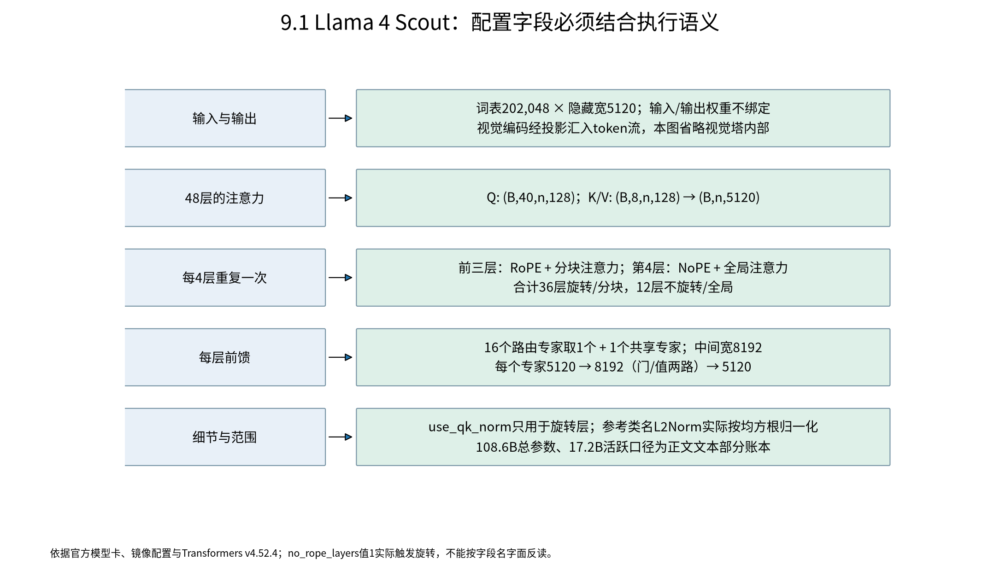

# 第 9 章 资料不完整时怎样读模型：Llama 4 配置与实现

## 9.0 开篇：从全书到这里

上一章借助论文、配置和实验比较三代整机。本章换一个资料条件：当发布说明不足以重建全部结构和训练过程时，怎样从公开模型卡、配置、实现与权重形状逐步确认所知？Llama4作为案例，重点是阅读程序，而不是替模型发布写一篇完整的训练报告。

本章保留Scout与Maverick的配置表、参数核算与代际差异，进一步区分三种问题：文件写了什么、代码怎样解释它、这些事实足以支持什么结论。专家路由的深层训练机制留给Book4，这里只用它说明不同层型如何进入整机账本。

## 9.1 模型资料不止一篇论文

可以取得的资料包括开发者模型卡、发布说明、配置、分词器与推理实现。Meta的Llama4发布博客及官方模型卡提供了模型规格与训练披露，因此不能把这个案例描述成“官方文字全部消失，只剩转述”。本章查阅模型卡、固定版本的Transformers实现，并把旧配置扫描记录作为带时间的实验材料。[官方模型卡](https://github.com/meta-llama/llama-models/blob/main/models/llama4/MODEL_CARD.md)、[发布说明](https://ai.meta.com/blog/llama-4-multimodal-intelligence/)。

各类资料承担不同职责。配置描述模型构造参数，但可能省略默认值、携带旧字段，或与实际执行版本不匹配；它不是“厂商不得不诚实”的保证。实现解释字段如何变成运算，权重形状帮助检查参数是否对应；模型卡给出训练和评测披露，却仍可能没有全部数据配比与优化细节。相互核对，比建立一条“配置永远高于论文”的固定等级更有用。

旧扫描使用unsloth与RedHatAI镜像，保留其来源和转换版本。两个镜像一致是有价值的检查，但可能来自同一上游，不能当作完全独立的证据。官方权重访问若有许可与登录要求，应按规定取得访问；公开模型卡和代码不因此失去参考价值。本章的参数算术不需要下载上百GB权重。

权重索引只负责定位张量分片；如果需要逐张量形状和dtype，还要读相应分片头部。支持HTTP Range的公开文件可只取头部，服务器不支持或访问受限时应记录限制，不把取不到文件等同模型信息不存在。

## 9.2 双镜像 config 逆向：五步实战

三件套已经摆上工作台，现在按构造的逻辑走：先看整机长什么样（粗但完整），再逐字段落到部件，最后算账验收。

### 第一步与整机粗读

认家族三件套：`model_type = "llama4"`、`architectures = ["Llama4ForConditionalGeneration"]`、`transformers_version = 4.52.4`【证据等级：config 逆向（unsloth 镜像；RedHatAI 镜像核心字段逐项一致，本书实测）】。第二个值信息量最大：不再是 `LlamaForCausalLM`（纯文本），而是「条件生成整机」——config 里内嵌了一整份 `vision_config`，视觉不是外挂而是机身的一部分。`transformers_version` 延续第 5 章的年代学：4.51 正是 Llama 4 首发的 transformers 版本段，4.52 是修正段——两代镜像各占其一，后面还有戏。



图9.1 Llama 4 Scout的教学结构图。先看输入、48层主体和出口，再看每四层的注意力分工。配置负责提供尺寸，Transformers v4.52.4提供字段执行语义；图中36层RoPE/分块与12层NoPE/全局必须一起读。文本参数账不包括视觉塔。

先粗读图 9.1 建立整机心智：这仍是那台 LLaMA 的直系后代——pre-RMSNorm、分组查询注意力、门控前馈、旋转位置编码，四插槽的族谱一眼可辨；但三处大不同。其一，左边多出一座视觉塔，图像经投影后以 token 形态汇入残差流（原生多模态）。其二，前馈插槽从「一份门控前馈」换成了「一份共享 + 十六份路由的专家群，每 token 取一份」。其三，位置编码不再层层都旋，而是 3:1 交错。现在把这三个「不同」逐字段钉死——每个字段到部件的映射就是第 5 章表 5.3 那张地图的 2025 版（表 9.1）。

表 9.1 Llama 4 Scout 的 config 字段全表（双镜像交叉；「→ 部件/读法」列即结构推断）

| config 字段（text_config） | 值（Scout） | → 部件/读法 | 等级 |
|---|---|---|---|
| `architectures` | Llama4ForConditionalGeneration | 原生多模态整机（内嵌 vision_config） | config 逆向 |
| `hidden_size` / `num_hidden_layers` | 5120 / 48 | 残差流宽 $d$ / Block 数 $L$ | config 逆向 |
| `num_attention_heads` / `num_key_value_heads` / `head_dim` | 40 / 8 / 128 | GQA 分组：$h \times d_k = 40\times128 = 5120 = d$ 恰好拼满 | config 逆向 |
| `num_local_experts` / `num_experts_per_tok` | 16 / 1 | 前馈插槽 → 专家群：16 份里每 token 取 1 份 | config 逆向 |
| `moe_layers` / `interleave_moe_layer_step` | 全 48 层 / step 1 | 专家层布局（Maverick 为奇数层、step 2，偶数层稠密） | config 逆向 |
| `intermediate_size` / `intermediate_size_mlp` | 8192 / 16384 | 专家宽 $f$ / 稠密层宽 $f_{\text{mlp}}$（Scout 的稠密宽闲置） | config 逆向 |
| （源码补读）shared expert | 宽同 $f=8192$ | 每 token 常开的一份共享前馈——config 无此字段，参考实现读出 | 官方参考源码 |
| `no_rope_layers` | [1,1,1,0]×12 | 在所据v4.52.4实现中：36层旋转且分块，12层不旋转且全局；须按使用点解释字段名 | config 逆向 |
| `attention_chunk_size` | 8192 | 旋转层的分块注意力范围（块内注意、块间不看） | config 逆向 |
| `rope_theta` / `rope_scaling` | 500,000 / llama3 型 factor 16（orig 8192） | $\theta$ 继承 Llama 3；分段缩放——快针不动、慢针压 $1/16$ | config 逆向 |
| `max_position_embeddings` | 10,485,760 | 声明上下文 10M（Maverick 为 1M） | config 逆向 |
| `vocab_size` / `tie_word_embeddings` | 202,048 / false | 出入口两份嵌入（untied 沿用 LLaMA 传统） | config 逆向 |
| `use_qk_norm` | true（Maverick 为 false） | 旋转层的 Q/K 过一道名为L2Norm的无参数均方根缩放（源码级） | config 逆向 + 参考源码 |
| `attn_temperature_tuning` / `floor_scale` / `attn_scale` | true / 8192 / 0.1 | 推理期注意力温度缩放的 config 事实——与第 7 章的温度配方同族旋钮，只登记不展开 | config 逆向 |
| `rms_norm_eps` / `attention_bias` | 1e-5 / false | pre-RMSNorm 与无偏置：第 2 章的遗产原样 | config 逆向 |
| `cache_implementation` | "hybrid" | 推理期缓存策略的字段登记（本册不展开） | config 逆向 |

### 重建图纸：三个「不同」逐一钉死

**前馈区**（整机里 Block 的 FFN 插槽，图 9.1 大框的下半部）。`num_local_experts = 16` 配 `num_experts_per_tok = 1`：十六份并列的门控前馈，每个 token 只点燃一份；专家宽 `intermediate_size = 8192`。逐运算标形（$d=5120$，$f=8192$，$E=16$）：路由器把残差向量打分成一列选择概率 $(B,n,d)\xrightarrow{\text{router}}(B,n,E)$，每 token 取最高的一份；被选中的专家走第 3 章的老路 $(B,n,d)\xrightarrow{W_g,W_u}(B,n,f)\times 2\xrightarrow{\;\operatorname{silu}(\cdot)\odot\;}(B,n,f)\xrightarrow{W_d}(B,n,d)$；另有一份**共享前馈**同形常开、人人过一遍，输出与被选专家相加仍是 $(B,n,d)$。共享份在 config 里没有对应字段——它是从参考实现里读出来的（固定核对的v4.52.4专家层含 `shared_expert`，宽度同$f$）【证据等级：Transformers参考实现（本章固定核对v4.52.4）】。这是“config→源码”的**双跳读法**：config 告诉你有十六份，源码补上第十七份——两跳都过了才能进参数账，9.3 节的 assert 会验证这一点。

**位置区**需要防止一个反读：字段名叫 `no_rope_layers`，不代表列表中1必然表示“不用RoPE”。在固定的Transformers v4.52.4实现中，注意力层直接把该元素赋给 `use_rope`，同一布尔值参与选择分块注意力。因而 `[1,1,1,0]` 实际表示前三层使用RoPE并采用分块可见性，第四层不用RoPE而采用全局可见性。48层对应36个前者与12个后者。

```python
# 固定阅读锚：Transformers v4.52.4 的Llama4实现。
use_rope = config.no_rope_layers[layer_idx]  # 1在这里表示启用RoPE
use_chunked = config.attention_chunk_size is not None and bool(use_rope)
# 继续追到RoPE调用及chunk mask，不能只根据字段名猜布尔语义。
```

这说明定义处、默认值与使用点必须接起来。iRoPE一名也见于开发者发布说明，不应仅标成社区命名。为什么这一组织有利于特定长度，需要训练与评测支持，不能只凭3:1列表回答。

Scout所据配置的base为500,000，缩放包含factor16和原范围8192。二者乘积131,072不是严格的“旋转覆盖半径”：RoPE公式没有以该乘积为硬边界，实际频率还依赖分段规则。它与声明上下文10,485,760相差80倍，只是一组字段算术，不能推出另一些层“填补了80倍能力缺口”。本章保留字段，区分可运行范围、位置构造与能力证据。

**出入口区**。词表 202,048、`tie_word_embeddings = false`——第 5 章的账在这里直接套用：两份嵌入各 $202{,}048 \times 5120 = 1{,}034{,}485{,}760$。外围三件的 token id 锚点（第四步）也先记下：`bos = 200000`、`pad = 200018`、图像起止 `boi/eoi = 200080/200081`、`image_token = 200092`——特殊与多模态 token 集中在 200,000+ 区段，于是这些ID只提示特殊词元分布；“20万基础+2048预留”的完整分解仍需读取词表与特殊项清单，不能由最大ID直接证明（tokenizer 文件未逐张量核，登记为悬案，9.6 节收账）。视觉塔

顺带一笔：34 层、宽 1408、patch 14、336px 都是 config 事实；塔内的前馈还是**带偏置的两矩阵 FFN 加 LayerNorm**——文本侧与视觉侧选择不同组件，不能将某类函数称为已被全面淘汰，视觉侧还在用（「SigLIP 系」的谱系认定为社区口径【社区】）。连 `use_qk_norm` 这样的字段也要双跳才落地：config 只写 true，参考源码里它是旋转层 Q/K 上的一道 **无可学增益的均方根缩放**；虽然类名含L2Norm，代码实际除以 $\sqrt{\operatorname{mean}(x^2)+\varepsilon}$，而非单位欧氏范数——零参数部件，参数账不受影响，但不明就里的读者会以为漏算了一块。

### 双镜像现场：空字段是被默认值接管的

双镜像交叉在本书实测里给出一堂计划外的课。核心字段（表 9.1 除注明外全部）两家逐项一致；但 RedHatAI 镜像（一个低比特量化变体，`transformers_version` 为 4.51.0.dev0——首发前的开发版转换）的 `no_rope_layers` 是**空表**。空表是不是意味着「全部层都旋」？不敢直接下结论——把它喂给 config 类走一遍：`Llama4TextConfig` 对空表有默认接管逻辑（每四层的前三层旋转，第四层不旋转），生效值与 unsloth 镜像**完全一致**【证据等级：本书实验（transformers 5.18.0，2026-10）】。第 5 章的纪律说「字段缺席也是信息」；本章补上它的 2025 版：**空字段可能是默认值的接管点——缺席不等于无机制**，要过一遍 config 类的默认语义、最好再过一遍参考实现，才敢把「没写」读成「没有」。镜像分歧本身也是信息：转换年代不同（4.51.0.dev0 对 4.52.4），落盘习惯就不同——「检查点卫生的代际差异」在第 5 章见过（Llama-2 的幻影参数对 Llama-3 的干净检查点），这里又见了一面。本节全程的机器可读版是 code/ch09/config_reverse.py：双镜像下载与回落、结构推断表、三方 assert 与图 9.1 的绘制都在这一个文件里，9.8 节给复现命令。

## 9.3 参数账 assert：从汇总参数量回到具体形状

结构推断是否可信，最后一关是算账——第 5 章式 (5.2) 的参数账公式在专家群与稠密层混排的世界里需要扩展，扩展本身只用已教过的零件：

$$N = Vd\,(2-\mathbb{1}_{\text{tied}}) \;+\; L\,\big(\underbrace{2d^2 + 2\,d\,h_{kv}d_k}_{\text{注意力}} + \underbrace{2d}_{\text{双 norm}}\big) \;+\; n_{\text{moe}}\big(\underbrace{dE}_{\text{router}} + \underbrace{3df\,(E+1)}_{\text{E 份路由 + 1 份共享}}\big) \;+\; (L-n_{\text{moe}})\,\underbrace{3df_{\text{mlp}}}_{\text{稠密层}} \;+\; d \tag{9.1}$$

符号表：

| 符号 | 含义 | 形状/本章取值 |
|---|---|---|
| $V$ / $d$ / $L$ | 词表大小 / 残差流宽 / 层数 | 标量；202,048 / 5120 / 48 |
| $h$ / $h_{kv}$ / $d_k$ | 查询头数 / KV 头数 / 每头维 | 标量；40 / 8 / 128（$h\,d_k = d$） |
| $E$ / $k$ | 路由专家份数 / 每 token 取用份数 | 标量；16 / 1（Maverick 128 / 1） |
| $f$ / $f_{\text{mlp}}$ | 专家宽 / 稠密层宽 | 标量；8192 / 16384 |
| $n_{\text{moe}}$ | 专家层层数 | 标量；Scout 48、Maverick 24 |
| $\mathbb{1}_{\text{tied}}$ | 绑定指示（1=共享一份嵌入） | 标量；本章 0 |

这表示：**总账 = 出入口两份嵌入 + 层数×（注意力+双 norm）+ 专家层的前馈账 + 稠密层的前馈账 + 收尾 norm**——与式 (5.2) 相比只有前馈一项从「每层一份 $3df$」变成「按层型查表」，注意力、norm、出入口一个字没改。这就是插槽化的红利：换一个插槽，账本只动一行。

Scout（全 48 层专家）逐项手算：注意力每层 $2\times5120^2 + 2\times5120\times8\times128 = 62{,}914{,}560$；前馈每层 $5120\times16 + 3\times5120\times8192\times17 = 2{,}139{,}176{,}960$（router 81,920 + 十六份路由各 125,829,120 + 共享一份 125,829,120）；乘 48 层、加嵌入 $2\times1{,}034{,}485{,}760$、加收尾 5,120——**文本侧合计 107,769,861,120**；加视觉塔与投影 871,932,416（视觉塔是 `vision_config` 里一台 34 层的小机器，同法可算，本书以参考实现计数为准），**整机 108,641,793,536**【证据等级：本书复算（式 9.1 手算 + meta 建模，CPU，2026-10）】。然后对拍：transformers meta 设备建模（不下载权重、不分配真实参数存储，但仍有Python对象和元数据开销）给出 107,769,861,120 / 108,641,793,536；远程读 unsloth 仓的 `model.safetensors.index.json`（KB 到 MB 级索引，第 5 章 Range 手法的直接复用），`total_size ÷ 2 = 108,641,793,536`——**三方逐位一致**，且全 bf16 落盘、没有 Llama-2 时代那类 F32 缓冲混装【证据等级：本书实验 + config 逆向，2026-10】。Maverick 同法：24 层专家（$E=128$）+ 24 层稠密（$f_{\text{mlp}}=16384$），文本 400,711,848,960、整机 401,583,781,376，三方同样逐位对平。

三个对拍方凭什么算「独立」，值得说破。手算是我们自己的公式算术；meta 建模是参考实现按同一份 config 逐模块搭一遍、遍历它登记的每个权重张量；远程 index 是当年转换脚本落盘的实物清单。三条路分别经过**人的推导、参考实现的构造、检查点的字节**——殊途同归，才叫对平。任何一方独大都会骗人：只信手算会漏暗字段（共享份就差点漏掉），只信实现会把实现 bug 当成架构，只信 index 会踩 dtype 混装（Llama-2 那批 F32 频率缓冲的幻影参数，第 5 章考据框的现成教案）。

现在才轮到那个流传最广的数字：官方模型卡报告Scout「总量约 109B」【证据等级：官方模型卡/发布材料（数字按披露口径）】。我们的手算 108.6B 与它相安无事——但方向要说清楚：**是转述向 config 对齐，不是 config 向转述对齐**。转述只有两位有效数字，config 能拆到每一项；「109B」对了对账单才知道自己是 107,769,861,120 加视觉的舍入值。从汇总参数量回到具体形状——参数量只是把十几个自由度压扁成的一个投影，config 才是图纸。

这台机器还有**第二本账**。总账数的是「仓库里躺了多少参数」，活账数的是「每个 token 实际点亮多少参数」：

$$N_{\text{act}} = n_{\text{moe}}\big(2d^2 + 2\,d\,h_{kv}d_k + 2d + dE + 3df\,(1+k)\big) + (L-n_{\text{moe}})\big(2d^2 + 2\,d\,h_{kv}d_k + 2d + 3df_{\text{mlp}}\big) + Vd\,(2-\mathbb{1}_{\text{tied}}) + d \tag{9.2}$$

这表示：**活账 = 按层型只数被点到名的零件——专家层数注意力、双 norm、router、共享一份加被选 $k$ 份，稠密层数注意力、双 norm 加整份稠密前馈——再加出入口两份**。与式 (9.1) 同一条纪律：router 只长在专家层上，稠密层的活跃宽是 $f_{\text{mlp}}$——混排机型的账必须按层型分册记。Scout 代入（48 层全是专家层，退化为单册）：每层 $314{,}664{,}960$，乘 48 层加出入口，**17,172,894,720 ≈ 17.2B**【证据等级：本书复算】——第三方转述的「17B 激活参数」【证据等级：官方模型卡/发布材料（数字按披露口径）】在这里被精确复现。更有意思的是 Maverick，它才是混排账的试金石：24 个专家层每层活跃 $315{,}238{,}400$、24 个稠密层每层活跃 $314{,}583{,}040$（稠密层没有 router 要扣掉 $dE=655{,}360$，但 $f_{\text{mlp}}=16384$ 恰为 $2f$，两型每层的活跃前馈同宽），合计 **17,184,691,200 ≈ 17.2B**——两台机器**活账几乎相同、总账差近四倍**（108.6B 对 401.6B；总账/活账之比 6.28 对 23.32，分子按文本侧总账计、视觉塔不入比）。回头看两个名字「17B-16E」与「17B-128E」：前半是活账、后半是专家份数——**命名本身就是一本账**，而这本书里唯一读得出这本账的地方是 config。

### 活跃参数不能直接替代每步计算和访存

**式(9.2)是一种模型规模口径，不是每个token实际读取所有这些参数的计数。**其中把输入、输出两张词表都计入；但输入查表只取一行，输出投影通常访问整张表。视觉塔是否运行、路由选择、批内不同token使用哪些专家，也会改变实际工作量。因此17B与109B分别帮助描述被选择的计算路径和总模型容量，却不能直接用二者之比推导速度倍率。

只看专家前馈部分，E个可选专家加1个共享专家共 $(E+1)3df$ 参数；一个token选k个专家时，沿该路径使用 $(k+1)3df$。这是总量与选中量之差的来源。若一批token分别选了不同专家，整批涉及的权重并集可能很大；要进一步算性能，必须指定token分配、缓存与通信，Book4会继续展开。

## 9.4 与上一代 diff：插槽表再演练

第 8 章的代际对表以「论文改动清单」为骨；没有论文的时代，diff 的骨换成了两份 config 的对表——插槽视角反而更顺手，因为 config 字段本来就近乎插槽清单的机器可读版。表 9.2 把 Llama 3（论文+config 双源已核）与 Llama 4（本章逆向）并排，每一行标明动的是哪个插槽。

表 9.2 Llama 3 → Llama 4：插槽视角的 diff（Llama 3 列证据=论文+config 双源【第 8 章已核】；Llama 4 列证据=config 逆向，注明者除外）

| 插槽/维度 | Llama 3（8B/405B） | Llama 4（Scout/Maverick） | 动没动 |
|---|---|---|---|
| 归一化 | pre-RMSNorm，eps 1e-5 | 同 | **未动** |
| 注意力分组 | GQA，全系 8 KV 头（$h$=32/128） | 40 头 / 8 KV / $d_k$ 128 | 分组未动（规模变） |
| 注意力新件 | — | 3:1交错＋分块8192＋无参数QK均方根缩放（Scout） | 添三件零/低参数件 |
| 前馈插槽 | 单份门控前馈（$f$=14336/53248） | 16/128 选 1 专家群 + 共享份（$f$=8192；Maverick 偶数层稠密 16384） | **大动** |
| 位置编码 | 全层 RoPE，$\theta$=5e5（3.1 加 llama3×8） | $\theta$=5e5 + 3:1 交错 + llama3×16（Scout） | 半动 |
| 出入口 | 128,256，untied | 202,048，untied | 动（量变） |
| 上下文声明 | 8k 原生 → 3.1 六阶段扩 128k | 10M / 1M | 大跳 |
| 多模态 | 纯文本（LlamaForCausalLM） | 原生（vision_config 内嵌） | 新增 |
| 训练 tokens | 15T / 旗舰15.6T【Llama3报告】 | Scout约40T、Maverick约22T【Meta模型卡】 | —（等级对照行） |
| 本章依赖资料 | 技术报告、配置与实现 | 官方模型卡、发布说明、配置与固定实现 | 资料不完整时逐项交叉核对 |

逐行收拢。**一不动**：归一化插槽原封不动——第 2 章装的零件传了三代。**分组不动、添零头**：8 个 KV 头从 Llama 2 的 70B/34B 双档到 Llama 3 全系再到 Llama 4，一路没变（GQA-8 的「所采用的组数」判断，第 6 章 6.5 节——在代际尺度上持续兑现）；新增的交错、分块、L2 三件几乎不占参数（名为L2Norm的函数无可学参数、交错与分块是「怎么算」不是「多少参数」）。**一大动**：前馈插槽换成专家群——单份专家宽 8192，比上一代 8B 档的 14336 还窄：前馈插槽的规模化走的是「份数」而不是「单份宽度」（config 事实；为什么这样选、训练难在哪，是下一册的开场主角，本册只登记 config 事实，欠账框见章末）。**一半动**：位置编码的 $\theta$ 不变，动的是「哪些层旋」与「旋多宽」——而且动的手法（llama3 型分段缩放）就是第 7 章教过的那套。**出入口再动**：词表 128k 到 202k，方向与第 5 章的三权衡一致（更大嵌入占比换 token 效率，多模态词表尤其需要位子）。

### 用分层状态账检查上下文声明

**将所有层都按全历史缓存计算，只能得到一种假设下的载荷，不能直接用来否定混合注意力的上下文声明。**若Scout全部48层保存n个位置、bf16、h_kv=8、d_k=128，则每token为 $2\times48\times8\times128\times2=196608$ 字节，即192KiB；n=10,485,760时约1.875TiB。这保留了旧稿的“全层全历史”算术，同时明确它的假设。

对混合层型，应把第l层实际保留长度记为 $n_l$：

$$M_{\rm KV}=2bh_{kv}d_k\sum_{l=1}^{48}n_l.\tag{9.3}$$

若一种执行策略让12个全局层保留n、36个分块层只保留至多c=8192个位置，则载荷上界为 $2bh_{kv}d_k[12n+36\min(n,c)]$。这个结果仍不包括权重、工作区或实际缓存分配策略，也不证明单卡就能服务最大窗口；它说明结构事实必须先映射到状态生命周期，再做系统预算。缓存实现属于后续系统册，当前不由一个字符串“hybrid”推断其全部行为。

## 9.5 服务状态、资料可用性与模型结构是不同问题

模型服务端点可以上线、调整或停用，文档也会迁移，但这些事件不能自动定义一条模型研究路线的“终局”。本章查阅时仍可取得Meta的Llama4模型卡、发布说明及模型页面；不能由某一次抓取失败推出门户完全撤场或模型线结束。具体API或产品状态应单独查证，不作为模型结构推导的前提。

对读者有长期价值的做法是固定所据资料：保存模型名、版本、配置内容和实现提交，区分当时的服务状态与可复查的结构。若某个网页不可访问，先检查迁移与其他官方渠道；某一次抓取失败只说明这次取得资料失败，不等于“官方从未披露”。如果只有镜像，则说明其来源并继续用形状和参数核算交叉检查。

相反，配置和权重也不是天然不会出错的事实集合。默认值、转换脚本、量化封装和自定义代码都可能改变解释。读模型的能力来自持续核对这些关系，既不依赖宣传文案，也不把机器可读文件当作无须审查的真相。

## 9.6 方法论收束：五步、分级与未决问题

把本章全程走一遍的程序收进工具箱，它是第 5 章五步法的 2025 版：**认家族**（model_type、architectures、transformers_version 年代学）→ **重建图纸**（字段-部件映射，整机图先行；config 读不出的字段用参考源码补第二跳）→ **算账对拍**（式 (9.1) 与式 (9.2) 手算 = meta 建模 = 远程 index，三方逐位；总账活账两本一起算）→ **读外围三件**（token id 锚点、tokenizer 构成、采样默认）→ **证据分级**（表 9.3）。与第 5 章相比有两处升级：对拍方从「论文表格」换成「参考实现 + 权重索引」（论文缺席后，参考源码升格为最接近一手的机制证据）；分级从「给数字标等级」升格为「整张图的实线虚线之分」。

表9.3 资料职责与核验边界（不是无条件的可信度总排名）

| 等级 | 本章实例 | 能做什么 / 不能做什么 |
|---|---|---|
| config 逆向（双镜像交叉） | d=5120/48 层/8 KV/16 选 1/202,048/3:1 交错/10M | 可逐位 assert；但读不出「为什么」 |
| Transformers参考实现（本章固定核对v4.52.4） | 共享份的存在与宽度；名为L2Norm的函数无可学参数；空表默认 3:1 | 补 config 之缺；注意「实现≠设计意图」 |
| 官方模型卡/发布材料（数字按披露口径） | 17B激活、10M/1M声明、40T/22T训练量、iRoPE描述 | 两位有效数字级；可对表不可进账本 |
| 厂商自报 | 实验聊天版本的竞技场分数、Behemoth 对比句 | 营销语境；只作存在性证据 |
| 社区 | 字段解读与视觉塔谱系推断 | 需交叉核对后才可引用 |

最后一步是**未决问题**——config 读不出什么，要显式写下来而不是含糊带过：模型卡40T/22T训练量背后的详细数据配比；后训练全部细节；训练动力学（loss 曲线）；为什么是 3:1 而不是别的比、为什么 16/128 份；10M窗口对目标任务是否足够的独立评估；tokenizer 文件的逐张量构成。这些问题不能只靠config回答，应分别查模型卡、技术说明和可复现实验——登记、标注、交给地界正确的后续册，而不是猜。诚实边界画清楚，读出来的那部分才可信。

这套「config → 架构图 → 参数 assert → 证据分级 → 未决问题」的程序，从下一册开始是日用工具：拆一切只交付不解释的旗舰，它是入场的手续（显式地址见章末欠账框）。

## 9.7 本章小结

本章沿配置、实现与参数形状重建了Scout和Maverick，保留了两组总参数与活跃参数账。关键并不是“没有论文也能猜全”，而是每一步都明确资料支持到哪里：字段值需要使用点解释，模型卡中的训练与上下文声明需要相应实验口径，参数数目不能替代执行成本。

最值得记住的例子是 `no_rope_layers`：仅凭名字会把36个旋转分块层与12个不旋转全局层完全读反。把声明、默认值、使用点和输出形状连起来，才形成可靠的结构图。资料可以帮助我们知道系统怎样构造，设计动机和能力边界仍需其他证据。

**保留未知并不是停止分析，而是防止下一步建立在未经确认的前提上。**用可追溯快照、算术与实现互证，读者可以继续研究新模型，也能及时识别旧解读中的错误。

读别人机器的手艺，到这里齐了。全书旅程只剩最后一程：回到我们自己的 207M——四插槽齐装成整机，参数逐位 assert，冒烟点火，再留下一份写给未来高算力机器的设计文档。下一章，把改装史装进 import 语句里收官。

> **【欠账】** Llama 4 把前馈插槽换成「16/128 选 1 的专家群 + 一份共享」——选法怎么工作、省在哪儿、训练难在哪，是下一册的开场主角；本册只登记 config 事实。→ Book4 第 2 章
> **【欠账】** 本章练成的「config → 架构图 → 参数 assert → 证据分级 → 未决问题」程序，下一册拆旗舰（精拆与各家 config 速览）时是日用工具；读厂商自报数字的操作手册另见后续册。→ Book4 第 10 章 / Book5 第 11 章

## 9.8 动手验证

- **双镜像 config 逆向 + 三方参数 assert**（CPU 秒级；含 config 下载与远程 index 读取，网络阻断时自动回落调研期缓存镜像并在产物 JSON 标来源）：
  ```bash
  cd 工作区根目录 && source env.sh && \
    python code/ch09/config_reverse.py --model scout --out-name run1
  python code/ch09/config_reverse.py --model maverick --out-name run1 --no-figure
  # 产物：log/book3-ch09/config_reverse_{scout,maverick}_run1.json + 图 9.1
  #   （figures/fig-9-1-llama4-inferred-structure.png，scout 档绘制）
  # 验收行：STEP3 的 [assert] 手算 = meta 建模 逐位一致 ✓
  #   与 index 实物 三方逐位一致 ✓（107,769,861,120 + 871,932,416；400,711,848,960 + 871,932,416）
  ```
- **复算本书数字**：把式 (9.1)/(9.2) 的 Scout 各项手抄一遍对 STEP3 打印（注意力 62,914,560 / 专家层前馈 2,139,176,960 / 每层活账 314,664,960）；改 $E=128$、$n_{\text{moe}}=24$ 复算 Maverick——活账记得按层型分册（稠密层无 router、活跃宽取 $f_{\text{mlp}}$，两型每层分别 315,238,400 与 314,583,040，合计 17,184,691,200）。
- **验收点**：拿到一份陌生 config.json 能独立走完五步、画出带证据等级的结构图；能对 Llama 4 的位置区说清「config 说了什么（3:1 交错、分块 8192、分段缩放、10M 声明）／我们不知道什么（机制与评估）」；能解释为什么「空 no_rope_layers」不能读成「全部层都旋」；能把 10M 声明过一遍 192 KiB/token 的 KV 裸账。

实现锚：[Transformers v4.52.4 Llama4模型](https://github.com/huggingface/transformers/blob/v4.52.4/src/transformers/models/llama4/modeling_llama4.py)及[配置默认值](https://github.com/huggingface/transformers/blob/v4.52.4/src/transformers/models/llama4/configuration_llama4.py)。模型规格与训练量见[Meta官方模型卡](https://github.com/meta-llama/llama-models/blob/main/models/llama4/MODEL_CARD.md)，查阅日期2026-11-03。
