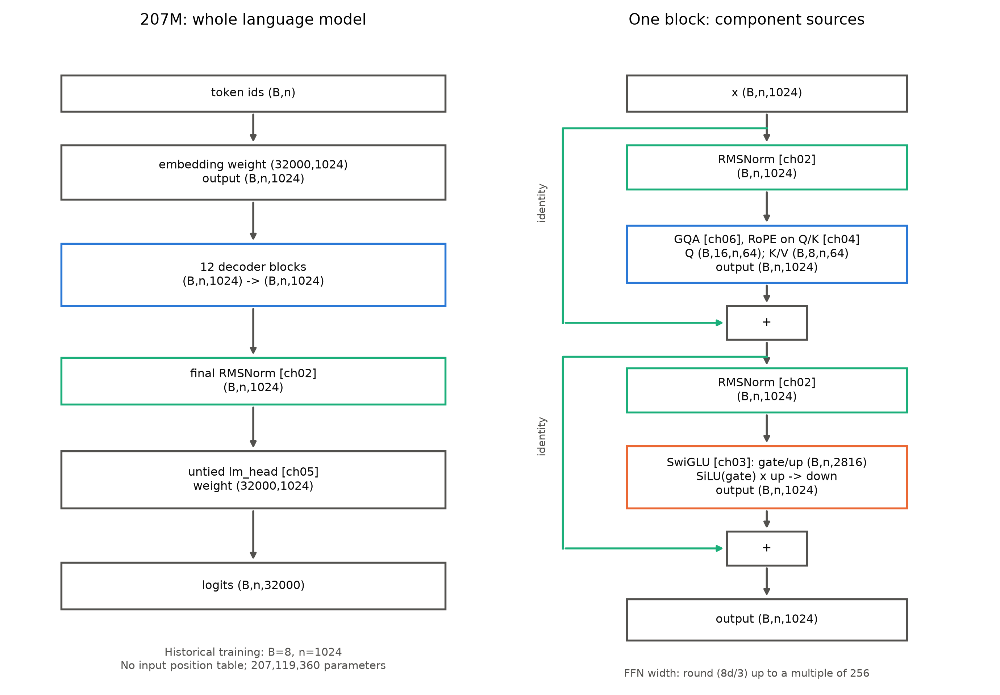
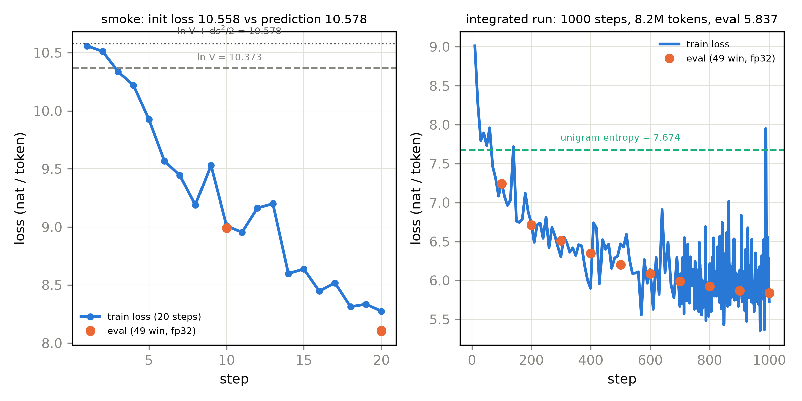

# 第 10 章 整机实践：把组件装成LLaMA式模型

## 10.0 开篇：从全书到这里

上一章沿配置、实现和参数账重建他人的模型，也区分了结构事实与能力证据。本章回到自己的 207M：把第 2 章的 RMSNorm、第 3 章的 SwiGLU、第 4 章的 RoPE、第 6 章的 GQA 装进同一台整机。我们延续 Book2 的残差块拓扑和语言模型接口，但不会把前面各组消融的训练权重依次接起来；这里从指定配置重新构造模型，检验四类组件能否共同工作。

本章实践包括结构与数值检查、冒烟和短训练；不把完成整个预训练预算作为阅读要求。先用历史计时明确完整训练的量级。调研期探针 C 在当时的 Mac 上（MPS bf16、$B{=}8$、$T{=}1024$）实测 207M 整机训练 1.702 秒/步、每步 8,192 token【证据等级：本书实验（MPS，2026-10，探针 C）】，两笔外推账：以约21 token/参数作为教学预算参照（不是该小模型已证最优比例），训练 4.3B token，需要 524,903 步 $\times$ 1.702 秒 $\approx$ **10.34 天连续运算**；以 Llama 3 的约 15T 总量作另一组量级参照，需要 18.3 亿步 $\approx$ 36,070 天 $\approx$ **98.8 年**【证据等级：本书实验外推（固定 $B/T$，假定秒/步不随总步数变化，量级论证）】。

这里需要说明每步耗时的口径：10.3 节整合短训在同一台机器上两窗复测为 1.21 与 1.93 秒/步（同一设备与配置下的两次历史观测）——探针 C 的 1.702 落在区间内，预算表沿用这一历史测量值（按两窗外推 4.3B 参照约为 7.4—11.7 天），不把两次观测当作稳定性区间或保守上界，量级结论不变。前者是一台笔记本不间断跑十天半——持续散热、休眠设置与内存使用都需管理，中断后还要恢复进度；后者不适合作为这台机器的实践预算，但不是物理不可能性定理。训练侧工程账本（Book2 第 9 章）的结论在这里再次得到体现：能装下一个训练批次，只回答了可运行性的一部分；时间预算与长期运行条件还需单独核对。

因此，本章并不以「跑一场大训练」为目标，而是回答三个问题：**怎样组装、怎样检查、怎样准备更大规模的训练**。本章交付四项内容：整合代码（参数逐位 assert）、分钟级冒烟、一次指定步数的整合短训（管道验收，不是效果训练）、以及一份达到「重启即可执行」标准的设计文档；不交付全量长训本身及其产物权重；架构、配方与历史预算的重启依据收录在 `DESIGN-215M.md`：架构与 config 逐字段依据、数据配方、预算表、验收标准、风险预案、重启 checklist。这延续了本丛书如实记录实践的要求：不假装跑过没跑的东西，也要留下可复查的起点，换环境时重新检查数据、依赖与实际吞吐。

> **最小背景栏**：本章不教新组件——四件套的机制与消融在第 2/3/4/6 章，出入口解绑的账在第 5 章，参数公式在第 5 章式 (5.2)，训练五件套（AdamW $0.9/0.95$+wd 0.1+clip 1.0+余弦+warmup）在 Book2 第 10 章，初始 loss 的数学（$\ln V$ 均匀基线与方差超额）在 Book2 第 10 章式 (10.3)，HF 结构对拍沿用历史探针 E 的方法，当前入口见本章动手验证。本章只做组装与运行。

## 10.1 蓝图与验收先行

整机实践沿用 Book2 第 10 章确立的原则：**验收先于实现**——代码尚未编写，先明确验收判据；10.3 节还会用初始损失的尺度分析检查初始化。207M 整机有四条验收要求，每条都可由程序判定：

**验收①（参数逐位）**：整机实例化后清点参数，与手算逐项账逐位相等，严格等于 $207{,}119{,}360$。手算账一行式就是第 5 章式 (5.2)（untied、GQA 档）：词表账 $32000\times 1024\times 2$ 加 12 层乘每层账（注意力 $2d^2+2d\,h_{kv}d_k$、SwiGLU $3df$、两个 norm $2d$）加末端 norm $d$。例如把 K 投影误用成全宽，通常会改变总参数数目，计数便能报警；但 RoPE 配对、掩码或残差接法出错可能不改一个参数。因此计数只是一道检查，还须核对形状与前向数值。

**验收②（结构对拍）**：同 config 随机权重，我们的 `state_dict` 与 HF `LlamaForCausalLM`（历史记录标注 transformers 5.18.0；本轮复核使用 5.14.1）`load_state_dict(strict=True)` 直接搬运并相互核验，CPU fp32 同输入对拍 logits——max|Δlogits| 阈值 $10^{-4}$、argmax 与 top-5 一致率 100%、另设「未搬运对照组」证明差异显著。这条链路在调研期探针 E 的 mini 档（3.2M）跑通过，批一验收 max|Δlogits|$=1.0\times10^{-6}$【证据等级：本书实验（CPU fp32，探针 E）】；历史实践把它扩到 207M 档；本轮也在 207M 上做短输入复核，二者的版本、输入与数值分别记录。五处数值口径（RMSNorm 方差 fp32、softmax fp32、rotate_half 约定、repeat_kv、无 bias+eps+untied 从 config 读）已在第 2/4/6 章逐项确定，组装时不再重新讨论。

**验收③（冒烟健康）**：整机运行 20 步，以 $\ln 32000=10.3735$ 为均匀输出基线，再计入方差修正，初始 loss 预期约为 10.58（见 10.3 节）；全程损失有限，末次损失低于初始值。这是 Book2 第 10 章固化下来的自检字段——整机开始运行时的健康检查。

**验收④（整合短训）**：1000 步 bf16（$B{=}8$、$T{=}1024$，共 8.2M token），eval下降是指定设置下学习过程有效的一项证据，不排除其他输入或任务上的问题。必须写明的口径：这是**管道验收，不是效果训练**——8.192M 个训练目标约为 4.3B 参照预算的 0.19%，曲线只证明「机器在学」，不证明「学到了多好」。

还有一项条件允许时进行的检查：加载真实训练权重，与对应参考实现比较。随机权重、固定输入的对拍可以发现许多结构错误，包括不一致的RoPE配对；并不是“随机权重下错误也自然相等”。真实权重进一步检验具体检查点的键名、形状、共享关系、词表和数值分布是否被正确处理。

历史实践使用TinyLlama_v1.1：1.1B档、201张量、fp32权重文件约4.4GB。它与207M整机同属可用同一类配置描述的结构，但模型宽度、层数和头分组不同。书中保留当时的下载与对拍记录，不要求读者为理解组装而下载权重；需要运行时应按模型访问条件取得数据，并保存快照版本。

以上五项构成了验收蓝图。它们共同回答一个问题：**凭什么相信组装出来的机器就是图纸上的那台？**——参数账检查计数，结构对拍检查指定输入的数值，冒烟与短训检查指定设置的训练流程，实权重对拍进一步检查指定训练快照能否加载，以及给定输入的数值是否一致。下面开始组装。

## 10.2 整机实现：改装史在 import 语句里

本册导览提出，要把组件来源保留在代码依赖中。`llama215.py` 的 import 段将这四次改装对应到四个文件：

```python
from rmsnorm import RMSNorm                     # 归一化插槽——第 2 章改装第一例
from swiglu import SwiGLUMLP                     # 前馈插槽——第 3 章改装第二例
from rope import apply_rope, build_rope_cache    # 位置插槽——第 4 章改装第三例
from gqa import GroupedQueryAttention            # 注意力插槽——第 6 章改装第四例
```

（code/ch10/llama215.py——`sys.path` 指向 `ch02/ch03/ch04/ch06` 与 `00-feasibility` 五个目录，后者提供 config 鸭子类型的对应实现 `LLaMAConfig`；import 契约的类名与签名在大纲插槽契约表定版。）

这四行体现了本册代码的组织方式：组件由前面章节导入，整机文件负责连接与配置。各章已按指定输入、精度与容差做过组件对照，但局部对照不能替代整机检查。第 5 章的出入口解绑不用额外 import，只需独立的 `nn.Linear(1024, 32000, bias=False)`。`Llama215DecoderLayer` 将两个 RMSNorm 分别放在注意力和前馈前，保留各自的残差相加；`Llama215Backbone` 堆叠 12 层并加收尾 norm，`Llama215` 接上独立输出头。这是另行组装的新类，沿用的是 Book2 的拓扑与接口，不是继承 GPT2 类或累计加载其消融权重。组件依赖说明实现从哪里来，前面各章则说明为什么这样选。图 10.1 将这些来源放回完整数据流。



图 10.1 207M 整机与一层残差块的展开示意。整数 ID 为 $(8,1024)$，查表后才成为 $(8,1024,1024)$ 的恒宽残差流；RoPE 在注意力内部旋转 Q/K，两个子层各有入口 RMSNorm 与残差相加。右侧保留四组件来源与 untied 出口，几何为 $d=1024,L=12,h=16,h_{kv}=8,d_{ff}=2816,V=32000$【来源：本书配置与 `llama215.py`；示意级重绘】。

config 用调研期定版的 cand1：$d{=}1024$、$L{=}12$、$h{=}16$、$h_{kv}{=}8$、$d_{ff}{=}2816$、$V{=}32000$ untied、$\theta{=}10^4$、eps $10^{-5}$、无 bias、无 $w_{pe}$。各字段的依据都已在前文交代：$d_{ff}=2816=\lceil 8d/3\rceil_{256}$ 是第 3 章的取整公式（$11\times256$）；本册选择 $h_{kv}=8$ 作为适度共享的教学配置；第6章并未证明它在207M上最优（16 个查询头组内 2 头，KV 账本 24 KiB/token，与 LLaMA2-34B/70B 及 Llama 3 系的 8 组同数——注意 LLaMA2-7B/13B 仍是 MHA）；untied 与 $V{=}32000$ 是第 5 章为对齐发布配置而承担的开销（词表账 65.5M、占全机 31.6%）；eps $10^{-5}$ 是第 2 章 eps 代际考据的 LLaMA2/3 出厂口径（HF 默认 1e-6 是对拍时的隐形开关，一律从 config 读）；$\theta{=}10^4$ 是 LLaMA1/2 的出厂值（Llama 3 加大到 $5\times10^5$ 的出厂设定路线在第 7 章 7.8 节读过——config中的最大位置字段为8192，但本章短训练窗口实际为1024；不能据字段声明能力或断言base已对所有长窗验证）。字段依据汇总在设计文档 §3；重启时仍应把其中的配置与当前脚本、数据和实际环境逐项核对。

为什么用 import，而不把四个类放进一个文件？Karpathy 的 [llama2.c](https://github.com/karpathy/llama2.c/blob/master/model.py) 将模型组件集中在 `model.py` 中，便于从一个文件读完整机；本书按教学章节保留组件，更方便对照每次改动的论证与实验。单文件写法也能通过文档和历史记录说明设计来源，分文件本身也不会自动证明选型正确。两种组织方式服务不同的阅读路径；我们的要求是让整机所调用的实现与前文讲解相互对应，而不是把代码拆成更多文件就算完成“演进”。

组装完成后，整机的数据流（$B{=}8$、$T{=}1024$ 训练口径）可按形状流转表（表 10.1）梳理如下——四类组件内部各运算的形状已在第 2/3/4/6 章说明，这里列出整机主干：

表 10.1 207M 整机形状流转表（$B{=}8$、$n{=}1024$、$C{=}1024$、$V{=}32000$；自排，与 `llama215.py` 各步骤行内形状注释同源；单层内部详见各章形状流转表）

| 步骤 | 运算 | 输入形状 | 输出形状 | 说明 |
|---|---|---|---|---|
| 入口查表 | $E[\mathrm{ids}]$ | $(8,1024)$ + $E\in(32000,1024)$ | $(8,1024,1024)$ | 无位置查表——$w_{pe}$ 已拆除 |
| RoPE 表现算 | $t\cdot\theta_i$（$\theta_i$ 依式 (4.7)，头维 64 代入） | $t\in(1024,)$ | $(1,1024,64)\times2$ | cos/sin，每层共用（第 4 章） |
| 子层①入口 | RMSNorm | $(8,1024,1024)$ | $(8,1024,1024)$ | 插槽①（第 2 章） |
| 注意力 | GQA+RoPE | $(8,1024,1024)$ + cos/sin | $(8,1024,1024)$ | $q$：$(8,16,1024,64)$、$k,v$：$(8,8,1024,64)$→repeat $(8,16,1024,64)$（第 6 章） |
| 第一次残差相加 | $x+\mathrm{Attn}(\mathrm{Norm}(x))$ | $(8,1024,1024)\times2$ | $(8,1024,1024)$ | 注意力结果先加回输入，再进入第二个子层 |
| 子层②入口 | RMSNorm | $(8,1024,1024)$ | $(8,1024,1024)$ | 插槽①（第 2 章） |
| 前馈 | SwiGLU | $(8,1024,1024)$ | $(8,1024,1024)$ | 中间量 $(8,1024,2816)\times2$→$\odot$（第 3 章） |
| 第二次残差相加并循环 | 前馈结果加回，再重复共 12 层 | $(8,1024,1024)$ | $(8,1024,1024)$ | 恒宽残差流，Book2 拓扑 |
| 末端 norm | RMSNorm | $(8,1024,1024)$ | $(8,1024,1024)$ | 出口前最后一个 |
| 出口投影 | $h\cdot H^{\top}$ | $(8,1024,1024)\cdot(1024,32000)$ | $(8,1024,32000)$ | untied 独立 $H$（第 5 章） |
| 损失 | 交叉熵 | $(8192,32000)$ fp32 | 标量 | 目标=下一 token |

参数逐项账（表 10.2）是验收①的对账单，也是「逐插槽改装」这套方法的最后清点——每一行对应一个插槽的决策：

表 10.2 207M 参数逐项账（手算=实测逐位；`llama215.py` 自测 assert 同源）

| 项 | 算式 | 参数量 | 插槽归属 |
|---|---|---|---|
| 注意力/层 | $2d^2+2d\,h_{kv}d_k=2\times1024^2+2\times1024\times512$ | 3,145,728 | 第 6 章（GQA 省在 $k/v$ 窄投影） |
| 前馈/层 | $3df=3\times1024\times2816$ | 8,650,752 | 第 3 章（三矩阵 $8d/3$） |
| 两枚 norm/层 | $2d$ | 2,048 | 第 2 章（只有 weight） |
| 每层小计 | | **11,798,528** | |
| ×12 层 | | 141,582,336 | |
| $w_{te}$ | $Vd=32000\times1024$ | 32,768,000 | |
| $lm\_head$（untied） | $Vd$ | 32,768,000 | 第 5 章（附加一刀） |
| 末端 norm | $d$ | 1,024 | 第 2 章 |
| **总计** | | **207,119,360** | assert 锁死 |

【证据等级：本书实验（CPU，2026-10，`llama215.py` 自测：手算=实测=207,119,360）】自测三秒完成，结果逐位一致。注意两笔对照账：位置编码一行是**零**（$w_{pe}$ 拆除后位置信息不占参数，只作为旋转角进入注意力——第 4 章的账）；词表账两行合计 65.5M、占全机 31.6%（第 5 章说明的开销；若按全机组件汇总，12 层 FFN 合计约 103.8M，比两张词表更大）。

> **【考据框】「215M 档」的名称从哪来。**早期规划称这档机器为「215M」，定版实测为 207.1M——差额 7.9M。名称的由来：丛书规划阶段的总览大纲按「GPT-2 124M 放大到 200M 档」的粗估写下「LLaMA 式 215M」，调研期探针 C 以 205-225M 为目标带微调 $h_{kv}$ 与 $d_{ff}$ 得到三个候选，主选 cand1（$h_{kv}{=}8$、$d_{ff}{=}2816$）落在 207,119,360。「215M」从此成了档位名（规划文档与伏笔登记沿用），书内引用参数量一律用实数 207M/207,119,360——名称沿用历史约定，参数量以实际数值为准。

## 10.3 冒烟与整合短训实测

整机组装完成，接下来运行。历史语料使用单独训练的 sp-32000 分词器重切：先将 OWT 流首部 51,976 篇逐篇编码并加 EOS，得到 57,484,791 个 token；流尾 1.2M 项留作 eval，其余 56,284,791 项写入 uint16 裸流 `tokens32k.bin`；首 2000 篇样本压缩率为 4.5382 原始字节/token（token 数含文末 EOS）【证据等级：本书实验（CPU，2026-10，P-03 销项：七项参数带校验全过）】。这里有一个值得登记的口径决策：第 5 章词表扫描时训过一块 sp-32768（扫描臂的实验变量），本章**不用它、新训 sp-32000**——分词器ID必须落在模型词表范围且具有匹配语义；32768词表可能产生超出32000行的ID，这首先是输入合法性问题，不只是损失基线的差异；分词器配方仍沿用 Book2 sp-8k 的设置（sp-BPE、byte fallback、coverage 1.0），按历史采集记录在另取的分片（约 29MB/6000 篇）上训练；分片互斥需由上游采集记录支持，不能只凭两个文件名判断。历史检查得到 $V=32000$，编码样本 unk 率为 0（启用 byte fallback）。同一块语料上 32000 与 32768 两把分词器的压缩率 4.5382 对 4.5467 字节/token——词表小约 2.3%、该样本每 token 承载字节略少约 0.2%。这说明该样本的编码长度有轻微差别，不能只凭词表大小推成普遍规律。尾切也只是把 token 位置分开，边界可能落在同一文档内部，不保证文档互斥或内容去重。

**初始损失主要用来检查输出尺度，不能单独证明模型正确；解绑也不会让方差修正消失。**Book2已经从logsumexp的二阶展开得到 $\mathbb E\ell\approx\ln V+\sigma_z^2/2$，条件是随机logits尺度适中、相应独立性近似合理。这个项对独立输出头同样存在，不是绑定权重特有的“泄漏项”。

本模型初始增益为1，末层RMSNorm使典型隐藏向量满足 $\|h\|^2\approx d$。若独立输出表的一行权重方差为 $s^2$，条件于h，有 $\operatorname{Var}(h^\top w_v\mid h)=s^2\|h\|^2$，所以取d=1024、s=0.02，得到 $\sigma_z^2\approx0.4096$。由V=32000，初始损失近似 $10.3735+0.2048=10.5783$。

历史记录的初始损失为10.5584，logits方差0.4102，目标位置logit均值约+0.022。对一个位置，交叉熵是 $\log\sum_v e^{z_v}-z_y$。用记录中的方差与目标 logit 均值作近似，得到 $10.3735+0.4102/2-0.022\approx10.5566$，接近 10.5584；这解释了量级差异，并不把二阶展开变成精确等式，但“测到接近0的均值”不是数学上严格归零的证明。绑定模型还可能存在输入与输出向量相关性；Book2的大方差反例偏向复制**当前输入**，不应称为未来目标泄漏。

这笔账给读者一个可用诊断：看到随机初值损失远高于lnV，先检查尺度、初始化与目标构造；接近lnV则继续检查因果遮罩、移位和参数搬运。损失量级只是整套检查的一部分。



图 10.2 冒烟与整合短训（自产，MPS bf16、种子 20261002、独占窗口）：左=冒烟 20 步，初始 loss 10.5584 接近 $\ln 32000+\tfrac12 ds^2=10.578$ 预言（灰虚线=$\ln V$ 均匀基线 10.373），20 步降至 8.27；右=整合短训 1000 步（8.2M token），train/eval 双曲线与一元分布熵参照 7.674（青虚线，扩大前缀中实际出现的 30,552 种 token）——第 100 步的 eval 观测低于该熵参照、终值 5.837（790 步处中断，从 700 步断点恢复；图保留最终有效轨迹，不证明所有重做步骤逐位相同）【证据等级：本书实验（MPS，2026-10，`curve_smoke_s1.csv`/`curve_integrated_run1.csv`，续跑窗口自动合并）】

冒烟的 20 步走完（图 10.2 左）：train loss 10.5584 → 8.2723，eval（49 窗、401,408 token、fp32）8.1053，损失全程有限，虽有局部回升，末值仍显著低于初值——符合验收③的历史健康判据。曲线的快速下降体现了训练循环的正常运行（Book2 第 10 章讲过：可以比较经验词频模型，但一元熵不是上下文模型损失的下界）。历史实践还对 sp-32k 语料计算过这项参照：历史脚本统计的扩大前缀（$[0,1001\times8192)$，按算式为 8,200,192 个 token）里活跃 30,552 种 token、词频熵 **7.674 nat**（eval 池同账 7.615）【证据等级：本书实验（CPU，2026-10，`train_215.py` 的 `corpus_stats` 同源算法实算，统计段比有效训练所需的原始前缀多 8,191 项）】。实际第 k 步从位置 `(k-1)×8192` 读取 8193 项，输入与目标各 8192 项、相差一位；1000 步累计监督 8,192,000 个目标，所需原始前缀为 8,192,001 项。新版统计按这个范围记录；历史熵值仍保留其原统计口径。冒烟 eval 约 8.11，仍高于该熵参照；整合短训的 eval 在第 100 步就报 7.24，低于这些语料的经验一元熵数值；严格比较应在同一验证样本上计算训练词频模型的交叉熵，不能将每一分下降直接分解为某种语言能力。

整合短训按验收④跑：1000 步 bf16、$B{=}8$、$T{=}1024$、五件套配方原样（AdamW $0.9/0.95$+wd 0.1、clip 1.0、余弦 1e-3→1e-4、warmup 100），有效训练轨迹按位置顺序覆盖约 8.2M 个目标【证据等级：本书实验（MPS，2026-10，`train215_integrated_run1.json`）】。结果（图 10.2 右）：train loss 从 10.56 降至 **5.72**，每百步记录的十个 eval 观测依次下降到 **5.84**（7.24 → 6.71 → 6.51 → 6.35 → 6.20 → 6.09 → 5.99 → 5.92 → 5.87 → 5.84，每百步一档）——比上述前缀熵参照低约 1.8 nat。由于统计文本和验证窗口未严格对齐，这个差值不能直接归因于超越词频的能力；与训练词频基线的严格比较应使用相同验证目标。组合训练的运行记录则是明确的：RMSNorm 的 fp32 方差、RoPE 的两半式旋转、GQA 的 KV 分组展开、SwiGLU 的门控乘法在同一台机器里跑了 1000 步，未出现 NaN、发散或形状错位——这提供了该组合能在这一设置下运行和学习的经验记录，不证明组件之间互不影响。

计时如实双报（计时纪律：独占 MPS 窗口、单进程单实验）：首个窗口 1.21 秒/步、训至 790 步被外层任务时限截断，自 700 步 checkpoint 续跑完成后段（续窗 1.93 秒/步——两次实际观测；原记录不足以把全部差异归因于单一机器状态；这次中断也说明保留断点的作用：从700步续到1000步，最后300步由恢复后的训练完成；从 701 到 790 的 90 次更新被丢弃并重做，因此记录所述过程至少执行 1090 次更新；1000 步是最终有效轨迹，不是全部物理工作量，额外耗时应另列）。再次写明口径：这是管道验收，不是效果训练——以4.3B token预算参照计算；它不是已证明这台机器必须达到的“喂饱”阈值，本次训练仅使用了这一参照预算的 0.19%。

接着进行两项结构对拍，先列历史记录。**HF 结构对拍（207M 档）**：同 config 随机权重，`strict=True` 直搬 207,119,360 参数进 `LlamaForCausalLM`，CPU fp32 同输入对拍——max|Δlogits| $=6.9\times10^{-6}$、argmax 一致率 100%、top-5 一致率 100%、未搬运对照组 max|Δ| $=4.86$（证明搬运真的发生了）【证据等级：本书实验（CPU fp32，2026-10，`llama215_parity_run1.json`）】。历史验收②通过。本轮另在同一 207,119,360 参数配置上，以 Transformers 5.14.1 的 eager 实现、CPU fp32、输入 $(1,8)$ 复核：最大 logits 差与损失差均为 0，argmax 和 top-5 集合一致率均为 100%，未搬运对照最大差约 4.007。该结果只对应本次版本、输入与精度；不替换历史窗口的读数。

**TinyLlama 实权重对拍（条件性验收）**：历史记录把 TinyLlama_v1.1 的 201 个张量 strict 搬进本类，配置为 $d=2048,L=22,h=32,h_{kv}=4,d_{ff}=5632,V=32000$、untied。它与 207M 的词表、epsilon、RoPE base 相同，但查询/KV 组比为 8:1，而本章为 2:1；配置窗口为 2048，而本章字段为 8192。历史参数总数 1,100,048,384，给定提示的最大 logits 差 $4.9\times10^{-5}$、argmax 一致率 100%；本类曾对 "The capital of France is" 贪心续写得到 `".\nThe 2019-202"`【证据等级：本书历史 CPU fp32 记录，2026-10】。

这里必须区分提示前向对拍与整段生成对拍：旧脚本只记录了本类续写，没有在每个新前缀上运行 HF，因此不能据它证明这 12 个生成 token 逐个相同。新版程序在每一步比较两边的选择，任何分歧都会失败。本轮未重新取得完整权重，保留历史数值，不把这个新检查说成已经在 TinyLlama 真权重上跑过。该模型卡将 v1.1 描述为约 2T token 的三阶段训练版本；不能把其他 TinyLlama 检查点的训练阶段套到这个版本，也不能仅凭一小段续写判断训练是否充分。结构对拍检查装载与指定输入的数值，生成质量仍需独立评测。[TinyLlama v1.1 官方说明](https://huggingface.co/TinyLlama/TinyLlama_v1.1/blob/ff3c701f2424c7625fdefb9dd470f45ef18b02d6/README.md)。

## 10.4 插槽清单总表：每个零件都有出处

第 8 章 8.6 节已汇总组件选择的依据。本章把它们与实际整机字段对应起来，形成表 10.3。需要注意，前章实验各自从 GPT-2 底座构造，并不是将每一刀的收益累加到这台 207M 上。

表 10.3 插槽清单总表（定版；历史读数来自各章独立模块对照；第 2/3/4/6 章为 full 档，词表为第 5 章 fast 档，文献锚=canonical 论文）

| 插槽 | 旧件（GPT-2 底座） | 新件（本册 import） | 改动章 | 历史模块证据及边界 | 文献锚 |
|---|---|---|---|---|---|
| 归一化 | pre-LayerNorm | pre-RMSNorm（无 bias、eps 1e-5） | 第 2 章 | 差值 +0.0430 nat，超出历史 0.02 描述带；单种子，不是统计等价检验 | 1910.07467 |
| 前馈 | GELU-4C 两矩阵 | SwiGLU 三矩阵 $\tfrac83 C$ | 第 3 章 | 主矩阵同参，loss −0.1952 nat；两臂 bias 数量不同，小尺度结果不解释大模型差距 | 2002.05202 |
| 位置 | $w_{pe}$ 查表（1024 硬墙） | RoPE $\theta{=}10^4$ 只旋 Q/K | 第 4 章 | 同窗 −0.4110 nat；长窗差约 +0.493 nat 涉及不同评估样本，不能全归因于长度 | 2104.09864 v5 |
| 注意力 | MHA（$h{=}h_{kv}$） | GQA（$h{=}16$、$h_{kv}{=}8$） | 第 6 章 | 8→4→1 时 loss 依次增 0.1088/0.1582 nat，KV 字节 8:4:1；参数与部分初始权重也变化 | 2305.13245 |
| 出入口 | tied（GPT-2 发布配置 50257；本册模块实验通常 8192） | untied + 词表 32000 | 第 5 章 | 词表 fast 档历史 bpb 估计降约 8.3%，验证原文未严格对齐；它没有单独检验解绑收益。本整机两词表占 31.6%，初始方差修正仍在 | 论文沉默（负结论）+config |

【证据等级：本机读数=本书实验（MPS，2026-10，各档位如表注，单种子；每组限制见相应章节）；文献锚=各组件 canonical 论文（版本见卷级大纲锚点表）】

这张表是本册最希望你保留的一项具体成果——它之于这台 207M，就像 BOM 表（bill of materials，物料清单）之于一台装配好的设备：**每一行都是一个「为什么用它」的选择记录，选择依据汇集了论文报告、配置事实和本书小模型实验**。读法有三层。逐行读，是五项选型及其条件（简化归一化、配平主矩阵预算比较门控、替换位置表示、改变 KV 头数、对齐词表与出入口配置）；整列读，「改动章」一列就是本册的叙事主线（第 2/3/4/6 章四连加第 5 章附加一刀）；对照读，把它与 LLaMA2 附录 A.2.1 的官方消融桌并排——明确改动对象、核对预算、先规定判据，是共同的实验方法；但官方注意力对照也调节 FFN 宽度，本书各组参数和初始化亦有具体限制，不能把它们视为同一个实验在两个尺度上的复现。

还可以从另一个角度阅读这张表：**这台教学机器没有逐字段复制某一代具体型号**。把表 10.3 与第 8 章的代际总表（表 8.4）并排看：注意力插槽用 LLaMA2-34B/70B 与 Llama 3 全系的 GQA-8，词表与 RoPE 基频却停在 L1/2 的 32k 与 $10^4$，归一化类型与门控形式沿用前代，但宽度与具体参数仍按本机配置选择——逐字段按本册的尺度各自选择，而不是整体照抄某一代的 config。这正是第 8 章「组装学」定义在整机实践中的体现：默认骨架给的是**插槽菜单**，每一格填什么，由当前模型的约束（207M 的词表占比、KV 账、训练窗）逐项决定。第 11 章收束会回到这张表：它是「组件化时代」四个字的实物注脚。

## 10.5 设计文档：写给未来某台机器的重启手册

本章另附 [设计文档与重启手册](code/ch10/DESIGN-215M.md)。它的写作标准叫**重启即可执行**：一个没有读过本书的工程师拿到它，能据它核对依赖、算子、资源与数据，再准备重启项目——所有决策（config 数字、数据配方、训练日程、验收判据）都自带依据与出处，不依赖本书上下文。这一标准对文档有明确的硬性要求：每个 config 数字自带依据（§3 的字段表一行一证据，不许写「见本书第 N 章」式的内引）；命令应覆盖自测、对拍、冒烟、短训与全量五个层次；实际执行仍以所用版本的帮助信息和本章当前入口为准；每笔预算带口径（6ND 的 $N$、MFU 的假设、秒/步的实测条件——换机器的人才能重算自己的账，文档末行还专门提醒「重启时请以自己机器的实测数字刷新预算表」）；每个验收判据机器可判定（assert 与阈值，不是「效果不错」）。教程的写法是「跟着做一遍」，工程文档的写法是「不跟着任何人也能做」——本册各章一直在练前一种，这份文档则采用后一种写法。

文档十一节：目标与范围、暂缓声明、架构与 config 逐字段依据、数据配方、训练配方、预算表、验收标准、风险与预案、重启 checklist、消费线衔接声明，外加末节参考与文献锚；暂缓声明按作者决策原文印在 §2 而不是删掉——后来者第一眼就知道这台机器「为什么现在没训」，将这句话保留在文档中，才能如实交代项目状态。

预算表（文档 §6）是「凭什么暂缓、凭什么能重启」的量化核心，本机档摘如表 10.4：

表 10.4 207M 训练预算外推表（$6ND$ 粗略口径，$N=207{,}119{,}360$ 含嵌入；将完整词表查表也按参数近似，并省略注意力二次项等开销，沿用第 1 章预算约定。MPS 行固定 $B/T$；GPU 行另假定 40% MFU）

| 档 | tokens | FLOPs（6ND） | 机器与口径 | wall-clock | 判读 |
|---|---|---|---|---|---|
| 教学预算参照 | 4.3B | $5.34\times10^{18}$ | 本机 MPS bf16（探针 C 实测 1.702 s/步；短训两窗复测 1.21-1.93，两次历史观测范围内——见 10.0 说明） | **10.34 天** | 超出本实践的连续运行预算 |
| 大训练量参照 | 15T | $1.86\times10^{22}$ | 历史 MPS bf16 | **98.8 年** | 不适合本实践预算 |
| 教学预算参照 | 4.3B | $5.34\times10^{18}$ | 1×A100-80GB @40% MFU | ≈11.9 小时 | 可重启档 |
| 教学预算参照 | 4.3B | $5.34\times10^{18}$ | 1×H100 SXM @40% MFU | ≈3.8 小时 | 可重启档 |
| 大训练量参照 | 15T | $1.86\times10^{22}$ | 8×H100 SXM @40% MFU | ≈68 天 | 假设吞吐估时，须实测更新 |
| 竞品对照 | —（README/章末自报） | — | llama2.c 110M：4×A100×24 h | — | {厂商自报} |
| 竞品对照 | —（章末自报） | — | happy-llm 215M：8×4090×46 h | — | {厂商自报} |

【证据等级：本机行=本书实验外推（探针 C 实测 sec/step，2026-10）；A100/H100 行=本书估算（A100/H100 SXM 稠密 BF16 Tensor Core 峰值约 312/989 TFLOPS×MFU 40% 假设——207M 小模型的实际 MFU 可能低于此值，估时偏乐观，不是实测性能保证）；竞品行=项目作者自报（[llama2.c README](https://github.com/karpathy/llama2.c#models) 与 [happy-llm 第5章](https://github.com/datawhalechina/happy-llm/blob/main/docs/chapter5/第五章%20动手搭建大模型.md)；此处未核完整训练 token 预算与 MFU，不能据时长横比效率）】

峰值规格依据 [NVIDIA H100 架构白皮书 Table 1/2](https://resources.nvidia.com/en-us-hopper-architecture)，这里采用稠密 Tensor Core 值，未使用结构化稀疏翻倍值。

这张表说明，容量允许开始运行之后，时间还可能决定项目是否可行。按每参数 16 字节估算 FP32 权重、梯度和 Adam 两份状态，207M 的持久状态约 3.31GB；激活、logits、临时工作区与实现额外开销还未计入，不能仅凭这一行保证装入 24GB。A100 的约 11.9 小时与 H100 SXM 的约 3.8 小时，是用 $6ND/(\text{峰值}\times0.4)$ 得到的假设估时；小模型未必达到 40% MFU，多卡还要考虑通信，不能写成已经验证的提速。重启时先做短探针，再更新预算，而不是照搬这组小时数。竞品报告保留作不同交付方式的参照，不用于证明本模型的吞吐或相同训练质量。

重启 checklist（文档 §9）将「凭何重启」整理为可逐项勾选的十步，摘要如表 10.5：

表 10.5 重启 checklist 摘要（完整版=DESIGN-215M.md §9）

| # | 步骤 | 验收 |
|---|---|---|
| 1 | 核对库版本、设备算子与容量，先做小批探针 | `python llama215.py` 自测通过 |
| 2 | 数据：`prep_sp32k.py` 重切（或换等量语料，重训分词器于独立分片） | 七项参数带校验全过 |
| 3 | 验收①：参数 assert | 207,119,360 逐位 |
| 4 | 验收②：`--parity` HF 结构对拍 | max\|Δlogits\|<$10^{-4}$ |
| 5 | 验收③：`--task smoke` | 初始 loss≈10.58、有限、下降 |
| 6 | 验收④：`--task integrated` | 1000 步 eval 下降 |
| 7 | 全量训练：按表 10.4 定档（4.3B 只是本章预算参照） | 曲线+ckpt 续跑 |
| 8 | 固定验证文件、分词器、窗口起点与精度；同为49批仍可能不是同样本 | 保存数据哈希与抽样版本 |
| 9 | 曲线入档：与本章 1000 步曲线（eval 终值 5.84）的接续关系 | — |
| 10 | 消费线登记：产物权重接 Book6 mini 引擎 | — |

暂缓声明在训练范围说明中列出：本大项目全量训练暂时略过，待获得高算力机器后可凭此文档直接重启设计与开发。文档 §10 是**消费线衔接声明**：后续推理练习可选择本册同构小模型，也可按Book6实践要求选其他模型——本章整合短训 checkpoint（历史1000步、eval约5.84）是同型候选；第 6 章消融仍带 GPT-2 的 LayerNorm、GELU 与位置表，不能直接当作本章四组件整机的权重，具体接口还须与 Book6 的模型加载和缓存协议对齐。

## 10.6 消费线衔接与展望

现在可以明确单轨代码主线的进展：Book1 末造出翻译机（原版 Transformer，编码器解码器双塔），Book2 末造出 GPT-2 124M（单塔、三插槽底座），本册末造出 LLaMA 式 207M（四插槽全换、出入口解绑、参数逐位、对拍通过、短训运行）——一条从 2017 到 2023 的改装史，全部在你自己的代码目录里，每一站都能跑。下一册在这台机器上动两刀：前馈插槽换成专家群（MoE）、注意力做更低秩的折叠（MLA）——刀口还是插槽，判断力还是这张表 10.3。

消费线这头，历史实践已保存过 207M 的短训 checkpoint：它可作为后续推理练习的同构候选，不要求Book6读者完成本次训练——设计文档 §10 已明确记录这一安排；第 6 章产物结构不同，若用于推理练习必须使用对应模型定义。作为推理引擎的服务对象，这个模型有三项成本信息是引擎侧直接需要的：参数 207M（BF16 权重载荷约 414.24MB；可运行设备还需容纳缓存与工作区并支持相应算子）；KV 账 24 KiB/token（第 6 章式 (6.2)：$2\times12\times8\times64\times2$ 字节），2048 窗单序列 48 MiB、并发 8 时 384 MiB——第 6 章算过的数，此处只换一个身份，从「造机器时的设计约束」变成「用机器时的工程输入」；还有一笔定性账：逐 token 生成时理想化估算中每步考虑权重与KV的读取，实际复用、分块和内核会改变访存次数。只有把这些字节与同一步的计算量及设备吞吐一起比较，才能判断瓶颈；第 6 章的低批量解码例子提供了分析起点，Book6 会继续展开。模型构建阶段的产物，将在这里交给推理实践使用。

## 10.7 本章小结

回到开篇的三个问题，逐一作答。**本机交付了什么**——整合代码（`llama215.py`：四插槽 import 组装、参数逐位 207,119,360、HF 结构对拍 max|Δlogits| $6.9\times10^{-6}$）、运行健康（初始 loss 10.5584 接近 $\ln V+\tfrac12 ds^2$ 预言、目标 logit 样本均值接近 0，不能称为严格归零）、整合短训（1000 个有效更新、8.192M 个目标，历史十次 eval 观测递减至约 5.84；是指定组合的运行记录）、实权重对拍（TinyLlama 1.1B 历史 strict 装机与提示前向数值对照；整段双边生成检查为新增入口，本轮未重跑真权重），以及一份十一节的设计文档。

**不交付什么**——全量长训及其权重，凭据是那笔时间账：两组教学参照按历史秒/步外推，分别约 10.34 天与 98.8 年。

**凭什么重启**——`DESIGN-215M.md` 达到「重启即可执行」标准：config 逐字段依据、数据配方带校验、预算表带口径、验收四条可机器判定、checklist 十步可勾选；表中A100时间是指定峰值与40% MFU假设下的外推，实际运行需重新测量。

**带走的心智**：即使忘掉具体数字，也请记住两点。**第一件，「每个零件都有出处」的造机判断力**——此后你阅读任何一台开源模型，都能在脑中对应出一张插槽清单：这个 norm 为什么是它、这个前馈付出了什么代价、这个位置编码拆掉了什么墙、这份 config 里每个字段替谁说话；没有出处的零件你要敢问，有出处的零件你要能引。**第二件，「验收先于实现、文档即机器」的工程方法**——参数逐位、结构对拍、冒烟健康、短训验管道，四条判据在写代码之前就已确定；而预算不够时不假装、不缩水、把全部决策写成一份他人能执行的重启手册——机器会过时，这份「把一台机器的设计连同依据完整交出去」的能力不会。

镜头拉回全书：机器装完了——但这一册真正要带走的不是这台 207M，而是「每个零件都有出处」的造机判断力。最后一章将按设计问题回顾前两册与本册的联系，整理术语和代码入口，并说明参数、计算与 KV 三类成本沿哪些后续路线继续展开。

> **【欠账】** 207M 全量长训未在该历史实践中完成——重启依据另见 [设计文档](code/ch10/DESIGN-215M.md)（重启即可执行标准）；本章短训权重可作后续推理实践的同型候选，按 Book6 实践的实际模型接口选择和适配；不要求后册读者先完成本次长训。→ Book6（mini 推理引擎贯穿式大项目）

## 10.8 动手验证

- **整机自测与随机权重对拍**（CPU 秒到分钟级，内存需容纳多个模型）：
  ```bash
  source ./env.sh
  python from-models-to-vllm/book3-modern-open-source-skeleton/code/ch10/llama215.py
  python from-models-to-vllm/book3-modern-open-source-skeleton/code/ch10/llama215.py --parity --out-name new1
  # 有完整本地TinyLlama快照时选做；模型与tokenizer须来自同一快照：
  python from-models-to-vllm/book3-modern-open-source-skeleton/code/ch10/llama215.py --tinyllama --snapshot /本地快照目录 --out-name new1
  ```
  参数应为 207,119,360；初始损失按约 10.58 的尺度检查，不要求复现历史最后几位。结构对拍同时检查 logits、损失、argmax、top-5 集合与未搬运对照；失败以非零状态退出，已有同名结果不会覆盖。真实权重入口只读显式本地目录，不自动下载。历史自测随机 token/CPU 窗口的 10.5597，与历史 MPS 冒烟 10.5584 是不同输入下的两次测量。
- **准备数据、冒烟与整合短训**（历史 MPS 1000步训练段约20分钟加eval；当前耗时应重新测量）：
  ```bash
  source ./env.sh
  python from-models-to-vllm/book3-modern-open-source-skeleton/code/ch10/prep_sp32k.py --out-dir log/book3-ch10-new
  python from-models-to-vllm/book3-modern-open-source-skeleton/code/ch10/train_215.py --task smoke --data-dir log/book3-ch10-new --out-dir log/book3-ch10-new --out-name s1
  python from-models-to-vllm/book3-modern-open-source-skeleton/code/ch10/train_215.py --task integrated --data-dir log/book3-ch10-new --out-dir log/book3-ch10-new --out-name run1
  ```
  默认配方保留 warmup=100，所以 smoke 的20步全部在预热段；1000步日程才包含余弦下降。新评估抽样补入末个合法起点，数据、环境或抽样版本变化后不能期待历史5.84逐值重现。新版断点保存配置、数据与实现身份、优化器、随机状态和曲线；同名重启必须身份一致。损失或梯度非有限时在更新前停止，不把失败训练写成完成。当前入口也可用 `--config`、`--batch`、`--block` 缩到 CPU 小档检查流程，报告记录实际配置；小档结果不能作为207M训练效果。
- **验收点**：不看书画出 207M 整机结构并标出四插槽的改动章与 import 来源；能手算表 10.2 的每一行并说明 untied 与 GQA 各改了哪一行；能解释初始损失为何有方差修正，以及为什么绑定相关性不能与方差项混为一谈；能按明确的硬件峰值与 MFU 假设，复算 8×H100 SXM 的 4.3B 预算时长（表 10.4 的口径复算）；能说出设计文档的十一节结构与「重启即可执行」标准靠什么达成。
