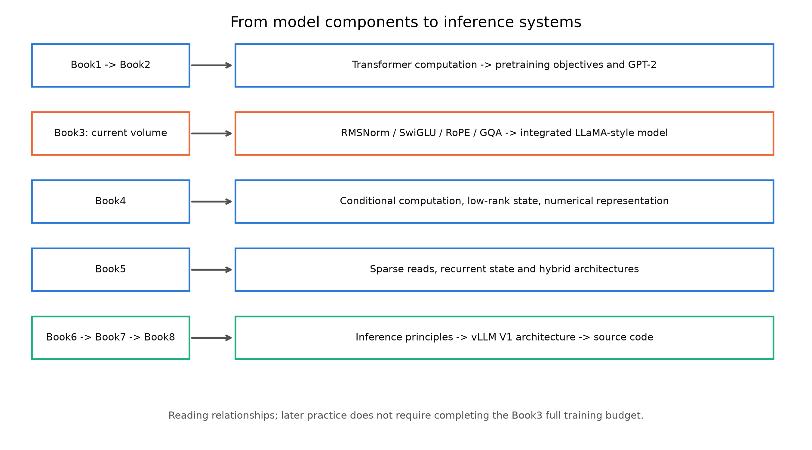
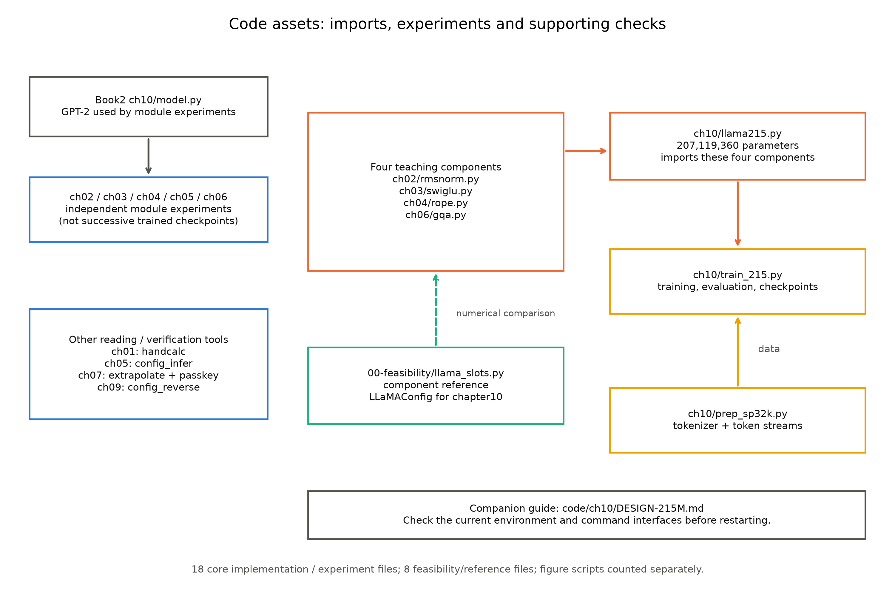

# 第 11 章 收束：组件化时代的判断力

## 11.0 开篇：从全书到这里

上一章把RMSNorm、SwiGLU、RoPE和GQA装入同一台207M教学模型，并用参数、数值与短训练记录检查连接是否符合预期。本章回到整册：我们究竟学会了怎样判断一次架构改造，又有哪些问题将交给下一册？

从GPT-2蓝本出发，关键并不在于记住四个新名字。我们逐步学会定位改动：函数的归一化方向、前馈中的乘性交互、位置对打分的影响，以及查询与KV投影的共享。每项变化都要说明接口、数学条件与资源代价，最后放回整机检查。

## 11.1 组件化是一种分析方法，不是架构停止演进

三代 LLaMA 保留了许多主要组件，因此可以在同一张结构图上比较。但数据规模、词表、GQA使用范围、位置与掩码都存在变化，不能把代际进步称为“架构完全不动”。Llama4又展示了专家前馈、交错注意力和多模态入口；仍能定位熟悉的部件，并不意味着新计算关系无关紧要。

组件接口清楚，使局部替换容易检查；不同组件的数值行为却会相互影响。RMSNorm改变输入尺度，SwiGLU响应受输入分布影响，RoPE与GQA共同参与打分，动态位置规则还可能改变缓存复用条件。只有把接口与这些依赖一起理解，“插件”才是有用的心智，而不是任意拼装的许可。

本书历史消融留下了正反两种结果。RMSNorm在full单种子设置中损失较高；SwiGLU和RoPE在所测条件下较低；减少KV头则付出不同质量与状态成本。它们帮助比较局部选择，但没有证明在207M整机、其他语料或更长训练中保留相同差值。表 11.1 汇总了部件位置与需要判断的问题。

表 11.1 插槽清单总表（摘要版；定版与逐项读数见第 10 章表 10.3，此处不重复证据链）

| 插槽 | 旧件 → 新件 | 改动章 | 一句话总结 |
|---|---|---|---|
| 归一化 | pre-LayerNorm → pre-RMSNorm（无 bias、eps 1e-5） | 第 2 章 | 减少显式中心化；函数不等价，训练结果依设置 |
| 前馈 | GELU-4C 两矩阵 → SwiGLU 三矩阵 $\tfrac83 C$ | 第 3 章 | 主矩阵预算对齐；所测任务有收益，执行成本另计 |
| 位置 | $w_{pe}$ 查表（1024 硬墙）→ RoPE 只旋 Q/K | 第 4 章 | 固定 Q/K 的旋转内积显式依赖相对位置；可计算越窗不保证有效外推 |
| 注意力 | MHA → GQA（$h{=}16$、$h_{kv}{=}8$） | 第 6 章 | 共享键值表示，减少KV载荷并改变容量约束 |
| 出入口 | tied（GPT-2 发布配置 50257）→ untied＋词表 32000 | 第 5 章 | 独立输入/输出表；两端合计31.6%，动机与效果分别检验 |

这张清单可以用于阅读新模型，也可以用于设计自己的实验。先指出改变的计算，再写出形状和资源变化，最后确认哪些性能结论有直接比较支撑。已有论文说明某个部件在特定条件下有效，不意味着选择它就免去了本模型的验证。

因此，本册的“组装”指把组件关系说明白并检验组合，不是宣布发明新架构已经结束。完整训练、单组件消融、固定输入对拍和参数核算各自解决不同问题；把它们互相补充，比把其中任何一种叫作全部正确性的证明更可靠。

## 11.2 四段旅程回望

明确了这些判断，再回顾全册。导览 0.4 节将本册分为四段，现在分别概括各段的主要收获——与各章小结的「带走的心智」同源，这里只概括主线，细节可按各段回看对应章节。

**第一段：为什么（第 1 章）。**公开权重、数据与完整配方分别决定可以开展哪些研究；固定训练预算的缩放分析与长期推理预算共同提示「更少参数、更多数据」这一可能选择；6ND、GPU 时、吞吐三本账互证。带走的心智：**「更少参数、更多数据」改变了训练与使用两侧的支出分配；能否节省总成本仍取决于目标能力与使用量——训练是一次性支出，使用是按 token 收的长期账单**；而 LLaMA采用了已有组件并提供整机训练实例，其后仍有多条架构探索路线。

**第二段：逐插槽改装（第 2—6 章）。**先定位限制，再改变组件，最后核对形状、预算与实验。归一化提供简化的选择，门控前馈在本书配平主矩阵的实验中降低损失，RoPE 改变位置进入打分的方式，GQA 减少 KV 表示的份数；出入口解绑则改变参数共享约束。各组同时还要记录 bias、初始化和评估样本的差别，不能一概称为完美单变量实验。带走的心智是：**改造一个组件，就重新核算它改变的成本，并用同一问题下的比较判断收益。**训练和推理关注的成本不同，因此会推动不同选择；本书没有证明两侧各自存在一个通用最优配置。

**第三段：工程与谱系（第 7—9 章）。**第 7 章固定一组权重比较位置侧干预：在 8k 目标窗，相对 none 在原 2k 窗的 4.254 nat 基线，none、PI、NTK 与 yarn_lite 的增量约为 +1.14、+0.44、+0.28、+0.24 nat。yarn_lite 在这一窗口损失最低，与同底数 NTK 的 0.04 nat 差对应本次增加的尺度调节；到 16k 时排序改变，passkey 检索仍全零。这是机制对照，不是完整 PI、NTK 与 YaRN 论文配方的通用排名。第 8 章把组件放回三代整机比较，第 9 章则在资料不完整时核对模型卡、配置、实现与索引。带走的心智是：**对旋转位置方案，可以在波长谱上定位频率与尺度的变化；对整机，则沿数据流定位部件，再用实现和权重形状核对配置。**前者不涵盖所有长上下文方法，后者也不能从几 KB 配置中推得训练动机和能力。

**第四段：整合与收束（第 10-11 章）。**四插槽 import 成整机、参数逐位 assert、冒烟测试、短训验证流程、历史真实权重的提示前向对照，外加一份「重启即可执行」的设计文档。带走的心智：**每个零件都有出处、验收先于实现、预算不够时不假装——把一台机器的设计连同依据完整交出去，这份能力比机器本身更持久**。

四段连起来，便回答了导览提出的设计问题：从 GPT-2 蓝本到本册的 LLaMA 式模型，哪些计算被保留，哪些被替换？归一化、前馈、位置与注意力四类组件得到改造，出入口共享另作选择，主要残差拓扑则保留下来。每次改动都同时检查表示、接口与成本。导览 0.5 节提出的三条贯穿线索，也在这里汇总——**代码线**从 Book2 底座发展为 207M 整机与设计文档（细账见 11.5 节图 11.2）；**问题线**将前两册的疑问对应到本册的机制解释，也列出仍需后册展开的问题（细账见 11.3 节表 11.2）；**一本账**从参数账（124M 对到 207M 逐位，再扩展为 config 反推的通用方法）扩展为三本（加 KV 账与预算账）。

## 11.3 把跨册问题连接起来

前两册提出的模型问题在本册获得了更具体的机制解释。表11.2按问题而非管理编号索引：回到哪章查推导，哪些内容仍需后续知识。

表 11.2 跨册问题与后续阅读位置。

| 设计问题 | 本册解释位置 | 后续去向 |
|---|---|---|
| K 与 V 拆开各自缓存：推理时代的账 | 第 6 章开篇回顾四个遗留问题→增量算法+账本 probe 七个 case 逐字节核对一致 | 成本 → Book6 第 3 章；KV 状态与分页 → 第 4/6 章 |
| 位置编码外推的半句承诺（may） | 第 4 章区分旋转的相对内积性质与长度泛化证据；第 7 章给出扩窗论文与本书实验条件 | 收束论 → Book5 第 8 章 |
| FFN 的门控思想（GLU 里冒头） | 第 3 章梳理六年演变（2016 GLU→2023 定式） | FFN 下一次改造 → Book4 第 2-5 章 |
| 权重共享：绑与解的小开关 | 第 5 章四个配置样本（词表一表或两表占整机 31.0%→3.89%→13.1%→21.3%；这些是占比，不是解绑新增比例） | —（本册清账） |
| 缩 $d_k$ 伤质量的再解释 | 第 6 章 6.6 节完成三步论证 | 工程视角 → Book4 第 6 章 |
| 归一化零件自身的演化 | 第 2 章汇总演变关系（位置轴×函数轴合流于 pre-RMSNorm） | — |
| 学习式位置编码的 1024 位之墙 | 第 4 章结构性解除（wpe 越界报错具象化）+第 7 章硬墙→软墙 | — |
| 下一代对「绑与解」作出不同选择 | 第 5 章（与权重共享问题合并讨论） | — |
| 「更少参数、更多数据」的开源第一单 | 第 1 章集中讨论（动机五段+三笔账）+第 8 章再次讨论（8B 档 $R\approx1{,}868$，约为 20 这一参照的 93.4 倍） | — |
| 跨册的上下文长度问题 | 第 7 章集中讨论（区分原训练窗口、后续位置改写与继续训练的成本）+第 6 章账本联动 | 长上下文收束 → Book5 第 8 章；账 → Book6 |
| warmup 的限制与 pre-LN | Book2 第 4 章已收；接力半句在第 2 章开篇（回顾 warmup 与归一化位置的关系） | — |
| 上下文长度：出厂设定 | Book2 第 12 章已登记；本册第6/7章展开 | — |
| 低精度与训练稳定化的处方 | 无本册落点（冻结线内不涉及） | Book4 第 7 章 |
| few-shot 的能力侧与系统侧 | 无本册落点 | Book5 第 10 章；Book6 第 7 章 |

后续阅读围绕三类问题展开。Book4继续研究参数容量与每次计算的分离：专家选择改变前馈执行，低秩表示改变KV参数化，低精度改变数值成本。Book5比较显式历史与递归状态怎样保存、检索和更新上下文，并讨论混合模型及能力评估。Book6则将状态和计算放入请求、批次、设备与服务预算中，解释缓存管理和执行效率。

同一段历史可以在模型层与系统层提出不同问题。GQA决定保存多少组表示，而分页决定怎样组织这些存储；扩窗改变模型可能读取的范围，而检索评估检查它是否真的用到了需要的信息。图11.1按这种先修关系展示后续路线。

图11.1 八册的知识依赖地图。Book3完成组件与整机；Book4、Book5继续改造计算和记忆，Book6–8把这些模型放入推理系统。后面三册的实践不要求先完成本册长训练。

## 11.4 成本账的两条后续路线

将这些组件重新放回整机，下一步需要区分参数、计算与状态三种成本。本册建立了三本账，其中参数账与预算账承接 Book2，KV 账在本册新增——参数与计算预算主要沿 Book4 继续展开，KV 状态及其管理沿 Book6 展开，形成两条后续路线。

**KV 账本移交 Book6。**第 6 章开立的这本账（每 token 字节 $2Lh_{kv}d_kb$、权重常数与 KV 直线的剪刀差、7B 档并发 8 时，每请求约 3,213 个位置的批总 KV 载荷追平一份模型权重的算例）在本册只做了第一件事：准确核算这项成本，并在头维、层数与精度等相同条件下，通过 GQA 减少每位置的 KV 载荷。怎样系统地节省这项开销，是 Book6 整册要研究的问题：三种节省方法如何结合，多条请求共用显存时缓存如何存放与回收（分页的账本），以及作为服务侧第一课的「缓存经济学」——这些问题将在 Book6 分别展开。

历史实践保存的 207M 短训 checkpoint 可作为后续推理实践的同型候选；阅读Book6不以完成本册训练为前提，它的 KV 账 24 KiB/token、2048 窗单序列 48 MiB【证据等级：本书复算（第 6 章表 6.1 同源）】——从「造机器时的设计约束」到「用机器时的工程输入」，这项成本换到新的使用场景中继续计算。

交接的关键是明确接口与预算。[设计文档](code/ch10/DESIGN-215M.md) 收录了历史配置；实际使用时，还要核对当前加载器是否支持这组配置、tokenizer 是否匹配，以及缓存与生成接口是否兼容。207M 的 BF16 权重载荷约 414MB，24KiB/token 只计算单请求的 KV 元素；激活与工作区等仍需另计。`state_dict` 同名并通过 strict 搬运，只检查键与形状，数值一致性要继续用指定输入对拍。参数账和缓存账提供了估算起点，不是总显存或模型能力的保证。

再提醒一下重启入口：207M 的历史实践未完成全量长训，可从 [重启手册](code/ch10/DESIGN-215M.md) 重新核对配置、数据与预算（A100时间是40% MFU假设下的预算外推，不是换机后的保证，第 10 章表 10.4）。

**参数-算力账移交 Book4。**6ND 口径的三笔账（第 1 章立）、config 反推的通用参数公式（第 5 章式 (5.2)，第 9 章扩展到专家群与稠密混排的式 (9.1)）、以及「总账与活账两本分开记」的读法——这些工具在 Book4 会反复使用，因为 Book4 的开篇问题正涉及成本核算中的一个悖论：**效率悖论**——总参数涨上去、单 token 成本降下来，两件事如何同时成立。第 9 章已经给过预告性的数字：Llama 4 Scout 整机约 108.6B、按本书约定统计的文本活跃规模约 17.2B，两数相差约六倍【证据等级：第 9 章算术与 meta 模型核对；索引仅核字节相容性】。前者含视觉部分，后者是文本路径口径，不能把这一比值当作速度倍率——「17B-16E」这个名字里，前半是活账、后半是份数。

这里再说明一处跨册联系：Book2 收官时清点过 GPT-2 124M 的 124,439,808，本册收官用同一门手艺对 207M 逐位、再扩展到专家与稠密混排。式 (5.2) 已包含 untied 的 $2-\mathbb{1}_{\text{tied}}$ 开关与 GQA 的 $h_{kv}$ 项；式 (9.1)/(9.2) 再按专家层和稠密层分别核算，并区分存储总量与选中路径规模；方法没有变，成本计算的内容在扩展。把这笔账从 config 事实推进到机制与训练，是下一册的正题。

**下一次改造在哪里。**第 10 章 10.6 节的展望句已经指过方向，这里继续概括：下一册在这台机器上动两刀——**前馈插槽换成专家群（MoE）、注意力做更低秩的折叠（MLA）**——刀口还是插槽，判断力还是表 11.1 那张清单。这两项改造都有前文铺垫。前馈方面，第 3 章已预告前馈还可以有新的组织方式，第 8 章读到了 Llama 3 拒绝它的稳定性证词，第 9 章登记了 Llama 4 落地它的 config 事实；注意力方面，第 6 章建立成本记录时已有预告——共享 KV 只是第一次改造，进一步改变缓存表示的参数化，是另一种设计方向。进入下一册时，几个入口已经清楚：式 (9.1) 的 $dE$ 项让你知道路由器也有参数成本；第 6 章的张量计数方法提醒你，改变缓存表示后要重新列式，不能照套旧公式；Llama 3 的稳定性讨论则说明，节省计算不等于训练问题自动消失。如何在这些约束下设计模型，是下一册要继续回答的问题。

## 11.5 册末清点：代码资产与术语表

最后清点两份可带走的资产。

**第一份是代码**。当前随书目录包含 18 份核心实现或实验程序，另有 7 份历史可行性探针与 1 份组件库；各章绘图脚本单列。图 11.2 按实际职责展示它们：Book2 的 GPT-2 供第 2—6 章的模块实验导入；共用库 `llama_slots.py` 提供组件参照与配置；第 10 章的 `llama215.py` 则真正导入第 2/3/4/6 章的教学组件。`train_215.py` 调用整机训练，`prep_sp32k.py` 提供数据与分词器。配置核算、外推与检索脚本各自回答相应问题；文件之间有方法上的联系，不代表所有箭头都是运行时依赖。

从 Book1 的翻译机到 Book2 的 GPT-2，再到本册的 LLaMA 式 207M，读者可以沿已声明的入口运行各阶段实现。但这并不表示学到任意一节就已有一台终态整机，也不表示一个章节的权重能直接交给下一章。模型类、配置、数据与检查点必须相互匹配。账本帮助说明设计的代价，代码给出可执行的计算，设计文档记录如何在具体资源条件下组织实践；三者一起构成可继续使用的成果。

图 11.2 本册代码资产与组装关系。橙色连线表示四个组件被第 10 章整机导入，以及训练脚本调用整机；黄色连线表示数据准备向训练提供产物；青色虚线表示组件数值对照关系。Book2 底座、共用组件库和第 10 章新整机分别标出，不把教学演进画成类继承。各框按文件名定位，不用旧版行数标注当前代码。

**第二份是术语表**。它保留本册的主要术语及中英对照，并给出适合回读的章节位置。“查阅位置”是理解该概念的入口，不是对每个字串首次出现位置的统计；导览提前出现的名词，仍应回到详解章核对定义、公式条件和实验范围。标为“本书用语”的条目只表示本册的教学简称。

| 术语 | 英文 | 查阅位置 | 一句话定义 |
|---|---|---|---|
| 插槽 | slot | 导览 | Block 内可整件替换的子层位（归一化/前馈/位置/注意力四格，加出入口） |
| 现代开源骨架 | modern open skeleton | 导览 | 以LLaMA等模型为案例的现代稠密因果Transformer主体；并非所有后续模型唯一结构 |
| 组件组装 | component assembly | 导览、第 8 章 | 把已有组件接成整机并检查交互；不排除新架构探索 |
| 改装四连+附加一次改造 | （本书用语） | 导览 | 本册改动次序：norm/FFN/PE/注意力四插槽+出入口解绑 |
| KV 缓存 | KV cache | 导览（第 6 章详解） | 逐 token 生成时保存旧位置 K/V 的缓存；每层一对 $(B,h_{kv},n,d_k)$ |
| 分组查询注意力 | grouped-query attention, GQA | 导览（第 6 章详解） | $h$ 个查询头按组共享 $h_{kv}$ 组 KV 头的注意力形态 |
| KV 账本 | KV ledger | 导览（第 6 章开立） | 单请求、各层同头数/头维/精度时，KV每位置字节 $=2Lh_{kv}d_kb$；批量还须乘 $B$ |
| 证据等级 | evidence grading | 导览 | 随结论标明来源与核验范围；不同材料承担不同职责，不是对所有问题的固定可信度排序 |
| 重启即可执行 | （本书用语） | 导览（第 10 章具体交付） | 设计文档标准：不依赖本书上下文、所有决策自带依据与出处 |
| 可复现性 | reproducibility | 第 1 章 | 给出足够的数据、配置与实现信息，使对应结果可被重复检验；与权重可下载及许可开放性分开 |
| 推理预算 | inference budget | 第 1 章 | 使用侧按 token 收的账单——「训练一次性、使用每天收」的下半本账 |
| 处方比 $R=D/N$ | （本书用语） | 第 1 章 | 平均每参数见过的 token 数；约20是部分研究范围的近似参照，不是固定最优常数 |
| GPU 时 | GPU-hour | 第 1 章 | 一张GPU运行一小时的设备时间；实际计算量还取决于型号与利用率（2048 卡×21 天≈103 万） |
| 组件-组装双轴时间线 | （本书用语） | 第 1 章 | 上轴组件论文、下轴组装代际的年谱（图 1.1） |
| 组装学 | assembly | 第 1 章（§1.5 节题） | 将已有组件接成整机，再在明确配置、数据与预算下检验组合；局部成功不构成普遍正确性证明 |
| 重中心化 | re-centering | 第 2 章 | LayerNorm 减去均值的操作（输出对整体平移不敏感） |
| 重缩放 | re-scaling | 第 2 章 | 对向量整体尺度作归一化；LayerNorm用中心化后的标准差，RMSNorm用原向量均方根，两者分母不同 |
| RMSNorm | root mean square layer normalization | 第 2 章 | 不减均值，按 $\sqrt{C^{-1}\sum_jx_j^2+\varepsilon}$ 归一化，再乘每维增益 $g_i$；$(B,n,C)$ 同形进出 |
| 均方根 | root mean square, RMS | 第 2 章 | 各分量平方平均再开方；同一向量以 $1/C$ 定义方差时，$\mathrm{RMS}^2=\sigma^2+\mu^2$ |
| 隐式学习率适配器 | implicit learning rate adaptor | 第 2 章 | 正整体缩放、零稳定项等条件下的梯度尺度关系；不能代替优化器与稳定性分析 |
| 位置轴/函数轴 | （本书用语） | 第 2 章 | 归一化设计中可分别选择的两个维度：post→pre 与 LayerNorm→RMSNorm |
| 判据预注册 | preregistration | 第 2 章立制（预注册）、第 3 章成词 | 判读规则先于运行落盘、结果无论方向照实报的实验制度 |
| 门控线性单元 | gated linear unit, GLU | 第 3 章 | $\sigma(xW)\odot xV$ 的双支路结构，门由数据自己学 |
| 乘性跳连 | multiplicative skip connection | 第 3 章 | 线性值支路不额外经过门函数导数，但仍经过投影，不是恒等梯度路径 |
| 二值硬门 | （本书用语） | 第 3 章 | ReLU 的重解读：$X\odot\mathbb{1}[X>0]$，开合由符号决定 |
| SwiGLU | SwiGLU | 第 3 章 | 三矩阵门控前馈：两支路各到 $(B,n,f)$，$\operatorname{SiLU}(g)\odot u$ 后投影回 $(B,n,C)$；$f$ 需按预算与对齐规则选择 |
| SiLU（Swish） | SiLU / Swish | 第 3 章 | $x\sigma(x)$（$\beta{=}1$ 档）——「自己给自己当门」的函数 |
| 参数中性账 | （本书用语） | 第 3 章 | $3C(8C/3)=8C^2$：未取整、忽略bias时主矩阵同参数和乘加量；不含激活算子等全部执行开销 |
| multiple-of 取整 | multiple-of rounding | 第 3 章 | 将目标前馈宽度向指定对齐倍数上取整；本机 $f=\lceil8C/3\rceil_{256}$，带倍率的型号另按配置计算 |
| 悬案登记 | open-questions registry | 第 3/9 章 | 结果超出当前档位解释力时显式登记、交给讨论相应主题的后续章/册，不猜；第 9 章在五步核对后另列配置尚不能回答的问题 |
| 加性/乘性位置编码 | additive / multiplicative PE | 第 4 章 | 前者以 $x_i+p_i$ 将位置加进表示，后者通过旋转矩阵的乘法影响打分 |
| 旋转位置编码 | rotary position embedding, RoPE | 第 4 章 | Q/K 投影后按位置旋转；固定未旋转Q/K时，显式位置旋转对内积只通过距离作用 |
| 块对角旋转 | block-diagonal rotation | 第 4 章 | $R^d_{\Theta,m}$：$d_k/2$ 个二维旋转块拼成的正交矩阵 |
| 波长谱/快慢指针 | wavelength spectrum | 第 4 章 | 第 $i$ 对维度的波长 $\lambda_i=2\pi/\theta_i$——外推工程的地图 |
| 长程衰减上界 | long-term decay upper bound | 第 4 章 | 含内容系数与尾项的Abel上界；有限区间部分和图不证明无条件远距衰减 |
| 实现三型 | three implementation styles | 第 4 章 | 复数相邻与实数相邻采用同一配对；切到两半式时需按头重排Q/K投影行，不能直接混用未经转换的权重 |
| 硬墙/软墙 | hard wall / soft wall | 导览表 0.2 预告、第 4/7 章立义 | 前者是查表越界时直接报错，后者是无须查表、仍能计算，但越窗后质量大幅下降 |
| partial RoPE / NoPE | partial RoPE / NoPE | 第 4 章（概念名） | partial RoPE只旋转部分头维；NoPE需看语境，是指定层不施加显式位置编码或RoPE，不代表掩码与其他层没有位置线索 |
| 绑定/解绑 | tied / untied embeddings | 第 5 章 | 出口投影复用或独立于入口嵌入：$N_{\text{vocab}}=Vd(2-\mathbb{1}_{\text{tied}})$ |
| 四个配置样本 | （本书用语） | 第 5 章 | 对照 GPT-2、LLaMA 7B、Llama 3 8B 与 3.2 1B 的绑定状态和词表占比；占比回升不等于绑定开关改变 |
| 字节回退 | byte fallback | 第 5 章 | 未知 UTF-8 字符拆成字节 token 的兜底（256 个字节位） |
| 词表三权衡 | （本书用语） | 第 5 章 | 嵌入参数占比 / token 效率 / 有效上下文 |
| 每字节比特数 | bits per byte, bpb | 第 5 章 | $\mathcal{L}/(\ln 2\cdot\beta)$——共同计量单位之一；仍须对齐原始文本、上下文与评分协议 |
| config 反推架构法 | config reverse-engineering | 第 5 章 | 认家族→重建图纸→算账对拍→读外围→证据分级的五步程序 |
| 参数账公式 | parameter ledger formula | 第 5 章 | 本书无偏置、均匀层且 $hd_k=d$ 的文本配置下，$N=Vd(2-\mathbb{1}_{\text{tied}})+L(2d^2+2dh_{kv}d_k+3df+2d)+d$（式 (5.2)） |
| 幻影参数 | （本书用语） | 第 5 章 | 检查点缓冲被「÷2」口径误读的多出项（Llama-2-7B 的 4,096） |
| 增量生成 | incremental decoding | 第 6 章 | 参数、历史前缀与位置规则固定时复用旧K/V，计算新位置的Q/K/V及其他子层；读取全历史的注意力累计仍有平方工作 |
| 一次读入/逐 token 生成 | （自然语言称呼） | 第 6 章 | 对整段 prompt 做一次前向计算，与逐 token 追加生成相对应——两段共用一本缓存 |
| 带宽（对算力） | memory bandwidth | 第 6 章 | 单位时间可传输的数据量，常用字节/秒；读取时间还取决于实际流量、复用与内核 |
| 多查询注意力 | multi-query attention, MQA | 第 6 章 | $h_{kv}=1$；与同条件MHA相比，KV元素载荷除以 $h$，不表示总参数或运行时间也除以 $h$ |
| 组内连号配对 | contiguous grouping | 第 6 章 | 第 $i$ 个查询头配第 $\lfloor i/g\rfloor$ 个 KV 头（$g=h/h_{kv}$，配错头映射仍可能保持形状合法） |
| uptraining | uptraining | 第 6 章 | 检查点 mean-pool 改造+原配方 $\alpha$ 比例续训（GQA 论文配方） |
| repeat_kv | repeat_kv | 第 6 章 | $(B,h_{kv},n,d_k)$ 扩展到 $(B,h,n,d_k)$ 的组内逻辑展开；是否复制取决于形状与步长，MQA可保留零步长视图 |
| 账本变了 | （本书用语，心智句） | 第 6 章 | 比较设计时同时核对训练与使用成本；约束变化会改变取舍，不意味着已证明两个普适最优 |
| 训练后扩窗 | （本书用语） | 第 6 章末预告、第 7 章主场 | 预训练后调整位置规则，可配继续训练；本章冻结权重实验仅检验部分机制 |
| 位置插值 | positional interpolation, PI | 第 7 章 | 位置 $m\to m/s$：所有频率统一缩放坐标；映到原训练坐标量级，末端分数位置是否有已知邻点仍需检查 |
| NTK-aware 缩放 | NTK-aware scaling | 第 7 章 | 静态配方令 $b'=b\,s^{D/(D-2)}$，要求 $D>2$；高频变化小、低频更接近插值，动态版本另按长度定规则 |
| YaRN | Yet another RoPE extensioN | 第 7 章 | 按频率分段缩放（本章 $\alpha=1,\beta=32$）配注意力尺度调节；扩窗时经验系数 $\sqrt{1/t}=0.1\ln s+1$。渐进扩窗是论文中的训练安排，yarn_lite不等于完整方法 |
| 注意力温度 | attention temperature | 第 7 章 | 打分除以正数 $t$ 后做 softmax，以调节分布集中程度；本章YaRN扩窗使用 $t<1$ 的方向，但不能先假定所有位置插值都使分布变平 |
| 位置分桶 | position bucketing | 第 7 章 | 按位置段分别报 loss，观察损失随位置的分布；变化点不必恰在训练窗边界 |
| passkey 检索 | passkey retrieval | 第 7 章 | 长文放置随机数字、末尾提问的检索协议；本书按生成文本含连续目标数字串计命中，和平均loss分别报告 |
| 同窗税 | （本书用语） | 第 7 章 | 特定扩窗设置在原窗口内的性能变化；本书PI损失升高，不推成所有配置必然付同样代价 |
| 出厂设定/扩窗 | native context / post-training extension | 第 7 章 | 区分训练中形成的原窗口与后续扩窗；后者可能同时修改位置规则并继续训练 |
| 正交性 | orthogonality | 第 8 章（组件义；第 4 章数学义另出——旋转矩阵的正交群性质） | 数学上的正交矩阵满足 $R^\top R=I$；组件接口分离不意味着数值行为独立 |
| 插槽化时代 | （本书用语） | 第 1 章 §1.5 预告、第 8 章判断、第 11 章升格 | 以已有蓝本定位和比较组件变化的教学视角，不排除新架构探索 |
| 两段式 scaling law | two-stage scaling law | 第 8 章 | 在验证损失选出候选配置之后，关联预算、下游NLL与准确率的能力预测方法 |
| 有意过训练 | intentional over-training | 第 8 章 | 考虑使用预算时增加小模型训练量；8B 档 $R\approx1{,}868$，约20只是比较参照，不是该模型已证最优点 |
| 插槽清单总表 | （本书用语，BOM） | 第 8 章（表 8.5 初版）/第 10 章（表 10.3 定版） | 插槽｜旧件｜新件｜改动章｜消融证据｜文献锚的六列判断记录 |
| 双镜像交叉 | dual-mirror cross-check | 第 9 章 | 从两个镜像逐项比对；可能共享上游，不能视为完全独立证据 |
| 双跳读法 | （本书用语） | 第 9 章 | config 中读不到的行为，继续查参考实现（如共享专家、名为L2Norm的无参数均方根缩放） |
| 总账/活账 | total / active parameters | 第 9 章 | 总参数与选中路径的规模口径分记；式 (9.2)约定含整张词表，不等于每token实际读取的全部元素数 |
| 空字段默认接管 | （本书用语） | 第 9 章 | config 空表可能被类默认值接管——缺席不等于无机制 |
| 管道验收 | pipeline validation | 第 10 章 | 在指定配置和数据上检查执行、数值与学习曲线；完成日程不等于效果达标（历史8.192M目标，4.3B为预算参照） |
| 一元分布熵参照 | unigram entropy | 第 10 章 | 指定语料的词频分布熵；不同验证分片下不能直接当作模型损失下界 |

## 11.6 本章小结：合上这本书

本册从一台熟悉的GPT式蓝本出发，沿归一化、门控、旋转位置、词表与KV头组织完成整机分析。关键数学既解释功能，也指出边界：稳定项影响尺度性质，乘性结构不等于恒等路径，旋转可算不等于能力外推，共享键值也不是删除完全相同的副本。

读新模型时，可以先画出表示流，定位改变的组件，再逐项核算参数、状态与计算。随后用正确的问题选择证据：公式证明什么、配置描述什么、代码实际怎样执行、实验又在哪些条件下测到了结果。这些层次连起来，才能形成可以迁移的架构判断。

Book4将沿两个熟悉的位置继续改造：前馈的条件计算与注意力的状态压缩，并加入低精度的数值分析。总参数变大而每次激活计算受控，究竟靠什么实现、付出什么代价，是下一册的起点。

## 11.7 动手验证（本章图表与复述自测）

- 跨册问题回顾：把导览表 0.2 与本章表 11.2 并排，逐行核对问题在本册哪里得到解释、哪里仍需后续知识。按问题与章节内容对照，不要求记住过程管理编号。
- 复述自测（本章验收标准）：①能否不看书画出四格插座图并说出每格在本册的改动章与判词；②能否区分参数核算、数值对拍与训练实验分别能支持什么结论；③能否说出参数、计算和KV三类成本沿哪两条路线继续展开、下一次改造动在哪两个插槽、凭哪些预备知识进场；④能否对一台陌生 config 走完五步反推并算出参数账——这是对本册所学方法的综合检验。
