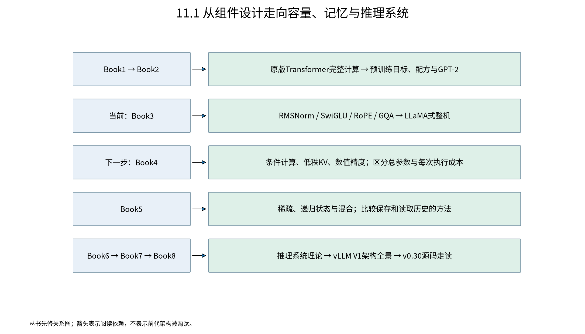
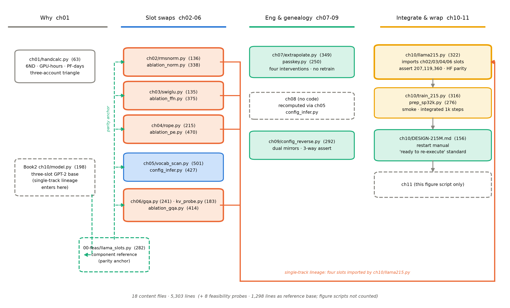

# 第 11 章 收束：组件化时代的判断力

## 11.0 开篇：从全书到这里

上一章把RMSNorm、SwiGLU、RoPE和GQA装入同一台207M教学模型，并用参数、数值与短训练记录检查连接是否符合预期。本章回到整册：我们究竟学会了怎样判断一次架构改造，又有哪些问题将交给下一册？

从GPT-2蓝本出发，关键并不在于记住四个新名字。我们逐步学会定位改动：函数的归一化方向、前馈中的乘性交互、位置对打分的影响，以及查询与KV投影的共享。每项变化都要说明接口、数学条件与资源代价，最后放回整机检查。

## 11.1 组件化是一种分析方法，不是架构停止演进

三代LLaMA保留了许多主要组件，因此可以在同一张结构图上比较。但数据规模、词表、GQA使用范围、位置与掩码都存在变化，不能把代际进步称为“架构完全不动”。Llama4又展示了专家前馈、交错注意力和多模态入口；仍能定位熟悉的部件，并不意味着新计算关系无关紧要。

组件接口清楚，使局部替换容易检查；不同组件的数值行为却会相互影响。RMSNorm改变输入尺度，SwiGLU响应受输入分布影响，RoPE与GQA共同参与打分，动态位置规则还可能改变缓存复用条件。只有把接口与这些依赖一起理解，“插件”才是有用的心智，而不是任意拼装的许可。

本书历史消融留下了正反两种结果。RMSNorm在full单种子设置中损失较高；SwiGLU和RoPE在所测条件下较低；减少KV头则付出不同质量与状态成本。它们帮助比较局部选择，但没有证明在207M整机、其他语料或更长训练中保留相同差值。表11.1将部件位置与需要判断的问题收拢在一起。

表 11.1 把这张定版清单再印一次。

表 11.1 插槽清单总表（摘要版；定版与逐项读数见第 10 章表 10.3，此处不重复证据链）

| 插槽 | 旧件 → 新件 | 改动章 | 一句话判词 |
|---|---|---|---|
| 归一化 | pre-LayerNorm → pre-RMSNorm（无 bias、eps 1e-5） | 第 2 章 | 减少显式中心化；函数不等价，训练结果依设置 |
| 前馈 | GELU-4C 两矩阵 → SwiGLU 三矩阵 $\tfrac83 C$ | 第 3 章 | 主矩阵预算对齐；所测任务有收益，执行成本另计 |
| 位置 | $w_{pe}$ 查表（1024 硬墙）→ RoPE 只旋 Q/K | 第 4 章 | 买相对位置，硬墙换软墙 |
| 注意力 | MHA → GQA（$h{=}16$、$h_{kv}{=}8$） | 第 6 章 | 共享键值表示，减少KV载荷并改变容量约束 |
| 出入口 | tied（50257）→ untied＋词表 32000 | 第 5 章 | 独立输入/输出表；两端合计31.6%，动机与效果分别检验 |

这张清单可以用于阅读新模型，也可以用于设计自己的实验。先指出改变的计算，再写出形状和资源变化，最后确认哪些性能结论有直接比较支撑。已有论文说明某个部件在特定条件下有效，不意味着选择它就免去了本模型的验证。

因此，本册的“组装”指把组件关系说明白并检验组合，不是宣布发明新架构已经结束。完整训练、单组件消融、固定输入对拍和参数核算各自解决不同问题；把它们互相补充，比把其中任何一种叫作全部正确性的证明更可靠。

## 11.2 四段旅程回望

判断落定，旅程倒带。导览 0.4 节把本册画成四段，现在每段收一句总账——与各章小结的「带走的心智」同源，此处只留最粗的一层，细账按段回看各章即可。

**第一段：为什么（第 1 章）。**公开权重、数据与完整配方分别决定可以开展哪些研究；Chinchilla 处方与推理预算合成「更少参数、更多数据」；6ND、GPU 时、吞吐三本账互证。带走的心智：**「更少参数、更多数据」不是省钱的配方，是换付款方向的配方——训练是一次性支出，使用是按 token 收的长期账单**；而 LLaMA采用了已有组件并提供整机训练实例，其后仍有多条架构探索路线。

**第二段：逐插槽改装（第 2-6 章）。**每章一次改造：限制→改造→消融验收，四刀加一次改造把 GPT-2 底座换成 LLaMA 式骨架；中途开立了推理时代的第一本账。带走的心智：**每一次改造买的都是一本账——归一化买简、前馈买同预算性能、位置买相对性、注意力买 KV 账本；而「换组件=换账本」的手艺（同预算、单变量、判据预注册、对拍）比任何单个零件都值钱**。其中最该留下的一句是第 6 章的灵魂：**不是 2017 错了，是账本变了**——训练侧与推理侧是两本账上的两个最优。

**第三段：工程与谱系（第 7-9 章）。**换完零件的新问题依次到场：窗能不能租（第 7 章四干预免重训对照：+1.14 nat 的软墙被三代配方分别压到 +0.44/+0.28/+0.24——最优是 YaRN-lite，温度独占 0.04 nat 的优势；租约要按窗重签）、这套组合为什么赢（第 8 章组装比较）、没有论文的模型怎么读（第 9 章 config 逆向全程演练）。带走的心智：**一张波长谱表针——一切外推配方都是对这排针的不同调法；一张可定位改动的整机图——结构与配方变化都需要具体核对；一份几 KB 的 config——它提供结构线索，但仍需与版本、实现和权重形状交叉核对**。

**第四段：整合与收束（第 10-11 章）。**四插槽 import 成整机、参数逐位 assert、冒烟点火、短训验管道、实权重装机，外加一份「重启即可执行」的设计文档。带走的心智：**每个零件都有出处、验收先于实现、预算不够时不假装——把一台机器的设计连同依据完整交出去，这份能力比机器本身长寿**。

四段连起来，正好回答导览开篇的问题「从 2019 年的 GPT-2 到今天的开源旗舰，机器到底换了什么」：换了四格插槽加一次改造，保留主要残差拓扑，同时检查投影、表示与缓存契约的变化；而每换一格，账本就重算一遍。导览 0.5 节许诺的三条贯穿线索在此收线——**代码线**从 Book2 底座长到 207M 整机与设计文档（细账见 11.5 节图 11.2）；**伏笔线**十笔旧账全清、九笔新钩埋定（细账见 11.3 节表 11.2）；**一本账**从参数账（124M 对到 207M 逐位，再升级成 config 反推的通用手艺）长成三本（加 KV 账与预算账）。

## 11.3 把跨册问题连接起来

前两册提出的模型问题在本册获得了更具体的机制解释。表11.2按问题而非管理编号索引：回到哪章查推导，哪些内容仍需后续知识。

表11.2 跨册问题与后续阅读位置。

| 设计问题 | 本册解释位置 | 后续去向 |
|---|---|---|
| K 与 V 拆开各自缓存：推理时代的账 | 第 6 章开篇四张欠条回放→增量算法+账本 probe 七 case 逐字节闭合 | 账的展开 → Book6 第 3/5 章 |
| 位置编码外推的半句承诺（may） | 第 4 章原理重估（v1-v5 无外推实验红线立此存照）+第 7 章工程全链 | 收束论 → Book5 第 8 章 |
| FFN 的门控思想（GLU 里冒头） | 第 3 章六年线兑现（2016 GLU→2023 定式） | FFN 下一次改造 → Book4 第 2-5 章 |
| 权重共享：绑与解的小开关 | 第 5 章四个配置样本（31.0%→3.89%→13.1%→21.3%；三篇论文沉默的负结论） | —（本册清账） |
| 缩 $d_k$ 伤质量的再解释 | 第 6 章 6.6 节三步论证收口 | 工程视角 → Book4 第 6 章（B3-2 同址） |
| 归一化零件自身的演化 | 第 2 章谱系收口（位置轴×函数轴合流于 pre-RMSNorm） | — |
| 学习式位置编码的 1024 位之墙 | 第 4 章结构性解除（wpe 越界报错具象化）+第 7 章硬墙→软墙 | — |
| 「绑与解」在下一代被反悔 | 第 5 章（与 F15 同址合并回收） | — |
| 「更少参数、更多数据」的开源第一单 | 第 1 章主场（动机五段+三笔账）+第 8 章第二落点（8B 档 $R\approx1{,}870$ 超处方 90 倍） | — |
| 上下文长度主线（F10 接力棒） | 第 7 章主场（出厂设定与训练后扩窗两条路在「加大 base」汇流）+第 6 章账本联动 | 1M 收束论 → Book5 第 8 章；账 → Book6 |
| warmup 的限制与 pre-LN | Book2 第 4 章已收；接力半句在第 2 章开篇（停药叙事续 N1） | — |
| 上下文长度：出厂设定 | Book2 第 12 章已登记；本册第6/7章展开 | — |
| 低精度与训练稳定化的处方 | 无本册落点（冻结线内不涉及） | Book4 第 7 章 |
| few-shot 的能力侧与系统侧 | 无本册落点 | Book5 第 10 章；Book6 第 6 章 |

后续阅读围绕三类问题展开。Book4继续研究参数容量与每次计算的分离：专家选择改变前馈执行，低秩表示改变KV参数化，低精度改变数值成本。Book5比较显式历史与递归状态怎样保存、检索和更新上下文，并讨论混合模型及能力评估。Book6则将状态和计算放入请求、批次、设备与服务预算中，解释缓存管理和执行效率。

同一段历史可以在模型层与系统层提出不同问题。GQA决定保存多少组表示，而分页决定怎样组织这些存储；扩窗改变模型可能读取的范围，而检索评估检查它是否真的用到了需要的信息。图11.1按这种先修关系展示后续路线。

图11.1 八册的知识依赖地图。Book3完成组件与整机；Book4、Book5继续改造计算和记忆，Book6–8把这些模型放入推理系统。后面三册的实践不要求先完成本册长训练。

## 11.4 两本账的移交与下一次改造

将这些组件重新放回整机，下一步需要区分参数、计算与状态三种成本。本册立起三本账，其中参数账与预算账是 Book2 的续账，KV 账是本册新开——它们在下一册的去向，决定了 Book4 与 Book6 的开场。

**KV 账本移交 Book6。**第 6 章开立的这本账（每 token 字节 $2Lh_{kv}d_kb$、权重常数与 KV 直线的剪刀差、7B 档并发 8 时 3,213 个 token 追平权重的锚点）在本册只做了第一件事：把账立准、并用 GQA 砍了一次改造单价。省它的完整经济学是 Book6 整册的经营对象：三股省法怎么拧、多条请求共处一份显存时缓存怎么摆放与回收（分页的账本）、以及「缓存经济学」作为服务侧的第一门课——机制一个字不在这里提前讲。移交的凭据也已备好：207M 短训 checkpoint可作为后续推理实践的同构候选；阅读Book6不以完成本册训练为前提，它的 KV 账 24 KiB/token、2048 窗单序列 48 MiB【证据等级：本书复算（第 6 章表 6.1 同源）】——从「造机器时的设计约束」到「用机器时的工程输入」，这本账换一个身份继续记。移交的入口也是实物级的：`DESIGN-215M.md` §10 的消费线衔接声明把服务对象写成了工程参数——参数 207M（bf16 权重约 414 MB）、KV 账 24 KiB/token，且 `state_dict` 键位与 HF 同名、strict 直搬即可加载。Book6 开工算容量账时不必回读本册正文，凭文档那一节就能把「引擎要伺候谁、显存要备多少」定下来——账本移交的完成态，是接账的人不必再回来问要账的人。顺带一句重启锚：207M 的历史实践未完成全量长训，重启不在书页里、在 `ch10/DESIGN-215M.md`——待高算力机器到位，凭文档直接重启（A100时间是40% MFU假设下的预算外推，不是换机后的保证，第 10 章表 10.4）。

**参数-算力账移交 Book4。**6ND 口径的三笔账（第 1 章立）、config 反推的通用参数公式（第 5 章式 (5.2)，第 9 章扩展到专家群与稠密混排的式 (9.1)）、以及「总账与活账两本分开记」的读法——这些工具在 Book4 会天天用，因为 Book4 的入场题正是一本账的悖论：**效率悖论**——总参数涨上去、单 token 成本降下来，两件事如何同时成立。第 9 章已经给过预告性的数字：Llama 4 Scout 总账 108.6B、活账 17.2B，两本账差六倍【证据等级：本书复算（三方逐位对拍，第 9 章 9.3 节）】——「17B-16E」这个名字里，前半是活账、后半是份数。顺手再钉一枚跨册的钉子：Book2 收官时清点过 GPT-2 124M 的 124,439,808，本册收官用同一门手艺对 207M 逐位、再扩展到专家与稠密混排——公式从式 (5.2) 长到式 (9.1)/(9.2)，长出来的每一项（untied 的 $2-\mathbb{1}_{\text{tied}}$ 开关、GQA 的 $h_{kv}$ 缩项、专家层的按层型分册）都是三册改装史在账本上的投影；手艺没变，账本在长。把这笔账从 config 事实推进到机制与训练，是下一册的正题。

**下一次改造在哪里。**第 10 章 10.6 节的展望句已经指过方向，这里原样重申：下一册在这台机器上动两刀——**前馈插槽换成专家群（MoE）、注意力做更低秩的折叠（MLA）**——刀口还是插槽，判断力还是表 11.1 那张清单。两刀都不凭空：前馈这刀，第3章已经指出「FFN 还会挨第二刀」，第 8 章读到了 Llama 3 拒绝它的稳定性证词，第 9 章登记了 Llama 4 落地它的 config 事实；注意力这刀，第 6 章立账时点过名——共享 KV 只是第一次改造，把 $h_{kv}\cdot d_k$ 本身折叠掉是更深的一次改造。你会带着完整的预备知识进场：读得懂路由器的账（式 (9.1) 已经算过 $dE$ 那一行）、算得清折叠后的 KV 字节（式 (6.2) 现成）、也记得 Llama 3 的警告——被拒绝的路线难在哪里，恰是开场要回答的问题。

## 11.5 册末清点：代码资产与术语表

最后清点两份可带走的资产。

**第一份是代码**——图 11.2 是全书代码资产的总览。正文代码 18 件、合计 5,303 行（另有 8 件可行性探针共 1,298 行作参考底座、各章图脚本不计入）【证据等级：本书统计（`wc -l`，2026-10）】，按四段旅程排布。这张图上最重要的两条线：橙色的是单轨主线的组装段——第 2/3/4/6 四章的插槽正件被 `ch10/llama215.py` 用四行 import 搬进整机，再交棒给设计文档，**改装史物理地写在 import 语句与依赖线里**；青色虚线是上游来路——Book2 第 10 章的 `model.py`（198 行，三插槽底座）进站后，配套组件库对应实现 `llama_slots.py` 作为对拍锚立起，各章的教学重写件逐一与它逐位一致。黄色的一列是终点的四件交付：整机、训练脚本、语料重切、设计文档。从 Book1 翻译机到 Book2 GPT-2 再到本册 207M，一条从 2017 到 2023 的代码史全程可跑——旅程停在任何一站，你手里都是一台当下完整的机器。这份资产与上一节的账本是同一件事的两面：账本记「为什么这样造」，代码记「造出来的实物」，设计文档把两者钉在一起——§3 的每个字段依据都能在 `llama215.py` 的 import 段与参数账 assert 里找到对应行。这也是代码清点放在收束章正文、而不沉到附录的原因：它就是本册交付的机器本体。

图 11.2 本册代码资产总览（自绘）：四列对应导览 0.4 的四段旅程；橙色线=单轨主线的组装段（第 2/3/4/6 章插槽正件→`ch10/llama215.py` 整机→设计文档），青色虚线=上游来路（Book2 底座与 `00-feasibility/llama_slots.py` 组件库对应实现——各章教学重写件的对拍锚），橙框=被整机 import 的插槽正件、蓝框=出入口插曲（ch10 内联实现）、灰虚框=无代码或仅图脚本的章；框内括号为实测行数（`wc -l`，2026-10）

**第二份是词汇**。汇总第 0-10 章全部术语首现处（「本书用语」为本册自创、无通行英译），沿 Book1/Book2 册末术语表格式列于下方，按首现章排序——它同时是全书索引的骨架。用法提示一条：首现列按字串在成稿中的实际第一次出现登记，它可能与概念正式下定义的章不同（如「组装学」首现第 1 章节题、定义在第 8 章）——检索时以首现为入口、以定义处为准。

| 术语 | 英文 | 首现 | 一句话定义 |
|---|---|---|---|
| 插槽 | slot | 导览 | Block 内可整件替换的子层位（归一化/前馈/位置/注意力四格，加出入口） |
| 现代开源骨架 | modern open skeleton | 导览 | 以LLaMA等模型为案例的现代稠密因果Transformer主体；并非所有后续模型唯一结构 |
| 组装（对发明） | assembly vs. invention | 导览 | 把不同年代组件论文各自验证的零件装进同一整机的造机方式（「组装学」见下——第 1 章节题首现） |
| 改装四连+附加一次改造 | （本书用语） | 导览 | 本册改动次序：norm/FFN/PE/注意力四插槽+出入口解绑 |
| KV 缓存 | KV cache | 导览（第 6 章正菜） | 逐 token 生成时保存旧位置 K/V 的账本；每层一对 $(B,h_{kv},n,d_k)$ |
| 分组查询注意力 | grouped-query attention, GQA | 导览（第 6 章正菜） | $h$ 个查询头按组共享 $h_{kv}$ 组 KV 头的注意力形态 |
| KV 账本 | KV ledger | 导览（第 6 章开立） | 每 token 字节 $=2Lh_{kv}d_k b$；权重常数对 KV 直线的剪刀差 |
| 证据等级 | evidence grading | 导览 | 官方论文＞技术报告＞config 逆向＞第三方复测＞社区配方＞厂商自报的随行标注 |
| 重启即可执行 | （本书用语） | 导览（第 10 章实物落地） | 设计文档标准：不依赖本书上下文、所有决策自带依据与出处 |
| 可复现性 | reproducibility | 第 1 章 | 给出足够的数据、配置与实现信息，使对应结果可被重复检验；与权重可下载及许可开放性分开 |
| 推理预算 | inference budget | 第 1 章 | 使用侧按 token 收的账单——「训练一次性、使用每天收」的下半本账 |
| 处方比 $R=D/N$ | （本书用语） | 第 1 章 | 平均每参数见过的 token 数；约20是部分研究范围的近似参照，不是固定最优常数 |
| GPU 时 | GPU-hour | 第 1 章 | 一张GPU运行一小时的设备时间；实际计算量还取决于型号与利用率（2048 卡×21 天≈103 万） |
| 组件-组装双轴时间线 | （本书用语） | 第 1 章 | 上轴组件论文、下轴组装代际的年谱（图 1.1） |
| 组装学 | assembly | 第 1 章（§1.5 节题） | 把各自验证过的零件装进同一整机、押预算证明组合成立的学问（第 8 章正式下定义） |
| 重中心化 | re-centering | 第 2 章 | LayerNorm 减均值的动作（输出对整体平移不敏感） |
| 重缩放 | re-scaling | 第 2 章 | LayerNorm 除波动的动作——RMSNorm 唯一保留的一件 |
| RMSNorm | root mean square layer normalization | 第 2 章 | 只重缩放的归一化：$x_i/\mathrm{RMS}(\mathbf{x})\cdot g$，$(B,n,C)$ 同形进出 |
| 均方根 | root mean square, RMS | 第 2 章 | 各分量平方平均再开方；恒等式 $\mathrm{RMS}^2=\sigma^2+\mu^2$ |
| 隐式学习率适配器 | implicit learning rate adaptor | 第 2 章 | 正整体缩放、零稳定项等条件下的梯度尺度关系；不能代替优化器与稳定性分析 |
| 位置轴/函数轴 | （本书用语） | 第 2 章 | 归一化演化的两根独立轴：post→pre 与 LayerNorm→RMSNorm |
| 判据预注册 | preregistration | 第 2 章立制（预注册）、第 3 章成词 | 判读规则先于运行落盘、结果无论方向照实报的实验制度 |
| 门控线性单元 | gated linear unit, GLU | 第 3 章 | $\sigma(xW)\odot xV$ 的双支路结构，门由数据自己学 |
| 乘性跳连 | multiplicative skip connection | 第 3 章 | 线性值支路不额外经过门函数导数，但仍经过投影，不是恒等梯度路径 |
| 二值硬门 | （本书用语） | 第 3 章 | ReLU 的重解读：$X\odot\mathbb{1}[X>0]$，开合由符号一次改造切 |
| SwiGLU | SwiGLU | 第 3 章 | 门上挂 SiLU 的三矩阵门控前馈：$(B,n,C)\to(B,n,\tfrac83 C)^2\to\odot\to(B,n,C)$ |
| SiLU（Swish） | SiLU / Swish | 第 3 章 | $x\sigma(x)$（$\beta{=}1$ 档）——「自己给自己当门」的函数 |
| 参数中性账 | （本书用语） | 第 3 章 | $3\cdot C\cdot\tfrac83 C=8C^2$：三矩阵缩维后与两矩阵同参数同乘加 |
| multiple-of 取整 | multiple-of rounding | 第 3 章 | $d_{ff}=\lceil\tfrac83 C\rceil_{256}$（mult 档先乘 1.3） |
| 悬案登记 | open-questions registry | 第 3 章（第 9 章制度化为五步末步） | 结果超出当前档位解释力时显式登记、交给地界正确的后续章/册，不猜——第 9 章把它制度化为五步法的末步（config 读不出什么显式写下） |
| 加性/乘性位置编码 | additive / multiplicative PE | 第 4 章 | 位置以 $x_i+p_i$ 相加进表示，对以旋转矩阵乘进打分 |
| 旋转位置编码 | rotary position embedding, RoPE | 第 4 章 | Q/K 投影后按位置旋转；固定未旋转Q/K时，显式位置旋转对内积只通过距离作用 |
| 块对角旋转 | block-diagonal rotation | 第 4 章 | $R^d_{\Theta,m}$：$d_k/2$ 个二维旋转块拼成的正交矩阵 |
| 波长谱/快慢指针 | wavelength spectrum | 第 4 章 | 第 $i$ 对维度的波长 $\lambda_i=2\pi/\theta_i$——外推工程的地图 |
| 长程衰减上界 | long-term decay upper bound | 第 4 章 | 含内容系数与尾项的Abel上界；有限区间部分和图不证明无条件远距衰减 |
| 实现三型 | three implementation styles | 第 4 章 | 复数相邻/实数相邻/两半式（rotate_half）：数学等价、权重互不通用 |
| 硬墙/软墙 | hard wall / soft wall | 导览表 0.2 预告、第 4/7 章立义 | 查表越界当场报错，对无查表可算但越窗质量塌 |
| partial RoPE / NoPE | partial RoPE / NoPE | 第 4 章（概念名） | 头维留一段不旋/完全不编码位置的研究方向（→Book5） |
| 绑定/解绑 | tied / untied embeddings | 第 5 章 | 出口投影复用或独立于入口嵌入：$N_{\text{vocab}}=Vd(2-\mathbb{1}_{\text{tied}})$ |
| 四个配置样本 | （本书用语） | 第 5 章 | tie 开关的当代史：GPT-2 绑→LLaMA 解→3-8B 回升→3.2-1B 回绑 |
| 字节回退 | byte fallback | 第 5 章 | 未知 UTF-8 字符拆成字节 token 的兜底（256 个字节位） |
| 词表三权衡 | （本书用语） | 第 5 章 | 嵌入参数占比 / token 效率 / 有效上下文 |
| 每字节比特数 | bits per byte, bpb | 第 5 章 | $\mathcal{L}/(\ln 2\cdot\beta)$——共同计量单位之一；仍须对齐原始文本、上下文与评分协议 |
| config 反推架构法 | config reverse-engineering | 第 5 章 | 认家族→重建图纸→算账对拍→读外围→证据分级的五步程序 |
| 参数账公式 | parameter ledger formula | 第 5 章 | $N=Vd(2-\mathbb{1}_{\text{tied}})+L(2d^2+2dh_{kv}d_k+3df+2d)+d$（式 (5.2)） |
| 幻影参数 | （本书用语） | 第 5 章 | 检查点缓冲被「÷2」口径误读的多出项（Llama-2-7B 的 4,096） |
| 增量生成 | incremental decoding | 第 6 章 | 因果性⇒旧 K/V 冻结⇒每步复用历史投影，只算新查询；全历史注意力累计仍有平方工作 |
| 一次读入/逐 token 生成 | （自然语言称呼） | 第 6 章 | prompt 整段一把前向对逐 token 追加生成——两段共用一本缓存 |
| 带宽（对算力） | memory bandwidth | 第 6 章 | 搬数据的钱——KV与权重读取可能限制生成速度，实际瓶颈依批量、长度与内核 |
| 多查询注意力 | multi-query attention, MQA | 第 6 章 | $h_{kv}{=}1$：全部查询头共享一组 KV，账直接除以 $h$ |
| 组内连号配对 | contiguous grouping | 第 6 章 | 第 $i$ 个查询头配第 $\lfloor i/g\rfloor$ 个 KV 头（$g=h/h_{kv}$，写错静默） |
| uptraining | uptraining | 第 6 章 | 检查点 mean-pool 改造+原配方 $\alpha$ 比例续训（GQA 论文配方） |
| repeat_kv | repeat_kv | 第 6 章 | $(B,h_{kv},n,d_k)$ 撑回 $(B,h,n,d_k)$ 的组内复制（expand 视图、reshape 真复制） |
| 账本变了 | （本书用语，心智句） | 第 6 章 | 「不是 2017 错了，是账本变了」：训练侧与推理侧两本账上的两个最优 |
| 训练后扩窗 | （本书用语） | 第 6 章末预告、第 7 章主场 | 预训练后调整位置规则，可配继续训练；本章冻结权重实验仅检验部分机制 |
| 位置插值 | positional interpolation, PI | 第 7 章 | 位置 $m\to m/s$：新窗缩小步长装进旧窗（全维均匀） |
| NTK-aware 缩放 | NTK-aware scaling | 第 7 章 | 只调 base：$b'=b\cdot s^{D/(D-2)}$，高频外推低频插值（社区配方等级） |
| YaRN | Yet another RoPE extensioN | 第 7 章 | by-parts 斜坡（$\alpha{=}1/\beta{=}32$）+温度 $\sqrt{1/t}=0.1\ln s+1$+渐进扩窗 |
| 注意力温度 | attention temperature | 第 7 章 | 打分除以 $t<1$ 再 softmax，改变分布集中程度；YaRN给出经验拟合，不能先假定所有插值都使分布变平 |
| 位置分桶 | position bucketing | 第 7 章 | 按位置段分别报 loss，把墙的位置量出来（钉在训练窗边界） |
| passkey 检索 | passkey retrieval | 第 7 章 | 长文埋针、末尾提问的检索协议（困惑度之外的第二口径） |
| 同窗税 | （本书用语） | 第 7 章 | 扩窗配方在原窗内付的分辨率代价（PI 最重：先付后租） |
| 出厂设定/扩窗 | factory setting / renting | 第 7 章 | 长上下文两条路：预训练花钱买，对训练后改参数租 |
| 正交性 | orthogonality | 第 8 章（组件义；第 4 章数学义另出——旋转矩阵的正交群性质） | 数学上的正交矩阵满足RᵀR=I；组件接口分离不意味着数值行为独立 |
| 插槽化时代 | （本书用语） | 第 1 章 §1.5 预告、第 8 章判断、第 11 章升格 | 以已有蓝本定位和比较组件变化的教学视角，不排除新架构探索 |
| 两段式 scaling law | two-stage scaling law | 第 8 章 | 在验证损失选出候选配置之后，关联预算、下游NLL与准确率的能力预测方法 |
| 有意过训练 | intentional over-training | 第 8 章 | 小档按使用预算刻意超处方喂 token（8B 档 $R\approx1{,}870$） |
| 插槽清单总表 | （本书用语，BOM） | 第 8 章（表 8.5 初版）/第 10 章（表 10.3 定版） | 插槽｜旧件｜新件｜改动章｜消融证据｜文献锚的六列判断记录 |
| 双镜像交叉 | dual-mirror cross-check | 第 9 章 | 从两个镜像逐项比对；可能共享上游，不能视为完全独立证据 |
| 双跳读法 | （本书用语） | 第 9 章 | config 读不出的字段过一遍参考源码补第二跳（如共享份、无参数 L2） |
| 总账/活账 | total / active parameters | 第 9 章 | 仓库里躺了多少对每 token 点亮多少（式 (9.1)/(9.2) 两本分开记） |
| 空字段默认接管 | （本书用语） | 第 9 章 | config 空表可能被类默认值接管——缺席不等于无机制 |
| 管道验收 | pipeline validation | 第 10 章 | 整合短训证明「机器在学」而非「学到了多好」（8.2M 对 4.3B token） |
| 一元分布熵参照 | unigram entropy | 第 10 章 | 指定语料的词频分布熵；不同验证分片下不能直接当作模型损失下界 |

## 11.6 本章小结：合上这本书

本册从一台熟悉的GPT式蓝本出发，沿归一化、门控、旋转位置、词表与KV头组织完成整机分析。关键数学既解释功能，也指出边界：稳定项影响尺度性质，乘性结构不等于恒等路径，旋转可算不等于能力外推，共享键值也不是删除完全相同的副本。

读新模型时，可以先画出表示流，定位改变的组件，再逐项核算参数、状态与计算。随后用正确的问题选择证据：公式证明什么、配置描述什么、代码实际怎样执行、实验又在哪些条件下测到了结果。这些层次连起来，才能形成可以迁移的架构判断。

Book4将沿两个熟悉的位置继续改造：前馈的条件计算与注意力的状态压缩，并加入低精度的数值分析。总参数变大而每次激活计算受控，究竟靠什么实现、付出什么代价，是下一册的起点。

## 11.7 动手验证（本章图表与复述自测）

- 跨册问题回顾（对照阅读）：把导览表 0.2 与本章表 11.2 并排逐行对读，核对每笔 F/N 钩的「本册处置」与对应章开篇回收句/章末欠账框的实际表述一致、九笔 B3 钩的埋设章与去向章闭合——这套「首尾对账」本身就是这套书的结构课。
- 复述自测（本章验收标准）：①能否不看书画出四格插座图并说出每格在本册的改动章与判词；②能否复述「插槽化时代的判断」的三路证据与三句判词；③能否说出两本账各自移交给谁、下一次改造动在哪两个插槽、凭哪些预备知识进场；④能否对一台陌生 config 走完五步反推并算出参数账——这是本册手艺的期末考。
