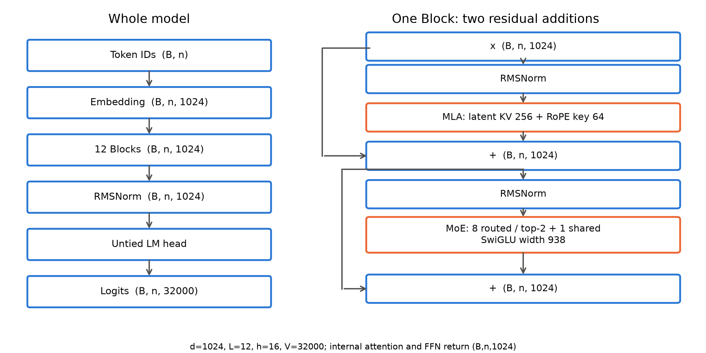

# 导览：在好骨架上动两刀

> 本章先给出路线与目标，具体推导和实验在后续章节展开。409M 与 3,840 个 KV 元素等数字来自第 9 章随书配置的参数与缓存账本；它们是结构计数，不是速度测量。带着一个问题读：**沿用同一副残差骨架，只替换前馈与注意力，参数容量、单 token 计算和缓存占用会怎样分别变化？**

上一册在收束处提出了下一步的方向（Book3 第 11 章 11.4 节）：将前馈层换成混合专家，将注意力换成多头潜在注意力，并继续分别检查收益、代价和证据。现在沿着这个方向继续。Book3 第 9 章已经算过路由器的参数，第6章已经建立KV字节账本，第8章还讨论了Llama 3对训练稳定性的权衡；但会计算参数，还不等于理解路由过程，GQA 的缓存公式也不能原封不动套到 MLA。本册从这些已知出发，逐步补上机制与条件，再看它们在真实模型中的形式，最后组装自己的模型。

在八册地图上，这是第四站：Book1 建立 Transformer 的基本结构，Book2 讨论预训练，Book3 逐组件构造 LLaMA 式骨架。本册继续考察规模与效率的关系：除了增加宽度和层数，还能否通过选择性计算扩充参数容量，通过改变注意力表示减少缓存？这里的“容量”首先指模型容纳的参数量，并不直接等于学到的知识或任务能力；后两者仍须训练与评测来判断。训练成本与使用成本都要计算，两项改造分别改变其中的若干部分。

> **最小背景栏**：本册只假设你完整读过 Book1-3——能独立写出 2017 年 Transformer（注意力三角色、因果掩码、FFN 数据流——Book1 第 3-7 章）、理解GPT-2的计算与训练（Book2 第 10-11 章）、理解它怎样逐组件改装成LLaMA式模型（四插槽+untied+KV 账本+五步法+外推线——Book3 第 2-11 章）。其余所需知识会在本册说明：混合专家（MoE，mixture of experts）与多头潜在注意力（MLA，multi-head latent attention）都会先教到「你能凭书稿画出它」再投入使用。

## 0.1 读完这本书，你会拥有什么

先说清目的地。读完本册，你会得到三项具体成果，以及一种理解模型的方法。

**第一，一台由 207M 骨架改造而来的 409M 两刀机，外加一份可重启的大项目设计文档。**残差流宽度、Block 外层拓扑、两处 pre-RMSNorm 和 untied 词表沿用 Book3；第 2—6 章分别构造 MoE 与 MLA，第 9 章通过 import 将它们装入整机。RoPE 的旋转规则仍然沿用，但施加位置改到 MLA 的解耦分支，MLA 内部还增加潜向量归一化。两项改造合起来，总参数为 409,115,648。配套历史实践包含启动、冒烟和短训曲线，没有完成全量长训（见 0.6 节）。设计文档保留数据、预算与重启步骤；再次训练前仍需核对依赖、数据和硬件条件。

**第二，MoE 与 MLA 的选型与成本判断力。**两者代表不同的效率设计，DeepSeek-V2/V3 将它们结合使用；本册也会看到只采用部分组件的模型。每项技术都按同样的顺序讨论：解决什么问题、结构怎样搭建、训练难点在哪里、引入哪些代价、怎样验证，以及历史模块实验观察到了什么。读完后，你应能说明某个插槽是否适合改造、候选配置如何比较，以及还缺少哪些证据才能作决定。

**第三，继续完善三本账。**参数账分成总参数与激活参数两种口径，先说明包含哪些权重，再讨论“47B 参数、13B 激活”这类数字；KV 账先数元素，再乘每元素字节数，分别适用于 GQA 的逐头 K/V 和 MLA 的压缩表示；预算账把 token 数、计算量和历史秒数联系起来。Chinchilla 提供的是特定稠密模型实验条件下的参考关系，不能直接成为 MoE 的最优训练定律。三本账贯穿各章，也用于检查旗舰发布时的成本说法。

还有一样是心智。半年后，你多半会忘记公式细节，但直观认识会留下——「容量与通行费分开记」「KV 从砍份数到砍每份的大小」「辅助目标与反馈路由可以共同调节负载」。每章小结都会回答同一个问题：**如果只允许你记住一件事，是什么？**

## 0.2 卷间契约：从 Book3 出发

册与册之间需要明确衔接：上一册提供了什么基础，本册新增什么知识，又改动什么结构。表 0.1 是本册与前三册的完整契约——需要确认内容位置时，可以回看这张表。

| 契约栏 | 明细 | 地址 |
|---|---|---|
| **已知基础**（三册已教，直接指回、不再重教） | Transformer 原典：注意力三角色/因果掩码/FFN 数据流/参数账本 | Book1 第 3-7 章 |
| | GPT-2 底座与训练五件套 | Book2 第 10 章 |
| | 工程账本（认病：spike 与梯度尺度诊断） | Book2 第 9 章 |
| | Scaling Laws 与 Chinchilla 处方（第 9 章预算底数） | Book2 第 8 章 |
| | RMSNorm（不动件） | Book3 第 2 章 |
| | SwiGLU（不动件——它将用于每个专家内部） | Book3 第 3 章 |
| | RoPE 机制（第 6 章解耦论证的前提） | Book3 第 4 章 |
| | untied 与词表（先区分共享权重与两张独立参数表，再约定激活参数统计范围） | Book3 第 5 章 |
| | KV 账本与 GQA | Book3 第 6 章 |
| | 外推工程线 PI/NTK/YaRN | Book3 第 7 章 |
| | 组装学（从插槽理解模型） | Book3 第 8 章 |
| | config 逆向五步法 | Book3 第 9 章 |
| | 207M 整机与训练配方 | Book3 第 10 章 |
| **本册新增** | 效率悖论与三口径账本 | 第 1 章 |
| | MoE 全链：机构→难题→Mixtral→DeepSeekMoE | 第 2-5 章 |
| | MLA：KV 低秩压缩/解耦 RoPE/权重吸收 | 第 6 章 |
| | 训练侧低精度（FP8/MXFP4）与稳定化组件（QK-Norm/Muon 系） | 第 7 章 |
| | 多 token 预测（MTP，multi-token prediction） | 第 8 章 |
| | DSV2→V3 整机演进账+两刀整合（大项目） | 第 9 章 |
| | 旗舰拆解实战：gpt-oss 精拆+旗舰速览表 | 第 10 章 |
| | LatentMoE 支线 | 第 11 章 |
| **架构修改**（两刀，逐一动刀） | 第一刀：dense FFN（SwiGLU 1024-2816-1024）→ MoE（8 路由专家 top-2+1 共享，专家宽 938；12/12 层全 MoE——首层稠密留作重启变体，第 9 章设计文档 §3） | 第 2-5 章 |
| | 第二刀：GQA（16Q/8KV）→ MLA（KV 联合压缩 $d_c$=256+解耦位置键 64） | 第 6 章 |
| | 沿用件：两处外层 pre-RMSNorm、残差流与 Block 拓扑；RoPE 保留旋转规则，MLA 内部新增潜向量归一化 | — |

表 0.1 卷间契约三栏（自排）

三栏分别说明不同的内容。已知基础=**本册不重教**，遇到 GQA、RoPE、五步法直接指回；新增一栏是正文主体。修改一栏体现了三册以来最克制的一次改造：Book3 动了四格加一刀，本册只动两格——**外层归一化与残差拓扑沿用 Book3，RoPE 在 MLA 中改变施加位置，前馈与注意力两格换件**——这些改造可以在真实模型中找到对应：第 4 章 Mixtral 的官方说明（与 Mistral 7B 同架构，唯一区别是每层由 8 个前馈块组成）、第 9 章 DeepSeek-V2/V3 的逐字段演进，动的正是这两格。两项改造按构造顺序展开：前馈结构独立，可以直接替换，所以先改；注意力与 KV 成本紧密相关，要接着算清这项成本再改。

## 0.3 先看一眼我们要造的机器

出发前先看目的地。图 0.1 是本册最终模型的整体示意图，沿用 Book3 图 0.1 的「插座图」图式——上一册换好的四件里，本册再动两件：橙色框标出了改动位置。

图 0.1 本册最终模型的整体与单层示意。左侧是从 token ID 到 logits 的整机路径；右侧展开一个 Block，橙色框标出 MoE 与 MLA，两个加法结点对应两条残差连接。几何取第 9 章主配置：$d=1024,L=12,h=16,V=32000$，输入表与输出头不共享；12 层全部采用 8 个路由专家、top-2、1 个共享专家，专家宽 938；MLA 的 KV 压缩维与查询压缩维均为 256，内容、RoPE 与值的每头维度均为 64。自绘教学示意，不表示实际并行调度。复现：运行随书 [make_fig0.py](code/ch00/make_fig0.py)，默认输出到工作区日志目录；组件细节见第 2、5、6 章。

沿数据流看一遍，记住两处改动的位置；第 2-6 章讨论各项改造时，都会回到这张图：

- **前馈插槽改变了执行方式（第一刀）**。原来的 dense SwiGLU（1024→2816→1024）每次完整参与计算；换成 MoE 后，路由器由 $(B n,1024)$ 得到 $(B n,8)$ 的分数，每个 token 选择 2 个路由专家并加权合并。每个专家内部仍是 SwiGLU，但宽度改为 938；另有 1 个同宽共享专家，每个 token 都经过它。12 层全部如此，主配置没有首层稠密例外。更多权重可以留在模型中，而每次只执行其中一部分。不过只换 MoE 并不会得到 409M：那是两项改造都完成后的结果。
- **注意力插槽改变了 KV 的表示（第二刀）**。原来的 GQA 由 16 个查询头共享 8 组 KV；MLA 先从层输入得到联合 KV 潜向量 $\boldsymbol c^{KV}\in\mathbb R^{B\times n\times256}$，以及独立的共享位置键 $\boldsymbol k^R\in\mathbb R^{B\times n\times64}$。压缩缓存保留前者归一化后的值与后者的位置信息。计算注意力时，可以显式恢复逐头 K/V，也可以通过权重吸收直接利用潜向量；第 6 章会证明这两条路径的等价条件。缓存表示变小，不等于所有中间张量都消失。

把两项改造放回整机，账本如下。总参数包含全部权重；本册的单 token 激活参数包含路由器、选中专家、共享专家、注意力、归一化与输出头，不计输入 embedding 整表。Book3 第 9 章曾采用包含两张词表的另一口径，跨册比较时须先统一。

| 结构 | 总参数 | 激活参数（上述口径） | 全部 12 层 KV 元素/token |
|---|---:|---:|---:|
| Book3 稠密前馈 + GQA | 207,119,360 | 174,351,360 | 12,288 |
| 只换 MoE，保留 GQA | 414,614,528 | 174,375,936 | 12,288 |
| MoE + MLA（本册最终模型） | 409,115,648 | 168,877,056 | 3,840 |

表 0.2 两次替换的独立结构计数，依据随书第 9 章配置与参数公式复算；不是训练效果或速度对比。采用同一 bf16 存储时，每 token 的缓存有效载荷由 24 KiB 降至 7.5 KiB，减少 68.75%；单请求长度 2,048 时对应 48 MiB 与 15 MiB。这里不含分配器、临时张量或服务引擎开销。第 9 章整机默认采用显式前向，本表表示其可用压缩表示的理论缓存账，并非已经测得增量解码占用。

回到图 0.1，两条残差连接和外层接口仍为 $(B,n,1024)\to(B,n,1024)$，所以新组件能够装入同一骨架。接口相同不意味着内部计算、权重或归一化都不变，也不意味着旧模型的权重能直接迁移。这里复用的是组件和构造方法；训练是否获益，还要看后续对照。

## 0.4 旅程地图：四段

全册分为四个阶段。需要确认当前内容的位置时，可以查看下表：

| 段 | 章 | 我们在做什么 | 一句话 |
|---|---|---|---|
| 为什么 | 第 1 章 | 效率悖论：建立三种成本口径的公式+各年代样本的计算核对 | 参数涨、单 token 成本降，如何同时成立 |
| 换前馈（第一刀） | 第 2-5 章 | 机构（路由/top-k/容量）→难题（负载/不稳定/损失税）→Mixtral 实证→DeepSeekMoE 三连 | 把一个大车间拆成一群小专家加一名调度员 |
| 换注意力与补件（第二刀） | 第 6-8 章 | MLA 数学全链→训练侧低精度与稳定化处方→MTP | KV 装进小箱子；训练侧的处方笺与第二目标 |
| 拆机与整合 | 第 9-12 章 | DSV2→V3 演进账+两刀整合（大项目）→gpt-oss 精拆与旗舰速览→LatentMoE 支线→收束 | 拆旗舰=检验本册全部组件 |

这个次序让拆解真实模型有据可依。第 1—8 章先建立成本口径，再依次解释路由、负载均衡、MLA、低精度与 MTP；第 9—12 章再把配置、组件和整机实验联系起来。读到一个字段时，既能指出它改变哪一步计算，也能找到公式、代码或对拍证据。自己实现组件是检验理解的一种方法，但并非分析模型的唯一前提。前几章的顺序同样服务于构造：先理解路由，才能看见负载问题；再讨论均衡方案，随后处理注意力表示与训练侧组件。

## 0.5 三条贯穿线索

全册有三条贯穿线索。沿着它们阅读，十三章的内容就能联系起来。

**一条代码线。**底座是 Book3 的组件库与 207M 整机构造方法。本册先用参考实现检查 MoE 与 MLA，再在第 2、5、6 章分别交付教学实现；历史 CPU 对拍记录与当时 transformers 5.18.0 的实现比较。第 9 章重新组装模型类，import Book3 的 RMSNorm/RoPE 和本册的 MoE/MLA，组件来源可追溯。章内模块实验各自构建模型，不是连续沿用上一章训练好的 checkpoint；代码的演进与权重的延续须分开。结构对拍也只说明所测配置、权重和输入下的数值一致性，不能代替训练效果验证。

**一条问题线。**前三册留下了前馈扩容、KV压缩和训练稳定性等问题。下表说明这些问题在哪一章继续，以及哪些需要模型理论之外的系统知识。

| 问题（一句话） | 本册动作 | 状态 / 后续去向 |
|---|---|---|
| 自回归串行：因果掩码的另一面 | 第 8 章回收训练侧半句（MTP：训练目标转身成为推理资产） | 推理侧半句 → Book6 第 16—17 章（起草与验证机制） |
| 文本之外的模态（Gemma3 出厂带视觉塔） | 第 10 章 Gemma3 行 config 事实边界注记（只计文本栈参数） | 视觉侧与能力扩展 → Book5 第 10 章 |
| FFN 的两刀：换激活、换专家 | 第 1 章开场+第 2-5 章全链（机构→难题→两代实证） | 本册回收 |
| 头数与 $d_k$ 的账本：推理时代翻转 | 第 6 章开篇「账本变了」第三段续写 | 本册回收（与KV压缩问题一起） |
| 低精度：从GNMT量化推理到训练数值格式 | 第 7 章回收训练侧半句（两张处方笺） | 推理侧半句 → Book6 第 12—13 章／Book8 第 24 章 |
| 低精度与训练稳定化的处方 | 第 7 章主场（Book2 认病，本册讨论方案） | 本册回收 |
| KV 的下一刀：$h_{kv}\cdot d_k$ 低秩折叠 | 第 6 章开篇（与 F16 同句，一次回收双钩） | 本册回收 |
| config 逆向五步法的复用 | 第 10 章主场（gpt-oss 精拆+旗舰速览表） | 读厂商自报数字手册 → Book5 第 11 章（保留地址） |
| Llama 3 拒绝专家群的稳定性权衡 | 第 3 章开场（拒绝引语=证词+本机负载现场） | 本册回收 |
| Llama 4 的 MoE 化 config 事实 | 第 2 章首次展开机制 | 本册回收 |
| few-shot 的能力侧与系统侧 | 无本册落点 | → Book5 第 10 章／Book6 第 7 章（前缀复用） |
| KV 三股省法／后训练链／外推哲学分岔／重启锚／头维「净土」 | 无本册落点（地址 Book3 已登记） | → Book5／Book6 |
| 注意力手术（窄窗与汇聚元）；线性与稀疏算子（MLA 开箱后的换算子战线）；2026 旗舰（LatentMoE 的发扬） | 第 6/10/11 章埋设 | Book5 第 2/6/7 章起 |
| 起草-验证（MTP 的推理侧身份）；推理侧量化（F18 下半程执行句） | 第 7/8 章埋设 | Book6 第 16—17 章与第 12—13 章；Book8 第 24 章 |
| MLA 引擎后端（箱子的读取落地）；分布式专家并行（专家铺卡的工程） | 第 2/6 章埋设 | Book7 第 8 章；Book8第11、18章（多卡基础另见第16—17章） |

表 0.3 跨册问题与后续阅读位置。这里只给出理解本册所需的导航，具体机制在各章展开；第 9 章另保留大项目重启入口。

**三本账。**参数、KV 和预算始终分开。参数账在第 1 章明确总量与激活量的统计范围；KV 账在第 6 章由 GQA 的 $2Lh_{kv}d_k$ 个元素转到 MLA 的 $L(d_c+d_h^R)$ 个元素，乘存储字节数后才能比较显存；预算账在第 9 章结合 token 预算、计算估计和历史耗时。路由负载则是连接这些账与实际执行的另一项观察：相同的激活参数量，也可能因专家分配不同而产生不同的通信和等待时间。

## 0.6 这本书的纪律与约定

五条纪律，读之前说清楚。

**本册的研究范围。**主要案例是Mixtral、DeepSeek-V2/V3、gpt-oss及相关组件论文。先讲条件计算和低秩表示，再讨论数值表示与训练目标；这几条路线相互配合，但并非唯一正确的模型配方。滑动窗口与汇聚元在本册只用于辨认配置，原理留给Book5；MTP的训练目标在本册展开，推理时怎样起草并验证由Book6接续。先修顺序服务于理解，不能被误读成模型只允许采用某些技术。

**大项目暂缓声明。**第 9 章没有执行全量长训。2026 年 10 月 Mac/MPS 历史实践交付了整合代码、参数逐项核对、冒烟检查、约半小时级短训，以及设计文档与重启手册。短训表明所测条件下模型能够运行并学习，不足以证明长期稳定性或与同规模稠密模型的最终质量差距。本轮修订的 CPU 局部复算另行标明，不将它们写成新的 MPS 性能结果。

**四框一栏，各司其职。**借用框（工具当黑盒用，算法另拆）、实现对照框（HF transformers 5.18.0 等现代实现对照，非论文内容）、考据框（版本考古、引文勘误——调研期已发现三处 ID 误引和多项讹传数字）、欠账框（通往后续册的钩子，每章至多两条）加每章开头的最小背景栏。框内是支线，主线永远在正文。

**每个数字都有出处与条件。**正文区分论文或技术报告、配置逆向、第三方复测、厂商自报，以及本书的算术复算和实验。来源的权威性不能代替适用条件：论文的结论要看比较对象，配置只能支持结构判断，厂商吞吐数字要连同硬件与批量阅读。历史实验以 CPU fp32 做数值对拍，以 Mac/MPS 记录计时和内存；各章给出相应命令与条件。正文中的示意数、理论计数和量化模拟均不称硬件实测。

**环境与先修。**先修为 Book1—3。配套历史实验运行于 48GB Apple Silicon 机器，复现受内存、依赖与数据可用性约束。训练实验提供缩档入口；静态计数、数值对拍和量化模拟各有自己的运行方式，并非每个脚本都有 fast/full 两档。历史模块消融采用单种子和预先登记的判据，MPS bf16 不保证逐位重现；预先约定比较条件有助于减少事后挑选结果，但不能替代重复训练和统计分析。随书仓库不包含数据或完整权重：需要它们的实验须按脚本说明准备并缓存到日志目录，纯结构与数学练习不必下载完整模型。真实权重对拍还受模型许可与可用内存限制，第 4 章将说明这些条件如何影响选型。

回到开篇：沿用残差骨架、替换两个插槽后，参数容量与计算、缓存的关系会怎样改变？先在第 1 章明确口径，再用第 2—5 章解释选择性执行，用第 6 章解释压缩表示，第 7—8 章补充数值表示与训练目标，最后在第 9—12 章回到整机。每次改造都要同时回答“省了哪一项”和“增加了什么代价”，而不能只从参数量判断好坏。

第一站接续前馈网络的演进。Book1 介绍了逐位置前馈网络，Book3 第 3 章将其改为门控结构，并把专家选择留给本册。一个更大的专家集合，怎样只执行其中一部分？它在什么比较条件下更省，收益又该如何验证？这项分析从 2017 年那篇比 Transformer 早五个月的稀疏门控 MoE 论文讲起。

从下一章开始，先区分参数容量与实际计算，再决定怎样改造前馈层。

---

*下一章：第 1 章 效率悖论——三本账分开记——总参数涨、单 token 成本降如何同时成立；从那篇比 Transformer 早五个月的论文算起，三口径账本立式，四枚年代样本自算对拍。*
